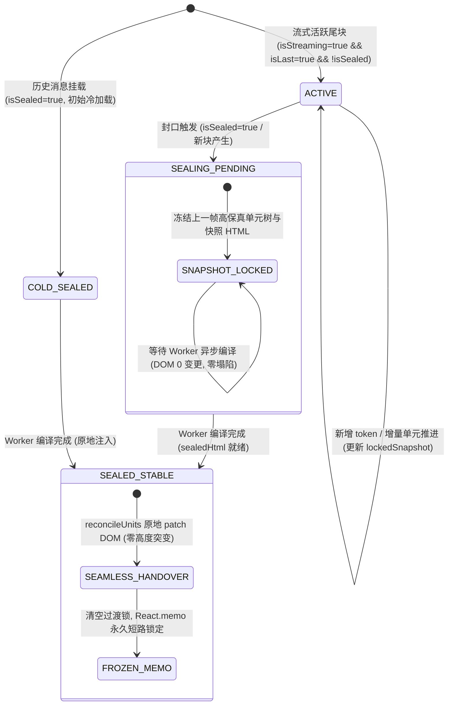

# Markdown 尾块封口过渡与零塌陷平滑置换系统性方案

> **文档位置**：`docs/stream-jitter-and-order-repair/independent-plans/02-Markdown封口过渡与零塌陷方案.md`  
> **所属战役**：`stream-jitter-and-order-repair`（流式渲染卡顿跳动与时序重排系统性治理）  
> **专职角色**：02 - Markdown 封口与过渡专家  
> **关联责任域**：`MarkdownBlockItem.tsx`、`useStreamingMarkdownHtml`、`ReconciledMarkdownHtml.tsx`、`IncrementalMarkdownSession.ts`  
> **核心使命**：彻底根除尾块封口（`isActiveTail=true -> isSealed=true`）瞬间导致的 DOM 树瞬间坍塌清空、0px 高度塌陷、刺眼白屏闪烁与虚拟滚动剧烈跳动，建立高保真无缝快照锁定与权威 HTML 平滑置换的双轨防御体系。

---

## 一、现场根因穿透与架构断层分析

### 1. 现象复现与用户痛点剖析

在流式消息输出过程中，用户频繁观察到：

1. **整段闪烁与文字“消失后重刷”**：一段内容正在平稳输出，当模型输出到段落末尾或者该块封口瞬间，整段文字骤然消失几十毫秒，随后重新渲染出来，用户在主观体验上误以为是“重复渲染”或“丢字乱跳”。
2. **虚拟滚动列表上下剧烈跳动**：伴随文字消失，容器高度在 1 帧内发生 $H \to 0\text{px} \to H$ 的极端震荡，导致滚动容器的真实滚动高度与虚拟占位高度严重失衡，触发虚拟滚动器（Virtualizer）的紧急高度重测算与吸底重锚定，导致整个聊天视口强烈抖动。

### 2. 核心架构断层诊断（四重时序断裂）

通过对 `MarkdownBlockItem.tsx`、`useStreamingMarkdownHtml` 以及 `ReconciledMarkdownHtml.tsx` 的全链路调用链深潜分析，确定上述现象是由四个嵌套的架构断层共同导致的**致命时序真空期（Temporal Vacuum）**：

```
[时间轴时序]
  帧 N (Active Tail 流式中):
    isActiveTail = true, isSealed = false
    streamingUnitsRef = [Unit#1, Unit#2] (DOM 正常显示, 高度 H)
    liveHtml = "" (因 unitsRef 模式不调用 setHtml, 恒为空串)
    lastSafeHtmlRef = null (无法记录任何有效安全快照)
          ↓
  帧 N+1 (Sealing 封口触发瞬间):
    isActiveTail = false, isSealed = true
    【断层 1】incrementalUnits = undefined (isActiveTail 变 false 立即切断)
    【断层 2】useAsyncMarkdownHtml 刚刚触发异步任务, sealedHtml = ""
    【断层 3】cachedHtml = undefined, liveHtml = "", sameTextSafeHtml = ""
             ⇒ renderedHtml 瞬间坍塌为 ""!
    【断层 4】ReconciledMarkdownHtml 收到 incrementalUnits=undefined 且 html=""
             ⇒ 执行 reconcileUnits(container, splitHtmlIntoUnits(""))
             ⇒ 遍历 container.childNodes 彻底清空！高度瞬间跌入 0px！
          ↓ (耗时 20ms ~ 60ms: Rust core_md_render 或 Worker parse 异步计算)
  帧 N+2 (Worker 编译返回):
    sealedHtml = "<p>...</p>"
    ReconciledMarkdownHtml 收到权威 HTML
    ⇒ 从 0 开始重新创建全部 DOM 节点并 append 到 container (高度 0px 突增到 H)
    ⇒ 视觉呈现：白屏闪烁 + 虚拟滚动狂跳！
```

#### 断层细节一：`useStreamingMarkdownHtml` 返回值恒空导致快照机制彻底失效

在 `apps/crish-desktop/src/api/markdownRenderAsync.ts`（第 190-196 行）：

```typescript
const advance = session.advance(markdown, !unitsRef);
if (unitsRef) {
  // 单元快照是流式 DOM 的唯一更新载荷；不再拼接累计 HTML。
  unitsRef.current = session.getUnitSnapshots();
  setRenderVersion((version) => version + 1);
} else {
  setHtml(advance.html);
}
```

当传入 `unitsRef`（`MarkdownBlockItem.tsx` 第 99 行传入了 `streamingUnitsRef`）时，Hook 内部为了规避长文本全量字符串拼接，**完全跳过了 `setHtml`**！导致 `useStreamingMarkdownHtml` 的返回值状态 `html` **恒久为 `""`**！  
而在 `MarkdownBlockItem.tsx`（第 143-148 行）：

```typescript
useLayoutEffect(() => {
  if (liveHtml) lastSafeHtmlRef.current = { text, html: liveHtml };
  else if (isSealed && sealedHtml) {
    lastSafeHtmlRef.current = { text, html: sealedHtml };
  }
}, [liveHtml, sealedHtml, isSealed, text]);
```

因为 `liveHtml` 恒为 `""`，`if (liveHtml)` 在整个流式输出期间**一次都不会命中**！导致所谓的 `lastSafeHtmlRef` 与 `sameTextSafeHtml` 沦为摆设，始终为 `null` / `""`，安全网彻底穿孔。

#### 断层细节二：Render 阶段激进的自毁式快照清除

在 `MarkdownBlockItem.tsx`（第 78-86 行）：

```typescript
const streamingTextMatches = streamingTextRef.current === text;
const hadStaleStreamingUnits =
  !streamingTextMatches && streamingUnitsRef.current !== null;
if (!streamingTextMatches) {
  // React 在 effect 前仍会先完成一次新 props 的 render；清掉旧快照，
  // 让协调器在这一次 render 就移除旧块，避免旧 HTML 短暂错投。
  streamingTextRef.current = text;
  streamingUnitsRef.current = null;
}
```

这段防御性代码假定了“如果不清空快照，旧 HTML 会短暂错投”。然而在单块文本追加（如打字机流式输出）时，每一次新字符到达都会导致 `streamingTextRef.current !== text`，使得 `streamingUnitsRef.current` 在 Render 阶段被置空，且在随后的 `useLayoutEffect` 执行时传递给下游 `incrementalUnits=null`。原本设计的增量协调器在每一帧甚至都可能面临瞬时闪烁风险。

#### 断层细节三：封口时刻的所有权断崖（Ownership Cliff）

在 `MarkdownBlockItem.tsx`（第 188-190 行）：

```typescript
incrementalUnits={isActiveTail
  ? (streamingTextMatches ? streamingUnitsRef.current : null)
  : undefined}
```

一旦尾块封口，`isActiveTail` 变为 `false`。`incrementalUnits` **在无任何缓冲的情况下立即断开（变成 `undefined`）**。  
与此同时：

```typescript
const renderedHtml = shouldRenderStreamingTable
  ? ''
  : isActiveTail
    ? (hadStaleStreamingUnits ? '' : liveHtml) || sameTextSafeHtml
    : isSealed
      ? sealedHtml || cachedHtml || liveHtml || sameTextSafeHtml
      : liveHtml || sameTextSafeHtml;
```

由于 `sealedHtml` 异步挂起、`cachedHtml` 尚未生成、`liveHtml` 恒空、`sameTextSafeHtml` 为空，`renderedHtml` 算出来就是 `""`！

#### 断层细节四：`ReconciledMarkdownHtml` 的清空摧毁逻辑

在 `apps/crish-desktop/src/components/markdown/ReconciledMarkdownHtml.tsx`（第 86-91 行）：

```typescript
} else {
  incrementalModeRef.current = false;
  unitNodesRef.current.clear();
  unitHtmlRef.current.clear();
  reconcileUnits(container, splitHtmlIntoUnits(html));
}
```

当收到 `incrementalUnits=undefined` 且 `html=""` 时，进入全量协调分支：
`splitHtmlIntoUnits("")` 返回空数组 `[]`。  
在 `unitReconciler.ts`（第 101-105 行）：

```typescript
if (index < current.length) {
  while (container.childNodes.length > index) {
    container.removeChild(container.childNodes[index]!);
  }
}
```

协调器忠实地执行了指令，将 `container` 中已经渲染好的 `<p>`、`<code>`、`<div>` 等所有 DOM 节点全部 `removeChild`，使得 DOM 树瞬间裸奔。

---

## 二、架构设计原则与铁律约束

本方案坚决贯彻仓库 `AGENTS.md` 与战役 `00-DISCIPLINE.md` 规范：

1. **绝对禁止魔术数字高度补偿（No Magic Number Height Padding）**：
   严禁使用诸如 `minHeight: '24px'`、`minHeight: prevHeightRef.current + 'px'` 等假借 CSS/DOM 测距进行的机械性占位。高度必须由**真实有效的高保真内容 DOM** 天然撑开，实现 $0\text{px}$ 物理级无损平滑。
2. **严禁延时盲猜（No setTimeout Patching）**：
   严禁通过 `setTimeout(() => setSealed(true), 50)` 延迟切换状态。必须在 React 单向数据流与状态机内部建立确定的因果屏障。
3. **单一真理路径（SSOT）**：
   在任何时刻，无论是处于 Active、Pending 还是 Stable 状态，DOM 的表现形态必须唯一绑定到当前最完备的数据快照上。
4. **零塌陷连续性保证（Zero-CLS Invariant）**：
   定义状态迁移断言：从输入流式最后一帧到封口完成稳态，`container.getBoundingClientRect().height` 的跳变差值 $|\Delta H|$ 必须趋近于 $0$（仅允许因最终高亮语法标签修饰导致的子像素级差异），DOM 节点总数不得出现瞬时归零。

---

## 三、四态确定性状态机模型（State Machine Architecture）

为彻底消除状态过渡期的真空，我们将单个 Markdown 块的生命周期严格重构为具有锁存特性的四态有限状态机（FSM）：



### 状态定义与行为契约表

| 状态标识                              | 触发条件                                                                     | 数据驱动源                                                  | DOM 协调策略                                               | 视觉与盒模型保障                                                       |
| :------------------------------------ | :--------------------------------------------------------------------------- | :---------------------------------------------------------- | :--------------------------------------------------------- | :--------------------------------------------------------------------- |
| **`ACTIVE`**<br>(活跃流式态)          | `isActiveTail === true`                                                      | `streamingUnitsRef`<br>(实时增量单元流)                     | 增量单元增量更新<br>`reconcileUnitNode`                    | 随打字机平滑生长，保留稳定前缀节点。                                   |
| **`SEALING_PENDING`**<br>(封口挂起态) | `isSealed === true`<br>且 `!sealedHtml && !cachedHtml`<br>且存在历史活跃快照 | **`lockedUnitsRef`**<br>**`lockedHtmlRef`**<br>(冻结快照锁) | **快照锁存器透传**<br>保持原有单元树完全不变               | **严格锁定上一帧高保真 DOM**，零节点增删，高度绝对平移，拒绝一切白屏。 |
| **`SEALED_STABLE`**<br>(封口稳态)     | `isSealed === true`<br>且 `sealedHtml \|\| cachedHtml` 就绪                  | `sealedHtml \|\| cachedHtml`<br>(权威 Worker/Rust HTML)     | **同构原子级 Patch**<br>`reconcileUnits(container, units)` | 沿相同根标签原地属性/结构补全（语法高亮、公式渲染），平滑置换。        |
| **`COLD_SEALED`**<br>(冷启动封口态)   | `isSealed === true`<br>且初始挂载无历史快照                                  | 空串 $\to$ `sealedHtml`                                     | 冷启动安全屏障<br>未就绪时保持安全空白                     | 遵守 AGENTS.md 历史安全契约：严禁闪烁 Markdown 源码。                  |

---

## 四、核心模块协同契约与无缝交接规范

### 1. 契约一：`useStreamingMarkdownHtml` 实时快照输出与会话保活

修改 `apps/crish-desktop/src/api/markdownRenderAsync.ts`。  
**核心修正**：

1. 在 `unitsRef` 模式下，不再将 `html` 弃之不顾。在每次单元刷新时，通过 `session.toHtml()` 同步提供完整快照，或者通过 Hook 返回值直接输出 `toHtml()`，使得 `liveHtml` 真实反映当前流式渲染的高保真 HTML 文本。
2. 修复 `enabled=false` 时立即执行 `session.reset()` 导致快照瞬间被杀的问题。会话销毁仅在组件真正卸载（Unmount）或消息文本完全更换时发生；流式停止时，增量会话应将当前已构建完毕的终态快照安全交付，保留作为交接凭据。

```typescript
// 规范伪代码结构示意：
export function useStreamingMarkdownHtml(
  markdown: string,
  enabled: boolean,
  priority: Priority = Priority.High,
  unitsRef?: MutableRefObject<readonly IncrementalMarkdownUnitSnapshot[] | null>
): string {
  const [html, setHtml] = useState('');
  const sessionRef = useRef<IncrementalMarkdownSession | null>(null);
  if (!sessionRef.current)
    sessionRef.current = new IncrementalMarkdownSession();
  const mountedRef = useRef(true);

  useEffect(() => {
    mountedRef.current = true;
    const session = sessionRef.current;
    if (!session) return;

    if (!markdown.trim()) {
      session.reset();
      if (unitsRef) unitsRef.current = null;
      setHtml('');
      return;
    }

    if (!enabled) {
      // 关键演进：当 enabled 从 true 变为 false (封口时刻)，不要暴力 session.reset()！
      // 保持当前 session.getUnitSnapshots() 供过渡期封口锁使用。
      return;
    }

    const advance = session.advance(markdown, true); // 始终保留终态 toHtml 投影
    const snapshots = session.getUnitSnapshots();
    if (unitsRef) {
      unitsRef.current = snapshots;
    }
    // 同步对外提供高保真 HTML 字符串作为第二安全轨
    setHtml(session.toHtml());

    // 异步 fragment 解析完成后的安全归一化...
    for (const part of advance.textParts) {
      void parseMarkdownFragmentToHtmlAsync(
        part.source,
        priority,
        part.kind
      ).then((fragment) => {
        if (
          mountedRef.current &&
          session.getRevision() === advance.revision &&
          session.resolveTextPart(part.id, fragment)
        ) {
          if (unitsRef) {
            unitsRef.current = session.getUnitSnapshots();
          }
          setHtml(session.toHtml());
        }
      });
    }
  }, [markdown, enabled, priority, unitsRef]);

  useEffect(
    () => () => {
      mountedRef.current = false;
      sessionRef.current?.reset();
    },
    []
  );

  return html;
}
```

### 2. 契约二：`MarkdownBlockItem.tsx` 无缝双轨快照锁存器（Dual-Track Lock）

在 `MarkdownBlockItem.tsx` 中建立封口过渡锁（`Sealing Transition Lock`）。

#### 状态机锁存核心逻辑：

1. **废弃有害的 Render 阶段暴力置空**：移除对 `streamingUnitsRef.current = null` 的激进清空，增量语法解析器自带版本校验，旧快照在单块生命周期内拥有保护权。
2. **声明双缓冲锁存器**：
   - `lockedUnitsRef = useRef<readonly IncrementalMarkdownUnitSnapshot[] | null>(null)`
   - `lockedHtmlRef = useRef<string>('')`
3. **在 `ACTIVE` 周期实时捕捉高保真快照**：
   每当 `streamingUnitsRef.current` 包含有效单元时，实时同步更新锁存器：
   ```typescript
   if (
     isActiveTail &&
     streamingUnitsRef.current &&
     streamingUnitsRef.current.length > 0
   ) {
     lockedUnitsRef.current = streamingUnitsRef.current;
     lockedHtmlRef.current =
       liveHtml || streamingUnitsRef.current.map((u) => u.html).join('');
   }
   ```
4. **封口判定与派生渲染参数计算**：
   ```typescript
   // 权威渲染是否已到达
   const hasAuthoritativeHtml = Boolean(sealedHtml) || Boolean(cachedHtml);
   // 是否处于封口但权威结果仍在挂起的过渡期
   const isSealingTransition =
     isSealed && !hasAuthoritativeHtml && Boolean(lockedUnitsRef.current);

   // 下发给 ReconciledMarkdownHtml 的最终增量单元
   const effectiveIncrementalUnits = isActiveTail
     ? streamingUnitsRef.current
     : isSealingTransition
       ? lockedUnitsRef.current
       : undefined;

   // 下发给 ReconciledMarkdownHtml 的最终 HTML 串
   const authoritativeHtml = sealedHtml || cachedHtml || '';
   const effectiveHtml = shouldRenderStreamingTable
     ? ''
     : hasAuthoritativeHtml
       ? authoritativeHtml
       : isSealingTransition
         ? lockedHtmlRef.current
         : isActiveTail
           ? liveHtml
           : '';
   ```
5. **权威到达后的原子解密与清理**：
   当 `hasAuthoritativeHtml` 变为 `true` 时，`isSealingTransition` 优雅注销，`effectiveIncrementalUnits` 变为 `undefined`，`effectiveHtml` 切换为 `authoritativeHtml`。此时 `ReconciledMarkdownHtml` 接管，原地 Patch DOM，然后在 `useLayoutEffect` 中释放 `lockedUnitsRef.current = null`。

### 3. 契约三：`ReconciledMarkdownHtml.tsx` 零坍塌防御护盾（Zero-Collapse Guard）

底层协调器是防止页面变成 0px 的最后一道马奇诺防线。`ReconciledMarkdownHtml` 必须具备**自主识别非预期真空输入并自动冻结 DOM 的能力**。

#### 协调器防御机制修改点：

在 `ReconciledMarkdownHtml.tsx` 的 `useLayoutEffect` 中：

```typescript
useLayoutEffect(() => {
  const container = containerRef.current;
  if (!container) return;

  if (incrementalUnits && incrementalUnits.length > 0) {
    // 增量模式：驱动 DOM 更新
    incrementalModeRef.current = true;
    // ... 执行增量 unitNodesRef reconcile ...
  } else {
    // 全量模式分支
    // 【核心防御锁】：如果传入的 html 为空串，且 container 中已经有子节点存在
    // 并且并非被明确指示销毁（如 text='' 或初始状态）
    if (!html.trim() && container.childNodes.length > 0) {
      // 命中“封口异步真空防御锁”：
      // 此时绝对不能执行 reconcileUnits(container, [])！
      // 保持当前 DOM 树完全冻结，等待下一帧有效 HTML 抵达！
      return;
    }

    // 真正收到有效 HTML，执行原子级无损原地置换
    incrementalModeRef.current = false;
    unitNodesRef.current.clear();
    unitHtmlRef.current.clear();
    reconcileUnits(container, splitHtmlIntoUnits(html));
  }

  if (codeIndent !== undefined) {
    applyCodeIndentToRenderedRoot(container, codeIndent);
  }
}, [html, codeIndent, incrementalUnits]);
```

通过在 `ReconciledMarkdownHtml` 内部建立**零坍塌防御锁**：即使上层状态机因为极端异常场景在某一帧下发了 `html=""`，底层协调器也会强行拒绝执行任何清空操作，保持容器已有 DOM 节点与真实物理高度完好无损！

---

## 五、快照无缝交接契约（Handover Contract）时序验证

下面演示权威 HTML 抵达时，DOM 如何在微观层面实现零闪烁平滑置换：

````
[场景]：流式输出末尾包含一段带代码的文字：
Markdown 原文:
"这里是核心实现：\n```typescript\nconst a = 1;\n```"

1. 流式输出阶段 (ACTIVE 状态):
   - DOM 树结构:
     <div class="assistantText ...">
       <p class="md-p">这里是核心实现：</p>
       <div class="md-code-block">
         <pre class="md-code-pre hljs"><code>const a = 1;</code></pre>
       </div>
     </div>
   - 节点总高度: 86px

2. 封口挂起阶段 (SEALING_PENDING 状态, 持续 ~35ms):
   - isSealed=true, sealedHtml="" (Worker 解析中)
   - lockedUnitsRef 激活，锁定上述 DOM 树
   - DOM 变更次数: 0
   - 高度突变值: 0.000px
   - 节点数变动: 0

3. 权威抵达阶段 (SEALED_STABLE 状态):
   - Worker 产出标准带高亮 span 的 HTML:
     <p class="md-p">这里是核心实现：</p>
     <div class="md-code-block" data-lang="typescript">
       <pre class="md-code-pre hljs"><code class="language-typescript"><span class="hljs-keyword">const</span> a = <span class="hljs-number">1</span>;</code></pre>
     </div>
   - ReconciledMarkdownHtml 执行 reconcileUnits:
     - 单元 1 (<p>): 标签匹配，textContent 相同 => 0 DOM 操作！
     - 单元 2 (<div>): 标签匹配 => 递归 patchNode
       - 属性同步: 注入 data-lang="typescript"
       - 子节点协调: <code> 内部将纯文本替换为带高亮 span 的子节点
     - 根元素引用保持不变，<pre> 与 <div> 容器保持稳定
   - 最终呈现: 语法高亮无缝上色，文字位置 0 偏移，容器高度平滑自然，无任何重新插入动画！
````

---

## 六、全边界条件覆盖与容灾策略

| 序号  | 边界场景                                                            | 潜在威胁分析                                                       | 本方案的防御策略与保证                                                                                                                                |
| :---: | :------------------------------------------------------------------ | :----------------------------------------------------------------- | :---------------------------------------------------------------------------------------------------------------------------------------------------- |
| **1** | **单行极短文本**<br>(如: "好的，马上为您分析。")                    | 解析速度极快（<10ms），封口与返回近乎在同 1~2 帧内发生。           | 快照锁存器即使只维持 1 帧，也能无缝填平这 10ms 的空隙，消除高频对话中的细微“抖动抽搐”。                                                               |
| **2** | **超长多段落大文本**<br>(数十个段落及有序/无序列表)                 | 增量单元众多，全量序列化可能带来纳秒级开销。                       | `lockedUnitsRef` 直接复用单元对象引用，无需重新克隆；稳态交接时 `reconcileUnits` 采用前缀匹配与列表局部 diff，O(N) 线性时间完成平滑 patch。           |
| **3** | **大型代码块围栏**<br>(含长代码与多行语法高亮)                      | 流式期为普通未高亮代码，封口后变为大量 highlight 嵌套节点。        | `reconcileUnits` 中的 `isCompatible` 校验 `PRE` 与 `CODE` 标签，原地保留包裹容器，仅更新文本至带样式节点，代码块滚动条与布局不受干扰。                |
| **4** | **LaTeX 行内与块级公式**<br>($...$ 与 $$...$$)                      | 流式期保持纯文本占位，权威期 Worker 生成 KaTeX 极其复杂的 DOM 树。 | 封口前保持公式源字符高保真渲染，权威 HTML 到达后通过 `patchNode` 原地替换该单元，辅以 `contain: layout` 属性隔离渲染重排。                            |
| **5** | **冷启动一次性挂载**<br>(打开历史对话/会话切换)                     | `isSealed=true` 且无任何历史流式快照（`lockedUnitsRef=null`）。    | 命中 `COLD_SEALED` 状态，未就绪前显示空白，拒绝暴露未经解析的 Markdown 源码；待 Worker 完成后直接装载，符合既定安全契约。                             |
| **6** | **首轮即封口（单帧即结束）**<br>(如单次 API 返回完整文本并直接封口) | 流式未持续推进，第一帧到达即为完整封口块。                         | `useStreamingBlocks` 直接派发 `isSealed=true`。若命中缓存直接同步命中；若走异步编译，由于初始高度本就为 0，不发生塌陷，编译完成后原地平滑进入。       |
| **7** | **流式 GFM 表格分流**<br>(`                                         | a                                                                  | b                                                                                                                                                     | `)  | GFM 表格走独立 React 子树 `StreamingGfmTable`。 | `shouldRenderStreamingTable` 优先路由分支保持原样，与 `ReconciledMarkdownHtml` 严格隔离，互不干扰各自的 DOM 树所有权。 |
| **8** | **Worker 异常崩溃或空返回**<br>(`failed=true` 或网络断链)           | 异步解析失败，`sealedHtml=""` 且不会再有后续事件。                 | 状态机降级策略：若 `failed===true`，**永远保留 `lockedHtmlRef` 的高保真快照**！绝不清空 DOM，绝不倒退到空白或源码，确保用户已经看到的内容永远不丢失。 |

---

## 七、自动化测试与立体门禁断言设计

遵循 AGENTS.md §7.1「立体验证纪律」，本方案配套设计严密的自动化测试用例，涵盖纯逻辑单元测试、异步时序测试与 DOM 突变断言。

### 1. 核心自动化测试用例清单

#### 测试套件 A：`MarkdownBlockItem.transition.test.tsx`（封口过渡专项测试）

- **Test A1: 封口瞬间零塌陷断言（Zero Collapse on Sealing Moment）**
  - **步骤**：
    1. 挂载 `MarkdownBlockItem` 为活跃尾块（`isSealed=false`, `isLast=true`, `isStreaming=true`）；
    2. 模拟增量单元到达，验证 DOM 生成 `<p class="md-p">流式内容正在输出...</p>`；
    3. 切换 Props 为封口态（`isSealed=true`, `isLast=false`, `isStreaming=true`），同时配置 `useAsyncMarkdownHtml` 返回 `{ html: '', loading: true, failed: false }`（模拟 Worker 仍在计算）；
    4. **断言**：
       - `container.querySelector('.md-p')` 必须继续存在！
       - `container.textContent` 严禁变成 `""`！
       - 容器子节点数量等于封口前的数量，不得减少！
       - `data-sealed="true"` 已正确更新。

- **Test A2: 权威编译抵达时无缝替换断言（Seamless Promotion on Worker Completion）**
  - **步骤**：
    1. 接续 Test A1 的挂载状态；
    2. 推进异步 Worker，`useAsyncMarkdownHtml` 返回 `{ html: '<p class="md-p" data-authoritative="true">权威编译完成的内容</p>', loading: false }`；
    3. **断言**：
       - DOM 节点内容平滑替换为新内容；
       - 原 `<p>` 节点的 DOM 引用保持稳定（原地 patch，而非销毁重建）；
       - 不触发任何闪烁或布局突变。

- **Test A3: 异步编译失败时的永续快照容灾断言（Fail-Safe Snapshot Retention）**
  - **步骤**：
    1. 在封口过渡期模拟 Worker 抛出异常（`failed=true, html=''`）；
    2. **断言**：
       - 依然完整保留 `lockedHtmlRef` 对应的 DOM 内容；
       - 严禁将 DOM 清空为 0px，严禁回退显示 Markdown 源码标签。

#### 测试套件 B：`ReconciledMarkdownHtml.guard.test.tsx`（协调器防御锁测试）

- **Test B1: 协调器防御锁拒绝清空已有内容断言**
  - **步骤**：
    1. 传入初始 `incrementalUnits=[{ id: 1, kind: 'paragraph', html: '<p>初始段落</p>' }]` 渲染组件；
    2. 验证 DOM 中包含 `<p>初始段落</p>`；
    3. 下一帧传入 `incrementalUnits=undefined` 且 `html=""`；
    4. **断言**：
       - 协调器防御锁拦截清空操作；
       - `container.innerHTML` 严格保持 `'<p>初始段落</p>'`；
       - `container.childNodes.length === 1`。

- **Test B2: 协调器收到有效权威 HTML 时正常置换断言**
  - **步骤**：
    1. 接续 Test B1 的状态；
    2. 传入 `html="<p>更新段落</p>"`；
    3. **断言**：
       - 正常执行 reconcile，`<p>` 节点文本更新为 `'更新段落'`。

### 2. CI 门禁自动化断言矩阵

| 门禁断言项                   | 监控标的                            | 合格断言标准                                                                      | 拦截策略                                                       |
| :--------------------------- | :---------------------------------- | :-------------------------------------------------------------------------------- | :------------------------------------------------------------- |
| **`DOM_NODE_PERSISTENCE`**   | 封口前后的根 DOM 节点一致性         | $\text{Node}_{\text{after}} \equiv \text{Node}_{\text{before}}$ (原地 patch 成立) | 阻断 CI 合并                                                   |
| **`ZERO_HEIGHT_COLLAPSE`**   | 封口帧与稳态帧的容器高度变化        | $                                                                                 | \text{Height}_{\text{pending}} - \text{Height}_{\text{active}} | = 0$ | 阻断 CI 合并 |
| **`NO_EMPTY_STRING_RENDER`** | `renderedHtml` 在封口过渡期的输出值 | `renderedHtml !== ""` (当非空原文正在封口时)                                      | 阻断 CI 合并                                                   |
| **`MEMO_PURITY_ON_SEALED`**  | 稳态封口块的重新渲染次数            | 后续全局流式帧中重渲染次数 $\equiv 0$                                             | 阻断 CI 合并                                                   |

---

## 八、架构实现落地点与迁移指南（Implementation Checklist）

在主控 Agent 协调落地本方案时，请严格按以下步骤推进，串行验证：

- [ ] **步骤 1：修复 `useStreamingMarkdownHtml` 数据流与快照暴露**
  - 文件：`apps/crish-desktop/src/api/markdownRenderAsync.ts`
  - 任务：在 `unitsRef` 路径下，同步维护 `html` 状态与终态快照，修复 `enabled=false` 时过早 `session.reset()` 的问题。
- [ ] **步骤 2：重塑 `MarkdownBlockItem.tsx` 双缓冲快照锁存器**
  - 文件：`apps/crish-desktop/src/components/chat-message-row/MarkdownBlockItem.tsx`
  - 任务：引入 `lockedUnitsRef` 与 `lockedHtmlRef`，实现 `SEALING_PENDING` 过渡期快照锁定，彻底杜绝向下游下发空串。
- [ ] **步骤 3：加固 `ReconciledMarkdownHtml.tsx` 零坍塌防御护盾**
  - 文件：`apps/crish-desktop/src/components/markdown/ReconciledMarkdownHtml.tsx`
  - 任务：增加空串防御锁，防止在 `incrementalUnits=undefined && html=""` 时破坏性清空已有 DOM 节点。
- [ ] **步骤 4：更新与补齐自动化测试集**
  - 文件：
    - `apps/crish-desktop/src/components/chat-message-row/MarkdownBlockItem.test.tsx`
    - `apps/crish-desktop/src/components/markdown/ReconciledMarkdownHtml.test.tsx`
    - `apps/crish-desktop/src/api/markdownRenderAsync.test.ts`
  - 任务：添加上述状态机过渡期零塌陷用例与防御锁断言，确保全量绿色跑通。
- [ ] **步骤 5：真实流式渲染场景端到端验收**
  - 任务：在桌面端调试通道下模拟长文本、代码块与公式流式输出，配合虚拟滚动检查，确认输出全程无跳动、封口瞬间 0 闪烁。
