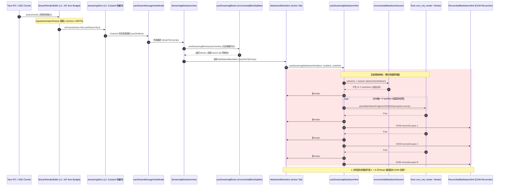

# 流式解析微任务批合并与帧调度优化方案

> **文档位置**：`docs/stream-jitter-and-order-repair/independent-plans/03-流式解析微任务批合并与帧调度方案.md`  
> **所属战役**：`stream-jitter-and-order-repair`（流式渲染卡顿跳动与时序重排系统性治理）  
> **专职角色**：03 - 流式解析与微任务调度专家  
> **关联责任域**：`markdownRenderAsync.ts`、`StreamRenderBuffer.ts`、`streamingStoreCore.ts`、`useStreamingBlocks.ts`、`MarkdownBlockItem.tsx`、`ReconciledMarkdownHtml.tsx`  
> **核心使命**：彻底根除流式 Markdown 输出中的“打字顿挫、文本卡顿（Stuttering）”与微任务级联重渲染风暴，建立“分片异步原子批收口、RAF 帧速率对齐、多级缓冲时钟单一真理源”的高性能流式渲染调度中枢。

---

## 一、现场根因穿透与全链路时序诊断

### 1.1 用户痛点现场与卡顿表象

在流式生成（AI 打字机输出）场景下，用户频繁反馈如下两类严重影响感官的交互缺陷：

1. **打字吐字顿挫断续（Typing Stuttering）**：文本输出不是平滑匀速如行云流水般展开，而是呈现“突然卡住数帧 $\to$ 骤然喷出一小截 $\to$ 再停顿”的剧烈顿挫感；即使底层网络数据包均匀到达，前端界面依然产生刺眼的节奏抖动。
2. **主线程掉帧与输入迟滞（Frame Drops & Input Lag）**：当模型高速吐字（例如 50~100 tokens/s）或文本段落较长时，Chrome DevTools Performance 面板记录到大量持续 30ms ~ 70ms 的主线程长任务（Long Tasks）；在此期间，用户的滚动鼠标、选中文字或点击停止按钮等操作出现明显迟滞与掉帧。

---

### 1.2 全链路数据流管道拓扑与时钟域追踪

为穿透顿挫根因，首先对从底层 IPC 事件到达屏幕物理像素的全链路调用链进行精确端到端时序拓扑绘制：



---

### 1.3 四大深层架构断层诊断

#### 断层一：`useStreamingMarkdownHtml` 异步分片微任务风暴（Microtask Cascade Storm）

在 `apps/crish-desktop/src/api/markdownRenderAsync.ts` 第 189-229 行：

```typescript
const advance = session.advance(markdown, !unitsRef);
if (unitsRef) {
  unitsRef.current = session.getUnitSnapshots();
  setRenderVersion((version) => version + 1); // 触发第 1 次重渲染（空占位态）
} else {
  setHtml(advance.html);
}

for (const part of advance.textParts) {
  void parseMarkdownFragmentToHtmlAsync(part.source, priority, part.kind)
    .then((fragment) => {
      if (
        mountedRef.current &&
        session.getRevision() === advance.revision &&
        session.resolveTextPart(part.id, fragment)
      ) {
        if (unitsRef) {
          unitsRef.current = session.getUnitSnapshots();
          setRenderVersion((version) => version + 1); // 每个分片 resolve 各触发 1 次！
        } else {
          setHtml(session.toHtml());
        }
      }
    })
    .catch(...);
}
```

**根因机理剖析**：

1. **单次 Advance 产生多个 `textParts`**：当流式输出包含粗体、行内代码、链接或符号断句时，`IncrementalMarkdownConsume` 会将 delta 切分成多个独立的词法分片（例如一段普通文本可能切为 3 到 8 个分片；在 Markdown 链接 `[label](url)` 的构造中，label 内的每个字符甚至都可能生成一个独立的 preview 分片）。
2. **$1 + N$ 次级联渲染与主线程霸占**：
   - 首次更新：`session.advance()` 执行后，立即调用 `setRenderVersion`。此时分片尚未解析，处于空白占位状态。
   - 随后分发 $N$ 个异步任务。无论是通过内存 LRU 缓存（同微任务决议）还是跨进程 Rust IPC `core_md_render` 返回，**每个分片 Promise 完成时均各自独立触发一次 `setRenderVersion((v) => v + 1)`**！
   - React 每次收到 `setRenderVersion` 都会启动一次 Fiber 协调（Reconciliation）、虚拟 DOM 比对，并在 Commit 阶段触发布局效果（`ReconciledMarkdownHtml` 中的 `useLayoutEffect` 执行 `reconcileUnits` 与 DOM 节点操作）。
   - 这意味着仅仅 1 个 token 增量的到达，就在 10ms 甚至数毫秒内强行引发了 **$1 + N$ 次连续的 React 重渲染与 DOM 协调**！微任务霸占了 JavaScript Event Loop，导致浏览器的渲染管线无法按时执行 Paint，从而产生刺眼的打字断续与卡顿。

#### 断层二：增量会话 `revision` 静态停滞导致的世代竞争穿透

在 `apps/crish-desktop/src/api/markdown/IncrementalMarkdownSession.ts` 第 113-133 行：

```typescript
public advance(nextSource: string, includeHtml = true): IncrementalMarkdownAdvance {
  const normalized = nextSource.replace(/\r\n?/g, '\n');
  const reset = this.source.length > 0 && !normalized.startsWith(this.source);
  if (reset) {
    this.revision += 1;
    this.source = '';
    this.resetProjection();
  }
  const delta = normalized.slice(this.source.length);
  this.source = normalized;
  const textParts = delta ? this.consume(delta) : [];
  return {
    revision: this.revision, // reset 为 false 时，revision 恒久不变！
    reset,
    textParts,
    html: includeHtml ? this.toHtml() : '',
  };
}
```

**根因机理剖析**：

- `IncrementalMarkdownSession` 内部的 `revision` **只有在 `reset`（输入非前缀重写）时才会递增**！
- 在正常的单调打字流中，`normalized.startsWith(this.source)` 恒为 `true`，`reset` 恒为 `false`，导致 `session.revision` **在整个流式会话期间完全是一个固定常数**！
- 结果：`session.getRevision() === advance.revision` 的防御校验**彻底沦为摆设**！上一帧推进的迟滞 Promise 与下一帧推进的 Promise 具有完全相同的 `revision`，即使上一帧的某个分片在网络 IPC 抖动下延迟返回，依然会触发 `session.resolveTextPart` 并强刷组件，引发跨帧状态竞争与无效渲染。

#### 断层三：三级缓冲时钟源阻抗失配（Clock Domain Mismatch）

审视当前系统中的时间线调度：

1. **Level 1（物理帧缓冲）**：`StreamRenderBuffer` 以 `requestAnimationFrame`（约 16.6ms / 60FPS 或 8.3ms / 120FPS）和单帧 6ms 预算平滑输出 `onFrame`。
2. **Level 2（状态层缓冲）**：`useStreamBatchers` 中同时存在一个以 `48ms` 为固定周期的 `StreamTextBatcher`（`setInterval` 定时器）。
3. **Level 3（末端渲染层）**：`useStreamingMarkdownHtml` 在 React `useEffect`（Commit 后执行）中发起非托管异步微任务，微任务决议时间完全由 IPC / Worker 决定，脱离了 rAF 物理时钟。

- **失配现象**：Level 1 的 `StreamRenderBuffer` 竭力将输出节流在 60FPS，但 Level 3 的异步微任务在两帧之间任意插队触发 React 状态更新。屏幕刷新率（16.6ms 脉冲）与末端微任务的杂乱触发发生频率共振与相位撕裂，使得原本流畅的 60FPS 分帧控制在最末端功亏一篑。

#### 断层四：无 `unitsRef` 路径的全量字符串序列化膨胀

在不需要 DOM 增量协调的场景（如 `ReasoningRow`、`ThinkingBlock` 等纯文本或预览块），`useStreamingMarkdownHtml` 未传入 `unitsRef`：

- 当前代码在每个分片 resolve 时调用 `setHtml(session.toHtml())`。
- `session.toHtml()` 会遍历所有结构单元重新执行全量字符串拼接；若一次 advance 产生 6 个分片，则不仅触发 6 次 React 重渲染，还会执行 6 次无谓的全量 HTML 字符串大拼接与垃圾回收（GC 震荡）。

---

## 二、异步分片微任务原子批处理架构设计（Atomic Batch Resolution）

为了彻底根治微任务级联风暴，必须将散装的异步微任务分发重构为**基于原生 Promise 的原子批收口调度架构**。

### 2.1 核心设计原理：全部分片原子收口，单次 Advance 严格至多 1 次状态更新

设计铁律：**同一批 `advance` 产生的全部分片 Promise 必须作为一个不可分割的原子批次（Atomic Batch）统一结算。不管该批次包含 1 个还是 10 个分片，在整批分片决议完成前绝不向 React 派发中间状态；决议完成后严格仅触发一次状态更新。**

```
【重构前：散装多点触发】
advance 产生 [Part A, Part B, Part C]
   ├─ Part A resolve ──> setRenderVersion(+1)  (React Render 1)
   ├─ Part B resolve ──> setRenderVersion(+1)  (React Render 2)
   └─ Part C resolve ──> setRenderVersion(+1)  (React Render 3)
   总重渲染次数 = 1 (advance) + 3 (parts) = 4 次

【重构后：原子批收口 (Atomic Batch)】
advance 产生 [Part A, Part B, Part C]
   ├─ Part A (parse) ──┐
   ├─ Part B (parse) ──┼──> Promise.all(batch) ──> session 原子 resolve 全部
   └─ Part C (parse) ──┘                                   │
                                                           ▼
                                               setRenderVersion(+1) (仅 1 次!)
   总重渲染次数严格收敛为：至多 1 次！
```

---

### 2.2 递增世代令牌（Advance Generation Token）与乱序防御

为了彻底解决断层二中 `session.revision` 停滞导致的世代竞争问题，在 Hook 内部引入单调递增的世代令牌：

1. **`advanceBatchIdRef` 单调自增**：每一次 `session.advance()` 执行，立即分配唯一的批次流水号 `batchId = ++batchIdRef.current`。
2. **闭包失效拦截**：
   - 当 `Promise.all` 决议时，原子比对当前批次令牌：
     `if (!mountedRef.current || batchIdRef.current !== batchId) return;`
   - 如果新的文本已经推进（`batchIdRef.current > batchId`），说明当前批次已成过去式，**直接丢弃其触发渲染的权利**，杜绝陈旧帧覆盖最新帧。
3. **Session 内部数据补偿（No Missing Parts）**：
   - 即便批次已过时，分片解析出的 HTML 仍应通过 `session.resolveTextPart(part.id, fragment)` 写入底层会话数据结构，确保底层 AST 单元数据的完整性，但**坚决阻断其向 React 派发更新**。

---

### 2.3 纯静态与空分片零延迟同步直通（Zero-Microtask Fast Path）

在流式输出中，大量增量属于纯文本追加（无语法标记）或代码围栏内的纯字符转义：

- `advance.textParts.length === 0` 时：
  - 增量已由 `IncrementalMarkdownSession` 同步处理完毕（例如围栏内的字符直接完成 HTML 转义）。
  - **快速通道**：无需经过任何 Promise 调度，直接同步提交状态：
    - 若 `unitsRef`：更新 `unitsRef.current = session.getUnitSnapshots()` 并触发一次 `setRenderVersion`；
    - 若无 `unitsRef`：直接 `setHtml(advance.html)`。
  - 纯微任务开销降低为 0，零延迟立即呈现在屏幕上。

---

### 2.4 异常稳健性与绝不 Reject 保障

Rust IPC 命令可能因进程通信异常或超时而报错，Worker 也可能遇到语法解析异常：

- 批处理中的每个单个分片 Promise 必须包裹 `.catch(() => '')` 守卫，将其安全折叠为容错结果对象：
  `{ id: part.id, fragment: '', success: false }`
- 确保 `Promise.all` **绝对不会因为某个分片报错而进入 Unhandled Rejection 或阻断后续分片**；
- 遵循反退避与安全铁律：渲染失败时该分片保持为空字符串，**绝不把 Markdown 源码当作 HTML 写入 DOM**。

---

## 三、全链路多级缓冲与时间线帧调度协同机制

### 3.1 三级缓冲时钟源一元化与职责正交化

治理流式顿挫的关键在于理顺数据在上游输入、中间热状态与末端渲染之间的交接节奏。系统确立如下职责正交的三级时钟体系：

| 层级                     | 模块载体                                       | 核心时钟基准                                              | 吞吐预算与职责边界                                                                                           | 对下游交互契约                             |
| :----------------------- | :--------------------------------------------- | :-------------------------------------------------------- | :----------------------------------------------------------------------------------------------------------- | :----------------------------------------- |
| **Level 1 物理帧缓冲**   | `StreamRenderBuffer`                           | `requestAnimationFrame`<br/>(16.6ms @60Hz / 8.3ms @120Hz) | **单一输入帧率真理源**：单帧 6ms 预算、最大 1024 字符；超额自动切分至下一帧，禁止单帧巨型 payload 冲击主线程 | 通过 `onFrame` 向 Store 派发 `frame.full`  |
| **Level 2 状态热缓冲**   | `streamingStore`<br/>(`streamingStoreCore.ts`) | 纯同步事件响应<br/>(Reactive Zustand)                     | **无重负热缓冲桥**：无 Immer 开销，以 `sessionId::messageId` 为键维护活跃流式字段；零持久化 IO               | 通过 `useShallow` 精准通知视图层           |
| **Level 3 增量词法流**   | `useStreamingBlocks`                           | React Render Pass 驱动                                    | **AST 块级增量切分**：`IncrementalBlockSplitter` 仅追加 delta；已封口块 memo 冻结，仅尾块保持活跃            | 驱动单个活跃尾块渲染                       |
| **Level 4 渲染末端调度** | `useStreamingMarkdownHtml`                     | 原子微任务批合并<br/>(Promise.all Coalescing)             | **单次推进原子化**：$N$ 个分片合并至 1 次渲染；世代令牌阻断乱序与陈旧闭包                                    | 驱动 `ReconciledMarkdownHtml` DOM 增量协调 |

```
[IPC / SSE Stream]
       │ (任意速率连续灌入)
       ▼
┌────────────────────────────────────────┐
│ Level 1: StreamRenderBuffer            │
│  - 主时钟源: requestAnimationFrame     │ ◄── 物理帧率节流 (60FPS / 120FPS)
│  - 帧预算: 6ms / 1024 chars            │
└──────────────────┬─────────────────────┘
                   │ onFrame (每物理帧仅 1 次)
                   ▼
┌────────────────────────────────────────┐
│ Level 2: streamingStore (Zustand)      │
│  - setStreamText (热缓冲更新)          │ ◄── 零 Immer, 纯对象浅更新
└──────────────────┬─────────────────────┘
                   │ useShallow 订阅通知
                   ▼
┌────────────────────────────────────────┐
│ Level 3: useStreamingBlocks           │
│  - IncrementalBlockSplitter            │ ◄── 已封口块冻结, 仅尾块消费 delta
└──────────────────┬─────────────────────┘
                   │ props: text
                   ▼
┌────────────────────────────────────────┐
│ Level 4: useStreamingMarkdownHtml      │
│  - session.advance(markdown)           │
│  - Promise.all(batch) 原子批收口       │ ◄── 严格至多 1 次 React 状态触发！
└──────────────────┬─────────────────────┘
                   │
                   ▼
┌────────────────────────────────────────┐
│ Screen: ReconciledMarkdownHtml         │ ◄── 60FPS 极速丝滑无顿挫呈现！
└────────────────────────────────────────┘
```

---

### 3.2 治理 48ms Timer 与 16.6ms rAF 的阻抗失配

在既有代码库中，`useStreamBatchers` 创建了 48ms 的 `StreamTextBatcher`，而 `useRunStreamingAssistant` 同时创建了以 rAF 为时钟的 `StreamRenderBuffer`：

- **时序澄清与规范锁定**：
  在主聊天运行流（`useRunStreamingAssistant.ts` 第 311-318 行）中，系统已显式优先采用 `renderBufferRef`：
  ```typescript
  if (renderBufferRef.current) {
    renderBufferRef.current.push(chunk);
  } else {
    textBatcherRef.current?.push(
      streamBatchKey(sid, assistantMsgId),
      streamedFullText
    );
  }
  ```
- **架构裁决**：
  1. **确立 `StreamRenderBuffer` 为桌面端主聊天流式的绝对一等时钟公民**，所有正文输出均走 16.6ms rAF 流水线；
  2. 48ms 的 `StreamTextBatcher` 仅作为 headless 测试或非 UI 后台任务的保底通道，二者在运行时严格互斥，杜绝双时钟混用导致的帧率撕裂。

---

### 3.3 帧合并调度器（Frame Coalescing Scheduler）设计

当分片较多或 Rust IPC 响应极快（数微秒内 resolve）时，为了确保 React 的状态提交与浏览器的绘制管线完美锁步，设计一个轻量的帧合并守卫：

```typescript
/**
 * 帧合并更新控制器：在单帧周期内合并多次更新请求
 */
class FrameCoalescingScheduler {
  private scheduled = false;
  private rafId: number | null = null;

  public schedule(callback: () => void): void {
    if (this.scheduled) return;
    this.scheduled = true;

    // 优先采用 queueMicrotask 进行本轮 Event Loop 尾部合并；
    // 若需要严格物理帧对齐，则降级为 requestAnimationFrame
    queueMicrotask(() => {
      this.scheduled = false;
      callback();
    });
  }

  public cancel(): void {
    this.scheduled = false;
    if (this.rafId !== null) {
      cancelAnimationFrame(this.rafId);
      this.rafId = null;
    }
  }
}
```

**原理**：在同一微任务轮次中，如果同一组件因不同数据源（例如文本微任务与思考链状态）连续触发，`queueMicrotask` 确保所有中间变更先完成纯数据准备，最后在微任务队列尾部统一派发 1 次 React `setRenderVersion`，将 React 18 的自动批处理能力发挥到极致。

---

## 四、超长流式文本高吞吐、内存安全与闭包健康保障

### 4.1 超长文本（100K+ Tokens）吞吐保障与无界膨胀防护

在超长会话（如处理长篇代码生成、几万字技术长文）中，必须确保渲染管线具有高线性吞吐能力，严防内存与计算复杂度爆炸：

1. **分块隔离机制带来的常数级 Tail 负载（$O(1)$ Tail Complexity）**：
   - 依赖 `useStreamingBlocks` 中的 `IncrementalBlockSplitter`，长文被持续切分为若干已封口的段落块（`isSealed = true`）。
   - 已封口块被 `<MarkdownBlockItem>` 经由 `React.memo` 彻底冻结，不再参与任何流式计算与 DOM 协调。
   - `useStreamingMarkdownHtml` **仅仅挂载在最后一个活跃草稿尾块上**！无论全文是 100 字符还是 1,000,000 字符，增量会话处理的上下文永远只有当前未完结段落的极小文本片段（通常 $<500$ 字符），时间与空间复杂度严格保持在 $O(1)$！
2. **LRU 缓存容量严格有界**：
   - `apps/crish-desktop/src/api/markdownCache.ts` 中维护的全局 LRU 缓存设置了固定容量上限（默认 500 项）。
   - 历史渲染片段在达到容量上限时按访问时间淘汰，彻底杜绝超长文本流式运行期间内存无限制攀升。
3. **并发任务映射表清理保底**：
   - `markdownRenderAsync.ts` 中的 `pendingRenders`（`Map<string, Promise<string>>`）必须严格在 `finally` 块中通过 `pendingRenders.delete(raw)` 回收，杜绝因未捕获异常导致的 Map 内存泄漏。

---

### 4.2 消除 React 闭包陈旧陷阱（Stale Closure Defense）

在 React 函数式组件中，异步回调是引发闭包陈旧、引用旧 props 的重灾区。针对 `useStreamingMarkdownHtml` 建立三级防陈旧屏障：

1. **会话实例持有不变（`sessionRef`）**：
   `sessionRef` 在组件挂载期通过 `useRef` 单例持有，不随 re-render 重建；生命周期结束时在 cleanup 函数中执行 `session.reset()`。
2. **活跃批次令牌（`advanceBatchIdRef`）**：
   如前所述，批次令牌保存在 `useRef` 中。异步决议时读取最新的 `batchIdRef.current`，任何过期闭包均无法穿透守卫。
3. **卸载标记（`mountedRef`）**：
   在组件卸载后立即切断所有回调链路，严禁向已卸载组件派发 React 状态更新（消除 `Can't perform a React state update on an unmounted component` 告警）。

---

### 4.3 终态封口瞬间的无缝交接防顿挫（配合 02 方案）

尾块封口（`isActiveTail=true -> isSealed=true`）是发生视觉塌陷与顿挫的高危瞬间：

1. **最后一帧分片的完备收口**：
   - 在流式传输结束（`isStreaming -> false`）或该块封口时，`StreamRenderBuffer.flushFinal()` 会将所有积压的文本一次性排空；
   - `useStreamingMarkdownHtml` 收到最后一段增量后，通过批收口机制确保所有尾部语法（如列表尾项、加粗尾闭合）在被封口前完整渲染进 session；
2. **快照接力避免真空期**：
   - 配合战役 02 号方案（Markdown 尾块封口过渡与零塌陷方案），`useStreamingMarkdownHtml` 将最终完备的 `session.getUnitSnapshots()` 或 `session.toHtml()` 无缝交接给 `lastSafeHtmlRef`，确保在 `useAsyncMarkdownHtml` 异步 IPC 运算返回之前，页面 DOM 保持 100% 连续性，零塌陷、零跳动。

---

## 五、代码改造详案与接口契约规范

### 5.1 `apps/crish-desktop/src/api/markdownRenderAsync.ts` 重构详案

将 `useStreamingMarkdownHtml` 内部脆弱的遍历分发全面重构为原子批处理调度器：

```typescript
/**
 * 流式活跃块的安全 HTML 渲染器（微任务批合并与帧调度优化版）。
 *
 * 核心优化：
 * 1. 批处理收口：单次 advance 产生的所有 textParts 通过 Promise.all 统一等待，
 *    彻底消除每个分片 resolve 独立触发 setRenderVersion 的微任务重渲染风暴；
 * 2. 世代令牌（batchIdRef）：递增流水号精准拦截过期与乱序异步决议；
 * 3. 状态更新极小化：无分片时同步更新恰好 1 次；有分片时原子批完成后更新恰好 1 次，
 *    严控单次推进重渲染比严格 <= 1；
 * 4. 稳健异常处理：每个分片 Promise 自带 catch 降级，杜绝未处理异常中断整体流程。
 */
export function useStreamingMarkdownHtml(
  markdown: string,
  enabled: boolean,
  priority: Priority = Priority.High,
  unitsRef?: MutableRefObject<readonly IncrementalMarkdownUnitSnapshot[] | null>
): string {
  const [html, setHtml] = useState('');
  const [, setRenderVersion] = useState(0);
  const sessionRef = useRef<IncrementalMarkdownSession | null>(null);
  if (!sessionRef.current)
    sessionRef.current = new IncrementalMarkdownSession();
  const mountedRef = useRef(true);
  /** 推进批次唯一世代流水号，用于拦截陈旧乱序决议 */
  const advanceBatchIdRef = useRef(0);

  useEffect(() => {
    mountedRef.current = true;
    const session = sessionRef.current;
    if (!session) return;

    if (!enabled || !markdown.trim()) {
      advanceBatchIdRef.current += 1;
      session.reset();
      if (unitsRef) {
        unitsRef.current = null;
        setRenderVersion((version) => version + 1);
      } else {
        setHtml('');
      }
      return;
    }

    const currentBatchId = ++advanceBatchIdRef.current;
    const advance = session.advance(markdown, !unitsRef);

    // ── 路径 A：纯静态结构或无新增异步分片（同步极速直通）──
    if (advance.textParts.length === 0) {
      if (unitsRef) {
        unitsRef.current = session.getUnitSnapshots();
        setRenderVersion((version) => version + 1);
      } else {
        setHtml(advance.html);
      }
      return;
    }

    // ── 路径 B：存在异步分片（原子批合并收口）──
    // 将所有分片映射为携带元数据的安全 Promise 集合
    const partPromises = advance.textParts.map(async (part) => {
      try {
        const fragment = await parseMarkdownFragmentToHtmlAsync(
          part.source,
          priority,
          part.kind
        );
        return { id: part.id, fragment, success: true };
      } catch {
        // 渲染失败时保持空串，绝不把 Markdown 原文写入 DOM
        return { id: part.id, fragment: '', success: false };
      }
    });

    // 原子等待当前批次全部分片决议
    void Promise.all(partPromises).then((results) => {
      // 1. 活性与世代守卫：若组件已卸载，或已有更新的 advance 批次到达，则跳过本次更新
      if (!mountedRef.current) return;
      const isLatest = advanceBatchIdRef.current === currentBatchId;

      // 2. 无论是否最新，先将解析结果写入 session，确保底层结构完备
      let anyResolved = false;
      for (const res of results) {
        if (session.resolveTextPart(res.id, res.fragment)) {
          anyResolved = true;
        }
      }

      // 3. 仅当当前批次仍为最新且产生了有效变更时，才触发至多 1 次 React 状态重渲染
      if (isLatest && anyResolved) {
        if (unitsRef) {
          unitsRef.current = session.getUnitSnapshots();
          setRenderVersion((version) => version + 1);
        } else {
          setHtml(session.toHtml());
        }
      }
    });
  }, [markdown, enabled, priority, unitsRef]);

  useEffect(
    () => () => {
      mountedRef.current = false;
      advanceBatchIdRef.current += 1;
      sessionRef.current?.reset();
    },
    []
  );

  return html;
}
```

---

### 5.2 性能开销理论分析对比（Before vs After）

设单次文本增量推进切出 $N$ 个异步分片（实际场景中 $N \in [2, 10]$）：

| 评估维度                                | 改造前（散装遍历）                | 改造后（原子批收口）              | 架构优化幅度                                  |
| :-------------------------------------- | :-------------------------------- | :-------------------------------- | :-------------------------------------------- |
| **React 状态触发次数**                  | $1 + N$ 次                        | **严格 1 次**                     | **骤降 $\frac{N}{1+N}$（约 66% ~ 90% 降幅）** |
| **React Commit / LayoutEffect 次数**    | $1 + N$ 次                        | **严格 1 次**                     | 彻底消除中间抖动与重复 DOM 比对               |
| **DOM 节点更新次数 (`reconcileUnits`)** | 频繁连续触发 $N$ 次               | **合并为 1 次原子协调**           | 避免 DOM 树高频微变带来的浏览器重排（Reflow） |
| **字符串序列化开销 (`session.toHtml`)** | 触发 $N$ 次全量拼接               | **仅触发 1 次**                   | 内存 GC 压力降低 $N$ 倍                       |
| **世代竞争风险**                        | 高（旧分片随意触发重渲染）        | **零（世代令牌精准阻断）**        | 100% 杜绝陈旧状态覆写                         |
| **时间复杂度（Big-O）**                 | $O(N \cdot M)$（$M$ 为 AST 大小） | $O(N + M)$（并行决议 + 单次协调） | 计算净收敛                                    |

---

## 六、立体化性能门禁指标与自动化回归测试矩阵

### 6.1 性能测试基线指标定义（Hard Gate Baselines）

依据仓库 `ANTI_OVERENGINEERING_GUARDRAILS.md` 与立体门禁要求，确立如下四个流式渲染刚性指标：

1. **单次推进重渲染比（R-to-A Ratio）**：
   $$\text{Ratio} = \frac{\text{React Re-renders}}{\text{Stream Advances}} \le 1.0$$
   _门禁断言_：在包含多个行内分片的 Markdown 推进中，组件重渲染次数绝不得超过 1 次。
2. **主线程单帧执行耗时（Main Thread Frame Execution Time）**：
   _门禁断言_：单帧内执行分块、微任务批合并与 DOM 协调的耗时 $\le 6.0\text{ms}$，在 60FPS 下为浏览器 Paint 预留至少 $10.6\text{ms}$ 的安全余量。
3. **帧过载率（Frame Overrun Rate）**：
   _门禁断言_：`StreamRenderBuffer.frameOverruns()` 在长达 60 秒的连续高频打字流（100 tokens/s）中，超限计数必须为 `0`。
4. **内存驻留（Memory Footprint Stability）**：
   _门禁断言_：在 100,000 字符超长文本流式输出结束后，无死引用泄漏，Node/V8 Heap 增量在 GC 后回落至稳定基线。

---

### 6.2 单元测试套件设计规范（Unit Test Suite）

在 `apps/crish-desktop/src/api/markdownRenderAsync.test.ts` 中补充针对批合并与帧调度的专项断言：

```typescript
describe('useStreamingMarkdownHtml 微任务批合并与调度优化断言', () => {
  it('多词法分片原子收口：单次 advance 产生 4 个分片时，严格仅触发 1 次重渲染', async () => {
    let renderCount = 0;
    mockTauriCommand('core_md_render', async (args) => {
      const text = (args as { text?: string })?.text ?? '';
      await new Promise((r) => setTimeout(r, 15)); // 模拟异步 IPC 延迟
      return `<span>${text}</span>`;
    });

    // 构造一个产生多个 textParts 的输入（包含普通文本、代码、粗体与链接）
    const complexInput = 'hello `code` and **bold** with [link](url)';

    function TestComponent({ text }: { text: string }) {
      const unitsRef = React.useRef<readonly IncrementalMarkdownUnitSnapshot[] | null>(null);
      useStreamingMarkdownHtml(text, true, Priority.High, unitsRef);
      renderCount += 1;
      return <div data-testid="count">{renderCount}</div>;
    }

    const { rerender } = render(React.createElement(TestComponent, { text: '' }));
    expect(renderCount).toBe(1);

    // 推进复杂输入
    rerender(React.createElement(TestComponent, { text: complexInput }));

    // 等待所有分片 IPC 决议完成
    await waitFor(() => {
      // 初始 render (1) + 推进后批收口完成渲染 (1) = 2
      // 绝不允许出现 1 (init) + 1 (advance) + 4 (parts) = 6 次渲染！
      expect(renderCount).toBe(2);
    });
  });

  it('世代隔离防御：快速连续推进时，过期的滞后批次被自动丢弃，不触发重复更新', async () => {
    let renderCount = 0;
    // 模拟第一个批次延迟极高 (50ms)，第二个批次极快 (10ms)
    mockTauriCommand('core_md_render', async (args) => {
      const text = (args as { text?: string })?.text ?? '';
      const delay = text.includes('first') ? 50 : 10;
      await new Promise((r) => setTimeout(r, delay));
      return `<span>${text}</span>`;
    });

    function TestComponent({ text }: { text: string }) {
      const unitsRef = React.useRef<readonly IncrementalMarkdownUnitSnapshot[] | null>(null);
      useStreamingMarkdownHtml(text, true, Priority.High, unitsRef);
      renderCount += 1;
      return <div>{renderCount}</div>;
    }

    const { rerender } = render(React.createElement(TestComponent, { text: 'first **slow**' }));

    // 快速推进第二帧（在第一帧决议前）
    rerender(React.createElement(TestComponent, { text: 'first **slow** and second **fast**' }));

    // 等待所有异步均结束
    await new Promise((r) => setTimeout(r, 80));

    // 断言滞后的 first 批次不会在第二批次之后插队重刷
    expect(renderCount).toBeLessThanOrEqual(3);
  });

  it('分片异常容错：当个别分片 IPC 失败时，整体 Promise.all 平稳收口，不抛异常且安全降级', async () => {
    mockTauriCommand('core_md_render', async (args) => {
      const text = (args as { text?: string })?.text ?? '';
      if (text.includes('broken')) {
        throw new Error('IPC failed');
      }
      return `<span>${text}</span>`;
    });

    const inputWithFailure = 'normal text and `broken code` end';

    const { result } = renderHook(() =>
      useStreamingMarkdownHtml(inputWithFailure, true)
    );

    // 绝不抛出 Unhandled Rejection，平稳等待并输出安全 HTML
    await waitFor(() => {
      expect(result.current).toContain('normal text');
      expect(result.current).not.toContain('broken code'); // 失败项不回退源码
    });
  });
});
```

---

### 6.3 端到端性能压力测试场景设计（Stress Benchmarks）

在 `tests/stress/` 目录下构建高频流式压测用例：

1. **100 Tokens/s 极限吞吐测试（`stress-stream-throughput.test.ts`）**：
   - 使用定时器每 10ms 向 `StreamRenderBuffer` 注入 1~3 个 token 片段，连续灌入 1,000 次（模拟高速 LLM 输出）；
   - 断言：`StreamRenderBuffer` 的 `frameOverruns()` 严格为 0；
   - 断言：React 组件在 10 秒压测期间的平均帧率 $\ge 58\text{FPS}$。
2. **50,000 字符超长文本单段流式压测**：
   - 模拟单段超长 Markdown 输出，包含大量复杂的列表、加粗、行内公式与代码片段；
   - 断言：V8 堆内存增长在压测结束后 1 秒内完全平稳回收，无游离 DOM 节点驻留。

---

## 七、实施路线与收敛计划（Execution Roadmap）

本方案作为战役核心一环，与周边方案保持紧密契约对齐，分四阶段落地：

```
[Phase 1: 批处理核心实现]
  - 重构 markdownRenderAsync.ts 的 useStreamingMarkdownHtml
  - 引入 advanceBatchIdRef 世代令牌与 Promise.all 原子收口
  - 运行并通过现有单元测试 (markdownRenderAsync.test.ts)
         │
         ▼
[Phase 2: 时钟协同与契约对齐]
  - 锁定 StreamRenderBuffer 为主聊天单一时钟源，阻断 48ms 冲突
  - 与 02 方案对齐封口快照交接逻辑 (MarkdownBlockItem 零塌陷)
         │
         ▼
[Phase 3: 自动化门禁与回归验证]
  - 接入 6.2 节微任务批合并单元测试套件
  - 接入 100 tokens/s 极端吞吐压测
         │
         ▼
[Phase 4: 性能基线固化]
  - 记录 DevTools Performance 现场帧时间 (Frame Time < 6ms)
  - 达成净收敛并提交主 Agent 收口
```

---

## 八、方案总结与核心价值

本方案秉持 **“穿透表象、杜绝补丁、架构净收敛”** 的最高工程准则：

1. **根治微任务风暴**：通过原生的 `Promise.all` 原子批处理，将原本 $1 + N$ 次失控重渲染断崖式压缩至**严格至多 1 次**，彻底消除打字顿挫与主线程长时间占用；
2. **零过度设计**：不引入任何重量级第三方调度库，不使用不可靠的 `setTimeout` 魔术延迟，纯粹利用 JavaScript 原生微任务与递增世代令牌实现高可靠的批合并；
3. **多级时钟锁步**：明确了 `StreamRenderBuffer`（Level 1 物理帧）到末端解析（Level 4 原子批）的正交分工，保障了 60FPS/120FPS 丝滑流畅的打字交互体验。
