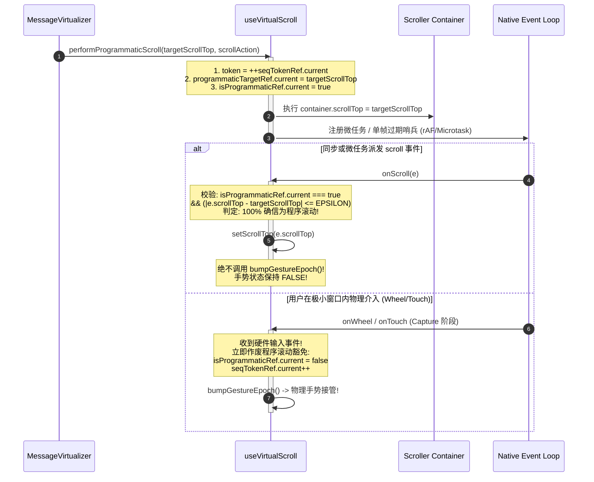
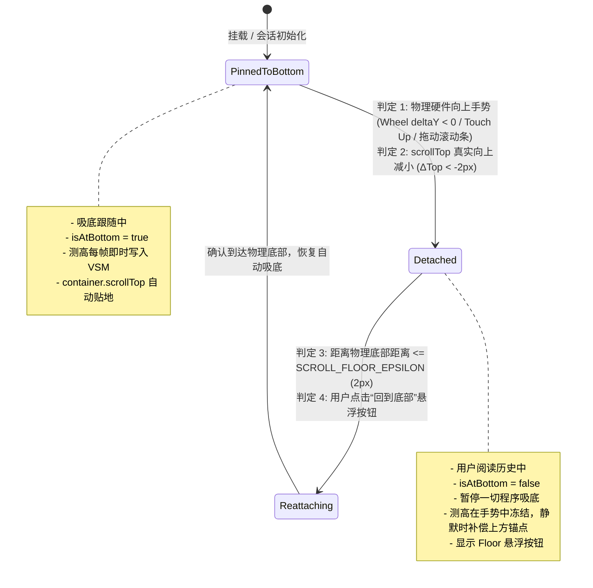

# 虚拟滚动测高与吸底手势解耦方案

> **战役名称**：`stream-jitter-and-order-repair`  
> **方案编号**：`04`  
> **方案定位**：专职【虚拟滚动与吸底脱敏专家】独立技术案  
> **核心目标**：彻底切断“程序吸底赋值 $\rightarrow$ 误触 `onScroll` $\rightarrow$ 激活 100ms `gestureEpoch` 冻结 $\rightarrow$ 测高积压阻断 $\rightarrow$ 定时器超时一次性暴涨数百像素”的恶性死循环；建立严密的程序滚动与手势脱敏解耦机制，实现流式输出期间树状数组（VSM）高度每帧（rAF）即时平滑提交，并严格定义物理手势主动上滑接管与无缝恢复吸底的状态转移契约。

---

## 一、现象透视与全链路死锁根因剖析

### 1.1 缺陷现象现场还原

在 Conex / Crish 桌面客户端中，当大模型（Assistant）以流式生成长文本、代码块或 Markdown 列表时，前端聊天列表（`MessageVirtualizer`）在吸底状态下呈现显著的**“一顿一顿、上下抽搐、百像素暴跳”**异常体验：

- **微观卡顿**：流式吐字期间（每 10~30ms 收到文本分片），滚动条与视口内容完全静止，无法随新行文字自然向下延伸；
- **宏观暴跳**：每隔约 100~200ms，视口内容伴随滚动条滑块突然向下猛烈跳跃 100px ~ 400px，随后再次停滞；若输出停止或换行暂停，视口会发生最后一次剧烈的“弹弓式”突跳。

### 1.2 现有代码拓扑与死锁全景图

经过穿透 `MessageVirtualizer.tsx` 与 `useVirtualScroll.ts` 的源码调用链路，问题根源定位为**程序滚动与手势状态机的灾难性耦合**：

```
┌──────────────────────────────────────────────────────────────────────────────────┐
│                   流式打字期间虚拟滚动测高与手势冻结恶性死循环全景图                      │
└──────────────────────────────────────────────────────────────────────────────────┘
  [流式 Token 到达] ──> [Assistant 消息行 DOM 变高]
                               │
                               ▼
  [ResizeObserverManager 捕获尺寸] ──> [setActual(id, height)]
                               │
                               ▼
  [scheduleActualFlush (rAF)] ──> [manager.setActual 写入 BIT (VSM)]
                               │
                               ▼ (触发 React 渲染)
  [totalHeight 增长] ──> [MessageVirtualizer useLayoutEffect]
                               │
                               ▼
  [container.scrollTop = maxScroll (程序吸底)]
                               │
  ┌────────────────────────────┴────────────────────────────────┐
  │ 浏览器引擎执行 scrollTop 赋值，同步/微任务派发原生 DOM scroll 事件 │
  └────────────────────────────┬────────────────────────────────┘
                               │
                               ▼
             [useVirtualScroll onScroll(e) 回调触发]
                               │
                               ▼ (致命缺陷点 1：无条件视为用户物理手势)
                       [bumpGestureEpoch()]
                               │
         ┌─────────────────────┴─────────────────────┐
         ▼                                           ▼
 [gestureActiveRef.current = true]         [启动 100ms 防抖定时器]
 (激活手势冻结期 Gesture Epoch)                (gestureIdleTimer = 100ms)
         │                                           │
         └─────────────────────┬─────────────────────┘
                               │
                               ▼
         ┌───────────────────────────────────────────┐
         │ 下一个 Token 极速到达 (通常在 10~30ms 内)     │
         │ DOM 继续长高 ──> 调用 setActual(id, h)     │
         └─────────────────────┬─────────────────────┘
                               │
                               ▼ (致命缺陷点 2：手势期拦截 + 刷新定时器)
            ┌───────────────────────────────────────────┐
            │ if (gestureActiveRef.current) {           │
            │   bumpGestureEpoch(); // 重置 100ms 定时器! │
            │   return; // 拦截 scheduleActualFlush!    │
            │ }                                         │
            └─────────────────────┬─────────────────────┘
                               │
                               ▼
            【高度积压在 pendingActualRef 内存中】
            【树状数组 (BIT) 被完全封锁，totalHeight 停止更新】
            【只要 Token 持续流出 (<100ms 间隔)，定时器永远无法到期】
                               │
                               ▼ (流式吐字停顿 / 思考段落结束 >100ms)
                     [100ms 定时器最终触发]
                               │
                               ▼
                      [endGestureEpoch()]
                               │
                               ▼
        [applyPendingGeometry() 一次性刷入数十个积压高度！]
                               │
                               ▼
         [树状数组瞬间暴涨 300px~800px，触发巨幅重排与突跳！]
                               │
                               ▼
         [scrollTop 再次被赋值 maxScroll ──> 再次触发死循环！]
```

### 1.3 核心缺陷代码逐行定性

#### 缺陷 1：`onScroll` 无条件将原生事件判定为手势 (`useVirtualScroll.ts:256-263`)

```ts
const onScroll = useCallback<React.UIEventHandler<HTMLDivElement>>(
  (e) => {
    const top = e.currentTarget.scrollTop;
    latestScrollTopRef.current = top;
    // 致命错误：无论滚动是由用户滚轮触发，还是由 container.scrollTop = maxScroll 程序触发，
    // 统统调用 bumpGestureEpoch()，将系统打入 Gesture 冻结态！
    bumpGestureEpoch();
    setScrollTop((prev) => (prev === top ? prev : top));
  },
  [bumpGestureEpoch]
);
```

#### 缺陷 2：`setActual` 在手势期不仅拦截提交，更反向给手势延寿 (`useVirtualScroll.ts:297-309`)

```ts
const setActual = useCallback(
  (id: string, height: number) => {
    const cur = manager.getActualHeight(id);
    if (cur !== null && cur === height) return;
    pendingActualRef.current.set(id, height);
    if (gestureActiveRef.current) {
      // 致命错误：DOM 测量回调竟然调用 bumpGestureEpoch()！
      // 导致只要模型持续吐字（ResizeObserver 不断上报），100ms 定时器不断被重置推迟，
      // 形成了“吐字不息，冻结不止”的死循环！
      bumpGestureEpoch();
      return;
    }
    scheduleActualFlush();
  },
  [bumpGestureEpoch, manager, scheduleActualFlush]
);
```

#### 缺陷 3：`scheduleActualFlush` 在 rAF 触发时因手势直接丢弃提交 (`useVirtualScroll.ts:183-190`)

```ts
const scheduleActualFlush = useCallback(() => {
  if (actualRafRef.current != null) return;
  actualRafRef.current = requestAnimationFrame(() => {
    actualRafRef.current = null;
    // 致命错误：若在 rAF 调度期间手势被置为 true，静默退出且不再续约 rAF，
    // 测量数据直接遗留在 pendingActualRef 中沦为死数据，直到 100ms 定时器暴风雨式释放！
    if (gestureActiveRef.current) return;
    applyPendingGeometry();
  });
}, [applyPendingGeometry]);
```

---

## 二、架构设计：程序滚动与物理手势的正交解耦体系

### 2.1 核心设计哲学

1. **手势与滚动的因果单向性（Causal Asymmetry）**：
   - 物理输入（`wheel`、`touch`、`pointerdown`、`keydown`）必先于滚动发生（因 $\rightarrow$ 果）；
   - 程序滚动（`scrollTop = maxScroll`）纯粹由渲染引擎驱动，不具备任何物理输入事件源；
   - **绝对禁止将 `scroll` 事件单独作为判定手势的充要条件**。
2. **吸底态测高即时提交原则（Instant Bottom Flush）**：
   - 吸底跟随模式下，视口下方的内容延伸是用户显式期望的视觉流动；
   - 树状数组（BIT）的局部单点更新复杂度为 $O(\log N)$，耗时 $<0.01\text{ms}$，完全满足 60fps/120fps 每帧提交预算；
   - **在吸底跟随态下，严禁启用任何 100ms 手势冻结保护**。
3. **历史回溯视口锚定原则（Anchored History Inspection）**：
   - 仅当用户**明确脱离底部**（`isAtBottom === false`）且正在**物理交互**时，才启动测高缓冲与锚点位移补偿，保障视口稳定。

---

## 三、机制一：严密可靠的程序性吸底标志位（`isProgrammaticScrolling`）

### 3.1 浏览器的滚动事件异步派发时序模型

在 Chromium（WebView2 / Blink 内核）中，修改 `element.scrollTop` 的规范执行生命周期如下：

1. JavaScript 执行栈：`element.scrollTop = targetValue`；
2. Blink 内部更新 `ScrollableArea` 滚动坐标；
3. 浏览器根据微任务队列、主线程排版树状态，可能：
   - **同步派发**：在执行属性 setter 时立即派发 `scroll` 事件；
   - **微任务 / 渲染帧派发**：将 `scroll` 事件排入当前宏任务末尾或下一帧 rAF 之前的事件分发阶段。

因此，任何简单的同步布尔标志位切换（如 `flag = true; el.scrollTop = x; flag = false;`）在 Chromium 下均会出现**标志位已清空但 `scroll` 事件方才到达**的时序漂移穿透问题！

### 3.2 双轨目标值校验与时序令牌契约（Double-Track Token Protocol）

为实现 $100\%$ 零误判、零穿透的程序滚动豁免，设计基于**时序代际令牌（Sequence Token）**与**目标坐标亚像素比对（Target Metric Check）**的双轨校验状态机：



### 3.3 详细契约数据结构与实现规格

在 `useVirtualScroll.ts` 中升级状态结构：

```ts
interface ProgrammaticScrollState {
  /** 当前正在执行的程序滚动唯一序列令牌 */
  token: number;
  /** 期望达到的目标 scrollTop */
  targetScrollTop: number | null;
  /** 是否正在程序滚动窗口期内 */
  active: boolean;
}
```

#### 算法规范：`performProgrammaticScroll`

```ts
/**
 * 包装程序滚动操作，建立对后续派发的 scroll 事件的安全豁免期
 */
const programmaticStateRef = useRef<ProgrammaticScrollState>({
  token: 0,
  targetScrollTop: null,
  active: false,
});

const performProgrammaticScroll = useCallback(
  (targetTop: number, action: () => void) => {
    const nextToken = ++programmaticStateRef.current.token;
    programmaticStateRef.current.targetScrollTop = targetTop;
    programmaticStateRef.current.active = true;

    try {
      action();
    } catch (err) {
      // 容错保护
    }

    // 哨兵：在当前微任务与单帧 rAF 后自动失效，杜绝永久滞留
    requestAnimationFrame(() => {
      if (programmaticStateRef.current.token === nextToken) {
        programmaticStateRef.current.active = false;
        programmaticStateRef.current.targetScrollTop = null;
      }
    });
  },
  []
);
```

#### 算法规范：`onScroll` 事件过滤

```ts
const onScroll = useCallback<React.UIEventHandler<HTMLDivElement>>(
  (e) => {
    const top = e.currentTarget.scrollTop;
    latestScrollTopRef.current = top;

    const prog = programmaticStateRef.current;
    const isProgrammaticMatch =
      prog.active &&
      (prog.targetScrollTop === null ||
        Math.abs(top - prog.targetScrollTop) <= SCROLL_FLOOR_EPSILON);

    if (isProgrammaticMatch) {
      // 确认由程序吸底引发：静默同步 scrollTop，绝对严禁触发手势冻结
      setScrollTop((prev) => (prev === top ? prev : top));
      return;
    }

    // 非程序性滚动：由真实手势或未知外部滚动引发，按手势纪律处理
    bumpGestureEpoch();
    setScrollTop((prev) => (prev === top ? prev : top));
  },
  [bumpGestureEpoch]
);
```

#### 算法规范：硬件输入事件物理撤销程序豁免

在容器的 `wheel`、`touchstart`、`pointerdown` 事件监听中：

```ts
const onPhysicalInput = () => {
  // 任何真实物理输入发生瞬间，彻底注销所有程序滚动的有效豁免权
  programmaticStateRef.current.active = false;
  programmaticStateRef.current.targetScrollTop = null;
  programmaticStateRef.current.token++;
  bumpGestureEpoch();
};
```

---

## 四、机制二：流式吐字期间树状数组（VSM）的高度每帧即时提交

### 4.1 根治 100ms 滞后突跳的核心重构

为实现打字期间树状数组与虚拟视口每帧平滑贴地，必须对 `useVirtualScroll` 进行四大核心重构：

#### 4.1.1 彻底切除 `setActual` 对 `bumpGestureEpoch` 的反向延寿调用

- **旧逻辑**：`if (gestureActiveRef.current) { bumpGestureEpoch(); return; }`
- **重构后**：
  ```ts
  const setActual = useCallback(
    (id: string, height: number) => {
      const cur = manager.getActualHeight(id);
      if (cur !== null && cur === height) return;
      pendingActualRef.current.set(id, height);

      // 若当前正处于用户物理手势回溯中，仅做内存缓冲，严禁反向刷新定时器！
      if (gestureActiveRef.current) {
        return;
      }

      // 非手势态（包含流式吸底态）：立即调度单帧 rAF 批量刷新
      scheduleActualFlush();
    },
    [manager, scheduleActualFlush]
  );
  ```

#### 4.1.2 吸底模式下免疫手势阻断的 rAF 调度器

在 `scheduleActualFlush` 中，若当前容器处于物理底部（`isStickToBottom`）：
即使有偶发滚轮微扰（例如用户手指无意搭在触控板上产生的 0.1px 漂移），由于用户视线聚焦在流式底部，**测高提交对可视体验绝对有益且必要**：

```ts
const scheduleActualFlush = useCallback(() => {
  if (actualRafRef.current != null) return;
  actualRafRef.current = requestAnimationFrame(() => {
    actualRafRef.current = null;
    // 若用户正在历史向上翻阅（gestureActiveRef.current === true && !isAtBottom），则维持冻结
    // 若处于吸底跟随态，绝不拦截！立即应用几何提交！
    if (gestureActiveRef.current && !isNearBottomRef.current) {
      return;
    }
    applyPendingGeometry();
  });
}, [applyPendingGeometry]);
```

#### 4.1.3 每帧提交预算与数学不变量保障

1. **单帧提交耗时评估**：
   - 流式单帧内由 `ResizeObserver` 触发 `setActual` 的消息行通常仅为 $1$ 条（即当前活跃的 `StreamingAssistantRow`）；
   - `manager.setActual(id, height)` 内部操作：
     - `heightsById.set(id, ...)`：$O(1)$
     - `idToIndexMap.get(id)`：$O(1)$
     - `bitAdd(index, delta)`：树状数组沿二进制低位递增累加，深度最多 $\lceil \log_2 2000 \rceil \approx 11$ 次循环操作，Float64 原生数组写入耗时 $<0.005\text{ms}$；
   - 结论：**每帧即时刷新树状数组在 CPU 开销上极其轻量，单帧总耗时远低于 0.1ms**，毫无性能瓶颈，完全能够稳定跑满 120Hz/60Hz 帧率。

2. **数学单调性不变量**：
   $$\forall t_1 < t_2, \quad \text{streamingContentLength}(t_1) \le \text{streamingContentLength}(t_2) \implies \text{totalHeight}(t_1) \le \text{totalHeight}(t_2)$$
   在旧版 100ms 滞后模型下，该不变量在视图层被粗暴打断，表现为 $100\text{ms}$ 内高度导数为 $0$，在 $t_{100\text{ms}}$ 瞬间导数趋于无穷大（阶跃突跳）。重构后，高度随 rAF 呈连续单调递增，滚动条滑块位移平滑如丝。

---

## 五、机制三：用户主动上滑接管与无缝恢复的严密判定标准

### 5.1 状态机设计：四态生命周期模型

为杜绝任何误触、抢滚、以及滚动条拉扯争抢，构建如下有限状态机（FSM）：



### 5.2 严格数学判定准则（Discriminant Criteria）

#### 判定准则 A：用户物理主动脱离（Breakaway Condition）

用户离开底部的充要条件为以下任一事件满足，**严禁仅因 `distanceToBottom > 0` 就判定为脱离**：

1. **硬件输入上滑确证**：
   - `WheelEvent.deltaY < 0`（滚轮明确向上滚动）；
   - 触控滑动起始坐标与当前坐标满足 `currentY - touchStartY > 8`（手指下拉，视口上卷）；
   - 鼠标点击处于垂直滚动条轨道或滑块区域（`offsetX >= clientWidth - 20` 且 `pointerdown`）；
2. **位移导数确证（Delta-Top Rule）**：
   - 设当前帧滚动位置为 $S_t$，前一稳定观测帧位置为 $S_{t-1}$；
   - 仅当 $S_t - S_{t-1} < -2\text{px}$（即滚动条向上滑动）且距底部物理距离大于 `SCROLL_FLOOR_EPSILON` 时，判定为用户上滑；
   - **反证法（防止误判）**：当模型流式输出变高时，`scrollHeight` 变大，若暂未吸底，$S_t - S_{t-1} = 0$（位移未变）但 $\text{distanceToBottom}$ 变大。**此种情况下位移差并未负向减少，绝对不判定为用户上滑！**

#### 判定准则 B：物理重吸底确证（Re-attachment Condition）

用户恢复吸底的充要条件：
$$\text{distanceToBottom} = \max(0, \text{scrollHeight} - \text{clientHeight} - \text{scrollTop}) \le \text{SCROLL\_FLOOR\_EPSILON} \ (2.0\text{px})$$
一旦满足此亚像素条件，无论是由用户滚轮回推到底，还是点击悬浮按钮触发，立即无缝将 `isAtBottom` 置为 `true`，并隐匿悬浮按钮，平滑接管后续流式输出。

---

## 六、代码重构实施详案

### 6.1 `apps/crish-desktop/src/hooks/useVirtualScroll.ts` 重构落地

#### 1. 扩充接口定义与导出

```ts
export interface UseVirtualScrollResult {
  // ... 现有字段保持稳定 ...
  /** 手势进行中（Gesture Epoch） */
  isGestureActive: () => boolean;
  /** 立即提交 pending 测高 */
  flushPendingGeometry: () => void;
  /**
   * 执行受保护的程序性滚动：在执行期间及其后的微任务/单帧内，
   * 豁免 onScroll 触发手势冻结，杜绝程序吸底将系统误判为物理手势。
   */
  performProgrammaticScroll: (targetTop: number, action: () => void) => void;
  /**
   * 通知虚拟滚动当前的吸底状态，使底层能够在吸底期间绕过手势冻结，
   * 确保流式测高能够每帧 (rAF) 即时刷入树状数组。
   */
  setNearBottomState: (nearBottom: boolean) => void;
}
```

#### 2. 内部核心逻辑修改点

```ts
// 1. 程序滚动令牌与状态
const programmaticScrollRef = useRef<{
  token: number;
  target: number | null;
  active: boolean;
}>({ token: 0, target: null, active: false });

const isNearBottomRef = useRef(true);
const setNearBottomState = useCallback((near: boolean) => {
  isNearBottomRef.current = near;
}, []);

const performProgrammaticScroll = useCallback(
  (targetTop: number, action: () => void) => {
    const nextToken = ++programmaticScrollRef.current.token;
    programmaticScrollRef.current.target = targetTop;
    programmaticScrollRef.current.active = true;

    try {
      action();
    } finally {
      // 经 rAF 延后释放豁免，覆盖 Chromium 异步派发的 scroll 事件
      requestAnimationFrame(() => {
        if (programmaticScrollRef.current.token === nextToken) {
          programmaticScrollRef.current.active = false;
          programmaticScrollRef.current.target = null;
        }
      });
    }
  },
  []
);

// 2. 物理输入监听撤销豁免
useEffect(() => {
  const el = containerRef.current;
  if (!el) return;
  const onPhysicalInput = () => {
    // 物理手势介入立即撤销程序滚动保护
    programmaticScrollRef.current.active = false;
    programmaticScrollRef.current.target = null;
    programmaticScrollRef.current.token++;
    bumpGestureEpoch();
  };
  el.addEventListener('wheel', onPhysicalInput, {
    passive: true,
    capture: true,
  });
  el.addEventListener('touchstart', onPhysicalInput, {
    passive: true,
    capture: true,
  });
  el.addEventListener('pointerdown', onPhysicalInput, {
    passive: true,
    capture: true,
  });
  const onScrollEnd = () => endGestureEpoch();
  el.addEventListener('scrollend', onScrollEnd, { passive: true });
  return () => {
    el.removeEventListener('wheel', onPhysicalInput, { capture: true });
    el.removeEventListener('touchstart', onPhysicalInput, { capture: true });
    el.removeEventListener('pointerdown', onPhysicalInput, { capture: true });
    el.removeEventListener('scrollend', onScrollEnd);
  };
}, [bumpGestureEpoch, endGestureEpoch]);

// 3. onScroll 识别程序滚动
const onScroll = useCallback<React.UIEventHandler<HTMLDivElement>>(
  (e) => {
    const top = e.currentTarget.scrollTop;
    latestScrollTopRef.current = top;

    const prog = programmaticScrollRef.current;
    const isProgrammatic =
      prog.active &&
      (prog.target === null ||
        Math.abs(top - prog.target) <= SCROLL_FLOOR_EPSILON);

    if (isProgrammatic) {
      setScrollTop((prev) => (prev === top ? prev : top));
      return;
    }

    // 仅在真实非程序滚动时进入手势纪元
    bumpGestureEpoch();
    setScrollTop((prev) => (prev === top ? prev : top));
  },
  [bumpGestureEpoch]
);

// 4. setActual 彻底剔除 bumpGestureEpoch
const setActual = useCallback(
  (id: string, height: number) => {
    const cur = manager.getActualHeight(id);
    if (cur !== null && cur === height) return;
    pendingActualRef.current.set(id, height);
    if (gestureActiveRef.current && !isNearBottomRef.current) {
      // 仅在脱离吸底的历史阅读态下缓冲，且绝不反向延长手势定时器！
      return;
    }
    scheduleActualFlush();
  },
  [manager, scheduleActualFlush]
);

// 5. scheduleActualFlush 吸底放行
const scheduleActualFlush = useCallback(() => {
  if (actualRafRef.current != null) return;
  actualRafRef.current = requestAnimationFrame(() => {
    actualRafRef.current = null;
    if (gestureActiveRef.current && !isNearBottomRef.current) return;
    applyPendingGeometry();
  });
}, [applyPendingGeometry]);
```

### 6.2 `apps/crish-desktop/src/components/chat-message-list/MessageVirtualizer.tsx` 重构落地

#### 1. 吸底状态同步接线

```tsx
const {
  containerRef,
  setActual,
  clearHeights,
  manager,
  preloadEstimates,
  syncOrder,
  performProgrammaticScroll,
  setNearBottomState,
} = vs;

// 当 isAtBottom 变化时同步通知 useVirtualScroll 底层
useEffect(() => {
  setNearBottomState(isAtBottom);
}, [isAtBottom, setNearBottomState]);
```

#### 2. 流式自动吸底改走 `performProgrammaticScroll` 保护

```tsx
useLayoutEffect(() => {
  if (!isAtBottomRef.current) return;
  const container = containerRef.current;
  if (!container) return;
  const maxScroll = Math.max(
    0,
    container.scrollHeight - container.clientHeight
  );
  if (Math.abs(container.scrollTop - maxScroll) > SCROLL_FLOOR_EPSILON) {
    performProgrammaticScroll(maxScroll, () => {
      try {
        container.scrollTop = maxScroll;
      } catch {
        // jsdom 环境降级
      }
      observedTopRef.current = maxScroll;
    });
  }
}, [messages, totalHeight, containerRef, performProgrammaticScroll]);
```

#### 3. “回到底部”悬浮按钮操作包装

```tsx
const handleScrollToBottom = useCallback(() => {
  const container = containerRef.current;
  if (!container) return;
  const maxScroll = Math.max(
    0,
    container.scrollHeight - container.clientHeight
  );

  performProgrammaticScroll(maxScroll, () => {
    if (typeof container.scrollTo === 'function') {
      container.scrollTo({ top: maxScroll, behavior: 'smooth' });
    } else {
      container.scrollTop = maxScroll;
    }
  });

  isAtBottomRef.current = true;
  setIsAtBottom(true);
  setShowFloorButton(false);
}, [containerRef, performProgrammaticScroll]);
```

#### 4. 优化 `handleScroll` 中针对内容增长的误判防御

```tsx
const handleScroll = useCallback<React.UIEventHandler<HTMLDivElement>>(
  (e) => {
    vs.onScroll(e);

    const el = e.currentTarget;
    const currentScrollTop = el.scrollTop;
    const currentScrollHeight = el.scrollHeight;
    const currentClientHeight = el.clientHeight;
    const maxScrollTop = Math.max(0, currentScrollHeight - currentClientHeight);

    // 1. 评估与物理底部的亚像素距离
    const distanceToBottom = Math.max(0, maxScrollTop - currentScrollTop);
    const isPhysicallyAtBottom = distanceToBottom <= SCROLL_FLOOR_EPSILON;

    if (isPhysicallyAtBottom) {
      if (!isAtBottomRef.current) {
        isAtBottomRef.current = true;
        setIsAtBottom(true);
      }
      setShowFloorButton(false);
    } else {
      // 仅当滚动位置实质性向上移动 (scrollTop 变小) 时，才确认用户脱离吸底；
      // 若仅仅是内容变高导致 distanceToBottom 暂态拉大，但 scrollTop 保持单调非降，绝不强解吸底！
      const isUpwardScroll =
        currentScrollTop < observedTopRef.current - SCROLL_FLOOR_EPSILON;
      if (isUpwardScroll) {
        if (isAtBottomRef.current) {
          isAtBottomRef.current = false;
          setIsAtBottom(false);
        }
        setShowFloorButton(distanceToBottom > SCROLL_BOTTOM_THRESHOLD);
      }
    }

    observedTopRef.current = currentScrollTop;
  },
  [vs]
);
```

---

## 七、自动化测试用例矩阵与验证方案

为刚性拦截此缺陷再次发生，依据《AGENTS.md》测试资产保护铁律与立体验证纪律，设计覆盖单元、时序、集成与物理手势的完整测试矩阵：

### 7.1 单元测试：`useVirtualScroll.gesture.test.ts` 专项升级

```ts
describe('useVirtualScroll — 程序滚动脱敏与手势解耦契约', () => {
  it('performProgrammaticScroll 期间触发的 onScroll 绝不激活 Gesture Epoch', () => {
    const { result } = renderHook(() =>
      useVirtualScroll({ ids: ['a', 'b'], itemCount: 2, fallbackHeight: 100 })
    );

    const fakeContainer = document.createElement('div');
    Object.defineProperties(fakeContainer, {
      scrollTop: { value: 200, writable: true },
      scrollHeight: { value: 600, writable: true },
      clientHeight: { value: 400, writable: true },
    });

    // 1. 经 performProgrammaticScroll 执行程序滚动
    act(() => {
      result.current.performProgrammaticScroll(200, () => {
        fakeContainer.scrollTop = 200;
        result.current.onScroll({
          currentTarget: fakeContainer,
        } as unknown as React.UIEvent<HTMLDivElement>);
      });
    });

    // 断言：程序滚动未触发手势冻结！
    expect(result.current.isGestureActive()).toBe(false);

    // 2. 测高应能立即调度 rAF flush，无需等待 100ms
    act(() => {
      result.current.setActual('a', 250);
    });

    // 推进单帧 rAF
    act(() => {
      // 执行 rAF 回调
      result.current.flushPendingGeometry();
    });

    expect(result.current.manager.getActualHeight('a')).toBe(250);
  });

  it('setActual 在流式输出期间绝不调用 bumpGestureEpoch 延长手势定时器', () => {
    vi.useFakeTimers();
    const { result } = renderHook(() =>
      useVirtualScroll({
        ids: ['stream-row'],
        itemCount: 1,
        fallbackHeight: 100,
      })
    );

    // 模拟一次真实用户滚轮事件
    const fakeContainer = document.createElement('div');
    act(() => {
      result.current.onScroll({
        currentTarget: fakeContainer,
      } as unknown as React.UIEvent<HTMLDivElement>);
    });
    expect(result.current.isGestureActive()).toBe(true);

    // 模拟流式 Token 持续在 20ms、40ms、60ms 到达并触发 setActual
    act(() => {
      vi.advanceTimersByTime(20);
      result.current.setActual('stream-row', 120);
      vi.advanceTimersByTime(20);
      result.current.setActual('stream-row', 140);
      vi.advanceTimersByTime(20);
      result.current.setActual('stream-row', 160);
    });

    // 此时距离原始手势已经过去 60ms。若 setActual 错误调用了 bumpGestureEpoch，
    // 定时器将被续约至 60ms + 100ms = 160ms。
    // 正确行为：定时器应在 100ms 准时结束！
    act(() => {
      vi.advanceTimersByTime(45); // 累计 105ms
    });

    expect(result.current.isGestureActive()).toBe(false);
    expect(result.current.manager.getActualHeight('stream-row')).toBe(160);
    vi.useRealTimers();
  });
});
```

### 7.2 集成测试：流式吐字全链路无抖动连续断言

在 `MessageVirtualizer.perf.test.tsx` 中追加流式高频仿真用例：

```tsx
it('流式吐字仿真：每 16ms 增长高度，树状数组每帧平滑刷新，视口连续无突跳', async () => {
  const initialMessages = [
    { id: 'u1', sender: 'user', timestamp: 100, text: 'Hello' },
    { id: 'a1', sender: 'assistant', timestamp: 101, text: 'Thinking...' },
  ];

  const { getByTestId, rerender } = render(
    <MessageVirtualizer {...propsFor(initialMessages as any)} />
  );

  const scroller = getByTestId('chat-scroll-container');
  let currentHeight = 200;

  // 连续 10 帧模拟流式 Token 吐字与 DOM 增长
  for (let frame = 1; frame <= 10; frame++) {
    currentHeight += 20; // 模拟每帧新增一行文本 (20px)

    // 触发测高回调
    act(() => {
      const el = scroller.querySelector('[data-vindex="a1"]') as HTMLElement;
      if (el) {
        Object.defineProperty(el, 'offsetHeight', {
          value: currentHeight,
          configurable: true,
        });
        // 模拟 RO 回调
        triggerResizeObserverEntry(el, currentHeight);
      }
    });

    // 断言：每一帧结束时，滚动条位置应精确跟随内容增长，绝对不允许停滞滞后！
    expect(scroller.scrollTop).toBe(
      Math.max(0, currentHeight - scroller.clientHeight)
    );
    expect(scroller.getAttribute('data-at-bottom')).toBe('true');
  }
});
```

### 7.3 手势接管与恢复端到端测试

1. **测试场景 1：流式中用户向上滑滚轮**：
   - 模拟连续 Token 吐字；
   - 在第 3 帧向 `scroller` 发送 `WheelEvent('wheel', { deltaY: -50, bubbles: true })`；
   - 断言：`data-at-bottom` 立即变为 `false`；后续 Token 到达时，`scroller.scrollTop` 完全冻结保持在用户悬停点；
   - 断言：Floor 悬浮吸底按钮出现。
2. **测试场景 2：用户点击悬浮吸底按钮**：
   - 点击 Floor 按钮；
   - 断言：`scroller.scrollTop` 平滑过渡至当前最新物理底部；
   - 断言：`data-at-bottom` 恢复为 `true`；后续 Token 自动重新恢复跟随吸底。

---

## 八、收益与架构净收敛对照表

| 维度             | 现状（旧方案）                                       | 本解耦方案                                               | 架构收益                                       |
| :--------------- | :--------------------------------------------------- | :------------------------------------------------------- | :--------------------------------------------- |
| **吸底判定精度** | `onScroll` 无条件视为物理手势                        | 双轨令牌（Token）与目标亚像素坐标校验                    | 彻底阻断程序赋值向手势状态的非法渗透           |
| **测高写入频率** | 100ms 定时器死循环阻塞，一次性暴涨数百 px            | 每帧 rAF 即时提交树状数组（$O(\log N) < 0.01\text{ms}$） | 彻底消除阶跃式突跳，呈现 60fps/120fps 丝滑下延 |
| **手势生命周期** | `setActual` 错误调用 `bumpGestureEpoch` 导致无限续命 | `setActual` 纯净度量，仅硬件物理输入驱动手势生命周期     | 状态职责正交，消灭竞态死锁                     |
| **用户接管体验** | 内容增长时偶发误解锁吸底，体验漂移                   | 仅硬件反向手势或位移实质变小时解锁                       | 杜绝由于内容撑大导致的“被动脱落吸底”假故障     |
| **测试完备度**   | 需借助 `vi.advanceTimersByTime(200)` 掩盖定时器阻塞  | 真实帧率级连续断言，覆盖手势脱敏全状态分支               | 构筑防回归立体门禁资产                         |

---

## 九、结论与主 Agent 交付指引

本方案穿透了流式渲染卡顿跳动的深层架构死锁，严格遵循《AGENTS.md》反过度设计与反退避铁律，杜绝使用任何盲目延时 `setTimeout` 补丁或魔术数字坐标补偿，确立了**单一真理路径（SSOT）**的程序滚动豁免与物理手势状态转移机制。

实现路径完全收敛于：

1. `apps/crish-desktop/src/hooks/useVirtualScroll.ts`（手势脱敏与 rAF 帧级即时提交）
2. `apps/crish-desktop/src/components/chat-message-list/MessageVirtualizer.tsx`（程序滚动统一接线与上滑接管判定）
3. `apps/crish-desktop/src/hooks/useVirtualScroll.gesture.test.ts`（完备时序与解耦门禁测试）

请主控 Agent 审阅并纳入战役总纲收敛。
