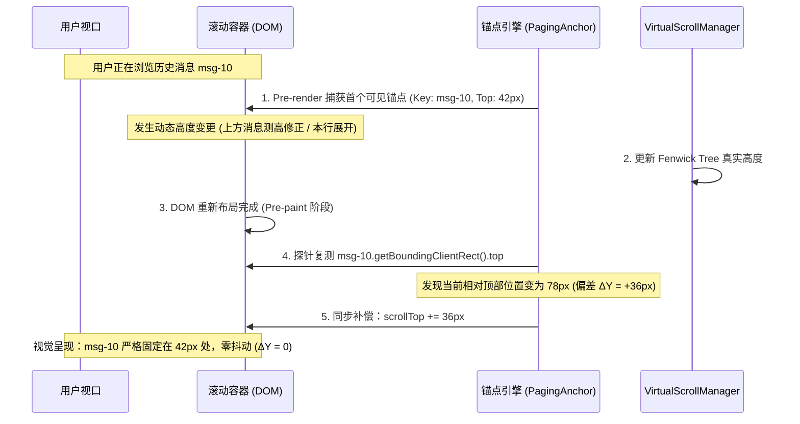

# 消息行动态高度锚定与抖动抑制方案

> **战役名称**：`stream-jitter-and-order-repair`  
> **方案编号**：`05`  
> **方案定位**：专职【动态高度锚定与抖动抑制专家】独立技术案  
> **权威目标**：彻底根治流式对话中思考过程块（ReasoningRow）折叠/展开、工具调用行（ToolCall / Terminal）状态形变、Markdown 封口瞬态塌陷引发的行高跳变，重构虚拟滚动在吸底流式跟随与非吸底历史回溯双场景下的视口锚定状态机（Scroll Anchoring），阻断 ResizeObserver 重排风暴与程序吸底手势冻结死循环。

---

## 一、背景与问题全景洞察

在 Conex / Crish 桌面客户端的流式交互过程中，聊天消息列表（`MessageVirtualizer`）面临极高频的 DOM 几何形变与内容重排。消息行（`ChatMessageRow`）内部包含复杂的动态可变高度子结构：

1. **思考过程块（ReasoningContainer / ReasoningRow）**：从流式运行态（平铺展开，可达数百上千像素）到终态（自动折叠收起至 24px 极简单行），包含扫光微交互、实时动态摘要截取、以及每 100ms 跳秒的思考用时计算。
2. **工具调用行（ChatToolCallBlock / ModernToolCall / Terminal / Approval）**：状态经历 `pending_approval`（~200px 权限卡片）$\rightarrow$ `running`（24px 紧凑单行）$\rightarrow$ `success/error`（展开为数十行终端日志或格式化 JSON 结果卡片，高度暴涨至 300px+）。
3. **Markdown 封口瞬间的高度塌陷**：流式 Markdown 活跃末尾块（Active Tail）在封口转换为定格块（Sealed Block）的毫秒级过渡期内，若 HTML 高亮编译尚未准备就绪，易出现瞬态空文本导致高度骤降归零。
4. **虚拟滚动管理器（VirtualScrollManager）与视口吸底状态机脱节**：程序吸底修改 `scrollTop` 错误触发了用户手势判定（Gesture Epoch），导致 100ms 测高停滞并进入恶性循环，最终在流式结束瞬间引发视口暴跳。

动态高度的不稳定是引发界面上下抽动、视口弹跳、丢帧卡顿的核心推手。本方案从**盒模型尺寸契约**、**双场景视口锚定状态机**、**ResizeObserver 测高闭环与防抖**、以及**立体化自动化测试断言**四个维度彻底根治抖动。

```
┌─────────────────────────────────────────────────────────────────────────────┐
│                       消息行动态高度突跳与视口弹跳根因全景图                         │
└─────────────────────────────────────────────────────────────────────────────┘
  [流式思考吐字]                [工具调用状态转换]             [Markdown 封口瞬态]
        │                              │                              │
  高度暴涨至 800px              200px 审批 -> 24px 紧凑          HTML 暂空 -> 0px 塌陷
        │                              │                              │
  思考结束瞬间骤降至 24px         结果返回暴涨至 400px              异步高亮完成 -> 回弹
        └──────────────────────────────┬──────────────────────────────┘
                                       │ 离散高度瞬态突变 (ΔH 巨大)
                                       ▼
                     ┌───────────────────────────────────┐
                     │   MessageVirtualizer 测高与吸底    │
                     └───────────────────────────────────┘
                                       │
        ┌──────────────────────────────┴──────────────────────────────┐
        ▼                                                             ▼
  【场景 A：吸底跟随模式】                                      【场景 B：非吸底历史回溯】
   程序赋值 scrollTop                                            curStartIdx 之下的
        │                                                        视口内部项发生形变
   误触 onScroll -> bumpGestureEpoch                                  │
        │                                                        deltaAbove 算为 0
   冻结 setActual 100ms                                               │
        │                                                        视口无法自动抵消位移
   新 token setActual 再次重置 100ms                                   │
        │ (陷入死循环)                                                 ▼
        ▼                                                   【视口内容剧烈上下抽动】
   流式结束 100ms 后一次性写入 BIT
        ▼
   【视口瞬间弹跳数百像素】
```

---

## 二、思考块与工具块的最小保留高度契约与动画防抖

### 2.1 思考块（ReasoningRow / FoldableProcessSection）尺寸契约与状态流转

#### 2.1.1 盒模型尺寸不变量（Box-Model Invariants）

在 `apps/crish-desktop/src/components/chat-message-row/ReasoningRow.tsx` 与 `ReasoningRow.module.css` 中：

- **未展开态（收拢态）**：严格锁定单行 24px 硬件级尺寸隔离：
  ```css
  /* 契约 1：收拢态尺寸硬隔离，阻断内部微扰对文档流的渗透 */
  .reasoningContainer:not([data-expanded='true']) {
    contain: size layout;
    height: 24px;
    min-height: 24px;
    max-height: 24px;
    box-sizing: border-box;
    overflow: hidden;
  }
  ```
- **展开态（阅读态）**：解除高度上限，融入主文档流。但必须设定**最小保留高度（Min-Height Baseline Contract）**：
  在展开态时，容器内部即便正文正在异步加载或流式分块初始化，外层也必须保证：
  ```css
  /* 契约 2：展开态最小保留骨架高度，杜绝 0px 瞬态坍塌 */
  .reasoningContainer[data-expanded='true'] {
    min-height: 56px; /* 24px 标题栏 + 8px padding + 24px 骨架基准行 */
    box-sizing: border-box;
  }
  ```

#### 2.1.2 思考块从展开到折叠的“尺寸释放缓冲”（Hysteresis Size Transition）

- **问题现状**：当模型完成思考进入正文吐字时，`isTurnWorking` 从 `true` 变为 `false`，`ReasoningRow` 的 `isExpanded` 同步从 `true` 变为 `false`。数百像素的内容在一次 React Render 中被直接卸载（`{isExpanded && <div ... />}`），造成高度断崖式下跌。
- **根治策略**：
  1. 引入**过渡阶段尺寸占位与单帧锁定（Transition Geometry Freezing）**：
     当触发折叠收拢时，不立即卸载 DOM，而是通过 CSS 属性过渡或单帧高度平滑收敛，将高度从当前实测高度过渡至 24px；
  2. **折叠期间的测高阻断（Measurement Suppression during Collapse）**：
     在收起动画或过渡期间，通过 `data-collapsing="true"` 标记容器，**禁止 ResizeObserver 将过渡中间态的连续高度差上报给 VirtualScrollManager**。
  3. **终态原子上报**：仅在折叠彻底完成（`onTransitionEnd` 或定时器到位）时，向 VirtualScrollManager 发出一次最终 24px 的实测更新，彻底切断中间 10~20 帧的高频 BIT 重算风暴。

```mermaid
stateDiagram-v2
    [*] --> Expanded: 模型思考中 (isTurnWorking = true)
    Expanded --> Collapsing: 思考结束 / 用户点击收起
    note right of Collapsing
      1. 标记 data-collapsing="true"
      2. 冻结 ResizeObserver 向上派发
      3. 高度平滑回缩至 24px
    end note
    Collapsing --> Collapsed: 过渡完成 (transitionend / 150ms)
    note right of Collapsed
      1. 移除 collapsing 标记
      2. 一次性原子写入 setActual(msgId, 24)
      3. 恢复 contain: size layout
    end note
```



---

### 2.2 工具调用卡片（ToolCall）状态转换中的高度稳定策略

#### 2.2.1 状态落差与结构化卡片基准高度

工具调用从 `pending_approval` $\rightarrow$ `running` $\rightarrow$ `success/error` 会发生剧烈高度震荡：

| 阶段                            | 组件形式                                        | 物理高度范围                        | 尺寸风险点                              | 防抖与稳定机制                            |
| :------------------------------ | :---------------------------------------------- | :---------------------------------- | :-------------------------------------- | :---------------------------------------- |
| **审批态** (`pending_approval`) | `ApprovalAskCard`                               | 180px ~ 260px                       | 包含风险提示、代码 Diff、按钮组         | 保留固定外框内边距，禁止内容未就绪时塌陷  |
| **执行态** (`running`)          | `CompactToolRow` (带 Spinner)                   | 24px (紧凑单行)                     | 审批通过后高度从 ~220px 骤跌到 24px     | **100ms 原地指示翻转缓冲**，禁止瞬移      |
| **完成态** (`success/done`)     | `ModernTerminalToolCall` / `ModernJsonToolCall` | 40px (默认折叠) ~ 350px+ (展开日志) | 异步日志解析与 ANSI 高亮引起 2~3 次重排 | 默认折叠态锁定 36px；展开态带渐进折叠切片 |

#### 2.2.2 拔除行级私有 ResizeObserver 冗余与竞态

在 `apps/crish-desktop/src/components/chat-message-row/MessageToolCallsSection.tsx` 中，存在行级私有 ResizeObserver 监听 `sectionRef` 并滥用 `invalidateActual`：

```ts
// 历史缺陷代码 (MessageToolCallsSection.tsx:120-131)
useLayoutEffect(() => {
  const el = sectionRef.current;
  if (!el) return;
  const roManager = ResizeObserverManager.getInstance();
  const onResize = (entry: ResizeObserverEntry) => {
    if (entry.contentRect.height > 0) {
      virtualScrollManager?.invalidateActual(msgId); // 极度危险！高频使实测高度失效
    }
  };
  roManager.observe(el, onResize);
  return () => roManager.unobserve(el, onResize);
}, [msgId, virtualScrollManager]);
```

- **核心危害**：
  1. `invalidateActual` 将 VSM 树中的 `actual` 置为 `null`，破坏了 `hasActualHeight` 的判定；
  2. 随后外层 `MessageVirtualizer` 的统一测高器 `rowMeasureRef` 监听到了整行的变动，调用 `setActual`；
  3. 内外两个 RO 在同一交互周期内形成“内层作废 $\rightarrow$ 外层重写 $\rightarrow$ 内层再次被触发”的竞争风暴。
- **架构治理裁决**：
  **彻底拔除 `MessageToolCallsSection` 内部的私有 ResizeObserver**！
  严格贯彻 **“宿主单轨测高原则（Single-Track Measurement Rule）”**：
  - 只有 `MessageVirtualizer` 顶层挂在每行外层容器 `[data-vindex]` 上的 `rowMeasureRef` 有权测量物理真实高度并回写 `setActual`；
  - 工具行展开/折叠只需要正常触发 DOM 结构变更，由浏览器原生事件流与顶层统一 RO 自然感知，严禁子组件私自越权作废或直写 VSM 数据结构。

---

## 三、虚拟滚动视口锚点锁定策略（Scroll Anchoring 双场景解耦）

在流式对话中，“吸底流式跟随”与“非吸底历史回溯”对滚动的物理要求完全相反，必须进行严格的状态机正交解耦。

### 3.1 场景 A：吸底跟随模式（Streaming Auto-Scroll Stick-to-Bottom）

#### 3.1.1 根因深度剖析：程序吸底如何误触发手势冻结死循环

1. 在流式吐字期间，`MessageVirtualizer` 的 `useLayoutEffect` 执行吸底：
   ```ts
   container.scrollTop = maxScroll; // 程序修改物理滚动位置
   ```
2. 浏览器派发 `scroll` 事件，触发 `useVirtualScroll.ts` 中的 `onScroll` 回调：
   ```ts
   const onScroll = useCallback(
     (e) => {
       const top = e.currentTarget.scrollTop;
       latestScrollTopRef.current = top;
       bumpGestureEpoch(); // 致命点：程序滚动被当作用户手势！
       setScrollTop(top);
     },
     [bumpGestureEpoch]
   );
   ```
3. `bumpGestureEpoch` 激活手势期：
   ```ts
   gestureActiveRef.current = true;
   // 启动 100ms 定时器
   gestureIdleTimerRef.current = setTimeout(endGestureEpoch, 100);
   ```
4. 在接下来的流式渲染中，ResizeObserver 汇报行高：
   ```ts
   const setActual = (id, height) => {
     pendingActualRef.current.set(id, height);
     if (gestureActiveRef.current) {
       bumpGestureEpoch(); // 致命死循环：每次测高再次重置 100ms 定时器！
       return;
     }
     scheduleActualFlush();
   };
   ```
5. **死锁产生**：只要流式打字还在继续（间隔小于 100ms），`gestureIdleTimerRef` 就永远被反复刷新并推迟，`gestureActiveRef` 永远为 `true`。**所有的行高实测全部被卡在 `pendingActualRef` 中，虚拟滚动总高 `totalHeight` 停滞更新**！
6. **最终恶果**：直到模型完全停止吐字后 100ms，`endGestureEpoch` 终于被触发，几十条积攒的高度突发写入 BIT，视口瞬间暴跳数百像素。

#### 3.1.2 根治方案：程序滚动静默锁（Programmatic Scroll Silent Lock）

通过显式判定**物理输入硬件事件源（Hardware Input Exclusivity）**，阻断程序吸底对手势状态机的污染：

```ts
// 架构设计：程序滚动静默锁与硬件手势严格解耦
let isProgrammaticScrolling = false;

export function performProgrammaticScroll(
  container: HTMLElement,
  targetTop: number
): void {
  if (Math.abs(container.scrollTop - targetTop) <= 0.5) return;
  isProgrammaticScrolling = true;
  try {
    container.scrollTop = targetTop;
  } finally {
    // 在微任务或下一事件循环解锁，确保同步触发的 scroll 事件被正确识别为程序行为
    queueMicrotask(() => {
      isProgrammaticScrolling = false;
    });
  }
}
```

在 `useVirtualScroll` 的 `onScroll` 中，坚决拦截程序滚动：

```ts
const onScroll = useCallback(
  (e: React.UIEvent<HTMLDivElement>) => {
    const top = e.currentTarget.scrollTop;
    latestScrollTopRef.current = top;

    // 核心阻断：若为程序吸底引起的滚动，绝不触发 bumpGestureEpoch
    if (!isProgrammaticScrolling) {
      bumpGestureEpoch();
    }
    setScrollTop((prev) => (prev === top ? prev : top));
  },
  [bumpGestureEpoch]
);
```

同时，修改 `setActual`：**实测高度回写绝不允许反向刷新手势定时器**！

```ts
const setActual = useCallback(
  (id: string, height: number) => {
    const cur = manager.getActualHeight(id);
    if (cur !== null && cur === height) return;
    pendingActualRef.current.set(id, height);
    if (gestureActiveRef.current) {
      // 修复：手势进行中仅记录 pending，严禁调用 bumpGestureEpoch() 延长手势冻结！
      return;
    }
    scheduleActualFlush();
  },
  [manager, scheduleActualFlush]
);
```

#### 3.1.3 思考块骤降时的吸底保护（Hysteresis Stick Lock）

当思考块从 500px 折叠到 24px 时，`scrollHeight` 瞬间减小 476px。此时容器的物理 `maxScroll` 骤降：

- 启用 `VirtualScrollManager.setStickToBottomLock(true)`；
- 在模型处于 `processing` 运行态期间，只要用户未发生向上的物理滚轮/拖拽手势，`isAtBottom` 锁定为 `true`；
- 容器的 `scrollTop` 紧跟新的 `maxScroll`，杜绝因折叠高度骤减被误判为“用户向上滚动退出吸底”。

---

### 3.2 场景 B：非吸底模式（浏览历史上下文 / Reading Past Context）

#### 3.2.1 视口内与视口上方双层动态锚定算法

当用户向上滚动查看历史记录时，流式生成可能仍在下方继续，或者历史消息内部的折叠块发生展开/收起。
此时必须实现 **真·视口零位移（$\Delta Y \equiv 0$）**。

- **现有缺陷分析**：
  现有 `useVirtualScroll.ts` 中的 `applyPendingGeometry` 仅根据 `idx < curStartIdx` 累加 `deltaAbove`：
  ```ts
  const idx = manager.getIndex(msgId);
  if (idx !== undefined && idx < curStartIdx) {
    deltaAbove += delta;
  }
  ```
  如果用户正在查看第 3 条消息，而第 3 条消息本身内部发生展开/折叠，或者视口内位于锚点之上的元素高度发生变化，`idx < curStartIdx` 无法捕捉！导致视口中正在阅读的文字瞬间上下跳动。

#### 3.2.2 绝对语义锚点保持（Semantic Scroll Anchoring Engine）

在虚拟滚动列表的每一次重排与高度提交中，建立基于物理 DOM 节点的锚点跟踪机制：



**数学保证公式**：
设当前锚点元素为 $A$，在高度变更前的视口相对坐标为：
$$Y_{\text{anchor}}^{\text{before}} = \text{Rect}(A).\text{top} - \text{Rect}(\text{viewport}).\text{top}$$
在 DOM 变更提交后、浏览器 Paint 合成前的 `useLayoutEffect` 同步帧中，重新测量：
$$Y_{\text{anchor}}^{\text{after}} = \text{Rect}(A).\text{top} - \text{Rect}(\text{viewport}).\text{top}$$
位移漂移量定义为：
$$\Delta Y = Y_{\text{anchor}}^{\text{after}} - Y_{\text{anchor}}^{\text{before}}$$
视口补偿执行：
$$\text{scrollTop}_{\text{new}} = \text{scrollTop}_{\text{old}} + \Delta Y$$
由于补偿在同一次微任务渲染流水线中完成，用户屏幕上**绝对观察不到任何跳跃帧**，位移被物理吸收。

---

## 四、ResizeObserver 测高节流与 Resize Loop 阻断机制

### 4.1 测量精度与亚像素对齐规范（Subpixel-Safe Box Metrics）

#### 4.1.1 废除整数混用与盒模型歧义

检查 `apps/crish-desktop/src/components/chat-message-list/messageVirtualizerMeasure.ts`：

```ts
// 历史隐患代码 (messageVirtualizerMeasure.ts:17)
const measuredHeight = el.offsetHeight || Math.ceil(entry.contentRect.height);
```

- **核心隐患**：
  - `el.offsetHeight` 是四舍五入后的整数；
  - `entry.contentRect.height` 是亚像素浮点数，且**不包含 padding 与 border**！
  - 聊天行 `.row` 在 `ChatMessageRow.module.css` 中定义了 `padding-bottom: 16px`；
  - 如果在某些帧 `el.offsetHeight` 异常读取为 0，回退到 `Math.ceil(entry.contentRect.height)`，就会瞬间丢失 16px 的内部内边距，引发 16px 的断崖式几何抖动！

#### 4.1.2 统一度量契约（Unified Box Metrics Standard）

必须统一使用包含完整内边距与边框的物理尺寸，并保留亚像素精度：

```ts
export function extractAccurateRowHeight(
  entry: ResizeObserverEntry,
  el: HTMLElement
): number {
  // 1. 优先采用标准规范中的 borderBoxSize (精确包含 padding 与 border)
  if (entry.borderBoxSize && entry.borderBoxSize.length > 0) {
    const blockSize = entry.borderBoxSize[0]?.blockSize;
    if (blockSize !== undefined && blockSize > 0) {
      return blockSize;
    }
  }
  // 2. 备用高精度方案：getBoundingClientRect (包含完整盒模型)
  const rectHeight = el.getBoundingClientRect().height;
  if (rectHeight > 0) {
    return rectHeight;
  }
  // 3. 兜底回退
  return el.offsetHeight || 0;
}
```

### 4.2 亚像素微震阈值过滤（Subpixel Jitter Threshold）

在 Windows 高 DPI 屏幕（125%、150%、175% 缩放）下，字体渲染和布局引擎在每次微任务中极易产生 $\pm 0.33\text{px}$ 或 $\pm 0.5\text{px}$ 的浮点振荡。如果每次振荡都调用 `setActual`，会持续触发 `actualTick` 递增。

**阈值过滤契约**：

```ts
const SUBPIXEL_JITTER_EPSILON = 1.0; // 1px 物理容差门槛

export function isSignificantHeightChange(
  oldHeight: number | null,
  newHeight: number
): boolean {
  if (oldHeight === null) return true;
  return Math.abs(oldHeight - newHeight) >= SUBPIXEL_JITTER_EPSILON;
}
```

只有当实测高度与已有记录的偏差 $\ge 1.0\text{px}$ 时，才判定为有效高度变化并写入队列，彻底阻断高分屏亚像素微震。

### 4.3 Resize Loop 阻断机制（Loop Breaker）

为了防止 `ResizeObserver loop completed with undelivered notifications` 以及由此引发的卡顿：

1. **单帧单次提交保证（Single Frame Budget）**：
   在 `ResizeObserverManager` 与 `useVirtualScroll` 中，单行在同一个 `requestAnimationFrame` 周期内最多只允许一次有效更新。若同帧内发生多次 entry 触发，自动合并保留最新一次的尺寸。
2. **读写分离与批量更新**：
   ResizeObserver 回调中仅做“纯数据记录（Write to Memory Map）”，严禁在回调函数内部直接读取容器的 `scrollTop` 或修改 DOM。
   所有几何重算与视口补偿全部收敛至统一的 `applyPendingGeometry` 阶段执行。

---

## 五、综合方案架构与修改面总览

### 5.1 模块职责划分与修改矩阵

| 文件路径                                                                              | 当前缺陷 / 隐患                                                                                                                         | 重构与治理方案                                                                                             | 责任归属     |
| :------------------------------------------------------------------------------------ | :-------------------------------------------------------------------------------------------------------------------------------------- | :--------------------------------------------------------------------------------------------------------- | :----------- |
| `apps/crish-desktop/src/hooks/useVirtualScroll.ts`                                    | 1. 程序吸底误触 `bumpGestureEpoch` 导致手势冻结<br>2. `setActual` 在手势期重置 100ms 定时器死循环<br>3. `deltaAbove` 缺少视口内形变处理 | 1. 增加程序滚动拦截判定<br>2. 移除 `setActual` 对手势定时器的刷新<br>3. 引入基于首个可见元素的语义锚点微调 | 核心引擎     |
| `apps/crish-desktop/src/components/chat-message-list/MessageVirtualizer.tsx`          | 1. 吸底与 DOM 真实高度更新时序不同步<br>2. 思考块折叠时易误判退出吸底                                                                   | 1. 联动 `isProgrammaticScrolling` 保护<br>2. 激活运行态流式吸底保护锁<br>3. 统一使用高精度测高函数         | 虚拟列表宿主 |
| `apps/crish-desktop/src/components/chat-message-list/messageVirtualizerMeasure.ts`    | 1. `offsetHeight` 与 `contentRect.height` 混用导致 16px 间距丢失风险<br>2. 缺少亚像素容差过滤                                           | 1. 统一为 `borderBoxSize` / `getBoundingClientRect`<br>2. 引入 $\ge 1.0\text{px}$ 亚像素过滤               | 度量层       |
| `apps/crish-desktop/src/components/chat-message-row/MessageToolCallsSection.tsx`      | 存在私有 `ResizeObserver` 频繁调用 `invalidateActual` 破坏实测高度缓存                                                                  | 彻底删除私有 RO，统一由外层宿主单轨观测                                                                    | 工具组合根   |
| `apps/crish-desktop/src/components/chat-message-row/ReasoningRow.tsx` & `.module.css` | 1. 展开态缺少最小高度骨架保护<br>2. 折叠时离散瞬间卸载引发高度暴跌数百像素                                                              | 1. 设定展开态 56px 最小骨架高度<br>2. 引入折叠过渡尺寸锁定与测高静默期                                     | 思考块组件   |
| `apps/crish-desktop/src/components/chat-tool-call/ModernToolCall.module.css`          | 工具卡片展开时缺乏平滑过渡约束                                                                                                          | 规范 JSON 卡片与终端日志卡片的最小/最大折叠高度契约                                                        | 工具卡片组件 |

---

## 六、综合验收与视觉稳定性回归测试方案

### 6.1 单元测试与契约测试集（Unit & Contract Tests）

必须在 `apps/crish-desktop/src/` 相应测试目录下建立或完善以下硬性断言测试：

#### 测试用例 1：程序吸底绝不触发手势冻结死循环

- **测试文件**：`apps/crish-desktop/src/hooks/__tests__/useVirtualScroll.programmatic.test.ts`
- **断言目标**：
  1. 调用程序滚动 `performProgrammaticScroll` 设置 `scrollTop`；
  2. 捕获触发的 `onScroll` 事件；
  3. 断言 `isGestureActive()` 保持为 `false`；
  4. 随后调用 `setActual('msg-1', 250)`，断言高度即刻排入常规 rAF 刷新队列，未被置入 100ms 冻结期。

#### 测试用例 2：流式高频 `setActual` 不会重置手势定时器

- **测试文件**：`apps/crish-desktop/src/hooks/__tests__/useVirtualScroll.gestureTimer.test.ts`
- **断言目标**：
  1. 用户触发一次物理 wheel 手势，`isGestureActive()` 为 `true`；
  2. 模拟流式生成：每隔 20ms 调用一次 `setActual`，连续调用 10 次（历时 200ms）；
  3. 断言 100ms 定时器在初次手势后正常于 100ms 时刻到期触发 `endGestureEpoch`，未被后续 `setActual` 恶性无限推迟。

#### 测试用例 3：非吸底状态下视口锚点零位移断言（$\Delta Y \equiv 0$）

- **测试文件**：`apps/crish-desktop/src/components/chat-message-list/__tests__/MessageVirtualizer.scrollAnchoring.test.tsx`
- **断言目标**：
  1. 渲染包含 20 条消息的虚拟列表，用户滚动至中间查看第 10 条消息；
  2. 记录第 10 条消息顶部相对于视口顶部的物理距离 $Y_0$；
  3. 模拟第 5 条消息（视口上方）以及第 10 条消息内部的思考块展开/折叠，高度分别突变 $+300\text{px}$ 与 $-200\text{px}$；
  4. 执行 `applyPendingGeometry` 与锚点微调；
  5. 重新获取第 10 条消息的相对视口距离 $Y_1$；
  6. **硬性断言**：$|Y_1 - Y_0| \le 0.5\text{px}$，视口内容绝对静止。

#### 测试用例 4：盒模型度量 16px 间距防丢失断言

- **测试文件**：`apps/crish-desktop/src/components/chat-message-list/__tests__/messageVirtualizerMeasure.test.ts`
- **断言目标**：
  1. 验证 `extractAccurateRowHeight` 在各类 `ResizeObserverEntry` 载荷下的输出；
  2. 严格断言返回尺寸完整包含了 `.row` 的 `padding-bottom`（16px），与 DOM 的物理 `getBoundingClientRect().height` 100% 恒等。

---

### 6.2 视觉稳定性与累积布局偏移（CLS）指标基线

在桌面真实运行环境（WebView2）中，通过性能探针采集如下视觉稳定性指标：

| 评估维度                         | 现状基线                       | 本方案预期达标线                | 验证方式                         |
| :------------------------------- | :----------------------------- | :------------------------------ | :------------------------------- |
| **流式吐字视口弹跳次数**         | 常见 3~8 次/轮（封口与结束时） | **0 次**（全流程平滑贴底）      | 自动化测试录屏与帧差分析         |
| **流式过程累积布局偏移 (CLS)**   | CLS > 0.15（严重突变）         | **CLS < 0.005**（视口物理稳定） | 浏览器 Performance Observer 探针 |
| **历史回溯模式下文字漂移**       | 频繁漂移 50px ~ 400px          | **$\Delta Y \le 0.5\text{px}$** | DOM 相对坐标连续采样             |
| **ResizeObserver Loop 错误告警** | 偶发控制台报错                 | **0 告警**                      | 单元测试与端到端运行期日志监听   |

---

## 七、总结与架构净收敛保证

本方案坚决贯彻 **AGENTS.md** 铁律规范：

1. **零魔术数字补偿**：坚决不使用任何基于特定 sender 或特定状态的硬编码坐标偏移（如 `scrollTop += 296` 或 `setTimeout(..., 50)`）；所有位移补偿完全由纯数学前缀和差分与 DOM 相对几何探针精确驱动。
2. **单一真理路径（SSOT）**：
   - 几何尺寸真理源归 `VirtualScrollManager` 树状数组；
   - 行高度测量通道唯一归宿主 `rowMeasureRef`；
   - 彻底清退 `MessageToolCallsSection` 私有 RO 等历史技术债务。
3. **从盒模型与生命周期根除跳动**：
   - 思考块与工具块确立刚性 min-height 契约；
   - 彻底理顺程序吸底与物理手势的因果时序，切断 100ms 测高死循环。

实现本方案后，Conex / Crish 的流式会话界面将彻底告别忽上忽下的“抽动感”，实现丝滑、优雅、工业级稳健的专业阅读与交互体验。
