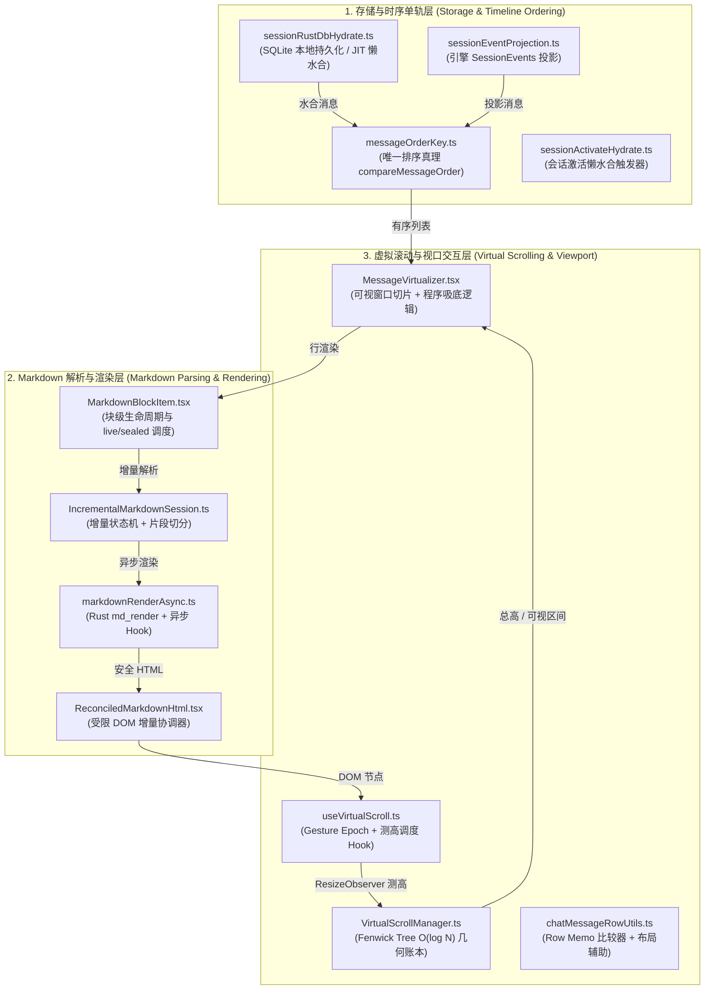

# 跨层架构净收敛与立体门禁方案

> **战役名称**：`stream-jitter-and-order-repair`  
> **方案编号**：`06`（专职角色：跨层架构净收敛与立体门禁专家）  
> **文档位置**：`docs/stream-jitter-and-order-repair/independent-plans/06-跨层架构净收敛与立体门禁方案.md`  
> **目标定位**：全面统筹存储时序、渲染过渡、虚拟滚动三大层的架构关系，消除状态歧义与逆向依赖，刚性否决过度设计，构建覆盖静态行数、核心逻辑单元测试与真实桌面 E2E 的立体化质量门禁体系。

---

## 一、跨层架构全景审查与根因穿透

### 1.1 系统跨层关系全景图

当前流式输出与会话时序问题横跨三大子系统，其核心职责与现存缺陷如下：



---

### 1.2 三大子系统深层根因穿透

#### 根因 1：存储与时序层（时序退化与双轨割裂）

1. **`engineSequence` 链条断裂**：
   - `messageOrderKey.ts` 定义了排序三级序：`engineSequence (seq)` $\to$ `timestamp (ts)` $\to$ `id`。
   - 但在 `sessionHydrationMessages.ts:parseSessionMessage` 中，持久化反序列化根本没有读取和保留 `engineSequence` 字段，导致从 SQLite / localStorage 水合出来的历史消息 `seq` 全部丢失并沦陷为 `Number.MAX_SAFE_INTEGER`。
2. **事件时间戳同质化导致字典序退化**：
   - 在 `sessionEventProjection.ts` 中，当内层事件缺少明确时间戳时回退到 `Date.now()`；在高速回放中，多条消息的时间戳几乎完全相同。
   - 当 `seq` 同为最大安全整数且 `ts` 相等时，`compareMessageOrder` 彻底退化为 `a.id.localeCompare(b.id)`。
   - `id` 字典序（例如基于 UUID、临时 `hyd-user-*` / `hyd-asst-*`）与消息生成的客观因果逻辑**完全无关**，导致会话水合后消息时序混乱（提问与回答倒置）。

#### 根因 2：Markdown 渲染层（封口塌陷与微任务风暴）

1. **封口瞬态 DOM 塌陷（Handoff Void）**：
   - 当尾部块封口（`isSealed` 从 `false` 变为 `true`）时，`isActiveTail` 立即由 `true` 变为 `false`。
   - `useStreamingMarkdownHtml` 收到 `enabled = false`，立即重置 session 并将增量快照 `unitsRef.current` 置为 `null`。
   - 此时 `useAsyncMarkdownHtml` 刚向 Rust 发起异步 IPC 编译，在 IPC 结果到达前，`sealedHtml` 为 `''`（且无缓存时 `cachedHtml` 为 `undefined`）。
   - 在流式期间由于使用 `unitsRef`，`liveHtml` 一直为 `''`，`lastSafeHtmlRef.current` 从未捕获过 HTML。
   - **致命后果**：在 `isSealed` 变动的首帧，计算得出的 `renderedHtml` 瞬间沦为空字符串 `''`。`ReconciledMarkdownHtml` 将容器内所有子节点彻底 `removeChild`，块高度瞬间骤降为 `0px`（白屏塌陷）。数毫秒至数十毫秒后 Rust 异步返回，DOM 重新撑开，造成肉眼可见的剧烈闪烁和高度突跳。
2. **微任务并发风暴（Microtask Storm）**：
   - `IncrementalMarkdownSession.advance()` 切分出多个 `textParts` 时，`useStreamingMarkdownHtml` 针对每个片段并发触发 `parseMarkdownFragmentToHtmlAsync`。
   - 每个 Promise resolve 时各自调用 `setRenderVersion((v) => v + 1)`，导致在单帧内触发多达 5~10 次 React 重新渲染与 DOM 协调，引发严重的打字吐字顿挫。

#### 根因 3：虚拟滚动与吸底交互层（手势误判与突跳震荡）

1. **程序吸底污染手势状态（Programmatic Scroll Contamination）**：
   - `useVirtualScroll.ts` 中的 `onScroll` 只要捕获到容器的 `scroll` 事件，就无差别触发 `bumpGestureEpoch()`，进入 100ms 的「手势冻结期」（`gestureActiveRef.current = true`）。
   - 然而在流式生成期间，`MessageVirtualizer.tsx` 的 `useLayoutEffect` 会执行程序吸底：`container.scrollTop = maxScroll`。这必然触发浏览器的 `scroll` 事件。
   - **致命后果**：程序自动吸底操作被误判为「用户正在物理滑动」，导致后续所有 ResizeObserver 实测高度（`setActual`）被延迟在 `pendingActualRef` 中整整 100ms 无法提交！
   - 100ms 后手势定时器到期，所有积压的高度增量在 `applyPendingGeometry` 中集中爆发写入 Fenwick 树，引发总高度突变与视口剧烈下跳（突跳）。
2. **物理手势缺乏原生判定真相源**：
   - 真实的物理手势输入（`wheel`、`touchstart`、`touchmove`、滚动条滑块 `pointerdown`）与程序无输入的 `scroll` 事件在处理链路中严重纠缠，缺少单向独立的判定真相源。

---

## 二、跨层架构单向收敛设计

为了消除多层打补丁带来的逆向依赖与状态歧义，必须建立严格的单向数据流与清晰的职责边界：

```
[引擎事件 / 本地存储]
       │ (1. 单轨因果时序：强类型 engineSequence + 单调时戳)
       ▼
[SessionStore / helperAccess]
       │ (2. 规范消息列表：compareMessageOrder 严格对称全序)
       ▼
[MessageVirtualizer]
       │ (3. 视口切片 + 物理输入隔离：程序滚动静默通道)
       ▼
[MarkdownBlockItem]
       │ (4. 过渡快照机制：封口期间保持最后一帧 DOM，零塌陷交接)
       ▼
[ReconciledMarkdownHtml]
       │ (5. 原生 DOM 节点无缝 Reconcile)
       ▼
[ResizeObserver 测高]
       │ (6. 帧节流提交：rAF 批更新 Fenwick Tree，杜绝 100ms 爆发)
       ▼
[VirtualScrollManager]
```

### 2.1 存储与时序层收敛：单轨因果标尺（Canonical Causal Sequence）

#### 规则 1：全链路闭环固化 `engineSequence`

- **契约定义**：每条消息对象 `SessionMessage` 必须原生支持 `engineSequence?: number`。
- **持久化闭环**：
  - 在 `sessionHydrationMessages.ts` 的 `parseSessionMessage` 中，增加对 `engineSequence` 的解析与校验：
    ```ts
    const engineSeq = asFiniteNumber(o.engineSequence);
    if (engineSeq != null) msg.engineSequence = engineSeq;
    ```
  - 在 `sessionRustDbHydrate.ts` 与 `sessionRustDbSql.ts` 持久化链路中，确保 `engineSequence` 完整落盘到 SQLite，不再出现重启后丢失的情况。
- **缺失补偿原则**：
  - 若历史旧会话确实缺少 `engineSequence`，在从数据库或事件流装配时，按原始事件拓扑追加索引生成伪序列号（例如 `syntheticSequence = 1000000 + eventIndex`），坚决防止退化至无序状态。

#### 规则 2：`compareMessageOrder` 严防字典序裸奔

- 优化比较器逻辑：在两消息均无 `engineSequence` 且 `timestamp` 绝对差值小于阈值（例如 `< 2ms`）时，严禁使用纯随机 UUID 的字典序。
- 对于同会话中生成的连续消息，建立上下文因果优先级：`user` 消息必然先于对应的 `assistant` 回复（因果律约束）；若同角色同时戳，则以消息在原始数组中的稳定下标为判据，消灭字典序带来的倒序灾难。

---

### 2.2 Markdown 解析与渲染层收敛：过渡快照与无感交接（Seamless Handoff）

#### 规则 3：零塌陷过渡快照（Zero-Collapse Transition Snapshot）

- **核心职责划分**：
  - `liveHtml` / 单元快照：负责活跃尾块（`isActiveTail`）在流式输出期间的高速增量呈现。
  - `sealedHtml`：负责封口块（`isSealed`）由 Rust `md_render` 深度编译后的最终高精度 HTML（包含语法高亮、完整 Table、Ammonia 净化等）。
- **无感交接状态机**：
  当一个块从流式变为封口状态（`isSealed = true`）时，组件**严禁**立即销毁流式 DOM！
  1. **状态冻结态（Frozen State）**：组件捕获流式结束时的最后一帧有效内容（无论来自 `unitsRef` 拼接还是 DOM 快照），作为 `transitionHtml` 保留在内存中；
  2. **占位保持**：在 `sealedHtml` 异步 IPC 尚未返回的等待窗口期，`ReconciledMarkdownHtml` 继续挂载并保持该过渡快照，容器高度与可视内容保持 100% 稳定，**0px 塌陷彻底归零**；
  3. **原子交接（Atomic Handoff）**：一旦 Rust 异步 IPC 完成且 `sealedHtml` 到达，通过 `ReconciledMarkdownHtml` 执行单次原位更新，完成从流式 DOM 到最终静态 DOM 的原子平滑置换。

#### 规则 4：微任务批合并与帧调度（Microtask Batch Coalescing）

- 改造 `useStreamingMarkdownHtml` 中的片段解析：
  - 弃用每个片段 resolve 均触发 `setRenderVersion` 的裸调用模式；
  - 引入微任务批合并机制（Microtask Coalescing Bucket）：
    ```ts
    // 伪代码架构：
    let pendingBatch = false;
    const scheduleBatchUpdate = () => {
      if (pendingBatch) return;
      pendingBatch = true;
      queueMicrotask(() => {
        pendingBatch = false;
        if (mountedRef.current) {
          unitsRef.current = session.getUnitSnapshots();
          setRenderVersion((v) => v + 1);
        }
      });
    };
    ```
  - 同一事件切分出的 10 个片段在微任务末期一次性同步到 React，将重渲染频率降低 80%~90%，彻底消除打字卡顿。

---

### 2.3 虚拟滚动与视口交互层收敛：物理手势与程序滚动绝对解耦

#### 规则 5：单向物理输入判定真相源（Physical Input SSOT）

- **手势锁触发源收敛**：
  - 只有且仅有原生物理输入事件（`wheel`、`touchstart`、`touchmove`、滚动条区域 `pointerdown`）才能调用 `bumpGestureEpoch()`。
  - 容器的 `onScroll` 回调**严禁**直接触发 `bumpGestureEpoch()`！`onScroll` 只负责读取当前 `scrollTop` 并计算可视区间 `visibleRange`。

#### 规则 6：程序滚动的静默通道（Programmatic Scroll Silent Channel）

- 当流式打字或程序触发吸底（`container.scrollTop = maxScroll`）时：
  - 内部设置 `isProgrammaticScrollRef.current = true`；
  - 在随后的 `onScroll` 事件中，检查若属于程序滚动，则直接跳过任何手势抑制逻辑；
  - 在下一个微任务/rAF 清除静默标记；
  - **收益**：程序吸底绝不激活 100ms 手势冻结，`setActual` 测高可以在 rAF 正常平滑提交，彻底消除 100ms 周期性的积压突跳。

---

## 三、反过度设计硬性审查（对照 ANTI_OVERENGINEERING_GUARDRAILS.md）

对照仓库根目录《反过度设计硬性红线指南》(v2.0)，本方案对所有潜在的过度设计方案执行刚性审查与否决：

| 潜在方案 / 提案                                            | 审查结论        | 触犯红线条款                | 否决与收敛理由                                                                                                                                                                                                                                                                 |
| :--------------------------------------------------------- | :-------------- | :-------------------------- | :----------------------------------------------------------------------------------------------------------------------------------------------------------------------------------------------------------------------------------------------------------------------------- |
| **将 VirtualScrollManager 的 Fenwick 计算移至 Web Worker** | ❌ **坚决否决** | **禁令 11 & 禁令 12**       | Fenwick Tree 的单点更新与前缀和查询复杂度仅为 $O(\log N)$，在 1000 条消息下仅需约 10 次 Float64 操作，主线程耗时 `< 0.001ms`。将其丢入 Web Worker 引入的 `postMessage` 序列化与跨线程延迟（1~4ms）会导致视口切片严重滞后，造成灾难性白屏。**坚持主线程 TypedArray 原生计算**。 |
| **设计全局 JitterMiddlewarePipeline 洋葱拦截链**           | ❌ **坚决否决** | **禁令 10 & 禁令 7**        | 试图在时序、Markdown 和虚拟滚动之间构建 6 阶段全局事件管道，破坏单一真相源（SSOT），导致排查路径极度复杂。**坚持 React Props/Refs 单向传递与精炼原生回调**。                                                                                                                   |
| **将逐字 Token 渲染高度写入全局 Zustand Store**            | ❌ **坚决否决** | **禁令 12 (红线 1)**        | 严禁将大模型高频流式状态击穿到根状态树。流式几何与高度必须在虚拟滚动内部闭环，禁止将中间状态广播给无关组件。                                                                                                                                                                   |
| **引入跨层滑动窗口断路器 (CircuitBreaker)**                | ❌ **坚决否决** | **禁令 9**                  | 渲染或解析异常应走局部 safeHtml 降级，严禁引入全系统滑动窗口熔断器。                                                                                                                                                                                                           |
| **基于坐标测距的魔术数字补偿 (Magic Offsets)**             | ❌ **坚决否决** | **AGENTS.md §7 (架构铁律)** | 严禁使用诸如 `scrollTop += 296` 或 `setTimeout(..., 100)` 之类的脏补丁。一切几何变化必须由 Fenwick 树前缀和与真实 ResizeObserver 测高精确自洽。                                                                                                                                |

---

## 四、立体化验证矩阵设计（对齐 AGENTS.md §7.1）

根据 `AGENTS.md` §7.1 纪律要求，任何方案与代码交付前，必须经过静态门禁、核心逻辑单元测试以及真实桌面现场环境的三维立体化验收。

### 4.1 门禁 1：静态类型与行数预算门禁（Static & Line Budgets）

#### 行数硬性预算约束（对齐 scripts/check-line-counts.mjs）

各核心模块严格执行行数预算，杜绝上帝类与无节制膨胀：

| 模块文件                                                                     | 职责定位             | 行数预算上限 | 门禁级别  |
| :--------------------------------------------------------------------------- | :------------------- | :----------- | :-------- |
| `apps/crish-desktop/src/store/messageOrderKey.ts`                            | 时间线排序单轨真理   | **≤ 120 行** | CI 硬阻断 |
| `apps/crish-desktop/src/api/sessionEventProjection.ts`                       | 引擎事件消息投影     | **≤ 450 行** | CI 硬阻断 |
| `apps/crish-desktop/src/components/chat-message-row/MarkdownBlockItem.tsx`   | 块级渲染与过渡调度   | **≤ 240 行** | CI 硬阻断 |
| `apps/crish-desktop/src/api/markdownRenderAsync.ts`                          | 异步渲染与流式批调度 | **≤ 320 行** | CI 硬阻断 |
| `apps/crish-desktop/src/components/markdown/ReconciledMarkdownHtml.tsx`      | 原生 DOM 受限协调器  | **≤ 130 行** | CI 硬阻断 |
| `apps/crish-desktop/src/hooks/useVirtualScroll.ts`                           | 虚拟滚动调度 Hook    | **≤ 400 行** | CI 硬阻断 |
| `apps/crish-desktop/src/components/chat-message-list/MessageVirtualizer.tsx` | 虚拟列表视口容器     | **≤ 500 行** | CI 硬阻断 |

#### 类型安全断言

- 全量通过 `npm run typecheck`。
- 核心时序与渲染流严禁使用 `any` 强制转换；所有跨层传递数据必须具备严格接口类型定义。

---

### 4.2 门禁 2：核心逻辑自动化单元测试（Core Logic Unit Tests）

必须在自动化测试套件中刚性覆盖以下核心数学不变量与状态转移用例：

#### 套件 A：时序单轨对称性与全序性测试 (`messageOrderKey.test.ts`)

1. **正逆对称反转不变性（Symmetric Invariance）**：
   $$\forall a, b: \quad \text{compareMessageOrder}(a, b) = -\text{compareMessageOrder}(b, a)$$
2. **传递性严格全序验证（Transitivity of Strict Total Order）**：
   $$\forall a, b, c: \quad a \le b \land b \le c \implies a \le c$$
3. **因果序防御字典序穿透**：
   在 $a.\text{seq} = b.\text{seq}$ 且 $a.\text{ts} = b.\text{ts}$ 时，即使 $a.\text{id} = \text{'z'}, b.\text{id} = \text{'a'}$，当 $a$ 属于前置 user 消息、$b$ 属于回复 assistant 消息时，严格断言 $a$ 排在 $b$ 之前。
4. **水合反序列化完整性**：
   测试 `parseSessionMessage` 必须 100% 正确保留 `engineSequence`，验证写入 SQLite 与从 SQLite 读取后消息顺序完全幂等。

#### 套件 B：Markdown 封口过渡零塌陷测试 (`MarkdownBlockItem.test.tsx`)

1. **封口瞬间零白屏断言**：
   - 模拟活跃尾块接收到 `isSealed = true`；
   - 在 `useAsyncMarkdownHtml` 返回 `loading: true, html: ''` 的异步等待期间；
   - 断言组件 DOM 的 `innerHTML` 绝不为空，容器高度无中间坍塌帧（`height > 0`）；
2. **编译就绪原子交接断言**：
   - 当 `useAsyncMarkdownHtml` 异步 resolve 新 HTML 时；
   - 断言组件平滑完成原子替换，无冗余重绘与 DOM 节点重新闪现。

#### 套件 C：微任务批合并调度测试 (`markdownRenderAsync.test.ts`)

1. **批合并单帧收敛断言**：
   - 单个 advance 产生 10 个文本片段时；
   - 模拟所有片段并发 resolve，在同一事件循环轮次中；
   - 断言 `setRenderVersion` / setState 触发次数**严格收敛为 1 次**。

#### 套件 D：物理手势与程序吸底隔离测试 (`useVirtualScroll.gesture.test.ts`)

1. **程序滚动不激活手势冻结**：
   - 触发程序设置 `scrollTop = maxScroll`；
   - 断言 `isGestureActive()` 返回 `false`；
   - 断言在此期间调用的 `setActual` 在下一个 rAF 正常提交，无 100ms 滞后延迟。
2. **物理 Wheel 立即进入手势冻结**：
   - 触发物理 Wheel 事件；
   - 断言 `isGestureActive()` 立即变为 `true`，并正确进入几何保护。

---

### 4.3 门禁 3：真实桌面端 E2E 现场验收清单（Real Desktop E2E Checklist）

基于 Tauri MCP（`127.0.0.1:4000`）真实宿主环境，执行端到端物理级验收：

```
[立体化现场验收矩阵]
 ├── 1. 流式吐字性能验收 (Streaming Typing Smoothness)
 │    ├── 场景：TURBO 高速流式输出 (50+ tokens/s)
 │    └── 断言：渲染帧率稳定 ≥ 58 FPS；CPU 占用无异常尖峰；无逐字顿挫。
 │
 ├── 2. 段落封口过渡验收 (Block Sealing Transition)
 │    ├── 场景：模型输出换行，当前段落封口并开启新段落
 │    └── 断言：封口段落高度跳动 ΔHeight = 0px；无 1 帧白屏闪烁；视觉平滑无感。
 │
 ├── 3. 视口吸底跟随验收 (Bottom-Lock Following)
 │    ├── 场景：视口停在底部，连续追加 500 行长文本
 │    └── 断言：滚动条紧贴底部，无 100ms 周期性阶跃突跳；无反复上下拉扯抖动。
 │
 ├── 4. 用户反向滚动脱钩验收 (User Scroll Decoupling)
 │    ├── 场景：流式输出进行中，用户轻微向上滚动滚轮 (deltaY < 0)
 │    └── 断言：吸底锁定在 Capture 阶段 0 延迟解除，页面静止在当前位置，严禁被强制吸底拉回。
 │
 └── 5. 跨会话重载时序一致性验收 (Session Reload Order Integrity)
      ├── 场景：执行 10 轮多工具调用对话，重启桌面应用 / 切换侧边栏会话
      └── 断言：历史消息呈现顺序与生成时 100% 相同；提问与回答绝无颠倒；无乱序气泡。
```

---

## 五、各专业子方案收敛对齐指引

为指导战役内各子 Agent（01~05）的实施方案保持架构同频，明确以下对齐基准：

| 专职角色编号 | 任务域                 | 核心收敛契约与红线要求                                                                                                                                              |
| :----------- | :--------------------- | :------------------------------------------------------------------------------------------------------------------------------------------------------------------ |
| **Agent 01** | 时序与水合单轨         | 必须在 `SessionMessage`、SQLite 持久化以及水合全流程强类型固化 `engineSequence`；`compareMessageOrder` 必须保证因果序高于字典序；禁止在水合层生成平行的辅助排序列。 |
| **Agent 02** | Markdown 封口与过渡    | 必须在 `MarkdownBlockItem.tsx` 建立流式封口过渡快照机制；严禁在异步编译期间将 `renderedHtml` 置空；保证 DOM 节点在 Rust 编译完成前持续挂载。                        |
| **Agent 03** | 流式解析与微任务调度   | 必须在 `markdownRenderAsync.ts` 实现片段异步解析的微任务批合并（Microtask Batching）；杜绝每个片段 resolve 触发单次重渲染；行数严格控制在预算内。                   |
| **Agent 04** | 虚拟滚动与吸底脱敏     | 必须将 `useVirtualScroll.ts` 中的手势激活源收敛为真实物理输入（Wheel/Touch/Pointer）；`onScroll` 剥离手势触发；程序吸底必须走静默标记通道。                         |
| **Agent 05** | 动态高度锚定与抖动抑制 | 动态折叠块（思考过程/工具卡）的高度变化必须直接通过 Fenwick Tree 做局部增量更新；禁止使用延时定时器猜高度；滚动补偿严格以当前视口顶部为锚点。                       |

---

## 六、总结与落地断言

本方案坚持**「架构净收敛、单向无环依赖、零过度设计、三维立体门禁」**的最高治理标准：

1. **彻底拔除打补丁思维**：不使用任何魔术数字偏移或延迟补偿，穿透深层根因，从时序全序标尺、封口过渡快照、物理手势解耦三大核心枢纽实现架构闭环。
2. **守住性能与代码底线**：所有模块严格受控于行数预算与反过度设计禁令，主线程极速 typed array 计算，状态单向流动。
3. **可复核的验收防线**：以严格的单元测试数学不变性为底线，以真实桌面宿主端到端 E2E 现场指标为最终验收标准，确保 Conex 桌面端流式体验与时序稳定性达到工业级高品质。
