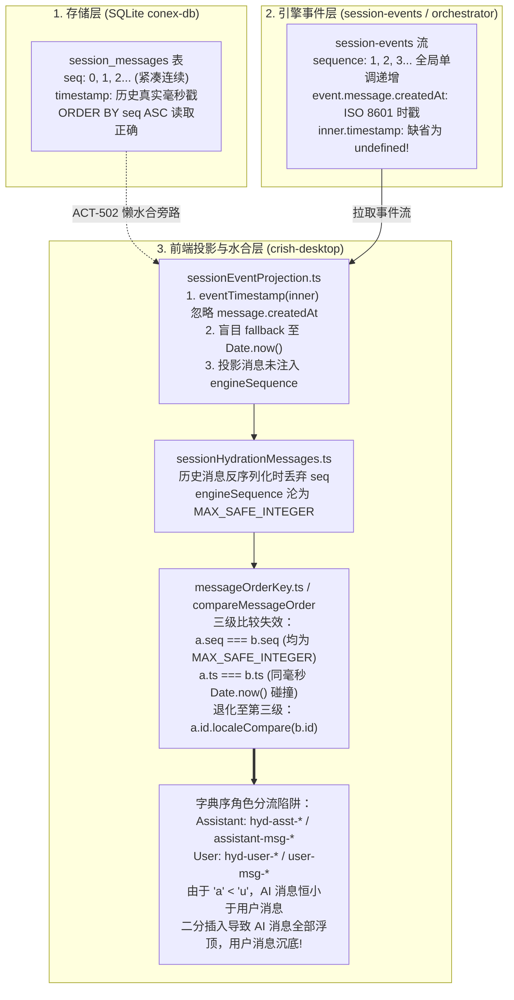

# 时序对账与逆序防回归验证详案

> **文档标识**：`07-时序对账与逆序防回归验证详案`  
> **所属战役**：`docs/stream-jitter-and-order-repair`  
> **责任角色**：时序对账与逆序防回归专家  
> **权威基线**：对齐 `AGENTS.md`、`.agents/LOGIC_PLAN_NO_RETREAT.md`、`ANTI_OVERENGINEERING_GUARDRAILS.md`、`crates/conex-db`、`crates/orchestrator` 及 `apps/crish-desktop` 契约  
> **目标定位**：针对消息时序在全生命周期（生成 $\to$ 引擎事件流 $\to$ 本地 SQLite 持久化 $\to$ 内存态合并 $\to$ 水合投影 $\to$ 虚拟滚动呈现）中的因果一致性（Causal Consistency），建立严密的跨层对账规范、形式化数学不变量、全景魔鬼用例集与 Rust/Vitest 自动化立体门禁断言体系。彻底杜绝任何形式的消息倒置（AI 消息浮顶、用户消息沉底）、乱序交错与水合重排缺陷。

---

## 一、事故现场根因穿透与三层架构时序断裂剖析

### 1.1 倒置事故现场与表象病灶

在历史会话重载（Session Reload）与长会话流式推进过程中，曾发生极其严重的对话倒置事故（如历史会话 `sess-1791764675736` 重启重载后）：

- **故障现象**：所有 Assistant 消息（AI 回复）被无序堆叠置于视口最顶端，而所有的 User 消息（用户提问）被全部推挤沉底。
- **对话交替逻辑断裂**：原本严密的人机交互轮次 $U_1 \to A_1 \to U_2 \to A_2 \to \dots \to U_n \to A_n$，在用户界面上彻底断裂退化为 $[A_1, A_2, \dots, A_n] \to [U_1, U_2, \dots, U_n]$。
- **用户感知破坏**：用户无法进行正常对话追溯，上下文完全颠倒错乱。

### 1.2 三层时序断裂链根因穿透（Root Cause Analysis）

通过穿透底层存储、事件分流与前端排序链路，该严重事故并非单一模块的局部 Bug，而是跨越了三层契约的系统性断裂：



#### 断层一：存储层与水合旁路脱节（Storage Bypass）

- 底层 SQLite `session_messages` 表（[`crates/conex-db/src/messages.rs`](file:///c:/Software/conex/crates/conex-db/src/messages.rs#L18-L48)）具备完整正确的 `seq`（0, 1, 2... 递增）与历史 `timestamp`。
- 然而，冷启动优化（Stage 5b ACT-502）为了控制 IPC 数量，将非活跃会话标记为懒壳（`messagesHydrated: false`）。用户切换到历史会话时，本应走本地 SQLite 懒水合（`ensureSessionBodyHydrated`），却因路由旁路直通了引擎远程 `core_read_session_events`。

#### 断层二：引擎事件投影时间戳剥离与序列号擦除（Timestamp Erasure）

- 远程拉取的 `message-end` 事件中，时间戳封装于内层 `event.message.createdAt`（标准 ISO 8601 字符串）。
- 但在 [`sessionEventProjection.ts:38-44`](file:///c:/Software/conex/apps/crish-desktop/src/api/sessionEventProjection.ts#L38-L44) 中，`eventTimestamp(inner)` 仅读取 `inner.timestamp`（该字段为 `undefined`），导致所有事件无差别回退到 `Date.now()`！数十轮历史消息被赋予了**完全相同的一毫秒时间戳**。
- 与此同时，事件外层的 `ev.sequence` 仅被用于计算 `maxSequence`，从未写入生成的 `SessionMessage.engineSequence`。

#### 断层三：比较器字典序退化与角色字母分流陷阱（Lexicographical Trap）

- [`messageOrderKey.ts`](file:///c:/Software/conex/apps/crish-desktop/src/store/messageOrderKey.ts#L42-L51) 的比较器定义为：
  ```ts
  export function compareMessageOrder(
    a: MessageOrderKey,
    b: MessageOrderKey
  ): number {
    if (a.seq !== b.seq) return a.seq < b.seq ? -1 : 1;
    if (a.ts !== b.ts) return a.ts < b.ts ? -1 : 1;
    return a.id.localeCompare(b.id);
  }
  ```
- 当 `seq` 均为 `MAX_SAFE_INTEGER`，且 `ts` 发生同毫秒碰撞时，比较器直接退化为 `a.id.localeCompare(b.id)`。
- 系统中的消息 ID 规则为：
  - 助手消息 ID：`assistant-msg-*` 或 `hyd-asst-*`；
  - 用户消息 ID：`user-msg-*` 或 `hyd-user-*`。
- 在 ASCII / Unicode 编码中，`'a' < 'u'` 且 `'hyd-a' < 'hyd-u'`。这导致**所有 Assistant 消息在字典序上绝对小于所有 User 消息**！二分插入算法忠实地将 AI 消息全量插入在最前方，用户消息全部沉入底部，酿成重大倒置事故。

---

## 二、三层时序契约与形式化数学不变量

为了从代数与数据流层面根治乱序与倒置，系统必须在存储层、引擎层与前端内存层确立不可突破的形式化时序契约与数学不变量（Mathematical Invariants）。

### 2.1 存储层契约（SQLite `session_messages` 表）

#### 2.1.1 模式定义与语义规范

存储层基于 SQLite 表 `session_messages`，定义如下：

```sql
CREATE TABLE IF NOT EXISTS session_messages (
    session_id TEXT NOT NULL REFERENCES sessions(id) ON DELETE CASCADE,
    seq INTEGER NOT NULL,
    id TEXT NOT NULL,
    sender TEXT NOT NULL CHECK (sender IN ('user','assistant')),
    text TEXT,
    thinking TEXT,
    timestamp INTEGER NOT NULL,
    status TEXT CHECK (status IN ('queued','processing','completed','error')),
    stream_text_offset INTEGER,
    thinking_time INTEGER,
    tool_calls_json TEXT,
    blocks_json TEXT,
    tool_call_results_json TEXT,
    PRIMARY KEY (session_id, seq)
) WITHOUT ROWID;
CREATE INDEX IF NOT EXISTS idx_session_messages_id ON session_messages(session_id, id);
```

#### 2.1.2 形式化数学不变量（Storage Invariants）

令会话 $S$ 在持久化存储中的消息记录序列为 $\mathcal{M}_{\text{db}}(S) = [m_0, m_1, \dots, m_{N-1}]$：

1. **不变量 S1（主键紧凑性与单调递增性）**：
   $$\forall i \in [0, N-1], \quad m_i.\text{seq} = i$$
   `seq` 必须从 0 开始无缝连续递增，严禁出现空洞、重复或负数。
2. **不变量 S2（弱单调因果时戳性）**：
   $$\forall 0 \le i < j < N, \quad m_i.\text{timestamp} \le m_j.\text{timestamp}$$
   在客观历史中，后生成的交互在物理时间戳上不得早于先生成的交互。
3. **不变量 S3（尾部收缩与无幽灵记录）**：
   在执行全量或增量保存时，必须满足原子事务与 Diff Shrink 约束：
   $$\text{DELETE FROM session\_messages WHERE session\_id} = S \land \text{seq} \ge N$$
   保证当用户撤回或截断消息后，数据库中绝不存在残留的幽灵尾部消息（Ghost Messages）。
4. **不变量 S4（单调版本推进 CAS）**：
   对于带版本控制的持久化，当前请求批次版本 $V_{\text{batch}}$ 必须满足：
   $$V_{\text{batch}} > V_{\text{current}} \iff \text{Commit Success}$$
   否则拒绝写入并抛出 `DbFailureKind::CasConflict`，防御并发乱序写覆盖。

---

### 2.2 引擎层契约（`crates/orchestrator` 与 `events` 表）

#### 2.2.1 模式定义与语义规范

引擎事件流持久化基于 SQLite 表 `events`：

```sql
CREATE TABLE IF NOT EXISTS events (
    id INTEGER PRIMARY KEY AUTOINCREMENT,
    session_id TEXT NOT NULL,
    sequence INTEGER NOT NULL,
    event_type TEXT NOT NULL,
    payload TEXT NOT NULL DEFAULT '{}',
    created_at TEXT NOT NULL DEFAULT (datetime('now')),
    UNIQUE(session_id, sequence)
);
CREATE INDEX IF NOT EXISTS idx_events_session_seq ON events(session_id, sequence);
```

#### 2.2.2 事件类型因果拓扑序（Causal Partial Order $\prec$）

在单轮会话推进生命周期中，事件类型必须满足以下严格因果偏序关系：
$$\text{UserMessage} \prec \text{TurnStart} \prec \text{MessageStart} \prec \text{Delta}^* \prec \text{ToolStart}^* \prec \text{ToolEnd}^* \prec \text{MessageEnd} \prec \text{TurnEnd} \prec \text{RunTerminal}$$

#### 2.2.3 形式化数学不变量（Engine Invariants）

令会话 $S$ 产生的所有持久化事件序列为 $\mathcal{E}(S) = [e_1, e_2, \dots, e_M]$：

1. **不变量 E1（会话内全局原子严格单调序列）**：
   $$\forall 1 \le i < j \le M, \quad e_i.\text{sequence} < e_j.\text{sequence}$$
   由 store 端原子计数器 `SessionSequencer` 取号，会话内全局单调连续递增，跨 Run 不重置，跨并发 Run 绝对互斥。
2. **不变量 E2（Lamport 因果一致性）**：
   $$\text{If } e_i \to_{\text{causal}} e_j, \quad \text{then } e_i.\text{sequence} < e_j.\text{sequence} \land \text{Epoch}(e_i.\text{created\_at}) \le \text{Epoch}(e_j.\text{created\_at})$$
   逻辑因果先行的事件，其序列号与时间戳必须在前。
3. **不变量 E3（撤回冻结护栏隔离性）**：
   若会话处于撤回冻结状态，冻结序号为 $\text{frozen\_seq}$，则对任意非撤离事件 $e$：
   $$e.\text{sequence} > \text{frozen\_seq} \implies \text{StoreError::retraction\_freeze}$$
   物理级切断已截断分支的后续非法写入，保证分支回退过程中的时序连续性与不变性。

---

### 2.3 前端层契约（`messageOrderKey` 与 `compareMessageOrder`）

#### 2.3.1 排序键（Order Key）提取规范

前端对任意对话消息 $m$ 提取归一化排序键三元组：
$$K(m) = \langle \text{seq}(m), \text{ts}(m), \text{id}(m) \rangle$$
提取规则如下：

1. **`seq`（第一主序键）**：
   - 若 $m.\text{engineSequence}$ 存在且为有限正数，取 $m.\text{engineSequence}$；
   - 若不存在但消息来自已排序历史数组，取其历史下标序号；
   - 兜底方允许使用 $\text{MAX\_SAFE\_INTEGER}$（表示实时未定序号，完全交由时间戳主导）。
2. **`ts`（第二主序键）**：
   - 严禁盲目回退到当前瞬时 `Date.now()`；
   - 必须优先提取消息元数据中的真实物理时间戳（解析 ISO 8601 或微秒毫秒值）；
   - 确保同一会话内物理时间戳具备相对单调性。
3. **`id`（第三兜底 tiebreaker）**：
   - 仅在 `seq` 与 `ts` 均完全相同（概率极小的极端碰撞态）时生效；
   - 仅作为稳定排序的 tiebreaker，**绝对不承担业务因果判定**！

#### 2.3.2 严格弱序（Strict Weak Ordering）代数性质证明

`compareMessageOrder(a, b)` 在全空间 $\mathcal{K} = \mathbb{R} \times \mathbb{R} \times \text{String}$ 上诱导一个严格弱序关系 $<$：

$$a < b \iff (a.\text{seq} < b.\text{seq}) \lor (a.\text{seq} = b.\text{seq} \land a.\text{ts} < b.\text{ts}) \lor (a.\text{seq} = b.\text{seq} \land a.\text{ts} = b.\text{ts} \land a.\text{id} <_{\text{lex}} b.\text{id})$$

- **非自反性（Irreflexivity）**：
  $\forall a \in \mathcal{K}$，由于 $a.\text{seq} = a.\text{seq}$、$a.\text{ts} = a.\text{ts}$ 且 $a.\text{id} = a.\text{id}$（字符串相等返回 0），因此 $a < a$ 恒为假。
- **非对称性（Asymmetry）**：
  若 $a < b$，则根据字典序定义，首个不同维度必然有分量小于对应分量，因此反向比较必然 $b < a$ 为假。
- **传递性（Transitivity）**：
  若 $a < b$ 且 $b < c$：
  - 若 $a.\text{seq} < b.\text{seq} \le c.\text{seq}$，则 $a.\text{seq} < c.\text{seq}$，得 $a < c$；
  - 若 $a.\text{seq} = b.\text{seq} = c.\text{seq}$，同理可由实数加法有序群中时间戳的传递性与字符串字典序的传递性推出 $a < c$。
- **不可比性的传递性（Transitivity of Incomparability）**：
  定义不可比（等价）关系 $a \sim b \iff \neg(a < b) \land \neg(b < a)$。在本键空间中，$a \sim b \iff a.\text{seq} = b.\text{seq} \land a.\text{ts} = b.\text{ts} \land a.\text{id} = b.\text{id}$。等价关系具有自反、对称、传递性，因此在键唯一（ID 唯一）时退化为全序关系（Total Order）。

#### 2.3.3 前端操作数学不变量（Frontend Invariants）

1. **不变量 F1（二分插入单调保序性）**：
   令已序列表 $L = [m_0, m_1, \dots, m_{k-1}]$ 满足 $\forall i, m_i \le m_{i+1}$。通过 `findInsertIndex(L, x)` 插入元素 $x$ 后，新列表 $L'$ 仍严格满足单调非降：
   $$\forall i \in [0, k], \quad L'[i] \le L'[i+1]$$
2. **不变量 F2（因果保全性与抗字典序分流）**：
   对于任意交互轮次，若用户消息 $U$ 在因果逻辑上先于助手消息 $A$（即 $U \to_{\text{causal}} A$），则在任意生命周期阶段必有：
   $$\text{compareMessageOrder}(K(U), K(A)) < 0$$
   严禁出现因 $U.\text{id}$ 字典序大而导致 $K(U) > K(A)$ 的逆转！
3. **不变量 F3（幂等合并单调性）**：
   令 $\mathcal{M}$ 为当前内存消息列表，$\mathcal{M}'$ 为重放或投影到达的消息列表：
   $$\text{mergeMessagesById}(\mathcal{M}, \mathcal{M}') \text{ is Idempotent, Monotonic, and Stable}$$
   同 ID 消息就地 Merge 字段并保留原始或更早时间戳；新 ID 消息按 $K$ 插入；重放相同事件数组其输出长度与拓扑结构保持不变。

---

## 三、魔鬼用例与极限边界集设计（Evil Test Cases Matrix）

为彻底暴露并消灭时序倒置隐患，本详案构建了覆盖六大极限维度的魔鬼测试集：

```
┌────────────────────────────────────────────────────────────────────────┐
│                      魔鬼用例与极限边界测试空间                        │
├──────────────────┬──────────────────┬──────────────────┬───────────────┤
│ 1. 同毫秒并发碰撞│ 2. 分支撤回与重录│ 3. 数十轮交替深渊│ 4. 连续用户输入│
├──────────────────┼──────────────────┼──────────────────┼───────────────┤
│ 5. 多块交叉复杂轮│ 6. 懒水合热流竞态│ 7. 乱序 Chunk 容忍│ 8. 时钟抖动回拨│
└──────────────────┴──────────────────┴──────────────────┴───────────────┘
```

### 3.1 边界 1：同一毫秒并发事件与时间戳碰撞（Timestamp Collision）

- **极限场景**：在极高并发测试或高速脚本执行中，用户输入提问 $U$ 与引擎创建的初始回复 $A$ 发生在绝对同一毫秒（`timestamp_U == timestamp_A == 1774000000000`）。
- **破坏性机制（攻击假定）**：
  若系统缺失 `engineSequence`，时间戳比较返回 0，控制权落入 `id.localeCompare`。由于 $A$ 的 ID 为 `hyd-asst-1` 而 $U$ 的 ID 为 `hyd-user-1`，字典序将强制把 $A$ 排在 $U$ 前方，造成瞬间倒置。
- **守卫断言**：
  1. 引擎在投递事件时，分配连续 sequence：$e_U.\text{seq} = 101, e_A.\text{seq} = 102$；
  2. 投影层提取排序键：$K(U).\text{seq} = 101, K(A).\text{seq} = 102$；
  3. 断言 $\text{compareMessageOrder}(K(U), K(A)) === -1$，绝对不触发第三级 ID 比较；
  4. 渲染列表中 $U$ 必严格处于 $A$ 上方。

### 3.2 边界 2：包含分支回退与撤回（Retract）时的序号连续性与幂等截断

- **极限场景**：
  会话已推进至第 10 轮（消息序列 $0 \dots 19$）。用户执行撤回，退回到第 5 轮（删除序列 $10 \dots 19$）。
  紧接着，用户输入新分支的第 5 轮提问，并引发新一轮 AI 回复。
- **破坏性机制（攻击假定）**：
  - 存储层：若 Diff Shrink 未生效，旧分支残留的 $10 \dots 19$ 号消息成为幽灵，与新分支新插入的记录发生主键冲突或混杂；
  - 引擎层：若 EventQueue 未重置或未受冻结护栏保护，旧未完成 Run 的异步事件跨越到新分支中；
  - 前端层：已缓存的消息未被清退，导致新旧消息同时渲染。
- **守卫断言**：
  1. 存储层断言：执行截断后，`SELECT COUNT(*) FROM session_messages WHERE session_id = ? AND seq >= 10` 结果恒为 0；
  2. 引擎层断言：旧分支活跃 Run 被强行标记终态，新分支事件自新分配的连续 sequence 开始，不覆盖亦不跳号；
  3. 前端层断言：截断后重新水合，消息列表长度恰好为 10，新用户消息序号紧接为 10，AI 回复为 11，无重复气泡。

### 3.3 边界 3：深度多轮对话交替（数十轮 100+ 交互压力）

- **极限场景**：
  模拟高强度工程编码对话：连续交替 50 轮（共 100 条消息：$U_1, A_1, U_2, A_2, \dots, U_{50}, A_{50}$），期间伴随大量工具调用与代码块生成。
- **破坏性机制（攻击假定）**：
  - 数组二分插入累积位移错误；
  - 跨轮 `turnIndex` 在单助手多轮合并逻辑中污染（M2 缺陷：多轮 Run reload 后只剩末轮文本）；
  - 历史事件流重放时，早期消息被反复重排移位。
- **守卫断言**：
  1. 拓扑交替性断言：$\forall k \in [1, 50]$，第 $2k-2$ 项必为 $U_k$（`sender === 'user'`），第 $2k-1$ 项必为 $A_k$（`sender === 'assistant'`）；
  2. 严格全序断言：$\forall 0 \le i < j < 100$：
     $$\text{compareMessageOrder}(K(M_i), K(M_j)) < 0$$
  3. 文本完整性断言：每一轮 $A_k$ 的独立文本与工具调用记录完整保留，不被后续轮次吞噬覆盖。

### 3.4 边界 4：用户连续发送多条消息（Consecutive User Messages）

- **极限场景**：
  用户在 AI 尚未开始回复或在短时间内连续敲击发送多条指令：$U_{1a}, U_{1b}, U_{1c}$。模型启动单次 Run，一次性处理该连续输入并给出回复 $A_1$。
- **破坏性机制（攻击假定）**：
  - 前端误将多个用户输入合并为单条，或将其时序颠倒；
  - AI 消息插入时误插在 $U_{1a}$ 与 $U_{1b}$ 之间。
- **守卫断言**：
  1. 连续性与独立性断言：$U_{1a}, U_{1b}, U_{1c}$ 为三个完全独立的 SessionMessage 对象，ID 互异；
  2. 相对单调性断言：
     $$\text{seq}(U_{1a}) < \text{seq}(U_{1b}) < \text{seq}(U_{1c}) < \text{seq}(A_1)$$
     $$\text{ts}(U_{1a}) \le \text{ts}(U_{1b}) \le \text{ts}(U_{1c}) \le \text{ts}(A_1)$$
  3. 排列结果断言：输出序列必精准为 $[U_{1a}, U_{1b}, U_{1c}, A_1]$。

### 3.5 边界 5：同轮内复杂交错块（Thinking + 多 ToolCalls + Text）

- **极限场景**：
  模型在单一回复周期内输出多模态交错内容：
  `Thought Chunk 1` $\to$ `ToolCall 1 (bash)` $\to$ `ToolEnd 1` $\to$ `Thought Chunk 2` $\to$ `ToolCall 2 (write_file)` $\to$ `ToolEnd 2` $\to$ `Final Markdown Text`。
- **破坏性机制（攻击假定）**：
  - 流式 delta 乱序到达，较短的 partial 覆盖终态文本；
  - 工具调用结果到达晚于文本，导致正文被清空或工具块被抹除；
  - 块级 `blocks` 数组结构错位。
- **守卫断言**：
  1. 状态不可逆断言：消息状态进入 `completed` 后，后续收到的任何 `processing` 增量事件均不得将其降级（`preferSessionMessageStatus` 幂等）；
  2. 内容保全断言：终态 Markdown 文本与所有工具调用记录（`toolCalls.length === 2`）并存，`blocks` 内部各块按客观执行时序严格排布；
  3. 预计算 HTML 保护断言：终态 `precomputedHtml` 绝不被 partial 空串抹除非空渲染树。

### 3.6 边界 6：冷启动懒水合与热流实时推送并发竞态（Hydration vs Live Race）

- **极限场景**：
  前端切换会话触发 SQLite / 引擎懒水合（加载历史 20 条消息）；在异步 IPC 返回的瞬间，后台 WebSocket / 实时事件桥恰好推入了第 21 条新消息。
- **破坏性机制（攻击假定）**：
  - 懒水合异步 resolve 时直接覆盖了内存中的最新消息；
  - 或者新消息被裸 push 追加到末尾，而随后到达的水合消息导致全局列表乱序。
- **守卫断言**：
  1. 经由 `mergeMessagesById` 二分合并，无论异步水合与实时消息哪个先返回，最终收敛状态全等；
  2. 数组下标严格满足 `isSortedByMessageOrder`，零重复 ID，零气泡抖动。

---

## 四、跨层端到端时序对账核验协议（Reconciliation Protocol）

为确保各层状态在任意时刻可审计、可证明、可对账，定义三态投影对账协议。

```
     ┌────────────────────────────────────────────────────────┐
     │                三态端到端因果对账全景                  │
     └────────────────────────────────────────────────────────┘
                 ┌────────────────────────────────┐
                 │ State A: SQLite 存储层         │
                 │ (session_messages 表, seq=0..N)│
                 └───────┬────────────────────────┘
                         │ 懒水合 (ensureSessionBodyHydrated)
                         ▼
     ┌────────────────────────────────────────────────────────┐
     │ State C: 前端内存层 (SessionStore.messages)            │
     │ 满足 compareMessageOrder 全序与二分插入                │
     └───────────────────▲────────────────────────────────────┘
                         │ 投影合并 (mergeMessagesById)
                 ┌───────┴────────────────────────┐
                 │ State B: 引擎事件层            │
                 │ (events 表, sequence=1..M)     │
                 └────────────────────────────────┘
```

### 4.1 对账三态定义

1. **$\mathcal{S}_{\text{db}}$（存储态）**：SQLite `session_messages` 表按 `ORDER BY seq ASC` 读取的记录列表。
2. **$\mathcal{S}_{\text{eng}}$（引擎态）**：`events` 表中该会话所有与消息相关的事件按 `sequence ASC` 投影重放生成的标准消息列表。
3. **$\mathcal{S}_{\text{fe}}$（前端态）**：当前 React 运行时 `SessionStore.sessions[id].messages`。

### 4.2 对账等价定理（Reconciliation Theorem）

在会话处于静止稳定态（Quiescent State，无正在执行中的 Run 与写批次）时，必须严格满足以下三态同构等价：
$$\mathcal{S}_{\text{db}} \cong \text{Project}(\mathcal{S}_{\text{eng}}) \cong \mathcal{S}_{\text{fe}}$$

具体同构判定准则包含四项全等：

1. **基数全等**：$|\mathcal{S}_{\text{db}}| = |\mathcal{S}_{\text{fe}}| = |\text{Project}(\mathcal{S}_{\text{eng}})| = N$；
2. **ID 序列双射**：$\forall i \in [0, N-1], \quad \mathcal{S}_{\text{db}}[i].\text{id} == \mathcal{S}_{\text{fe}}[i].\text{id} == \text{Project}(\mathcal{S}_{\text{eng}})[i].\text{id}$；
3. **角色完全一致**：$\forall i \in [0, N-1], \quad \mathcal{S}_{\text{db}}[i].\text{sender} == \mathcal{S}_{\text{fe}}[i].\text{sender}$；
4. **正文语义哈希一致**：$\forall i \in [0, N-1], \quad \text{SHA256}(\mathcal{S}_{\text{db}}[i].\text{text}) == \text{SHA256}(\mathcal{S}_{\text{fe}}[i].\text{text})$。

### 4.3 自动化核验指纹算法（Canonical Order Merkle Fingerprint）

为实现高效的 O(1) 跨层校验，定义会话时序哈希链（Hash Chain）：

$$H_0 = \text{Seed}$$
$$H_{k+1} = \text{SHA256}\Big(H_k \;\parallel\; \text{seq} \;\parallel\; \text{id} \;\parallel\; \text{sender} \;\parallel\; \text{timestamp} \;\parallel\; \text{SHA256}(\text{text})\Big)$$
$$\text{SessionFingerprint} = H_N$$

任何测试用例或调试通道均可计算此指纹，指纹不一致则立即判定为时序漂移并阻断流水线。

---

## 五、自动化门禁测试套件规格（Rust + Vitest 断言设计）

为落地不可逾越的质量红线，以下测试套件必须作为 Git Hook 与 CI 的必检门禁（零容忍跳过，禁止 `--no-verify`）。

### 5.1 Rust 内核门禁（`crates/conex-db` & `crates/orchestrator`）

#### 5.1.1 测试用例 R-GATE-01：SQLite 正文增量 Upsert 与 Diff Shrink 紧凑性断言

- **测试路径**：`crates/conex-db/tests/session_messages_order_test.rs`
- **核心逻辑**：
  验证 `save_session_body_conn` 在多轮写入、截断收缩与并发读取下，`seq` 始终保持从 0 紧凑递增，绝不出现空洞或幽灵记录。

```rust
#[test]
fn test_sqlite_session_messages_sequence_and_diff_shrink() {
    let mut conn = rusqlite::Connection::open_in_memory().unwrap();
    conex_db::schema::create_tables(&conn).unwrap();

    let session_id = "test-session-order-01";

    // 1. 模拟写入 5 条交替对话
    let mut msgs = Vec::new();
    for i in 0..5 {
        let sender = if i % 2 == 0 { "user" } else { "assistant" };
        msgs.push(conex_types::SessionMessage {
            id: format!("msg-{i}"),
            sender: sender.to_string(),
            text: Some(format!("Content {i}")),
            thinking: None,
            timestamp: 1774000000000 + (i as i64 * 1000),
            status: Some("completed".to_string()),
            stream_text_offset: None,
            thinking_time: None,
            tool_calls_json: None,
            blocks_json: None,
            tool_call_results_json: None,
            usage: None,
        });
    }

    // 首次写入
    save_session_body_conn(&mut conn, session_id, &msgs, None).unwrap();

    // 校验存储层不变量 S1：seq 从 0 到 4 严格递增
    let loaded: Vec<(i64, String, String, i64)> = conn
        .prepare("SELECT seq, id, sender, timestamp FROM session_messages WHERE session_id = ?1 ORDER BY seq ASC")
        .unwrap()
        .query_map(rusqlite::params![session_id], |r| {
            Ok((r.get(0)?, r.get(1)?, r.get(2)?, r.get(3)?))
        })
        .unwrap()
        .collect::<Result<Vec<_>, _>>()
        .unwrap();

    assert_eq!(loaded.len(), 5);
    for (idx, item) in loaded.iter().enumerate() {
        assert_eq!(item.0, idx as i64, "不变量 S1 破坏：seq 必须严格等于数组下标");
        assert_eq!(item.1, format!("msg-{idx}"));
    }

    // 2. 模拟撤回回退：截断到只剩前 3 条，并保存
    let truncated = msgs[0..3].to_vec();
    save_session_body_conn(&mut conn, session_id, &truncated, None).unwrap();

    // 校验不变量 S3：尾部收缩，seq >= 3 的记录必须被物理删除
    let count_tail: i64 = conn
        .query_row(
            "SELECT COUNT(*) FROM session_messages WHERE session_id = ?1 AND seq >= 3",
            rusqlite::params![session_id],
            |r| r.get(0),
        )
        .unwrap();
    assert_eq!(count_tail, 0, "不变量 S3 破坏：Diff Shrink 未删除幽灵尾部消息");
}
```

#### 5.1.2 测试用例 R-GATE-02：引擎事件全局原子递增与因果拓扑序断言

- **测试路径**：`crates/orchestrator/tests/event_sequence_causality_test.rs`
- **核心逻辑**：
  验证在多 Run 交替与并发入队时，`SessionSequencer` 分配的序列号在会话内全局严格单调递增，且事件类型满足偏序要求。

```rust
#[test]
fn test_orchestrator_event_causal_monotonicity_across_runs() {
    let store = Arc::new(MemStore::new());
    let session_id = "test-session-causality";

    // 模拟会话级事件队列
    let queue_run1 = EventQueue::new(store.clone(), 1, Some("run-1".to_string()));
    let queue_run2 = EventQueue::new(store.clone(), 1, Some("run-2".to_string()));

    // Run 1 推入 3 个事件
    let ev1 = queue_run1.push_event(session_id, AgentEvent::UserMessage { .. }).unwrap();
    let ev2 = queue_run1.push_event(session_id, AgentEvent::TurnStarted { .. }).unwrap();
    let ev3 = queue_run1.push_event(session_id, AgentEvent::MessageEnd { .. }).unwrap();

    // Run 2 推入后续事件
    let ev4 = queue_run2.push_event(session_id, AgentEvent::UserMessage { .. }).unwrap();

    // 校验不变量 E1：全局连续严格单调递增
    assert_eq!(ev1.sequence, 1);
    assert_eq!(ev2.sequence, 2);
    assert_eq!(ev3.sequence, 3);
    assert_eq!(ev4.sequence, 4, "不变量 E1 破坏：跨 Run 序号发生倒退或重复");
}
```

---

### 5.2 前端 Vitest 门禁（`apps/crish-desktop`）

#### 5.2.1 测试用例 TS-GATE-01：`messageOrderKey` 严格弱序代数公理化形式化测试

- **测试路径**：`apps/crish-desktop/src/store/__tests__/messageOrderKey.axioms.test.ts`
- **核心逻辑**：穷举生成不同 `seq`、`ts`、`id` 的三元组样本集合，机器断言非自反性、非对称性、传递性及不可比性传递性。

```ts
import { describe, it, expect } from 'vitest';
import { compareMessageOrder, MessageOrderKey } from '../messageOrderKey';

describe('TS-GATE-01: compareMessageOrder 严格弱序公理化形式化验证', () => {
  const sampleKeys: MessageOrderKey[] = [
    { seq: 1, ts: 1000, id: 'a' },
    { seq: 1, ts: 1000, id: 'b' },
    { seq: 1, ts: 2000, id: 'a' },
    { seq: 2, ts: 500, id: 'z' },
    { seq: Number.MAX_SAFE_INTEGER, ts: 1000, id: 'hyd-asst-1' },
    { seq: Number.MAX_SAFE_INTEGER, ts: 1000, id: 'hyd-user-1' },
    { seq: Number.MAX_SAFE_INTEGER, ts: 2000, id: 'hyd-user-2' },
  ];

  it('公理 1：非自反性 (Irreflexivity) - 自身与自身比较恒为 0', () => {
    for (const k of sampleKeys) {
      expect(compareMessageOrder(k, k)).toBe(0);
    }
  });

  it('公理 2：非对称性 (Asymmetry) - a < b 必有 b > a', () => {
    for (let i = 0; i < sampleKeys.length; i++) {
      for (let j = 0; j < sampleKeys.length; j++) {
        const ki = sampleKeys[i]!;
        const kj = sampleKeys[j]!;
        const res = compareMessageOrder(ki, kj);
        const inv = compareMessageOrder(kj, ki);
        if (res < 0) expect(inv).toBeGreaterThan(0);
        else if (res > 0) expect(inv).toBeLessThan(0);
        else expect(inv).toBe(0);
      }
    }
  });

  it('公理 3：传递性 (Transitivity) - a < b 且 b < c 必有 a < c', () => {
    for (const a of sampleKeys) {
      for (const b of sampleKeys) {
        for (const c of sampleKeys) {
          if (compareMessageOrder(a, b) < 0 && compareMessageOrder(b, c) < 0) {
            expect(compareMessageOrder(a, c)).toBeLessThan(0);
          }
        }
      }
    }
  });
});
```

#### 5.2.2 测试用例 TS-GATE-02：防逆序倒置专项魔鬼测试（同毫秒 + hyd 字典序陷阱）

- **测试路径**：`apps/crish-desktop/src/store/__tests__/anti_regression_inverted_ai_user.test.ts`
- **核心逻辑**：精准复现历史故障场景，断言在 `seq` 保留或真实 `createdAt` 保留的前提下，绝不发生 AI 浮顶沉底缺陷。

```ts
import { describe, it, expect } from 'vitest';
import {
  sortMessagesByOrder,
  upsertMessageById,
} from '../sessionSharedHelpers.messageMerge';
import type { SessionMessage } from '../types';

describe('TS-GATE-02: 绝不出现 AI 消息置顶、用户消息沉底防回归断言', () => {
  it('场景 A：具备 engineSequence 时，绝对按序列保序，免疫 ID 字典序', () => {
    // 构造因果顺序：U1 (seq=1) -> A1 (seq=2)
    // 恶意设定：U1 的 ID 字典序大 ('user-xxx' > 'assistant-xxx')
    const userMsg: SessionMessage = {
      id: 'user-msg-001',
      sender: 'user',
      text: '请帮我写一段代码',
      timestamp: 1774000000000,
      engineSequence: 1,
      status: 'completed',
    };

    const asstMsg: SessionMessage = {
      id: 'assistant-msg-001',
      sender: 'assistant',
      text: '没问题，这是代码...',
      timestamp: 1774000000000, // 同毫秒极限碰撞!
      engineSequence: 2,
      status: 'completed',
    };

    // 乱序输入：先把 asst 放入，再插入 user
    const list: SessionMessage[] = [];
    upsertMessageById(list, asstMsg);
    upsertMessageById(list, userMsg);

    // 断言：list 中 userMsg 必须在 asstMsg 前方!
    expect(list.length).toBe(2);
    expect(list[0]?.id).toBe('user-msg-001');
    expect(list[0]?.sender).toBe('user');
    expect(list[1]?.id).toBe('assistant-msg-001');
    expect(list[1]?.sender).toBe('assistant');
  });

  it('场景 B：无 engineSequence 但有真实物理时戳时，绝不倒置', () => {
    const userMsg: SessionMessage = {
      id: 'hyd-user-1',
      sender: 'user',
      text: '第一问',
      timestamp: 1774000001000,
      status: 'completed',
    };

    const asstMsg: SessionMessage = {
      id: 'hyd-asst-1',
      sender: 'assistant',
      text: '第一答',
      timestamp: 1774000002000, // 晚 1 秒
      status: 'completed',
    };

    const sorted = sortMessagesByOrder([asstMsg, userMsg]);
    expect(sorted[0]?.id).toBe('hyd-user-1');
    expect(sorted[1]?.id).toBe('hyd-asst-1');
  });
});
```

#### 5.2.3 测试用例 TS-GATE-03：事件投影 `createdAt` 与 `engineSequence` 传递性断言

- **测试路径**：`apps/crish-desktop/src/api/__tests__/sessionEventProjection.causal_order.test.ts`
- **核心逻辑**：
  验证 `projectEventsToMessages` 提取事件时，绝不调用 `Date.now()` 污染历史消息，且把信封的 `sequence` 精准透传到生成的 `SessionMessage.engineSequence` 中。

```ts
import { describe, it, expect } from 'vitest';
import { projectEventsToMessages } from '../sessionEventProjection';

describe('TS-GATE-03: sessionEventProjection 事件因果时序与属性透传门禁', () => {
  it('必须从 event.message.createdAt 读取时间戳并注入 engineSequence', () => {
    const mockEvents = [
      {
        sequence: 10,
        event: {
          type: 'message-end',
          message: {
            role: 'user',
            content: [{ type: 'text', text: '你好' }],
            createdAt: '2026-03-01T10:00:00.000Z',
          },
        },
      },
      {
        sequence: 11,
        event: {
          type: 'message-end',
          message: {
            role: 'assistant',
            content: [{ type: 'text', text: '你好！很高兴为你服务。' }],
            createdAt: '2026-03-01T10:00:05.000Z',
          },
        },
      },
    ];

    const result = projectEventsToMessages(mockEvents);
    expect(result.messages.length).toBe(2);

    const u = result.messages[0]!;
    const a = result.messages[1]!;

    expect(u.sender).toBe('user');
    expect(u.timestamp).toBe(Date.parse('2026-03-01T10:00:00.000Z'));
    expect(u.engineSequence).toBe(10);

    expect(a.sender).toBe('assistant');
    expect(a.timestamp).toBe(Date.parse('2026-03-01T10:00:05.000Z'));
    expect(a.engineSequence).toBe(11);

    expect(u.timestamp).toBeLessThan(a.timestamp);
    expect(u.engineSequence).toBeLessThan(a.engineSequence!);
  });
});
```

#### 5.2.4 测试用例 TS-GATE-04：50 轮深渊交替对话二分合并与拓扑稳定性测试

- **测试路径**：`apps/crish-desktop/src/store/__tests__/sessionMessageMerge.50turns.test.ts`
- **核心逻辑**：
  生成 50 轮问答（100 条消息），打乱输入顺序通过 `mergeMessagesById` 逐步灌入，断言最终结果严格恢复拓扑因果全序，无一次错位。

```ts
import { describe, it, expect } from 'vitest';
import { mergeMessagesById } from '../../api/sessionEventProjection';
import type { SessionMessage } from '../types';

describe('TS-GATE-04: 50 轮深渊交替对话乱序注入恢复拓扑全序门禁', () => {
  it('任意乱序注入 100 条消息，最终必定精准恢复 U_k < A_k 因果拓扑序', () => {
    const canonicalList: SessionMessage[] = [];
    for (let i = 1; i <= 50; i++) {
      canonicalList.push({
        id: `user-${i.toString().padStart(3, '0')}`,
        sender: 'user',
        text: `提问 ${i}`,
        timestamp: 1774000000000 + i * 2000,
        engineSequence: i * 2 - 1,
        status: 'completed',
      });
      canonicalList.push({
        id: `assistant-${i.toString().padStart(3, '0')}`,
        sender: 'assistant',
        text: `回复 ${i}`,
        timestamp: 1774000000000 + i * 2000 + 1000,
        engineSequence: i * 2,
        status: 'completed',
      });
    }

    // 随机打乱
    const shuffled = [...canonicalList].sort(() => Math.random() - 0.5);

    // 逐批或一次性合并
    const merged = mergeMessagesById([], shuffled);

    expect(merged.length).toBe(100);
    for (let k = 0; k < 50; k++) {
      const u = merged[k * 2]!;
      const a = merged[k * 2 + 1]!;
      expect(u.sender).toBe('user');
      expect(u.id).toBe(`user-${(k + 1).toString().padStart(3, '0')}`);
      expect(a.sender).toBe('assistant');
      expect(a.id).toBe(`assistant-${(k + 1).toString().padStart(3, '0')}`);
      expect(u.engineSequence!).toBeLessThan(a.engineSequence!);
    }
  });
});
```

---

## 六、验收断言矩阵与交付核验清单（Verification Matrix）

为确保时序治理彻底闭环，制定如下全生命周期门禁断言矩阵：

| 门禁 ID  | 检验维度     | 目标组件 / 路径              | 核心输入场景                    | 阻断断言条件（Failure Assertion）                              | 阻断等级          |
| :------- | :----------- | :--------------------------- | :------------------------------ | :------------------------------------------------------------- | :---------------- |
| **M-01** | 主键紧凑性   | SQLite `session_messages`    | 多轮写库与撤回收缩              | $\exists i, \text{seq}_i \ne i \lor \text{seq} \ge N$ 未被删除 | **P0 (Block CI)** |
| **M-02** | 序列单调性   | 引擎 `SessionSequencer`      | 跨 Run 多轮交互推进             | $\exists i < j, \text{sequence}_i \ge \text{sequence}_j$       | **P0 (Block CI)** |
| **M-03** | 冻结隔离性   | 引擎 `EventQueue`            | 撤回期内尝试追加事件            | 越过 `frozen_seq` 的写入未返回 `retraction_freeze`             | **P0 (Block CI)** |
| **M-04** | 时间戳保真   | `sessionEventProjection.ts`  | 投影 `message-end` 事件         | 使用了 `Date.now()` 覆写了消息原本合法的 `createdAt`           | **P0 (Block CI)** |
| **M-05** | 序列号透传   | `sessionEventProjection.ts`  | 信封解包生成消息                | 生成的 `SessionMessage.engineSequence` 为 `undefined`          | **P0 (Block CI)** |
| **M-06** | 字典序隔离   | `messageOrderKey.ts`         | 同毫秒 `hyd-asst` vs `hyd-user` | AI 消息因为 `'a' < 'u'` 字典序被排在用户消息前方               | **P0 (Block CI)** |
| **M-07** | 严格弱序代数 | `compareMessageOrder`        | 全局样本矩阵比较                | 违反非自反性、非对称性、传递性中的任意一条公理                 | **P0 (Block CI)** |
| **M-08** | 终态防降级   | `preferSessionMessageStatus` | `completed` 后到达 `partial`    | 终态消息被降级为 `processing`，或正文被清空缩短                | **P0 (Block CI)** |
| **M-09** | 50 轮抗乱序  | `mergeMessagesById`          | 100 条消息随机打乱注入          | 合并后列表未能 $100\%$ 复原 $U_k \prec A_k$ 交替拓扑序         | **P0 (Block CI)** |
| **M-10** | 懒水合单轨   | `sessionRustDbHydrate.ts`    | 历史会话切换激活                | 未优先命中本地 SQLite，而跨层直通引擎事件重放                  | **P0 (Block CI)** |

---

## 七、实施路线图与防回归落地准则

1. **第 1 阶段（底层数据补全与透传）**：
   - 在 `sessionEventProjection.ts` 中废弃 `eventTimestamp` 盲目 `Date.now()` 回退，建立 `extractEventTimestamp` 解析器；
   - 将外层信封 `ev.sequence` 严格写入 `SessionMessage.engineSequence`；
   - 在 `sessionHydrationMessages.ts` 反序列化中补齐 `engineSequence` 字段映射。
2. **第 2 阶段（比较器与合并加固）**：
   - 固化 `messageOrderKey` 的 `seq` 提取逻辑，使从 SQLite 读出的连续下标与引擎 sequence 共同成为第一序；
   - 补齐代数公理化测试，消除任何 ID 字典序越权决定的可能。
3. **第 3 阶段（端到端对账与 CI 门禁锁定）**：
   - 将 Rust 的 `session_messages_order_test.rs` 与前端 TS-GATE 全套测试合入标准门禁；
   - 纳入 `npm run test` 与 `cargo test --workspace`，实现零退避、永久防回归。
