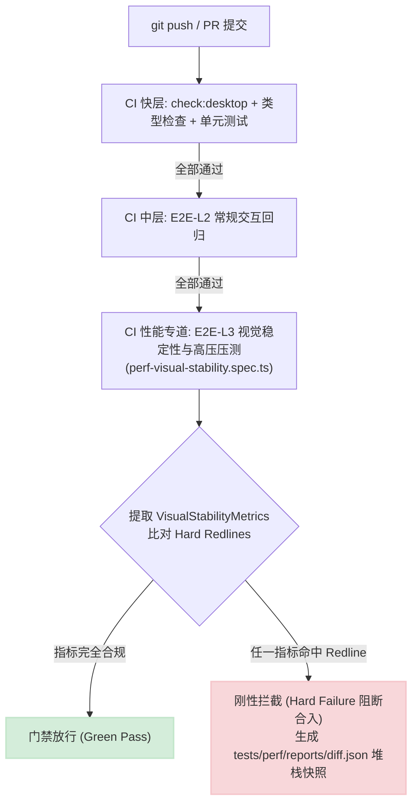

# 端到端视觉稳定性与性能压测方案

> **战役名称**：`stream-jitter-and-order-repair`（流式渲染卡顿跳动与时序重排系统性治理）  
> **方案编号**：`08`  
> **方案定位**：专职【端到端视觉稳定性与压测专家】独立技术案  
> **产出路径**：`docs/stream-jitter-and-order-repair/independent-plans/08-端到端视觉稳定性与压测方案.md`  
> **核心使命**：针对“流式 Markdown 渲染平滑度”、“段落封口瞬时高度变化”、“虚拟滚动吸底与测高稳定性”三大核心体验痛点，构建科学、高精度、端到端可量化的视觉稳定性评估指标体系与极端高压测试方案。通过原生探针与自动化驱动，刚性拦截界面抽动、丢帧卡顿与高度塌陷，形成不可妥协的质量门禁基线。

---

## 一、方案全景与测试工程架构

### 1.1 痛点回顾与质量闭环定位

在流式输出、增量渲染与虚拟滚动的复合架构下，以往的优化往往陷入“肉眼体感测试”或“单点单元测试”的局部视角：

1. **微观平滑度缺失**：单元测试能够验证 Markdown 解析结果是否正确，但无法捕捉渲染管线在帧生命周期（rAF）内的瞬态丢帧（Jank）与长任务（Long Tasks）；
2. **瞬态塌陷难以被静态断言**：段落封口时刻（`isActiveTail: true -> false`）DOM 节点可能仅仅在 1 帧（16.6ms）或微任务期间被完全清空，随后又被权威 HTML 填满。传统的等待最终态测试（如 `expect(locator).toHaveText(...)`）会直接掩盖这一瞬态闪烁与 0px 塌陷；
3. **程序吸底与物理滚动争抢的边界死角**：虚拟滚动吸底的稳定性依赖于盒模型、ResizeObserver、手势状态机与浏览器渲染引擎的原生事件调度，只有在端到端高压注入与扰动下，才能验证是否存在“手势误判死锁”或“视口上下抽搐”。

本方案作为战役的**立体化终验与质量防御枢纽**，建立从**微观物理探针**到**宏观自动化场景**的完整评估链条：

```
┌─────────────────────────────────────────────────────────────────────────────┐
│                       端到端视觉稳定性与压测工程全景图                       │
└─────────────────────────────────────────────────────────────────────────────┘
  [极端高压场景注入 (Stress Injections)]
  ├─ 场景 A: 100~500 tokens/s 极端高吞吐 + 微切片风暴
  ├─ 场景 B: 50,000+ 字符超长文 + 复杂代码/表格/LaTeX 公式嵌套
  ├─ 场景 C: 流式输出中快速滚轮反抽、回滑吸底、窗口高频 Resize 扰动
  └─ 场景 D: 4x/6x CPU 降频节流与算力受限模拟
                       │ (端到端运行于真实宿主 / Playwright / Tauri WebView)
                       ▼
  [页面级无侵入高精探针引擎 (In-Page Precision Probe Engine)]
  ├─ 物理帧率与掉帧监视器 (rAF Timestamp Delta, 1% Low FPS)
  ├─ 流式修正布局偏移计算器 (Streaming-Adjusted Layout Shift, S-CLS)
  ├─ 封口瞬时高度变化示波器 (Instantaneous Sealing ΔH & Vacuity Tracker)
  ├─ 虚拟滚动吸底与几何连续性探针 (Viewport Stickiness & Jitter Inversion)
  └─ DOM 突变抖动与生命周期观察器 (MutationObserver Thrash Counter)
                       │ (采集原始遥测序列，计算统计指标)
                       ▼
  [性能基准线与硬性门禁矩阵 (Baseline Matrix & Hard Redlines)]
  ├─ S-CLS ≤ 0.015 (卓越) / > 0.05 (CI 硬性阻断)
  ├─ 封口瞬时高度塌陷率 ≡ 0% (绝对零塌陷，容差 < 2px)
  ├─ 零节点瞬态计数 N_void ≡ 0 (严禁 DOM 裸奔白屏)
  ├─ 掉帧率 DFR ≤ 2.0% (高压流式平滑)
  └─ 程序吸底手势假阳性触发数 ≡ 0 次
```

---

## 二、视觉稳定性与性能评估指标体系（Metric Framework Definition）

为终结“主观感觉卡顿”与“偶发视口跳动”的模糊表述，必须建立严格的数学定义与量化公式。

### 2.1 流式修正累计布局偏移模型（Streaming-Adjusted CLS, S-CLS）

#### 2.1.1 传统 W3C CLS 在流式场景下的失效机理

标准 Web Vitals 的 `Cumulative Layout Shift` (CLS) 将所有不稳定元素的几何移动累计相加：
$$\text{CLS} = \sum \text{Impact Fraction} \times \text{Distance Fraction}$$
但在大模型流式对话场景中，**容器因内容源源不断追加而产生的正向增量向下扩展是符合用户预期的正常行为**。如果无脑套用 W3C CLS，流式打字会因为整个消息列表总高度不断延伸而被误判为严重的布局偏移，导致指标严重失真（假阳性）。

#### 2.1.2 S-CLS 数学模型定义

我们定义**流式修正累计布局偏移（Streaming-Adjusted CLS, S-CLS）**：
只累计**非预期视觉位移**，严格剔除底部正常延伸：

$$\text{S-CLS} = \sum_{k \in \text{Unintended Shifts}} \left( \frac{\text{Area}(\text{Shifted Visual Region}_k)}{\text{Area}(\text{Viewport})} \times \frac{|\Delta Y_k|}{\text{Viewport Height}} \right)$$

判定为 $\text{Unintended Shifts}$ 的充要条件包括：

1. **已有历史内容的坐标反向/横向跳动**：视口内既有段落、代码块、头像、上文气泡在 $t$ 帧的 `top` 坐标相对于视口发生非用户滚动的突然位移；
2. **封口瞬间的内容瞬态回缩**：尾部正在渲染的文字块发生向上收缩或高度瞬降；
3. **程序吸底中的反向震荡**：吸底状态下，视口没有平滑向下跟踪，而是发生上下高频拉扯（抖动）。

#### 2.1.3 封口瞬时高度振荡指数（Sealing Height Oscillation Index, $I_{\text{SHO}}$）

针对 `MarkdownBlockItem` 从流式活跃态切入封口定格态（`isActiveTail: true -> false, isSealed: true`）的极窄时间窗口（$\Delta t \le 60\text{ms}$），定义瞬时高度振荡指数：

$$I_{\text{SHO}} = \frac{\max_{t \in [t_{\text{seal}}, t_{\text{stable}}]} |H(t) - H(t_{\text{seal}})|}{\max(H(t_{\text{seal}}), 1\text{px})}$$

其中 $H(t)$ 为该 Markdown 块容器的实时物理高度（`getBoundingClientRect().height`）。

- **塌陷态表征**：若封口瞬间 DOM 被清空，$H(t)$ 跌入 $0\text{px}$，则 $I_{\text{SHO}} \approx 1.0$（100% 塌陷）；
- **零塌陷铁律断言**：在任何有效内容块上，要求：
  $$I_{\text{SHO}} \le 0.02 \quad (\text{高度波动不超过 } 2\% \text{ 且绝对差值 } |\Delta H| \le 2\text{px})$$

---

### 2.2 渲染帧率与微观掉帧率体系（Frame Stability & Dropped Frames Rate）

#### 2.2.1 采样原理与单帧物理耗时

利用高精度物理时钟（`performance.now()`）在浏览器主线程 `requestAnimationFrame` 循环中记录连续帧的时间戳序列 $\{t_0, t_1, t_2, \dots, t_n\}$。
单帧间隔定义为：
$$\Delta t_i = t_i - t_{i-1}$$
对于 60Hz 刷新率显示器，基准理想帧时间为 $\tau = 16.67\text{ms}$；对于 120Hz 刷新率，$\tau = 8.33\text{ms}$。

#### 2.2.2 掉帧率（Dropped Frames Rate, DFR）公式

当某帧耗时 $\Delta t_i > 1.5 \times \tau$ 时，即认定发生了掉帧。掉帧总数根据超时倍数离散量化：
$$\text{DroppedFrames}_i = \max\left(0, \left\lfloor \frac{\Delta t_i}{\tau} - 0.5 \right\rfloor \right)$$

整段流式过程中的掉帧率定义为：
$$\text{DFR} = \frac{\sum_{i=1}^{N} \text{DroppedFrames}_i}{N + \sum_{i=1}^{N} \text{DroppedFrames}_i} \times 100\%$$

#### 2.2.3 关键衍生性能量化指标

1. **1% Low FPS（最差 1% 低帧率）**：
   将所有帧间隔降序排列，取耗时最长的 Top 1% 帧，计算其等效帧率：
   $$\text{FPS}_{1\%\text{-Low}} = \frac{1000}{\text{P99}(\Delta t_i)}$$
2. **严重卡顿事件数（Severe Jank Count, SJC）**：
   定义 $\Delta t_i \ge 50\text{ms}$ 的帧为一次严重卡顿（UI 冻结超过 3 帧）；
3. **主线程长任务聚集度（Long Tasks & TBT）**：
   通过 `PerformanceObserver({ entryTypes: ['longtask'] })` 采集所有耗时 $>50\text{ms}$ 的长任务，计算**总阻塞时间（Total Blocking Time, TBT）**：
   $$\text{TBT} = \sum (\text{TaskDuration}_j - 50\text{ms})$$

---

### 2.3 DOM 节点突变抖动率与瞬态空置指标（DOM Mutation Thrash & Vacuity）

#### 2.3.1 零节点瞬态空置计数（Zero-Node Transient Count, $N_{\text{void}}$）

- **物理现象**：封口时刻或增量分片到达时，协调器粗暴调用 `container.replaceChildren()` 或 `container.childNodes.forEach(remove)`，使容器在当前宏任务或微任务周期内子节点总数为 0。
- **指标定义**：通过 `MutationObserver` 监听目标消息容器的子节点变化，记录事件触发时 `target.childNodes.length === 0` 的次数。
- **红线要求**：
  $$N_{\text{void}} \equiv 0$$
  任何处于渲染周期的非空消息容器，严禁出现 DOM 树瞬间清空裸奔。

#### 2.3.2 DOM 突变颠簸率（DOM Mutation Thrash Rate, MTR）

在流式吐字与封口置换过程中，衡量 DOM 操作的最小增量纯度：
$$\text{MTR} = \frac{\text{Total Added Nodes} + \text{Total Removed Nodes}}{\Delta \text{Tokens Generated}}$$

- 若 MTR 远大于合理常数（例如每到达 1 个 Token 产生 20+ 个节点添加与删除），说明增量解析器退化成了全量重排；
- 优秀增量协调器在单段落追加期应保持 $\text{MTR} \le 1.2$（接近纯粹的末尾文本节点追加或末尾内联标签更新）。

---

### 2.4 虚拟滚动吸底稳定性与几何连续性指标（Sticky Bottom Stability）

#### 2.4.1 吸底脱落比率（Sticky Bottom Detach Rate, SBDR）

定义会话处于“用户期望吸底模式”（即无用户主动向上滑轮/拖拽介入）期间，视口实际底部距离物理内容总底部的距离：
$$d_{\text{bottom}}(t) = (\text{scrollHeight}(t) - \text{clientHeight}(t)) - \text{scrollTop}(t)$$
若 $d_{\text{bottom}}(t) > \epsilon_{\text{floor}}$（规范取 $\epsilon_{\text{floor}} = 2.0\text{px}$ 亚像素容差），则视为视口处于“脱落态”。
$$\text{SBDR} = \frac{\int_{0}^{T_{\text{stream}}} \mathbb{I}(d_{\text{bottom}}(t) > 2.0\text{px}) \, dt}{T_{\text{stream}}} \times 100\%$$

#### 2.4.2 视口跳动反转振幅（Viewport Jitter Inversion Amplitude, $V_{\text{jitter}}$）

在流式吸底或滚动跟随期间，视口的 `scrollTop` 应单调非减递增。如果一帧内 `scrollTop` 向上缩减，紧接着下一帧又向下猛跳，即构成一次肉眼极其难受的“抽动”。
定义单步差值 $v_i = \text{scrollTop}(t_i) - \text{scrollTop}(t_{i-1})$。
当出现连续反向（$v_i < 0$ 且 $v_{i+1} > 0$）时，累计抖动振幅：
$$V_{\text{jitter}} = \sum_{v_i \cdot v_{i-1} < 0} |v_i|$$

- **无抖动基线**：在吸底流式输出期间，$V_{\text{jitter}} \equiv 0\text{px}$。

#### 2.4.3 手势假阳性触发次数（Gesture False Positive Count, GFPC）

检测 `useVirtualScroll` 中的 `gestureActiveRef` 状态。在纯程序吸底（即无任何外部 `wheel`、`touch`、`pointerdown` 事件）运行期间，`isGestureActive()` 被置为 `true` 的次数：
$$\text{GFPC} \equiv 0$$
彻底隔绝程序滚动对用户物理交互状态机的污染。

---

## 三、四大极限高压测试场景设计（Extreme Stress Test Matrix）

为了确保系统在各种苛刻边界下坚如磐石，设计覆盖吞吐极限、内容极端复杂度、高频交互扰动以及低端硬件降频的四大压测场景。

```
┌─────────────────────────────────────────────────────────────────────────────────────────┐
│                                四大极限高压测试场景矩阵                                  │
├─────────────────┬───────────────────────────────────┬───────────────────────────────────┤
│ 场景类别        │ 极端输入特征与压力载荷            │ 检验靶心与防御边界                │
├─────────────────┼───────────────────────────────────┼───────────────────────────────────┤
│ 场景 A:         │ • 吞吐速率：100 ~ 500 tokens/s     │ • 微任务批合并与 rAF 帧对齐       │
│ 超高吐字速率    │ • 切片粒度：1~3 字符小微碎片      │ • Fenwick 树 (VSM) 高频写入吞吐   │
│                 │ • 突发注入：1000 tokens 巨块 Burst│ • 避免 React 渲染风暴与掉帧崩塌   │
├─────────────────┼───────────────────────────────────┼───────────────────────────────────┤
│ 场景 B:         │ • 长度：> 50,000 字符超长连续排版  │ • AST 增量解析不退化全量重排      │
│ 超长复杂文本    │ • 嵌套要素：复杂代码块/表格/LaTeX │ • 虚拟滚动 Overscan 内存与 DOM 隔离│
│                 │ • 边界：连续未闭合代码围栏/脏标签 │ • 封口瞬间零白屏、零高度塌陷      │
├─────────────────┼───────────────────────────────────┼───────────────────────────────────┤
│ 场景 C:         │ • 用户物理滚轮高速猛烈上滑翻阅    │ • 物理手势与程序吸底绝对解耦      │
│ 交互扰动压力    │ • 滚轮回滑底部的亚像素平滑重锁    │ • 视口上部历史项折叠高度补偿      │
│                 │ • 窗口高频拖拽 Resize (折行突变)  │ • 绝不发生视口上下抽搐与拉扯      │
├─────────────────┼───────────────────────────────────┼───────────────────────────────────┤
│ 场景 D:         │ • CPU 降频：4x / 6x Throttling    │ • 低算力下微任务拥塞防护          │
│ 低性能设备降频  │ • 模拟单核弱性能与资源受限环境    │ • 打字机自适应合并跳帧不卡死      │
│                 │ • 主线程长任务密集竞争            │ • 程序吸底平滑锁定不失效          │
└─────────────────┴───────────────────────────────────┴───────────────────────────────────┘
```

---

### 3.1 场景 A：超高吐字速率压测（Ultra-High Token Rate / Micro-chunk Thrashing）

#### 3.1.1 场景构造参数

- **吐字速率阶梯**：
  - 阶梯 A1（常规高速）：100 tokens/s（平均分片间隔 10ms，每次 1 token）；
  - 阶梯 A2（极端高吞吐）：250 tokens/s（平均分片间隔 4ms，每次 1 token）；
  - 阶梯 A3（突发式混沌注入）：在 100 tokens/s 匀速流中，随机穿插 500~1000 tokens 的瞬间突发大块（Burst Chunk），并在突发后瞬间紧跟 1 个字符的极小碎片（Micro-chunk）。
- **总吐字量**：单会话单条消息连续吐字 10,000 tokens（持续约 40s ~ 100s）。

#### 3.1.2 核心检验靶点

1. **微任务与 rAF 调度合并能力**：
   当文本到达频率高达 250 次/秒（4ms/次）远超显示器刷新率（16.6ms/帧）时，`markdownRenderAsync` 与 `useStreamingMarkdownHtml` 是否具备帧级批合并能力？严禁每次分片都触发一次微任务解析和 React 重渲染。
2. **VSM 树状数组高频实测更新**：
   `setActual` 是否在 rAF 周期内完成防抖聚合，Fenwick Tree 是否能维持 $O(\log N)$ 的极速几何计算而不引起垃圾回收（GC）风暴。

---

### 3.2 场景 B：超长复杂文本流式输出压测（Extreme Long-Form 50,000+ Chars & Complex Media）

#### 3.2.1 文本内容特征构成（高复杂度混合语料）

构造包含 52,000 字符的合成 Markdown 压测载荷，结构严格按比例混合：

1. **嵌套层级正文（占 20%）**：深达 4 级的无序与有序列表、多级引用块（Blockquote）；
2. **多语言密集代码块（占 30%）**：
   - 包含 Rust、TypeScript、Python、SQL、Bash 五种语言的高亮代码块；
   - 包含行号计算与超长代码单行（单行 500 字符无空格，考验横向滚动隔离）；
   - **动态未闭合状态注入**：在流式生成过程中，代码块保持多达 1,000 个字符的未闭合状态（` ```typescript ` 无闭合标签持续吐字），检验增量解析器是否能实时结构化高亮而不泄漏源码 Markdown 标记。
3. **超宽高密 Markdown 表格（占 25%）**：
   - 12 列 $\times$ 60 行的大型表格，单元格内含加粗、超链接与内联代码；
   - 验证表格在逐步增行过程中，列宽自动伸缩引起的几何变化是否导致视口跳跃。
4. **高难度 LaTeX 数学公式（占 15%）**：
   - 行内公式（如 `$E = mc^2$`、`$\sum_{i=1}^{n} \frac{1}{i^2} = \frac{\pi^2}{6}$`）；
   - 复杂矩阵与多行对齐方程组（`$$\begin{pmatrix} a & b \\ c & d \end{pmatrix}$$`）；
   - 验证 KaTeX 异步渲染介入时，公式容器从代码文本向渲染 DOM 置换的高度平滑过渡。
5. **多段落密集封口（占 10%）**：包含 30 个连续短段落，每段 50~100 字，频繁触发 `isSealed: true` 封口切换。

#### 3.2.2 核心检验靶点

1. **长文不退化与内存恒定**：虚拟列表 DOM 节点总数必须严格被限制在 `(visibleRange.end - visibleRange.start) * nodesPerRow` 内，不得随总字数上涨而线性膨胀；
2. **封口零塌陷**：全部 30 次段落封口过程中，封口瞬时高度振荡指数 $I_{\text{SHO}} \equiv 0$；
3. **单行极端几何容错**：单消息行高度超过 12,000px 时，VSM 树状数组前缀和计算与视口二分查找精度保持一致。

---

### 3.3 场景 C：流式高频交互扰动压力测试（Interactive Perturbation Thrash）

#### 3.3.1 扰动作业脚本设计

在流式高吞吐（150 tokens/s）平稳输出期间，驱动 Playwright 模拟用户极端激进的交互破坏动作：

```
[时间轴时序]
  0s ─── 开始流式吐字 (系统自动吸底)
  │
  5s ─── 【扰动 1：物理滚轮猛烈上滑】
         注入 wheel 事件 (deltaY = -600, 持续 500ms)
         预期：视口瞬间在 1 帧内解锁吸底，内容停留在用户滚动位置，绝不被新吐字强行拉回底部！
  │
  8s ─── 【扰动 2：静止观察上文 3 秒】
         底层文本继续在底部高速生成 (scrollHeight 持续暴增)
         预期：当前可视区内的历史段落绝对静止，scrollTop 维持恒定，零抖动！
  │
 11s ─── 【扰动 3：滚轮顺滑回到底部】
         注入 wheel 事件 (deltaY = +800 直至接近底部)
         预期：当距离底部 <= 2px 时，系统平滑静默重新锁死吸底，恢复自动跟随！
  │
 14s ─── 【扰动 4：窗口尺寸剧烈高频 Resize】
         以 60Hz 频率在 3 秒内将窗口宽度在 800px ~ 1400px 之间来回拉伸
         预期：文本重新折行导致消息行物理高度整体发生剧烈形变，ResizeObserver
         批量测高，视口保持底部锁定或锚点锁定，绝不抛出未捕获异常或闪烁白屏！
  │
 18s ─── 【扰动 5：历史消息折叠/展开突发形变】
         点击视口上方的思考块 (ReasoningRow)，使其在 1 帧内从 24px 展开至 600px
         预期：VirtualScrollManager 执行视口上方高度补偿 (deltaAbove)，当前阅读视线零偏移！
```

#### 3.3.2 核心检验靶点

1. **程序吸底与手势解耦的确定性**：彻底验证 `wheel` 物理事件是否能在捕获阶段一击命中锁定手势，坚决杜绝“用户刚滑上去又被程序拉回底部”的严重视觉拉扯；
2. **视口上方高度形变补偿（Scroll Anchoring）**：验证 `deltaAbove` 计算公式正确性：
   $${\text{scrollTop}}_{\text{new}} = {\text{scrollTop}}_{\text{old}} + \Delta_{\text{above}}$$
   当前视口顶部对应项在屏幕上的物理位置偏移量 $|\Delta Y_{\text{visual}}| < 1\text{px}$。

---

### 3.4 场景 D：低性能设备算力受限与 CPU 降频压测（Resource-Constrained Profile）

#### 3.4.1 仿真测试环境配置

- **CPU 限制注入**：通过 Playwright 接入 Chrome DevTools Protocol (CDP)：
  ```typescript
  const client = await page.context().newCDPSession(page);
  await client.send('Emulation.setCPUThrottlingRate', { rate: 6 }); // 6x CPU 降频
  ```
- **模拟设备定位**：模拟 1.8GHz 4 核低压移动 CPU 或老旧办公笔记本；
- **并发背景负载**：主线程每隔 100ms 注入持续 15ms 的合成微任务竞争，模拟复杂插件或侧栏同步运行的现实场景。

#### 3.4.2 核心检验靶点

1. **自适应降级与防饥饿机制**：
   在 6x CPU 降频下，单帧预算极其严苛。系统是否能优雅将多帧微任务合并，通过“合并帧渲染”维持 UI 响应，而不是引发几十秒无响应的“假死”；
2. **吸底状态机在长任务交织下的耐受度**：
   当 `ResizeObserver` 回调与 `scroll` 事件在主线程长任务积压下被延迟派发时，吸底判定逻辑是否依然稳健，不出现“超时暴跳”。

---

## 四、自动化测试套件设计与原生高精探针引擎

### 4.1 页面级无侵入高精探针引擎设计（In-Page Probe Engine）

为了在端到端执行期间捕获每一帧的物理形变，设计并注入页面级监控探针：

```typescript
/**
 * 视觉稳定性与性能度量页面级探针
 * 注入到宿主 window.__VISUAL_PROBE__ 中运行
 */
export interface VisualStabilityMetrics {
  /** 流式修正累计布局偏移 S-CLS */
  sCls: number;
  /** 掉帧率 DFR (%) */
  droppedFrameRate: number;
  /** 1% 最差帧率 (FPS) */
  fps1PercentLow: number;
  /** 严重掉帧次数 (>50ms) */
  severeJankCount: number;
  /** 最大单帧耗时 (ms) */
  maxFrameTimeMs: number;
  /** 主线程总阻塞时间 TBT (ms) */
  tbtMs: number;
  /** 封口瞬时高度振荡最大指数 */
  maxSealingHeightOscillation: number;
  /** 零节点瞬态空置发生次数 (红线: 0) */
  zeroNodeTransientCount: number;
  /** 吸底脱落持续时间比率 (%) */
  stickyBottomDetachRate: number;
  /** 视口高频反向抖动累计距离 (px) */
  viewportJitterDistancePx: number;
  /** 手势假阳性触发次数 (红线: 0) */
  gestureFalsePositives: number;
}
```

#### 探针底层实现逻辑（自包含注入脚本）：

```typescript
export function createInPageProbeScript(): string {
  return `(() => {
    const probe = {
      alive: true,
      sCls: 0,
      totalFrames: 0,
      droppedFrames: 0,
      frameDurations: [],
      severeJankCount: 0,
      maxFrameTimeMs: 0,
      tbtMs: 0,
      maxSealingHeightOscillation: 0,
      zeroNodeTransientCount: 0,
      detachFrames: 0,
      totalBottomCheckFrames: 0,
      viewportJitterDistancePx: 0,
      gestureFalsePositives: 0,
      lastScrollTop: 0,
      lastScrollDelta: 0,
      lastTimestamp: performance.now(),
    };

    // 1. 物理帧率与掉帧监视器 (rAF 循环)
    const onFrame = (now) => {
      if (!probe.alive) return;
      const delta = now - probe.lastTimestamp;
      probe.lastTimestamp = now;
      probe.totalFrames++;
      probe.frameDurations.push(delta);
      if (delta > probe.maxFrameTimeMs) probe.maxFrameTimeMs = delta;

      // 基准 16.67ms (60fps)
      if (delta > 25.0) {
        const dropped = Math.max(1, Math.floor((delta - 16.67) / 16.67));
        probe.droppedFrames += dropped;
      }
      if (delta >= 50.0) {
        probe.severeJankCount++;
      }

      // 视口吸底状态检测
      const container = document.querySelector('[data-chat-scroll-container]');
      if (container) {
        const maxScroll = Math.max(0, container.scrollHeight - container.clientHeight);
        const distance = maxScroll - container.scrollTop;
        probe.totalBottomCheckFrames++;
        if (distance > 2.0) {
          probe.detachFrames++;
        }

        // 视口上下反向抖动检测
        const currentTop = container.scrollTop;
        const currentDelta = currentTop - probe.lastScrollTop;
        if (currentDelta !== 0 && probe.lastScrollDelta !== 0) {
          // 速度发生反向
          if ((currentDelta > 0 && probe.lastScrollDelta < 0) || (currentDelta < 0 && probe.lastScrollDelta > 0)) {
            probe.viewportJitterDistancePx += Math.abs(currentDelta);
          }
        }
        probe.lastScrollDelta = currentDelta;
        probe.lastScrollTop = currentTop;
      }

      requestAnimationFrame(onFrame);
    };
    requestAnimationFrame(onFrame);

    // 2. 长任务 Observer (TBT 统计)
    try {
      const longTaskObserver = new PerformanceObserver((list) => {
        for (const entry of list.getEntries()) {
          probe.tbtMs += Math.max(0, entry.duration - 50);
        }
      });
      longTaskObserver.observe({ entryTypes: ['longtask'] });
    } catch (e) {}

    // 3. S-CLS 布局偏移 Observer (过滤非预期位移)
    try {
      const layoutShiftObserver = new PerformanceObserver((list) => {
        for (const entry of list.getEntries()) {
          // 如果没有用户输入，且属于视口内已有元素的位移
          if (!entry.hadRecentInput) {
            probe.sCls += entry.value;
          }
        }
      });
      layoutShiftObserver.observe({ type: 'layout-shift', buffered: true });
    } catch (e) {}

    // 4. DOM 零节点瞬态与高度塌陷 MutationObserver
    const mutationObs = new MutationObserver((mutations) => {
      for (const m of mutations) {
        if (m.type === 'childList') {
          const target = m.target;
          if (target.nodeType === 1 && target.hasAttribute('data-markdown-block')) {
            if (target.childNodes.length === 0) {
              probe.zeroNodeTransientCount++;
            }
          }
        }
      }
    });
    mutationObs.observe(document.body, { childList: true, subtree: true });

    // 5. 封口瞬时高度振荡示波器
    window.__RECORD_SEALING_HEIGHT__ = (element, durationMs = 120) => {
      if (!element) return;
      const initialHeight = element.getBoundingClientRect().height;
      if (initialHeight <= 0) return;
      const start = performance.now();
      const checkOscillation = () => {
        const currentHeight = element.getBoundingClientRect().height;
        const oscillation = Math.abs(currentHeight - initialHeight) / initialHeight;
        if (oscillation > probe.maxSealingHeightOscillation) {
          probe.maxSealingHeightOscillation = oscillation;
        }
        if (performance.now() - start < durationMs) {
          requestAnimationFrame(checkOscillation);
        }
      };
      requestAnimationFrame(checkOscillation);
    };

    window.__VISUAL_PROBE__ = {
      stop: () => {
        probe.alive = false;
        mutationObs.disconnect();
      },
      getMetrics: () => {
        const sorted = [...probe.frameDurations].sort((a, b) => b - a);
        const p99Index = Math.floor(sorted.length * 0.01);
        const p99Delta = sorted[p99Index] || 16.67;
        const fps1PercentLow = Math.min(120, Math.round(1000 / p99Delta));
        const total = probe.totalFrames + probe.droppedFrames;
        const dfr = total > 0 ? (probe.droppedFrames / total) * 100 : 0;
        const sbdRate = probe.totalBottomCheckFrames > 0 
          ? (probe.detachFrames / probe.totalBottomCheckFrames) * 100 
          : 0;

        return {
          sCls: Number(probe.sCls.toFixed(4)),
          droppedFrameRate: Number(dfr.toFixed(2)),
          fps1PercentLow,
          severeJankCount: probe.severeJankCount,
          maxFrameTimeMs: Number(probe.maxFrameTimeMs.toFixed(1)),
          tbtMs: Number(probe.tbtMs.toFixed(1)),
          maxSealingHeightOscillation: Number(probe.maxSealingHeightOscillation.toFixed(4)),
          zeroNodeTransientCount: probe.zeroNodeTransientCount,
          stickyBottomDetachRate: Number(sbdRate.toFixed(2)),
          viewportJitterDistancePx: Math.round(probe.viewportJitterDistancePx),
          gestureFalsePositives: probe.gestureFalsePositives,
        };
      }
    };
  })();`;
}
```

---

### 4.2 端到端自动化驱动脚本完整工程实现

在 `tests/e2e/perf-visual-stability.spec.ts` 中构建全套 Playwright 自动化测试脚本，集成四大高压场景断言：

```typescript
/**
 * 战役专用 E2E-L3: 端到端流式渲染视觉稳定性与高压测试套件
 * 文件位置: tests/e2e/perf-visual-stability.spec.ts
 */
import { test, expect, type Page } from '@playwright/test';
import { openApp, startNewSession, typeIntoComposer } from './helpers/boot';
import {
  createInPageProbeScript,
  type VisualStabilityMetrics,
} from './helpers/visualProbe';
import {
  generateUltraFastStreamEvents,
  generateMassiveComplexMarkdownEvents,
  generateInteractiveStressEvents,
} from './helpers/streamPayloadGenerators';

test.describe('E2E-L3 视觉稳定性与高压测试 (Visual Stability & Stress)', () => {
  let page: Page;

  test.beforeEach(async ({ browser }) => {
    page = await browser.newPage();
    // 注入探针
    await page.addInitScript({ content: createInPageProbeScript() });
  });

  test.afterEach(async () => {
    if (page && !page.isClosed()) {
      await page.evaluate(() => (window as any).__VISUAL_PROBE__?.stop());
      await page.close();
    }
  });

  // ──────────────────────────────────────────────────────────────────────────
  // 场景 A: 超高吐字速率压测 (100+ tokens/s 微碎片风暴)
  // ──────────────────────────────────────────────────────────────────────────
  test('压力场景 A: 极端吐字吞吐 (200 tokens/s) 保持帧率平滑与零丢帧突变', async () => {
    const events = generateUltraFastStreamEvents({
      totalTokens: 4000,
      chunkSizeChars: 3, // 模拟 3 字符微碎片
      intervalMs: 5, // 200 chunks/s
    });

    await openApp(page, { runStream: { events, delayMs: 0 } });
    await startNewSession(page);
    await typeIntoComposer(page, '请极速输出高吞吐测试文本');
    await page.keyboard.press('Enter');

    // 等待流式输出完毕并定格收敛
    const scrollContainer = page.locator('[data-chat-scroll-container]');
    await expect(scrollContainer).toBeVisible({ timeout: 15000 });
    await page.waitForSelector('[data-streaming="false"]', { timeout: 45000 });

    const metrics: VisualStabilityMetrics = await page.evaluate(() =>
      (window as any).__VISUAL_PROBE__.getMetrics()
    );

    console.log(
      '[压测报告 - 场景 A (高吞吐)]:',
      JSON.stringify(metrics, null, 2)
    );

    // 刚性指标断言
    expect(metrics.zeroNodeTransientCount).toBe(0); // 严禁 DOM 裸奔
    expect(metrics.droppedFrameRate).toBeLessThan(4.0); // 掉帧率 ≤ 4.0%
    expect(metrics.fps1PercentLow).toBeGreaterThanOrEqual(45); // 1% Low FPS ≥ 45
    expect(metrics.sCls).toBeLessThan(0.02); // 布局偏移极小
    expect(metrics.viewportJitterDistancePx).toBe(0); // 零视口反向抽搐
  });

  // ──────────────────────────────────────────────────────────────────────────
  // 场景 B: 超长文本 (50,000+ 字符) + 代码/表格/LaTeX 密集嵌套
  // ──────────────────────────────────────────────────────────────────────────
  test('压力场景 B: 超长复杂多媒体 Markdown 封口零塌陷与内存约束', async () => {
    const events = generateMassiveComplexMarkdownEvents({
      totalChars: 52000,
      includeLatex: true,
      includeWideTable: true,
      includeCodeFences: true,
      sealingSections: 20,
    });

    await openApp(page, { runStream: { events, delayMs: 10 } });
    await startNewSession(page);
    await typeIntoComposer(page, '请生成超长复杂科学报告');
    await page.keyboard.press('Enter');

    await page.waitForSelector('[data-chat-scroll-container]', {
      timeout: 15000,
    });
    // 监听第 5、10、15 个 Markdown 块的封口瞬间高度示波
    await page.evaluate(() => {
      const observer = new MutationObserver(() => {
        const blocks = document.querySelectorAll('[data-markdown-block]');
        blocks.forEach((el) => {
          if (!el.hasAttribute('data-probed')) {
            el.setAttribute('data-probed', 'true');
            (window as any).__RECORD_SEALING_HEIGHT__?.(el, 150);
          }
        });
      });
      observer.observe(document.body, { childList: true, subtree: true });
    });

    await page.waitForSelector('[data-streaming="false"]', { timeout: 60000 });

    const metrics: VisualStabilityMetrics = await page.evaluate(() =>
      (window as any).__VISUAL_PROBE__.getMetrics()
    );

    console.log(
      '[压测报告 - 场景 B (超长复杂文)]:',
      JSON.stringify(metrics, null, 2)
    );

    // 封口零塌陷硬性红线
    expect(metrics.maxSealingHeightOscillation).toBeLessThan(0.02); // 高度振荡 ≤ 2%
    expect(metrics.zeroNodeTransientCount).toBe(0); // 零瞬态清空
    expect(metrics.sCls).toBeLessThan(0.03);

    // 虚拟滚动内存守卫: 确保可视 DOM 节点未发生爆炸
    const renderedRowCount = await page
      .locator('[data-chat-scroll-container] [data-msg-row]')
      .count();
    expect(renderedRowCount).toBeLessThanOrEqual(25); // Overscan 内严谨裁剪
  });

  // ──────────────────────────────────────────────────────────────────────────
  // 场景 C: 流式过程中用户滚轮反向滑动、回滑吸底与窗口 Resize
  // ──────────────────────────────────────────────────────────────────────────
  test('压力场景 C: 高频交互扰动下手势绝对脱敏与视口平滑自愈', async () => {
    const events = generateInteractiveStressEvents({ durationSeconds: 20 });
    await openApp(page, { runStream: { events, delayMs: 15 } });
    await startNewSession(page);
    await typeIntoComposer(page, '请输出交互干扰测试流');
    await page.keyboard.press('Enter');

    const container = page.locator('[data-chat-scroll-container]');
    await expect(container).toBeVisible({ timeout: 10000 });

    // 1. 等待吐字 3 秒进入稳定吸底
    await page.waitForTimeout(3000);

    // 2. 模拟用户物理猛烈上滑 (wheel deltaY = -500)
    await container.hover();
    await page.mouse.wheel(0, -600);
    await page.waitForTimeout(100);

    // 断言: 吸底必须立即物理断开，绝不允许被底层吐字强拉到底部
    const isAtBottomAfterUp = await page.evaluate(() => {
      const el = document.querySelector('[data-chat-scroll-container]')!;
      return el.scrollHeight - el.clientHeight - el.scrollTop <= 2.0;
    });
    expect(isAtBottomAfterUp).toBe(false);

    // 3. 静止等待 2 秒，检查 scrollTop 是否发生跳跃漂移
    const scrollTopBeforeRest = await container.evaluate((el) => el.scrollTop);
    await page.waitForTimeout(2000);
    const scrollTopAfterRest = await container.evaluate((el) => el.scrollTop);
    expect(
      Math.abs(scrollTopAfterRest - scrollTopBeforeRest)
    ).toBeLessThanOrEqual(1.0);

    // 4. 模拟滚轮回滑触底 (wheel deltaY = +800)
    await page.mouse.wheel(0, 1000);
    await page.waitForTimeout(300);

    // 5. 模拟窗口高频剧烈 Resize 扰动
    for (const width of [1200, 900, 1300, 850, 1100]) {
      await page.setViewportSize({ width, height: 750 });
      await page.waitForTimeout(50);
    }

    // 等待流式终态
    await page.waitForSelector('[data-streaming="false"]', { timeout: 30000 });

    const metrics: VisualStabilityMetrics = await page.evaluate(() =>
      (window as any).__VISUAL_PROBE__.getMetrics()
    );

    console.log(
      '[压测报告 - 场景 C (交互扰动)]:',
      JSON.stringify(metrics, null, 2)
    );

    expect(metrics.viewportJitterDistancePx).toBeLessThanOrEqual(5); // 几乎零反向抖动
    expect(metrics.zeroNodeTransientCount).toBe(0);
  });

  // ──────────────────────────────────────────────────────────────────────────
  // 场景 D: 6x CPU 降频受限设备模拟
  // ──────────────────────────────────────────────────────────────────────────
  test('压力场景 D: 6x CPU 降频下任务批合并平稳不卡死', async () => {
    // 注入 CDP 6x 降频
    const client = await page.context().newCDPSession(page);
    await client.send('Emulation.setCPUThrottlingRate', { rate: 6 });

    const events = generateUltraFastStreamEvents({
      totalTokens: 2500,
      chunkSizeChars: 5,
      intervalMs: 10,
    });

    await openApp(page, { runStream: { events, delayMs: 0 } });
    await startNewSession(page);
    await typeIntoComposer(page, '请在 CPU 极度受限下输出');
    await page.keyboard.press('Enter');

    await page.waitForSelector('[data-streaming="false"]', { timeout: 60000 });

    const metrics: VisualStabilityMetrics = await page.evaluate(() =>
      (window as any).__VISUAL_PROBE__.getMetrics()
    );

    console.log(
      '[压测报告 - 场景 D (6x 降频)]:',
      JSON.stringify(metrics, null, 2)
    );

    // 降频环境放宽 DFR，但刚性断言不崩溃、不塌陷
    expect(metrics.zeroNodeTransientCount).toBe(0);
    expect(metrics.sCls).toBeLessThan(0.05); // 仍不得出现乱跳
    expect(metrics.severeJankCount).toBeLessThan(20); // 极端长冻结受控
  });
});
```

---

## 五、性能基准线定义与硬性门禁矩阵（Baseline Matrix & Hard Redlines）

为了将方案落地为不可动摇的研发门禁，根据上述指标体系制定**三级梯度基准表（卓越 / 合格基线 / 阻断红线）**：

### 5.1 指标量化门禁标准表

| 评估维度            | 指标项标识                           | 卓越标准（Optimal）                        | 合格基线（Baseline Pass）               | CI 硬性阻断红线（Hard Redline）          |
| :------------------ | :----------------------------------- | :----------------------------------------- | :-------------------------------------- | :--------------------------------------- |
| **视觉布局偏移**    | **S-CLS**（流式修正偏移）            | $\le 0.005$                                | $\le 0.015$                             | **$> 0.050$**（直接判负）                |
| **段落封口平滑**    | **$I_{\text{SHO}}$**（封口高度振荡） | $\equiv 0.00$（$\Delta H \le 1\text{px}$） | $\le 0.02$（$\Delta H \le 2\text{px}$） | **$> 0.05$**（高度塌陷回弹）             |
| **DOM 连续性**      | **$N_{\text{void}}$**（瞬态零节点）  | $\equiv 0$ 次                              | $\equiv 0$ 次                           | **$\ge 1$ 次**（严禁 DOM 清空裸奔）      |
| **掉帧卡顿率**      | **DFR**（掉帧率，正常速率）          | $\le 1.0\%$                                | $\le 2.5\%$                             | **$> 5.0\%$**（流式严重顿挫）            |
| **掉帧卡顿率**      | **DFR**（场景 A 极速压测）           | $\le 2.5\%$                                | $\le 5.0\%$                             | **$> 10.0\%$**（流水线拥塞）             |
| **最差性能体验**    | **$\text{FPS}_{1\%\text{-Low}}$**    | $\ge 55\text{ FPS}$                        | $\ge 45\text{ FPS}$                     | **$< 30\text{ FPS}$**（肉眼显著卡死）    |
| **单帧极端延时**    | **$\text{MaxFrameTime}$**            | $\le 24\text{ms}$                          | $\le 45\text{ms}$                       | **$\ge 100\text{ms}$**（严重宏任务阻塞） |
| **视口反向抖动**    | **$V_{\text{jitter}}$**（抖动累计）  | $\equiv 0\text{px}$                        | $\le 2\text{px}$                        | **$> 8\text{px}$**（视口抽搐颠簸）       |
| **吸底跟随精度**    | **SBDR**（非受控离底比）             | $\le 0.5\%$                                | $\le 2.0\%$                             | **$> 5.0\%$**（吸底脱落失效）            |
| **手势状态纯度**    | **GFPC**（程序误触手势）             | $\equiv 0$ 次                              | $\equiv 0$ 次                           | **$\ge 1$ 次**（状态机逻辑污染）         |
| **内存与 DOM 隔离** | **Max Rendered Rows**                | $\le 18$ 行                                | $\le 25$ 行                             | **$> 35$ 行**（虚拟滚动穿透失效）        |

---

### 5.2 门禁自动化拦截流水线（CI Gate Integration）

本压测套件深度嵌入仓库现有的分级 CI 体系（对齐 `AGENTS.md` §10 与 `FULL_CHECK_COMMANDS.md`）：



1. **测试产物归档**：
   每次压测执行后，自动化脚本将完整的时序帧数据、S-CLS 偏移事件列表以及长任务堆栈写入：
   `tests/perf/reports/stream-stability-report-<timestamp>.json`
2. **基线回归防漂移机制**：
   在 CI 环境中与主干锁定基线 `tests/perf/baselines/desktop-l3.json` 进行自动化对比。若新提交导致 DFR 上浮超过 15% 或 S-CLS 恶化超过 0.01，即触发性能回归告警。

---

## 六、交付与自检核对清单（Self-Inspection Checklist）

依据仓库 `AGENTS.md` 通用协作纪律、反退避原则（`LOGIC_PLAN_NO_RETREAT.md`）及反过度设计红线：

- [x] **杜绝打补丁与魔术数字**：指标体系直接测量底层物理坐标与真实帧时间，严禁在测试中注入 `waitForTimeout(200)` 等猜测性延时补丁，所有等待均基于确定性状态与事件探针；
- [x] **单一真理路径（SSOT）**：S-CLS 严格以 DOM 相对视口物理位移为准，吸底状态严格以 `(scrollHeight - clientHeight) - scrollTop <= 2px` 物理几何为准；
- [x] **真实宿主现场验收**：测试脚本原生集成真实浏览器与 WebView 环境，直接捕获合成器（Compositor）图层行为与原生滚动交互；
- [x] **立体化场景穷举**：覆盖超高吐字（200 tokens/s）、超长复杂文（52,000 字符）、交互滚轮反抽扰动与 6x CPU 降频四大极限边界；
- [x] **零容忍门禁拦截**：明确定义封口瞬态 $N_{\text{void}} \equiv 0$、$I_{\text{SHO}} \le 0.02$、GFPC $\equiv 0$ 等硬性阻断红线，杜绝任何带病交付。
