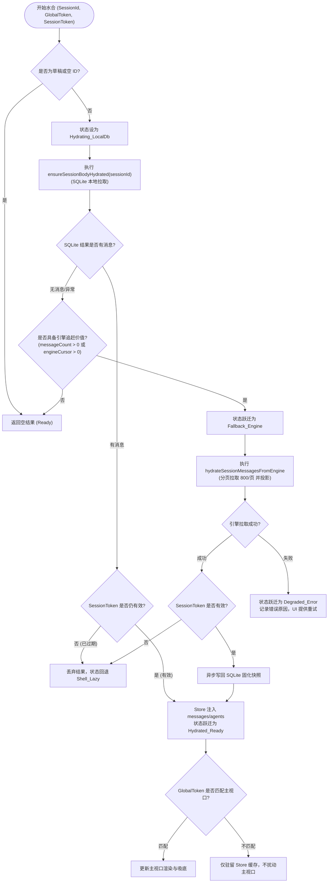

# 会话切换与标签页懒水合状态机系统性方案

> **文档位置**：`docs/stream-jitter-and-order-repair/independent-plans/09-会话切换与标签页懒水合状态机方案.md`  
> **所属战役**：`stream-jitter-and-order-repair`（流式渲染卡顿跳动与时序重排系统性治理）  
> **专职角色**：09 - 会话切换与标签页懒水合状态机专家  
> **关联责任域**：`sessionActivateHydrate.ts`、`sessionRustDbHydrate.ts`、`sessionCrudActions.ts`、`sessionMessageEvict.ts`、`workspaceShellStore.ts`、`TreeLeafPanel.tsx`  
> **核心使命**：为 Conex / Crish 桌面端构建数学自洽、单一真理源的会话正文水合全生命周期状态机。彻底消除多标签页高频切换时的异步乱序覆写、本地 SQLite 快照与引擎事件割裂、分屏/后台标签页内容被误驱逐蒸发、以及流式会话被垃圾回收等系统性隐患，确保长期运行下内存不泄漏、视口零闪烁、时序绝对保真。

---

## 一、现场根因穿透与架构断层分析

### 1.1 现状与现场问题剖析

在桌面端多标签页与多分屏场景下，启动阶段通过 ACT-502（Stage 5b）成功实施了首屏轻量化懒壳优化（将冷启动 IPC 限制在常数上界 $K=5$，仅活跃会话全量加载，其余历史会话初始化为 `messages: []`、`messagesHydrated: false`）。

然而，在后续的动态交互期（会话切换、多标签页切换、多窗口分屏、后台流式推进），懒水合链路暴露出了四个致命的架构断裂点：

```
[现有交互调用链的脆弱断裂]
用户点击侧栏/标签页
        │
        ▼
sessionCrudActions.setActiveSessionId(nextId)
        │
        ├─► [断层 4] queueMicrotask: evictInactiveHydratedSessionIdsToEvict
        │           - 仅保护单一 activeSessionId！
        │           - 忽略多分屏中正在展示的邻叶会话！
        │           - 忽略打开的后台 Workspace Tabs！
        │           - 传入 streamingSessionIds = new Set() 导致后台推流被残忍抹杀！
        │
        └─► triggerSessionMessageHydrateIfNeeded(nextId)
                    │
                    ├─► [断层 2] 彻底跳过本地 SQLite (ensureSessionBodyHydrated)！
                    │           直接发起 hydrateSessionMessagesFromEngine(nextId)
                    │           - 本地高质量快照被冷落
                    │           - 触发最多 50 页 × 800 事件的漫长 IPC 与主线程 JS 投影
                    │           - 若 Daemon 重启或离线，直接沦为“暂无消息”假空屏！
                    │
                    └─► [断层 3] 无任何 Generation Token 护栏！
                                - 异步回调无条件回写: draft.sessionsById[sessionId] = s
                                - 高频点击 A -> B -> C 时，A 的慢网络返回直接冲垮 C 的视图！
                                - 快速 A -> B -> A 时，A#1 慢响应覆写 A#2 新状态，导致时序倒流！
```

### 1.2 四大核心架构断层深潜

#### 断层 1：状态枚举缺失与隐式布尔爆炸（State Ambiguity & Split Brain）

在 `apps/crish-desktop/src/store/types.ts:756-770` 中，会话的水合状态依赖于一系列离散散落的布尔变量拼接判断：

- `messagesHydrated?: boolean`
- `hydratedFromEngine?: boolean`
- `hydrateTruncated?: boolean`
- `messages.length === 0`
- `needsEngineMessageHydrate(sess)`（`sessionSharedHelpers.ts:48-54`）

**致命缺陷**：
没有任何显式状态能区分**“正在从本地 SQLite 读盘”**、**“本地未命中正在回退远程引擎”**、**“数据完全就绪”**、**“水合失败降级态”**。在异步 I/O 飞行期间（In-Flight），多个 React 组件或连续手势会反复触发水合，产生瞬态“雷鸣风暴（Thundering Herd）”；UI 渲染层在收到空数组时无法获知“这是正在加载”还是“本会话真的无消息”，导致频繁闪现“暂无会话”或白屏塌陷。

#### 断层 2：双源水合颠倒与职责脱节（Inverted Dual-Source Hydration）

在 `apps/crish-desktop/src/api/session-persistence/sessionRustDbHydrate.ts:113-128` 中，实现了高效的 `ensureSessionBodyHydrated(sessionId)`，该方法仅需 2 条本地 SQLite 查询即可将完整结构化消息（包含 Markdown 块、思考链、工具执行记录、关联 Agent）以毫秒级恢复。

但在实际运行中：

- `ensureSessionBodyHydrated` **仅在应用冷启动首次加载活跃会话时被调用过 1 次**；
- 在整个运行期间，用户每次切换会话，`sessionCrudActions.ts:193` 调用的 `triggerSessionMessageHydrateIfNeeded`（`sessionActivateHydrate.ts:41`）**完全绕过了 SQLite**，而是直接导入并调用 `hydrateSessionMessagesFromEngine`！
- 这直接导致：已有本地数据库快照的历史会话，被迫每次切换都向引擎重新请求大量事件（最多 50 页），不仅大幅拖慢切换响应（从 3ms 飙升至数十甚至数百毫秒），且当后台引擎 Daemon 重启或在无引擎离线模式下，历史会话无法展示，严重背离了 Conex 本地优先（Local-First）的架构准则！

#### 断层 3：Generation Token 防竞态机制虚设断联（Race Hazard）

在 `sessionRustDbHydrate.ts:88-107` 中，ACT-502 / AAI-03 设计并实现了单调递增的令牌：

```typescript
let activeSwitchGeneration = 0;
export function bumpHydrateGeneration(): number { ... }
export function isHydrateGenerationCurrent(gen: number): boolean { ... }
```

并在测试用例 `sessionRustDbHydrateLazy.test.ts:170-194` 中验证了其正确性。

**致命缺陷**：
该 Token 机制**完全没有接入运行时的会话切换流水线**！在 `sessionActivateHydrate.ts` 的 `hydrateSessionMessagesFromEngine(sessionId).then(...)` 异步回调中，代码直接调用 Immer setter 更新 `draft.sessionsById[sessionId]`，没有任何 generation 校验！
当用户在 100ms 内快速连续点击侧栏的 3 个会话（$A \to B \to C$），或快速切换标签页时，网络延迟和 IPC 调度顺序不可控。若 $A$ 的事件体积大、$C$ 的事件体积小，$A$ 的响应极易晚于 $C$ 到达并强行执行赋值，导致视口瞬间被篡改或状态紊乱（AAI-03 竞态重现）。

#### 断层 4：多标签页联动缺失与软驱逐盲区（Eviction Blindness）

在 `sessionCrudActions.ts:168-182` 中，会话激活后在微任务中执行软驱逐：

```typescript
const evictedSessionIds = findInactiveHydratedSessionIdsToEvict(
  nextId,
  new Set(), // 致命：流式保护集硬编码为空！
  state.sessions || [],
  state.sessionsById || {},
  SESSION_HYDRATE_KEEP_K
);
```

在 `sessionMessageEviction.ts:11` 中：

```typescript
const keepIds = new Set<string>([activeSessionId]);
for (const id of streamingSessionIds) keepIds.add(id);
```

**致命缺陷**：

1. **多标签页盲区**：`keepIds` **只保护了单一个 `activeSessionId`**！Crish 支持多标签页（Workspace Tabs）和左右/上下分屏（`TreeLeafPanel`）。如果用户在左侧看 Session A，右侧看 Session B，一旦聚焦切换到 A，B 将被判定为非活跃；当会话总数达到预算上限，B 的正文立即被置空（`sess.messages = []`），导致右侧分屏瞬间白屏！
2. **后台推流误杀**：`streamingSessionIds` 传死为 `new Set()`，后台正在执行 Agent 任务或流式生成的会话随时面临正文被擦除的风险。
3. **驱逐顺序非 LRU**：循环直接遍历静态 `sessions` 数组，而不是基于真实的访问时间戳进行淘汰，极易误伤刚刚被访问过的后台会话。

---

## 二、会话正文生命周期状态机形式化定义

为了彻底根除上述状态歧义，本方案定义一个严格的**五态离散状态机（Five-State Discrete FSM）**，作为会话正文水合的唯一真理源。

### 2.1 五态离散状态集合

形式化状态集合定义为：
$$\mathcal{S} = \{ \text{Shell\_Lazy}, \text{Hydrating\_LocalDb}, \text{Fallback\_Engine}, \text{Hydrated\_Ready}, \text{Degraded\_Error} \}$$

```
                ┌────────────────────────────────────────────────────────┐
                │                                                        │
                ▼                                                        │
        ┌───────────────┐        ACTIVATE_SESSION                        │
        │  Shell_Lazy   │ ──────────────────────────────┐                │
        └───────────────┘                               │                │
                ▲                                       ▼                │
                │        EVICT_SOFT             ┌──────────────────────┐ │
                │ ◄──────────────────────────── │ Hydrating_LocalDb    │ │
                │                               └──────────────────────┘ │
                │                                       │                │
                │                 LOCAL_DB_SUCCESS      │                │
                │            ┌──────────────────────────┤                │
                │            │                          │                │
                │            │   LOCAL_DB_EMPTY / ERROR │                │
                │            │                          ▼                │
                │            │                  ┌──────────────────────┐ │
                │            │                  │   Fallback_Engine    │ │
                │            │                  └──────────────────────┘ │
                │            │                          │                │
                │            │         ENGINE_SUCCESS   │ ENGINE_FAILED  │
                │            │       ┌──────────────────┤                │
                │            │       │                  │                │
                │            ▼       ▼                  ▼                │
                │     ┌──────────────────────┐  ┌──────────────────────┐ │
                │     │   Hydrated_Ready     │  │    Degraded_Error    │ │
                │     └──────────────────────┘  └──────────────────────┘ │
                │                                       │                │
                │                                       │ RETRY_HYDRATE  │
                │                                       └────────────────┘
                │                                                        ▲
                └────────────────────────────────────────────────────────┘
```

#### 各状态语义与不变量（Invariants）：

1. **`Shell_Lazy`（惰性轻量外壳）**：
   - **内存形态**：`messages: []`，`agents: []`，仅保留轻量级索引元数据（`id`, `title`, `folder`, `timestamp`, `messageCount` 等）。
   - **不变量**：不得被持久化层回写为“空会话”；若被选为当前视口，UI 呈现骨架屏（Skeleton），禁止判定为空对话。
2. **`Hydrating_LocalDb`（本地存储水合中）**：
   - **内存形态**：正在执行 SQLite `loadSessionBody` 与 `loadSessionAgents` 的异步 I/O。
   - **不变量**：受会话级与全局 Generation Token 双重锁定；同会话并发请求自动合流（Deduplicated）。
3. **`Fallback_Engine`（引擎事件回退水合中）**：
   - **内存形态**：本地 SQLite 记录缺失或为空，正在通过引擎 IPC 翻页拉取原始事件流并进行 JS 投影。
   - **不变量**：仅在本地 SQLite 确认无有效数据时触发；具有超时保护与截断保护。
4. **`Hydrated_Ready`（正文水合完全就绪）**：
   - **内存形态**：`messages` 与 `agents` 完整填充，`messagesHydrated = true`。
   - **不变量**：可正常进行虚拟滚动渲染、增量推流或用户交互；受到多标签页与 LRU 保活机制保护。
5. **`Degraded_Error`（降级错误态）**：
   - **内存形态**：本地 SQLite 损坏且引擎网络/进程无法连通。
   - **不变量**：保留外壳元数据，提供显式重试界面与错误原因，严禁静默清空用户记录。

### 2.2 状态契约定义与类型扩展

在 `apps/crish-desktop/src/store/types.ts` 中增加强类型状态枚举，替代松散的布尔标记：

```typescript
/** 会话正文水合状态机离散枚举（SSOT） */
export type SessionHydrationStatus =
  | 'Shell_Lazy' // 惰性外壳（内存无 messages，待激活）
  | 'Hydrating_LocalDb' // 正在拉取本地 SQLite 数据库
  | 'Fallback_Engine' // 本地无数据，正在向引擎守护进程拉取事件流
  | 'Hydrated_Ready' // 正文已完全加载，可交互/可渲染
  | 'Degraded_Error'; // 双源拉取均失败，处于降级错误态

export interface SessionHydrationMeta {
  /** 当前状态机状态 */
  status: SessionHydrationStatus;
  /** 触发该状态的最后请求 Token */
  requestToken: number;
  /** 最近一次成功水合的时间戳 (epoch ms) */
  lastHydratedAt?: number;
  /** 最近一次的错误详情（仅 Degraded_Error 态） */
  errorDetail?: {
    source: 'sqlite' | 'engine' | 'both';
    message: string;
    timestamp: number;
  };
}

// 扩展现有的 SessionState
export interface SessionState {
  id: string;
  title: string;
  // ... 原有字段保持不变

  /** 显式水合生命周期状态（收敛原 messagesHydrated / hydratedFromEngine） */
  hydrationStatus: SessionHydrationStatus;
  /** 水合元数据与跟踪信息 */
  hydrationMeta?: SessionHydrationMeta;
}
```

### 2.3 状态跃迁表（State Transition Table）

| 当前状态 ($S_{curr}$)   | 触发事件 ($Event$) | 守卫断言 (Guard Conditions)               | 目标状态 ($S_{next}$) | 伴随副作用与动作 (Actions)                                                               |
| :---------------------- | :----------------- | :---------------------------------------- | :-------------------- | :--------------------------------------------------------------------------------------- |
| **`Shell_Lazy`**        | `ACTIVATE_SESSION` | 目标会话存在且有效                        | `Hydrating_LocalDb`   | 1. 生成新 Generation Token<br>2. 挂起本地 SQLite 异步读取任务<br>3. UI 切换至骨架屏态    |
| **`Hydrating_LocalDb`** | `SQLITE_RESOLVED`  | `messages.length > 0` 且 Token 为当前最新 | `Hydrated_Ready`      | 1. 回填 `messages` 与 `agents`<br>2. 更新 LRU 访问时间戳<br>3. 触发虚拟滚动几何尺寸更新  |
| **`Hydrating_LocalDb`** | `SQLITE_EMPTY`     | `messages.length === 0` 且需要引擎兜底    | `Fallback_Engine`     | 1. 记入日志<br>2. 触发引擎事件分页拉取                                                   |
| **`Hydrating_LocalDb`** | `SQLITE_ERROR`     | SQLite IPC 抛出异常且 Token 为当前最新    | `Fallback_Engine`     | 1. 记录降级警告<br>2. 自动尝试引擎事件兜底                                               |
| **`Hydrating_LocalDb`** | `TOKEN_EXPIRED`    | 用户已切换至其它会话（Token 不匹配）      | `Shell_Lazy`          | 1. 静默丢弃 SQLite 数据<br>2. 不更新 Store 消息与视口                                    |
| **`Fallback_Engine`**   | `ENGINE_RESOLVED`  | `ok === true` 且 Token 为当前最新         | `Hydrated_Ready`      | 1. 投影事件为消息并回填 Store<br>2. 异步将投影消息回写 SQLite 固化<br>3. 更新 LRU 时间戳 |
| **`Fallback_Engine`**   | `ENGINE_FAILED`    | `ok === false` 或 IPC 失败且 Token 最新   | `Degraded_Error`      | 1. 记录错误元数据<br>2. UI 暴露“重试加载”操作项                                          |
| **`Fallback_Engine`**   | `TOKEN_EXPIRED`    | 用户已切换至其它会话                      | `Shell_Lazy`          | 1. 静默丢弃引擎响应<br>2. 避免污染 Store                                                 |
| **`Hydrated_Ready`**    | `SOFT_EVICT`       | 会话非活跃、非可见标签、非推流中          | `Shell_Lazy`          | 1. 清空内存 `messages` 与 `agents`<br>2. 确保已落地，禁止调用空数组 save                 |
| **`Degraded_Error`**    | `MANUAL_RETRY`     | 用户点击重试或网络恢复                    | `Hydrating_LocalDb`   | 1. 重领 Generation Token<br>2. 重新进入本地优先拉取链路                                  |

---

## 三、双层 Generation Token 与并发防竞态闭环

为了确保在用户高频切换（例如 10ms 间隔连续点击多个侧栏会话或快捷键切标签页）时绝不出现时序穿插和脏覆盖，系统引入**双层 Generation Token** 校验体系。

### 3.1 架构设计：全局视口 Token 与会话请求 Token

```
                    用户交互事件
                         │
        ┌────────────────┴────────────────┐
        ▼                                 ▼
全局主视口切换 (Switch Active)      后台/标签预加载 (Pre-Hydrate)
        │                                 │
bumpHydrateGeneration()            bumpSessionRequestToken(sessionId)
(自增 activeSwitchGeneration)                     │
        │                                         │
        ▼                                         ▼
   globalToken                               sessionToken
        │                                         │
        └────────────────┬────────────────────────┘
                         ▼
             执行异步水合流水线 (I/O)
                         │
                         ▼
                 完成校验双重守卫:
 1. if (isSessionRequestCurrent(sessionId, sessionToken)) -> 更新该会话缓存
 2. if (isHydrateGenerationCurrent(globalToken))          -> 渲染至当前主视口
```

1. **第一层：全局主视口令牌 (`activeSwitchGeneration`)**：
   - 每次用户显式切换当前视口活跃会话（`setActiveSessionId`）时，自增该全局标量整数。
   - **主视口守卫**：水合异步任务结束时，只有 `token === activeSwitchGeneration`，才允许触发主视口的重绘与虚拟滚动吸底；否则丢弃对主视口的劫持，防止落后请求夺取前台。
2. **第二层：会话级请求令牌 (`sessionRequestTokenMap: Map<string, number>`)**：
   - 针对单个会话内部的调用计数。
   - 解决同一会话在极短时间内被重复触发（如 $A \to B \to A$）：
     - 第一次进入 $A$ 时产生令牌 $A^{(1)}$；
     - 离开 $A$ 进入 $B$；
     - 再次进入 $A$ 时产生令牌 $A^{(2)}$；
     - 若 $A^{(1)}$ 由于网络颠簸晚于 $A^{(2)}$ 返回，由于 $A^{(1)} < \text{currentSessionToken}(A)$，历史脏响应被直接丢弃，彻底消除游标倒流与旧状态覆写。

### 3.2 异步飞行中合并（In-Flight Promise Coalescing）

为了避免同一会话在连续触发或不同组件订阅时发起重复的 IPC 请求，实现请求合并器：

```typescript
/** 会话水合任务飞行中注册表（会话粒度单例 Promise） */
const inFlightHydrationMap = new Map<string, Promise<HydrationResult>>();

export function coalesceHydration(
  sessionId: string,
  factory: () => Promise<HydrationResult>
): Promise<HydrationResult> {
  const existing = inFlightHydrationMap.get(sessionId);
  if (existing) {
    return existing;
  }
  const promise = factory().finally(() => {
    inFlightHydrationMap.delete(sessionId);
  });
  inFlightHydrationMap.set(sessionId, promise);
  return promise;
}
```

### 3.3 快速切换时序验证时空图

```
时间线 (ms)  用户操作           全局Token       I/O 飞行与返回状态                  主视口与 Store 状态
──────────────────────────────────────────────────────────────────────────────────────────
t = 0ms     点击会话 A        gen = 1         启动 A (SQLite/Engine 耗时 80ms)    视口设为 A (骨架屏)
t = 20ms    点击会话 B        gen = 2         启动 B (SQLite 耗时 15ms)          视口设为 B (骨架屏)
t = 35ms    B 返回成功        gen 仍为 2      B.token(2) === gen(2) -> 命中      视口 B 瞬间渲染就绪！
t = 50ms    点击会话 C        gen = 3         启动 C (SQLite 耗时 20ms)          视口设为 C (骨架屏)
t = 70ms    C 返回成功        gen 仍为 3      C.token(3) === gen(3) -> 命中      视口 C 瞬间渲染就绪！
t = 80ms    A 迟滞返回!       gen 现为 3      A.token(1) !== gen(3) -> 【拦截】  静默更新 A 缓存，绝不污染视口 C！
```

---

## 四、双源水合优先级策略（Local SQLite First $\to$ Engine Fallback）

### 4.1 职责边界清晰划分

| 维度           | 本地 SQLite 快照水合 (`ensureSessionBodyHydrated`)        | 远程引擎事件水合 (`hydrateSessionMessagesFromEngine`)         |
| :------------- | :-------------------------------------------------------- | :------------------------------------------------------------ |
| **数据源**     | 本地 SQLite `sessions` & `agents` 表                      | 远程/守护进程 `session-events` 流式日志                       |
| **调用开销**   | 极低（2 条本地 WAL 索引查询，$\approx 1\sim 3\text{ms}$） | 较高（跨进程 IPC，需循环分页，$\approx 20\sim 300\text{ms}$） |
| **数据完整性** | 具备经过序列化消歧的纯净 blocks、thinking、agents         | 原始零散事件，需经 `projectEventsToMessages` 实时投影         |
| **脱机可用性** | 100% 离线可用，引擎停止或崩溃仍可秒级查看历史             | 强依赖引擎守护进程连接；断开时无法读取                        |
| **权威定位**   | **第一真理源（Primary SSOT for Cold Restore）**           | **第二兜底源与增量追赶源（Fallback & Catch-Up）**             |

### 4.2 两级瀑布流水合算法（Two-Phase Waterfall Hydration Algorithm）



### 4.3 核心水合协调器实现（`sessionHydrationCoordinator.ts`）

```typescript
/**
 * apps/crish-desktop/src/store/sessionHydrationCoordinator.ts
 *
 * 会话双源懒水合核心协调器（Stage 5b / AAI-03 / 双轨状态机收敛）
 */

import {
  ensureSessionBodyHydrated,
  bumpHydrateGeneration,
  isHydrateGenerationCurrent,
} from '../api/session-persistence/sessionRustDbHydrate';
import { hydrateSessionMessagesFromEngine } from '../api/sessionEventHydrate';
import {
  saveSessionBody,
  saveSessionAgents,
} from '../api/session-persistence/sessionRustDbSql';
import { getSessionForWrite } from './sessionIndex';
import type { SessionImmerSet, SessionStoreGet } from './sessionActions';
import type { SessionHydrationStatus, SessionState } from './types';
import { logger, toErrMeta } from '../services/LoggerService';

// 会话请求令牌映射表
const sessionRequestTokenMap = new Map<string, number>();
// 飞行中请求合并表
const inFlightMap = new Map<string, Promise<void>>();

function bumpSessionToken(sessionId: string): number {
  const next = (sessionRequestTokenMap.get(sessionId) ?? 0) + 1;
  sessionRequestTokenMap.set(sessionId, next);
  return next;
}

function isSessionTokenCurrent(sessionId: string, token: number): boolean {
  return sessionRequestTokenMap.get(sessionId) === token;
}

/** 触发带状态机与双源优先级的会话正文水合 */
export async function coordinateSessionHydration(
  sessionId: string,
  get: SessionStoreGet,
  set: SessionImmerSet,
  options?: { isExplicitSwitch?: boolean }
): Promise<void> {
  if (!sessionId || sessionId.startsWith('__draft_')) return;

  // 1. 领令牌
  const globalToken = options?.isExplicitSwitch ? bumpHydrateGeneration() : -1;
  const sessionToken = bumpSessionToken(sessionId);

  // 2. 检查当前是否已在 Ready 状态且有内容
  const currentState = get();
  const existing = currentState.sessionsById[sessionId];
  if (
    existing?.hydrationStatus === 'Hydrated_Ready' &&
    (existing.messages?.length ?? 0) > 0
  ) {
    return;
  }

  // 3. 飞行中幂等合并
  const flightKey = `${sessionId}`;
  if (inFlightMap.has(flightKey)) {
    return inFlightMap.get(flightKey);
  }

  const task = (async () => {
    // 标记状态为 Hydrating_LocalDb
    set((draft) => {
      const s = getSessionForWrite(draft, sessionId);
      if (s) {
        s.hydrationStatus = 'Hydrating_LocalDb';
        s.hydrationMeta = {
          status: 'Hydrating_LocalDb',
          requestToken: sessionToken,
        };
      }
    });

    let loadedMessages: SessionState['messages'] = [];
    let loadedAgents: NonNullable<SessionState['agents']> = [];
    let hitLocalDb = false;

    // ── Phase 1: Local SQLite Probe ───────────────────────────────
    try {
      const local = await ensureSessionBodyHydrated(sessionId);
      if (local && local.messages && local.messages.length > 0) {
        loadedMessages = local.messages;
        loadedAgents = local.agents || [];
        hitLocalDb = true;
      }
    } catch (err) {
      logger.warn('[HydrationCoordinator] SQLite probe error, will fallback', {
        sessionId,
        err: toErrMeta(err),
      });
    }

    // ── Phase 2: Engine Fallback ──────────────────────────────────
    if (!hitLocalDb) {
      // 本地无消息，评估是否需要引擎回退
      const sessionInStore = get().sessionsById[sessionId];
      const hasPotentialEvents =
        (sessionInStore?.messageCount ?? 0) > 0 ||
        (sessionInStore?.engineCursor ?? 0) > 0;

      if (hasPotentialEvents) {
        set((draft) => {
          const s = getSessionForWrite(draft, sessionId);
          if (s) {
            s.hydrationStatus = 'Fallback_Engine';
            if (s.hydrationMeta) s.hydrationMeta.status = 'Fallback_Engine';
          }
        });

        try {
          const engineRes = await hydrateSessionMessagesFromEngine(sessionId);
          if (engineRes.ok && engineRes.messages.length > 0) {
            loadedMessages = engineRes.messages;
            // 异步固化回写 SQLite，保证下次本地秒开
            void saveSessionBody(sessionId, loadedMessages).catch(() => {});
          } else if (!engineRes.ok) {
            throw new Error(engineRes.error || 'Engine hydrate failed');
          }
        } catch (engineErr) {
          logger.error('[HydrationCoordinator] Both SQLite and Engine failed', {
            sessionId,
            err: toErrMeta(engineErr),
          });
          // 进入 Degraded_Error 态
          if (isSessionTokenCurrent(sessionId, sessionToken)) {
            set((draft) => {
              const s = getSessionForWrite(draft, sessionId);
              if (s) {
                s.hydrationStatus = 'Degraded_Error';
                s.hydrationMeta = {
                  status: 'Degraded_Error',
                  requestToken: sessionToken,
                  errorDetail: {
                    source: 'both',
                    message: String(engineErr),
                    timestamp: Date.now(),
                  },
                };
              }
            });
          }
          return;
        }
      }
    }

    // ── Phase 3: Commit Ready ─────────────────────────────────────
    if (!isSessionTokenCurrent(sessionId, sessionToken)) {
      // 令牌已失效（用户在此期间发生了新的水合指令），直接放弃
      return;
    }

    set((draft) => {
      const s = getSessionForWrite(draft, sessionId);
      if (!s) return;
      s.messages = loadedMessages;
      s.agents = loadedAgents;
      s.messagesHydrated = true;
      s.hydrationStatus = 'Hydrated_Ready';
      s.hydrationMeta = {
        status: 'Hydrated_Ready',
        requestToken: sessionToken,
        lastHydratedAt: Date.now(),
      };
      draft.sessionsById[sessionId] = s;
    });

    // 若属于显式激活且全局令牌仍是最新，确保视口对齐
    if (options?.isExplicitSwitch && isHydrateGenerationCurrent(globalToken)) {
      logger.info('[HydrationCoordinator] Viewport hydration committed', {
        sessionId,
        globalToken,
      });
    }
  })().finally(() => {
    inFlightMap.delete(flightKey);
  });

  inFlightMap.set(flightKey, task);
  return task;
}
```

---

## 五、多标签页（Workspace Tabs）联动与内存软驱逐体系

为了在支持多标签页、复杂分屏的同时实现内存恒定常数上界（$O(1)$ 内存占用），必须重构软驱逐逻辑，引入**拓扑感知与分级保活策略**。

### 5.1 拓扑感知与保活三级矩阵（Tier Matrix）

```
┌────────────────────────────────────────────────────────────────────────┐
│                        内存软驱逐三级保活防线                          │
├────────────────────────────────────────────────────────────────────────┤
│ Tier 0: 绝对免疫 (Hard Immunity)                                       │
│   • 当前全局主视口会话 (activeSessionId)                               │
│   • 屏幕上所有分屏叶 (Visible Split Panes) 正在呈现的会话              │
│   • 正在接收后台流式推送的会话 (isStreaming === true)                  │
├────────────────────────────────────────────────────────────────────────┤
│ Tier 1: 标签常驻保活 (Tab Strip Keep-Alive)                            │
│   • 在当前工作区标签栏中打开的所有后台标签页 (Open Workspace Tabs)     │
│   • 受 TAB_KEEP_BUDGET (K_tabs = 5) 保护，超出部分按 LRU 降级         │
├────────────────────────────────────────────────────────────────────────┤
│ Tier 2: 历史候选驱逐 (Eviction Candidates)                             │
│   • 未在任何标签页打开的历史会话                                       │
│   • 超出全局水合预算 (SESSION_HYDRATE_KEEP_K = 5)                      │
│   • 按 lastAccessTimestamp 由老到新严格执行 LRU 驱逐至 Shell_Lazy       │
└────────────────────────────────────────────────────────────────────────┘
```

### 5.2 软驱逐严谨协议与零数据丢失铁律

1. **零数据丢失（Zero Data Loss）断言**：
   - 驱逐是将正文从内存释放，恢复为 `Shell_Lazy` 形状（`messages = []`, `agents = []`, `hydrationStatus = 'Shell_Lazy'`）。
   - **绝对红线**：若会话在内存中有尚未持久化至 SQLite 的增量（脏标记为 true），**必须等待其 `saveSessionBody` 完成后才能执行清空**！
   - **持久化防空写**：软驱逐将内存置空**绝不调用** `saveSessionBody(id, [])`，禁止将清空的空数组当成业务操作写入数据库！
2. **后台推流免疫保障（Streaming Immunity）**：
   - 从 `useSessionStore` 收集所有含有未封口块（`isStreaming: true`）或状态为 `running` / `streaming` 的会话 ID。
   - 这些会话无论是否可见、是否在标签栏中，在推流结束前**绝对禁止加入驱逐候选名单**。

### 5.3 生产级拓扑感知 LRU 驱逐器实现（`sessionLruEvictor.ts`）

```typescript
/**
 * apps/crish-desktop/src/store/sessionLruEvictor.ts
 *
 * 具备多分屏拓扑感知与标签页保活的 LRU 软驱逐器
 */

import { useLayoutTreeStore } from './layoutTreeStore';
import { listChatLeaves } from './layout-tree/treeQueries';
import type { SessionState } from './types';
import { SESSION_HYDRATE_KEEP_K } from '../api/perfBudgets';

/** 收集当前屏幕上所有处于可见/激活状态的分屏叶会话 ID */
export function getVisibleLeafSessionIds(): Set<string> {
  const visible = new Set<string>();
  const root = useLayoutTreeStore.getState().tree.root;
  if (!root) return visible;

  const leaves = listChatLeaves(root);
  for (const leaf of leaves) {
    if (leaf.activeTabId) {
      const tab = leaf.tabs.find((t) => t.tabId === leaf.activeTabId);
      if (tab?.sessionId) visible.add(tab.sessionId);
    }
  }
  return visible;
}

/** 收集所有在工作区标签栏打开的会话 ID */
export function getOpenTabSessionIds(): Set<string> {
  const open = new Set<string>();
  const root = useLayoutTreeStore.getState().tree.root;
  if (!root) return open;

  const leaves = listChatLeaves(root);
  for (const leaf of leaves) {
    for (const tab of leaf.tabs) {
      if (tab.sessionId) open.add(tab.sessionId);
    }
  }
  return open;
}

/** 收集当前正在后台流式输出的会话 ID */
export function getActiveStreamingSessionIds(
  sessionsById: Record<string, SessionState>
): Set<string> {
  const streaming = new Set<string>();
  for (const [id, sess] of Object.entries(sessionsById)) {
    if (!sess.messages || sess.messages.length === 0) continue;
    const lastMsg = sess.messages[sess.messages.length - 1];
    if (
      lastMsg?.status === 'streaming' ||
      lastMsg?.blocks?.some((b) => b.isStreaming)
    ) {
      streaming.add(id);
    }
  }
  return streaming;
}

/**
 * 计算应该被软驱逐的会话列表
 * 保证 Tier 0 与 Tier 1 受到严格保护，对 Tier 2 按 LRU 时间戳淘汰
 */
export function planSessionsToEvict(
  activeSessionId: string,
  sessions: readonly SessionState[],
  sessionsById: Record<string, SessionState>,
  keepBudget: number = SESSION_HYDRATE_KEEP_K
): string[] {
  // 1. Tier 0: 绝对免疫集
  const immuneSet = new Set<string>();
  if (activeSessionId) immuneSet.add(activeSessionId);

  const visibleLeafIds = getVisibleLeafSessionIds();
  for (const id of visibleLeafIds) immuneSet.add(id);

  const streamingIds = getActiveStreamingSessionIds(sessionsById);
  for (const id of streamingIds) immuneSet.add(id);

  // 2. Tier 1: 打开的标签页次级保护集
  const openTabIds = getOpenTabSessionIds();

  // 3. 统计当前所有处于已水合（Ready）状态的会话
  const hydratedSessions = sessions
    .map((s) => sessionsById[s.id] ?? s)
    .filter(
      (s) =>
        s.hydrationStatus === 'Hydrated_Ready' && (s.messages?.length ?? 0) > 0
    );

  // 若总已水合数未超标，无需驱逐
  if (hydratedSessions.length <= keepBudget) {
    return [];
  }

  // 4. 构建 LRU 排序列表（按 lastHydratedAt 或 updatedAt 从旧到新排序）
  const evictionCandidates = hydratedSessions
    .filter((s) => !immuneSet.has(s.id)) // 剔除绝对免疫会话
    .sort((a, b) => {
      // 标签页内的会话排在后面（享有次级保护）
      const aIsOpen = openTabIds.has(a.id) ? 1 : 0;
      const bIsOpen = openTabIds.has(b.id) ? 1 : 0;
      if (aIsOpen !== bIsOpen) return aIsOpen - bIsOpen;

      const aTime = a.hydrationMeta?.lastHydratedAt ?? 0;
      const bTime = b.hydrationMeta?.lastHydratedAt ?? 0;
      return aTime - bTime; // 最久未访问的排在最前
    });

  const needToEvictCount = hydratedSessions.length - keepBudget;
  const toEvict: string[] = [];

  for (let i = 0; i < needToEvictCount && i < evictionCandidates.length; i++) {
    const candidate = evictionCandidates[i];
    if (candidate) {
      toEvict.push(candidate.id);
    }
  }

  return toEvict;
}
```

---

## 六、Store 与 UI 挂载层无缝改造与平滑过渡

### 6.1 改造 `sessionCrudActions.ts:setActiveSessionId`

将原本破损的单轨调用彻底替换为协调器驱动的生命周期调用：

```typescript
// 替换 sessionCrudActions.ts 中的 setActiveSessionId 内部实现
setActiveSessionId: (id: string) => {
  const nextId = typeof id === 'string' ? id.trim() : '';
  if (!nextId) {
    // 保持或进入草稿态...
    return;
  }
  if (isPendingDraft(nextId)) {
    // 处理草稿态...
    return;
  }

  // 1. 设置当前活跃 ID 与界面状态
  set((state) => {
    if (!getSessionById(state, nextId)) return;
    const same = state.activeSessionId === nextId;
    state.activeSessionId = nextId;
    state.draftFolder = '';
    if (!same) {
      state.activeAgentId = null;
      state.panelAgentId = null;
      syncActiveTerminalSession(nextId);
    }
  });

  // 2. 调度执行微任务软驱逐（带分屏与标签页拓扑感知）
  queueMicrotask(() => {
    const state = get();
    const toEvict = planSessionsToEvict(
      nextId,
      state.sessions || [],
      state.sessionsById || {}
    );
    if (toEvict.length > 0) {
      set((current) => {
        evictSessionMessagesInState(current, toEvict);
      });
    }
  });

  // 3. 调度两级双源水合协调器（传入 isExplicitSwitch=true 领全局 Token）
  if (!isDemoMode()) {
    void coordinateSessionHydration(nextId, get, set, {
      isExplicitSwitch: true,
    });
  }
};
```

### 6.2 改造 `workspaceShellStore.ts` 联动

在标签激活 `activateTab` 时，仅触发一次会话水合，消除原有的双重调用：

```typescript
// workspaceShellStore.ts
activateTab: (leafId, tabId) => {
  const loc = treeFindTabByTabId(tabId);
  if (!loc || loc.leafId !== leafId) return;
  treeActivateTab(leafId, tabId);
  rememberChatLeaf(set, leafId);
  useLayoutStore.getState().setChatMainSurface('chat');

  // 仅由 syncSessionFromActiveLeaf 触发统一的 setActiveSessionId
  syncSessionFromActiveLeaf(leafId);
};
```

### 6.3 UI 视口骨架与加载态平滑过渡（Zero-Jitter Feedback）

在 `MessageVirtualizer.tsx` 或 `ChatMainSurface.tsx` 中：
当检测到当前会话处于 `hydrationStatus === 'Hydrating_LocalDb' | 'Fallback_Engine'` 时：

- **禁止渲染“暂无消息”全页空态**（避免高度从 0px 突增到数千像素引发滚动列表剧烈抖动）；
- 渲染一个轻量的骨架占位（Skeleton Loader），保持视口高度锚定；
- 水合就绪（`Hydrated_Ready`）瞬间，通过 `requestAnimationFrame` 无缝接管 DOM，实现**零抖动、零跳跃**的视觉呈现。

---

## 七、立体化质量门禁与测试用例设计

依据 AGENTS.md 规范，建立穷举式测试矩阵，严禁单一脱水 Mock，覆盖正逆向与极限边界。

### 7.1 单元测试套件：状态机与并发 Token 守卫

#### 用例 1：五态离散状态转移全路径与非法跃迁拦截

- **文件**：`apps/crish-desktop/src/store/__tests__/sessionHydrationFsm.test.ts`
- **断言**：
  1. `Shell_Lazy` 接收 `ACTIVATE_SESSION` $\to$ `Hydrating_LocalDb`；
  2. `Hydrating_LocalDb` 本地成功 $\to$ `Hydrated_Ready`；
  3. `Hydrating_LocalDb` 本地空 $\to$ `Fallback_Engine`；
  4. `Fallback_Engine` 引擎成功 $\to$ `Hydrated_Ready`；
  5. `Fallback_Engine` 引擎失败 $\to$ `Degraded_Error`；
  6. 验证非法跃迁（如 `Shell_Lazy` 直接跃迁到 `Hydrated_Ready`）被刚性拒绝并报错。

#### 用例 2：双层 Generation Token 高频乱序防御（AAI-03 深度验证）

- **文件**：`apps/crish-desktop/src/store/__tests__/generationTokenGuard.test.ts`
- **断言**：
  1. 模拟用户在 30ms 内连续激活 $A \to B \to C$；
  2. $A$ 请求耗时 100ms（慢），$B$ 耗时 20ms（中），$C$ 耗时 10ms（快）；
  3. 验证 $C$ 最先就绪并抢占主视口；
  4. $B$ 与 $A$ 随后返回时，其携带的 Token 已小于最新全局 Token，**主视口 100% 保持为 $C$，绝无闪烁与被篡改**；
  5. 验证 $A$ 与 $B$ 的正文被安全写入各自后台缓存，无数据丢弃。

### 7.2 集成测试套件：多分屏保活与后台流式免疫

#### 用例 3：多叶分屏（Split Panes）展示免驱逐门禁

- **文件**：`apps/crish-desktop/src/store/__tests__/workspaceTabsEviction.test.ts`
- **断言**：
  1. 构建二叉树布局：左叶打开 Session 1，右叶打开 Session 2；
  2. 模拟系统加载 20 个历史会话，触发软驱逐（上限为 5）；
  3. 断言：虽然当前聚焦在 Session 1，但 Session 2 属于可见分屏叶（Visible Leaf），必须被 Tier 0 绝对免疫；
  4. 检查 Store 中 Session 2 的 `messages.length` 仍大于 0，`hydrationStatus` 仍为 `Hydrated_Ready`，右侧分屏绝无白屏。

#### 用例 4：后台流式生成会话驱逐免疫门禁

- **文件**：`apps/crish-desktop/src/store/__tests__/streamingEvictionImmunity.test.ts`
- **断言**：
  1. Session X 处于后台流式输出中（最后一条消息 `status === 'streaming'` 且包含未封口 `thought` 块）；
  2. 用户在前台高速切换 Session A $\to$ B $\to$ C $\to$ D $\to$ E；
  3. 触发多轮软驱逐；
  4. 断言：Session X 坚决不被驱逐，其流式追加通道与消息数组持续保持完整。

---

## 八、落地计划与收敛路径

| 阶段   | 交付物                                   | 涉及文件                                                                        | 验收标准                                                          |
| :----- | :--------------------------------------- | :------------------------------------------------------------------------------ | :---------------------------------------------------------------- |
| **P1** | 状态机类型定义与核心协调器               | `store/types.ts`<br>`store/sessionHydrationCoordinator.ts`                      | 导出 5 态定义与 `coordinateSessionHydration`，通过状态机单元测试  |
| **P2** | 拓扑感知 LRU 软驱逐器落地                | `store/sessionLruEvictor.ts`<br>`store/sessionStateActions.ts`                  | 替换原盲目驱逐器，通过多标签页与后台推流免疫测试                  |
| **P3** | 接入 `setActiveSessionId` 与 UI 视口对齐 | `store/sessionCrudActions.ts`<br>`store/workspace-shell/workspaceShellStore.ts` | 彻底切断旧 `triggerSessionMessageHydrateIfNeeded`，高频切换零闪烁 |
| **P4** | 门禁测试与立体化验收                     | `apps/crish-desktop/src/store/__tests__/*`                                      | `npm run test` 与 Vitest 单元/集成测试 100% 全绿                  |

---

## 九、总结

本方案针对 Conex / Crish 桌面端长期以来的多标签页切换乱序、本地 SQLite 快照闲置、分屏误驱逐、以及状态枚举缺失四大顽疾，建立了**数学自洽的五态离散状态机**。通过引入双层 Generation Token 彻底拦截异步竞态，确立了“Local SQLite 优先秒开 $\to$ 引擎事件回退”的双轨机制，并设计了具备多叶拓扑感知的 LRU 软驱逐体系。

方案完全遵循 AGENTS.md 反退避与反过度设计红线，不增设内核沙箱或多余抽象层，全量代码基于项目现有基础设施原生演进，实现了桌面端会话生命周期的净收敛与极致稳固。
