# 执行拓扑与文件域排他评审报告

> **文档标识**：`review-06-execution-dag-and-file-boundaries`  
> **所属战役**：`stream-jitter-and-order-repair`（流式渲染卡顿跳动与时序重排系统性治理）  
> **评审角色**：执行拓扑与文件域排他评审专家  
> **权威基线**：对齐根目录 `AGENTS.md` §2 与 §3、`ANTI_OVERENGINEERING_GUARDRAILS.md`、`.agents/LOGIC_PLAN_NO_RETREAT.md` 以及 `docs/agent-roles/prompts/主控-全流程调度-收敛版.md` §四  
> **审查对象**：`docs/stream-jitter-and-order-repair/00-总方案.md`（第四节 Execution Waves）及 `independent-plans/` 01 至 09 详案  
> **评审目标**：严格审查战役实施波次（Waves）中的依赖拓扑、任务切分粒度与文件域排他性，消除多 Agent 并行执行时的潜在代码冲突、路径竞态与职责重叠，确保进入实施阶段实现**零代码冲突、工作量均衡（100~300行/单元）、收敛优先与绝对闭环**。

---

## 一、评审结论总览

经过对《总方案》实施路线图与 01 至 09 详案代码修改域的逐行交叉比对，得出评审核心定性：

1. **宏观阶段分层合理，但微观任务切分存在严重的文件重叠（File Domain Collisions）**：
   - **冲突病灶 1（Wave 2）**：Plan 02（封口过渡快照）与 Plan 03（批合并与帧调度）**均要求修改核心文件 `markdownRenderAsync.ts` 及其实体测试**。若按原总方案切分，两名子 Agent 将在同一 Wave 内同时写入该文件，导致不可调和的工作区代码冲突。
   - **冲突病灶 2（Wave 3）**：Plan 04（程序吸底解耦）与 Plan 05（动态高度锚定）**均试图修改 `useVirtualScroll.ts` 与 `MessageVirtualizer.tsx`**。若同时派发，虚拟滚动核心状态机将出现跨方案代码践踏。
   - **冲突病灶 3（Wave 1）**：Plan 01 与 Plan 09 均触碰了会话正文懒水合触发链路（`sessionActivateHydrate.ts`），且 Plan 06/07 中存在路径拼写错误（将 `api/session-persistence/sessionHydrationMessages.ts` 误写为 `store/sessionHydrationMessages.ts`）。
2. **依赖拓扑（DAG）整体顺畅，但必须强化“收敛/删除优先于增强”的逻辑执行铁律**：
   - 现存方案偏重“新增机制”，对“清退死代码/死层/多余路径”的显式排期不足，必须在各 Wave 实施前刚性前置删除动作。
3. **工作量均衡度良好**：
   - 经重构切分后，全战役划分为 4 个 Waves，前 3 个实现 Wave 各精确配置 5 个互斥任务单元（每单元代码净改动量在 100~~300 行舒适区间），满足每轮 5~~12 个子 Agent 的调度基线。

---

## 二、实施依赖拓扑（DAG）审查与收敛顺序

### 2.1 全景 Wave 推进依赖拓扑图

```mermaid
flowchart TD
    subgraph Wave1["Wave 1: 时序与水合单轨收敛 (Session Timeline & Hydration SSOT)"]
        W1_A["W1-A: sessionEventProjection.ts\n废除 Date.now() / 提取 msg.createdAt / 透传 engineSequence"]
        W1_B["W1-B: messageOrderKey.ts\n四级全序模型 (RoleRank 守门 / 自然数字 ID)"]
        W1_C["W1-C: sessionHydrationMessages.ts\n反序列化补齐 engineSequence + Rust 存储序测试"]
        W1_D["W1-D: sessionActivateHydrate.ts & Coordinator\nSQLite JIT 优先单轨 + 5态 FSM + GenerationToken"]
        W1_E["W1-E: sessionLruEvictor.ts & sessionCrudActions.ts\n多标签/多分屏/流式免疫 LRU 软驱逐器"]
    end

    subgraph Wave2["Wave 2: 流式解析与封口过渡无损置换 (Streaming Markdown Zero-Collapse)"]
        W2_A["W2-A: markdownRenderAsync.ts & IncrementalMarkdownSession.ts\nPromise.all 原子批决议 / 世代令牌 / 快照暴露"]
        W2_B["W2-B: MarkdownBlockItem.tsx\nSEALING_PENDING 锁存状态机 / 清除破坏性置空"]
        W2_C["W2-C: ReconciledMarkdownHtml.tsx\n底层零坍塌护盾 (Zero-Collapse Guard)"]
        W2_D["W2-D: unitReconciler.ts\n原地属性与子树 Patch / 标签兼容加固"]
        W2_E["W2-E: StreamRenderBuffer.ts & stress tests\n单一时钟源锁步 / 100 tokens/s 吞吐基准压测"]
    end

    subgraph Wave3["Wave 3: 虚拟滚动吸底解耦与动态高度稳定 (Virtual Scroll Smooth Stick & Anchoring)"]
        W3_A["W3-A: useVirtualScroll.ts & MessageVirtualizer.tsx\nperformProgrammaticScroll 双轨令牌 / 拔除延寿死循环 / 平滑吸底"]
        W3_B["W3-B: messageVirtualizerMeasure.ts\nborderBoxSize 高精盒模型 / 16px 间距保全 / 1px 亚像素防抖"]
        W3_C["W3-C: MessageToolCallsSection.tsx\n清退私有 RO & invalidateActual 冗余 / 确立宿主单轨测高"]
        W3_D["W3-D: ReasoningRow.tsx & CSS\n24px/56px 最小高度基线 / contain: size / 折叠尺寸锁定"]
        W3_E["W3-E: ModernToolCall.module.css & CompactToolRow.tsx\n审批卡 / 终端折叠卡盒模型规范与稳定过渡"]
    end

    subgraph Wave4["Wave 4: 立体化质量门禁与压测验收 (Verification & Performance Guardrails)"]
        W4_A["W4-A: tests/e2e/specs/perf-visual-stability.spec.ts\nPlaywright E2E-L3 视觉稳定性自动化压测 (S-CLS, Isho, Nvoid)"]
        W4_B["W4-B: anti_regression_inverted_ai_user.test.ts\n50 轮抗乱序全生命周期因果时序集成门禁"]
        W4_C["W4-C: scripts/check-line-counts.mjs & guardrails\n代码行数硬预算扫描 (≤500行) 与反过度设计基线复核"]
        W4_D["W4-D: Tauri MCP 4000 live inspection\n真实桌面端重启验证 (sess-1791764675736 历史消息顺序 100% 对齐)"]
        W4_E["W4-E: CI 全矩阵检验放行\ncargo test --workspace + npm run typecheck + check:desktop"]
    end

    Wave1 -->|时序因果单轨确定\n消息列表提供正确输入| Wave2
    Wave2 -->|Markdown 稳定渲染\n消除 0px 塌陷干扰| Wave3
    Wave3 -->|虚拟滚动吸底平滑\n视口几何稳态就绪| Wave4
```



### 2.2 跨波次时序逻辑闭环论证

- **Wave 1（数据时序与水合单轨）作为绝对基石**：
  若底层数据源与比较器时序错乱，UI 列表消费到的就是颠倒的数据流。在 Wave 1 中彻底解决 SQLite JIT 秒开、`engineSequence` 全链路透传以及角色权重（User 恒先于 Assistant），确保内存态 `messages` 的因果全序 100% 正确。
- **Wave 2（内容渲染与过渡）承上启下**：
  在数据流正确的基础上，解决打字机吐字卡顿与段落封口白屏塌陷。若 Markdown 封口仍在 0px 与高保真之间振荡，虚拟滚动的吸底和测高将持续收到假阳性尺寸扰动。因此，Wave 2 必须先于 Wave 3 消除 0px 塌陷。
- **Wave 3（视口几何与手势解耦）终结跳动**：
  在 DOM 内容不塌陷、吐字不顿挫的前提下，切断虚拟滚动内部程序吸底与手势冻结的死锁，确立树状数组（BIT）每帧提交与盒模型最小高度契约，实现视觉 60fps/120fps 丝滑贴底。
- **Wave 4（立体化门禁与验收）不可妥协**：
  在三层架构均净收敛后，接入自动化 E2E 探针、Rust 时序测试与桌面 MCP 现场对账，形成永久防回归防线。

### 2.3 “收敛/删除优先于增强”逻辑顺序核验

严格对照《主控-全流程调度-收敛版》§0.2 与 §4.3，本方案在每个 Wave 内均明确了前置的**负产出（删除面）清退清单**：

| 波次       | 明确清退/删除事项（Deletion Surface）                                                                                                                                                                                                                                                                                       | 替代/收敛后的单一真理路径（SSOT）                                                                                                                                                                     | 负产出验收标准                                                                                          |
| :--------- | :-------------------------------------------------------------------------------------------------------------------------------------------------------------------------------------------------------------------------------------------------------------------------------------------------------------------------- | :---------------------------------------------------------------------------------------------------------------------------------------------------------------------------------------------------- | :------------------------------------------------------------------------------------------------------ |
| **Wave 1** | 1. 彻底删除 `sessionEventProjection.ts` 中无条件的 `Date.now()` 覆写；<br>2. 彻底删除 `messageOrderKey.ts` 中针对不同角色的纯字典序兜底分支；<br>3. 删除切会话时绕过 SQLite 直通远程引擎的旁路调用；<br>4. 删除 `sessionMessageEviction.ts` 中传死 `streamingSessionIds = new Set()` 的盲目驱逐器。                         | 1. `msg.createdAt` 真实时戳单轨；<br>2. 四级因果全序（`seq -> ts -> roleRank -> naturalId`）；<br>3. `ensureSessionBodyHydrated` 本地 SQLite 优先单轨；<br>4. `sessionLruEvictor.ts` 拓扑感知驱逐器。 | `sessionEventProjection.ts` 删除死回退代码 ≥ 20 行；<br>清退 1 条旁路水合路径；<br>未接线标记新增 = 0。 |
| **Wave 2** | 1. 彻底删除 `markdownRenderAsync.ts` 中每个分片 resolve 独立触发 `setRenderVersion` 的散装多点更新；<br>2. 彻底删除 `MarkdownBlockItem.tsx` 中在 render 阶段粗暴将 `streamingUnitsRef.current = null` 的破坏性代码；<br>3. 彻底删除 `ReconciledMarkdownHtml.tsx` 在收到空串时对已有 DOM 执行 `removeChild` 的全量摧毁分支。 | 1. `Promise.all` 原子批决议与递增世代令牌（单次推进至多 1 次渲染）；<br>2. `SEALING_PENDING` 双缓冲锁存状态机；<br>3. 底层零坍塌防御护盾（Zero-Collapse Guard）。                                     | 消除单次推进 $N$ 次级联重渲染；<br>删除瞬态清空 DOM 分支；<br>净减少 React 调度开销 60%+。              |
| **Wave 3** | 1. 彻底拔除 `setActual` 中对 `bumpGestureEpoch()` 的错误延寿调用（切断死循环）；<br>2. 彻底清退 `MessageToolCallsSection.tsx` 中私有 `ResizeObserver` 及对 `virtualScrollManager?.invalidateActual` 的越权调用；<br>3. 废除 `messageVirtualizerMeasure.ts` 中回退使用不含 padding 的 `contentRect.height` 粗糙算法。        | 1. 程序吸底双轨令牌契约（程序滚动绝不触发手势冻结）；<br>2. 宿主顶层 `rowMeasureRef` 单轨测高原则；<br>3. 标准 `borderBoxSize` / `getBoundingClientRect` 高精度盒模型。                               | 彻底删除私有 RO 监听代码 ≥ 25 行；<br>删除 100ms 测高死循环；<br>清退 1 处越权缓存作废。                |

---

## 三、文件域绝对排他分配表（File Domain Exclusivity Matrix）

为杜绝任何形式的并行代码冲突，本评审表对 4 个 Wave 中的全部实施任务单元给出**严格互斥的文件白名单（File Globs / 绝对路径）**与**明确禁止触碰的文件黑名单**。

### 3.1 Wave 1 文件域排他分配表（5 Agent 并行）

| 任务单元编号  | 实施 Agent 角色定位          | 严格限定的写入文件白名单（Allowed Write Files）                                                                                                                                                                                                                                                                                                                                                                                                   | 绝对禁止触碰的文件黑名单（Forbidden Touch Files）                                                   | 核心工作量预估                |
| :------------ | :--------------------------- | :------------------------------------------------------------------------------------------------------------------------------------------------------------------------------------------------------------------------------------------------------------------------------------------------------------------------------------------------------------------------------------------------------------------------------------------------ | :-------------------------------------------------------------------------------------------------- | :---------------------------- |
| **Task W1-A** | 事件投影时间戳保真与透传专家 | • `apps/crish-desktop/src/api/sessionEventProjection.ts`<br>• `apps/crish-desktop/src/api/sessionEventProjection.test.ts`<br>• `apps/crish-desktop/src/api/__tests__/sessionEventProjection.causal_order.test.ts`                                                                                                                                                                                                                                 | 严禁触碰 `store/messageOrderKey.ts`、`store/sessionActivateHydrate.ts`、`api/session-persistence/*` | 约 80 行代码<br>+ 100 行测试  |
| **Task W1-B** | 四级全序比较器专家           | • `apps/crish-desktop/src/store/messageOrderKey.ts`<br>• `apps/crish-desktop/src/store/messageOrderKey.test.ts`<br>• `apps/crish-desktop/src/store/__tests__/anti_regression_inverted_ai_user.test.ts`                                                                                                                                                                                                                                            | 严禁触碰 `api/sessionEventProjection.ts`、`store/sessionActivateHydrate.ts`、UI 组件目录            | 约 50 行代码<br>+ 120 行测试  |
| **Task W1-C** | 存储层序列化与底层契约专家   | • `apps/crish-desktop/src/api/session-persistence/sessionHydrationMessages.ts`<br>• `apps/crish-desktop/src/api/sessionPersistence.test.ts`<br>• `crates/conex-db/tests/session_messages_order_test.rs`                                                                                                                                                                                                                                           | 严禁触碰 `api/sessionEventProjection.ts`、`store/*` 目录、前端视图组件                              | 约 25 行代码<br>+ 90 行测试   |
| **Task W1-D** | 本地水合单轨与状态机专家     | • `apps/crish-desktop/src/store/sessionActivateHydrate.ts`<br>• `apps/crish-desktop/src/store/sessionHydrationCoordinator.ts` _(新增)_<br>• `apps/crish-desktop/src/store/types.ts` _(仅限追加 HydrationStatus 相关类型)_<br>• `apps/crish-desktop/src/store/sessionActivateHydrate.test.ts`<br>• `apps/crish-desktop/src/store/__tests__/sessionHydrationFsm.test.ts`<br>• `apps/crish-desktop/src/store/__tests__/generationTokenGuard.test.ts` | 严禁触碰 `sessionCrudActions.ts`、`sessionMessageEviction.ts`、`messageOrderKey.ts`                 | 约 160 行代码<br>+ 140 行测试 |
| **Task W1-E** | 拓扑感知多标签软驱逐专家     | • `apps/crish-desktop/src/store/sessionLruEvictor.ts` _(新增)_<br>• `apps/crish-desktop/src/store/sessionMessageEviction.ts`<br>• `apps/crish-desktop/src/store/sessionCrudActions.ts` _(仅限接入驱逐与水合调用点)_<br>• `apps/crish-desktop/src/store/__tests__/workspaceTabsEviction.test.ts`<br>• `apps/crish-desktop/src/store/__tests__/streamingEvictionImmunity.test.ts`                                                                   | 严禁触碰 `sessionActivateHydrate.ts`、`sessionHydrationCoordinator.ts`、`messageOrderKey.ts`        | 约 180 行代码<br>+ 120 行测试 |

> **Wave 1 冲突阻断验证**：
>
> - W1-A 与 W1-B 完全正交，分别处理解析层与排序器；
> - W1-C 独占 `sessionHydrationMessages.ts`（纠正了方案中的错误路径）；
> - W1-D 独占水合状态机与 Coordinator，W1-E 独占软驱逐器与调用点。5 个 Agent 写入文件集合的交集**严格为空集 $\emptyset$**。

---

### 3.2 Wave 2 文件域排他分配表（5 Agent 并行）

| 任务单元编号  | 实施 Agent 角色定位      | 严格限定的写入文件白名单（Allowed Write Files）                                                                                                                                                                                                                             | 绝对禁止触碰的文件黑名单（Forbidden Touch Files）                                        | 核心工作量预估                |
| :------------ | :----------------------- | :-------------------------------------------------------------------------------------------------------------------------------------------------------------------------------------------------------------------------------------------------------------------------- | :--------------------------------------------------------------------------------------- | :---------------------------- |
| **Task W2-A** | 流式批合并与解析中枢专家 | • `apps/crish-desktop/src/api/markdownRenderAsync.ts`<br>• `apps/crish-desktop/src/api/markdown/IncrementalMarkdownSession.ts`<br>• `apps/crish-desktop/src/api/markdownRenderAsync.test.ts`                                                                                | 严禁触碰 `MarkdownBlockItem.tsx`、`ReconciledMarkdownHtml.tsx`、`unitReconciler.ts`      | 约 120 行代码<br>+ 120 行测试 |
| **Task W2-B** | 块级封口双缓冲锁存专家   | • `apps/crish-desktop/src/components/chat-message-row/MarkdownBlockItem.tsx`<br>• `apps/crish-desktop/src/components/chat-message-row/MarkdownBlockItem.test.tsx`<br>• `apps/crish-desktop/src/components/chat-message-row/__tests__/MarkdownBlockItem.transition.test.tsx` | 严禁触碰 `markdownRenderAsync.ts`、`ReconciledMarkdownHtml.tsx`、`StreamRenderBuffer.ts` | 约 75 行代码<br>+ 110 行测试  |
| **Task W2-C** | 协调器零坍塌护盾专家     | • `apps/crish-desktop/src/components/markdown/ReconciledMarkdownHtml.tsx`<br>• `apps/crish-desktop/src/components/markdown/ReconciledMarkdownHtml.test.tsx`<br>• `apps/crish-desktop/src/components/markdown/__tests__/ReconciledMarkdownHtml.guard.test.tsx`               | 严禁触碰 `MarkdownBlockItem.tsx`、`markdownRenderAsync.ts`、`unitReconciler.ts`          | 约 45 行代码<br>+ 90 行测试   |
| **Task W2-D** | 单元 Diff 与标签兼容专家 | • `apps/crish-desktop/src/components/markdown/unitReconciler.ts`<br>• `apps/crish-desktop/src/components/markdown/unitReconciler.test.ts`                                                                                                                                   | 严禁触碰 `ReconciledMarkdownHtml.tsx`、`MarkdownBlockItem.tsx`、`markdownRenderAsync.ts` | 约 50 行代码<br>+ 70 行测试   |
| **Task W2-E** | 物理帧时钟与吞吐压测专家 | • `apps/crish-desktop/src/api/StreamRenderBuffer.ts`<br>• `tests/stress/stress-stream-throughput.test.ts` _(新增)_                                                                                                                                                          | 严禁触碰 `markdownRenderAsync.ts`、`MarkdownBlockItem.tsx`、`unitReconciler.ts`          | 约 40 行代码<br>+ 160 行测试  |

> **Wave 2 冲突阻断验证**：
>
> - **核心重构突破**：将原 Plan 02 与 Plan 03 对 `markdownRenderAsync.ts` 的竞争**完全归并收敛至 Task W2-A 专职负责**（W2-A 同时实现原子批收口与快照暴露契约）；
> - W2-B（`MarkdownBlockItem.tsx`）仅消费 Hook 返回的快照并维护过渡锁，绝不触碰 Hook 实现本身；
> - W2-C（`ReconciledMarkdownHtml.tsx`）与 W2-D（`unitReconciler.ts`）严格按组件协调器与底层 DOM Diff 算法拆分为两组独立文件。5 个 Agent 写入文件集合的交集**严格为空集 $\emptyset$**。

---

### 3.3 Wave 3 文件域排他分配表（5 Agent 并行）

| 任务单元编号  | 实施 Agent 角色定位          | 严格限定的写入文件白名单（Allowed Write Files）                                                                                                                                                                                                                                                         | 绝对禁止触碰的文件黑名单（Forbidden Touch Files）                                        | 核心工作量预估                            |
| :------------ | :--------------------------- | :------------------------------------------------------------------------------------------------------------------------------------------------------------------------------------------------------------------------------------------------------------------------------------------------------ | :--------------------------------------------------------------------------------------- | :---------------------------------------- |
| **Task W3-A** | 虚拟滚动调度与吸底脱敏专家   | • `apps/crish-desktop/src/hooks/useVirtualScroll.ts`<br>• `apps/crish-desktop/src/components/chat-message-list/MessageVirtualizer.tsx`<br>• `apps/crish-desktop/src/hooks/useVirtualScroll.gesture.test.ts`<br>• `apps/crish-desktop/src/components/chat-message-list/MessageVirtualizer.perf.test.tsx` | 严禁触碰 `messageVirtualizerMeasure.ts`、`MessageToolCallsSection.tsx`、`ReasoningRow.*` | 约 130 行代码<br>+ 130 行测试             |
| **Task W3-B** | 盒模型高精度度量专家         | • `apps/crish-desktop/src/components/chat-message-list/messageVirtualizerMeasure.ts`<br>• `apps/crish-desktop/src/components/chat-message-list/__tests__/messageVirtualizerMeasure.test.ts`                                                                                                             | 严禁触碰 `useVirtualScroll.ts`、`MessageVirtualizer.tsx`、行组件目录                     | 约 40 行代码<br>+ 80 行测试               |
| **Task W3-C** | 工具行测高单轨收敛专家       | • `apps/crish-desktop/src/components/chat-message-row/MessageToolCallsSection.tsx`<br>• `apps/crish-desktop/src/components/chat-message-row/MessageToolCallsSection.test.tsx`                                                                                                                           | 严禁触碰 `useVirtualScroll.ts`、`MessageVirtualizer.tsx`、`ModernToolCall.*`             | 约 45 行代码（净删除为主）<br>+ 60 行测试 |
| **Task W3-D** | 思考块盒模型与折叠过渡专家   | • `apps/crish-desktop/src/components/chat-message-row/ReasoningRow.tsx`<br>• `apps/crish-desktop/src/components/chat-message-row/ReasoningRow.module.css`<br>• `apps/crish-desktop/src/components/chat-message-row/ReasoningRow.test.tsx`                                                               | 严禁触碰 `MessageVirtualizer.tsx`、`MessageToolCallsSection.tsx`、`useVirtualScroll.ts`  | 约 80 行代码<br>+ 60 行测试               |
| **Task W3-E** | 工具卡片盒模型与平滑过渡专家 | • `apps/crish-desktop/src/components/chat-tool-call/ModernToolCall.module.css`<br>• `apps/crish-desktop/src/components/chat-tool-call/ModernTerminalToolCall.tsx`<br>• `apps/crish-desktop/src/components/chat-tool-call/CompactToolRow.tsx`                                                            | 严禁触碰 `MessageToolCallsSection.tsx`、`ReasoningRow.*`、虚拟滚动目录                   | 约 70 行代码<br>+ 40 行测试               |

> **Wave 3 冲突阻断验证**：
>
> - **核心重构突破**：将原 Plan 04 与 Plan 05 均试图修改 `useVirtualScroll.ts` 与 `MessageVirtualizer.tsx` 的致命冲突**完全合流，由 Task W3-A 单一 Agent 闭环承包**，彻底消灭死锁与手势逻辑的双头更新；
> - W3-B（高精测高算法）只修改度量函数纯函数模块，作为底层工具供 W3-A 调用；
> - W3-C、W3-D、W3-E 严格限定于各自子组件的 CSS 与盒模型契约，与虚拟滚动调度器完全解耦。5 个 Agent 写入文件集合的交集**严格为空集 $\emptyset$**。

---

### 3.4 Wave 4 文件域排他分配表（5 Agent 并行）

| 任务单元编号  | 实施 Agent 角色定位           | 严格限定的写入文件白名单（Allowed Write Files）                                                                                                                             | 绝对禁止触碰的文件黑名单（Forbidden Touch Files）                                     | 核心工作量预估               |
| :------------ | :---------------------------- | :-------------------------------------------------------------------------------------------------------------------------------------------------------------------------- | :------------------------------------------------------------------------------------ | :--------------------------- |
| **Task W4-A** | 视觉稳定性探针与 E2E 压测专家 | • `tests/perf/probes/visualStabilityProbe.ts` _(新增)_<br>• `tests/e2e/specs/perf-visual-stability.spec.ts` _(新增)_<br>• `tests/perf/baselines/desktop-l3.json` _(新增)_   | 严禁触碰 `apps/crish-desktop/src/*` 业务代码                                          | 约 280 行测试/探针代码       |
| **Task W4-B** | 时序对账与逆序防回归门禁专家  | • `apps/crish-desktop/src/store/__tests__/anti_regression_inverted_ai_user.test.ts`<br>• `apps/crish-desktop/src/api/__tests__/sessionEventProjection.causal_order.test.ts` | 严禁触碰业务代码，专职补齐 50 轮乱序打乱与极限同毫秒因果门禁                          | 约 220 行集成门禁测试代码    |
| **Task W4-C** | 架构净收敛与行数预算审计专家  | • `docs/stream-jitter-and-order-repair/audits/wave-convergence-audit.md` _(新增)_                                                                                           | 只读审查代码库，执行 `scripts/check-line-counts.mjs`，复核行数上限与反过度设计红线    | 审查报告输出，不修改业务源码 |
| **Task W4-D** | 真实桌面端 MCP 现场验收专家   | • `docs/stream-jitter-and-order-repair/audits/mcp-desktop-verification.md` _(新增)_                                                                                         | 专职连接 `127.0.0.1:4000` Tauri MCP，现场校验 `sess-1791764675736` 重启前后时序与吸底 | 验收记录输出，不修改业务源码 |
| **Task W4-E** | CI 全量回归与构建门禁执行专家 | • 运行全量 `cargo test --workspace`、`npm run typecheck`、`npm run check:desktop`、`npm run test`                                                                           | 验证全量门禁状态，汇报最终绿色指标                                                    | 执行命令与现场记录           |

---

## 四、各任务单元工作量均衡度（Workload Balance）审查

依据工程舒适区间（单任务单元净改动量宜在 **100~300 行** 代码），对上述 15 个实现任务单元及 5 个验收单元进行严格工作量度量：

```
[任务工作量分布阶梯图 (行数)]
  W1-A [███████████████▒▒▒▒▒▒▒▒▒] 180 行 (代码 80 + 测 100)  -> 适中完美
  W1-B [██████████████▒▒▒▒▒▒▒▒▒▒] 170 行 (代码 50 + 测 120)  -> 适中完美
  W1-C [██████████▒▒▒▒▒▒▒▒▒▒▒▒▒▒] 120 行 (代码 25 + 测 95)   -> 适中
  W1-D [████████████████████████] 300 行 (代码 160 + 测 140) -> 饱和合规
  W1-E [████████████████████████] 300 行 (代码 180 + 测 120) -> 饱和合规
  ─────────────────────────────────────────────────────────────
  W2-A [███████████████████▒▒▒▒▒] 240 行 (代码 120 + 测 120) -> 适中完美
  W2-B [██████████████▒▒▒▒▒▒▒▒▒▒] 185 行 (代码 75 + 测 110)  -> 适中完美
  W2-C [███████████▒▒▒▒▒▒▒▒▒▒▒▒▒] 135 行 (代码 45 + 测 90)   -> 适中
  W2-D [██████████▒▒▒▒▒▒▒▒▒▒▒▒▒▒] 120 行 (代码 50 + 测 70)   -> 适中
  W2-E [████████████████▒▒▒▒▒▒▒▒] 200 行 (代码 40 + 测 160)  -> 适中完美
  ─────────────────────────────────────────────────────────────
  W3-A [████████████████████▒▒▒▒] 260 行 (代码 130 + 测 130) -> 饱和合规
  W3-B [██████████▒▒▒▒▒▒▒▒▒▒▒▒▒▒] 120 行 (代码 40 + 测 80)   -> 适中
  W3-C [█████████▒▒▒▒▒▒▒▒▒▒▒▒▒▒▒] 105 行 (代码 45 + 测 60)   -> 适中 (净删除)
  W3-D [███████████▒▒▒▒▒▒▒▒▒▒▒▒▒] 140 行 (代码 80 + 测 60)   -> 适中
  W3-E [█████████▒▒▒▒▒▒▒▒▒▒▒▒▒▒▒] 110 行 (代码 70 + 测 40)   -> 适中
```

### 均衡度审查结论：

- **无畸重任务**：单任务代码上限均严格控制在 300 行以内，杜绝了单 Agent 上帝式爆炸提交；
- **无畸轻任务**：最低任务亦包含完整的组件调整与专属测试断言，代码量均 $\ge 100$ 行，杜绝空壳交付；
- **行数预算红线安全**：
  - `MessageVirtualizer.tsx`（当前 458 行）：W3-A 仅进行约 50 行的精准替换，改动后严格控制在 **475 行** 左右，未突破 **500 行** 门禁上限；
  - `useVirtualScroll.ts`（当前 330 行）：剔除死循环与手势续约后，改动后保持在 **350 行**，远低于 **400 行** 预算上限；
  - `markdownRenderAsync.ts`（当前 260 行）：引入批合并与令牌后，重构后保持在 **295 行**，严格受控于 **320 行** 预算。

---

## 五、评审汇总与主控调度裁决建议

### 5.1 必须改（Must Change - 阻断性冲突与设计缺陷）

1. **必须在总方案中解除 Wave 2 的 `markdownRenderAsync.ts` 双头竞争**：
   - 现存方案 Plan 02 与 Plan 03 均要求改写该文件。必须在总方案与实施任务书中明确：**`markdownRenderAsync.ts` 归 Task W2-A 唯一独占**，兼顾批合并与快照维护；Task W2-B（`MarkdownBlockItem.tsx`）仅消费 Hook 返回值，严禁触碰该文件。
2. **必须在总方案中将 Wave 3 的 `useVirtualScroll.ts` 与 `MessageVirtualizer.tsx` 合流为单一任务 W3-A**：
   - 原方案 04 与 05 将这两个文件拆分给不同角色，但二者在手势判定、令牌传递、吸底执行上是强类型和状态强耦合的。分派两个 Agent 必然发生 Git 冲突与状态漂移。必须合流由单一 Agent（W3-A）闭环落地。
3. **必须修正 Plan 06 与 Plan 07 中的文件路径拼写错误**：
   - 将文档中出现的 `apps/crish-desktop/src/store/sessionHydrationMessages.ts` 统一更正为物理真实路径：  
     `apps/crish-desktop/src/api/session-persistence/sessionHydrationMessages.ts`。
4. **必须显式在实施计划中列出每轮的“负产出（删除面）验收标准”**：
   - 依据《主控-全流程调度-收敛版》§4.3，严格将：
     - Wave 1：删除 `Date.now()` 盲目覆写、删除角色纯字典序比较、清退引擎旁路水合；
     - Wave 2：删除逐片段级联 `setRenderVersion` 微任务、删除破坏性置空 DOM 快照；
     - Wave 3：拔除 `setActual` 手势延寿死循环、彻底删除 `MessageToolCallsSection.tsx` 私有 RO 及 `invalidateActual` 冗余；
       作为进入下一波的刚性阻塞门禁。

### 5.2 建议改（Recommended - 架构健壮性与调度提效）

1. **严格维持每波派发 5 个子 Agent 的稳定节奏**：
   - 依据重构后的排他矩阵，Wave 1、Wave 2、Wave 3 均精确设计为 5 个正交任务单元，严格符合 `AGENTS.md` §2 关于“每轮派发 5~12 个子 Agent”的黄金区间，建议主控依此规格标准化分发。
2. **在向子 Agent 派发 Prompt 时严格注入 File Globs 白名单与禁令**：
   - 必须在派单 Prompt 中明确指定允许修改的文件清单，并声明“严禁修改白名单之外的任何文件”，从提示词层面提前阻断好心“顺带重构”造成的跨域污染。
3. **波次之间保持严格的单向依赖屏障（Wave Barriers）**：
   - 坚持 Wave 1 $\to$ Wave 2 $\to$ Wave 3 $\to$ Wave 4 的串行收口策略。主 Agent 必须在收口 Wave 1 并执行 `git commit --only` 后，方可派发 Wave 2，杜绝跨波次交叠导致的主线程状态紊乱。

### 5.3 可接受风险（Acceptable Risks - 已有防御对策的边缘风险）

1. **高 DPI 屏幕亚像素微震**：
   - 风险：Windows 125%/150% 缩放可能导致 ResizeObserver 浮点抖动；
   - 应对：已在 W3-B 落地 `SUBPIXEL_JITTER_EPSILON = 1.0px` 过滤网，低于 1px 的几何变动不触发提交，风险已被闭环消化。
2. **极端超长历史会话从 SQLite 首屏水合的微小延迟**：
   - 风险：数千条消息加载可能耗时 15~25ms；
   - 应对：本地 SQLite 读取耗时远低于远程引擎 IPC 重放（>200ms），且已受到 ACT-502 常数上界保护，完全处于性能预算内。
3. **Playwright E2E-L3 在 CI 资源受限时的偶发帧率波动**：
   - 风险：CI 虚拟机宿主 CPU 抖动可能引起微小 DFR 偏差；
   - 应对：Plan 08 已制定了阻断红线与合格基线的分级宽容度，且本地 4000 端口现场真实桌面验收作为终验铁律，可有效防御 CI 假故障。

---

## 六、评审执行签署

- **评审状态**：评审完成（Approved with Execution Boundary Refinements）
- **交付建议**：请主控 Agent 依据本评审报告第三节的《文件域绝对排他分配表》与第四节的任务粒度，直接生成最终可执行任务书并启动 Wave 1 派发。
