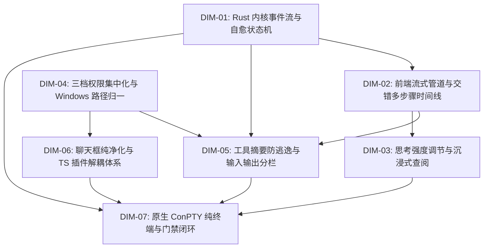

# Conex / Crish 全系统综合重构最终拍板维度矩阵

> **【权威标识】**：`docs/system-audit-and-redesign/00-主控拍板最终维度矩阵.md`
> **制定者**：主控调度者（Main Agent）
> **依据文件**：15 份专题分析报告（`analysis/01~15-*.md`）及 3 份维度建议（`dimension-proposals/01~03-*.md`）
> **状态**：**已拍板定案（Authoritative Decision）**，作为后续阶段二（多 Agent 独立总方案生成）的基准框架。

---

## 一、最终 7 大核心重构维度矩阵

```
┌───────────────────────────────────────────────────────────────────────────────────────────────────────┐
│                                Conex / Crish 全系统 7 大核心重构维度矩阵                              │
├─────────┬─────────────────────────────────────────────────┬───────────────────────────────────────────┤
│ 维度编号│ 维度名称                                        │ 涵盖的核心痛点与治理目标                  │
├─────────┼─────────────────────────────────────────────────┼───────────────────────────────────────────┤
│ DIM-01  │ Rust 内核双轨事件、后台任务装配与自愈状态机     │ 根治 19 轮事件滞留、任务未装配与中途暴毙  │
│ DIM-02  │ 前端流式管道、Dedupe 矩阵与交错多步骤时间线     │ 根治 Token 误杀乱码与两坨压平结构倒退     │
│ DIM-03  │ 思考强度档位调节、沉浸式查阅器与 PromptCache 优化│ 全链路 Thinking 档位、万字思考与缓存修复  │
│ DIM-04  │ 三档权限集中化大刀阔斧重构与 Windows 路径归一   │ 破除完全访问死锁、规范 Windows 沙箱与提议 │
│ DIM-05  │ 工具卡片语义化摘要防逃逸与输入/输出结构化分栏   │ 彻底根除 raw JSON 逃逸、建立两段式分栏    │
│ DIM-06  │ 聊天框纯净化、几何绝对防漂移与 TS 插件解耦体系  │ 拔除博客排版、(0,0)防漂移、四大能力插件化 │
│ DIM-07  │ 原生 ConPTY 纯终端、设计系统契约与质量门禁闭环  │ Windows ConPTY 直通终端、视觉曲率与门禁   │
└─────────┴─────────────────────────────────────────────────┴───────────────────────────────────────────┘
```

---

## 二、各维度具体任务定义与文件域契约

### 维度 1（DIM-01）：Rust 内核双轨事件、后台任务装配与自愈状态机

- **涵盖专题**：`01`（Rust 双轨事件）、`05`（BackgroundTaskManager 装配）、`13`（AI 连续工作中断自愈）
- **核心文件域**：
  - `crates/session-loop/src/provider.rs`、`handlers/streaming.rs`、`executing_tools.rs`、`prepare_turn.rs`、`turn_complete.rs`、`loop_exec.rs`、`exec_single.rs`、`tool_exec.rs`
  - `crates/agent-tools/src/tools/background_task.rs`、`shell.rs`、`background.rs`
  - `apps/agent-workbench/src-tauri/src/engine_channels.rs`、`run/run_launch.rs`、`bg_registry.rs`
- **核心治理目标**：
  1. **双轨事件实时打通**：将中间工具事件（ToolStart/ToolEnd）与轮次事件实时打通至 `LiveEventSink`，消除 19 轮长程任务中的黑盒滞留；
  2. **后台任务全链路装配**：打通 `ToolExecCtx` 与 `ToolContext` 的 `background` 与 `log_root`，解决 `background_task` 报错 `[common.unsupported]`；
  3. **不间断自愈状态机**：引入 `Tool-Promise 意图自愈` 与 `Format Self-Healing`，建立白名单准出契约，确保 AI 连续自主工作不暴毙。

---

### 维度 2（DIM-02）：前端流式管道、Dedupe 矩阵与交错式多步骤时间线（Interleaved Step Timeline）

- **涵盖专题**：`02`（EventRouter 去重）、`03`（多轮思考交互）、`08`（交错多步骤时间线）
- **核心文件域**：
  - `apps/crish-desktop/src/api/chat-bridge/EventRouter.ts`、`messageHandlers.ts`、`toolHandlers.ts`
  - `apps/crish-desktop/src/store/types.ts`、`streamingStore.ts`、`layoutStore.ts`
  - `apps/crish-desktop/src/api/tool-presentation/timelineNormalizer.ts`、`toolPresentationTypes.ts`
  - `apps/crish-desktop/src/components/chat-message-row/ChatAssistantMessageRow.tsx`、`MessageContent.tsx`、`MessageThinkingBlock.tsx`
- **核心治理目标**：
  1. **EventRouter Dedupe 矩阵重构**：修复实时轨无 sequence 时的 Dedupe Key 冲突，放行 `message-delta`，按 `toolId` 去重工具事件，根除 `"TheTheThe...All...package"` 乱码；
  2. **交错式多步骤时间线（Interleaved Step Timeline）**：确立 `thought` 为时间线一等公民，重构 `timelineNormalizer.ts`，建立真实的 `[步骤 1: 思考 ➔ 工具 ➔ 观察] ➔ [步骤 2: 思考 ➔ 工具 ➔ 观察] ➔ [最终总结]` 逻辑链路；活跃步骤动态打字展开，历史步骤优雅折叠。

---

### 维度 3（DIM-03）：思考强度档位调节、沉浸式查阅器与 PromptCache 优化

- **涵盖专题**：`09`（思考截断与沉浸式查阅）、`14`（思考强度与 PromptCache）
- **核心文件域**：
  - `apps/crish-desktop/src/components/chat-message-row/messageWindowDomBudget.ts`、`MessageThinkingSection.tsx`、`CacheMetricsBadge.tsx`
  - `apps/crish-desktop/src/components/chat-composer/ChatComposer.tsx`、`ModelSelector.tsx`
  - `apps/crish-desktop/src/components/settings-models/ModelsSettingsTab.tsx`
  - `crates/agent-provider/src/parse/chat_core.rs`、`provider/anthropic/build_anthropic.rs`、`headers.rs`
- **核心治理目标**：
  1. **思考强度全链路连通**：模型设置 Tab（全局默认思考档位与 Token 预算滑动条）+ 主对话底栏模型行（即时切换 Minimal/Medium/Deep 档位）；
  2. **双轨万字思考查阅器**：行内自适应弹性视口（8k~12k 预算）+ 全量沉浸式查阅器（`FullThoughtModal`，带 TOC 大纲、搜索与无损导出）；
  3. **修复 PromptCache 虚假“未命中”**：重构 `CacheMetricsBadge.tsx` 为四态展示（⚡ 缓存命中 / 💾 写入缓存 / 未命中 / 隐藏），在 Rust 补齐 Anthropic `cache_control` 与 beta headers。

---

### 维度 4（DIM-04）：三档权限集中化大刀阔斧重构与 Windows 路径归一

- **涵盖专题**：`04`（工作区沙箱越界与盘符）、`12`（权限体系大刀阔斧重构）
- **核心文件域**：
  - `crates/agent-tools/src/tools/shell.rs`、`shell_redirect.rs`、`mod.rs`、`delete_file.rs`、`delete_dir.rs`
  - `crates/conex-fs/src/lib.rs`、`path_utils.rs`
  - `apps/crish-desktop/src/store/permissionStore.ts`、`workspaceStore.ts`
  - `apps/crish-desktop/src/components/chat-composer/PermissionModeMenu.tsx`
- **核心治理目标**：
  1. **破除完全访问死锁**：彻底拔除脱离上下文的 `ShellCommandTool` 复合删除拦截与私设卡点，**“完全访问模式”真正赋予用户授权后的完全信任执行权限**（放行复合删除、间接执行与临时文件清理）；
  2. **极简三档权限模型**：只读模式（Read-Only / Plan）/ 标准模式（Standard Workspace）/ 完全访问模式（Full Access）；
  3. **Windows 路径归一与动态挂载**：统一剥离 Windows `\\?\` UNC 前缀与盘符大写比对，放行 NTFS Junction；纯对话模式显式建模为通用无工作区状态，支持“AI 提议 ➔ 用户授权 ➔ 动态挂载”。

---

### 维度 5（DIM-05）：工具卡片语义化摘要防逃逸与输入/输出结构化分栏

- **涵盖专题**：`06`（工具执行摘要与输入输出分栏）、`12`（工具展开输入输出分区）
- **核心文件域**：
  - `apps/crish-desktop/src/api/tool-presentation/toolCardPresenter.ts`
  - `apps/crish-desktop/src/components/chat-tool-call/CompactToolRow.tsx`、`ToolCallOutput.tsx`、`ChatToolCallBlock.tsx`
  - `apps/crish-desktop/src/components/chat-tool-call/ToolCallInputPane.tsx`、`ToolCallOutputPane.tsx`、`ToolCall.module.css`
- **核心治理目标**：
  1. **语义化标题引擎（防 raw JSON 逃逸）**：建立覆盖全部 13 类工具的 100% 精准中文标题提取矩阵（如 `运行 npm install`、`查询后台任务 (task-0)`、`列出目录 ...`），彻底消灭 `浏览 {}`、`处理 .`、`运行命令`；
  2. **输入/输出两段式结构化分栏**：
     - **📥 输入区（Input Pane）**：命令命令行（带复制按钮）、执行入参 JSON/参数表、工作目录 CWD；
     - **📤 输出区（Output Pane）**：终端输出（Stdout/Stderr）、执行结果、错误诊断横幅、退出码与高精度耗时。

---

### 维度 6（DIM-06）：聊天框纯净化、几何绝对防漂移与 TypeScript 插件解耦体系

- **涵盖专题**：`07`（Follow-up 插件与子 Agent 隔离）、`10`（输入框解耦与 MarkdownEditor 插件）、`15`（AI 浏览器与电脑操作插件化）
- **核心文件域**：
  - `apps/crish-desktop/src/components/chat-composer/SlashExtension.ts`、`TiptapSlashMenu.tsx`、`ChatComposer.tsx`
  - `packages/plugin-sdk/`、`packages/plugin-markdown-editor/`、`packages/plugin-browser/`、`packages/plugin-computer-use/`、`packages/plugin-follow-up/`
  - `apps/crish-desktop/src/components/settings/`、`apps/crish-desktop/src/components/preview/`
- **核心治理目标**：
  1. **输入框彻底净化**：从 `ChatComposer` 彻底拔除 `Heading 1/2/3`, `Bullet List`, `Task List` 等博客排版命令，`/` 专注服务于 AI 系统指令（`/clear`, `/settings`, `/compact`, `/goal`）；
  2. **坐标防漂移**：建立 `safeCursorAnchor.ts` 几何探测器，确保弹层绝对锁定在光标正上方 8px，彻底根除 `(0, 0)` 左上角漂移；
  3. **四大 TS 插件解耦体系**：
     - `MarkdownEditorPlugin`：独立富文本编辑器打包为纯 TS 插件，仅在文档 Tab 按需加载；
     - `BrowserPlugin` & `ComputerUsePlugin`：剥离主界面丑陋脚手架，书签/历史导入移入设置中心（Settings），轻量悬浮 HUD；
     - `FollowUpPlugin`：轻量插件化，子 Agent 上下文与 UI **100% 严格隔离屏蔽**。

---

### 维度 7（DIM-07）：原生 ConPTY 纯终端、设计系统契约与质量门禁闭环

- **涵盖专题**：`11`（原生 ConPTY 纯终端）、`00`（战役通则规范与设计系统契约）
- **核心文件域**：
  - `apps/agent-workbench/src-tauri/src/pty/`、`apps/crish-desktop/src/components/terminal/`、`terminalStore.ts`
  - `apps/crish-desktop/src/components/ui/`、`index.css`、`reference/markdown-editor/`
- **核心治理目标**：
  1. **原生 ConPTY 纯终端**：Rust 基于 `portable-pty` 直连 Windows 原生 **ConPTY**（`pwsh.exe`/`cmd.exe`）+ 前端标准 `@xterm/xterm`，双向字节流直通，100% 支持按键、Tab 补全、上下键历史、ANSI 颜色与 Vim 交互；彻底清除 `terminalStore` 伪行缓冲注入；
  2. **全系统设计系统契约落地**：视觉曲率 4 级阶梯（9999px / 10px / 12px / 6px），统一 `<Tooltip>`，输入框 ≤10% 柔和焦点态；
  3. **测试资产保护与门禁闭环**：100% 保护 `reference/markdown-editor/` 全部测试资产；全量通过 `cargo test --workspace` + `npm run typecheck` + `npm test`；CDP 9222 真机验收。

---

## 三、纯逻辑依赖拓扑（Dependency Topology）



**逻辑演进顺序**：

1. **基座层**：`DIM-01`（内核事件与自愈） + `DIM-04`（权限集中化与沙箱）；
2. **状态与时间线层**：`DIM-02`（流式 Dedupe 与交错步骤时间线）；
3. **展示与交互层**：`DIM-03`（思考深度与查阅器） + `DIM-05`（工具摘要与输入输出分栏）；
4. **插件与扩展层**：`DIM-06`（输入框净化与 TS 插件体系）；
5. **系统终端与质量闭环层**：`DIM-07`（原生 ConPTY 纯终端、设计契约与全量门禁）。
