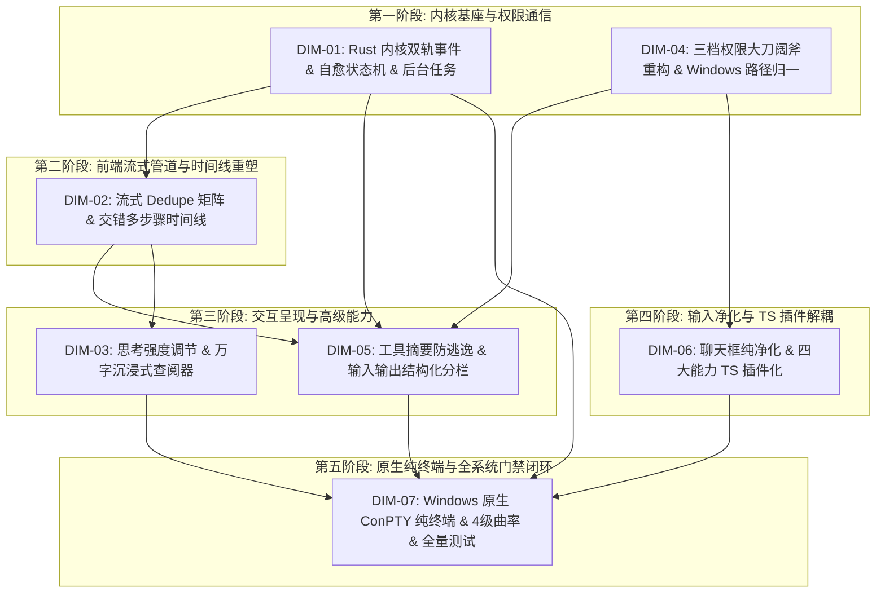

# Conex / Crish 全系统综合重构总计划框架（权威定案版）

> **【权威标识】**：`docs/system-audit-and-redesign/00-总方案-Conex全系统综合重构总计划框架.md`
> **制定者**：主控调度者（Main Agent）
> **依据文件**：15 份专题分析报告（`analysis/01~15`）、7 份独立总方案（`independent-plans/01~07`）、3 份严格批判性评审意见（`plan-reviews/01~03`）
> **核心原则**：纯逻辑时序、所有问题同权、零优先级砍项、效果锁不可妥协、反过度设计与反退避。

---

## 目录

1. [主控重大争议裁决与架构基准定夺（Executive Rulings）](#一主控重大争议裁决与架构基准定夺)
2. [全系统 7 大核心重构维度总览（Core Dimensions Hierarchy）](#二全系统-7-大核心重构维度总览)
3. [各维度核心任务与责任文件域（Dimensional Task Specifications）](#三各维度核心任务与责任文件域)
4. [全系统纯逻辑演进无环拓扑（Pure Logical Dependency Topology）](#四全系统纯逻辑演进无环拓扑)
5. [跨模块数据流与通信契约（Cross-Module Data Flow Contracts）](#五跨模块数据流与通信契约)
6. [四级质量门禁与全量验收规范（Quality Gates & Acceptance Criteria）](#六四级质量门禁与全量验收规范)

---

## 一、主控重大争议裁决与架构基准定夺

针对 3 位严格方案评审师在 `plan-reviews/01~03` 中提出的系统级冲突与漏洞，主控在此作出**唯一权威裁决**，所有后续维度详案与实施轮次必须无条件以此为准：

```
┌───────────────────────────────────────────────────────────────────────────────────────────────────────┐
│                               主控调度者 6 大系统级争议与关键设计裁决                                 │
├─────────┬───────────────────────────────────┬─────────────────────────────────────────────────────────┤
│ 裁决编号│ 争议与评审发现核心问题            │ 主控拍板最终定夺方案（不可违背）                        │
├─────────┼───────────────────────────────────┼─────────────────────────────────────────────────────────┤
│ RUL-01  │ 双轨事件收口重放导致前端状态颠簸  │ 采用复合因果 Key (`type:toolId` / `type:turnIndex`)，收口│
│         │ 与时间线重复闪烁                  │ 事件仅执行元数据同步（Commit Phase），不重走插入。      │
├─────────┼───────────────────────────────────┼─────────────────────────────────────────────────────────┤
│ RUL-02  │ Tool-Promise 行动意图自愈误杀普通 │ 引入三层反向过滤（排除 Markdown/反问/第三人称），设置最大│
│         │ 解释导致死循环暴毙                │ 自愈上限为 2 次，超限安全以 Stop 终态收口。             │
├─────────┼───────────────────────────────────┼─────────────────────────────────────────────────────────┤
│ RUL-03  │ 完全访问放行后系统目录误删隐患    │ 完全访问放行所有常规项目/临时目录与复合删除，但保留系统  │
│         │                                   │ 核心目录不可变红线（`is_system_critical_path` 硬拦截）。│
├─────────┼───────────────────────────────────┼─────────────────────────────────────────────────────────┤
│ RUL-04  │ Windows 路径盘符大小写冲突崩溃    │ 全仓强制使用大写盘符（`C:/...`）+ 正斜杠 `/`，UNC 网络  │
│         │                                   │ 探测必须封装于 `spawn_blocking` 防止 Tokio 线程饥饿。   │
├─────────┼───────────────────────────────────┼─────────────────────────────────────────────────────────┤
│ RUL-05  │ 10MB Stdout 展开与万字思考卡死    │ 工具输出默认 2000 行/256KB 轻量视口并支持下载/检查器；  │
│         │                                   │ 万字思考 TOC 提取与搜索移入 Worker/轻量防抖计算。       │
├─────────┼───────────────────────────────────┼─────────────────────────────────────────────────────────┤
│ RUL-06  │ TS 插件资源泄漏与子 Agent 穿透    │ `PluginContext` 装配 `DisposableBag` 严格按生命周期注销；│
│         │                                   │ 子 Agent 实施引擎/上下文/注册表/视图四重立体硬阻断。    │
└─────────┴───────────────────────────────────┴─────────────────────────────────────────────────────────┘
```

---

## 二、全系统 7 大核心重构维度总览

```
┌───────────────────────────────────────────────────────────────────────────────────────────────────────┐
│                                Conex / Crish 全系统 7 大核心重构维度矩阵                              │
├─────────┬─────────────────────────────────────────────────┬───────────────────────────────────────────┤
│ 维度编号│ 维度名称                                        │ 核心解决痛点与治理目标                    │
├─────────┼─────────────────────────────────────────────────┼───────────────────────────────────────────┤
│ DIM-01  │ Rust 内核双轨事件、后台任务装配与自愈状态机     │ 根治 19 轮事件滞留、任务未装配与中途暴毙  │
│ DIM-02  │ 前端流式管道、Dedupe 矩阵与交错多步骤时间线     │ 根治 Token 误杀乱码与两坨压平结构倒退     │
│ DIM-03  │ 思考强度档位调节、沉浸式查阅器与 PromptCache 优化│ 全链路 Thinking 档位、万字思考与缓存修复  │
│ DIM-04  │ 三档权限集中化大刀阔斧重构与 Windows 路径归一   │ 破除完全访问死锁、规范 Windows 沙箱与提议 │
│ DIM-05  │ 工具卡片语义化摘要防逃逸与输入/输出结构化分栏   │ 彻底根除 raw JSON 逃逸、建立两段式分栏    │
│ DIM-06  │ 聊天框纯净化、几何绝对防漂移与 TS 插件解耦体系  │ 拔除博客排版、(0,0)防漂移、四大能力插件化 │
│ DIM-07  │ 原生 ConPTY 纯终端、设计系统契约与质量门禁闭环  │ Windows ConPTY 直通终端、视觉曲率与门禁   │
└─────────┴─────────────────────────────────────────────────┴───────────────────────────────────────────┘
```

---

## 三、各维度核心任务与责任文件域

### 维度 1（DIM-01）：Rust 内核双轨事件、后台任务装配与自愈状态机

- **核心文件域**：
  - `crates/session-loop/src/provider.rs`、`handlers/streaming.rs`、`executing_tools.rs`、`prepare_turn.rs`、`turn_complete.rs`、`loop_exec.rs`、`exec_single.rs`、`tool_exec.rs`
  - `crates/agent-tools/src/tools/background_task.rs`、`shell.rs`、`background.rs`
  - `apps/agent-workbench/src-tauri/src/engine_channels.rs`、`run/run_launch.rs`、`bg_registry.rs`
- **核心任务**：
  1. **双轨事件实时化**：在 `SessionLoopOptions` 中注入 `LiveEventSink`，实时广播 `ToolStart`、`ToolEnd`、`TurnStart`、`TurnEnd`，彻底消除长程任务黑盒滞留；
  2. **后台任务全链路装配**：打通 `ToolExecCtx` ➔ `ToolContext` 的 `background` 与 `log_root`，解决 `background_task` 抛出 `[common.unsupported]`，支持超长输出磁盘溢出；
  3. **不间断自愈状态机**：引入 `Tool-Promise` 意图自愈与 `Format Self-Healing`，建立白名单准出契约（仅在模型显式无动作用户答复、用户主动停止或达到硬上限时才收敛）。

---

### 维度 2（DIM-02）：前端流式管道、Dedupe 矩阵与交错式多步骤时间线

- **核心文件域**：
  - `apps/crish-desktop/src/api/chat-bridge/EventRouter.ts`、`messageHandlers.ts`、`toolHandlers.ts`
  - `apps/crish-desktop/src/store/types.ts`、`streamingStore.ts`、`layoutStore.ts`
  - `apps/crish-desktop/src/api/tool-presentation/timelineNormalizer.ts`、`toolPresentationTypes.ts`
  - `apps/crish-desktop/src/components/chat-message-row/ChatAssistantMessageRow.tsx`、`MessageContent.tsx`、`MessageThinkingBlock.tsx`
- **核心任务**：
  1. **EventRouter Dedupe 矩阵**：重构去重 Key 计算，放行 `message-delta`，以复合因果 Key 识别工具与轮次边界，根除 `"TheTheThe...All...package"` 乱码；
  2. **交错式多步骤时间线（Interleaved Step Timeline）**：扩展 `MessageTimelineBlockType` 确立 `thought` 一等公民，重构 `timelineNormalizer.ts`，建立真实有序的 `[步骤 1: 思考 ➔ 工具 ➔ 观察] ➔ [步骤 2: 思考 ➔ 工具 ➔ 观察] ➔ [最终总结]` 逻辑链路；活跃步骤动态打字展开，历史步骤优雅折叠。

---

### 维度 3（DIM-03）：思考强度档位调节、沉浸式查阅器与 PromptCache 优化

- **核心文件域**：
  - `apps/crish-desktop/src/components/chat-message-row/messageWindowDomBudget.ts`、`MessageThinkingSection.tsx`、`CacheMetricsBadge.tsx`
  - `apps/crish-desktop/src/components/chat-composer/ChatComposer.tsx`、`ModelSelector.tsx`
  - `apps/crish-desktop/src/components/settings-models/ModelsSettingsTab.tsx`
  - `crates/agent-provider/src/parse/chat_core.rs`、`provider/anthropic/build_anthropic.rs`、`headers.rs`
- **核心任务**：
  1. **思考强度全链路连通**：模型设置 Tab（全局默认思考档位与 Token 预算滑动条）+ 主对话底栏模型行（即时切换 Minimal/Medium/Deep 档位）；
  2. **双轨万字思考查阅器**：行内自适应弹性视口（8k~12k 预算）+ 全量沉浸式查阅器（`FullThoughtModal`，带 TOC 大纲、搜索与无损导出）；
  3. **修复 PromptCache 虚假“未命中”**：重构 `CacheMetricsBadge.tsx` 为四态展示（⚡ 缓存命中 / 💾 写入缓存 / 未命中 / 隐藏），在 Rust 补齐 Anthropic `cache_control` 与 beta headers。

---

### 维度 4（DIM-04）：三档权限集中化大刀阔斧重构与 Windows 路径归一

- **核心文件域**：
  - `crates/agent-tools/src/tools/shell.rs`、`shell_redirect.rs`、`mod.rs`、`delete_file.rs`、`delete_dir.rs`
  - `crates/conex-fs/src/lib.rs`、`path_utils.rs`
  - `apps/crish-desktop/src/store/permissionStore.ts`、`workspaceStore.ts`
  - `apps/crish-desktop/src/components/chat-composer/PermissionModeMenu.tsx`
- **核心任务**：
  1. **破除完全访问死锁**：彻底拔除脱离上下文的 `ShellCommandTool` 复合删除拦截与私设卡点，**“完全访问模式”真正赋予用户授权后的完全信任执行权限**（放行复合删除、间接执行与临时文件清理，仅保留系统核心目录不可变红线）；
  2. **极简三档权限模型**：只读模式（Read-Only）/ 标准模式（Standard）/ 完全访问模式（Full Access）；
  3. **Windows 路径归一与动态挂载**：统一剥离 Windows `\\?\` UNC 前缀与大写盘符（`C:/`），放行 NTFS Junction；纯对话模式显式建模为无工作区状态，支持“AI 提议 ➔ 用户授权 ➔ 动态挂载”。

---

### 维度 5（DIM-05）：工具卡片语义化摘要防逃逸与输入/输出结构化分栏

- **核心文件域**：
  - `apps/crish-desktop/src/api/tool-presentation/toolCardPresenter.ts`
  - `apps/crish-desktop/src/components/chat-tool-call/CompactToolRow.tsx`、`ToolCallOutput.tsx`、`ChatToolCallBlock.tsx`
  - `apps/crish-desktop/src/components/chat-tool-call/ToolCallInputPane.tsx`、`ToolCallOutputPane.tsx`、`ToolCall.module.css`
- **核心任务**：
  1. **语义化标题引擎（防 raw JSON 逃逸）**：建立覆盖全部 13 类工具的 100% 精准中文标题提取矩阵（如 `运行 npm install`、`查询后台任务 (task-0)`、`列出目录 ...`），彻底消灭 `浏览 {}`、`处理 .`、`运行命令`；
  2. **输入/输出两段式结构化分栏**：
     - **📥 输入区（Input Pane）**：命令命令行（带复制按钮）、执行入参 JSON/参数表、工作目录 CWD；
     - **📤 输出区（Output Pane）**：终端输出（Stdout/Stderr）、执行结果、错误诊断横幅、退出码与高精度耗时。

---

### 维度 6（DIM-06）：聊天框纯净化、几何绝对防漂移与 TypeScript 插件解耦体系

- **核心文件域**：
  - `apps/crish-desktop/src/components/chat-composer/SlashExtension.ts`、`TiptapSlashMenu.tsx`、`ChatComposer.tsx`
  - `packages/plugin-sdk/`、`packages/plugin-markdown-editor/`、`packages/plugin-browser/`、`packages/plugin-computer-use/`、`packages/plugin-follow-up/`
  - `apps/crish-desktop/src/components/settings/`、`apps/crish-desktop/src/components/preview/`
- **核心任务**：
  1. **输入框彻底净化**：从 `ChatComposer` 彻底拔除 `Heading 1/2/3`, `Bullet List`, `Task List` 等博客排版命令，`/` 专注服务于 AI 系统指令（`/clear`, `/settings`, `/compact`, `/goal`）；
  2. **坐标防漂移**：建立 `safeCursorAnchor.ts` 几何探测器，确保弹层绝对锁定在光标正上方 8px，彻底根除 `(0, 0)` 左上角漂移；
  3. **四大 TS 插件解耦体系**：
     - `MarkdownEditorPlugin`：独立富文本编辑器打包为纯 TS 插件，仅在文档 Tab 按需加载；
     - `BrowserPlugin` & `ComputerUsePlugin`：剥离主界面丑陋脚手架，书签/历史导入移入设置中心（Settings），轻量悬浮 HUD；
     - `FollowUpPlugin`：轻量插件化，子 Agent 上下文与 UI **100% 严格隔离屏蔽**。

---

### 维度 7（DIM-07）：原生 ConPTY 纯终端、设计系统契约与质量门禁闭环

- **核心文件域**：
  - `apps/agent-workbench/src-tauri/src/pty/`、`apps/crish-desktop/src/components/terminal/`、`terminalStore.ts`
  - `apps/crish-desktop/src/components/ui/`、`index.css`、`reference/markdown-editor/`
- **核心任务**：
  1. **原生 ConPTY 纯终端**：Rust 基于 `portable-pty` 直连 Windows 原生 **ConPTY**（`pwsh.exe`/`cmd.exe`）+ 前端标准 `@xterm/xterm`，双向字节流直通，支持键盘输入、Tab 补全、上下键历史、ANSI 颜色与 Vim 交互；彻底清除 `terminalStore` 伪行缓冲注入；
  2. **全系统设计系统契约落地**：视觉曲率 4 级阶梯（9999px / 10px / 12px / 6px），统一 `<Tooltip>`，输入框 ≤10% 柔和焦点态；
  3. **测试资产保护与门禁闭环**：100% 保护 `reference/markdown-editor/` 全部测试资产；全量通过 `cargo test --workspace` + `npm run typecheck` + `npm test`；CDP 9222 真机验收。

---

## 四、全系统纯逻辑演进无环拓扑



---

## 五、跨模块数据流与通信契约

### 5.1 事件流双轨契约

1. **实时通知轨（`LiveEventSink`）**：无序列号（`sequence: None`），Tauri IPC 直推前端，用于流式打字、工具启动、动态状态机推进；
2. **持久收口轨（`drive_outcome`）**：严格单调自增 `sequence`，用于最终持久化落盘与离线水合，前端接收后执行 Commit Phase（元数据对齐，不重复插入节点）。

### 5.2 插件通信与沙箱契约

1. 插件通过 `PluginContext` 注册工具与视图，强制挂载 `DisposableBag`，确保注销时 CDP、Worker、Event Listener 100% GC；
2. 严禁子 Agent 接收或渲染任何 Follow-up 插件内容，由 ToolContext 与 Slot 双重阻断。

---

## 六、四级质量门禁与全量验收规范

1. **Level 1: 静态类型门禁**：`npm run typecheck` 0 错误；
2. **Level 2: 代码行数门禁**：`npm run check:line-counts` 严格满足组件 ≤ 500 行、业务逻辑 ≤ 400 行、类型契约 ≤ 800 行；
3. **Level 3: 自动化测试门禁**：
   - Rust: `cargo test --workspace` 73+ 套件全绿；
   - 前端: `npm test`（Vitest 单元测试全绿，`reference/markdown-editor/` 门禁 100% 通过）；
4. **Level 4: 真应用实机验收**：连接 `http://127.0.0.1:9222` Tauri WebView2 环境，对交错时间线、输入框斜杠命令、完全访问权限执行与原生 ConPTY 纯终端进行实机无死锁验收。
