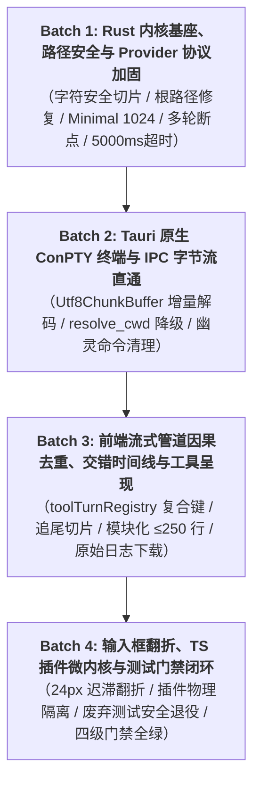

# 第二轮 Conex 全系统深度重构与多轮修复执行总方案（定稿）

> **方案版本**：v2.0-FINAL  
> **生效时间**：2026-08-16  
> **权威依据**：`docs/system-audit-and-redesign/audits/01~14-*.md` 全盘审计报告、`detailed-plans/01~08-*.md` 8 份维度详案、`plan-reviews/06~07-*.md` 2 份严格交叉评审意见。  
> **核心原则**：纯逻辑编排、反退避、无兼容包袱与补丁、主控独占收口、四大批次原子落地。

---

## 一、主控 8 大关键架构裁决（Master Architectural Decisions）

### 裁决 1（DEC-01）：自愈状态机与 Steering 思考预算隔离

- **裁决内容**：当 `ToolPromiseDetector` 捕获到工具承诺但未产出结构化调用时，合成的 Steering Nudge 请求**强制将 `thinking_budget` 设为 0**（跳过深度思考），避免一轮简单的自愈重试消耗 30s+ 思考延迟与上万 Token；
- **匹配增强**：`ToolPromiseDetector` 必须引入否定词（“我不会/禁止/暂不执行”）过滤规则，避免被反语误诱导；字符切片强制使用 Unicode 字素/字符边界（`char_indices`），彻底根除 UTF-8 多字节 Panic。

### 裁决 2（DEC-02）：Windows 规范路径绝对权威与 Single Source of Truth

- **裁决内容**：全仓库所有模块（Rust Crates, Tauri PTY 宿主, 前端 API）对于工作区与文件路径，一律统一以 `ConexPathNormalizer` 产出的 `C:/...`（大写盘符、正斜杠、剥离 `\\?\` UNC 前缀）为唯一标准；
- **边界防御**：输入 POSIX 根 `/` 时必须保留根锚点（返回 `/` 或系统盘根 `C:/`），绝对禁止返回空字符串 `""`；UNC 根 `//server/share` 建立单调性保护，`..` 操作不得将 UNC 根弹出；系统关键路径红线动态感知 `%SystemRoot%` 与多盘符。

### 裁决 3（DEC-03）：反过度设计裁决：PTY 极简生命周期与 CAS 存储本地化

- **裁决内容**：
  1. **彻底否决 PTY 3 态 2 小时保活与后台心跳轮询**：收拢为极简本地桌面模型——前端 Tab 挂载即启动进程，Tab 关闭或会话删除时随 Job Object 彻底销毁，零心跳零常驻守护；
  2. **彻底否决 CAS 存储 7 天分布式两阶段软删除**：收拢为单机 SQLite 本地引用计数 + 单事务原子更新；
  3. **彻底否决 Rayon 强制多线程模糊检索与预请求 DNS 解析器**：万级文件树采用轻量单线程预分配迭代，域名检查收拢为极简静态白名单。

### 裁决 4（DEC-04）：Win32 原生 Job Object 独占树杀（杜绝 PID 复用误杀）

- **裁决内容**：废除外部 `taskkill` 裸 PID 树杀机制（防止 Windows PID 快速复用误杀系统进程），统一使用 Win32 原生 Job Object（`JOB_OBJECT_LIMIT_KILL_ON_JOB_CLOSE`）作为唯一安全进程树回收机制；`TaskAuditAccumulator` 限制 1000 条上限与 FIFO 淘汰，任务终态即时释放映射，杜绝内存泄漏。

### 裁决 5（DEC-05）：EventRouter 因果缓冲复合键与大日志异步下载

- **裁决内容**：
  1. `EventRouter.ts` 引入 `toolTurnRegistry: Map<string, number>` 记录每个 `toolId` 的归属 `turnIndex`，因果缓冲统一使用 `${turn}:${toolId}` 复合索引，彻底消除全局可变单例引发的去重键碰撞与死锁；
  2. `ToolCallOutput.tsx` 绝对禁止在 React Props 中同步透传 50MB 原始全量输出，采用按需异步读取器（`fetchToolRawOutput(toolId)`）触发 Blob 下载，彻底防止 React Fiber 树 OOM。

### 裁决 6（DEC-06）：万字思考安全 Markdown 追尾切片与输入框 24px 迟滞翻折

- **裁决内容**：
  1. `TimelineThoughtSection.tsx` 行内自适应视口采用 `Safe Markdown Tail Slicer`：截取尾部 10k 字符时必须对齐最近的换行符 `\n`，并通过单遍轻量状态机自动补齐未闭合的 Markdown Code Fences (` ``` `) 与 LaTeX 界标，消除虚拟滚动重排抖动（Layout Thrashing）；
  2. `SlashExtension.ts` 视口翻折算法引入 24px 迟滞回差（Hysteresis），杜绝边缘亚像素浮动闪烁；打通 Level 4 容器备援。

### 7（DEC-07）：TS 插件体系物理隔离与安全 Default-Deny 白名单

- **裁决内容**：
  1. `FollowUpPlugin` 等前台插件在 `PluginRegistry` 事件分派层（0ms）对 `isSubagent` 实行物理阻断，0 后台触发，0 Token 消耗；
  2. `PluginContext.invokeIpc` 落地显式白名单映射（`CHANNEL_PERMISSION_MAP`），系统安全通道（`dialog`, `clipboard`, `app`, `window`）放行，未在映射表中的未知通道默认抛出 `PluginSecurityError` 阻断。

### 裁决 8（DEC-08）：测试资产分级保护与三步安全退役准入铁律

- **裁决内容**：
  1. **Tier-1 核心测试资产 100% 保护**：`reference/markdown-editor/` 88 个测试套件（1,146 用例）与 5 大 Markdown 专项 E2E spec（`ast-block-tables`, `format-checker`, `ime-composition`, `keyboard-navigation`, `wysiwyg-interaction`）纳入核心保护资产，严禁删改；
  2. **废弃测试安全退役三步法**：对 32 个历史探索脚本（`tests/legacy/`）与探针文件，必须先在单测层确认 1:1 提取覆盖绿灯，再行物理删除；
  3. **假阳性强断言重构**：移除 `if (await isVisible())` 等假绿条件，补齐 `apps/crish-desktop/tests/snapshots/` 的 Glob 匹配，CI 引入静态语法检查扫描防死灰复燃。

---

## 二、四大多轮次实施批次（Implementation Batches）



### Batch 1: Rust 内核基座、路径安全与 Provider 协议加固

- **Task 1.1（DIM-01 会话内核）**：
  - `crates/session-loop/src/strategy.rs`：修复 `ToolPromiseDetector` 为 `char_indices` 字符安全切片，增加否定词过滤；
  - `crates/session-loop/src/loop_state.rs` & `executing_tools.rs`：完善 `LiveEventSink` 对称广播，删除空 `batch_id` 伪 `ToolStart` 双发；
  - `crates/session-loop/src/abort.rs`：升级 `AbortToken` 为 `tokio::sync::Notify` 异步通知，拔除 50ms 轮询死循环；
  - `crates/orchestrator/src/background.rs`：落地 Win32 Job Object 树杀，`TaskAuditAccumulator` 1000 条 FIFO 淘汰。
- **Task 1.2（DIM-02 路径与权限）**：
  - `crates/conex-fs/src/path_normalizer.rs`：修复 POSIX 根 `/` 返回空字符串漏洞与 UNC 根前缀防弹出；
  - `crates/agent-tools/src/tools/permission.rs`：落地集中化 `PermissionDecisionEngine`，收拢 `shell.rs` 分支；
  - `crates/agent-tools/src/tools/symlink.rs`：`resolve_symlink_chain` 多级解析与防环。
- **Task 1.3（DIM-03 模型通信）**：
  - `crates/agent-provider/src/vendor_wire.rs`：修正 Anthropic `Minimal = 1024` tokens 与物理最大 token 钳制；
  - `crates/agent-provider/src/build_anthropic.rs`：拔除 `messages: false`，注入多轮会话动态 PromptCache 断点与 Beta 头部集合；
  - `crates/conex-types/src/lib.rs`：清理死结构体 `IpcEnvelope`, `IpcResponse`；
  - `crates/agent-provider/src/error_classify.rs`：补齐 HTTP 529 与 5xx 状态码。
- **Task 1.4（DIM-04 存储优化）**：
  - `crates/conex-db/src/local_db.rs`：配置 `busy_timeout = 5000ms`，读请求路由至 `ReaderPool`；
  - `crates/conex-diff/src/lib.rs`：修复首行 Insert/Delete 索引 Bug；
  - 物理清理 `parse_handwritten.rs` 与预请求 DNS 代码。

### Batch 2: Tauri 原生 ConPTY 终端与 IPC 字节流直通

- **Task 2.1（DIM-05 原生 ConPTY 乱码根治）**：
  - `apps/agent-workbench/src-tauri/src/pty/session.rs`：落地 `Utf8ChunkBuffer` 流式增量解码器，彻底解决 8KB 跨边界中文字符与 ANSI 序列截断乱码；
  - `apps/agent-workbench/src-tauri/src/pty/session.rs`：`resolve_cwd` 实施 4 级不可击穿降级阶梯（`显式路径 ➔ 工作区根 ➔ 用户主目录 ~ ➔ .`）；
  - `apps/agent-workbench/src-tauri/src/pty/mod.rs`：解除写入持锁阻塞，转为 `async fn` + `spawn_blocking`；
  - `apps/agent-workbench/src-tauri/src/process.rs`：全面统一为 `pwsh7`。
- **Task 2.2（DIM-05 IPC 注册面大扫除）**：
  - 拔除 5 条 `registered: false` 占位死命令与 4 条未接线幽灵命令；
  - `commandMap.ts` 废除 13 条遗留假白名单，对齐 `commandManifest.ts`。

### Batch 3: 前端流式管道因果去重、交错时间线与工具呈现

- **Task 3.1（DIM-06 流式去重与时间线）**：
  - `apps/crish-desktop/src/api/chat-bridge/EventRouter.ts`：引入 `toolTurnRegistry` 记录工具归属轮次，因果缓冲改用 `${turn}:${toolId}` 复合索引；
  - `apps/crish-desktop/src/components/chat-message/MessageContent.tsx`：清除 render 内部 setState，修复 StrictMode 游标脱节；
  - `apps/crish-desktop/src/components/chat-message-row/TimelineThoughtSection.tsx`：落地 `Safe Markdown Tail Slicer` 尾部 10k 追尾切片与代码块/公式自动闭合；
  - `apps/crish-desktop/src/workers/thoughtWorker.ts`：大纲提取增加代码块状态机，避免注释 `#` 误判为 H1。
- **Task 3.2（DIM-07 工具呈现拆分与分栏）**：
  - 拆分 `toolHumanDescriptions.ts` 与 `toolCardPresenter.ts` 为 8 个高内聚子模块（每文件 ≤ 250 行）；
  - 修复 `read_url_content` / `read_resource` 工具判定短路；
  - `ToolCallOutput.tsx` 采用异步读取器透传 raw output 修复日志下载，`ToolCallInputPane.tsx` 增加 1000 行/128KB 防爆保护。

### Batch 4: 输入框翻折、TS 插件微内核与测试门禁闭环

- **Task 4.1（DIM-07 输入框与插件）**：
  - `apps/crish-desktop/src/components/chat-composer/SlashExtension.ts`：保全 `suggestedSide` 属性，引入 24px 迟滞回差（Hysteresis）；
  - `apps/crish-desktop/src/plugins/PluginRegistry.ts`：对子 Agent 实行 `isSubagent` 0ms 物理阻断，落地 `CHANNEL_PERMISSION_MAP` 默认拒绝安全白名单；
  - `packages/block-paper-contract/src/coordinates.ts`：消除循环依赖。
- **Task 4.2（DIM-08 测试重构与门禁闭环）**：
  - 100% 保护 `reference/markdown-editor/` 88 套件与 5 大 Markdown E2E spec；
  - 物理清理 `tests/legacy/`（32 个废弃脚本）、`tests/experimental/`、`placeholder.test.ts`、`tmp_*_probe.rs`；
  - 移除 `ui-store-invariants.spec.ts` 中 `if (await isVisible())` 假阳性守卫，修复 `vitest.config.ts` 快照测试匹配；
  - 执行四级全量门禁（`npm run typecheck` + `npm test` + `cargo test --workspace` + `npm --prefix reference/markdown-editor test`）。

---

## 三、四大批次验收与提交规范

| 批次         | 覆盖领域                            | 关键验收命令                                                                                          | 预期成果                                           |
| :----------- | :---------------------------------- | :---------------------------------------------------------------------------------------------------- | :------------------------------------------------- |
| **BATCH-01** | Rust 内核、路径安全与 Provider 协议 | `cargo test -p session-loop -p conex-fs -p agent-provider -p conex-db`                                | 字符切片零崩溃，Minimal 1024 合规，5000ms 超时生效 |
| **BATCH-02** | Tauri 桌面 ConPTY 终端与 IPC        | `cargo test -p crish_agent_workbench ; npm test`                                                      | 8KB 跨边界中文零乱码，resolve_cwd 安全降级         |
| **BATCH-03** | 前端流式因果去重、时间线与工具分栏  | `npm test -- apps/crish-desktop/src/api/ apps/crish-desktop/src/components/`                          | 零去重误杀，追尾切片无重排抖动，每文件 ≤ 250 行    |
| **BATCH-04** | 输入框翻折、TS 插件体系与全量门禁   | `npm run typecheck ; npm test ; cargo test --workspace ; npm --prefix reference/markdown-editor test` | 假阳性清零，88 套件全绿，四级门禁 100% 绿灯通过    |
