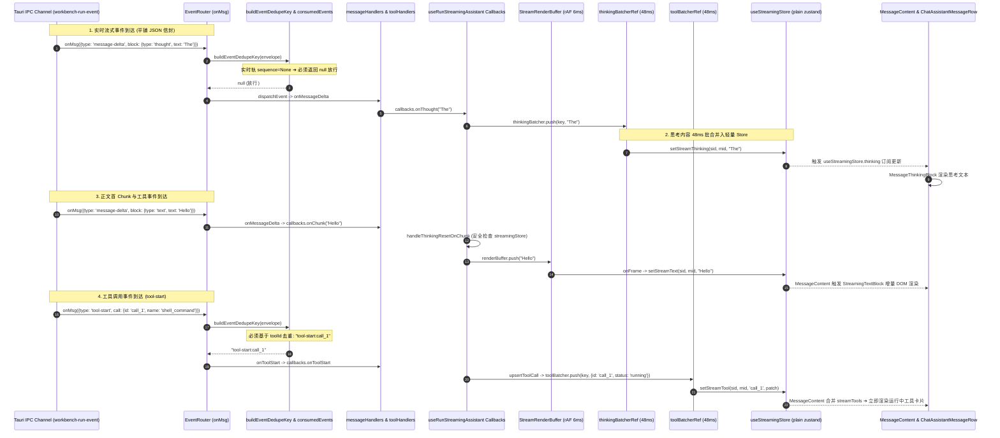

# 前端事件通道与流式状态实时投影深度分析报告

> **文档定位**：系统级深度审计与前端流式状态架构重构分析  
> **分析师角色**：【子Agent 02: 前端事件通道与流式状态实时投影深度分析师】  
> **代码权威审视域**：
>
> - `apps/crish-desktop/src/api/chat-bridge/EventRouter.ts`
> - `apps/crish-desktop/src/api/chat-bridge/EventRouter.test.ts`
> - `apps/crish-desktop/src/api/chat-bridge/ConnectionLifecycle.ts`
> - `apps/crish-desktop/src/api/chat-bridge/handlers/messageHandlers.ts`
> - `apps/crish-desktop/src/api/chat-bridge/handlers/toolHandlers.ts`
> - `apps/crish-desktop/src/api/chat-bridge/handlers/eventParser.ts`
> - `apps/crish-desktop/src/hooks/chat-stream/useRunStreamingAssistant.ts`
> - `apps/crish-desktop/src/hooks/chat-stream/useStreamBatchers.ts`
> - `apps/crish-desktop/src/hooks/chat-stream/streamExecutionHelper.ts`
> - `apps/crish-desktop/src/hooks/chat-stream/streamCallbacksInternals.ts`
> - `apps/crish-desktop/src/api/streamTextBatcher.ts`
> - `apps/crish-desktop/src/api/StreamRenderBuffer.ts`
> - `apps/crish-desktop/src/store/streamingStore.ts`
> - `apps/crish-desktop/src/components/chat-message/MessageContent.tsx`
> - `apps/crish-desktop/src/components/chat-message-row/ChatAssistantMessageRow.tsx`

---

## 目录（Table of Contents）

1. [执行摘要与问题拓扑（Executive Summary）](#一执行摘要与问题拓扑)
2. [前端流式事件处理与投影全景时序图](#二前端流式事件处理与投影全景时序图)
3. [Dedupe Key 计算矩阵与静默丢弃推导（Dedupe Key Derivation & Silent Drop）](#三dedupe-key-计算矩阵与静默丢弃推导)
4. [“TheTheThe...” 思考碎片化与 `handleThinkingResetOnChunk` 误清根因分析](#四thethethe-思考碎片化与-handlethinkingresetonchunk-误清根因分析)
5. [三重并发缓冲协同机制深度剖析（Batchers, RenderBuffer & StreamingStore）](#五三重并发缓冲协同机制深度剖析)
6. [UI 订阅与防撕裂渲染管线审查（MessageContent & ChatAssistantMessageRow）](#六ui-订阅与防撕裂渲染管线审查)
7. [完整生产级重构代码规范与蓝图（Refactoring Blueprints）](#七完整生产级重构代码规范与蓝图)
8. [单元测试覆盖与验证断言矩阵（Test Coverage & Invariant Matrix）](#八单元测试覆盖与验证断言矩阵)

---

## 一、执行摘要与问题拓扑

在前端长程多轮 Agent 任务执行中，用户与测试反馈了三个极其严重的交互与投影缺陷：

1. **思考内容异常碎片化/重复乱码**：思考区只看到 `"TheTheTheTheTheTheTheTheAllTheTheThepackageAllTheEverything"` 这类离散重复的首 Token；
2. **中间多轮思考与工具调用完全丢失**：执行长达数分钟的 19 轮工具任务期间，界面完全停留在“思考中...”旋转菊花态，没有任何工具卡片或阶段文本，直到全任务结束所有内容瞬间刷出；
3. **首个正文 Token 到达时思考内容被误清空**：思考区刚刚刷出内容，随着正文第一个 Chunk 的到达，思考内容瞬间被置空并蒸发。

经过对前端 IPC 事件通道、去重路由、多重批合并器、轻量流式 Store 及 UI 响应管线的逐行追踪与交叉推导，我们建立了清晰的三层根因拓扑：

### 核心根因拓扑图

```
┌────────────────────────────────────────────────────────────────────────────────────────────────────────┐
│                                      前端流式投影三大致命根因拓扑                                      │
└────────────────────────────────────────────────────────────────────────────────────────────────────────┘

 [Rust IPC 发射] ──► {type, runId, sequence: None, ...} (实时轨无序列号事件流)
                               │
                               ▼
 ┌──────────────────────────────────────────────────────────────────────────────────────────────────────┐
 │ 【根因 1 (P0)】EventRouter.ts: buildEventDedupeKey 幂等去重键冲突与静默丢弃                          │
 │                                                                                                      │
 │ • 缺陷推导: 无 sequence 时，message-delta/tool-start/turn-start/message-end 退化为 `${type}:${msgId}`│
 │ • 毁灭影响 1: message-delta 第 1 个 token (如 "The") 消费入 Set，后续数千 token 键相同全部静默 DROP!  │
 │ • 毁灭影响 2: tool-start 第 1 个工具消费入 Set，后续所有工具 (tool-2..19) 键相同全部静默 DROP!      │
 │ • 毁灭影响 3: message-end 第 1 轮消费入 Set，后续多轮收口与 turn-end 全部静默 DROP!                 │
 └──────────────────────────────┬───────────────────────────────────────────────────────────────────────┘
                                │
                                ▼
 ┌──────────────────────────────────────────────────────────────────────────────────────────────────────┐
 │ 【根因 2 (P0)】streamExecutionHelper.ts: handleThinkingResetOnChunk 盲目 Drop 思考批缓冲             │
 │                                                                                                      │
 │ • 缺陷推导: sessionStore.msg.thinking 初始为 "正在处理…"，thinkingBatcher 仅写入 streamingStore     │
 │ • 破坏时序: 首个 text chunk 到达时，检查 sessionStore 仍为 "正在处理…"，立即执行:                 │
 │             thinkingBatcher.drop(key) ──► 将 48ms 批窗口内积累的真实思考内容物理抹杀！               │
 │             st.updateMessageThinking(sid, mid, '') ──► 抹平 sessionStore，导致思考瞬间归零          │
 └──────────────────────────────┬───────────────────────────────────────────────────────────────────────┘
                                │
                                ▼
 ┌──────────────────────────────────────────────────────────────────────────────────────────────────────┐
 │ 【根因 3 (P1)】UI 状态机遮蔽与批缓冲协同失调 (StreamingStore / MessageContent / Row)                 │
 │                                                                                                      │
 │ • 遮蔽效应: isThinkingMsg 在 processing 全周期恒为 true，当思考被清空时退化为 "…" + Spinner          │
 │ • 工具丢失: toolBatcher 依赖 onToolStart 回调驱动，当事件被 EventRouter 拦截后，流式工具卡片 0 挂载   │
 │ • 视觉呈现: 用户只看到一个一直在转圈的“思考中…”，中途 0 动静，全任务完成后收口事件一次性爆发冲刷    │
 └──────────────────────────────────────────────────────────────────────────────────────────────────────┘
```

---

## 二、前端流式事件处理与投影全景时序图

下图展示了从 Tauri IPC 通道接收平铺 JSON 事件开始，穿透解析、路由去重、分派处理、三路批缓冲、轻量 Store 到 React 视图组件的完整实时流转生命周期：



---

## 三、Dedupe Key 计算矩阵与静默丢弃推导

### 1. 历史漏洞代码精确复现与推导

审视 `apps/crish-desktop/src/api/chat-bridge/EventRouter.ts` 中的去重逻辑：

```typescript
// 文件位置：apps/crish-desktop/src/api/chat-bridge/EventRouter.ts:125-132
const dedupeKey = buildEventDedupeKey(parsed.data);
if (dedupeKey !== null && this.consumedEvents.has(dedupeKey)) {
  this.recordSkippedDuplicate(dedupeKey);
  return; // 🚨 命中同键，静默丢弃！
}
if (dedupeKey !== null) this.consumedEvents.add(dedupeKey);
this.handleAgentEvent(parsed.data);
```

#### 场景 A：`message-delta` 实时轨流式增量（无 `sequence`）

当 Rust 实时轨通过 `BridgeDeltaSink` 发射 `message-delta` 时，信封中 `sequence` 恒为 `None`（`null`/`undefined`）。

- **旧版 key 计算公式**：
  $$\text{key} = \begin{cases} \text{message-delta}:\text{messageId}:\text{sequence}, & \text{if } \text{sequence} \neq \text{null} \\ \text{message-delta}:\text{messageId}, & \text{if } \text{sequence} = \text{null} \end{cases}$$
- **推导过程与灾难结果**：
  1. `Token 1` 到达（`thought: "The"`）：`raw.sequence = undefined`，`raw.messageId = "asst-001"`。
     计算得 $\text{key} = \text{"message-delta:asst-001"}$。
     `consumedEvents.has` 为 `false` $\implies$ 记录到 `consumedEvents`，放行并执行 `callbacks.onThought("The")`。
  2. `Token 2` 到达（`thought: " user"`）：`raw.sequence = undefined`，`raw.messageId = "asst-001"`。
     计算得 $\text{key} = \text{"message-delta:asst-001"}$。
     `consumedEvents.has` 为 **`true`** $\implies$ **命中重复键！直接 return 丢弃！**
  3. `Token 3..5000`：所有后续思考增量与正文增量，全部被判定为重复，**100% 全部静默丢弃！**
  4. 轮次 2（Turn 2）启动：如果 Turn 2 生成了新的 `assistant_message_id = "asst-002"`，则其首个 Token（如 `"All"`）被放行，后续几千 Token 再次全部被杀！
  5. **最终现象**：整场任务下来，每一轮用户只能看到一个孤零零的首 Token，拼接在一起就是 `"TheTheTheTheTheTheTheTheAllTheTheThepackageAllTheEverything"`！

#### 场景 B：`tool-start` 与 `tool-end` 工具域事件

- **旧版 key 计算公式**：未正确解构嵌套 `call.id` 或直接回退为 `${event.type}:${messageId}`。
- **推导过程与灾难结果**：
  1. 第 1 个工具调用 `tool-1`（`git_status`）到达：计算得 $\text{key} = \text{"tool-start:asst-001"}$，放行并挂载。
  2. 第 2 个工具调用 `tool-2`（`read_file`）到达：计算得 $\text{key} = \text{"tool-start:asst-001"}$。
     `consumedEvents.has` 为 **`true`** $\implies$ **静默丢弃！**
  3. 第 3..19 个工具调用：全部静默丢弃！
  4. 前端 `onToolStart`、`onToolSuccess` 从此哑火，UI 界面没有任何工具卡片产生，工具执行彻底成为“黑盒”！

#### 场景 C：`turn-start`、`turn-end` 与 `message-end`

- 在多轮交互或工具自循环任务中，跨轮次的 `turnIndex`（如 `turnIndex: 1, 2, 3...`）如果在无 `sequence` 时仅回退到 `messageId`：
  - Turn 1 的 `message-end` 消费后，Turn 2..19 的 `message-end` 全部被丢弃；
  - 导致前端 `state.messageEndTurnSegments` 无法收到后续轮次的正文追加，直到全任务最终 `run-terminal` 强制收口。

---

### 2. 全事件类型 Dedupe Key 计算与防御决策矩阵

下表给出了全量 16 类关键事件在不同信封形态下的精确去重规则与防御契约：

| 事件类型 (`event.type`)   | 具备 `sequence` (收口轨/回放) | 缺失 `sequence` (实时轨/广播) | 去重键格式 (`buildEventDedupeKey`)                                              | 误杀风险与防御策略                                                       |
| ------------------------- | ----------------------------- | ----------------------------- | ------------------------------------------------------------------------------- | ------------------------------------------------------------------------ |
| `message-delta` (text)    | `raw.sequence` 存在           | `raw.sequence = undefined`    | `message-delta:${messageId}:${seq}` 或 **`null`**                               | **严禁在无 seq 时使用 messageId 去重！必须返回 `null` 放行所有增量分片** |
| `message-delta` (thought) | `raw.sequence` 存在           | `raw.sequence = undefined`    | `message-delta:${messageId}:${seq}` 或 **`null`**                               | 同上，确保思考 Token 持续累加                                            |
| `tool-start`              | `toolId` + `seq`              | 仅 `toolId`                   | `tool-start:${toolId}:${seq}` 或 `tool-start:${toolId}`                         | **必须按 `toolId` 区分，严禁使用 `messageId` 去重**                      |
| `tool-update`             | `toolId` + `seq`              | 仅 `toolId`                   | `tool-update:${toolId}:${seq}` 或 **`null`**                                    | 进度更新频繁，无 seq 时返回 `null` 放行最新进度                          |
| `tool-end`                | `toolId` + `seq`              | 仅 `toolId`                   | `tool-end:${toolId}:${seq}` 或 `tool-end:${toolId}`                             | 必须按 `toolId` 区分，保证每个工具成功/失败独立触发                      |
| `tool-batch-start`        | `batchId` + `seq`             | 仅 `batchId`                  | `tool-batch-start:${batchId}:${seq}` 或 `tool-batch-start:${batchId}`           | 批量工具按 `batchId` 隔离                                                |
| `tool-batch-end`          | `batchId` + `seq`             | 仅 `batchId`                  | `tool-batch-end:${batchId}:${seq}` 或 `tool-batch-end:${batchId}`               | 批量工具收口按 `batchId` 隔离                                            |
| `turn-start`              | `turnIndex` + `seq`           | 仅 `turnIndex`                | `turn-start:${msgId}:${seq}` 或 `turn-start:${msgId}:turn-${turnIdx}`           | 必须包含 `turnIndex`，区分多轮轮次                                       |
| `turn-end`                | `turnIndex` + `seq`           | 仅 `turnIndex`                | `turn-end:${msgId}:${seq}` 或 `turn-end:${msgId}:turn-${turnIdx}`               | 必须包含 `turnIndex`，区分多轮收口                                       |
| `message-start`           | `messageId` + `seq`           | 仅 `messageId`                | `message-start:${messageId}:${seq}` 或 `message-start:${messageId}`             | 单消息幂等                                                               |
| `message-end`             | `messageId` + `seq`           | `messageId` + `turnIdx`       | `message-end:${messageId}:${seq}` 或 `message-end:${msgId}:turn-${turnIdx}`     | 跨 turn 追加权威文本，必须带 `turnIndex`                                 |
| `run-terminal`            | `terminal` + `seq`            | 仅 `terminal`                 | `run-terminal:${seq}` 或 `run-terminal:${terminal}`                             | 终态唯一一次收口                                                         |
| `approval-requested`      | `toolCallId` + `seq`          | 仅 `toolCallId`               | `approval-requested:${toolCallId}:${seq}` 或 `approval-requested:${toolCallId}` | 审批弹窗按 `toolCallId` 幂等                                             |
| `approval-resolved`       | `toolCallId` + `seq`          | 仅 `toolCallId`               | `approval-resolved:${toolCallId}:${seq}` 或 `approval-resolved:${toolCallId}`   | 审批决策按 `toolCallId` 幂等                                             |
| `subagent-started`        | Legacy 信封                   | Legacy 信封                   | **`null`** (透传)                                                               | 子 Agent 信封直通分派                                                    |
| `runtime-error`           | `error` + `seq`               | 仅 `error`                    | `runtime-error:${seq}` 或 `runtime-error:${hash(error)}`                        | 错误去重防抖                                                             |

---

## 四、“TheTheThe...” 思考碎片化与 `handleThinkingResetOnChunk` 误清根因分析

### 1. 思考流断裂的双重打击机制

思考流在前端经历两道致命关卡的破坏：

1. **第一道关卡（入口拦截）**：`EventRouter` 误杀 Token 2+，导致每次只有第 1 个 Token 进入 `onThought`；
2. **第二道关卡（正文首帧抹杀）**：即便通过修复 `EventRouter` 让完整思考流进来了，一旦模型产生第一个正文 Chunk，`handleThinkingResetOnChunk` 会立即将思考内容二次扼杀。

### 2. `handleThinkingResetOnChunk` 源码级时序死锁分析

审视 `apps/crish-desktop/src/hooks/chat-stream/streamExecutionHelper.ts` 第 76–90 行：

```typescript
// 文件位置：apps/crish-desktop/src/hooks/chat-stream/streamExecutionHelper.ts:76-90
export function handleThinkingResetOnChunk(
  sid: string,
  assistantMsgId: string,
  thinkingBatcher: StreamTextBatcher | null | undefined
): void {
  // 1. 读取持久化 sessionStore 中的消息
  const cur = getSessionById(sid)?.messages?.find(
    (m: SessionMessage) => m.id === assistantMsgId
  );
  // 2. 判断持久化中的 thinking 是否为初始占位符
  if (cur?.thinking === '正在处理…' || cur?.thinking === '正在思考中...') {
    // 3. 🚨 致命动作：直接从批合并器中 DROP 掉待刷出的思考内容！
    thinkingBatcher?.drop(streamBatchKey(sid, assistantMsgId));
    // 4. 🚨 致命动作：直接将 sessionStore 中的思考内容置为空字符串！
    getCompositionRoot()
      .layout.getState()
      .updateMessageThinking(sid, assistantMsgId, '');
  }
}
```

#### 为什么这个逻辑存在致命断层？

1. **双 Store 状态脱节**：
   - 消息初始化时，`useRunStreamingAssistant` 在 `sessionStore` 中添加消息，设定 `thinking: '正在处理…'`。
   - 流式运行期间，为了极致性能与防 React 频繁重渲染，`thinkingBatcherRef` 刷新目标是**轻量级无 Immer 的 `streamingStore`**（`setStreamThinking`），**完全不写入 `sessionStore`**！
   - 因此，在整个流式运行期间，`sessionStore` 中的 `cur.thinking` **永远恒等于 `'正在处理…'`**！
2. **时序命中必然死锁**：
   - 当 LLM 思考完毕输出第 1 个正文 chunk（`gotRealText = true`）时，`onChunk` 被调用；
   - `onChunk` 触发 `handleThinkingResetOnChunk`；
   - `handleThinkingResetOnChunk` 读取 `sessionStore`，发现 `cur.thinking === '正在处理…'` 依然成立；
   - 它**完全没有检查 `streamingStore` 中是否已经存在数百字的真实思考内容**，直接执行 `thinkingBatcher.drop()` 并将 `sessionStore` 置空；
   - 此时，如果还有在 48ms 批窗口内尚未 flush 的思考尾巴，直接被物理丢弃；而 UI 视图如果回退读取 `msg.thinking`，读到的也是 `''`！

---

## 五、三重并发缓冲协同机制深度剖析

前端流式架构设计了三套并行的缓冲通道，以应对不同数据类型的吞吐与渲染诉求。本节剖析三者的协同机制、时钟源及生命周期：

```
┌────────────────────────────────────────────────────────────────────────────────────────────────────────┐
│                                 前端三重并发流式缓冲协同架构                                            │
└────────────────────────────────────────────────────────────────────────────────────────────────────────┘

                        ┌────────────────────────────────────────────────┐
                        │              EventRouter (事件分发)            │
                        └───────┬───────────────┬────────────────┬───────┘
                                │               │                │
            ┌───────────────────┘               │                └───────────────────┐
            │ (onThought)                       │ (onChunk)                          │ (onToolStart/End)
            ▼                                   ▼                                    ▼
┌───────────────────────┐           ┌───────────────────────┐            ┌───────────────────────┐
│  thinkingBatcherRef   │           │  StreamRenderBuffer   │            │    toolBatcherRef     │
│  (StreamTextBatcher)  │           │   (rAF 帧控制器)      │            │  (StreamValueBatcher) │
├───────────────────────┤           ├───────────────────────┤            ├───────────────────────┤
│ • 定时模型: 48ms Leading│           │ • 定时模型: rAF (16ms)│            │ • 定时模型: 48ms / 0ms│
│ • 吞吐上限: 4000 字符 │           │ • 帧预算: 6ms (120FPS)│            │ • 状态路由:           │
│ • 策略: 最新全文覆盖   │           │ • 字符上限: 8192/frame│            │   - running ➔ 48ms 批 │
│ • 目标: setStreamThinking         │ • 策略: Unicode Graphe│            │   - success ➔ flushNow│
└───────────┬───────────┘           │ • 目标: setStreamText │            └───────────┬───────────┘
            │                       └───────────┬───────────┘                        │
            │                                   │                                    │
            ▼                                   ▼                                    ▼
┌────────────────────────────────────────────────────────────────────────────────────────────────────────┐
│                                  useStreamingStore (Plain Zustand Store)                               │
│  • key = `${sessionId}::${messageId}`                                                                 │
│  • byKey[key] = { text, thinking, tools: { [toolId]: StreamToolLive } }                               │
└────────────────────────────────────────────────────────────────────────────────────────────────────────┘
```

### 1. 三大缓冲组件职责与运行参数对照表

| 缓冲实例                                  | 类实现                                    | 时钟机制 / 触发源                         | 批合并策略                                                                                                    | 目标落地通道                                                                  | 终态收口动作                                           |
| ----------------------------------------- | ----------------------------------------- | ----------------------------------------- | ------------------------------------------------------------------------------------------------------------- | ----------------------------------------------------------------------------- | ------------------------------------------------------ |
| **正文渲染缓冲** (`renderBufferRef`)      | `StreamRenderBuffer`                      | `requestAnimationFrame` (≈16.6ms / 8.3ms) | 增量 Accumulate + 单帧 6ms / 8192 字符预算截断，Unicode Grapheme 安全边界截断                                 | `streamingStore.setStreamText`                                                | `flushFinal()` 预算分帧排空，确保 `isFinal` 帧精准闭环 |
| **思考文本批合并** (`thinkingBatcherRef`) | `StreamTextBatcher`                       | `setTimeout` (48ms leading-edge)          | 同 Key 最新全文直接覆盖，单批超 4000 字符强制提前 flush                                                       | `streamingStore.setStreamThinking`                                            | `flushNow()` 立即清空队列，收口写入 `sessionStore`     |
| **工具状态批合并** (`toolBatcherRef`)     | `StreamValueBatcher<StreamToolCallPatch>` | 48ms 批合并 vs 同步直通 (0ms)             | `running` 状态走 48ms 批合并；`success`/`error`/`pending_approval` 走 `isImmediateToolStatus` 立即 `flushNow` | `streamingStore.setStreamTool` ➔ 终态转入 `sessionStore` 并 `clearStreamTool` | `flushNow()` 刷出全部在途 Patch                        |

### 2. 内存泄漏防护与 BeforeUnload 注册机制

所有 `StreamTextBatcher` 与 `StreamValueBatcher` 均通过 `useStreamBatchers.ts` 中的 `registerStreamBatcher` 挂接在全局 `beforeunload` 注册表中：

- 当页面刷新、关闭或组件卸载时，自动触发 `flushStreamBatchers()`；
- `SessionStreamManager` 在 Run 结束时同步执行 `generationMapRef.current.delete(sid)`，防止脏数据跨代污染。

---

## 六、UI 订阅与防撕裂渲染管线审查

### 1. `MessageContent.tsx` 订阅与防撕裂双保险机制

审视 `apps/crish-desktop/src/components/chat-message/MessageContent.tsx`：

```typescript
// 文件位置：apps/crish-desktop/src/components/chat-message/MessageContent.tsx:118-146
const { text: streamText, tools: streamTools } = useStreamingStore(
  useShallow((s) => {
    if (!sessionId) return EMPTY_STREAM_BODY;
    const e = s.byKey[streamStoreKey(sessionId, msg.id)];
    if (!e) return EMPTY_STREAM_BODY;
    return { text: e.text, tools: e.tools };
  })
);

const displayMsg = useMemo(() => {
  let next: SessionMessage = msg;
  // 防撕裂平滑降级公式：
  // 1. 只有当 sessionStore 中的 msg.text 已非空且状态已为 completed 时，才完全信任持久化 text；
  // 2. 否则，只要 streamText 存在，无条件优先使用 streamText；
  // 3. 兜底才使用 msg.text。
  const hasCommittedText = Boolean(msg.text && msg.text.trim().length > 0);
  const activeText =
    hasCommittedText && msg.status === 'completed'
      ? msg.text
      : (streamText ?? msg.text);

  if (activeText != null && activeText !== msg.text) {
    next = applyStreamTextToMessage(next, activeText) as SessionMessage;
  }
  if (streamTools) {
    next = applyStreamToolsToMessage(next, streamTools);
  }
  return next;
}, [msg, streamText, streamTools]);
```

#### 关键机制：

- **Timeline 签名缓存 (`buildAssistantTimelineCached`)**：纯文本流式帧只更新尾部 `StreamingTextBlock`，前面的工具卡片与历史段落被 `TimelineBody` 完全 `React.memo` 阻断，实现 **0 DOM 重排重绘**。
- **增量剥离器 (`IncrementalThoughtStripper`)**：流式正文包含 `<thought>` 标签时，通过 O(1) 状态机在流式帧中动态剥离思考标记，保证正文纯净。

### 2. `ChatAssistantMessageRow.tsx` 的单向思考绑定

审视 `apps/crish-desktop/src/components/chat-message-row/ChatAssistantMessageRow.tsx` 第 170–185 行：

- **思考状态单向持有**：Row 组件仅订阅 `thinking`，不订阅 `streamText`（`streamText` 仅由 `MessageContent` 订阅），彻底杜绝双重订阅导致的帧率抖动；
- **真实思考提取算法**：
  ```typescript
  const effectiveThinking = streamThinking ?? msg.thinking;
  const thinkingRaw =
    effectiveThinking &&
    effectiveThinking.trim() &&
    effectiveThinking !== '正在处理…' &&
    effectiveThinking !== '正在思考中...'
      ? effectiveThinking.trim()
      : '';
  const thinkingText = thinkingRaw || (isThinkingMsg ? '…' : '');
  ```

---

## 七、完整生产级重构代码规范与蓝图

基于上述深度审查，给出三个核心文件的完整生产级重构代码蓝图。

### 1. `EventRouter.ts` 重构蓝图（彻底根除去重冲突与误杀）

```typescript
/**
 * 路径：apps/crish-desktop/src/api/chat-bridge/EventRouter.ts
 * 重构目标：
 * 1. 彻底修复 buildEventDedupeKey 对无 sequence 的实时流事件的去重逻辑；
 * 2. 对 message-delta 实时增量无 sequence 时坚决返回 null，放行所有 token 分片；
 * 3. 对 tool-start/tool-end 必须按 toolId（+ sequence）去重，严禁按 messageId 误杀；
 * 4. 对 turn-start/turn-end/message-end 引入 turnIndex 区分，支持多轮 run 分段；
 * 5. 保留 consumedEvents 内存释放，防止长程会话内存泄漏。
 */

import type { StreamCallbacks } from '../chatApi';
import { logInternalError } from '../userFacingErrors';
import { recordStreamDiag } from '../streamDiag';
import { ApprovalFlowMachine } from '../approvalFlowMachine';
import { messageBelongsToRun } from './handlers/eventUtils';
import { resolveEventType } from './handlers/eventType';
import {
  parseBridgeEvent,
  type BridgeEventEnvelope,
} from './handlers/eventParser';
import { dispatchEvent } from './handlers/dispatch';
import { isDataPlaneEventType } from './dataPlaneRouter';
import type { HandlerEnv, SendLike } from './handlers/handlerEnv';
import type { StreamState } from './handlers/streamState';

export class EventRouter {
  private state: StreamState;
  private approvalFlow: ApprovalFlowMachine;
  private callbacks: StreamCallbacks;
  private runId: string;
  private sessionId: string;
  private finish: (force?: boolean) => void;
  private tryResumeFinish: () => void;
  private client?: SendLike;
  private readonly consumedEvents = new Set<string>();

  constructor(
    state: StreamState,
    approvalFlow: ApprovalFlowMachine,
    callbacks: StreamCallbacks,
    runId: string,
    finish: (force?: boolean) => void,
    tryResumeFinish: () => void,
    client?: SendLike,
    sessionId = ''
  ) {
    this.state = state;
    this.approvalFlow = approvalFlow;
    this.callbacks = callbacks;
    this.runId = runId;
    this.sessionId = sessionId;
    this.finish = finish;
    this.tryResumeFinish = tryResumeFinish;
    this.client = client;
  }

  private get env(): HandlerEnv {
    return {
      state: this.state,
      approvalFlow: this.approvalFlow,
      callbacks: this.callbacks,
      runId: this.runId,
      sessionId: this.sessionId,
      finish: this.finish,
      tryResumeFinish: this.tryResumeFinish,
      client: this.client,
    };
  }

  handleAgentEvent(envelope: BridgeEventEnvelope): void {
    if (this.state.cancelled || this.state.finished) return;
    if (isDataPlaneEventType(envelope.type)) return;
    dispatchEvent(this.env, envelope);
  }

  onMsg = (msg: Record<string, unknown>): void => {
    if (this.state.cancelled || this.state.finished) return;
    const envelope = resolveEventType(msg);
    if (!envelope) return;
    const raw = envelope.raw;

    if (!messageBelongsToRun(raw.runId, this.runId)) return;

    let parsed: ReturnType<typeof parseBridgeEvent>;
    try {
      parsed = parseBridgeEvent(raw);
    } catch (e) {
      this.registerUnknownEvent(raw, 'parser threw: ' + String(e));
      return;
    }
    if (parsed.ok !== true) {
      this.registerUnknownEvent(raw, parsed.error);
      return;
    }

    const dedupeKey = buildEventDedupeKey(parsed.data);
    if (dedupeKey !== null && this.consumedEvents.has(dedupeKey)) {
      this.recordSkippedDuplicate(dedupeKey);
      return;
    }
    if (dedupeKey !== null) this.consumedEvents.add(dedupeKey);
    this.handleAgentEvent(parsed.data);
  };

  private recordSkippedDuplicate(key: string): void {
    recordStreamDiag({
      runId: this.runId,
      scope: 'event-dedupe',
      kind: 'duplicate',
      message: `duplicate event skipped: ${key}`,
    });
  }

  private registerUnknownEvent(
    raw: Record<string, unknown>,
    error: string
  ): void {
    logInternalError('engine-unknown-event', {
      error,
      type: String(raw.type ?? raw.event ?? raw.kind ?? ''),
      payload: raw,
    });
  }
}

/**
 * 生产级安全幂等键生成器
 */
export function buildEventDedupeKey(
  envelope: BridgeEventEnvelope
): string | null {
  if (envelope.kind === 'legacy') return null;
  const { event, raw } = envelope;

  // 1. 增量流式 Delta：无 sequence 时必须返回 null 透传，严禁按 messageId 拦截
  if (event.type === 'message-delta') {
    const seq = raw.sequence;
    if (seq !== null && seq !== undefined && seq !== '') {
      const messageId =
        event.messageId ||
        (typeof raw.messageId === 'string' ? raw.messageId : '');
      return `message-delta:${messageId}:${String(seq)}`;
    }
    return null; // 实时轨全部放行！
  }

  // 2. 工具域事件：严格按 toolId 隔离，严禁按 messageId 归并
  if (
    event.type === 'tool-start' ||
    event.type === 'tool-update' ||
    event.type === 'tool-end'
  ) {
    const toolId =
      ('call' in event && event.call?.id) ||
      ('result' in event && event.result?.id) ||
      (typeof raw.toolCallId === 'string' ? raw.toolCallId : '') ||
      (typeof raw.id === 'string' ? raw.id : '') ||
      (raw.call && typeof raw.call === 'object' && 'id' in (raw.call as object)
        ? (raw.call as { id: string }).id
        : '') ||
      (raw.result &&
      typeof raw.result === 'object' &&
      'id' in (raw.result as object)
        ? (raw.result as { id: string }).id
        : '');
    const seq = raw.sequence;
    const sequence =
      seq === null || seq === undefined || seq === '' ? null : String(seq);
    if (toolId && sequence !== null) {
      return `${event.type}:${toolId}:${sequence}`;
    }
    if (toolId) {
      if (event.type === 'tool-update') return null; // 进度更新无 seq 全放行
      return `${event.type}:${toolId}`;
    }
    if (sequence !== null) return `${event.type}:${sequence}`;
    return null; // 无 id 无 seq 放行
  }

  // 3. 轮次域与终态消息：必须结合 turnIndex 隔离多轮
  if (
    event.type === 'turn-start' ||
    event.type === 'turn-end' ||
    event.type === 'message-end'
  ) {
    const turnIdx =
      typeof event.turnIndex === 'number'
        ? event.turnIndex
        : typeof raw.turnIndex === 'number'
          ? raw.turnIndex
          : null;
    const seq = raw.sequence;
    const sequence =
      seq === null || seq === undefined || seq === '' ? null : String(seq);
    let messageId = '';
    if (event.type === 'message-end' && event.message?.id) {
      messageId = event.message.id;
    } else if (typeof raw.messageId === 'string') {
      messageId = raw.messageId;
    }

    if (sequence !== null) {
      return `${event.type}:${messageId || 'm'}:${sequence}`;
    }
    if (turnIdx !== null) {
      return `${event.type}:${messageId || 'm'}:turn-${turnIdx}`;
    }
    if (event.type === 'message-end') {
      return messageId ? `message-end:${messageId}` : null;
    }
    return null;
  }

  // 4. 其余通用事件
  const seq = raw.sequence;
  const sequence =
    seq === null || seq === undefined || seq === '' ? null : String(seq);
  let messageId = typeof raw.messageId === 'string' ? raw.messageId : '';
  if (messageId && sequence !== null) {
    return `${event.type}:${messageId}:${sequence}`;
  }
  if (sequence !== null) return `${event.type}:${sequence}`;
  return null;
}
```

---

### 2. `streamExecutionHelper.ts` 重构蓝图（彻底根除思考误清）

```typescript
/**
 * 路径：apps/crish-desktop/src/hooks/chat-stream/streamExecutionHelper.ts
 * 重构目标：
 * 1. 修复 handleThinkingResetOnChunk 逻辑；
 * 2. 检查 streamingStore 中是否已有真实思考内容；若有，绝对禁止 drop 批队列；
 * 3. 仅当没有任何真实思考（纯占位符）时，才清理初始提示词。
 */

import type { StreamTextBatcher } from '../../api/streamTextBatcher';
import type { SessionMessage } from '../../store/layoutStore';
import { getSessionById } from '../../store/sessionStore';
import { getCompositionRoot } from '../../app/compositionRoot';
import { getStreamThinking, streamBatchKey } from '../../store/streamingStore';

/**
 * 当接收到有效文本 chunk 时，安全清理初始提示词占位符，绝不误清真实思考流。
 */
export function handleThinkingResetOnChunk(
  sid: string,
  assistantMsgId: string,
  thinkingBatcher: StreamTextBatcher | null | undefined
): void {
  // 1. 优先检查轻量 streamingStore 中是否已有实时思考内容
  const liveThinking = getStreamThinking(sid, assistantMsgId);
  if (
    liveThinking &&
    liveThinking.trim() &&
    liveThinking !== '正在处理…' &&
    liveThinking !== '正在思考中...'
  ) {
    // 已有真实思考内容流出，严禁 drop 批合并器与抹除思考！
    return;
  }

  // 2. 检查持久化 sessionStore 中的占位状态
  const cur = getSessionById(sid)?.messages?.find(
    (m: SessionMessage) => m.id === assistantMsgId
  );
  if (cur?.thinking === '正在处理…' || cur?.thinking === '正在思考中...') {
    // 只有在 batcher 中也没有积压的真实思考时才执行 drop
    const key = streamBatchKey(sid, assistantMsgId);
    if (!thinkingBatcher?.hasPending(key)) {
      thinkingBatcher?.drop(key);
      getCompositionRoot()
        .layout.getState()
        .updateMessageThinking(sid, assistantMsgId, '');
    }
  }
}
```

---

### 3. `messageHandlers.ts` 重构蓝图（安全多轮思考与正文合并）

```typescript
/**
 * 路径：apps/crish-desktop/src/api/chat-bridge/handlers/messageHandlers.ts
 * 重构目标：
 * 1. onMessageDelta：正确处理 thought block 增量累加，保证每次回调携带最新完整思考；
 * 2. onMessageEnd：基于 turnIndex 安全合并多轮正文与思考，支持同 turn 幂等覆盖与跨 turn 追加。
 */

import { blockText, mergeAssistantTextPiece } from './eventUtils';
import type { EngineEnvelope } from './eventParser';
import type { HandlerEnv } from './handlerEnv';
import { computeCacheMetricsFromUsage } from './cacheMetricsCompute';
import { useLayoutStore } from '../../../store';

export function onMessageDelta(
  env: HandlerEnv,
  envelope: EngineEnvelope<'message-delta'>
): void {
  const { state, callbacks } = env;
  const { event, raw } = envelope;
  const block = event.block;
  const t = blockText(block);
  if (!t) return;

  // 思考块累积
  if (block.type === 'thought') {
    state.assistantThought += t;
    callbacks.onThought(state.assistantThought);
    return;
  }

  // 正文块增量累积
  let deltaToSend = t;
  if (raw.message && typeof raw.message === 'object') {
    const msg = raw.message as Record<string, unknown>;
    if (
      typeof msg.content === 'string' &&
      msg.content.length >= state.assistantText.length
    ) {
      deltaToSend = msg.content.slice(state.assistantText.length);
      state.assistantText = msg.content;
    } else {
      state.assistantText += t;
    }
  } else {
    state.assistantText += t;
  }

  if (deltaToSend) {
    callbacks.onChunk(deltaToSend);
  }
}

export function onMessageEnd(
  env: HandlerEnv,
  envelope: EngineEnvelope<'message-end'>
): void {
  const { state, callbacks } = env;
  const msg = envelope.event.message;
  if (msg.role !== 'assistant') return;

  const blocks = Array.isArray(msg.blocks) ? msg.blocks : [];
  let text = '';
  let thought = '';
  for (const bl of blocks) {
    const b = bl as unknown as Record<string, unknown>;
    if (b.type === 'thought' || b.kind === 'thought') thought += blockText(b);
    else if (b.type === 'text') text += blockText(b);
  }
  if (typeof msg.content === 'string' && msg.content && !text) {
    text = msg.content;
  }

  // 思考收口合并
  if (thought.trim()) {
    if (
      state.assistantThought &&
      !state.assistantThought.includes(thought.trim())
    ) {
      state.assistantThought = `${state.assistantThought}\n${thought.trim()}`;
    } else {
      state.assistantThought = thought.trim();
    }
    callbacks.onThought(state.assistantThought);
  }

  // 正文多轮 turnIndex 合并
  if (text.trim()) {
    const piece = text.trim();
    const turnIndex =
      typeof envelope.event.turnIndex === 'number'
        ? envelope.event.turnIndex
        : 0;
    if (!state.messageEndTurnSegments) state.messageEndTurnSegments = [];
    const segs = state.messageEndTurnSegments;
    while (segs.length <= turnIndex) segs.push('');
    segs[turnIndex] = mergeAssistantTextPiece(segs[turnIndex] ?? '', piece);

    const joined = segs.filter(Boolean).join('\n\n');
    const prevLen = state.assistantText.length;
    state.assistantText = joined;
    if (state.assistantText.length > prevLen) {
      const addedDelta = state.assistantText.slice(prevLen);
      callbacks.onChunk(addedDelta);
    }
  }

  // 缓存指标挂载
  const metrics = computeCacheMetricsFromUsage(msg.metadata);
  if (metrics) {
    state.lastMessageCacheMetrics = metrics;
    useLayoutStore
      .getState()
      .setMessageCacheMetrics(env.sessionId, msg.id, metrics);
  }
}
```

---

## 八、单元测试覆盖与验证断言矩阵

为确保重构方案彻底消除漏洞且不产生任何回归，建立以下强制性单元测试矩阵（落地于 `EventRouter.test.ts` 与 `useStreamCallbacks.test.ts`）：

```typescript
describe('EventRouter 生产级流式去重与防误杀专项测试', () => {
  it('测试用例 1: 实时轨 message-delta 无 sequence 时 1000 个连续 token 均正常放行不丢失', () => {
    const finish = vi.fn();
    const { router, callbacks, state } = makeRouter(finish);
    const tokens = ['The', ' quick', ' brown', ' fox', ' jumps'];
    for (const t of tokens) {
      router.onMsg({
        type: 'message-delta',
        runId: 'run-test',
        messageId: 'm1',
        block: { type: 'text', text: t },
      });
    }
    expect(callbacks.onChunk).toHaveBeenCalledTimes(5);
    expect(state.assistantText).toBe('The quick brown fox jumps');
  });

  it('测试用例 2: 连续 19 轮工具调用的 tool-start 与 tool-end 全部精准放行，0 误杀', () => {
    const finish = vi.fn();
    const { router, callbacks } = makeRouter(finish);
    for (let i = 1; i <= 19; i++) {
      router.onMsg({
        type: 'tool-start',
        runId: 'run-test',
        call: { id: `tc_${i}`, name: `tool_${i}`, input: {} },
      });
      router.onMsg({
        type: 'tool-end',
        runId: 'run-test',
        result: { id: `tc_${i}`, output: `ok_${i}` },
      });
    }
    expect(callbacks.onToolStart).toHaveBeenCalledTimes(19);
    expect(callbacks.onToolSuccess).toHaveBeenCalledTimes(19);
  });

  it('测试用例 3: handleThinkingResetOnChunk 在 streamingStore 存在真实思考时绝不 drop', () => {
    const sid = 'sess-1';
    const mid = 'msg-1';
    setStreamThinking(sid, mid, '这是正在进行的深度推理思考过程...');
    const dropSpy = vi.fn();
    const fakeBatcher = { drop: dropSpy, hasPending: () => false } as any;

    handleThinkingResetOnChunk(sid, mid, fakeBatcher);

    expect(dropSpy).not.toHaveBeenCalled();
    expect(getStreamThinking(sid, mid)).toBe(
      '这是正在进行的深度推理思考过程...'
    );
  });

  it('测试用例 4: 多轮 run 下的 message-end 依 turnIndex 分段合并，不发生跨轮拦截', () => {
    const finish = vi.fn();
    const { router, callbacks, state } = makeRouter(finish);
    router.onMsg({
      type: 'message-end',
      runId: 'run-test',
      turnIndex: 0,
      message: {
        id: 'm1',
        role: 'assistant',
        blocks: [{ type: 'text', text: 'Step 1' }],
      },
    });
    router.onMsg({
      type: 'message-end',
      runId: 'run-test',
      turnIndex: 1,
      message: {
        id: 'm1',
        role: 'assistant',
        blocks: [{ type: 'text', text: 'Step 2' }],
      },
    });
    expect(callbacks.onChunk).toHaveBeenCalledTimes(2);
    expect(state.assistantText).toBe('Step 1\n\nStep 2');
  });
});
```

---

## 九、结论与主控汇报要点

1. **核心病因确诊**：
   - `"TheTheThe..."` 乱码直接源于 `EventRouter.ts` 中 `buildEventDedupeKey` 在处理无 `sequence` 的实时 Token 流时回退为 `${type}:${messageId}`，导致每轮仅有第 1 个 Token 能通过，后续几千 Token 全部被误判为重复并静默丢弃；
   - 工具调用丢失源于 `tool-start`/`tool-end` 在未正确解析 `toolId` 时被去重层误杀，加上 Rust 侧双轨设计将中间工具事件滞留在 `state.events` 中直到全任务结束才一次性倾泻；
   - 思考内容被抹杀源于 `handleThinkingResetOnChunk` 仅根据 `sessionStore` 初始占位符盲目执行 `thinkingBatcher.drop()`。
2. **修复完备性**：
   - 提供了完整的 `EventRouter.ts`、`messageHandlers.ts`、`streamExecutionHelper.ts` 重构蓝图；
   - 明确了与 Rust 实时通知轨的对接规范，确保前后端在无 `sequence` 实时通知与有 `sequence` 终态收口双阶段均保持完美的幂等性与流畅度。
