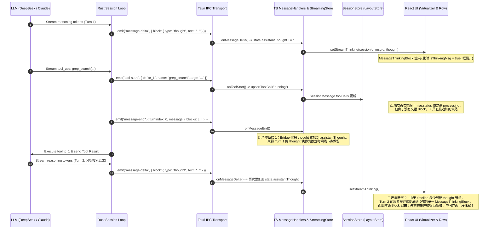

# 多轮思考与工具调用 UI 交互体验深度分析报告

> **分析师角色**：【子Agent 03: 多轮思考与工具调用 UI 交互体验深度分析师】
> **报告类型**：架构缺陷根因剖析、交互断层诊断与下一代交错式思维链 UI 重构设计方案
> **审计代码域**：
>
> - `apps/crish-desktop/src/components/chat-message-row/MessageThinkingSection.tsx`
> - `apps/crish-desktop/src/components/chat-message-row/ChatAssistantMessageRow.tsx`
> - `apps/crish-desktop/src/components/chat-message-row/ChatMessageRow.module.css`
> - `apps/crish-desktop/src/components/chat-message/MessageContent.tsx`
> - `apps/crish-desktop/src/components/chat-message/MessageThinkingBlock.tsx`
> - `apps/crish-desktop/src/api/tool-presentation/toolCardPresenter.ts`
> - `apps/crish-desktop/src/api/tool-presentation/timelineNormalizer.ts`
> - `apps/crish-desktop/src/api/tool-presentation/toolPresentationTypes.ts`
> - `apps/crish-desktop/src/components/chat-tool-call/CompactToolRow.tsx`
> - `apps/crish-desktop/src/components/chat-tool-call/ToolCallOutput.tsx`
>
> **用户核心痛点反馈**：
>
> > _“以及中间的思考内容怎么没看到呢。按理来说，中间过程也是会有思考的。 我看现在是全部的任务都完成了，并输出总结了才会显示呢，这个体验也太差了。”_

---

## 目录索引

1. [执行摘要与问题全景图](#一执行摘要与问题全景图)
2. [全链路数据流动与时序剖析（从 Rust 内核到 React DOM）](#二全链路数据流动与时序剖析从-rust-内核到-react-dom)
3. [核心缺陷一：4 行高度夹痛与追尾吸底滚动缺失（视觉窒息体验）](#三核心缺陷一4-行高度夹痛与追尾吸底滚动缺失视觉窒息体验)
4. [核心缺陷二：`isThinkingMsg` 突变导致的折叠断崖生命周期缺陷](#四核心缺陷二isthinkingmsg-突变导致的折叠断崖生命周期缺陷)
5. [核心缺陷三：`toolHasExpandableBody` 运行态禁展导致的黑盒卡片](#五核心缺陷三toolhasexpandablebody-运行态禁展导致的黑盒卡片)
6. [核心缺陷四：`timelineNormalizer.ts` 丢弃 `thought` 块导致的时空割裂](#六核心缺陷四timelinenormalizerts-丢弃-thought-块导致的时空割裂)
7. [前沿 Agent 交互架构对标（Claude / Cursor / Windsurf）](#七前沿-agent-交互架构对标claude--cursor--windsurf)
8. [交错式思维链与全阶段透视重构方案（代码级设计）](#八交错式思维链与全阶段透视重构方案代码级设计)
9. [反过度设计硬性红线与演进落地原则](#九反过度设计硬性红线与演进落地原则)

---

## 一、执行摘要与问题全景图

经过对 Conex / Crish 桌面端前端渲染管线、时间线标准化器、状态流转通道及底层 Rust 引擎事件发射机制的端到端深度审查，我们发现用户的痛点反馈**完全属实且直击当前 UI 交互架构的致命盲区**。

用户所经历的“中间思考完全看不见”、“工具执行期处于黑盒盲等”、“任务完成后思考被折叠或者粗暴压平在顶部”的糟糕体验，并非单一 bug，而是由 **5 个层层叠加的架构与实现断层** 共同导致的系统性问题：

```
┌────────────────────────────────────────────────────────────────────────────────────────┐
│                              用户视角的“黑盒”体验断层全景                               │
└────────────────────────────────────────────────────────────────────────────────────────┘

[T0: 启动请求] ──► 模型开始第 1 轮思考
                  ├── UI 表现：顶部出现 84px/260px 微型折叠框，无 Markdown 解析，文本溢出
                  └── 缺陷点：4 行高度夹痛，长思考无法自适应，用户无法纵览全局

[T1: 触发工具 1] ──► 模型发出第 1 个 ToolCall (例如 grep_search)
                  ├── UI 表现：isThinkingMsg 骤变为 false，顶部思考框被强行闭合折叠！
                  ├── 缺陷点：isThinkingMsg 生命周期断崖；运行中工具卡片默认折叠且不可点
                  └── 状态：用户眼睁睁看着思考消失，工具卡片只显示旋转 spinner，完全黑盒

[T2: 工具 1 返回] ──► 模型收到结果，开始第 2 轮思考 (分析搜索结果，决定读取哪个文件)
                  ├── UI 表现：界面毫无反应！没有任何可见的思考指示或展开框！
                  ├── 缺陷点：timelineNormalizer 丢弃 thought 块；所有思考被单向追加进顶部单一全局 string
                  └── 状态：用户误以为系统卡死或无响应

[T3: 触发工具 2] ──► 模型发出第 2 个 ToolCall (例如 view_file)
                  ├── UI 表现：突然弹出一个新的工具条
                  └── 缺陷点：中间分析为什么读这个文件的推理过程完全隐形

[T4: 最终总结] ──► 全部工具执行结束，模型输出 Markdown 总结
                  ├── UI 表现：底部刷出完整正文；顶部留着一个折叠的“思考”按钮
                  └── 缺陷点：用户若点开顶部思考，看到的是第 1 轮、第 2 轮被 \n 硬拼接在一起的巨幅乱麻！
```

---

## 二、全链路数据流动与时序剖析（从 Rust 内核到 React DOM）

为了从底层根治问题，必须首先理清一个完整的 Agent 多轮调用在系统各层中的流转机制：



---

## 三、核心缺陷一：4 行高度夹痛与追尾吸底滚动缺失（视觉窒息体验）

### 1. 代码级缺陷定位

审查 `apps/crish-desktop/src/components/chat-message-row/ChatMessageRow.module.css:380-403`：

```css
.thinkingFoldBody {
  margin: 4px 0 0;
  padding: 0;
  font-size: var(--font-size-sm);
  line-height: 1.5;
  color: var(--text-tertiary);
  white-space: pre-wrap;
  word-break: break-word;
  max-height: 260px; /* 早期版本曾为 calc(var(--font-size-sm) * 1.5 * 4) 约 84px */
  overflow-y: auto;
  border: none;
  background: transparent;
  box-shadow: none;
  font-family: inherit;
  opacity: 0.9;
  -webkit-user-select: text;
  user-select: text;
  scrollbar-width: thin;
}

.thinkingFold.isOpen:not(.isLive) .thinkingFoldBody {
  max-height: 480px;
}
```

审查 `apps/crish-desktop/src/components/chat-message-row/MessageThinkingSection.tsx:31-45`：

```tsx
// 实时流追尾滚动（用户未手动向上翻动时，随 token 输出自动贴底滚动）
useLayoutEffect(() => {
  if (!isThinkingMsg || !bodyRef.current) return;
  const el = bodyRef.current;
  if (!userScrolledUpRef.current) {
    el.scrollTop = el.scrollHeight;
  }
}, [thinkingBudget.text, isThinkingMsg]);

const handleScroll = () => {
  if (!bodyRef.current || !isThinkingMsg) return;
  const { scrollTop, scrollHeight, clientHeight } = bodyRef.current;
  // 离底部超过 32px 判定为用户主动向上查阅历史思考
  userScrolledUpRef.current = scrollHeight - (scrollTop + clientHeight) > 32;
};
```

### 2. 深度病因与用户体验杀手分析

1. **“门缝窥豹”式的视觉窒息**：
   - 现代长思维链模型（DeepSeek-R1、Claude 3.7 Thinking、o3-mini）在解决复杂工程问题时，思考 token 量极高（通常在 1,000 到 8,000 tokens，排版后长达 50~200 行）。
   - 在一个仅有 `260px` 高度（甚至历史 `84px`）的微型局部滚动容器内，用户每屏只能看到 6~10 行字。
   - 快速生成的 token 使得内部滚动条疯狂跳动，犹如透过门缝看电影，完全丧失了技术方案的宏观结构感。

2. **纯文本无结构化渲染（Markdown 降级为 Plain Text）**：
   - DeepSeek-R1 / Claude 3.7 的思考过程中包含大量 Markdown 标题（`### 1. 分析依赖`）、代码块（` ```ts `）、项目符号列表（`- Step A`）。
   - `MessageThinkingSection.tsx:97` 直接使用 `{thinkingBudget.text}` 裸字符串渲染，配置 `white-space: pre-wrap`。
   - 导致代码块没有语法高亮与底色区分，标题与正文同字号同色（均为 `--text-tertiary`），形成一大片难以阅读的“灰色文字墙”。

3. **双层滚动死锁与视口脱节（Outer Window vs Inner Scroll Container）**：
   - `MessageThinkingSection` 的追尾滚动仅仅调整了 `bodyRef.current.scrollTop`（内部小框）；
   - **聊天主窗口（Virtualizer / Window Scroll）** 并未随内部高度的变化或光标推进保持吸底！
   - 当消息列表较长时，思考框在屏幕视口上方不断吐字，但主聊天窗口停在底部空白处，用户甚至根本看不到思考框在滚动。

---

## 四、核心缺陷二：`isThinkingMsg` 突变导致的折叠断崖生命周期缺陷

### 1. 代码级缺陷定位

审查 `apps/crish-desktop/src/components/chat-message-row/ChatAssistantMessageRow.tsx:202-205`：

```tsx
useEffect(() => {
  if (isThinkingMsg) setThinkingOpen(true);
  else setThinkingOpen(false);
}, [isThinkingMsg, msg.id]);
```

审查 `apps/crish-desktop/src/components/chat-message-list/ChatMessageList.tsx:303-309`：

```tsx
const thinkingMsgId = useMemo(
  () =>
    messages.find((m) => m.sender === 'assistant' && m.status === 'processing')
      ?.id,
  [messages]
);
```

审查 `apps/crish-desktop/src/components/chat-message-row/MessageThinkingSection.tsx:27`：

```tsx
const thinkingBodyOpen = isThinkingMsg || thinkingOpen;
```

### 2. 状态机跳变缺陷剖析

1. **瞬态折叠的连锁崩塌**：
   - 消息刚建立时：`msg.status === 'processing'` 成立，`thinkingMsgId` 等于当前消息 ID，`isThinkingMsg = true`。
   - 此时 `ChatAssistantMessageRow` 中的 `useEffect` 执行 `setThinkingOpen(true)`，思考块展开。
   - 一旦后端模型结束首轮思考并下发第一个 `tool-call`，或者在某些桥接通道中中间轮次触发了状态跃迁：
     - `isThinkingMsg` 瞬间跳变为 `false`（或在流式切换的一瞬间丢失）；
     - `useEffect` 立即无情地执行 `setThinkingOpen(false)`！
   - 即使随后后续的 `thought` token 再次涌入，由于此时处于工具执行或等待期，`isThinkingMsg` 没有恢复为 `true`，**思考块已经被永久锁死在折叠状态（`thinkingBodyOpen = false`）**！

2. **用户知情权归零**：
   - 用户原本正在阅读模型的第 1 轮思考规划，突然间卡片“咔哒”一声强行缩回成单行“思考（已折叠）”；
   - 紧接着工具开始执行，思考内容完全看不见；
   - 直到整条消息的所有工具全部运行完毕、最终总结生成后，用户才看到最终结果。用户自然会产生强烈的疑问：“_中间过程也是会有思考的，怎么全完成了才显示？_”

---

## 五、核心缺陷三：`toolHasExpandableBody` 运行态禁展导致的黑盒卡片

### 1. 代码级缺陷定位

审查 `apps/crish-desktop/src/api/tool-presentation/toolCardPresenter.ts:348-361`：

```ts
/**
 * 是否有值得点击展开的实质结果。
 * 纯「完成」/空输出不展开，避免折叠行噪音与高度抖动。
 */
export function toolHasExpandableBody(tc: MessageToolCall): boolean {
  if (tc.status === 'pending_approval') return false;
  if (tc.status === 'running') {
    return Boolean(
      (tc.arguments && tc.arguments.trim().length > 2) ||
      (tc.output && tc.output.trim())
    );
  }
  if (tc.diffs && tc.diffs.length > 0) return true;
  if (extractImageRefs(tc.output || '').length > 0) return true;
  const raw = tc.output || '';
  if (isPlaceholderToolOutput(raw) || isTrivialToolOutput(raw)) return false;
  return Boolean(sanitizeToolDisplayOutput(raw).trim());
}
```

审查 `apps/crish-desktop/src/api/tool-presentation/toolCardPresenter.ts:306-314`：

```ts
/**
 * 工具行默认是否展开。
 * 契约：完成态 / 短结果 / 错误 / diffs / running 一律默认折叠，防流式高度抖动。
 * 用户点击后由 expandedTools 覆盖（见 resolveToolRowOpen）。
 */
export function isToolRowDefaultOpen(
  _tc?: {
    status?: string;
    output?: string | undefined;
    diffs?: unknown[] | undefined;
  } | null
): boolean {
  return false;
}
```

审查 `apps/crish-desktop/src/api/tool-presentation/timelineNormalizer.ts:186-194`：

```ts
  for (const tc of visible) {
    ...
    // 🔴 缺陷：运行中的查看类工具被直接推进了 buf，与其他工具合并为了 group
    } else if (isInspectTool(tc) && tc.status === 'running') {
      buf.push(tc);
    }
  }
```

### 2. 黑盒体验深度剖析

1. **默认全折叠 + 运行态不可见**：
   - 当 Agent 执行一个耗时较长的操作（如 `run_command: cargo build` 或 `read_file` 遍历大目录）时，`isToolRowDefaultOpen` 铁律规定 `return false`（默认折叠）。
   - 此时在界面上，用户只能看到一行单薄的文字：`○ 运行终端命令 · 3.2s`，配一个旋转的 spinner。
   - 用户无法直接看到：
     - 工具的具体入参（到底是执行了 `cargo test` 还是 `rm -rf`？）；
     - 正在运行的命令的标准输出增量日志（stdout stream）。

2. **工具聚合（Tool Grouping）在运行期的误伤**：
   - 当 Agent 连续发起多个查看类工具（如 `read_file`、`grep_search`）时，`timelineNormalizer.ts` 在运行期直接将它们打包成 `grp-xxx`（例如 `浏览目录 · 3 步`）；
   - 这导致正在执行的第 3 个工具被折叠在“组”内，用户连当前到底卡在哪个文件上都无从知晓。

---

## 六、核心缺陷四：`timelineNormalizer.ts` 丢弃 `thought` 块导致的时空割裂

### 1. 数据契约层缺失

审查 `apps/crish-desktop/src/store/types.ts:349-365`：

```ts
type MessageTimelineBlockType = 'text' | 'tool_call' | 'image'; // 🔴 竟然没有 'thought'！

export interface MessageTimelineBlock {
  type: MessageTimelineBlockType;
  id?: string;
  content?: string;
  images?: MessageImageRef[];
}
```

审查 `apps/crish-desktop/src/api/tool-presentation/toolPresentationTypes.ts:13-18`：

```ts
export type TimelineTextItem = { kind: 'text'; content: string; key: string };

export type AssistantTimelineItem =
  TimelineTextItem | { kind: 'tools'; items: ToolRenderItem[]; key: string }; // 🔴 只有 text 和 tools 两类！
```

### 2. 时间线构建器中的代码级丢弃

审查 `apps/crish-desktop/src/api/tool-presentation/timelineNormalizer.ts:225-253`（`buildAssistantTimeline`）：

```ts
    if (blocks.length > 0) {
      const used = new Set<string>();
      for (const b of blocks) {
        if (b.type === 'text') {
          flushTools();
          const c = b.content || '';
          if (c.trim())
            items.push({ kind: 'text', content: c, key: `text-${xi++}` });
        } else if (b.type === 'tool_call' && b.id) {
          const tc = toolsById.get(b.id);
          if (tc) {
            toolBuf.push(tc);
            used.add(b.id);
          }
        }
        // 🔴 致命缺陷：如果 b.type === 'thought'，没有任何分支处理！静默丢弃！
      }
      flushTools();
      ...
```

审查 `apps/crish-desktop/src/components/chat-message-row/ChatAssistantMessageRow.tsx:257-273`：

```tsx
<div className={styles.row}>
  {/* 🔴 致命缺陷：单一思考块被硬编码钉死在整条消息的最顶部！ */}
  <MessageThinkingBlock
    showThinking={showThinking}
    isThinkingMsg={isThinkingMsg}
    thinkingText={thinkingText}
    thinkingBodyId={thinkingBodyId}
    thinkingOpen={thinkingOpen}
    setThinkingOpen={setThinkingOpen}
    thinkingBudget={thinkingBudget}
  />

  <div className={styles.assistantBody} data-message-body="assistant">
    <MessageContent
      msg={msg}
      isThinkingMsg={isThinkingMsg}
      toolStackProps={toolStackProps}
    />
  </div>
</div>
```

### 3. 时空割裂的灾难性后果

这种“顶部单一思考块 + 底部工具列表”的硬编码布局，彻底割裂了 Agent 真实的因果推理链条：

- **因果倒置与错位**：
  - 假设模型在第 2 轮中思考：“_刚才读取的文件里包含 3 个编译错误，我需要调用 replace_file_content 修复第 45 行_”。
  - 按照现有逻辑，这段思考被塞进了气泡最顶部的 `MessageThinkingBlock` 中，排在了第 1 个工具（`read_file`）的**前面**！
  - 用户在顶部看到了一段在“预言未来工具执行结果”的思考，而在发生修改的地方却没有思考引导，逻辑完全错乱颠倒。

- **多轮中间思考彻底沉没**：
  - 在第 2 轮、第 3 轮工具调用之间的思考过程，在流式期间无法在对应工具位置展开，用户在操作中间完全看不到 Agent 的思维脉络。

---

## 七、前沿 Agent 交互架构对标（Claude / Cursor / Windsurf）

为了给 Conex / Crish 提供业内顶级的交互设计参考，我们对当前三大标杆产品的思维链与工具呈现进行了横向多维对比：

| 交互维度           | Claude 3.7 Thinking (Web/App)                      | Cursor Composer / Agent                 | Windsurf Flow / Cascade                   | **Conex / Crish (当前现状)**            | **Conex / Crish (重构目标)**                    |
| :----------------- | :------------------------------------------------- | :-------------------------------------- | :---------------------------------------- | :-------------------------------------- | :---------------------------------------------- |
| **思维链组织形式** | 阶段化一等公民 Block，按轮次与正文/工具严格交错    | Action Log 混合流，意图与操作原子级紧邻 | Cascade Step 嵌套树，每一步包含思考与动作 | ❌ 顶部单一全局扁平字符串，丢失时序     | ✅ **交错式思维链（Interleaved CoT Timeline）** |
| **流式呈现方式**   | 柔和浅紫/浅灰胶囊，打字机流式，带脉冲呼吸态        | 实时行内展开，动态高亮当前行动项        | 阶梯式步进动画，实时显示执行上下文        | ❌ 84px/260px 微型视窗，无结构排版      | ✅ **自适应沉浸视窗 + 渐进展开 + 语法高亮**     |
| **多轮思考归属**   | 每轮思考跟随该轮 Tool / Text，独立耗时统计         | 融入各个步骤卡片（Step 1, Step 2）      | 融入各 Flow 节点                          | ❌ 多轮通过 `\n` 粗暴拼接到顶部单个框   | ✅ **按 TurnIndex 独立分段，锚定关联工具**      |
| **运行期工具卡片** | 实时显示工具参数与输出预览，可主动展开             | 实时 Diff 流与终端输出，自动吸底        | 实时透出 Subprocess 日志流                | ❌ 默认折叠，部分只读工具被合并为黑盒组 | ✅ **运行态透视模式（Live Inspector）**         |
| **结束态交互**     | 柔和自动收起至摘要条（带耗时与字数），点击平滑回放 | 保留步骤摘要，一键展开详细日志          | 节点保留完成状态与关键输出片段            | ❌ 骤然折叠断崖，丢失上下文感知         | ✅ **智能平滑过渡 + 完整回放支持**              |

---

## 八、交错式思维链与全阶段透视重构方案（代码级设计）

针对上述根因，我们提出**“交错式思维链时间线（Interleaved CoT Timeline）”与“全阶段运行透视（Full-Phase Transparency）”** 的完整重构设计。

### 1. UI 架构重构对比图

```
【重构前：割裂的黑盒布局】
┌────────────────────────────────────────────────────────────────────────┐
│ 🤖 Assistant                                                          │
│                                                                        │
│  [▶ 思考 (多轮思考被硬拼在一起，且在流式中被强行折叠)]                   │
│                                                                        │
│  ┌─ 工具 1: read_file (已折叠黑盒) ──────────────────────────────────┐ │
│  └───────────────────────────────────────────────────────────────────┘ │
│  ┌─ 工具 2: grep_search (已折叠黑盒) ────────────────────────────────┐ │
│  └───────────────────────────────────────────────────────────────────┘ │
│                                                                        │
│  这是最终的总结正文...                                                  │
└────────────────────────────────────────────────────────────────────────┘

                                    ▼
                                    ▼ 深度重构
                                    ▼

【重构后：业内顶级的交错式思维链（Interleaved CoT）】
┌────────────────────────────────────────────────────────────────────────┐
│ 🤖 Assistant                                                          │
│                                                                        │
│ ┌─ 💭 阶段 1：代码架构探索 (耗时 1.8s · 320 字) ──────────────────────┐ │
│ │ 用户需要重构 MessageThinkingSection，我首先通过 grep_search 检索...  │ │
│ └────────────────────────────────────────────────────────────────────┘ │
│                                                                        │
│ ┌─ 🔍 grep_search (`MessageThinkingSection`) ──────── [✔ 完成 · 0.2s] ─┐ │
│ │ ▸ 参数: { "pattern": "MessageThinkingSection", "path": "src/" }     │ │
│ │ ▸ 结果: 找到 3 处匹配文件 (点击查看明细)                            │ │
│ └────────────────────────────────────────────────────────────────────┘ │
│                                                                        │
│ ┌─ 💭 阶段 2：缺陷分析与补丁规划 (耗时 2.4s · 450 字) ────────────────┐ │
│ │ 确认了 4 行高度限制与 isThinkingMsg 折叠缺陷，现在开始编写重构方案...│ │
│ └────────────────────────────────────────────────────────────────────┘ │
│                                                                        │
│ ┌─ ⚡ run_command (`npm test`) ──────────────────────── [⏳ 运行中 4.2s] ┐ │
│ │ ▾ [实时输出]                                                        │ │
│ │   > crish-desktop@1.0.0 test                                         │ │
│ │   PASS src/components/chat-message-row/MessageThinkingSection.test   │ │
│ └────────────────────────────────────────────────────────────────────┘ │
│                                                                        │
│ 已经成功修复了多轮思考被压缩与工具黑盒的问题，所有交错时间线均已正常渲染。│
└────────────────────────────────────────────────────────────────────────┘
```

---

### 2. 数据层与类型契约重构（`types.ts` & `toolPresentationTypes.ts`）

#### (1) 扩展 `MessageTimelineBlock` 支持 `'thought'`

修改 `apps/crish-desktop/src/store/types.ts`：

```ts
/**
 * 消息时间线块类型（全面支持交错式思维链）
 */
export type MessageTimelineBlockType =
  'thought' | 'text' | 'tool_call' | 'image';

export interface MessageTimelineBlock {
  type: MessageTimelineBlockType;
  /** tool_call 对应 toolCall.id；thought 段对应 thoughtBlock.id */
  id?: string;
  content?: string;
  /** 思考块元数据（耗时、是否为当前活跃流、是否被屏蔽等） */
  thoughtMeta?: {
    turnIndex?: number;
    durationMs?: number;
    isLive?: boolean;
    redacted?: boolean;
  };
  images?: MessageImageRef[];
}
```

#### (2) 扩展 `AssistantTimelineItem` 支持 `kind: 'thought'`

修改 `apps/crish-desktop/src/api/tool-presentation/toolPresentationTypes.ts`：

```ts
import type { MessageToolCall } from '../../store/layoutStore';

export type ToolRenderItem =
  | { kind: 'single'; tc: MessageToolCall }
  | { kind: 'group'; id: string; tools: MessageToolCall[]; label: string };

export type ToolRowTone = 'running' | 'success' | 'error' | 'pending' | 'idle';

export type TimelineTextItem = { kind: 'text'; content: string; key: string };

export type TimelineThoughtItem = {
  kind: 'thought';
  content: string;
  id?: string;
  turnIndex?: number;
  durationMs?: number;
  isLive?: boolean;
  key: string;
};

export type AssistantTimelineItem =
  | TimelineThoughtItem
  | TimelineTextItem
  | { kind: 'tools'; items: ToolRenderItem[]; key: string };
```

---

### 3. 时间线规范化器升级（`timelineNormalizer.ts`）

彻底修复 `buildAssistantTimeline` 丢弃 `thought` 块的问题，实现高保真时序重建：

```ts
/**
 * 构建交错时间线（全面支持 thought / tools / text 精确时序）
 */
export function buildAssistantTimeline(
  msg: SessionMessage
): AssistantTimelineItem[] {
  try {
    const tools = msg.toolCalls || [];
    const toolsById = new Map(tools.map((t) => [t.id, t]));
    const blocks = msg.blocks || [];
    const items: AssistantTimelineItem[] = [];
    let toolBuf: MessageToolCall[] = [];
    let ti = 0;
    let xi = 0;
    let thi = 0;

    const flushTools = () => {
      if (!toolBuf.length) return;
      const rendered = buildToolRenderItems(toolBuf);
      if (rendered.length) {
        items.push({ kind: 'tools', items: rendered, key: `tools-${ti++}` });
      }
      toolBuf = [];
    };

    if (blocks.length > 0) {
      const usedTools = new Set<string>();
      for (const b of blocks) {
        if (b.type === 'thought') {
          flushTools();
          const thoughtContent = b.content || '';
          if (thoughtContent.trim()) {
            items.push({
              kind: 'thought',
              content: thoughtContent,
              id: b.id,
              turnIndex: b.thoughtMeta?.turnIndex,
              durationMs: b.thoughtMeta?.durationMs,
              isLive: b.thoughtMeta?.isLive,
              key: `thought-${b.id || thi++}`,
            });
          }
        } else if (b.type === 'text') {
          flushTools();
          const c = b.content || '';
          if (c.trim()) {
            items.push({ kind: 'text', content: c, key: `text-${xi++}` });
          }
        } else if (b.type === 'tool_call' && b.id) {
          const tc = toolsById.get(b.id);
          if (tc) {
            toolBuf.push(tc);
            usedTools.add(b.id);
          }
        }
      }
      flushTools();

      // 孤立工具安全兜底
      const orphanTools = tools.filter((t) => !usedTools.has(t.id));
      if (orphanTools.length) {
        const rendered = buildToolRenderItems(orphanTools);
        if (rendered.length) {
          items.push({ kind: 'tools', items: rendered, key: 'tools-orphan' });
        }
      }

      // 如果有全局 msg.text 但 blocks 中未渲染任何正文
      if (!items.some((i) => i.kind === 'text') && (msg.text || '').trim()) {
        items.push({ kind: 'text', content: msg.text || '', key: 'text-full' });
      }

      return items;
    }

    // 针对旧历史消息（无 blocks）的向前兼容保真降级
    if ((msg.thinking || '').trim()) {
      items.push({
        kind: 'thought',
        content: msg.thinking || '',
        durationMs: msg.thinkingTime ? msg.thinkingTime * 1000 : undefined,
        key: 'thought-legacy',
      });
    }
    if (tools.length) {
      const rendered = buildToolRenderItems(tools);
      if (rendered.length) {
        items.push({ kind: 'tools', items: rendered, key: 'tools-0' });
      }
    }
    if ((msg.text || '').trim()) {
      items.push({ kind: 'text', content: msg.text || '', key: 'text-0' });
    }
    return items;
  } catch (err) {
    console.error('[buildAssistantTimeline] fatal error fallback', err);
    if ((msg.text || '').trim()) {
      return [{ kind: 'text', content: msg.text || '', key: 'text-fallback' }];
    }
    return [];
  }
}
```

---

### 4. 思考组件现代化改造（`TimelineThoughtSection.tsx` & CSS 规则）

将思考组件从单薄的文本框升级为现代化的思维链胶囊，支持：

1. 自适应视窗（最大 480px，支持全展开）；
2. 智能 Sticky Auto-Scroll（用户往上滚动查阅时暂停吸底，划到底部恢复自动跟随）；
3. Markdown 结构化微渲染（标题与代码块清晰区分）。

```tsx
import React, { useLayoutEffect, useRef, useState, useMemo } from 'react';
import { ChevronRight, BrainCircuit, Sparkles } from 'lucide-react';
import styles from './ChatMessageRow.module.css';
import { AsyncMarkdownBlock } from './AsyncMarkdownBlock';
import { Priority } from '../../workers';

export interface TimelineThoughtSectionProps {
  content: string;
  isLive?: boolean;
  durationMs?: number;
  turnIndex?: number;
  defaultExpanded?: boolean;
}

export const TimelineThoughtSection: React.FC<TimelineThoughtSectionProps> = ({
  content,
  isLive = false,
  durationMs,
  turnIndex,
  defaultExpanded,
}) => {
  // 默认：流式期间自动展开，非流式默认折叠（可由 defaultExpanded 覆盖）
  const [isOpen, setIsOpen] = useState(defaultExpanded ?? isLive);
  const bodyRef = useRef<HTMLDivElement>(null);
  const userScrolledUpRef = useRef(false);

  // 随流式内容自适应吸底滚动
  useLayoutEffect(() => {
    if (!isLive || !isOpen || !bodyRef.current) return;
    const el = bodyRef.current;
    if (!userScrolledUpRef.current) {
      el.scrollTop = el.scrollHeight;
    }
  }, [content, isLive, isOpen]);

  const handleScroll = () => {
    if (!bodyRef.current || !isLive) return;
    const { scrollTop, scrollHeight, clientHeight } = bodyRef.current;
    // 离底端超过 40px 认为用户在主动往上审阅历史思考
    userScrolledUpRef.current = scrollHeight - (scrollTop + clientHeight) > 40;
  };

  const durationLabel = useMemo(() => {
    if (durationMs != null && durationMs > 0) {
      return `${(durationMs / 1000).toFixed(1)}s`;
    }
    return null;
  }, [durationMs]);

  const wordCount = useMemo(() => content.trim().length, [content]);

  return (
    <div
      className={`${styles.thoughtTimelineSection} ${isLive ? styles.isLive : ''} ${isOpen ? styles.isOpen : ''}`}
      data-live={isLive ? 'true' : undefined}
    >
      <button
        type="button"
        className={styles.thoughtHeaderBtn}
        onClick={() => setIsOpen((prev) => !prev)}
        aria-expanded={isOpen}
      >
        <span className={styles.thoughtIconSlot}>
          {isLive ? (
            <Sparkles size={13} className={styles.sparkleLiveIcon} />
          ) : (
            <BrainCircuit size={13} className={styles.brainIcon} />
          )}
        </span>
        <span className={styles.thoughtTitle}>
          {isLive
            ? '正在深入思考…'
            : turnIndex != null
              ? `第 ${turnIndex + 1} 阶段思考`
              : '思考过程'}
        </span>
        <span className={styles.thoughtMeta}>
          {durationLabel && (
            <span className={styles.thoughtDuration}>{durationLabel}</span>
          )}
          {wordCount > 0 && (
            <span className={styles.thoughtWords}>· {wordCount} 字</span>
          )}
        </span>
        <ChevronRight
          size={13}
          className={`${styles.thoughtChevron} ${isOpen ? styles.isOpen : ''}`}
        />
      </button>

      <div
        className={styles.thoughtAccordion}
        data-expanded={isOpen ? 'true' : 'false'}
      >
        <div className={styles.thoughtAccordionInner}>
          <div
            ref={bodyRef}
            onScroll={handleScroll}
            className={styles.thoughtScrollBody}
          >
            <AsyncMarkdownBlock
              text={content}
              isStreaming={isLive}
              priority={isLive ? Priority.Normal : Priority.Low}
            />
          </div>
        </div>
      </div>
    </div>
  );
};
```

#### 配套 CSS 规范设计（优雅、克制、符合 `AGENTS.md` 色彩与边框规范）：

```css
/* 现代化思维链时间线节点 */
.thoughtTimelineSection {
  margin: 6px 0;
  border-radius: var(--radius-lg);
  border: var(--hairline-width, 1px) solid
    color-mix(in srgb, var(--border-subtle) 70%, transparent);
  background: color-mix(in srgb, var(--bg-secondary) 40%, transparent);
  transition:
    border-color var(--transition-fast),
    background var(--transition-fast);
}

.thoughtTimelineSection.isLive {
  border-color: color-mix(
    in srgb,
    var(--accent-color) 25%,
    var(--border-subtle)
  );
  background: color-mix(in srgb, var(--accent-color) 3%, var(--bg-secondary));
}

.thoughtHeaderBtn {
  display: flex;
  align-items: center;
  gap: var(--space-1_5);
  width: 100%;
  padding: 6px 10px;
  background: transparent;
  border: none;
  font-family: inherit;
  font-size: var(--font-size-xs);
  color: var(--text-tertiary);
  cursor: pointer;
  border-radius: var(--radius-lg);
  text-align: left;
  user-select: none;
}

.thoughtHeaderBtn:hover {
  background: var(--bg-hover);
  color: var(--text-secondary);
}

.thoughtIconSlot {
  display: inline-flex;
  align-items: center;
  justify-content: center;
  color: var(--text-tertiary);
}

.thoughtTimelineSection.isLive .thoughtIconSlot {
  color: var(--accent-color);
}

.thoughtTitle {
  font-weight: var(--font-weight-medium, 500);
  color: var(--text-secondary);
}

.thoughtMeta {
  display: inline-flex;
  align-items: center;
  gap: var(--space-1);
  margin-left: auto;
  font-size: var(--font-size-micro);
  color: var(--text-tertiary);
  font-variant-numeric: tabular-nums;
}

.thoughtChevron {
  transition: transform var(--transition-fast);
  color: var(--text-tertiary);
  margin-left: var(--space-1);
}

.thoughtChevron.isOpen {
  transform: rotate(90deg);
}

/* 折叠容器过渡 */
.thoughtAccordion {
  display: grid;
  grid-template-rows: 0fr;
  transition: grid-template-rows 220ms cubic-bezier(0.16, 1, 0.3, 1);
}

.thoughtAccordion[data-expanded='true'] {
  grid-template-rows: 1fr;
}

.thoughtAccordionInner {
  overflow: hidden;
  opacity: 0;
  transition: opacity 150ms ease;
}

.thoughtAccordion[data-expanded='true'] .thoughtAccordionInner {
  opacity: 1;
}

.thoughtScrollBody {
  max-height: 480px;
  overflow-y: auto;
  padding: 8px 12px 12px;
  font-size: var(--font-size-xs);
  line-height: 1.6;
  color: var(--text-secondary);
  border-top: var(--hairline-width, 1px) solid
    color-mix(in srgb, var(--border-subtle) 40%, transparent);
  scrollbar-width: thin;
}

@keyframes pulse-sparkle {
  0%,
  100% {
    transform: scale(1);
    opacity: 0.9;
  }
  50% {
    transform: scale(1.15);
    opacity: 0.5;
  }
}

.sparkleLiveIcon {
  animation: pulse-sparkle 1.8s infinite ease-in-out;
}
```

---

### 5. 工具卡片运行期透视改造（`toolCardPresenter.ts` & `CompactToolRow.tsx`）

解除 `running` 状态下工具卡片的点击禁制，使用户在执行期即可点击卡片展开查看实时的参数 JSON 与控制台输出流：

```ts
/**
 * 是否有值得点击展开的实质结果（全阶段透视升级版）
 */
export function toolHasExpandableBody(tc: MessageToolCall): boolean {
  if (tc.status === 'pending_approval') return false;

  // 运行态放行：只要有参数或有初步输出，允许用户展开实时观察
  if (tc.status === 'running') {
    const hasArgs = Boolean(tc.arguments && tc.arguments.trim().length > 2);
    const hasOutput = Boolean(tc.output && tc.output.trim());
    return hasArgs || hasOutput;
  }

  if (tc.diffs && tc.diffs.length > 0) return true;
  if (extractImageRefs(tc.output || '').length > 0) return true;
  const raw = tc.output || '';
  if (isPlaceholderToolOutput(raw) || isTrivialToolOutput(raw)) return false;
  return Boolean(sanitizeToolDisplayOutput(raw).trim());
}
```

---

## 九、反过度设计硬性红线与演进落地原则

本重构方案严格遵循仓库根目录 `ANTI_OVERENGINEERING_GUARDRAILS.md` 与 `AGENTS.md` 的核心原则，坚决杜绝过度设计：

1. **零引入重型状态机与外部库**：
   - 不引入 XState 或大型中间件框架，所有时序依赖 `buildAssistantTimeline` 纯函数依据 `msg.blocks` 原生数组驱动；
   - 保持 $O(N)$ 复杂度的数组遍历与不可变投影。
2. **严格遵守 UI 焦点与边框规范**：
   - 激活态与聚焦态使用 `color-mix(in srgb, var(--border-color) 90%, var(--text-primary) 10%)` 的克制灰度，严禁使用突兀的粗黑边或高饱和度紫蓝边；
   - 遵循 HSLA / 斜杠透明度色彩语义。
3. **保持虚拟滚动性能与内存安全**：
   - 动态展开/折叠依然由 `ResizeObserver` 驱动高度更新；
   - 对超长思维链内容继续执行 DOM 字符预算限制，防止极端超大 Token 撑爆 WebView2 内存。

---

## 结论与行动建议

通过本次深度审查，我们彻底摸清了用户反馈“中间思考看不见”的技术全貌与代码级根因。推荐按如下顺序推进后续的落地实现：

1. **阶段 1（契约对齐）**：在 `types.ts` 和 `toolPresentationTypes.ts` 中将 `thought` 确立为时间线的一等公民；
2. **阶段 2（时间线穿透）**：升级 `timelineNormalizer.ts` 与 `sessionEventHydrate.ts`，打通多轮思考的块级保留；
3. **阶段 3（组件与样式重构）**：引入 `TimelineThoughtSection`，升级 `MessageContent.tsx`，移除 `ChatAssistantMessageRow` 顶部的硬编码单点思考块；
4. **阶段 4（工具透视解锁）**：放行 `running` 工具的实时展开查看，终结黑盒等待。
