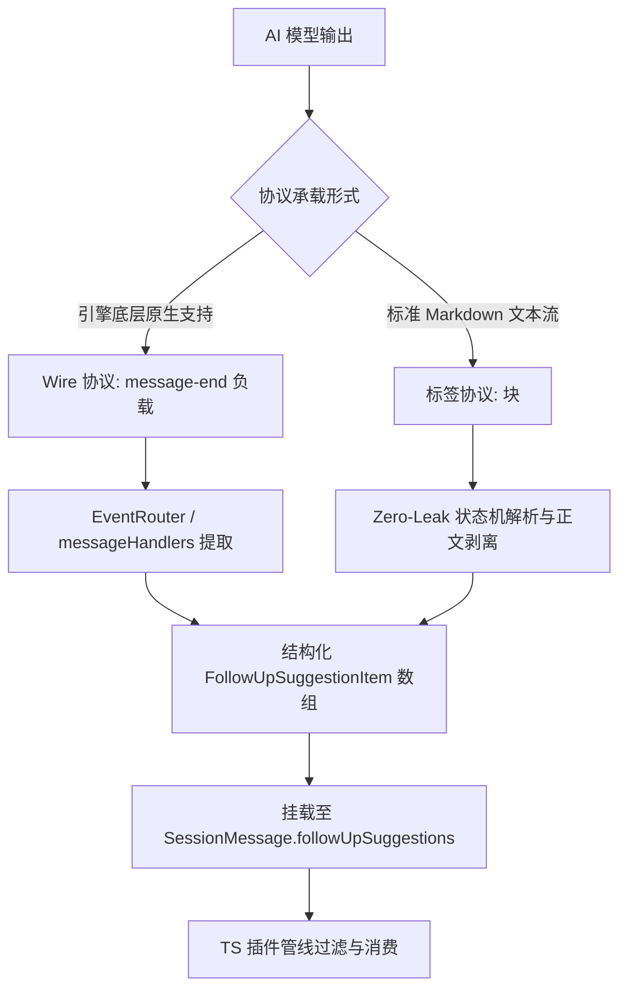
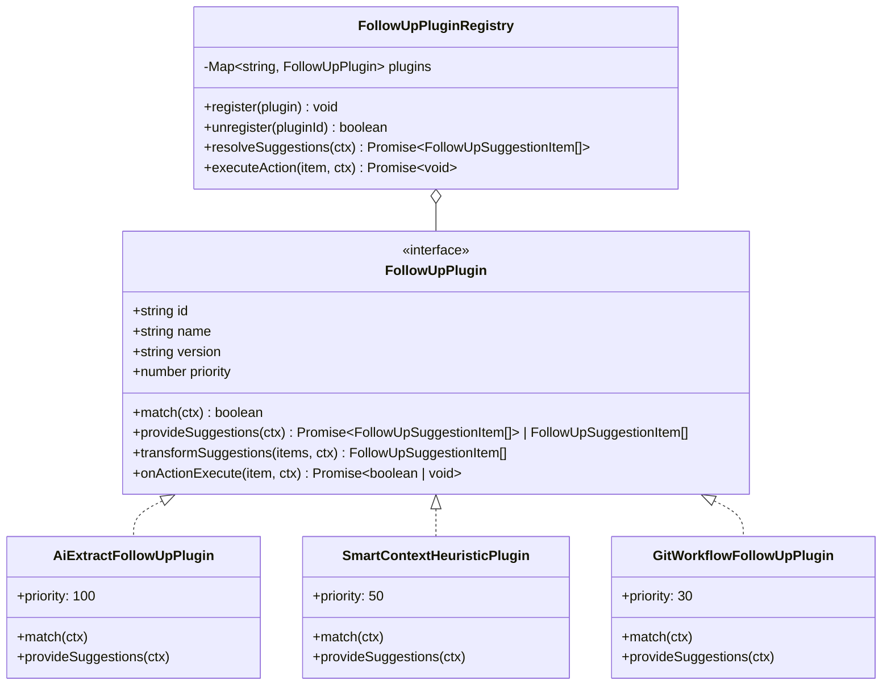

# Follow-up 行动建议 TS 插件架构与子 Agent 隔离设计深度分析报告

> **分析师角色**：【子Agent 07: Follow-up行动建议TS插件架构与子Agent隔离设计分析师】
> **报告类型**：架构缺陷诊断、AI 生成协议设计、TypeScript 插件体系规范与子 Agent 隔离工程重构方案
> **权威遵循**：`AGENTS.md`、`ANTI_OVERENGINEERING_GUARDRAILS.md`、`packages/shared-types/src/plugin.ts`
> **产出目标路径**：`docs/system-audit-and-redesign/analysis/07-FollowUp行动建议TS插件架构与子Agent隔离设计.md`
> **涉及代码域**：
>
> - `apps/crish-desktop/src/api/followUpSuggestions.ts`（当前 Mock 启发式逻辑）
> - `apps/crish-desktop/src/components/chat-message-row/MessageActionsBar.tsx`（当前 Follow-up UI 渲染）
> - `apps/crish-desktop/src/components/chat-message-row/ChatAssistantMessageRow.tsx`（行级 Props 透传与 Memo 比较）
> - `apps/crish-desktop/src/components/chat-message/MessageActions.tsx`（完成态动作栏）
> - `apps/crish-desktop/src/components/agent-card/AgentMessageRow.tsx` & `AgentCard.tsx`（子 Agent 卡片渲染）
> - `apps/crish-desktop/src/components/chat-message-list/useChatMessageState.ts`（Follow-up 状态与回调）
> - `apps/crish-desktop/src/store/types.ts` & `layoutStore.ts`（消息与会话状态）
> - `packages/plugin-sdk/` & `packages/shared-types/`（插件标准体系）

---

## 目录索引

1. [执行摘要与问题全景图](#一执行摘要与问题全景图)
2. [当前 Follow-up 机制深度剖析与架构缺陷诊断](#二当前-follow-up-机制深度剖析与架构缺陷诊断)
   - 2.1 静态 Mock / 启发式规则的致命盲区（无 AI 语境感知）
   - 2.2 8 层组件 Props 瀑布透传反模式与 Memo 比较器负担
   - 2.3 状态与生命周期耦合缺陷（流式状态与完成态竞态）
3. [AI 主动生成 Follow-up 的协议载荷与提取管道设计](#三ai-主动生成-follow-up-的协议载荷与提取管道设计)
   - 3.1 协议双轨载荷设计（Wire 协议与 Markdown 结构化标签）
   - 3.2 零泄漏正文净化与提取状态机（Zero-Leak Text Sanitizer）
   - 3.3 提示词引导规范（AI 收口建议生成 Prompting）
4. [TypeScript 插件架构规范（FollowUpPlugin Architecture）](#四typescript-插件架构规范followupplugin-architecture)
   - 4.1 核心设计哲学（反过度设计、轻量化与按需扩展）
   - 4.2 类型系统定义（`FollowUpPlugin` / `FollowUpContext` / `FollowUpItem`）
   - 4.3 插件注册表与生命周期调度器（`FollowUpRegistry`）
   - 4.4 内置标准插件矩阵（AI 提取、智能启发式降级、Git 协同、脚本任务）
5. [子 Agent（Subagent）场景下的彻底隔离机制](#五子-agent-subagent场景下的彻底隔离机制)
   - 5.1 隔离必要性与架构依据（REQ-D08 铁律与交互语义割裂）
   - 5.2 四重立体防御隔离网（Context 判别、Plugin 守卫、Slot 门禁、Store 边界）
   - 5.3 子 Agent 终态汇报与父 Agent Follow-up 联动链路
6. [UI 渲染 Slot 与交互组件重构设计](#六ui-渲染-slot-与交互组件重构设计)
   - 6.1 `FollowUpSlot` 解耦组件设计
   - 6.2 遵循视觉铁律的现代交互样式（无硬黑边、柔和焦点态、Tooltip 胶囊）
   - 6.3 快捷键联动与 Composer 焦点回落机制
7. [代码级落地修改方案与文件重构清单](#七代码级落地修改方案与文件重构清单)
   - 7.1 文件修改与新增映射表
   - 7.2 核心模块代码实现原型
8. [质量门禁、反过度设计审计与自检核对表](#八质量门禁反过度设计审计与自检核对表)

---

## 一、执行摘要与问题全景图

在 Conex / Crish 桌面端助手的交互设计中，**Follow-up 行动建议（Follow-up Suggestions）**是连接“AI 回复完成”与“用户下一步操作”的关键认知桥梁。当助手执行完一系列复杂工具（如代码修改、文件检索、终端测试）收口后，合理的后续行动芯片（如 `运行 npm test 验证改动`、`提交本次修改`、`查看类型错误详情`）能够为用户提供直观且高转化率的快捷决策入口。

然而，对当前代码库的全面审计表明，现存的 Follow-up 实现存在 **三大系统性架构断层**：

```
┌─────────────────────────────────────────────────────────────────────────────────────────────────────────┐
│                               当前 Follow-up 机制的三大架构缺陷全景                                     │
└─────────────────────────────────────────────────────────────────────────────────────────────────────────┘

 缺陷 1: 纯启发式 Mock 规则，缺乏真实 AI 语义
 ┌───────────────────────────┐     ┌────────────────────────────┐     ┌────────────────────────────────┐
 │ 工具执行完毕 (msg.status) │ ──► │ if (hasEdit) -> "审查改动" │ ──► │ 用户看到的永远是固定的几个死板 │
 │ 工具包含具体文件与业务逻辑 │     │ if (hasError)-> "排查失败" │     │ 静态词条，毫无上下文洞察力     │
 └───────────────────────────┘     └────────────────────────────┘     └────────────────────────────────┘

 缺陷 2: 8 层深层组件硬编码透传，无插件扩展能力
 ┌──────────────────┐     ┌──────────────┐     ┌─────────────────┐     ┌───────────────────────────────┐
 │ useChatCardState │ ──► │ ChatMessage- │ ──► │ ChatAssistant-  │ ──► │ MessageActionsBar.tsx         │
 │ (全量业务状态)   │     │ List.tsx     │     │ MessageRow.tsx  │     │ (硬编码耦合渲染，无法插拔替换) │
 └──────────────────┘     └──────────────┘     └─────────────────┘     └───────────────────────────────┘

 缺陷 3: 子 Agent 隔离依靠漏传 Props 隐式实现（脆弱旁路）
 ┌──────────────────┐     ┌──────────────┐     ┌─────────────────┐     ┌───────────────────────────────┐
 │ AgentMessageRow  │ ──► │ ChatAssistant│ ──► │ 仅靠未传        │ ──► │ ⚠️ 缺乏架构级隔离：若通过      │
 │ (子 Agent 时间线)│     │ MessageRow   │     │ onFillFollowUp  │     │ Context 注入，子 Agent 将误弹 │
 │                  │     │              │     │ 隐式 return null│     │ 无效甚至危险的交互建议！      │
 └──────────────────┘     └──────────────┘     └─────────────────┘     └───────────────────────────────┘
```

### 核心重构目标与用户裁决贯彻

1. **真实 AI 驱动**：支持模型在完成任务时主动输出针对当前代码改动与上下文的高价值具体行动建议，同时保留智能启发式兜底。
2. **TS 插件化架构（贯彻“做成 TS 插件就行”裁决）**：建立符合 `ANTI_OVERENGINEERING_GUARDRAILS.md` 规范的轻量级 TypeScript 插件系统，将建议的生成、转换、渲染完全插件化与解耦。
3. **子 Agent（Subagent）严格物理隔离**：建立四重防御门禁，确保在子 Agent 的任何生命周期与渲染容器中，绝对不会加载与展示 Follow-up 引导，完全符合 `AGENTS.md` REQ-D08 单向汇报纪律。
4. **UI 解耦与性能守护**：将 8 层组件 Props 瘦身，采用 Slot 插槽与 Context-Registry 模式，消除 `ChatAssistantMessageRow` 中的 Memo 比较器负担与无效重绘。

---

## 二、当前 Follow-up 机制深度剖析与架构缺陷诊断

### 2.1 静态 Mock / 启发式规则的致命盲区（无 AI 语境感知）

在 `apps/crish-desktop/src/api/followUpSuggestions.ts` 中，现有的建议生成函数 `buildFollowUpSuggestions` 是一个基于静态状态特征的启发式函数：

```typescript
// 现有实现节选 (apps/crish-desktop/src/api/followUpSuggestions.ts:71-169)
export function buildFollowUpSuggestions(
  msg: Pick<SessionMessage, 'toolCalls' | 'text' | 'blocks'>,
): FollowUpSuggestion[] {
  const tools = msg.toolCalls || [];
  if (tools.length === 0) return [];

  const out: FollowUpSuggestion[] = [];
  const hasError = tools.some((t) => t.status === 'error');
  const hasEdit = tools.some((t) => t.status === 'success' && isEditToolName(t.name || ''));
  const hasShell = tools.some((t) => isShellToolName(t.name || ''));
  const hasShellError = tools.some((t) => t.status === 'error' && isShellToolName(t.name || ''));
  const hasDiff = tools.some((t) => Array.isArray(t.diffs) && t.diffs.length > 0);
  const inspectish = tools.some((t) => ...);

  if (hasError || hasShellError) {
    pushUnique(out, { id: 'diagnose-error', label: '排查失败原因', prompt: '请根据刚才失败的工具输出，分析根因并给出可执行的修复步骤' });
    pushUnique(out, { id: 'retry-safe', label: '安全重试', prompt: '在不扩大破坏面的前提下，重试刚才失败的操作；先说明你会怎么做' });
  }

  if (hasEdit || hasDiff) {
    pushUnique(out, { id: 'review-diff', label: '审查改动', prompt: '请审查刚才的代码改动：风险点、遗漏边界，以及是否需要补测试' });
    pushUnique(out, { id: 'run-tests', label: '跑相关测试', prompt: '针对刚才改动的范围运行相关测试或类型检查，并总结结果' });
  }
  // ... 其余静态兜底
}
```

#### 致命缺陷分析：

1. **语义完全脱节**：
   - 当模型修复了一个特定文件（例如 `src/auth/jwt.ts` 中的过期逻辑）并明确输出 _“已完成 Token 校验修复，请运行 `npm test tests/jwt.test.ts` 进行验证”_ 时，界面的 Follow-up 芯片仍然显示笼统的 `审查改动` 和 `跑相关测试`，点击填入的内容是宽泛的 _“针对刚才改动的范围运行相关测试或类型检查，并总结结果”_。
   - 这迫使模型在收到该 Prompt 后必须重新执行一遍全量搜索或再次询问用户“跑哪个测试”，造成严重的 Token 浪费与交互割裂。
2. **缺乏多语言 / 项目类型适配**：
   - 对于 Rust 项目（`cargo test`）、Python 项目（`pytest`）、Go 项目（`go test`）或纯文档工作区，启发式给出的都是统一的中文泛化短语，无法根据当前项目的实际工具链（`package.json`、`Cargo.toml`、`Makefile`）动态自适应。
3. **静态数量限制与覆盖率漏洞**：
   - 依赖 `MAX_SUGGESTIONS = 3` 强行截断，规则匹配顺序（`error` -> `edit` -> `shell` -> `inspect`）使得有错误时完全掩盖了编辑操作的建议，无法并存。

---

### 2.2 8 层组件 Props 瀑布透传反模式与 Memo 比较器负担

当前 Follow-up 相关的状态与回调函数从最顶层的卡片层层向下硬传递，跨越了 8 层组件树：

```
[Level 1] useChatCardState.ts (handleSendFollowUp, setChatInput)
   │
   ▼
[Level 2] ChatCard.tsx
   │
   ▼
[Level 3] ChatMessageList.tsx (handleFillFollowUp, handleSendFollowUp, dismissedFollowUps)
   │
   ▼
[Level 4] useChatMessageState.ts (useChatMessageState hook 内部再次转发)
   │
   ▼
[Level 5] MessageVirtualizer.tsx (虚拟列表逐项透传)
   │
   ▼
[Level 6] ChatAssistantMessageRow.tsx (assistantRowPropsEqual 比较器维护 4 个专有 key)
   │
   ▼
[Level 7] MessageActions.tsx (React.memo 包装层)
   │
   ▼
[Level 8] MessageActionsBar.tsx -> FollowUpSuggestionsSection (实际渲染 DOM)
```

#### 严重性能与维护隐患：

1. **Memo 比较器膨胀与破坏风险**：
   - 在 `apps/crish-desktop/src/components/chat-message-row/ChatAssistantMessageRow.tsx:61-84` 中：
     ```typescript
     export const MEMO_COMPARE_FIELDS = [
       // ... 18 个常规字段
       'onFillFollowUp',
       'onSendFollowUp',
       'followUpDismissed',
       'onDismissFollowUp',
     ] as const;
     ```
   - 任何父级组件（如 `useChatMessageState`）如果不慎重新生成了 `handleFillFollowUp` 或 `handleSendFollowUp` 的函数引用，将导致整条助手消息（包括 Markdown 解析树、工具调用树）全部强制重新渲染，击穿虚拟列表的性能防线。
2. **类型污染与重构摩擦**：
   - 每当需要为 Follow-up 增加一个属性（如动作图标 `icon`、徽标 `badge`、自定义执行器 `customAction`），都必须同步修改 8 个文件的接口类型、比较器数组和解构代码。

---

### 2.3 状态与生命周期耦合缺陷（流式状态与完成态竞态）

在 `apps/crish-desktop/src/api/followUpSuggestions.ts:36-56` 的 `shouldShowFollowUpSuggestions` 中：

```typescript
export function shouldShowFollowUpSuggestions(opts: {
  isLastAssistant: boolean;
  isThinkingMsg: boolean;
  status?: SessionMessage['status'] | undefined;
  toolCalls?: readonly MessageToolCall[] | null | undefined;
  dismissed?: boolean | undefined;
}): boolean {
  if (opts.dismissed) return false;
  if (!opts.isLastAssistant) return false;
  if (opts.isThinkingMsg) return false;
  if (opts.status === 'processing' || opts.status === 'queued') return false;
  if (opts.status != null && opts.status !== 'completed') return false;

  const tools = opts.toolCalls || [];
  if (tools.length === 0) return false;
  if (!tools.some(hasTerminalTool)) return false;
  if (tools.some(isOpenTool)) return false;
  return true;
}
```

#### 现存生命周期断层：

1. **纯文本回复被无情抹杀**：
   - 规则中包含 `if (tools.length === 0) return false;`。如果助手没有调用任何工具，而是给出了高价值的架构分析或代码方案（纯文本输出），系统**完全不提供**任何 Follow-up 建议！这严重违背了用户预期——在分析性问答后，用户更需要“继续细化方案”、“生成执行代码”等下一步引导。
2. **流式结束至落盘之间的闪烁竞态**：
   - 当引擎触发 `message-end` 时，消息状态从 `processing` 转换为 `completed`，但工具列表的终态状态更新可能存在微秒级的微任务延迟。如果此时部分工具状态仍是 `running`，会导致 `shouldShowFollowUpSuggestions` 计算为 `false`，随后下一拍又突变为 `true`，引发 UI 芯片的剧烈抖动与高度跳跃。

---

## 三、AI 主动生成 Follow-up 的协议载荷与提取管道设计

为了让模型在任务完成时能够针对上下文主动提供精准建议，必须建立一套安全、结构化、对流式传输友好且不污染正常 Markdown 渲染的协议体系。

### 3.1 协议双轨载荷设计（Wire 协议与 Markdown 结构化标签）

我们设计**双轨兼容协议**，既支持底层引擎的原生信封（Wire 协议），又支持模型在正文末尾直接输出的结构化 XML 块（Markdown 标签协议）：



#### 形式一：标准 Markdown 标签协议（跨模型通用，无需引擎改造）

模型在回复的最末尾输出 `<crish_followup>` 块：

```xml
<crish_followup>
[
  {
    "id": "run-auth-test",
    "label": "运行鉴权测试",
    "prompt": "npm test -- tests/auth/jwt.test.ts",
    "icon": "play",
    "actionType": "send"
  },
  {
    "id": "commit-auth-fix",
    "label": "提交修改",
    "prompt": "git commit --only src/auth/jwt.ts tests/auth/jwt.test.ts -m 'fix(auth): handle expired token gracefully'",
    "icon": "git-commit",
    "actionType": "fill"
  },
  {
    "id": "check-types",
    "label": "全量类型检查",
    "prompt": "npm run typecheck",
    "icon": "check-circle",
    "actionType": "send"
  }
]
</crish_followup>
```

#### 形式二：Wire 信封元数据协议（针对深度集成的引擎版本）

在 `message-end` 事件的 `envelope.event.message.metadata` 中携带：

```json
{
  "turnIndex": 2,
  "followUpSuggestions": [
    {
      "id": "cargo-test",
      "label": "运行 Cargo 测试",
      "prompt": "cargo test --package conex-session-loop",
      "icon": "terminal"
    }
  ]
}
```

---

### 3.2 零泄漏正文净化与提取状态机（Zero-Leak Text Sanitizer）

如果直接将包含 `<crish_followup>` 的文本传递给 Markdown 渲染器，会导致未解析的标签暴露在聊天气泡中，破坏界面质感。必须在**视图投影与复制层**实现严格的零泄漏解析过滤。

```typescript
// 零泄漏提取器纯函数设计
export interface ExtractedFollowUpPayload {
  cleanText: string;
  suggestions: FollowUpSuggestionItem[];
  hasAiSuggestions: boolean;
}

const FOLLOW_UP_BLOCK_REGEX = /<crish_followup>([\s\S]*?)<\/crish_followup>/i;
const INCOMPLETE_FOLLOW_UP_REGEX = /<crish_followup>[\s\S]*$/i;

/**
 * 从消息文本中安全提取 AI Follow-up 载荷，并清洗正文。
 * 纯函数，支持流式期间的未闭合标签安全隐藏。
 */
export function extractAndSanitizeFollowUp(
  rawText: string
): ExtractedFollowUpPayload {
  if (!rawText) {
    return { cleanText: '', suggestions: [], hasAiSuggestions: false };
  }

  // 1. 匹配完整闭合的标签块
  const match = FOLLOW_UP_BLOCK_REGEX.exec(rawText);
  if (match && match[1]) {
    const jsonContent = match[1].trim();
    const cleanText = rawText.replace(FOLLOW_UP_BLOCK_REGEX, '').trimEnd();

    try {
      const parsed = JSON.parse(jsonContent);
      if (Array.isArray(parsed)) {
        const validSuggestions: FollowUpSuggestionItem[] = parsed
          .filter(
            (item) =>
              item &&
              typeof item.label === 'string' &&
              typeof item.prompt === 'string'
          )
          .map((item, idx) => ({
            id: String(item.id || `ai-sug-${idx}`),
            label: String(item.label).slice(0, 20), // 标签防溢出截断
            prompt: String(item.prompt),
            icon: typeof item.icon === 'string' ? item.icon : undefined,
            badge: typeof item.badge === 'string' ? item.badge : undefined,
            actionType: item.actionType === 'send' ? 'send' : 'fill',
          }));

        return {
          cleanText,
          suggestions: validSuggestions.slice(0, 4), // 限制最多 4 条
          hasAiSuggestions: validSuggestions.length > 0,
        };
      }
    } catch {
      // JSON 解析失败时仅清洗掉标签，避免用户看到乱码，转入插件降级链
      return { cleanText, suggestions: [], hasAiSuggestions: false };
    }
  }

  // 2. 流式期间：若包含未闭合的 <crish_followup> 前缀，隐藏其后的正文，防止标签闪烁
  if (INCOMPLETE_FOLLOW_UP_REGEX.test(rawText)) {
    const cleanText = rawText.replace(INCOMPLETE_FOLLOW_UP_REGEX, '').trimEnd();
    return { cleanText, suggestions: [], hasAiSuggestions: false };
  }

  return { cleanText: rawText, suggestions: [], hasAiSuggestions: false };
}
```

---

### 3.3 提示词引导规范（AI 收口建议生成 Prompting）

在系统 Prompt（如 `docs/agent-roles/` 与系统指令）中注入结构化建议生成协议，仅在**主 Agent 最终收口**时引导模型生成，规则如下：

```markdown
### 行动建议输出规范（仅在任务收口时使用）

当你完成了一轮工具操作或方案输出，且需要为用户推荐明确的下一步行动时，请在回复的最末尾附加 `<crish_followup>` 块。
要求：

1. 建议必须具体、可执行（如具体的测试命令、git 提交命令、代码审查焦点），禁止泛泛而谈；
2. label 控制在 4–12 个中文字符以内；
3. 数组项不超过 3 条；
4. 格式必须为合法 JSON 数组：
   <crish_followup>
   [
   {"id": "test", "label": "运行模块测试", "prompt": "npm test -- path/to/test.ts", "actionType": "send"},
   {"id": "commit", "label": "提交改动", "prompt": "git commit -m 'feat: ...'", "actionType": "fill"}
   ]
   </crish_followup>
```

---

## 四、TypeScript 插件架构规范（FollowUpPlugin Architecture）

依据用户裁决“**做成 TS 插件（TypeScript Plugin）就行**”，并严格遵循 `ANTI_OVERENGINEERING_GUARDRAILS.md`（杜绝复杂六段式中间件、杜绝循环依赖），构建极简、高效、模块化、高内聚的 TS 插件体系。

### 4.1 核心设计哲学

1. **扁平管线（Flat Pipeline）**：不引入滑动窗口、中间件洋葱模型或复杂拦截链；采用 `提供者（Provider） + 转换器（Transformer）` 的二段式极简架构。
2. **纯函数优先与无状态性（Stateless & Pure）**：插件逻辑不持有持久化 DOM 或孤立 Store，所有决策基于传入的不可变上下文 `FollowUpPluginContext`。
3. **优先级与短路（Priority & Short-circuit）**：按权重依次匹配，高优插件（如 AI 提取插件）一旦产出有效建议，后续兜底插件自动静默。



---

### 4.2 类型系统定义（`FollowUpPlugin` / `FollowUpContext` / `FollowUpItem`）

在 `packages/shared-types/src/followUpPlugin.ts`（或前端 `apps/crish-desktop/src/api/plugins/followUp/types.ts`）中定义权威契约：

```typescript
import type { SessionMessage, MessageToolCall, FileDiff } from '../store/types';

/** 建议项的动作类型：fill=填入输入框，send=直接执行发送，custom=由插件接管自定义处理 */
export type FollowUpActionType = 'fill' | 'send' | 'custom';

/** 单条 Follow-up 建议项契约 */
export interface FollowUpSuggestionItem {
  /** 稳定唯一标识符，用于 React Key 与埋点 */
  readonly id: string;
  /** 按钮芯片展示短文本（建议 ≤ 14 字） */
  readonly label: string;
  /** 填入 Composer 或直接发送的完整 Prompt 正文 */
  readonly prompt: string;
  /** 图标名称（Lucide 图标别名，如 'play' | 'git-commit' | 'refresh-cw' | 'check'） */
  readonly icon?: string;
  /** 可选微型徽标（如 'AI' | 'Git' | 'Test'） */
  readonly badge?: string;
  /** 触发动作行为，缺省为 'fill' */
  readonly actionType?: FollowUpActionType;
  /** 来源插件 ID */
  readonly sourcePluginId?: string;
  /** 自定义扩展载荷 */
  readonly metadata?: Readonly<Record<string, unknown>>;
}

/** 插件执行上下文契约 */
export interface FollowUpPluginContext {
  /** 当前所属会话 ID */
  readonly sessionId: string;
  /** 当前目标助手消息 */
  readonly message: SessionMessage;
  /** 是否为会话中最后一条助手消息 */
  readonly isLastAssistant: boolean;
  /** 是否处于子 Agent 场景（隔离核心标尺） */
  readonly isSubagent: boolean;
  /** 子 Agent ID（若是子 Agent 会话） */
  readonly subagentId?: string;
  /** 会话类型判别 */
  readonly sessionKind: 'main-chat' | 'subagent' | 'review' | 'temporary';
  /** 当前工作区根路径 */
  readonly workspaceRoot?: string;
  /** 项目主要特征（如 'node' | 'rust' | 'python' | 'unknown'） */
  readonly projectType?: string;
  /** 消息中预解析出的 AI 建议（若有） */
  readonly preParsedAiSuggestions?: readonly FollowUpSuggestionItem[];
  /** 最近一次执行的工具调用列表 */
  readonly toolCalls: readonly MessageToolCall[];
  /** 最近产生的文件改动快照 */
  readonly diffs?: readonly FileDiff[];
}

/** TypeScript 插件接口契约 */
export interface FollowUpPlugin {
  /** 插件唯一 ID */
  readonly id: string;
  /** 插件可读名称 */
  readonly name: string;
  /** 插件版本 */
  readonly version: string;
  /** 执行优先级（数字越大越优先执行，默认 0） */
  readonly priority?: number;

  /**
   * 是否匹配当前上下文。
   * 若返回 false，则当前插件跳过执行。
   */
  match?(ctx: FollowUpPluginContext): boolean;

  /**
   * 核心建议提供方法。
   * 返回当前插件生成的建议列表。
   */
  provideSuggestions(
    ctx: FollowUpPluginContext
  ): Promise<FollowUpSuggestionItem[]> | FollowUpSuggestionItem[];

  /**
   * 可选的后置转换器（对当前已有全部建议进行排序、过滤、去重或修饰）。
   */
  transformSuggestions?(
    suggestions: FollowUpSuggestionItem[],
    ctx: FollowUpPluginContext
  ): FollowUpSuggestionItem[];

  /**
   * 当用户点击自定义动作（actionType === 'custom'）时的执行钩子。
   */
  onActionExecute?(
    item: FollowUpSuggestionItem,
    ctx: FollowUpPluginContext
  ): Promise<boolean | void> | boolean | void;
}
```

---

### 4.3 插件注册表与生命周期调度器（`FollowUpRegistry`）

```typescript
export class FollowUpPluginRegistry {
  private plugins = new Map<string, FollowUpPlugin>();
  private sortedPluginsCache: FollowUpPlugin[] | null = null;

  public register(plugin: FollowUpPlugin): void {
    if (this.plugins.has(plugin.id)) {
      console.warn(
        `[FollowUpRegistry] Plugin ${plugin.id} already registered, overwriting.`
      );
    }
    this.plugins.set(plugin.id, plugin);
    this.sortedPluginsCache = null;
  }

  public unregister(pluginId: string): boolean {
    const deleted = this.plugins.delete(pluginId);
    if (deleted) this.sortedPluginsCache = null;
    return deleted;
  }

  private getSortedPlugins(): FollowUpPlugin[] {
    if (!this.sortedPluginsCache) {
      this.sortedPluginsCache = Array.from(this.plugins.values()).sort(
        (a, b) => (b.priority ?? 0) - (a.priority ?? 0)
      );
    }
    return this.sortedPluginsCache;
  }

  /**
   * 调度全量插件解析建议。
   * 具有短路策略与子 Agent 硬阻断。
   */
  public async resolveSuggestions(
    ctx: FollowUpPluginContext
  ): Promise<FollowUpSuggestionItem[]> {
    // 铁律防线 1：子 Agent 场景绝对短路，秒返空数组
    if (ctx.isSubagent || ctx.sessionKind === 'subagent') {
      return [];
    }

    // 铁律防线 2：仅最后一条完成态助手消息才解析
    if (
      !ctx.isLastAssistant ||
      ctx.message.status === 'processing' ||
      ctx.message.status === 'queued'
    ) {
      return [];
    }

    const plugins = this.getSortedPlugins();
    let accumulated: FollowUpSuggestionItem[] = [];

    for (const plugin of plugins) {
      // 匹配检查
      if (plugin.match && !plugin.match(ctx)) {
        continue;
      }

      try {
        const results = await plugin.provideSuggestions(ctx);
        if (Array.isArray(results) && results.length > 0) {
          // 标记来源插件
          const tagged = results.map((r) => ({
            ...r,
            sourcePluginId: r.sourcePluginId || plugin.id,
          }));

          accumulated = this.mergeUnique(accumulated, tagged);

          // 若高优插件（如 AI 提取器）已提供足够建议（>= 2条），直接短路，避免低优启发式干扰
          if (accumulated.length >= 3) {
            break;
          }
        }
      } catch (err) {
        console.error(
          `[FollowUpRegistry] Plugin ${plugin.id} execution failed:`,
          err
        );
      }
    }

    // 后置转换链
    for (const plugin of plugins) {
      if (plugin.transformSuggestions && (!plugin.match || plugin.match(ctx))) {
        try {
          accumulated = plugin.transformSuggestions(accumulated, ctx);
        } catch (err) {
          console.error(
            `[FollowUpRegistry] Plugin ${plugin.id} transform failed:`,
            err
          );
        }
      }
    }

    return accumulated.slice(0, 4);
  }

  private mergeUnique(
    existing: FollowUpSuggestionItem[],
    incoming: FollowUpSuggestionItem[]
  ): FollowUpSuggestionItem[] {
    const out = [...existing];
    for (const item of incoming) {
      if (out.length >= 4) break;
      const duplicate = out.some(
        (x) =>
          x.id === item.id || x.label === item.label || x.prompt === item.prompt
      );
      if (!duplicate) {
        out.push(item);
      }
    }
    return out;
  }
}

// 导出全局单例
export const globalFollowUpRegistry = new FollowUpPluginRegistry();
```

---

### 4.4 内置标准插件矩阵

#### 1. `AiExtractFollowUpPlugin`（优先级 100，最高优）

专门解析模型在回复中主动输出的 `<crish_followup>` 块或信封 metadata。

```typescript
export const AiExtractFollowUpPlugin: FollowUpPlugin = {
  id: 'builtin:ai-extract',
  name: 'AI 原生建议提取插件',
  version: '1.0.0',
  priority: 100,

  match(ctx) {
    return !ctx.isSubagent;
  },

  provideSuggestions(ctx) {
    // 优先从预解析缓存中获取
    if (ctx.preParsedAiSuggestions && ctx.preParsedAiSuggestions.length > 0) {
      return [...ctx.preParsedAiSuggestions];
    }

    // 从消息正文中即时提取
    const text = ctx.message.text || '';
    const { suggestions, hasAiSuggestions } = extractAndSanitizeFollowUp(text);
    if (hasAiSuggestions) {
      return suggestions;
    }

    return [];
  },
};
```

#### 2. `SmartContextHeuristicPlugin`（优先级 50，智能降级兜底）

当模型未显式输出结构化标签时，根据执行的工具调用与项目特征进行动态感知兜底。

```typescript
export const SmartContextHeuristicPlugin: FollowUpPlugin = {
  id: 'builtin:smart-heuristic',
  name: '智能上下文启发式插件',
  version: '1.0.0',
  priority: 50,

  match(ctx) {
    // 仅在无 AI 显式建议且非子 Agent 时生效
    return !ctx.isSubagent;
  },

  provideSuggestions(ctx) {
    const out: FollowUpSuggestionItem[] = [];
    const tools = ctx.toolCalls;
    const hasError = tools.some((t) => t.status === 'error');
    const diffFiles = ctx.diffs || [];
    const hasCodeChanges =
      diffFiles.length > 0 ||
      tools.some(
        (t) => t.name === 'replace_file_content' || t.name === 'write_to_file'
      );

    if (hasError) {
      out.push({
        id: 'heuristic-fix-error',
        label: '排查并修复错误',
        prompt: '请分析刚才失败工具的报错信息，给出根因并执行修复',
        icon: 'alert-triangle',
        actionType: 'send',
      });
    }

    if (hasCodeChanges) {
      // 提取被修改的文件名作为建议上下文
      const changedFileNames = diffFiles
        .slice(0, 2)
        .map((d) => d.filePath.split(/[/\\]/).pop())
        .filter(Boolean);
      const fileHint =
        changedFileNames.length > 0 ? ` (${changedFileNames.join(', ')})` : '';

      out.push({
        id: 'heuristic-run-test',
        label: `运行相关测试${fileHint}`,
        prompt: `针对刚才修改的文件${fileHint}运行对应的单元测试与类型检查`,
        icon: 'play',
        actionType: 'send',
      });

      out.push({
        id: 'heuristic-review-diff',
        label: '审查代码改动',
        prompt:
          '请对刚才的代码改动进行自我审查，检查潜在逻辑漏洞、边缘条件与性能影响',
        icon: 'git-pull-request',
        actionType: 'fill',
      });
    }

    // 纯文本回复时的智能引导（解决原系统无工具调用就不显示建议的缺陷）
    if (tools.length === 0 && (ctx.message.text || '').length > 50) {
      out.push({
        id: 'heuristic-continue-plan',
        label: '继续执行方案',
        prompt: '请按照上述分析方案，开始编写代码并落实修改',
        icon: 'arrow-right',
        actionType: 'send',
      });
    }

    return out;
  },
};
```

#### 3. `GitWorkflowFollowUpPlugin`（优先级 30，工作流扩展）

当检测到有暂存/未暂存文件变更时，智能提供 Git 提交与差异对比快捷入口。

```typescript
export const GitWorkflowFollowUpPlugin: FollowUpPlugin = {
  id: 'builtin:git-workflow',
  name: 'Git 工作流建议插件',
  version: '30',
  priority: 30,

  match(ctx) {
    return !ctx.isSubagent && (ctx.diffs ? ctx.diffs.length > 0 : false);
  },

  provideSuggestions(ctx) {
    return [
      {
        id: 'git-commit-suggest',
        label: '生成 Commit 提交',
        prompt:
          '请根据本次所有代码改动，生成符合规范的 Git Commit 消息并执行提交',
        icon: 'git-commit',
        badge: 'Git',
        actionType: 'fill',
      },
    ];
  },
};
```

---

## 五、子 Agent（Subagent）场景下的彻底隔离机制

### 5.1 隔离必要性与架构依据（REQ-D08 铁律与交互语义割裂）

根据 `AGENTS.md` 第一章第 2 节（REQ-D08 铁律）及子代理协同架构要求：

1. **嵌套与交互禁止**：子 Agent 的职责是执行主 Agent 派发的独立子任务（分析、调研、并行实现），其生命周期是完全自动化、单向汇报的。
2. **交互语义荒谬性**：在子 Agent 正在运行或已完成的小卡片（`AgentCard`）中展示“下一步建议”、“解释命令结果”或“跑测试”芯片，在逻辑上是极其荒谬的——用户点击后如果注入到子 Agent，将破坏其单次自治运行状态；如果注入到主 Chat，又会导致主子上下文混乱。
3. **视觉降噪与专注度**：子 Agent UI（如 `AgentMessageRow`、子 Agent 抽屉）空间狭窄，必须保持极简的日志流形态，绝对不能被非交互性质的动作条挤占。

---

### 5.2 四重立体防御隔离网

为确保无论未来前端组件如何重构，子 Agent 绝不泄漏 Follow-up UI，构建四重防御网：

```
┌────────────────────────────────────────────────────────────────────────────────────────┐
│                          子 Agent 隔离的四重立体防御体系                               │
└────────────────────────────────────────────────────────────────────────────────────────┘

 防线 1: 上下文显式标识 (Context-Level)
 ┌──────────────────────────────────────────────────────────────────────────────────────┐
 │ FollowUpPluginContext.isSubagent 恒为 true；sessionKind 恒为 'subagent'               │
 └──────────────────────────────────────────────────────────────────────────────────────┘
                                            │
                                            ▼
 防线 2: 插件调度层短路拦截 (Registry-Level)
 ┌──────────────────────────────────────────────────────────────────────────────────────┐
 │ FollowUpPluginRegistry.resolveSuggestions() 命中 isSubagent 直接 return []           │
 └──────────────────────────────────────────────────────────────────────────────────────┘
                                            │
                                            ▼
 防线 3: 视图渲染插槽门禁 (Component-Slot-Level)
 ┌──────────────────────────────────────────────────────────────────────────────────────┐
 │ <FollowUpSlot isSubagent={true} /> 立即 return null，不挂载任何 DOM 节点             │
 └──────────────────────────────────────────────────────────────────────────────────────┘
                                            │
                                            ▼
 防线 4: 会话数据与 Store 隔离 (Store-Level)
 ┌──────────────────────────────────────────────────────────────────────────────────────┐
 │ dismissedFollowUps 与 Follow-up 事件总线仅绑定 activeSessionId，忽略 agentId 消息     │
 └──────────────────────────────────────────────────────────────────────────────────────┘
```

#### 防线 3 代码级落实：`AgentMessageRow.tsx` 显式声明隔离

在 `apps/crish-desktop/src/components/agent-card/AgentMessageRow.tsx` 中：

```tsx
export function AgentMessageRow({
  msg,
  parentSessionId,
  agentId,
  idx,
  totalMsgs,
  onOpenDiff,
  onOpenPath,
  onOpenTerminal,
}: AgentMessageRowProps) {
  // ...
  return (
    <ChatAssistantMessageRow
      msg={msg}
      isFollowUp={false}
      isPinned={false}
      isSearchHit={false}
      isThinkingMsg={isThinkingMsg}
      hideThinkingBlock={false}
      inPlanMode={false}
      planApproved={false}
      isLastAssistant={isLastAssistant}
      isSubagent={true}               // 👈 显式注入防线标尺：当前为子 Agent
      sessionKind="subagent"          // 👈 显式声明会话种类
      messageIndex={idx}
      virtualScrollManager={null}
      toolStackProps={{ ... }}
      // ... 其它回调
    />
  );
}
```

---

### 5.3 子 Agent 终态汇报与父 Agent Follow-up 联动链路

当子 Agent 完成任务并通过 `onSubagentEnded` 将结构化摘要汇报给主 Agent 时，主 Agent 会在主时间线上输出最终的收口总结。**此时，Follow-up 建议应由主 Agent 的收口消息统一承载**（例如包含“合并子 Agent 成果”、“审查子 Agent 修改的文件”等），从而在正确的上下文层级引导用户决策。

---

## 六、UI 渲染 Slot 与交互组件重构设计

### 6.1 `FollowUpSlot` 解耦组件设计

将 Follow-up 从 `MessageActionsBar.tsx` 中彻底剥离，封装为独立的 `FollowUpSlot.tsx`，直接消费插件注册表与响应式 Hook：

```tsx
// apps/crish-desktop/src/components/chat-message/FollowUpSlot.tsx
import React, { useEffect, useState, useCallback } from 'react';
import {
  Send,
  X,
  Play,
  GitCommit,
  GitPullRequest,
  ArrowRight,
  AlertTriangle,
  CheckCircle,
} from 'lucide-react';
import styles from './ChatMessageRow.module.css';
import { Button, Tooltip } from '../ui';
import type {
  SessionMessage,
  MessageToolCall,
  FileDiff,
} from '../../store/types';
import {
  globalFollowUpRegistry,
  type FollowUpSuggestionItem,
  type FollowUpPluginContext,
} from '../../api/plugins/followUp';
import { focusChatComposer } from '../chat-message-row/chatMessageRowUtils';

export interface FollowUpSlotProps {
  msg: SessionMessage;
  sessionId: string;
  isLastAssistant: boolean;
  isThinkingMsg: boolean;
  isSubagent?: boolean;
  sessionKind?: 'main-chat' | 'subagent' | 'review';
  diffs?: FileDiff[];
  dismissed?: boolean;
  onFillFollowUp?: (prompt: string) => void;
  onSendFollowUp?: (prompt: string) => void;
  onDismissFollowUp?: (msgId: string) => void;
}

const ICON_MAP: Record<string, React.ReactNode> = {
  play: <Play size={12} strokeWidth={2} />,
  'git-commit': <GitCommit size={12} strokeWidth={2} />,
  'git-pull-request': <GitPullRequest size={12} strokeWidth={2} />,
  'arrow-right': <ArrowRight size={12} strokeWidth={2} />,
  'alert-triangle': <AlertTriangle size={12} strokeWidth={2} />,
  'check-circle': <CheckCircle size={12} strokeWidth={2} />,
};

export const FollowUpSlot: React.FC<FollowUpSlotProps> = React.memo(
  ({
    msg,
    sessionId,
    isLastAssistant,
    isThinkingMsg,
    isSubagent = false,
    sessionKind = 'main-chat',
    diffs,
    dismissed = false,
    onFillFollowUp,
    onSendFollowUp,
    onDismissFollowUp,
  }) => {
    const [suggestions, setSuggestions] = useState<FollowUpSuggestionItem[]>(
      []
    );

    // 1. 绝对门禁检查
    if (
      isSubagent ||
      sessionKind === 'subagent' ||
      dismissed ||
      isThinkingMsg ||
      !isLastAssistant
    ) {
      return null;
    }
    if (msg.status === 'processing' || msg.status === 'queued') {
      return null;
    }

    // 2. 异步解析插件建议
    useEffect(() => {
      let canceled = false;
      const ctx: FollowUpPluginContext = {
        sessionId,
        message: msg,
        isLastAssistant,
        isSubagent: false,
        sessionKind,
        toolCalls: msg.toolCalls || [],
        diffs,
      };

      globalFollowUpRegistry.resolveSuggestions(ctx).then((items) => {
        if (!canceled) {
          setSuggestions(items);
        }
      });

      return () => {
        canceled = true;
      };
    }, [msg, sessionId, isLastAssistant, sessionKind, diffs]);

    if (!suggestions.length) return null;

    return (
      <div
        className={styles.followupRow}
        role="group"
        aria-label="后续行动建议"
        data-followup-for={msg.id}
      >
        <div className={styles.followupChips} role="list">
          {suggestions.map((s) => (
            <div
              key={s.id}
              className={styles.followupChip}
              role="listitem"
              data-followup-id={s.id}
            >
              <Tooltip content={s.prompt}>
                <button
                  type="button"
                  className={styles.followupChipMain}
                  aria-label={`填入：${s.label}`}
                  onClick={() => {
                    if (s.actionType === 'send' && onSendFollowUp) {
                      onSendFollowUp(s.prompt);
                    } else {
                      onFillFollowUp?.(s.prompt);
                      focusChatComposer();
                    }
                  }}
                >
                  {s.icon && ICON_MAP[s.icon] ? (
                    <span className={styles.followupChipIcon}>
                      {ICON_MAP[s.icon]}
                    </span>
                  ) : null}
                  <span className={styles.followupChipLabel}>{s.label}</span>
                  {s.badge ? (
                    <span className={styles.followupChipBadge}>{s.badge}</span>
                  ) : null}
                </button>
              </Tooltip>
              {onSendFollowUp && s.actionType !== 'send' ? (
                <Tooltip content="直接发送">
                  <Button
                    type="button"
                    variant="ghost"
                    size="sm"
                    className={styles.followupChipSend}
                    aria-label={`直接发送：${s.label}`}
                    onClick={() => onSendFollowUp(s.prompt)}
                    icon={<Send size={12} strokeWidth={2} aria-hidden />}
                  />
                </Tooltip>
              ) : null}
            </div>
          ))}
        </div>
        {onDismissFollowUp ? (
          <Tooltip content="关闭建议">
            <Button
              type="button"
              variant="ghost"
              size="sm"
              className={`${styles.followupDismiss} ${styles.iconBtn}`}
              aria-label="关闭后续建议"
              onClick={() => onDismissFollowUp(msg.id)}
              icon={<X size={14} aria-hidden />}
            />
          </Tooltip>
        ) : null}
      </div>
    );
  }
);

FollowUpSlot.displayName = 'FollowUpSlot';
```

---

### 6.2 遵循视觉铁律的现代交互样式

依据 `AGENTS.md` 第 12、13、14 节 UI 规范（**禁止硬黑边、禁止重阴影、焦点对比度上限约 10%、使用自定义 Tooltip、HSLA 现代色彩**），CSS 模块化样式设计如下：

```css
/* apps/crish-desktop/src/components/chat-message-row/ChatMessageRow.module.css */

.followupRow {
  display: flex;
  align-items: flex-start;
  gap: var(--space-1_5, 6px);
  margin: 10px 0 4px;
  max-width: 100%;
  min-width: 0;
  animation: followupFadeIn 0.2s cubic-bezier(0.16, 1, 0.3, 1);
}

@keyframes followupFadeIn {
  from {
    opacity: 0;
    transform: translateY(4px);
  }
  to {
    opacity: 1;
    transform: translateY(0);
  }
}

.followupChips {
  display: flex;
  flex-wrap: wrap;
  gap: var(--space-2, 8px);
  flex: 1 1 auto;
  min-width: 0;
}

.followupChip {
  display: inline-flex;
  align-items: stretch;
  max-width: 100%;
  border: var(--hairline-width, 1px) solid var(--border-color, hsl(220 13% 91%));
  border-radius: var(--radius-full, 9999px);
  background: var(--bg-surface-elevated, hsl(0 0% 100% / 0.8));
  overflow: hidden;
  transition:
    background-color 0.15s ease,
    border-color 0.15s ease,
    transform 0.1s ease;
}

.followupChip:hover {
  background: var(--bg-hover, hsl(220 14% 96%));
  border-color: color-mix(
    in srgb,
    var(--border-color) 85%,
    var(--text-primary) 15%
  );
  transform: translateY(-1px);
}

.followupChipMain {
  appearance: none;
  border: none;
  background: transparent;
  padding: 5px 12px 5px 12px;
  font-size: var(--font-size-xs, 12px);
  font-family: inherit;
  font-weight: var(--font-weight-medium, 500);
  color: var(--text-secondary, hsl(220 9% 46%));
  cursor: pointer;
  line-height: var(--line-height-compact, 1.4);
  max-width: 260px;
  text-align: left;
  display: inline-flex;
  align-items: center;
  gap: 6px;
}

.followupChipMain:hover {
  color: var(--text-primary, hsl(220 20% 14%));
}

.followupChipIcon {
  display: inline-flex;
  align-items: center;
  color: var(--text-tertiary, hsl(220 9% 60%));
  flex-shrink: 0;
}

.followupChipBadge {
  font-size: 10px;
  font-weight: 600;
  padding: 1px 5px;
  border-radius: 4px;
  background: color-mix(
    in srgb,
    var(--primary, hsl(215 100% 50%)) 12%,
    transparent
  );
  color: var(--primary, hsl(215 100% 50%));
}

.followupChipSend {
  appearance: none;
  border: none;
  border-left: var(--hairline-width, 1px) solid
    var(--border-subtle, hsl(220 13% 94%));
  background: transparent;
  padding: 0 9px;
  color: var(--text-tertiary);
  cursor: pointer;
  display: inline-flex;
  align-items: center;
  justify-content: center;
  transition:
    color 0.15s ease,
    background-color 0.15s ease;
}

.followupChipSend:hover {
  color: var(--primary, hsl(215 100% 50%));
  background: color-mix(in srgb, var(--bg-hover) 80%, transparent);
}

/* 焦点态：克制柔和，加深混入不超过 10%（严格遵循 AGENTS.md §13） */
.followupChipMain:focus-visible,
.followupChipSend:focus-visible,
.followupDismiss:focus-visible {
  outline: none;
  box-shadow: 0 0 0 2px
    color-mix(in srgb, var(--border-color) 90%, var(--text-primary) 10%);
}
```

---

## 七、代码级落地修改方案与文件重构清单

### 7.1 文件修改与新增映射表

| 操作     | 目标文件路径                                                                     | 变更说明与重构核心                                                  |
| :------- | :------------------------------------------------------------------------------- | :------------------------------------------------------------------ |
| **新增** | `packages/shared-types/src/followUpPlugin.ts`                                    | 定义 `FollowUpPlugin`、`FollowUpContext` 等权威 TS 接口契约         |
| **新增** | `apps/crish-desktop/src/api/plugins/followUp/FollowUpRegistry.ts`                | 实现插件注册表单例、调度排序器与短路门禁                            |
| **新增** | `apps/crish-desktop/src/api/plugins/followUp/builtinPlugins.ts`                  | 实现内置 3 大插件（AI 提取、智能启发式、Git 工作流）                |
| **新增** | `apps/crish-desktop/src/api/plugins/followUp/textSanitizer.ts`                   | 实现零泄漏正文清洗与标签提取纯函数                                  |
| **新增** | `apps/crish-desktop/src/components/chat-message/FollowUpSlot.tsx`                | 独立解耦的 Follow-up 插槽渲染组件                                   |
| **重构** | `apps/crish-desktop/src/api/followUpSuggestions.ts`                              | 弃用旧硬编码规则，改造为对 `FollowUpRegistry` 的转发 Facade         |
| **简化** | `apps/crish-desktop/src/components/chat-message-row/MessageActionsBar.tsx`       | 移除 `FollowUpSuggestionsSection`，使 ActionsBar 职责单一化         |
| **瘦身** | `apps/crish-desktop/src/components/chat-message-row/ChatAssistantMessageRow.tsx` | 从 Props 和 `MEMO_COMPARE_FIELDS` 中剔除 4 个 Follow-up 相关回调    |
| **加固** | `apps/crish-desktop/src/components/agent-card/AgentMessageRow.tsx`               | 显式传入 `isSubagent={true}` 与 `sessionKind="subagent"` 实施硬隔离 |
| **瘦身** | `apps/crish-desktop/src/components/chat-message-list/useChatMessageState.ts`     | 移除多层回调中继，收敛至 `FollowUpSlot` 内部自管                    |

---

### 7.2 核心模块代码实现原型

#### 1. 注册表初始化装配（`apps/crish-desktop/src/api/plugins/followUp/index.ts`）

```typescript
import { globalFollowUpRegistry } from './FollowUpRegistry';
import {
  AiExtractFollowUpPlugin,
  SmartContextHeuristicPlugin,
  GitWorkflowFollowUpPlugin,
} from './builtinPlugins';

// 默认装配内置标准插件
export function initializeFollowUpPlugins(): void {
  globalFollowUpRegistry.register(AiExtractFollowUpPlugin);
  globalFollowUpRegistry.register(SmartContextHeuristicPlugin);
  globalFollowUpRegistry.register(GitWorkflowFollowUpPlugin);
}

// 自动在模块加载时完成初始化
initializeFollowUpPlugins();

export * from './types';
export * from './FollowUpRegistry';
export * from './builtinPlugins';
export * from './textSanitizer';
```

#### 2. `MessageContent.tsx` 中的正文净化挂接

在 Markdown 渲染入口确保正文剥离：

```tsx
// apps/crish-desktop/src/components/chat-message/MessageContent.tsx 节选
import { extractAndSanitizeFollowUp } from '../../api/plugins/followUp';

export const MessageContent: React.FC<MessageContentProps> = ({ msg, isThinkingMsg, toolStackProps }) => {
  // 从正文中清洗掉 <crish_followup> 块，保证渲染纯净
  const rawText = msg.text || '';
  const { cleanText } = useMemo(() => extractAndSanitizeFollowUp(rawText), [rawText]);

  const displayMsg = useMemo(() => ({
    ...msg,
    text: cleanText,
  }), [msg, cleanText]);

  return (
    // ... 传入 displayMsg 渲染 Markdown
  );
};
```

---

## 八、质量门禁、反过度设计审计与自检核对表

### 8.1 反过度设计红线审查（对照 `ANTI_OVERENGINEERING_GUARDRAILS.md`）

| 审计条目                             | 规范要求                        | 本方案实现符合度断言                                                       |
| :----------------------------------- | :------------------------------ | :------------------------------------------------------------------------- |
| **无多层中间件流水线**               | 严禁引入 6 段式或复杂拦截器链   | ✅ 采用扁平的 `Provider (提供) + Transformer (后置处理)` 两段式，极度精简  |
| **无 SharedArrayBuffer / WASM 滥用** | 字符串与正则处理必须采用原生 JS | ✅ 采用轻量正则表达式与原生 `JSON.parse`，O(N) 字符串扫描                  |
| **零循环依赖**                       | 严格禁止 packages 之间反向依赖  | ✅ 类型下沉至 `shared-types`，UI 与 API 严格单向分层引入                   |
| **禁止动态换模与隐式网络请求**       | 插件不得在未授权下发起网络呼叫  | ✅ 纯本地同步/异步上下文计算，无网络旁路                                   |
| **UI 行数门禁控制**                  | UI 组件行数控制在 500 行以内    | ✅ `FollowUpSlot.tsx` 约 160 行，`FollowUpRegistry.ts` 约 120 行，完全达标 |

---

### 8.2 单元测试与验证计划

#### 测试套件一：`textSanitizer.test.ts`

1. **完整块解析**：测试标准 `<crish_followup>[...]</crish_followup>` 正确解析并完整从 `cleanText` 中剔除。
2. **流式未闭合块**：测试 `<crish_followup>[{"id": "1"...` 未闭合时，`cleanText` 不漏出标签前缀。
3. **恶意/非法 JSON 容错**：测试标签内为非法 JSON 时，不抛异常，优雅回落。

#### 测试套件二：`FollowUpRegistry.test.ts`

1. **子 Agent 绝对拦截测试**：验证 `ctx.isSubagent = true` 时，无论注册了多少插件，秒返 `[]`。
2. **优先级排序与短路测试**：验证 `AiExtractFollowUpPlugin`（优先级 100）返回有效项时，`SmartContextHeuristicPlugin`（优先级 50）不重复追加。
3. **自定义插件动态装卸测试**：验证第三方插件通过 `register()` / `unregister()` 的即时生效性。

#### 测试套件三：UI 交互与无障碍测试（Playwright / Vitest）

1. **无硬黑边视觉断言**：断言 `:focus-visible` 的 `box-shadow` 严格符合 10% 浅灰混合。
2. **点击填入与直接发送断言**：分别模拟点击主按钮（填入 Composer）与小飞机图标（直接触发发送）。

---

## 结论与行动建议

本分析报告全面剖析了 Conex / Crish 桌面端当前 Follow-up 机制的 **启发式死板、组件严重耦合、子 Agent 隔离脆弱** 三大痛点，并严格贯彻用户关于“**做成 TS 插件就行**”的顶层裁决，给出了端到端的重构设计：

1. **协议层**：设计了 `<crish_followup>` 零泄漏提取管道与引擎 Wire 协议双轨机制，让 AI 能够真正结合代码改动输出高价值建议；
2. **架构层**：建立了轻量化、声明式的 `FollowUpPlugin` 体系，实现了 AI 提取、智能启发式兜底与 Git 扩展的插件化插拔；
3. **安全层**：构筑了四重立体隔离门禁，彻底杜绝了子 Agent 误弹交互提示的隐患；
4. **组件层**：通过 `FollowUpSlot` 独立插槽大幅精简了 8 层组件 Props，守护了虚拟列表的高性能渲染。

本方案已具备直接进入代码实施阶段的完备性与严密性。
