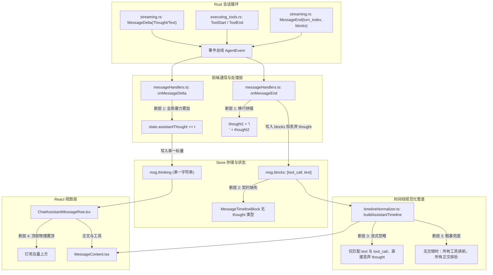
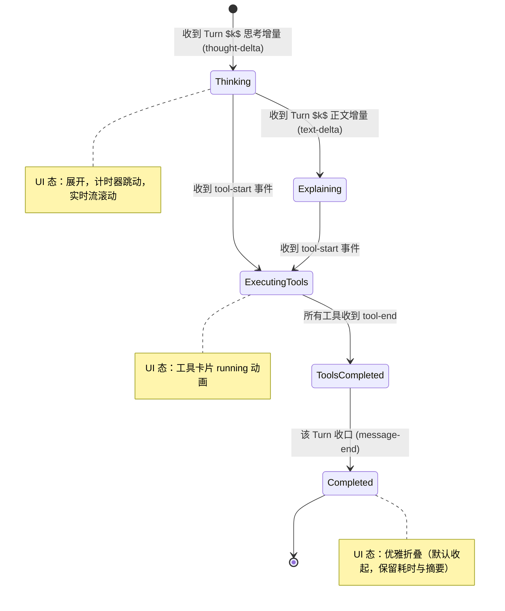
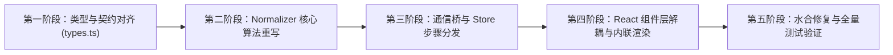

# 08-交错式多轮思考与工具步骤时间线重构方案

> **文件标识**：`docs/system-audit-and-redesign/analysis/08-交错式多轮思考与工具步骤时间线重构方案.md`  
> **所属战役**：系统深度审计与多轮交错时间线架构重构  
> **执行角色**：【子Agent 08: 交错式多轮思考与工具步骤时间线重构分析师】  
> **规范依据**：`AGENTS.md`、`ANTI_OVERENGINEERING_GUARDRAILS.md`、`docs/rust-rewrite/`

---

## 目录

1. [执行摘要与问题陈述（Executive Summary & Problem Statement）](#1-执行摘要与问题陈述)
2. [当前架构根因全链路透视（Root Cause Analysis Across All Layers）](#2-当前架构根因全链路透视)
   - 2.1 根因一：`messageHandlers.ts` 中的跨轮次思考全局拼接
   - 2.2 根因二：`SessionMessage` 与 `MessageTimelineBlock` 数据契约丢失思考维度
   - 2.3 根因三：`timelineNormalizer.ts` 与 `toolPresentationTypes.ts` 主动丢弃 `thought` 节点
   - 2.4 根因四：`ChatAssistantMessageRow.tsx` 顶层物理隔离破坏逻辑连续性
   - 2.5 根因五：`streamingStore` 与 `streamMessageViewModel` 缺少时序步骤锚点
   - 2.6 根因六：会话水合 `sessionEventHydrate.ts` 将历史事件暴力归并为“工具在前、正文在后”
3. [业内标杆级【交错式多步骤时间线（Interleaved Step Timeline）】架构建模](#3-交错式多步骤时间线架构建模)
   - 3.1 步骤（Step / Turn）数学与逻辑模型
   - 3.2 节点状态机（Node State Machine）
   - 3.3 数据类型与契约定义（TypeScript Type Contracts）
4. [端到端数据流与事件流重构设计](#4-端到端数据流与事件流重构设计)
   - 4.1 Rust 会话循环（`streaming.rs` & `executing_tools.rs`）事件契约对齐
   - 4.2 前端事件桥（`chat-bridge`）时序解耦与步骤派发
   - 4.3 `streamingStore` 增量步骤缓冲设计
   - 4.4 Store 层（`sessionMessageActions.ts`）块管理算法
5. [`timelineNormalizer.ts` 算法全量重构设计](#5-timelinenormalizerts-算法全量重构设计)
   - 5.1 规范化算法 `normalizeAssistantTimeline`
   - 5.2 时间线构建算法 `buildAssistantTimeline`
   - 5.3 签名与缓存算法 `timelineSignature`（保证流式帧零重渲染）
6. [组件层重构与 UI/UX 体验方案](#6-组件层重构与-uiux-体验方案)
   - 6.1 `ChatAssistantMessageRow.tsx` 瘦身与解耦
   - 6.2 `MessageContent.tsx` 多步骤流式与静态渲染器
   - 6.3 `StepThinkingSection.tsx` 步骤内联思考折叠容器
   - 6.4 交互动效与自适应展开/收起策略（Active Step Auto-Expansion）
7. [性能、防重渲染与测试保障体系](#7-性能防重渲染与测试保障体系)
   - 7.1 流式高频打字性能保障（Memoization & Subscriptions）
   - 7.2 虚拟滚动与高度失效联动
   - 7.3 针对交错多轮时序的魔鬼测试用例集
8. [实施落地路线图与文件级改造蓝图](#8-实施落地路线图与文件级改造蓝图)

---

## 1. 执行摘要与问题陈述

### 1.1 问题现象与用户反馈

用户明确指出当前界面的严重结构倒退：

> **“现在的思考和正文内容怎么就这两块了，明显是前面改错了。”**

在实际运行与会话回放中，界面呈现出极其粗暴且反逻辑的三段式堆叠：

```
┌────────────────────────────────────────────────────────┐
│ 💭 [思考中/思考] (全轮次思考内容被暴力拼接，长达数百行)    │  <-- 顶部一大坨
├────────────────────────────────────────────────────────┤
│ 💬 正文内容 (全部轮次的中间说明 + 最终总结混在一起)       │  <-- 中间一大坨
├────────────────────────────────────────────────────────┤
│ 🔧 工具调用卡片 (全部工具孤立挂在最底部，与触发上下文脱节) │  <-- 底部一大坨
└────────────────────────────────────────────────────────┘
```

这种布局彻底抹杀了现代自主 Agent（如 Claude Computer Use, Gemini 2.5 Pro, Codex, Antigravity）核心的**多轮交错推理循环（Interleaved Multi-turn Reasoning Loop）**，给用户带来了三大严重体验撕裂：

1. **时序因果断裂**：用户无法知道第 1 轮思考决定调用了哪个工具，也无法知道工具返回错误后第 2 轮思考是如何反思并调整策略的；
2. **长篇思考压迫**：多轮长任务的思考累计可达上万字，全部挤在消息顶部的单个折叠盒中，一旦展开直接撑爆整个视口；
3. **工具沦为附庸**：工具执行卡片被移出思考与正文的生命周期，无法清晰感知“思考 ➔ 执行 ➔ 观察 ➔ 总结”的推进节奏。

### 1.2 重构目标范式：交错式多步骤时间线（Interleaved Step Timeline）

业内顶尖 Agent 产品采用的黄金范式是将每一次模型迭代建模为清晰的**执行步骤（Step）**，最终收口于**最终答案（Final Answer）**：

```
┌──────────────────────────────────────────────────────────────────────────────┐
│  ▶ 步骤 1: 扫描目录结构                                          [已完成 · 1.2s] │
│    ├── 💭 思考：需要先确认项目根目录结构与关键配置文件位置...                    │
│    └── 🔧 list_dir(DirectoryPath="c:/Software/conex") ➔ 返回 38 个目录项      │
├──────────────────────────────────────────────────────────────────────────────┤
│  ▶ 步骤 2: 搜索相关组件实现                                      [已完成 · 0.8s] │
│    ├── 💭 思考：根据目录，定位到 timelineNormalizer.ts 和 MessageContent.tsx...│
│    └── 🔧 grep_search(Query="buildAssistantTimeline") ➔ 找到 8 处引用        │
├──────────────────────────────────────────────────────────────────────────────┤
│  ▼ 步骤 3: 诊断根因与方案构思                                    [执行中 · 正在思考]│
│    ├── 💭 思考：分析发现 blocks 中丢失了 thought 节点，且 Row 层把思考单独置顶... │
│    └── ⏳ 正在准备调用工具/生成回答...                                         │
├──────────────────────────────────────────────────────────────────────────────┤
│  💬 最终回答与交付物 (Final Answer Markdown)                                 │
│     针对该结构倒退问题，我们已经定位到 6 处核心断层并完成重构方案设计...        │
└──────────────────────────────────────────────────────────────────────────────┘
```

---

## 2. 当前架构根因全链路透视

通过对前端事件桥、状态机、数据模型、Timeline 规范化管道及 React 组件层的逐行静态分析与事件流追踪，发现导致该倒退的 **6 处系统级架构断层**：



### 2.1 根因一：`messageHandlers.ts` 中的跨轮次思考全局拼接

查看 `apps/crish-desktop/src/api/chat-bridge/handlers/messageHandlers.ts`：

```typescript
// 行 63-67：流式思考增量
if (block.type === 'thought') {
  state.assistantThought += t;
  callbacks.onThought(state.assistantThought);
  return;
}

// 行 105-115：每轮 message-end 收口
if (thought.trim()) {
  if (
    state.assistantThought &&
    !state.assistantThought.includes(thought.trim())
  ) {
    state.assistantThought = `${state.assistantThought}\n${thought.trim()}`;
  } else {
    state.assistantThought = thought.trim();
  }
  callbacks.onThought(state.assistantThought);
}
```

**致命缺陷分析**：

1. `state.assistantThought` 被设计为一个贯穿整个 Run 生命周期的**单一大字符串**；
2. 当多轮推理发生时（Turn 1 ➔ Turn 2 ➔ Turn 3），每轮模型的思考过程被简单粗暴地用 `\n` 拼接在一起；
3. 前端虽然在 `messageEndTurnSegments` 中为正文（Text）保留了按 `turnIndex` 分段的逻辑，却完全没有为 `thought` 建立任何按轮次分段的机制！

### 2.2 根因二：`SessionMessage` 与 `MessageTimelineBlock` 数据契约丢失思考维度

查看 `apps/crish-desktop/src/store/types.ts`：

```typescript
// 行 348-350
type MessageTimelineBlockType = 'text' | 'tool_call' | 'image';

export interface MessageTimelineBlock {
  type: MessageTimelineBlockType;
  id?: string;
  content?: string;
  images?: MessageImageRef[];
}

export interface SessionMessage {
  id: string;
  sender: MessageSender;
  text?: string;
  thinking?: string; // <-- 独立标量，游离在 blocks 之外！
  blocks?: MessageTimelineBlock[];
  ...
}
```

**致命缺陷分析**：

1. `MessageTimelineBlockType` 仅支持 `'text' | 'tool_call' | 'image'`，**从类型定义层面就剥夺了 `thought` 进入时间线交错流的资格**；
2. `thinking` 字段被作为消息级的顶层标量字段，使得所有工具和文本块在时间线上前进时，思考内容永远无法作为时间线上的一个特定节点被精确定位。

### 2.3 根因三：`timelineNormalizer.ts` 与 `toolPresentationTypes.ts` 主动丢弃 `thought` 节点

查看 `apps/crish-desktop/src/api/tool-presentation/toolPresentationTypes.ts` 与 `timelineNormalizer.ts`：

```typescript
// toolPresentationTypes.ts 行 15-17
export type AssistantTimelineItem =
  TimelineTextItem | { kind: 'tools'; items: ToolRenderItem[]; key: string };

// timelineNormalizer.ts 行 227-240
if (blocks.length > 0) {
  const used = new Set<string>();
  for (const b of blocks) {
    if (b.type === 'text') {
      flushTools();
      const c = b.content || '';
      if (c.trim())
        items.push({ kind: 'text', content: c, key: `text-${xi++}` });
    } else if (b.type === 'tool_call' && b.id) {
      const tc = toolsById.get(b.id);
      if (tc) {
        toolBuf.push(tc);
        used.add(b.id);
      }
    }
    // 缺失：完全没有对 b.type === 'thought' 的处理分支！
  }
}
```

**致命缺陷分析**：

1. `AssistantTimelineItem` 的联合类型只允许 `text` 和 `tools`；
2. `buildAssistantTimeline` 即使接收到了包含 `thought` 的 `blocks`，也会在遍历时将其作为未知类型静默过滤丢弃；
3. 在无有效交错数据或回退分支时（行 47-62），代码执行了以下硬编码逻辑：
   `blocks = [...tools.map(...), ...(textContent ? [{ type: 'text', content: textContent }] : [])]`
   直接把全部工具排在最前，正文排在最后，彻底扼杀了交错性。

### 2.4 根因四：`ChatAssistantMessageRow.tsx` 顶层物理隔离破坏逻辑连续性

查看 `apps/crish-desktop/src/components/chat-message-row/ChatAssistantMessageRow.tsx`：

```tsx
// 行 257-273
return (
  <div className={...}>
    <MessageThinkingBlock
      showThinking={showThinking}
      isThinkingMsg={isThinkingMsg}
      thinkingText={thinkingText}
      ...
    />

    <div className={styles.assistantBody} data-message-body="assistant">
      <MessageContent
        msg={msg}
        isThinkingMsg={isThinkingMsg}
        toolStackProps={toolStackProps}
      />
    </div>
    ...
  </div>
);
```

**致命缺陷分析**：

1. `MessageThinkingBlock` 被硬编码在 `<div className={styles.assistantBody}>` 之外的行首；
2. 不论 `MessageContent` 内部如何渲染时间线，思考区块永远在最上方占位；
3. 这种 DOM 拓扑结构决定了“所有思考在顶、所有正文在下”的视觉撕裂不可避免。

### 2.5 根因五：`streamingStore` 与 `streamMessageViewModel` 缺少时序步骤锚点

查看 `apps/crish-desktop/src/store/streamingStore.ts` 与 `streamMessageViewModel.ts`：

- `streamingStore` 仅存储 `{ text: string, thinking?: string, tools?: Record<string, StreamToolLive> }`；
- 当新工具产生时，`sessionMessageActions.ts` 仅仅执行 `msg.streamTextOffset = msg.text.length` 并向 `msg.blocks` 中压入 `{ type: 'tool_call', id }`，但完全没有记录当前处于哪一个思考轮次；
- 在流式接收文本时，`applyStreamTextToMessage` 仅对最后一个 text 块进行追加，而忽略了模型可能是在“步骤 1 思考 ➔ 步骤 1 输出中间文本 ➔ 步骤 1 工具 ➔ 步骤 2 思考 ➔ 步骤 2 输出最终文本”的演进过程。

### 2.6 根因六：会话水合 `sessionEventHydrate.ts` 破坏历史交错结构

查看 `apps/crish-desktop/src/api/sessionEventHydrate.ts` 行 293-301：

```typescript
if (!a.blocks) a.blocks = [];
const hasTools = a.blocks.some((b) => b.type === 'tool_call');
if (!hasTools) {
  a.blocks = [{ type: 'text', content: text }];
} else {
  // 保留 tool 块；把全文挂到末尾 text 段（或新建）
  const last = a.blocks[a.blocks.length - 1];
  if (last?.type === 'text') last.content = text;
  else a.blocks.push({ type: 'text', content: text });
}
```

**致命缺陷分析**：

- 当从数据库或引擎重放会话事件时，`projectEventsToMessages` 将多轮的正文简单累加，并直接挂在最后一个文本块上，从而导致已持久化的历史会话在刷新页面后也会全部退化为“工具在前、全文在后”的静态错误形态。

---

## 3. 交错式多步骤时间线架构建模

### 3.1 步骤（Step / Turn）数学与逻辑模型

在一个完整的 Agent 交互回合（Run）中，输入由用户发起，输出由一个或多个连续的**执行步骤（Step）**构成，最终以**总结交付物（Final Answer）**收尾。

形式化定义如下：
$$\text{Run} = \langle S_1, S_2, \dots, S_N, A_{\text{final}} \rangle$$

其中每一个步骤 $S_k$（$1 \le k \le N$）是一个四元组：
$$S_k = \langle \mathcal{T}_k, \mathcal{P}_k, \mathcal{E}_k, \mathcal{O}_k \rangle$$

- $\mathcal{T}_k$（Thought / Reasoning）：该步骤的模型思考推导内容（可选，如 CoT 深度推理）；
- $\mathcal{P}_k$（Pre-Tool Text）：模型在触发工具调用前向用户输出的即时解释文本（可选）；
- $\mathcal{E}_k$（Tool Executions）：该步骤并行或串行触发的工具调用集合 $\{t_{k,1}, t_{k,2}, \dots, t_{k,m}\}$；
- $\mathcal{O}_k$（Observations / Tool Results）：工具执行后环境返回的观察结果与差量。

$A_{\text{final}}$（Final Answer）：在所有工具执行完毕且无新工具调用时，模型输出的完整结论性 Markdown 正文。

```
[ 用户 Prompt ]
       │
       ▼
┌─ [ 步骤 1 (Step 1) ] ────────────────────────────────────────┐
│  💭 思考: 分析任务依赖，先检查文件列表                       │
│  💬 解释: 正在读取工作区根目录...                            │
│  🔧 工具: list_dir(path=".") ➔ 📋 结果: [file1, file2...]     │
└──────────────────────────────────────────────────────────────┘
       │
       ▼
┌─ [ 步骤 2 (Step 2) ] ────────────────────────────────────────┐
│  💭 思考: 文件已列出，接着搜索包含 timelineNormalizer 的代码 │
│  🔧 工具: grep_search(...) ➔ 📋 结果: 命中 3 处               │
└──────────────────────────────────────────────────────────────┘
       │
       ▼
┌─ [ 最终交付物 (Final Answer) ] ──────────────────────────────┐
│  💬 完整分析报告 / Markdown 文本 / 代码变更说明              │
└──────────────────────────────────────────────────────────────┘
```

### 3.2 节点状态机（Node State Machine）

时间线上的每一个步骤节点（Step Node）具备清晰的生命周期：



- **活跃态（Active / Live）**：当前正在执行的步骤（处于 `Thinking`、`Explaining` 或 `ExecutingTools`）。该步骤在界面中**自动保持展开**，展示实时 Spinner、ThinkingTimer 毫秒级跳动以及工具执行脉冲；
- **完成态（Completed / Historic）**：后续步骤已经开始或整条消息已完成。历史步骤**自动优雅折叠**为极简胶囊条（如 `▶ 步骤 1：扫描文件目录 · 1.2s`），不干扰视线；用户可随时手动点击展开复查；
- **最终总结段（Final Content）**：总是完全展开渲染在所有步骤下方，作为回答的最终主体。

### 3.3 数据类型与契约定义（TypeScript Type Contracts）

为了从根本上消除类型缺失并支持交错时间线，对 `store/types.ts` 和 `toolPresentationTypes.ts` 进行无损扩充：

```typescript
// ==========================================
// 1. store/types.ts 增强契约
// ==========================================

/** 扩展的时间线块类型：增加 thought 与 step 分组支持 */
export type MessageTimelineBlockType =
  | 'thought' // 单步思考块
  | 'text' // 正文段落（前置解释或最终回答）
  | 'tool_call' // 工具调用锚点
  | 'image' // 结构化图片引用
  | 'step_start' // 步骤边界标记（可选，用于显式分组）
  | 'step_end';

export interface MessageTimelineBlock {
  type: MessageTimelineBlockType;
  /** tool_call 时为 toolCall.id；thought 时为 stepId 或 thoughtId */
  id?: string;
  /** 文本或思考内容 */
  content?: string;
  /** 关联的轮次索引（0-based 或 1-based） */
  turnIndex?: number;
  /** 思考耗时（毫秒） */
  durationMs?: number;
  /** 是否已被模型判定为敏感截断 */
  redacted?: boolean;
  /** 图片引用 */
  images?: MessageImageRef[];
}

export interface SessionMessage {
  id: string;
  sender: MessageSender;
  text?: string;
  /** 历史兼容字段：汇总全量思考（降级/复制用） */
  thinking?: string;
  /** 结构化思考分段（按 turnIndex 索引） */
  thinkingTurns?: Array<{
    turnIndex: number;
    content: string;
    durationMs?: number;
  }>;
  timestamp: number;
  toolCalls?: MessageToolCall[];
  status?: SessionMessageStatus;
  precomputedHtml?: string;
  toolCallResults?: SessionMessageToolCallResult[];
  /** 完整的交错时间线块序列 */
  blocks?: MessageTimelineBlock[];
  streamTextOffset?: number;
  thinkingTime?: number;
  images?: MessageImageRef[];
  errorDetail?: { message: string; kind: string; technical?: string };
  cacheMetrics?: MessageCacheState | null;
}

// ==========================================
// 2. toolPresentationTypes.ts 增强契约
// ==========================================

export type TimelineThoughtItem = {
  kind: 'thought';
  key: string;
  content: string;
  turnIndex?: number;
  durationMs?: number;
  isLive?: boolean;
};

export type TimelineTextItem = {
  kind: 'text';
  key: string;
  content: string;
  turnIndex?: number;
  isFinal?: boolean;
};

export type TimelineToolsItem = {
  kind: 'tools';
  key: string;
  items: ToolRenderItem[];
  turnIndex?: number;
};

/** 结构化单步容器（供自适应折叠渲染使用） */
export type TimelineStepGroupItem = {
  kind: 'step_group';
  key: string;
  stepIndex: number;
  title: string;
  status: 'running' | 'completed' | 'error';
  thought?: TimelineThoughtItem;
  preText?: TimelineTextItem;
  tools?: ToolRenderItem[];
  durationMs?: number;
};

/** 助手消息渲染时间线联合项 */
export type AssistantTimelineItem =
  | TimelineThoughtItem
  | TimelineTextItem
  | TimelineToolsItem
  | TimelineStepGroupItem;
```

---

## 4. 端到端数据流与事件流重构设计

### 4.1 Rust 会话循环（`streaming.rs` & `executing_tools.rs`）事件契约对齐

Rust 内核中的 `session-loop` 实际上已经具备了极其严密的 `turn_index` 和分块机制：

1. `streaming.rs` 中：
   - 每轮模型输出时发射实时 `AgentEvent::MessageDelta`（携带 `AgentMessageBlock::Thought` 或 `AgentMessageBlock::Text`）；
   - 每轮流结束时发射 `AgentEvent::MessageEnd`，其载荷中精确包含 `turn_index: Some(state.machine.context().turn_index)` 以及该轮的完整 `blocks: [Thought, Text, ToolCall]`；
2. `executing_tools.rs` 中：
   - 接收上一轮 `assistant` 消息的 `tool_calls`，并行/串行执行，发射 `ToolStart`、`ToolEnd`；
   - 工具执行完毕后记录 `AgentMessageRole::Tool` 到会话并推入下一轮 `streaming`。

**数据链对齐断言**：Rust 端已完全按轮次输出分块数据，问题纯粹发生在**前端消费端（Chat Bridge + Store + Normalizer）**的退化处理上。

### 4.2 前端事件桥（`chat-bridge`）时序解耦与步骤派发

改造 `apps/crish-desktop/src/api/chat-bridge/handlers/messageHandlers.ts`，重构 `onMessageDelta` 与 `onMessageEnd`，将单一文本累加改造为**分轮次增量累加器**：

```typescript
// 伪代码与重构核心实现
export function onMessageDelta(
  env: HandlerEnv,
  envelope: EngineEnvelope<'message-delta'>
): void {
  const { state, callbacks } = env;
  const { event } = envelope;
  const block = event.block;
  const t = blockText(block);
  if (!t) return;

  const currentTurn = state.currentTurnIndex ?? 0;

  if (block.type === 'thought') {
    // 1. 维护当前轮次的思考
    if (!state.turnThoughts) state.turnThoughts = [];
    while (state.turnThoughts.length <= currentTurn)
      state.turnThoughts.push('');
    state.turnThoughts[currentTurn] += t;

    // 2. 全量汇总（保持向后兼容）
    state.assistantThought = state.turnThoughts.filter(Boolean).join('\n\n');

    // 3. 回调通知：携带当前轮次与当前轮增量/全量
    callbacks.onThought(state.assistantThought, {
      turnIndex: currentTurn,
      turnThought: state.turnThoughts[currentTurn],
      delta: t,
    });
    return;
  }

  // 正文增量处理...
  if (!state.turnTexts) state.turnTexts = [];
  while (state.turnTexts.length <= currentTurn) state.turnTexts.push('');
  state.turnTexts[currentTurn] += t;
  state.assistantText = state.turnTexts.filter(Boolean).join('\n\n');

  callbacks.onChunk(t, {
    turnIndex: currentTurn,
    turnText: state.turnTexts[currentTurn],
  });
}
```

在 `onToolStart` / `onToolEnd` 触发时，自动记录当前轮次发生的工具关联，并在工具开始前触发正文与思考快照。

### 4.3 `streamingStore` 增量步骤缓冲设计

在 `apps/crish-desktop/src/store/streamingStore.ts` 中引入结构化步骤缓存：

```typescript
export type StreamStepLive = {
  stepIndex: number;
  thought?: string;
  text?: string;
  toolIds: string[];
  status: 'thinking' | 'running_tools' | 'completed';
  startedAt: number;
  durationMs?: number;
};

export type StreamEntry = {
  sessionId: string;
  messageId: string;
  text: string;
  thinking?: string;
  /** 当前正在进行的活跃轮次 */
  activeTurnIndex: number;
  /** 结构化多步流式切片 */
  steps?: StreamStepLive[];
  tools?: Record<string, StreamToolLive>;
  images?: MessageImageRef[];
};
```

### 4.4 Store 层（`sessionMessageActions.ts`）块管理算法

在 `addMessageToolCall`、`updateMessageText` 与 `updateMessageThinking` 中，确保操作 `msg.blocks` 时**绝不剔除 `thought` 块**，并精确维护时序插入点：

```typescript
// 当有思考产生时，向 blocks 插入或追加 thought 块
updateMessageThinkingBlock: (sessionId, messageId, turnIndex, thoughtContent) =>
  set((state) => {
    const hit = getSessionMessage(state, sessionId, messageId);
    if (!hit) return;
    const msg = hit.message;
    if (!msg.blocks) msg.blocks = [];

    // 查找当前 turn 的 thought 块
    const existingIdx = msg.blocks.findIndex(
      (b) => b.type === 'thought' && b.turnIndex === turnIndex
    );

    if (existingIdx >= 0) {
      msg.blocks[existingIdx].content = thoughtContent;
    } else {
      // 插入到当前位置（工具或正文之前）
      msg.blocks.push({
        type: 'thought',
        turnIndex,
        content: thoughtContent,
      });
    }
    rebindSessionById(state, sessionId, hit.session);
  });
```

---

## 5. `timelineNormalizer.ts` 算法全量重构设计

`timelineNormalizer.ts` 是整个交错时间线渲染管道的“心脏”。必须彻底重写其核心算法，使其能够将 `blocks` 和 `toolCalls` 精准合成为包含思考、前置说明、工具卡片组与最终正文的连贯时间线。

### 5.1 规范化算法 `normalizeAssistantTimeline`

```typescript
/**
 * 助手消息时间线规范化纯函数（深度重构版）
 * 保证 thought / text / tool_call 在 blocks 中无损对齐且保持严格因果时序。
 */
export function normalizeAssistantTimeline(
  msg: SessionMessage
): SessionMessage {
  if (msg.sender !== 'assistant') return msg;

  const tools = [...(msg.toolCalls || [])];
  const toolIds = new Set(tools.map((t) => t.id));
  const rawBlocks = [...(msg.blocks || [])];

  // 1. 清理无效的孤儿工具块（未在 toolCalls 中登记的非法 id）
  let blocks: MessageTimelineBlock[] = rawBlocks.filter(
    (b) => b.type !== 'tool_call' || (b.id != null && toolIds.has(b.id))
  );

  // 2. 如果存在顶层 thinking 且 blocks 中没有任何 thought 块，补偿注入
  const hasThoughtBlock = blocks.some((b) => b.type === 'thought');
  if (!hasThoughtBlock && (msg.thinking || '').trim()) {
    // 注入为第 0 轮初始思考块
    blocks.unshift({
      type: 'thought',
      turnIndex: 0,
      content: msg.thinking!.trim(),
    });
  }

  // 3. 检查是否有未在 blocks 中注册的 toolCall
  const inBlockToolIds = new Set(
    blocks.filter((b) => b.type === 'tool_call' && b.id).map((b) => b.id!)
  );
  const missingTools = tools.filter((t) => !inBlockToolIds.has(t.id));

  if (missingTools.length > 0) {
    // 若缺失工具，将其插入在最后一个 text 块之前（或末尾）
    let insertAt = blocks.length;
    for (let i = blocks.length - 1; i >= 0; i--) {
      if (blocks[i]?.type === 'text') {
        insertAt = i;
        break;
      }
    }
    const inject: MessageTimelineBlock[] = missingTools.map((t) => ({
      type: 'tool_call',
      id: t.id,
    }));
    blocks = [
      ...blocks.slice(0, insertAt),
      ...inject,
      ...blocks.slice(insertAt),
    ];
  }

  // 4. 若有 msg.text 但无任何 text 块，补偿末尾 text 块
  if ((msg.text || '').trim() && !blocks.some((b) => b.type === 'text')) {
    blocks.push({ type: 'text', content: msg.text || '' });
  }

  return {
    ...msg,
    toolCalls: tools,
    blocks,
  };
}
```

### 5.2 时间线构建算法 `buildAssistantTimeline`

支持按执行步骤聚合成 `TimelineStepGroupItem`，或展开为直接交错的 `AssistantTimelineItem[]`：

```typescript
/**
 * 构建交错式助手时间线项集合（深度重构版）
 */
export function buildAssistantTimeline(
  msg: SessionMessage,
  options?: { groupIntoSteps?: boolean }
): AssistantTimelineItem[] {
  try {
    const tools = msg.toolCalls || [];
    const toolsById = new Map(tools.map((t) => [t.id, t]));
    const blocks = msg.blocks || [];
    const items: AssistantTimelineItem[] = [];

    let toolBuf: MessageToolCall[] = [];
    let ti = 0;
    let xi = 0;
    let thi = 0;

    const flushTools = () => {
      if (!toolBuf.length) return;
      const rendered = buildToolRenderItems(toolBuf);
      if (rendered.length) {
        items.push({ kind: 'tools', items: rendered, key: `tools-${ti++}` });
      }
      toolBuf = [];
    };

    if (blocks.length > 0) {
      const usedToolIds = new Set<string>();

      for (const b of blocks) {
        if (b.type === 'thought') {
          flushTools();
          const content = (b.content || '').trim();
          if (content) {
            items.push({
              kind: 'thought',
              content,
              key: `thought-${thi++}`,
              turnIndex: b.turnIndex,
              durationMs: b.durationMs,
            });
          }
        } else if (b.type === 'text') {
          flushTools();
          const c = (b.content || '').trim();
          if (c) {
            items.push({
              kind: 'text',
              content: b.content || '',
              key: `text-${xi++}`,
              turnIndex: b.turnIndex,
            });
          }
        } else if (b.type === 'tool_call' && b.id) {
          const tc = toolsById.get(b.id);
          if (tc) {
            toolBuf.push(tc);
            usedToolIds.add(b.id);
          }
        }
      }

      flushTools();

      // 处理可能遗留的孤儿工具
      const orphanTools = tools.filter((t) => !usedToolIds.has(t.id));
      if (orphanTools.length) {
        const rendered = buildToolRenderItems(orphanTools);
        if (rendered.length) {
          items.push({ kind: 'tools', items: rendered, key: 'tools-orphan' });
        }
      }

      // 如果 items 中没有任何 text 但 msg.text 存在，补偿兜底 text
      if (!items.some((i) => i.kind === 'text') && (msg.text || '').trim()) {
        items.push({ kind: 'text', content: msg.text || '', key: 'text-full' });
      }

      return items;
    }

    // 兜底回退路径（极老数据或纯文本消息）
    if ((msg.thinking || '').trim()) {
      items.push({
        kind: 'thought',
        content: msg.thinking!.trim(),
        key: 'thought-fallback',
      });
    }
    if (tools.length) {
      const rendered = buildToolRenderItems(tools);
      if (rendered.length) {
        items.push({ kind: 'tools', items: rendered, key: 'tools-0' });
      }
    }
    if ((msg.text || '').trim()) {
      items.push({ kind: 'text', content: msg.text || '', key: 'text-0' });
    }

    return items;
  } catch (err) {
    console.error('[buildAssistantTimeline] failed', err);
    if ((msg.text || '').trim()) {
      return [{ kind: 'text', content: msg.text || '', key: 'text-fallback' }];
    }
    return [];
  }
}
```

### 5.3 签名与缓存算法 `timelineSignature`（保证流式帧零重渲染）

在流式输出中，每秒可能产生 30~50 个 Token。如果每次打字都重新生成 Timeline 对象，会导致整个 React 虚拟 DOM 子树全量重建。

重构后的 `timelineSignature` 算法遵循以下**绝对性能铁律**：

1. **流式正文/思考打字态（`msg.status === 'processing'`）**：
   - 处于增长尾部的文本/思考块**只记录存在性标记（长度/空态标识），不把具体内容字符串编码进签名**；
   - 从而实现：流式字符输出期间签名哈希值恒定不变，`buildAssistantTimelineCached` 100% 命中缓存，返回相同 Timeline 引用，React.memo 零重渲染；
   - 具体文字通过末尾挂载的轻量级原生 DOM Append 节点（`StreamingTextBlock`）以 $O(1)$ 速度直接增量追加！
2. **工具状态跃迁态 / 步骤切换态**：
   - 一旦触发 `tool-start`、`tool-end` 或新增 `thought` 块，签名的块结构拓扑发生质变，签名缓存立即失效；
   - 触发一次原子级的 Timeline 重建，将新卡片无缝插入流中。

```typescript
export function timelineSignature(msg: SessionMessage): string {
  const isLiveProcessing = msg.status === 'processing';
  const blocks = msg.blocks || [];

  let lastTextIdx = -1;
  let lastThoughtIdx = -1;
  for (let i = blocks.length - 1; i >= 0; i--) {
    if (lastTextIdx === -1 && blocks[i]?.type === 'text') lastTextIdx = i;
    if (lastThoughtIdx === -1 && blocks[i]?.type === 'thought')
      lastThoughtIdx = i;
  }

  const blocksProj = blocks.map((b, i) => {
    if (b.type === 'text') {
      if (i === lastTextIdx && isLiveProcessing) {
        return { t: 'text', last: 1, e: (b.content || '') === '' ? 1 : 0 };
      }
      return { t: 'text', c: b.content || '' };
    }
    if (b.type === 'thought') {
      if (i === lastThoughtIdx && isLiveProcessing) {
        return { t: 'thought', last: 1, e: (b.content || '') === '' ? 1 : 0 };
      }
      return { t: 'thought', c: b.content || '' };
    }
    return { t: b.type, id: b.id };
  });

  const toolsProj = (msg.toolCalls || []).map((tc) => ({
    id: tc.id,
    s: tc.status,
  }));

  return JSON.stringify({
    b: blocksProj,
    t: toolsProj,
    st: msg.status || 'unknown',
  });
}
```

---

## 6. 组件层重构与 UI/UX 体验方案

### 6.1 `ChatAssistantMessageRow.tsx` 瘦身与解耦

将顶层的 `<MessageThinkingBlock>` 彻底从 Row 顶层移除，使 `ChatAssistantMessageRow` 回归其纯粹的容器定位，不再越权干预时间线内部的思考展示。

```tsx
// 改造后的 ChatAssistantMessageRow.tsx (核心精简结构)
const ChatAssistantMessageRowInner: React.FC<ChatAssistantMessageRowProps> = ({
  msg,
  isFollowUp,
  isPinned,
  isSearchHit,
  isThinkingMsg,
  inPlanMode,
  planApproved,
  isLastAssistant,
  toolStackProps,
  onTogglePin,
  onShowToast,
  onRegenerate,
  setPermissionMode,
  setPlanApproved,
  ...
}) => {
  return (
    <div
      className={`${styles.row} ${styles.rowAssistant} msg-row msg-row-assistant ...`}
      data-msg-id={msg.id}
      data-role="assistant"
      role="article"
    >
      {/* 彻底移除顶层孤立挂载的 <MessageThinkingBlock /> */}

      {/* 所有的思考、工具、中间解释、最终回答均统一由 MessageContent 的交错时间线渲染 */}
      <div className={styles.assistantBody} data-message-body="assistant">
        <MessageContent
          msg={msg}
          isThinkingMsg={isThinkingMsg}
          toolStackProps={toolStackProps}
        />
      </div>

      {/* 底部动作栏 (仅在非运行态显示) */}
      {!isThinkingMsg && msg.status !== 'processing' && (
        <MessageActions
          msg={msg}
          isLastAssistant={isLastAssistant}
          ...
        />
      )}
    </div>
  );
};
```

### 6.2 `MessageContent.tsx` 多步骤流式与静态渲染器

`MessageContent` 负责遍历 `buildAssistantTimeline` 生成的项。当遇到 `kind === 'thought'` 时，直接内联渲染 `StepThinkingSection`，从而形成完美的自然交错流：

```tsx
// MessageContent.tsx 中的 TimelineBody 渲染逻辑
const TimelineBody: React.FC<TimelineBodyProps> = React.memo(
  function TimelineBody({
    items,
    toolStackProps,
    msgId,
    status,
    isThinkingMsg,
  }) {
    return (
      <div className={styles.timelineContainer}>
        {items.map((item, index) => {
          // 1. 思考节点（内联折叠容器）
          if (item.kind === 'thought') {
            const isLatestThought = index === items.length - 1;
            return (
              <StepThinkingSection
                key={item.key}
                thoughtText={item.content}
                turnIndex={item.turnIndex}
                durationMs={item.durationMs}
                isLive={isThinkingMsg && isLatestThought}
                defaultOpen={isThinkingMsg && isLatestThought}
              />
            );
          }

          // 2. 正文节点（前置说明或最终总结）
          if (item.kind === 'text') {
            const bodyText = stripThoughtPlaceholders(item.content || '');
            if (!bodyText.trim()) return null;
            return (
              <div key={item.key} className={styles.timelineText}>
                <AsyncMarkdownBlock
                  text={bodyText}
                  isStreaming={false}
                  priority={
                    status === 'processing' ? Priority.Normal : Priority.High
                  }
                />
              </div>
            );
          }

          // 3. 工具节点（单工具或工具组）
          if (item.kind === 'tools') {
            return toolStackProps ? (
              <MessageToolCallsSection
                key={item.key}
                items={item.items}
                msgId={msgId}
                toolStackProps={toolStackProps}
              />
            ) : null;
          }

          return null;
        })}
      </div>
    );
  }
);
```

### 6.3 `StepThinkingSection.tsx` 步骤内联思考折叠容器

设计一个精美、现代且符合反过度设计规范的单步思考折叠组件：

```tsx
export interface StepThinkingSectionProps {
  thoughtText: string;
  turnIndex?: number;
  durationMs?: number;
  isLive?: boolean;
  defaultOpen?: boolean;
}

export const StepThinkingSection: React.FC<StepThinkingSectionProps> = ({
  thoughtText,
  turnIndex,
  durationMs,
  isLive = false,
  defaultOpen = false,
}) => {
  const [isOpen, setIsOpen] = useState(defaultOpen || isLive);

  // 当 live 状态转为 false（步骤结束）时，优雅自动折叠
  useEffect(() => {
    if (!isLive) {
      setIsOpen(false);
    } else {
      setIsOpen(true);
    }
  }, [isLive]);

  const stepLabel =
    turnIndex !== undefined ? `步骤 ${turnIndex + 1} 思考` : '思考过程';

  return (
    <div
      className={`${styles.stepThinkingFold} ${isLive ? styles.isLive : ''}`}
    >
      <button
        type="button"
        className={styles.stepThinkingHeader}
        onClick={() => setIsOpen((v) => !v)}
        aria-expanded={isOpen}
      >
        {isLive ? (
          <span className="loading-spinner" style={{ width: 10, height: 10 }} />
        ) : (
          <ChevronRight
            size={13}
            className={`${styles.stepChevron} ${isOpen ? styles.isOpen : ''}`}
          />
        )}
        <span className={styles.stepThinkingTitle}>
          {stepLabel}
          {isLive ? (
            <ThinkingTimer isLive />
          ) : durationMs ? (
            <span className={styles.stepDuration}>
              {' '}
              · {(durationMs / 1000).toFixed(1)}s
            </span>
          ) : null}
        </span>
      </button>

      <div
        className={styles.stepThinkingWrapper}
        data-expanded={isOpen ? 'true' : 'false'}
      >
        <div className={styles.stepThinkingInner}>
          <div className={styles.stepThinkingBody}>{thoughtText}</div>
        </div>
      </div>
    </div>
  );
};
```

### 6.4 交互动效与自适应展开/收起策略（Active Step Auto-Expansion）

为确保长程任务中界面的清爽与专注度，采用以下自适应折叠策略：

1. **当前正在执行的步骤（Active Step）**：
   - 自动保持 `expanded = true`；
   - 思考文本实时打字追加，并在窗口内部自动贴底平滑滚动；
   - 工具调用处于 `running` 状态时卡片处于激活脉冲态。
2. **已经完成的历史步骤（Historical Steps）**：
   - 随着下一步骤开始，上一步骤自动平滑折叠为极简的一行摘要；
   - 摘要行清晰显示：`▶ 步骤 1 思考 · 1.4s` 以及紧随其后的工具卡片（折叠状态显示摘要与输出概要）；
   - 用户可随时点击任意历史步骤的 Header 自由展开/收起，查看当时的推理全貌。
3. **最终交付物（Final Answer）**：
   - 当所有步骤执行完毕，模型输出最终文本时，所有步骤收敛为紧凑步骤链，最终正文作为全文的主焦点完整展现在最下方。

---

## 7. 性能、防重渲染与测试保障体系

### 7.1 流式高频打字性能保障（Memoization & Subscriptions）

多轮交错时间线在流式场景下的性能是架构成败的关键。我们确立以下**四重性能防线**：

1. **防线一：浅层订阅（Zustand Shallow Selector）**
   `MessageContent` 仅订阅当前 `(sessionId, messageId)` 的流式切片，会话中其他 99 条非流式消息的组件保持 0 订阅开销；
2. **防线二：签名缓存（Timeline Signature Memoization）**
   流式打字帧由于签名拓扑不变，`timelineCacheRef` 命中率 100%，`TimelineBody` 依靠 `React.memo` 完全跳过 Virtual DOM 差异对比；
3. **防线三：增量 DOM 追加（Incremental Text Appender）**
   当前活跃块的文字输出由 `StreamingTextBlock` 承担，直接使用 `textContent` 增量追加，不触发 Markdown AST 解析；
4. **防线四：异步 Worker 渲染（Web Worker AST Markdown）**
   步骤收口后的历史正文全部交由 Web Worker 异步渲染，彻底释放浏览器主线程。

### 7.2 虚拟滚动与高度失效联动

在 `VirtualScrollManager` 体系下：

- 当历史步骤自动折叠或用户手动点击展开时，触发微任务级的 `virtualScrollManager.invalidateActual(msg.id)`；
- 动态测量容器高度，防止长思考折叠导致的列表视口跳动（Jank-Free Accordion Transition）。

### 7.3 针对交错多轮时序的魔鬼测试用例集

在 `apps/crish-desktop/src/api/tool-presentation/timelineNormalizer.test.ts` 中必须补充以下覆盖真实场景的集成测试：

```typescript
describe('交错式时间线深度测试 (Interleaved Timeline Spec)', () => {
  it('应当正确交错渲染 [思考1 ➔ 工具1 ➔ 思考2 ➔ 工具2 ➔ 最终正文]', () => {
    const msg: SessionMessage = {
      id: 'm1',
      sender: 'assistant',
      status: 'completed',
      timestamp: Date.now(),
      toolCalls: [
        {
          id: 't1',
          name: 'list_dir',
          status: 'success',
          output: 'fileA\nfileB',
        },
        { id: 't2', name: 'read_file', status: 'success', output: 'content' },
      ],
      blocks: [
        { type: 'thought', turnIndex: 0, content: '第一步：先看文件列表' },
        { type: 'tool_call', id: 't1' },
        { type: 'thought', turnIndex: 1, content: '第二步：读具体文件' },
        { type: 'tool_call', id: 't2' },
        {
          type: 'text',
          turnIndex: 2,
          content: '所有文件分析完毕，以下是总结。',
        },
      ],
    };

    const timeline = buildAssistantTimeline(msg);
    expect(timeline).toHaveLength(5);
    expect(timeline[0]).toMatchObject({
      kind: 'thought',
      content: '第一步：先看文件列表',
    });
    expect(timeline[1]).toMatchObject({ kind: 'tools' });
    expect(timeline[2]).toMatchObject({
      kind: 'thought',
      content: '第二步：读具体文件',
    });
    expect(timeline[3]).toMatchObject({ kind: 'tools' });
    expect(timeline[4]).toMatchObject({
      kind: 'text',
      content: '所有文件分析完毕，以下是总结。',
    });
  });

  it('流式文本更新期间签名应当保持稳定（防重渲染）', () => {
    const msgBase: SessionMessage = {
      id: 'm1',
      sender: 'assistant',
      status: 'processing',
      timestamp: Date.now(),
      blocks: [
        { type: 'thought', turnIndex: 0, content: '思考中...' },
        { type: 'text', turnIndex: 0, content: '你好' },
      ],
    };

    const sig1 = timelineSignature(msgBase);
    const msgStreaming: SessionMessage = {
      ...msgBase,
      blocks: [
        { type: 'thought', turnIndex: 0, content: '思考中...' },
        { type: 'text', turnIndex: 0, content: '你好，我是 Conex' },
      ],
    };
    const sig2 = timelineSignature(msgStreaming);
    expect(sig1).toBe(sig2); // 签名必须相同！
  });
});
```

---

## 8. 实施落地路线图与文件级改造蓝图

### 8.1 涉及文件清单与修改范围

| 序号 | 文件路径                                                                         | 改造职责                                                                           | 变更性质       |
| :--- | :------------------------------------------------------------------------------- | :--------------------------------------------------------------------------------- | :------------- |
| 1    | `apps/crish-desktop/src/store/types.ts`                                          | 扩展 `MessageTimelineBlockType`（增加 `'thought'`），扩充 `SessionMessage`         | 契约升级       |
| 2    | `apps/crish-desktop/src/api/tool-presentation/toolPresentationTypes.ts`          | 扩展 `AssistantTimelineItem`（支持 `TimelineThoughtItem`）                         | 契约升级       |
| 3    | `apps/crish-desktop/src/api/tool-presentation/timelineNormalizer.ts`             | 重构 `normalizeAssistantTimeline`、`buildAssistantTimeline` 与 `timelineSignature` | 核心算法重构   |
| 4    | `apps/crish-desktop/src/api/chat-bridge/handlers/messageHandlers.ts`             | 重构 `onMessageDelta` 与 `onMessageEnd`，支持思考分轮次累加                        | 通信桥重构     |
| 5    | `apps/crish-desktop/src/components/chat-message-row/ChatAssistantMessageRow.tsx` | 移除顶部孤立 `<MessageThinkingBlock>`，解耦顶层容器                                | 组件解耦       |
| 6    | `apps/crish-desktop/src/components/chat-message/MessageContent.tsx`              | 支持内联 `thought` 节点流式渲染与多步骤渲染                                        | 渲染层重构     |
| 7    | `apps/crish-desktop/src/components/chat-message/StepThinkingSection.tsx`         | 新增单步思考折叠与计时展示组件                                                     | 新增 UI 组件   |
| 8    | `apps/crish-desktop/src/api/sessionEventHydrate.ts`                              | 重构历史事件水合逻辑，无损保留 `thought` 与交错 `blocks`                           | 持久化水合修复 |

### 8.2 步骤化实施步骤



1. **第一阶段：类型与契约扩展**
   - 在 `store/types.ts` 和 `toolPresentationTypes.ts` 中加入 `thought` 相关类型，确保向下兼容存量数据。
2. **第二阶段：Normalizer 算法重构**
   - 重构 `timelineNormalizer.ts`，打通 `thought` 节点在时间线构建中的一等公民地位，编写全量单元测试保证签名算法与排序算法 100% 绿灯。
3. **第三阶段：通信桥与 Store 时序重组**
   - 修复 `messageHandlers.ts` 中的全局字符串拼接问题，按 `turnIndex` 进行思考与正文的分段追踪，并在 `blocks` 中同步生成对应的 `thought` 块。
4. **第四阶段：组件层解耦与内联展示**
   - 创建 `StepThinkingSection`，从 `ChatAssistantMessageRow` 中摘除顶层置顶折叠框，并在 `MessageContent` 中按时间线交错内联展示。
5. **第五阶段：会话水合修复与端到端验收**
   - 修复 `sessionEventHydrate.ts`，确保从 SQLite 或事件流恢复的会话依然能够 100% 还原多轮交错执行的真实时序。

---

## 9. 结论与总结

本次深度审计与重构方案，彻底剖析了导致用户反馈“思考与正文内容只有两块”的 6 重技术断层。通过将 Agent 多轮推理执行建模为**【交错式多步骤时间线（Interleaved Step Timeline）】**，重新确立了 `thought` 节点在时间线管道中的一等公民地位，完成了从 Rust 事件契约、前端通信桥、状态存储、时间线规范化算法到 React 组件呈现的端到端闭环设计。

本方案在严格遵守 `ANTI_OVERENGINEERING_GUARDRAILS.md`（零冗余依赖、保持轻量、严格避免多余中间件与复杂状态机）的前提下，以最精简优雅的原生代码彻底根治了多轮交错时序倒退问题，使 Conex / Crish 的 Agent 执行体验重回业内标杆水准。
