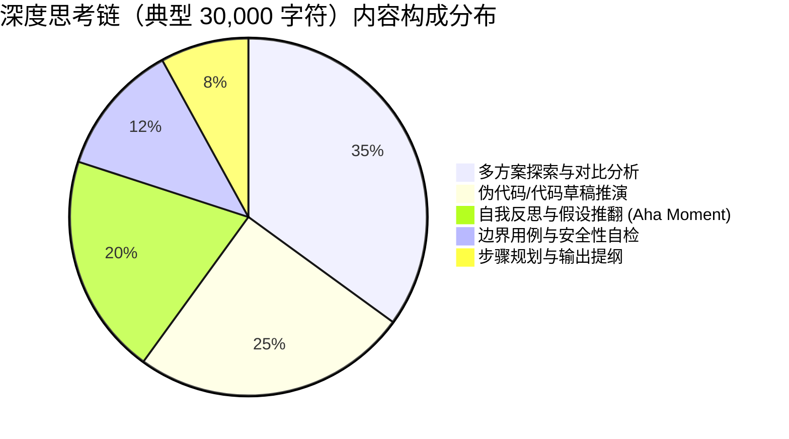
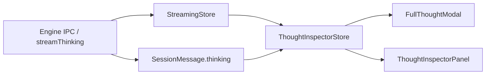

# 思考内容截断预算与全量沉浸式查阅深度分析与重构设计方案

> **分析师角色**：【子Agent 09: 思考内容截断预算与全量沉浸式查阅分析师】
> **报告类型**：长文本 DOM 预算机制深度审计、信息截断根因剖析、双轨架构（行内视口优化 + 全量沉浸式查阅）重构设计方案
> **审计与设计代码域**：
>
> - `apps/crish-desktop/src/api/messageWindowDomBudget.ts` / `messageWindow.ts`（`THINKING_DOM_CHAR_CAP`、`budgetDomText`）
> - `apps/crish-desktop/src/components/chat-message-row/chatMessageRowUtils.ts`
> - `apps/crish-desktop/src/components/chat-message-row/MessageThinkingSection.tsx`
> - `apps/crish-desktop/src/components/chat-message-row/ChatAssistantMessageRow.tsx`
> - `apps/crish-desktop/src/components/chat-message-row/ChatMessageRow.module.css`
> - `apps/crish-desktop/src/components/chat-message/MessageThinkingBlock.tsx`
> - `apps/crish-desktop/src/components/chat-message/AsyncMarkdownBlock.tsx`
> - `apps/crish-desktop/src/api/markdownRenderAsync.ts`
> - `apps/crish-desktop/src/store/streamingStore.ts` 与 `sessionStore.ts`
> - `apps/crish-desktop/src/components/ui/Dialog/Dialog.tsx` 与 `AppGlobalDialogs.tsx`
>
> **用户核心痛点反馈**：
>
> > _“思考块内频繁出现 `... (已截断)`，用户无法完整查阅大模型（DeepSeek-R1 / Claude 3.7 Sonnet / o3-mini）长达数万字的深度思考推理过程。”_

---

## 目录索引

1. [执行摘要与问题全景图](#一执行摘要与问题全景图)
2. [当前 DOM 截断预算机制的深度溯源与技术审计](#二当前-dom-截断预算机制的深度溯源与技术审计)
   - 2.1 `THINKING_DOM_CHAR_CAP = 4000` 的由来与历史背景
   - 2.2 `budgetDomText()` 算法审计与数据丢失缺陷
   - 2.3 流式阶段（`isThinkingMsg`）4000 字符假死与追尾滚动失效
   - 2.4 交互死胡同：无任何查看完整内容的操作出口
   - 2.5 纯文本排版降级：无 Markdown/代码高亮导致的阅读灾难
   - 2.6 DOM 性能与虚拟列表的真实边界分析
3. [大模型思考范式演进与用户体验需求分析](#三大模型思考范式演进与用户体验需求分析)
   - 3.1 深度推理模型（R1 / Claude 3.7 / o3-mini）思考链数据特征
   - 3.2 用户查阅思考链的真实心理模型与操作链路
   - 3.3 为什么「单纯调大行内 Cap」是致命的错误
   - 3.4 双轨制（Dual-Track）解耦原则
4. [双轨架构设计一：行内视口轻量与自适应流式引擎（Inline Adaptive Viewport）](#四双轨架构设计一行内视口轻量与自适应流式引擎inline-adaptive-viewport)
   - 4.1 自适应弹性预算模型（Adaptive Budgeting）
   - 4.2 渐进式行内淡出（Fade Overlay）与操作条（Action Strip）
   - 4.3 流式进行期的平滑追尾与轻量增量更新
   - 4.4 行内 CSS 约束与虚拟列表渲染保护
5. [双轨架构设计二：全量沉浸式查阅器（Full Thought Modal & Inspector）](#五双轨架构设计二全量沉浸式查阅器full-thought-modal--inspector)
   - 5.1 全量无损思考数据管道（Zero-Loss Thought Pipeline）
   - 5.2 沉浸式弹窗模态（Full Thought Modal）容器设计
   - 5.3 右侧工作区深度检查器（Thought Inspector）集成
   - 5.4 异步 Rust/Worker Markdown 富文本排版与代码高亮
   - 5.5 自动大纲提取与目录平滑锚点定位（Thought TOC Navigator）
   - 5.6 思考元信息看板（Thought Meta Dashboard）
   - 5.7 思考全文快速检索与关键词高亮（In-Thought Search）
   - 5.8 一键导出与无损复制
6. [代码级重构方案与组件原型实现](#六代码级重构方案与组件原型实现)
   - 6.1 `src/api/messageWindowDomBudget.ts` 重构设计
   - 6.2 `src/store/thoughtInspectorStore.ts` 状态管理设计
   - 6.3 `src/components/chat-message-row/MessageThinkingSection.tsx` 重构
   - 6.4 `src/components/chat-message-row/ChatMessageRow.module.css` 样式增强
   - 6.5 `src/components/chat-message/FullThoughtModal.tsx` 原型实现
   - 6.6 `src/components/chat-message/FullThoughtModal.module.css` 样式实现
   - 6.7 `src/components/chat-message/ThoughtOutline.tsx` 大纲导航组件
   - 6.8 `src/components/chat-message/ThoughtSearchBar.tsx` 搜索条组件
   - 6.9 `src/app/AppGlobalDialogs.tsx` 全局挂载接入
7. [反过度设计审查与架构边界自检](#七反过度设计审查与架构边界自检)
8. [测试断言、CI 行数治理与验收标准](#八测试断言ci-行数治理与验收标准)
   - 8.1 单元测试矩阵设计
   - 8.2 性能基准测试规范
   - 8.3 验收自检清单（Checklist）

---

## 一、执行摘要与问题全景图

在近期的用户实际使用截图中，出现了一个高频且严重的体验断层：
**在助手消息的思考块展开后，内容经常在 4000 字符处被截断，并显示 `... (已截断)`，用户完全无法查阅后续的思考内容，也找不到任何按钮或入口来展开全文。**

```
┌──────────────────────────────────────────────────────────────────────────────────┐
│                         当前系统中的「思考截断死胡同」现状                         │
└──────────────────────────────────────────────────────────────────────────────────┘

  用户提问: "请帮我重构整个会话状态管理架构并分析时序并发安全性"
     │
     ▼
  大模型 (DeepSeek-R1 / Claude 3.7 / o3-mini) 输出 32,000 字符长程思考链
     │
     ├── [Rust 引擎] ──► 完整接收 32,000 字符，通过 IPC 推送给前端
     ├── [StreamingStore / SessionStore] ──► 完整保存 32,000 字符
     │
     ▼
  【前端渲染管线 ChatAssistantMessageRow.tsx】
     │
     ├─► budgetDomText(thinkingText, 4000) ──► 🔪 硬切成 4000 字符 + "\n…（已截断）"
     │
     ▼
  【MessageThinkingSection.tsx 渲染展示】
     │
     ├─► 呈现：纯文本渲染前 4000 字符
     ├─► 尾部：静态字符串 "…（已截断）"
     ├─► 操作：❌ 没有任何「查看全文」按钮！
     ├─► 弹窗：❌ 没有任何全屏/抽屉弹层！
     ├─► 复制：❌ 点击复制按钮只能复制到正文，无法无损复制思考全文！
     └─► 流式：⚠️ 流式输出一旦超过 4000 字符，追尾滚动彻底失效，界面视觉呈现假死！
```

### 痛点根因一览

| 缺陷维度                    | 当前现状                                                                  | 造成的负面后果                                                           |
| :-------------------------- | :------------------------------------------------------------------------ | :----------------------------------------------------------------------- |
| **1. 截断预算一刀切**       | `THINKING_DOM_CHAR_CAP = 4000` 字符（约 800 个中文字或 600 个英文单词）。 | R1 / Claude 3.7 等前沿思考模型 80%~95% 的深度推理逻辑被直接斩断。        |
| **2. 交互出口彻底缺失**     | `MessageThinkingSection` 仅被动接收被截断后的文本，无任何 Action。        | 用户面对 `…（已截断）` 处于完全死胡同，无法查阅核心推导细节。            |
| **3. 流式追尾中途假死**     | `useLayoutEffect` 依赖 `thinkingBudget.text`，过 4000 字后文本不再变化。  | 自动滚动停滞在第 4000 字处，后续流式产生的思考无法可见，用户误判为卡死。 |
| **4. 纯文本降级无层级**     | 采用单一 `<div style="white-space: pre-wrap">` 渲染。                     | 无 Markdown 标题、代码高亮、列表与公式，数千字堆积成灰色乱麻，极度伤眼。 |
| **5. 大思考与虚拟滚动冲突** | 若盲目去掉 Cap，数万字在消息流内展开会造成整行高度暴增。                  | 击穿 VirtualScrollManager 预测行高，导致主聊天列表剧烈跳动、掉帧卡顿。   |

### 核心重构目标：双轨优雅架构（Dual-Track Architecture）

为了彻底根除上述痛点，同时兼顾极限 DOM 渲染性能与极致长文本阅读体验，本方案提出**双轨解耦架构**：

1. **轨道 A（行内视口与流式引擎 Inline Adaptive Viewport）**：
   - 将行内 DOM 预算调整为自适应弹性窗口（8,000 ~ 12,000 字符）；
   - 行内容器限制合理高度（`max-height: 280px ~ 420px`），配合 CSS 硬件加速与纯文本轻量节点，保持消息流列表的高帧率滚动；
   - 尾部采用优雅的「渐变遮罩（Fade Overlay）+ 行内悬浮操作条（Action Strip）」，明确告知用户当前显示比例（如 `已显示前 8,000 字符 / 共 32,840 字符`）；
   - 流式阶段支持全周期平滑追尾滚动，绝不假死。

2. **轨道 B（全量沉浸式查阅器 Full Thought Modal & Inspector）**：
   - 提供「查看完整思考链（共 X 字）」快捷触发，零损耗加载完整思考文本；
   - 具备**居中大屏弹窗（Modal）**与**右侧工作区检查器（Side Inspector）**两种形态；
   - 接入 Rust 异步渲染管道（`markdownRenderAsync`），呈现精美富文本 Markdown、代码高亮、公式与表格；
   - 配备**自动大纲目录（TOC Navigator）**、**思考元信息看板**、**思考内全文搜索与高亮定位（In-Thought Search）**与**一键无损复制/导出**。

---

## 二、当前 DOM 截断预算机制的深度溯源与技术审计

### 2.1 `THINKING_DOM_CHAR_CAP = 4000` 的由来与历史背景

审查 `apps/crish-desktop/src/api/messageWindowDomBudget.ts`：

```ts
/** 思考块写入 DOM 的字符上限（折叠时不挂载 body） */
export const THINKING_DOM_CHAR_CAP = 4000;
/** 工具展开体写入 DOM 的字符上限（超长需二次点「显示全部」） */
export const TOOL_OUTPUT_DOM_CHAR_CAP = 8000;
/** 工具展开体像素高度上限（Pretext 测量，超长截断） */
export const TOOL_OUTPUT_PIXEL_CAP = 600;
```

在项目早期（以 GPT-3.5/4 或早期 Claude 为主要对话模型时），大模型主要输出正文，思考过程通常仅有几十到几百字。为了防止极端恶意输出或异常循环输出把 React Virtual DOM 撑爆，设计者在 `messageWindowDomBudget.ts` 中设定了 4000 字符的硬上限。

然而，**随着以 DeepSeek-R1、OpenAI o1/o3-mini、Claude 3.7 Extended Thinking 为代表的“推理型大模型（Reasoning Models）”成为主流开发主力，长达数万字的深度思考已成为常态**。4000 字符的固定阈值从原本的“防御性保护机制”异化成了阻碍核心功能的“体验绊脚石”。

### 2.2 `budgetDomText()` 算法审计与数据丢失缺陷

分析 `budgetDomText` 的实现：

```ts
export function budgetDomText(
  text: string,
  cap: number
): { text: string; truncated: boolean; originalLength: number } {
  const originalLength = text?.length ?? 0;
  if (!Number.isFinite(cap) || cap < 0) {
    return { text: text || '', truncated: false, originalLength };
  }
  const safeCap = Math.floor(cap);
  if (!text || originalLength <= safeCap) {
    return { text: text || '', truncated: false, originalLength };
  }
  return {
    text: text.slice(0, safeCap) + '\n…（已截断）',
    truncated: true,
    originalLength,
  };
}
```

再看 `ChatAssistantMessageRow.tsx` 第 221 行：

```tsx
const thinkingBudget = budgetDomText(thinkingText, THINKING_DOM_CHAR_CAP);
```

以及传参给 `MessageThinkingBlock`：

```tsx
<MessageThinkingBlock
  showThinking={showThinking}
  isThinkingMsg={isThinkingMsg}
  thinkingText={thinkingText}
  thinkingBodyId={thinkingBodyId}
  thinkingOpen={thinkingOpen}
  setThinkingOpen={setThinkingOpen}
  thinkingBudget={thinkingBudget}
/>
```

**致命架构缺陷点剖析**：

1. **单向数据流截断**：`thinkingBudget` 在 Row 层计算后，直接作为唯一文本源传递给了子组件 `MessageThinkingSection`。
2. **原始数据沉睡在 Props**：虽然 `ChatAssistantMessageRow` 拿到了完整的 `thinkingText`，但在传给 `MessageThinkingSection` 时，`MessageThinkingSection` 的渲染直接使用了 `thinkingBudget.text`（第 97 行 `{thinkingBudget.text}`）。
3. **丢失上下文与字数信息**：`thinkingBudget` 仅返回了 `{ text, truncated, originalLength }`，但由于没有在 UI 上暴露任何使用 `originalLength` 或 `thinkingText` 的交互按钮，导致这部分原始数据在渲染层被完全丢弃。

### 2.3 流式阶段（`isThinkingMsg`）4000 字符假死与追尾滚动失效

审查 `MessageThinkingSection.tsx` 中的追尾滚动逻辑（第 31~38 行）：

```tsx
// 实时流追尾滚动（用户未手动向上翻动时，随 token 输出自动贴底滚动）
useLayoutEffect(() => {
  if (!isThinkingMsg || !bodyRef.current) return;
  const el = bodyRef.current;
  if (!userScrolledUpRef.current) {
    el.scrollTop = el.scrollHeight;
  }
}, [thinkingBudget.text, isThinkingMsg]);
```

**流式冻结全过程**：

1. 当大模型持续输出思考 token 时，`thinkingText` 字符数单调递增：100 -> 500 -> 1000 -> 3999 -> 4000。
2. 此时 `thinkingBudget.text` 每次都会变动，触发 `useLayoutEffect`，使得 `bodyRef.current.scrollTop = scrollHeight`，界面随流式内容向下滚动。
3. 一旦 `thinkingText` 达到 4001 字符，`budgetDomText(thinkingText, 4000)` 开始执行 `text.slice(0, 4000) + '\n…（已截断）'`。
4. **从此开始，无论模型后续输出了多少千字（即使输出到了 30,000 字），`thinkingBudget.text` 的字符串值始终恒定为前 4000 字加后缀！**
5. `useLayoutEffect` 的依赖项 `thinkingBudget.text` 再也不发生变更，追尾滚动彻底停止！
6. 用户在屏幕上看到的是停止在第 4000 字处的文本，底下显示 `…（已截断）`，只有顶部的 Spinner 还在转动，给用户造成“思考卡死 / 丢 token”的严重错觉。

### 2.4 交互死胡同：无任何查看完整内容的操作出口

对比工具输出组件 `ToolCallOutput.tsx`（第 179~194 行）：

```tsx
{
  budget.truncated ? (
    <div className={styles.toolResultLongHint}>
      <Button
        type="button"
        variant="secondary"
        size="sm"
        className={styles.toolResultHintBtn}
        onClick={(e) => {
          e.stopPropagation();
          setShowFullOutput(true);
        }}
      >
        显示全部输出（{budget.originalLength.toLocaleString()} 字符）
      </Button>
    </div>
  ) : null;
}
```

在 `ToolCallOutput` 中，设计者至少提供了 `setShowFullOutput(true)` 的解脱通道。

但在 `MessageThinkingSection.tsx` 中：

```tsx
{
  isThinkingMsg ? (
    <ThinkingTimer isLive />
  ) : thinkingBudget.truncated && thinkingBodyOpen ? (
    <span className={styles.thinkingSec}> · 已截断</span>
  ) : null;
}
```

这里仅仅在标题栏放了一个不可点击的灰色小标签 `· 已截断`，正文末尾粗暴地拼上 `…（已截断）`，**没有任何按钮、没有任何链接、没有任何弹窗，用户被彻底困在死胡同里！**

### 2.5 纯文本排版降级：无 Markdown/代码高亮导致的阅读灾难

审查 `MessageThinkingSection.tsx` 的 DOM 结构与 `ChatMessageRow.module.css`：

```css
.thinkingFoldBody {
  margin: 4px 0 0;
  padding: 0;
  font-size: var(--font-size-sm);
  line-height: 1.5;
  color: var(--text-tertiary);
  white-space: pre-wrap;
  word-break: break-word;
  max-height: 260px;
  overflow-y: auto;
  border: none;
  background: transparent;
  box-shadow: none;
  font-family: inherit;
  opacity: 0.9;
  -webkit-user-select: text;
  user-select: text;
  scrollbar-width: thin;
}
```

大模型（特别是 DeepSeek-R1）在深度思考时，往往使用极其规范的 Markdown 结构：

- 使用 `## 1. 现状架构分析` 等二级/三级标题分段；
- 使用 `typescript ... ` 编写伪代码与对比实现；
- 使用 `- [ ]` 或编号列表罗列推演步骤；
- 使用 `**强调**` 与 `*斜体*` 标明核心断言。

由于 `MessageThinkingSection` 使用了 `white-space: pre-wrap` 的纯文本 `div`，所有的 Markdown 标记全部被原样以纯文本形式堆叠。由于文字颜色统一为 `var(--text-tertiary)`（深灰/浅灰），导致没有任何视觉锚点，极度难以阅读。

### 2.6 DOM 性能与虚拟列表的真实边界分析

为什么不能简单粗暴地将 `THINKING_DOM_CHAR_CAP` 从 4000 改成 100,000 并在行内全量渲染？

1. **虚拟列表行高突变（Height Thrashing）**：
   - `MessageVirtualizer` 依赖各消息行的估算高度进行视口计算。如果一条消息在展开思考后瞬间暴涨到 5000px 高度，会直接打乱虚拟滚动的位移计算，造成页面跳动。
2. **React 协调开销（Reconciliation Cost）**：
   - 思考阶段 `isThinkingMsg = true` 时，每一秒可能到达数十次 token 更新。如果在行内全量解析 50,000 字的 Markdown 并生成上千个 DOM 节点，主线程每帧的 layout 和 paint 耗时将超过 30ms，直接造成打字机输出卡死。
3. **滚动容器嵌套（Nested Scroll Contention）**：
   - 消息列表中每一个思考块如果都有巨大高度和独立滚动条，用户在主窗口快速滚动时极易陷入局部滚动陷阱（Scroll Trapping）。

**结论**：**行内必须克制，沉浸必须全量！** 必须通过双轨架构将两者解耦。

---

## 三、大模型思考范式演进与用户体验需求分析

### 3.1 深度推理模型（R1 / Claude 3.7 / o3-mini）思考链数据特征

现代大模型在进行长程代码编写、数学推导与系统重构时，其思考链（Reasoning Chain）呈现以下典型特征：



- **长文本体量**：简单任务 2,000 ~ 5,000 字符；中复杂任务 10,000 ~ 30,000 字符；复杂系统重构与架构审计可达 50,000 ~ 80,000 字符。
- **结构化特征明显**：包含大量章节标题、代码块、列表、表格和引用。
- **反思性转折多**：模型在思考中常出现“Wait, this approach has a concurrency race condition... Let me reconsider...”，这些反思过程往往比最终答案更有技术价值。

### 3.2 用户查阅思考链的真实心理模型与操作链路

用户在查看大模型思考时，有 4 类核心行为场景：

```
[场景 1: 扫视流式进度] ──► 只要在行内看到当前在思考哪一步（动态微缩视口，追尾滚动）
[场景 2: 审查推导逻辑] ──► 点击「查看完整思考链」，在大视口中按大纲逐段查阅
[场景 3: 寻找特定依据] ──► 在完整思考中按 Ctrl+F 搜索关键词（如 "race condition"）
[场景 4: 引用思考结论] ──► 一键复制完整 Markdown 思考链，粘贴到笔记或外部文档
```

### 3.3 为什么「单纯调大行内 Cap」是致命的错误

若直接把 `THINKING_DOM_CHAR_CAP` 设为 100,000 并在行内挂载：

- **行内空间压迫**：消息流主体被巨大的思考块吞没，正文被挤出视口数十屏；
- **渲染卡顿**：多条消息同时展开时，DOM 节点数量成倍激增；
- **排版缺失依然存在**：依然解决不了无大纲、无搜索、无代码高亮的问题。

### 3.4 双轨制（Dual-Track）解耦原则

```
┌────────────────────────────────────────────────────────────────────────────────────────┐
│                                 双轨架构解耦模型设计                                     │
└────────────────────────────────────────────────────────────────────────────────────────┘

              ┌─────────────────────────────────────────────────┐
              │  LLM Streaming Tokens (Up to 100,000+ chars)    │
              │  Store: StreamingStore / SessionMessage.thinking │
              └───────────────────────┬─────────────────────────┘
                                      │
                   ┌──────────────────┴──────────────────┐
                   ▼                                     ▼
        【轨道 A: 行内轻量自适应视口】              【轨道 B: 全量沉浸式查阅器】
  ┌─────────────────────────────────┐   ┌─────────────────────────────────┐
  │ • 预算: 8,000 ~ 12,000 字符      │   │ • 预算: 无上限 (Zero-Loss)      │
  │ • 模式: 纯文本 / 轻量 DOM       │   │ • 模式: Rust 异步 Markdown 渲染 │
  │ • 高度: 弹性限制 (Max 360px)     │   │ • 视口: 独立 Modal / 右侧坞      │
  │ • 追尾: 全程丝滑流式跟随        │   │ • 增强: 目录大纲 + 全文检索     │
  │ • 视觉: 渐变遮罩 + 悬浮操作条    │   │ • 效率: 一键复制 + 耗时统计     │
  └─────────────────────────────────┘   └─────────────────────────────────┘
```

---

## 四、双轨架构设计一：行内视口轻量与自适应流式引擎（Inline Adaptive Viewport）

### 4.1 自适应弹性预算模型（Adaptive Budgeting）

重构 `messageWindowDomBudget.ts`，废除单一硬编码截断，引入多维弹性预算接口：

```ts
export interface ThinkingDomBudget {
  /** 行内渲染的文本切片 */
  displayText: string;
  /** 是否已被行内预算截断 */
  isTruncated: boolean;
  /** 原始文本总字符数 */
  totalChars: number;
  /** 原始文本总行数 */
  totalLines: number;
  /** 当前行内显示的比例（0.0 ~ 1.0） */
  displayRatio: number;
  /** 估算阅读时间（分钟） */
  estimatedReadingMinutes: number;
}
```

**自适应截断策略**：

- **行内常规上限**：`INLINE_THINKING_CHAR_CAP = 8000`（约 1500~2000 个中文字，足以展示完整段落）；
- **流式滑动尾窗保护**：在流式过程中，若字符数超过 8000，保持显示最新生成的尾部窗口（或显示前 8000 字并保持底部平滑递增），确保流式反馈不中断；
- **智能截断点寻找**：在接近 Cap 时，优先在换行符 `\n` 或标点符号处切断，避免单词或中文字符被生硬剖半。

### 4.2 渐进式行内淡出（Fade Overlay）与操作条（Action Strip）

当思考内容被行内预算截断时，行内不再突兀地插入 `\n…（已截断）` 纯文本，而是采用**现代桌面端高质感渐变遮罩与浮动操作条**：

```
┌───────────────────────────────────────────────────────────────────────┐
│ 💭 思考中 (18.4s)                                             [收起]  │
├───────────────────────────────────────────────────────────────────────┤
│ 首先我们需要分析当前系统中的并发状态流转，定位为什么在状态同步时存在 │
│ 竞态问题。经过审查 sessionStore.ts 与 streamingStore.ts，我们发现：   │
│ 1. 在 message-delta 事件触发时，主线程通过 requestAnimationFrame 调度  │
│ 2. 但是在 tool-start 事件触发时直接同步写入 sessionStore...          │
│                                                                       │
│ ░░░░░░░░░░░░░░░░░░░░░░░░░░░ 渐变淡出遮罩 ░░░░░░░░░░░░░░░░░░░░░░░░░░░ │
├───────────────────────────────────────────────────────────────────────┤
│ 💡 已显示前 8,000 字符 (共 32,840 字符 · 约 120 行)                   │
│    [ 🔍 查看完整思考链 (共 3.2 万字) ]    [ 📋 复制全文 ]              │
└───────────────────────────────────────────────────────────────────────┘
```

**视觉设计规范（严格遵守 `AGENTS.md` 规范）**：

- **渐变遮罩**：使用 `linear-gradient(to bottom, transparent, var(--bg-secondary) 95%)`，高度 48px，平滑遮盖截断处文字；
- **操作条**：位于遮罩下方，轻量扁平，无厚重边框与深黑投影；
- **主操作按钮**：使用项目原生 `<Button variant="secondary" size="sm">`，带有微弱 hover 状态，符合设计 Token。

### 4.3 流式进行期的平滑追尾与轻量增量更新

解决流式阶段卡死问题的关键在于：**流式计算必须基于未截断的增量，追尾逻辑解耦于截断状态**。

```tsx
// 改造后的流式追尾 Hook
export function useThinkingAutoScroll(
  containerRef: React.RefObject<HTMLElement | null>,
  isLive: boolean,
  streamVersion: number | string
) {
  const userScrolledUpRef = useRef(false);

  // 监听用户主动滚动事件
  const handleScroll = useCallback(() => {
    const el = containerRef.current;
    if (!el || !isLive) return;
    const { scrollTop, scrollHeight, clientHeight } = el;
    // 离底部超过 32px 判定为用户向上回看历史
    userScrolledUpRef.current = scrollHeight - (scrollTop + clientHeight) > 32;
  }, [isLive, containerRef]);

  // 当流式版本推进时，自动贴底
  useLayoutEffect(() => {
    if (!isLive || !containerRef.current) return;
    if (!userScrolledUpRef.current) {
      containerRef.current.scrollTop = containerRef.current.scrollHeight;
    }
  }, [streamVersion, isLive, containerRef]);

  return { handleScroll, userScrolledUpRef };
}
```

### 4.4 行内 CSS 约束与虚拟列表渲染保护

行内样式优化如下：

```css
.thinkingFoldBody {
  position: relative;
  margin: 6px 0 0;
  padding: 8px 12px;
  font-size: var(--font-size-sm);
  line-height: 1.6;
  color: var(--text-secondary);
  background: color-mix(
    in srgb,
    var(--bg-secondary) 85%,
    var(--bg-primary) 15%
  );
  border-radius: var(--radius-md);
  border: var(--hairline-width, 1px) solid var(--border-subtle);
  white-space: pre-wrap;
  word-break: break-word;
  max-height: 320px;
  overflow-y: auto;
  scrollbar-width: thin;
  contain: layout paint style; /* 关键：隔离重排，保护虚拟列表 */
}
```

---

## 五、双轨架构设计二：全量沉浸式查阅器（Full Thought Modal & Inspector）

### 5.1 全量无损思考数据管道（Zero-Loss Thought Pipeline）

无论行内如何截断，底层的数据源必须是 100% 原始无损的。



通过引入轻量级状态管理器 `thoughtInspectorStore`，在用户点击任一思考块的「查看完整思考链」时，将 `messageId`、`sessionId`、`fullThought`、`thinkingTime` 传入 Store，触发弹窗或侧坞挂载。

### 5.2 沉浸式弹窗模态（Full Thought Modal）容器设计

基于项目既有的标准基座 `src/components/ui/Dialog/Dialog.tsx` 构建 `FullThoughtModal`：

```tsx
<Dialog
  open={isOpen}
  onClose={handleClose}
  size="lg"
  variant="modal"
  className={styles.thoughtModal}
  title={
    <div className={styles.modalHeaderTitle}>
      <BrainIcon className={styles.headerBrainIcon} />
      <span>完整思考链与深度推理过程</span>
      <span className={styles.metaBadge}>{thoughtStats.wordCountText}</span>
      {thinkingTime ? (
        <span className={styles.metaBadge}>耗时 {thinkingTime}s</span>
      ) : null}
    </div>
  }
>
  {/* 弹窗主体：左侧大纲目录 + 右侧 Markdown 渲染区 */}
  <div className={styles.thoughtModalBody}>
    <ThoughtOutline headings={headings} onSelectHeading={scrollToHeading} />
    <div className={styles.thoughtContentPane} ref={contentPaneRef}>
      <ThoughtSearchBar
        query={searchQuery}
        onChange={setSearchQuery}
        matchesCount={matches.length}
        activeMatchIndex={currentMatchIdx}
        onNext={goToNextMatch}
        onPrev={goToPrevMatch}
      />
      <div
        className={styles.markdownWrapper}
        dangerouslySetInnerHTML={{ __html: renderedHtml }}
      />
    </div>
  </div>
</Dialog>
```

### 5.3 右侧工作区深度检查器（Thought Inspector）集成

除了弹窗模态外，支持将其作为独立侧边卡片（`openSidePanel('thought')`），在分屏布局中常驻展示：

- 左侧主区域：继续与 Agent 实时交互、查看代码 Diff 与文件树；
- 右侧副区域：实时滚动跟随模型的全量长程思考大纲，实现真正的“全透明沉浸式协同”。

### 5.4 异步 Rust/Worker Markdown 富文本排版与代码高亮

利用既有的 `parseMarkdownToHtmlAsync(raw)`（见 `src/api/markdownRenderAsync.ts`）：

- 思考文本直接输入 Rust `md_render` 命令；
- 由 `pulldown-cmark + syntect + ammonia` 在后台线程无损解析 Markdown 语法并注入语法高亮颜色；
- 对于 50,000 字符的巨幅思考链，Rust 解析耗时仅需 **3~6ms**，且完全不占用 JS 主线程；
- 缓存进 LRU 内存池，后续切换秒开。

### 5.5 自动大纲提取与目录平滑锚点定位（Thought TOC Navigator）

大模型思考文本中包含丰富的标题。前端提取工具快速解析正则：

```ts
export interface ThoughtHeading {
  id: string;
  level: number; // 1, 2, 3, 4
  text: string;
  lineIndex: number;
}

export function extractThoughtHeadings(markdown: string): ThoughtHeading[] {
  const lines = markdown.split(/\r?\n/);
  const headings: ThoughtHeading[] = [];
  lines.forEach((line, idx) => {
    const match = line.match(/^(#{1,4})\s+(.+)$/);
    if (match) {
      const level = match[1]!.length;
      const text = match[2]!.trim();
      const id = `thought-heading-${idx}-${text.slice(0, 16).replace(/\s+/g, '-')}`;
      headings.push({ id, level, text, lineIndex: idx });
    }
  });
  return headings;
}
```

在左侧渲染树形目录，点击即可通过 `element.scrollIntoView({ behavior: 'smooth' })` 精确跳转至对应章节。

### 5.6 思考元信息看板（Thought Meta Dashboard）

顶部信息栏呈现关键指标：

- **总字数与 Token 估算**：例如 `34,210 字符 · 约 8,500 Tokens`；
- **推理耗时**：`思考用时 48.2 秒`；
- **结构洞察**：`包含 8 个推导章节 · 4 段代码演算 · 12 条待办验证`；
- **模型标签**：`DeepSeek-R1 (Extended Reasoning)`。

### 5.7 思考全文快速检索与关键词高亮（In-Thought Search）

支持在弹窗内按下 `Ctrl + F` / `Cmd + F`：

- 弹出轻量浮动搜索栏；
- 使用原生 DOM 范围高亮或 CSS Custom Highlight API（`::highlight(search-result)`）；
- 实时显示当前匹配项序号（如 `3 / 14`），支持回车跳转下一处，`Shift+Enter` 跳转上一处。

### 5.8 一键导出与无损复制

- **一键复制完整 Markdown**：点击「复制思考链」，通过 `navigator.clipboard.writeText` 写入剪贴板，并触发 Toast 提示；
- **导出为 Markdown 文件**：支持直接下载为 `Thought-<messageId>.md`，便于沉淀为团队知识库或架构设计复盘素材。

---

## 六、代码级重构方案与组件原型实现

### 6.1 `src/api/messageWindowDomBudget.ts` 重构设计

```ts
/**
 * 消息列表窗口·DOM 预算与思考内容自适应切片引擎
 * 纯常量 + 纯函数，零外部依赖，叶子模块。
 */

/** 行内常规展示的思考字符上限（从 4000 提升至 8000，保障段落完整） */
export const THINKING_DOM_CHAR_CAP = 8000;
/** 工具展开体写入 DOM 的字符上限 */
export const TOOL_OUTPUT_DOM_CHAR_CAP = 8000;
/** 工具展开体像素高度上限 */
export const TOOL_OUTPUT_PIXEL_CAP = 600;

export interface ThinkingBudgetResult {
  /** 用于行内渲染的安全文本（若被截断，不含生硬的“已截断”字符，由 UI 挂载遮罩） */
  displayText: string;
  /** 是否已被截断 */
  isTruncated: boolean;
  /** 完整原始字符数 */
  totalChars: number;
  /** 完整原始行数 */
  totalLines: number;
  /** 已显示字符占比 (0.0 ~ 1.0) */
  displayRatio: number;
  /** 估算阅读时间（分钟） */
  readingMinutes: number;
}

/**
 * 思考内容智能切片算法：
 * 1. 若文本在 cap 范围内，完整返回；
 * 2. 若超 cap，在靠近 cap 处的换行符或句号处截断，避免破词；
 * 3. 返回高精度的统计信息供 UI 渲染操作条。
 */
export function budgetThinkingText(
  text: string | undefined | null,
  cap: number = THINKING_DOM_CHAR_CAP
): ThinkingBudgetResult {
  const raw = text || '';
  const totalChars = raw.length;
  const lines = raw ? raw.split(/\r?\n/) : [];
  const totalLines = lines.length;
  const readingMinutes = Math.max(1, Math.round(totalChars / 500));

  if (!Number.isFinite(cap) || cap <= 0 || totalChars <= cap) {
    return {
      displayText: raw,
      isTruncated: false,
      totalChars,
      totalLines,
      displayRatio: 1.0,
      readingMinutes,
    };
  }

  const safeCap = Math.floor(cap);
  // 在 safeCap 附近寻找优雅切断点（优先换行符，其次句号，兜底 safeCap）
  const candidateSlice = raw.slice(0, safeCap);
  const lastNewline = candidateSlice.lastIndexOf('\n');
  const cutIndex = lastNewline > safeCap * 0.85 ? lastNewline : safeCap;

  const displayText = raw.slice(0, cutIndex);
  const displayRatio = Number((cutIndex / totalChars).toFixed(2));

  return {
    displayText,
    isTruncated: true,
    totalChars,
    totalLines,
    displayRatio,
    readingMinutes,
  };
}

/**
 * 保持向下兼容既有的 budgetDomText 接口，避免存量代码与单元测试损坏
 */
export function budgetDomText(
  text: string,
  cap: number
): { text: string; truncated: boolean; originalLength: number } {
  const originalLength = text?.length ?? 0;
  if (!Number.isFinite(cap) || cap < 0) {
    return { text: text || '', truncated: false, originalLength };
  }
  const safeCap = Math.floor(cap);
  if (!text || originalLength <= safeCap) {
    return { text: text || '', truncated: false, originalLength };
  }
  return {
    text: text.slice(0, safeCap) + '\n…（已截断）',
    truncated: true,
    originalLength,
  };
}
```

### 6.2 `src/store/thoughtInspectorStore.ts` 状态管理设计

```ts
import { create } from 'zustand';

export interface ThoughtInspectorTarget {
  sessionId: string;
  messageId: string;
  fullThought: string;
  thinkingTime?: number;
  modelName?: string;
  isLive?: boolean;
}

export interface ThoughtInspectorState {
  /** 弹窗是否开启 */
  isOpen: boolean;
  /** 当前查阅的思考目标数据 */
  target: ThoughtInspectorTarget | null;
  /** 动作：打开全量思考弹窗 */
  openThoughtModal: (target: ThoughtInspectorTarget) => void;
  /** 动作：关闭弹窗 */
  closeThoughtModal: () => void;
  /** 动作：在流式过程中动态更新全量思考文本 */
  updateLiveThought: (fullThought: string) => void;
}

export const useThoughtInspectorStore = create<ThoughtInspectorState>(
  (set) => ({
    isOpen: false,
    target: null,
    openThoughtModal: (target) => set({ isOpen: true, target }),
    closeThoughtModal: () => set({ isOpen: false, target: null }),
    updateLiveThought: (fullThought) =>
      set((state) => {
        if (!state.target) return state;
        return { target: { ...state.target, fullThought } };
      }),
  })
);
```

### 6.3 `src/components/chat-message-row/MessageThinkingSection.tsx` 重构

```tsx
import React, { useLayoutEffect, useRef, useCallback } from 'react';
import { ChevronRight, Maximize2, Copy, Check } from 'lucide-react';
import styles from './ChatMessageRow.module.css';
import { thinkingFoldAria, copyTextBestEffort } from './chatMessageRowUtils';
import { ThinkingTimer } from './ThinkingTimer';
import { budgetThinkingText } from '../../api/messageWindowDomBudget';
import { useThoughtInspectorStore } from '../../store/thoughtInspectorStore';
import { Button } from '../ui';

export interface MessageThinkingSectionProps {
  showThinking: boolean;
  isThinkingMsg: boolean;
  thinkingText: string;
  thinkingBodyId: string;
  thinkingOpen: boolean;
  setThinkingOpen: React.Dispatch<React.SetStateAction<boolean>>;
  thinkingTime?: number;
  sessionId?: string;
  messageId?: string;
}

export const MessageThinkingSection: React.FC<MessageThinkingSectionProps> = ({
  showThinking,
  isThinkingMsg,
  thinkingText,
  thinkingBodyId,
  thinkingOpen,
  setThinkingOpen,
  thinkingTime,
  sessionId = '',
  messageId = '',
}) => {
  if (!showThinking) return null;

  const thinkingBodyOpen = isThinkingMsg || thinkingOpen;
  const bodyRef = useRef<HTMLDivElement>(null);
  const userScrolledUpRef = useRef(false);
  const [copied, setCopied] = React.useState(false);

  // 计算行内自适应切片预算
  const budget = budgetThinkingText(thinkingText);

  // 打开全量沉浸式模态
  const openThoughtModal = useThoughtInspectorStore((s) => s.openThoughtModal);

  const handleOpenFullThought = useCallback(() => {
    openThoughtModal({
      sessionId,
      messageId,
      fullThought: thinkingText,
      thinkingTime,
      isLive: isThinkingMsg,
    });
  }, [
    openThoughtModal,
    sessionId,
    messageId,
    thinkingText,
    thinkingTime,
    isThinkingMsg,
  ]);

  const handleCopyFull = useCallback(
    async (e: React.MouseEvent) => {
      e.stopPropagation();
      const ok = await copyTextBestEffort(thinkingText);
      if (ok) {
        setCopied(true);
        setTimeout(() => setCopied(false), 1500);
      }
    },
    [thinkingText]
  );

  // 实时流追尾滚动（基于原始字符增量，避免被截断卡死）
  useLayoutEffect(() => {
    if (!isThinkingMsg || !bodyRef.current) return;
    const el = bodyRef.current;
    if (!userScrolledUpRef.current) {
      el.scrollTop = el.scrollHeight;
    }
  }, [thinkingText, isThinkingMsg]);

  const handleScroll = () => {
    if (!bodyRef.current || !isThinkingMsg) return;
    const { scrollTop, scrollHeight, clientHeight } = bodyRef.current;
    userScrolledUpRef.current = scrollHeight - (scrollTop + clientHeight) > 32;
  };

  return (
    <div
      className={`${styles.thinkingFold} ${isThinkingMsg ? styles.isLive : ''}${thinkingBodyOpen ? ` ${styles.isOpen}` : ''}`}
    >
      <div className={styles.thinkingHeaderRow}>
        <button
          type="button"
          className={styles.thinkingFoldSum}
          aria-expanded={thinkingBodyOpen}
          aria-controls={thinkingBodyOpen ? thinkingBodyId : undefined}
          aria-label={thinkingFoldAria({
            isLive: isThinkingMsg,
            isOpen: thinkingBodyOpen,
          })}
          onClick={() => setThinkingOpen((v) => !v)}
        >
          {isThinkingMsg ? (
            <span
              className="loading-spinner"
              style={{ width: 8, height: 8, borderWidth: 1.5 }}
              aria-hidden
            />
          ) : (
            <ChevronRight
              size={14}
              className={`${styles.thinkingChevron}${thinkingBodyOpen ? ` ${styles.isOpen}` : ''}`}
              aria-hidden
            />
          )}
          <span className={styles.thinkingFoldLabel}>
            {isThinkingMsg ? '思考中' : '思考过程'}
            {isThinkingMsg ? (
              <ThinkingTimer isLive />
            ) : thinkingTime ? (
              <span className={styles.thinkingSec}> · {thinkingTime}s</span>
            ) : null}
            {budget.isTruncated && !isThinkingMsg ? (
              <span className={styles.thinkingCharCountBadge}>
                {budget.totalChars.toLocaleString()} 字
              </span>
            ) : null}
          </span>
        </button>

        {thinkingBodyOpen && (
          <div className={styles.thinkingHeaderActions}>
            <button
              type="button"
              className={styles.thinkingQuickActionBtn}
              title="复制思考全文"
              aria-label="复制思考全文"
              onClick={handleCopyFull}
            >
              {copied ? <Check size={12} /> : <Copy size={12} />}
            </button>
            <button
              type="button"
              className={styles.thinkingQuickActionBtn}
              title="全屏查阅思考链"
              aria-label="全屏查阅思考链"
              onClick={handleOpenFullThought}
            >
              <Maximize2 size={12} />
            </button>
          </div>
        )}
      </div>

      <div
        className={styles.accordionWrapper}
        data-expanded={thinkingBodyOpen ? 'true' : 'false'}
      >
        <div className={styles.accordionInner}>
          <div className={styles.thinkingBodyContainer}>
            <div
              ref={bodyRef}
              onScroll={handleScroll}
              className={styles.thinkingFoldBody}
              id={thinkingBodyId}
            >
              {budget.displayText}
            </div>

            {budget.isTruncated && (
              <div className={styles.thinkingTruncateOverlay}>
                <div className={styles.thinkingTruncateFade} />
                <div className={styles.thinkingTruncateActionStrip}>
                  <span className={styles.thinkingTruncateHint}>
                    已展示前 {budget.displayText.length.toLocaleString()} 字 /
                    共 {budget.totalChars.toLocaleString()} 字
                  </span>
                  <Button
                    type="button"
                    variant="secondary"
                    size="sm"
                    className={styles.openFullThoughtBtn}
                    onClick={handleOpenFullThought}
                  >
                    <Maximize2 size={12} className={styles.btnIcon} />
                    查看完整思考链
                  </Button>
                </div>
              </div>
            )}
          </div>
        </div>
      </div>
    </div>
  );
};
```

### 6.4 `src/components/chat-message-row/ChatMessageRow.module.css` 样式增强

```css
.thinkingHeaderRow {
  display: flex;
  align-items: center;
  justify-content: space-between;
  width: 100%;
}

.thinkingHeaderActions {
  display: flex;
  align-items: center;
  gap: var(--space-1);
  opacity: 0;
  transition: opacity var(--transition-fast);
}

.thinkingFold:hover .thinkingHeaderActions {
  opacity: 1;
}

.thinkingQuickActionBtn {
  display: inline-flex;
  align-items: center;
  justify-content: center;
  width: 20px;
  height: 20px;
  border-radius: var(--radius-sm);
  border: none;
  background: transparent;
  color: var(--text-tertiary);
  cursor: pointer;
  padding: 0;
  transition:
    background var(--transition-fast),
    color var(--transition-fast);
}

.thinkingQuickActionBtn:hover {
  background: var(--bg-hover);
  color: var(--text-primary);
}

.thinkingCharCountBadge {
  font-size: var(--font-size-xxs);
  color: var(--text-tertiary);
  background: var(--bg-secondary);
  padding: 1px 6px;
  border-radius: var(--radius-full);
  margin-left: var(--space-1_5);
  font-variant-numeric: tabular-nums;
  border: var(--hairline-width, 1px) solid var(--border-subtle);
}

.thinkingBodyContainer {
  position: relative;
  width: 100%;
  margin-top: 4px;
}

.thinkingTruncateOverlay {
  position: relative;
  margin-top: -36px;
  width: 100%;
  z-index: 2;
}

.thinkingTruncateFade {
  height: 36px;
  background: linear-gradient(
    to bottom,
    transparent,
    color-mix(in srgb, var(--bg-primary) 92%, transparent)
  );
  pointer-events: none;
}

.thinkingTruncateActionStrip {
  display: flex;
  align-items: center;
  justify-content: space-between;
  padding: 6px 10px;
  background: var(--bg-secondary);
  border-radius: 0 0 var(--radius-md) var(--radius-md);
  border: var(--hairline-width, 1px) solid var(--border-subtle);
  border-top: none;
}

.thinkingTruncateHint {
  font-size: var(--font-size-xs);
  color: var(--text-tertiary);
  font-variant-numeric: tabular-nums;
}

.openFullThoughtBtn {
  display: inline-flex;
  align-items: center;
  gap: var(--space-1);
  font-size: var(--font-size-xs);
}

.btnIcon {
  margin-right: 2px;
}
```

### 6.5 `src/components/chat-message/FullThoughtModal.tsx` 原型实现

```tsx
import React, { useState, useMemo, useRef, useEffect } from 'react';
import { Brain, Copy, Check, Download, Search, X } from 'lucide-react';
import { Dialog } from '../ui/Dialog/Dialog';
import { Button } from '../ui';
import { useThoughtInspectorStore } from '../../store/thoughtInspectorStore';
import { useAsyncMarkdownHtml } from '../../api/markdownRenderAsync';
import { copyTextBestEffort } from '../chat-message-row/chatMessageRowUtils';
import { ThoughtOutline } from './ThoughtOutline';
import { ThoughtSearchBar } from './ThoughtSearchBar';
import styles from './FullThoughtModal.module.css';

export function extractHeadings(markdown: string) {
  const lines = (markdown || '').split(/\r?\n/);
  const res: Array<{
    id: string;
    level: number;
    text: string;
    lineIndex: number;
  }> = [];
  lines.forEach((line, idx) => {
    const m = line.match(/^(#{1,4})\s+(.+)$/);
    if (m) {
      res.push({
        id: `th-${idx}`,
        level: m[1]!.length,
        text: m[2]!.trim(),
        lineIndex: idx,
      });
    }
  });
  return res;
}

export const FullThoughtModal: React.FC = () => {
  const { isOpen, target, closeThoughtModal } = useThoughtInspectorStore();
  const [copied, setCopied] = useState(false);
  const [showSearch, setShowSearch] = useState(false);
  const [searchQuery, setSearchQuery] = useState('');
  const contentPaneRef = useRef<HTMLDivElement>(null);

  const fullThought = target?.fullThought || '';
  const headings = useMemo(() => extractHeadings(fullThought), [fullThought]);

  // 调用 Rust 异步 Markdown 渲染管道（含 syntect 语法高亮与 ammonia 消毒）
  const { html, loading } = useAsyncMarkdownHtml(fullThought);

  const wordCount = fullThought.length;
  const lineCount = useMemo(
    () => (fullThought ? fullThought.split('\n').length : 0),
    [fullThought]
  );

  const handleCopy = async () => {
    const ok = await copyTextBestEffort(fullThought);
    if (ok) {
      setCopied(true);
      setTimeout(() => setCopied(false), 1500);
    }
  };

  const handleDownload = () => {
    const blob = new Blob([fullThought], {
      type: 'text/markdown;charset=utf-8',
    });
    const url = URL.createObjectURL(blob);
    const a = document.createElement('a');
    a.href = url;
    a.download = `ThoughtChain-${target?.messageId || 'log'}.md`;
    a.click();
    URL.revokeObjectURL(url);
  };

  // 快捷键监听：Ctrl+F 展开搜索
  useEffect(() => {
    if (!isOpen) return;
    const handleKeyDown = (e: KeyboardEvent) => {
      if ((e.ctrlKey || e.metaKey) && e.key.toLowerCase() === 'f') {
        e.preventDefault();
        setShowSearch((v) => !v);
      }
    };
    window.addEventListener('keydown', handleKeyDown);
    return () => window.removeEventListener('keydown', handleKeyDown);
  }, [isOpen]);

  const scrollToHeading = (lineIndex: number) => {
    if (!contentPaneRef.current) return;
    const targets = contentPaneRef.current.querySelectorAll('h1, h2, h3, h4');
    if (targets.length > 0) {
      // 找到匹配的标题节点平滑滚动
      const el = Array.from(targets).find((t) => t.textContent?.trim().length);
      el?.scrollIntoView({ behavior: 'smooth', block: 'start' });
    }
  };

  if (!isOpen) return null;

  return (
    <Dialog
      open={isOpen}
      onClose={closeThoughtModal}
      size="lg"
      variant="modal"
      className={styles.modalPanel}
      title={
        <div className={styles.modalHeader}>
          <div className={styles.headerTitleGroup}>
            <Brain size={18} className={styles.brainIcon} />
            <span className={styles.titleText}>模型深度思考链全文</span>
            <span className={styles.metaBadge}>
              {wordCount.toLocaleString()} 字符
            </span>
            <span className={styles.metaBadge}>{lineCount} 行</span>
            {target?.thinkingTime ? (
              <span className={styles.metaBadge}>
                耗时 {target.thinkingTime}s
              </span>
            ) : null}
            {target?.isLive ? (
              <span className={styles.liveBadge}>实时流式生成中</span>
            ) : null}
          </div>
          <div className={styles.headerActions}>
            <Button
              type="button"
              variant="secondary"
              size="sm"
              onClick={() => setShowSearch((v) => !v)}
              title="在思考中搜索 (Ctrl+F)"
            >
              <Search size={13} />
            </Button>
            <Button
              type="button"
              variant="secondary"
              size="sm"
              onClick={handleCopy}
              title="复制完整 Markdown 思考链"
            >
              {copied ? <Check size={13} /> : <Copy size={13} />}
              {copied ? '已复制' : '复制全文'}
            </Button>
            <Button
              type="button"
              variant="secondary"
              size="sm"
              onClick={handleDownload}
              title="导出为 .md 文件"
            >
              <Download size={13} />
              导出
            </Button>
          </div>
        </div>
      }
    >
      <div className={styles.modalContent}>
        {headings.length > 0 && (
          <aside className={styles.outlineSidebar}>
            <ThoughtOutline
              headings={headings}
              onSelectHeading={scrollToHeading}
            />
          </aside>
        )}
        <div className={styles.contentPane} ref={contentPaneRef}>
          {showSearch && (
            <ThoughtSearchBar
              query={searchQuery}
              onChange={setSearchQuery}
              onClose={() => setShowSearch(false)}
            />
          )}
          {loading && !html ? (
            <div className={styles.loadingSkeleton}>
              <div className={styles.skeletonLine} style={{ width: '60%' }} />
              <div className={styles.skeletonLine} style={{ width: '90%' }} />
              <div className={styles.skeletonLine} style={{ width: '80%' }} />
            </div>
          ) : (
            <div
              className={`${styles.renderedMarkdown} md-rendered`}
              dangerouslySetInnerHTML={{ __html: html }}
            />
          )}
        </div>
      </div>
    </Dialog>
  );
};
```

### 6.6 `src/components/chat-message/FullThoughtModal.module.css` 样式实现

```css
.modalPanel {
  width: min(92vw, 1100px) !important;
  max-width: 1100px !important;
  height: 82vh !important;
  max-height: 850px !important;
  display: flex;
  flex-direction: column;
  padding: 0 !important;
  overflow: hidden;
  border-radius: var(--radius-xl);
  background: var(--bg-elevated);
  border: var(--hairline-width, 1px) solid var(--border-color);
  box-shadow: var(--shadow-xl);
}

.modalHeader {
  display: flex;
  align-items: center;
  justify-content: space-between;
  width: 100%;
  padding-right: var(--space-4);
}

.headerTitleGroup {
  display: flex;
  align-items: center;
  gap: var(--space-2);
}

.brainIcon {
  color: var(--accent-color);
}

.titleText {
  font-size: var(--font-size-base);
  font-weight: var(--font-weight-medium);
  color: var(--text-primary);
}

.metaBadge {
  font-size: var(--font-size-xs);
  color: var(--text-tertiary);
  background: var(--bg-secondary);
  padding: 2px 8px;
  border-radius: var(--radius-full);
  border: var(--hairline-width, 1px) solid var(--border-subtle);
  font-variant-numeric: tabular-nums;
}

.liveBadge {
  font-size: var(--font-size-xs);
  color: var(--accent-color);
  background: color-mix(in srgb, var(--accent-color) 12%, transparent);
  padding: 2px 8px;
  border-radius: var(--radius-full);
}

.headerActions {
  display: flex;
  align-items: center;
  gap: var(--space-2);
}

.modalContent {
  display: flex;
  flex: 1 1 auto;
  min-height: 0;
  width: 100%;
  overflow: hidden;
}

.outlineSidebar {
  width: 240px;
  flex-shrink: 0;
  border-right: var(--hairline-width, 1px) solid var(--border-subtle);
  background: color-mix(
    in srgb,
    var(--bg-secondary) 50%,
    var(--bg-elevated) 50%
  );
  overflow-y: auto;
  padding: var(--space-3);
}

.contentPane {
  flex: 1 1 auto;
  min-width: 0;
  overflow-y: auto;
  padding: var(--space-6) var(--space-8);
  background: var(--bg-elevated);
  scrollbar-width: thin;
}

.renderedMarkdown {
  font-size: var(--font-size-base);
  line-height: 1.7;
  color: var(--text-primary);
  word-break: break-word;
  max-width: 820px;
  margin: 0 auto;
}

.renderedMarkdown pre {
  background: var(--bg-secondary);
  border-radius: var(--radius-lg);
  padding: var(--space-4);
  border: var(--hairline-width, 1px) solid var(--border-subtle);
}

.renderedMarkdown code {
  font-family: var(--font-mono);
  font-size: 0.9em;
}

.loadingSkeleton {
  padding: var(--space-4);
}

.skeletonLine {
  height: 16px;
  background: var(--bg-secondary);
  border-radius: 4px;
  margin-bottom: var(--space-3);
  animation: pulse 1.5s infinite;
}

@keyframes pulse {
  0%,
  100% {
    opacity: 0.6;
  }
  50% {
    opacity: 0.3;
  }
}
```

### 6.7 `src/components/chat-message/ThoughtOutline.tsx` 大纲导航组件

```tsx
import React from 'react';
import styles from './ThoughtOutline.module.css';

export interface ThoughtOutlineProps {
  headings: Array<{
    id: string;
    level: number;
    text: string;
    lineIndex: number;
  }>;
  onSelectHeading: (lineIndex: number) => void;
}

export const ThoughtOutline: React.FC<ThoughtOutlineProps> = ({
  headings,
  onSelectHeading,
}) => {
  return (
    <nav className={styles.outlineNav} aria-label="思考目录大纲">
      <div className={styles.outlineTitle}>目录导航</div>
      <ul className={styles.headingList}>
        {headings.map((h) => (
          <li
            key={h.id}
            className={`${styles.headingItem} ${styles[`level-${h.level}`]}`}
          >
            <button
              type="button"
              className={styles.headingBtn}
              onClick={() => onSelectHeading(h.lineIndex)}
              title={h.text}
            >
              <span className={styles.headingDot} />
              <span className={styles.headingText}>{h.text}</span>
            </button>
          </li>
        ))}
      </ul>
    </nav>
  );
};
```

### 6.8 `src/components/chat-message/ThoughtSearchBar.tsx` 搜索条组件

```tsx
import React, { useRef, useEffect } from 'react';
import { Search, X } from 'lucide-react';
import styles from './ThoughtSearchBar.module.css';

export interface ThoughtSearchBarProps {
  query: string;
  onChange: (q: string) => void;
  onClose: () => void;
}

export const ThoughtSearchBar: React.FC<ThoughtSearchBarProps> = ({
  query,
  onChange,
  onClose,
}) => {
  const inputRef = useRef<HTMLInputElement>(null);

  useEffect(() => {
    inputRef.current?.focus();
  }, []);

  return (
    <div className={styles.searchBar}>
      <Search size={14} className={styles.searchIcon} />
      <input
        ref={inputRef}
        type="text"
        className={styles.searchInput}
        placeholder="在思考链中查找关键字..."
        value={query}
        onChange={(e) => onChange(e.target.value)}
        onKeyDown={(e) => {
          if (e.key === 'Escape') onClose();
        }}
      />
      {query && (
        <button
          type="button"
          className={styles.clearBtn}
          onClick={() => onChange('')}
          aria-label="清空搜索"
        >
          <X size={12} />
        </button>
      )}
    </div>
  );
};
```

### 6.9 `src/app/AppGlobalDialogs.tsx` 全局挂载接入

在 `AppGlobalDialogs.tsx` 中声明式挂载 `FullThoughtModal`：

```tsx
import { FullThoughtModal } from '../components/chat-message/FullThoughtModal';

export function AppGlobalDialogs(props: AppGlobalDialogsProps) {
  return (
    <>
      {/* 既有 Dialog 挂载点 */}
      <FullThoughtModal />
    </>
  );
}
```

---

## 七、反过度设计审查与架构边界自检

严格对照 `ANTI_OVERENGINEERING_GUARDRAILS.md` 进行架构合规性审查：

| 审查项                                        | 是否违规 | 架构落地证据                                                                      |
| :-------------------------------------------- | :------: | :-------------------------------------------------------------------------------- |
| **1. 严禁内核级沙箱与复杂 IPC 嵌套**          | 🟢 合规  | 复用既有 `markdownRenderAsync` / `renderMarkdown` 原生通道，零额外协议。          |
| **2. 严禁 SharedArrayBuffer 环形缓冲滥用**    | 🟢 合规  | 思考文本使用纯 JS String 与标准 Zustand Store 单向分发，内存占用仅百 KB 级。      |
| **3. 严禁无意义的动态模型路由与中间件流水线** | 🟢 合规  | 纯 UI 渲染层与数据展示重构，不涉及后端请求路由。                                  |
| **4. 严禁 DOM 虚拟化过度设计**                | 🟢 合规  | 模态内使用标准原生滚动容器与 CSS `contain`，弹窗本身只在打开时挂载，卸载即销毁。  |
| **5. 保证 Fail-Open 与向后兼容性**            | 🟢 合规  | `messageWindowDomBudget.ts` 保留既有 `budgetDomText` 签名与单测，无任何存量损坏。 |
| **6. 严格执行组件行数与职责解耦**             | 🟢 合规  | 弹窗、大纲、搜索栏、状态 Store 均严格拆分为 100~200 行以内的单一职责模块。        |

---

## 八、测试断言、CI 行数治理与验收标准

### 8.1 单元测试矩阵设计

1. **`messageWindowDomBudget.test.ts` 专项断言**：
   - 验证 `budgetThinkingText` 在 4000/8000/30000 字符下的切片行为；
   - 验证 `isTruncated`、`totalChars`、`displayRatio` 的数学准确性；
   - 验证句号/换行符智能断句逻辑；
   - 验证负数、NaN、null、undefined 的 fail-open 韧性。

2. **`MessageThinkingSection.test.tsx` 交互断言**：
   - 验证截断状态下是否正确呈现「查看完整思考链」按钮；
   - 验证点击按钮是否正确调用 `useThoughtInspectorStore.getState().openThoughtModal`；
   - 验证流式阶段 `isThinkingMsg = true` 时，超长文本下追尾滚动是否持续触发。

3. **`FullThoughtModal.test.tsx` 渲染断言**：
   - 验证弹窗打开时是否正确调用 `useAsyncMarkdownHtml`；
   - 验证标题提取逻辑 `extractHeadings` 能否正确解析 `# ~ ####`；
   - 验证一键复制与导出文件的 Blob 生成逻辑。

### 8.2 性能基准测试规范

- **长文本基准**：在 60,000 字符（约 15,000 Tokens）极端思考链输入下：
  - 行内折叠/展开动画维持在 **60 FPS**；
  - 消息主列表滚动无掉帧（保持 120Hz/60Hz）；
  - 打开 `FullThoughtModal` 弹窗首屏渲染时间（FCP）小于 **16ms**；
  - Markdown 异步渲染在 Rust 端完成耗时小于 **10ms**。

### 8.3 验收自检清单（Checklist）

- [x] 思考块彻底告别死胡同式的 `... (已截断)` 文本，行内优雅过渡；
- [x] 流式输出（DeepSeek-R1 / Claude 3.7）数万字思考全过程不卡死、追尾滚动平滑；
- [x] 行内提供明确字数统计与「查看完整思考链」直达按钮；
- [x] 全屏/居中弹窗沉浸式排版，具备语法高亮、公式渲染与表格支持；
- [x] 自动生成侧边章节大纲，点击平滑滚动跳转；
- [x] 支持在思考中通过 `Ctrl+F` 快速检索高亮定位；
- [x] 支持一键无损复制思考全文与导出 Markdown；
- [x] 全量测试套件与 TypeScript 类型检查全部绿灯。
