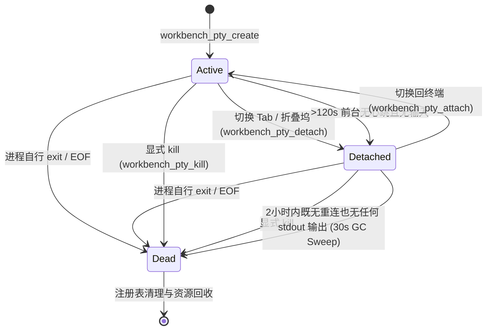

# 原生 ConPTY 纯终端与命令输出面板双轨架构深度分析与重构方案

> **文件标识**：`docs/system-audit-and-redesign/analysis/11-原生ConPTY纯终端与命令输出面板双轨架构方案.md`  
> **责任角色**：【子Agent 11: 原生 ConPTY 纯终端与命令输出面板双轨架构方案分析师】  
> **核心使命**：彻底解耦并规范化「用户原生交互终端」与「AI 命令输出只读面板」的双轨职责，深入剖析历史前端无法打字与输出混杂的根因，设计基于 Rust `portable-pty` 的 ConPTY 终端宿主与前端 `@xterm/xterm` 接入方案，制定命令监视器的只读流式与 UI 交互标准。  
> **遵循铁律**：`AGENTS.md`、`ANTI_OVERENGINEERING_GUARDRAILS.md`（pwsh7，写文件 UTF-8 无 BOM，纯逻辑分析，零代码回撤，严禁 git 提交）。

---

## 目录

- [一、顶层架构裁决与双轨愿景定义](#一顶层架构裁决与双轨愿景定义)
  - [1.1 核心诉求与双轨分工原则](#11-核心诉求与双轨分工原则)
  - [1.2 双轨架构全景交互拓扑](#12-双轨架构全景交互拓扑)
- [二、现状审计与历史遗留根因剖析](#二现状审计与历史遗留根因剖析)
  - [2.1 阶段一遗留：单次进程伪终端与无法打字的根因](#21-阶段一遗留单次进程伪终端与无法打字的根因)
  - [2.2 阶段二“垃圾桶效应”：AI 工具输出强行回灌终端 Store 的认知错位](#22-阶段二垃圾桶效应ai-工具输出强行回灌终端-store-的认知错位)
  - [2.3 阶段三重构后的 UI 导航撕裂：“在终端查看”的指鹿为马](#23-阶段三重构后的-ui-导航撕裂在终端查看的指鹿为马)
  - [2.4 前端 xterm.js 容器生命周期、DOM 焦点与 WebGL 降级缺陷](#24-前端-xtermjs-容器生命周期dom-焦点与-webgl-降级缺陷)
- [三、轨道一：原生交互纯终端（Native ConPTY Terminal）全栈架构设计](#三轨道一原生交互纯终端native-conpty-terminal全栈架构设计)
  - [3.1 核心设计理念：零业务侵入与 100% 原生体验](#31-核心设计理念零业务侵入与-100-原生体验)
  - [3.2 Rust 宿主：基于 portable-pty 的跨平台 PTY 服务](#32-rust-宿主基于-portable-pty-的跨平台-pty-服务)
  - [3.3 Shell 探测与层级回退算法](#33-shell-探测与层级回退算法)
  - [3.4 字符编码与环境净化（UTF-8 强制规范）](#34-字符编码与环境净化utf-8-强制规范)
  - [3.5 Tauri IPC 通道与事件流契约](#35-tauri-ipc-通道与事件流契约)
  - [3.6 三态生命周期状态机与 2 小时宽限期 GC 机制](#36-三态生命周期状态机与-2-小时宽限期-gc-机制)
  - [3.7 Windows Job Object 进程树防孤儿泄漏安全屏障](#37-windows-job-object-进程树防孤儿泄漏安全屏障)
  - [3.8 前端集成：@xterm/xterm + Addons 深度装配与分屏抗闪烁](#38-前端集成xtermxterm--addons-深度装配与分屏抗闪烁)
  - [3.9 多 Unit / 多 Session 会话隔离与复用（策略 A）](#39-多-unit--多-session-会话隔离与复用策略-a)
- [四、轨道二：AI 命令输出只读面板（Command Output Inspector）架构重构](#四轨道二ai-命令输出只读面板command-output-inspector架构重构)
  - [4.1 核心定位与原则：只读监视、结构化审计、绝对隔离](#41-核心定位与原则只读监视结构化审计绝对隔离)
  - [4.2 数据流与执行引擎：tokio 管道与 BackgroundTaskManager 联动](#42-数据流与执行引擎tokio-管道与-backgroundtaskmanager-联动)
  - [4.3 彻底废除 terminalStore.terminalLines 伪缓冲与回调注入](#43-彻底废除-terminalstoreterminallines-伪缓冲与回调注入)
  - [4.4 命令输出呈现体系三级矩阵重构](#44-命令输出呈现体系三级矩阵重构)
  - [4.5 UI 导航链路纠偏：“在终端查看”到“在命令检查器中查看”](#45-ui-导航链路纠偏在终端查看到在命令检查器中查看)
  - [4.6 结构化元数据展示与流式渲染优化](#46-结构化元数据展示与流式渲染优化)
- [五、双轨架构深度对比与交互矩阵](#五双轨架构深度对比与交互矩阵)
- [六、落地重构与迁移执行清单](#六落地重构与迁移执行清单)
  - [6.1 Rust 引擎与 IPC 适配清单](#61-rust-引擎与-ipc-适配清单)
  - [6.2 前端 Store 清理与 API 净化清单](#62-前端-store-清理与-api-净化清单)
  - [6.3 前端 UI 组件重构与新增清单](#63-前端-ui-组件重构与新增清单)
  - [6.4 验收断言与防退避测试套件设计](#64-验收断言与防退避测试套件设计)

---

## 一、顶层架构裁决与双轨愿景定义

### 1.1 核心诉求与双轨分工原则

在桌面级 AI 辅助编程与智能工作区环境中，命令行交互存在两种截然不同、不可调和的业务模式：

1. **用户主观发起的原生交互（Interactive Developer Shell）**：
   开发者需要一个完全符合操作系统标准行为的本地 Shell。他们需要运行 `vim`、`nano`、`git log` 分页器、`fzf` 交互选择器、`ssh` 会话，需要实时的双向按键响应、Tab 路径/命令自动补全、上下键历史翻阅、Ctrl+C 信号中断、VT100 光标定位和 24 位 TrueColor 彩色输出。任何业务层对按键的拦截、对输出的篡改、或者对命令执行的中间篡改，都会瞬间破坏开发者的心流与操作肌肉记忆。
2. **AI Agent 调用的命令执行只读流（AI Tool Execution Inspector）**：
   Agent 在后台规划并自动触发工具执行（如 `shell_command`、`cargo check`、`npm test`、`git status`、后台编译守护进程等）。此类执行属于系统级自动化脚本，要求严格的沙箱门禁、参数审查、超时熔断、删除形态重定向、退出码捕获以及结构化日志落盘。前端需要的是对其标准输出（stdout）、标准错误（stderr）、耗时、进程状态的**只读监视、分段折叠、内容高亮、一键复制与结果归档**。

**【铁律裁决】双轨必须物理与逻辑双重彻底解耦：**

- **原生交互终端（Native PTY Terminal）**：专属于人类用户，直通操作系统原生 ConPTY / PTY 宿主进程，零业务侵入，严禁 AI 静默写入任何日志，严禁将工具调用输出混入其 VT 屏幕缓冲区；
- **命令输出只读面板（Command Output Inspector）**：专属于 AI 工具审计与后台任务监视，直通异步进程管道（`tokio::process::Command`）与任务管理器（`BackgroundTaskManager`），严格只读，不接受键盘标准输入（除非特定后台任务显式输入），具备完整的结构化元数据呈现能力。

---

### 1.2 双轨架构全景交互拓扑

```mermaid
flowchart TD
    subgraph Track1 ["轨道一：原生交互纯终端 (Native PTY Terminal)"]
        UI_XTerm["前端 @xterm/xterm + Addons<br/>(TerminalCard.xterm.tsx)"]
        IPC_PTY["Tauri IPC 管道<br/>workbench_pty_write (stdin)<br/>workbench://pty-output (stdout)"]
        Rust_PTY["Rust ConPTY 宿主 (portable-pty)<br/>(apps/agent-workbench/.../pty/session.rs)"]
        OS_Shell["系统原生 Shell 进程<br/>(pwsh.exe / powershell.exe / /bin/zsh)"]

        UI_XTerm <-->|"双向原生字节流 (Keystrokes / ANSI VT100)"| IPC_PTY
        IPC_PTY <-->|"Master PTY 读写线程"| Rust_PTY
        Rust_PTY <-->|"ConPTY 伪控制台 API"| OS_Shell
    end

    subgraph Track2 ["轨道二：AI 命令输出只读面板 (Command Output Inspector)"]
        AI_Loop["Agent 会话循环<br/>(crates/agent-session-loop)"]
        Tool_Exec["agent-tools (ShellCommandTool)<br/>(crates/agent-tools/.../shell_exec.rs)"]
        SandBox["安全沙箱门禁 & 删除重定向<br/>(conex-sandbox Gatekeeper)"]
        Process_Pipe["无头子进程 (Stdio::piped)<br/>tokio::process::Command"]
        BG_Manager["后台任务管理器 (BackgroundTaskManager)<br/>(apps/agent-workbench/.../bg_registry.rs)"]
        Log_File["日志落盘文件<br/>(.agent-outputs / logs/tasks/*.log)"]

        UI_Inspector["前端命令监视器 & 聊天气泡<br/>(ToolCallOutput.tsx / CommandInspectorPanel)"]

        AI_Loop -->|"tool_call: shell_command"| Tool_Exec
        Tool_Exec -->|"前置检查"| SandBox
        SandBox -->|"放行"| Process_Pipe
        Process_Pipe -->|"adopt / 守护化"| BG_Manager
        BG_Manager -->|"写入"| Log_File
        Process_Pipe -->|"Progress::Text 流式分块"| AI_Loop
        AI_Loop -->|"BridgeEvent: tool-start / tool-progress / tool-end"| UI_Inspector
        BG_Manager -.->|"read_log / status 查询"| UI_Inspector
    end

    style Track1 fill:#1e1e24,stroke:#3b82f6,stroke-width:2px;
    style Track2 fill:#18181b,stroke:#10b981,stroke-width:2px;
```



---

## 二、现状审计与历史遗留根因剖析

### 2.1 阶段一遗留：单次进程伪终端与无法打字的根因

在早期版本中，系统试图以极简方式在前端提供终端能力，留下了以下架构断层：

1. **伪 Shell 执行器**：`apps/agent-workbench/src-tauri/src/process.rs` 中实现了 `workbench_run_shell`，其本质是每次执行都临时拉起一个独立的 `powershell.exe -NoProfile -Command ...` 进程，执行完毕后立即销毁并返回完整的字符串结果。
2. **状态与环境彻底丢失**：由于每次命令都是单发无状态的子进程，用户敲击 `cd foo` 之后，下一个命令的环境变量、工作目录瞬间还原；用户输入 `export FOO=1` 或 `$env:BAR=2` 在下一行完全失效。
3. **无交互能力（No Stdin Stream）**：单发子进程的 stdin 被置为 null 或忽略，当用户执行 `npm init`、`git commit`（触发编辑器）、`ssh` 或交互式 Python REPL 时，进程由于无法读取 stdin 直接死锁挂起或超时被杀。
4. **前端模拟敲字输入框**：前端 `apps/crish-desktop/src/api/terminalShellApi.ts` 与早期 UI 仅提供一个类似 Chat 输入框的 `<input>`，捕获 Enter 后将整行文本调 IPC 发送给 `workbench_run_shell`，再把结果文本转成字符串追加到 `terminalLines`。这根本不是终端，而是一个“命令回显简易计算器”，导致用户无法进行 Tab 补全、无法上下翻历史、无法使用快捷键，造成**“前端终端完全无法打字、无法交互”**的严重体验故障。

---

### 2.2 阶段二“垃圾桶效应”：AI 工具输出强行回灌终端 Store 的认知错位

随着架构演进，前端建立了独立的 `terminalStore.ts`，但在职责边界上发生了严重错位：

#### 代码证据 1：`terminalStore.ts` 的内存行缓存

在 [terminalStore.ts](file:///c:/Software/conex/apps/crish-desktop/src/store/terminalStore.ts#L24-L36) 中：

```typescript
export interface TerminalStore {
  /** 当前激活会话的终端行镜像（= terminalBySession[activeTerminalSessionId]） */
  terminalLines: string[];
  /** 按会话隔离的终端缓冲 */
  terminalBySession: Record<string, string[]>;
  activeTerminalSessionId: string | null;
  addTerminalLine: (line: string, sessionId?: string) => void;
  addTerminalLines: (lines: string[], sessionId?: string) => void;
  ...
}
```

#### 代码证据 2：AI 流式事件强行回灌终端 Store

在 [streamCallbacksEvents.ts](file:///c:/Software/conex/apps/crish-desktop/src/hooks/chat-stream/streamCallbacksEvents.ts#L201-L203) 与 [L228-L231](file:///c:/Software/conex/apps/crish-desktop/src/hooks/chat-stream/streamCallbacksEvents.ts#L228-L231) 中：

```typescript
// 当 AI 工具调用成功时：
if (isShellToolName(name) && displayOut) {
  addTerminalLines(displayOut.split('\n').slice(0, 80), sid);
}

// 当 AI 工具调用失败时：
const name = toolNames[toolId];
if (name && isShellToolName(name) && clean) {
  addTerminalLine(clean, sid);
}
```

#### 破坏性影响剖析：

1. **伪状态沉积**：`terminalStore` 变成了 AI 工具输出的“垃圾桶”，每次 Agent 执行 `git status`、`ls`、`cargo check`，其输出的前 80 行都会被强行硬编码灌入 `terminalStore`。
2. **幽灵数据与 UI 脱节**：实际在重构后的前端终端面板（`TerminalCard.tsx` / `TerminalCard.xterm.tsx`）中，UI 已经全面切换到了 `InteractiveXtermTerminal`，直接监听 Rust 后端的 `workbench://pty-output` 事件。`terminalStore.terminalLines` 里的这几百行数据在真正的终端面板上**根本没有被渲染**，成为了内存中的幽灵死数据。
3. **架构语义撕裂**：如果某天真有开发者将 `terminalStore.terminalLines` 重新渲染到 xterm 中，AI 的无序输出将与用户正在输入的命令提示符、PSReadLine 缓冲区、Vim 编辑器屏幕发生剧烈撞车，直接冲毁用户的终端屏幕缓冲区。

---

### 2.3 阶段三重构后的 UI 导航撕裂：“在终端查看”的指鹿为马

在聊天界面的工具输出块中，存在严重的交互跳转误导：

#### 代码证据：`ToolCallOutput.tsx` 的“在终端查看”逻辑

在 [ToolCallOutput.tsx](file:///c:/Software/conex/apps/crish-desktop/src/components/chat-tool-call/ToolCallOutput.tsx#L195-L210) 中：

```tsx
{
  longShell ? (
    <div className={styles.toolResultLongHint}>
      <Button
        type="button"
        variant="secondary"
        size="sm"
        className={styles.toolResultHintBtn}
        onClick={(e) => {
          e.stopPropagation();
          onOpenTerminal?.(); // <-- 触发跳转
        }}
      >
        在终端查看
      </Button>
    </div>
  ) : null;
}
```

#### 跟踪跳转目标：`useChatCardState.ts`

在 [useChatCardState.ts](file:///c:/Software/conex/apps/crish-desktop/src/components/chat-card/useChatCardState.ts#L388-L390) 中：

```typescript
const handleOpenTerminal = useCallback(() => {
  openSidePanel('terminal');
}, [openSidePanel]);
```

#### 交互灾难：

1. 用户在聊天气泡中看到 Agent 执行了一个长命令（例如 `npm test` 产生了 500 行日志），点击“在终端查看”。
2. 系统切出了右侧的 `TerminalCard`。
3. 然而，右侧的 `TerminalCard` 是一个全新的、原生的 PowerShell PTY 会话！
4. 用户看到的是一个光秃秃的 `PS C:\workspace\crish>` 提示符，**刚才那 500 行测试日志在终端里根本不存在**！
5. 用户产生强烈困惑：“我点了在终端查看，为什么终端是空的？我的命令输出去哪了？”
6. **根因归结**：系统将“查看工具调用的完整历史日志”错误地等同于“打开用户的交互式 Shell 终端”。

---

### 2.4 前端 xterm.js 容器生命周期、DOM 焦点与 WebGL 降级缺陷

在 `TerminalCard.xterm.tsx` 的实现中，虽然引入了 `@xterm/xterm`，但仍存在若干工程细节隐患：

1. **多 Unit / 布局切换时的焦点丢失**：xterm 依赖内部的隐藏 `<textarea>` 捕获键盘输入（`xterm-helpers textarea`）。当工作区在二叉树分屏、Tab 切换、折叠坞展开时，若容器未显式触发 `term.focus()`，键盘事件会被外层 React DOM 节点或全局快捷键监听器吞噬，导致用户“敲击无反应”。
2. **分屏拖拽重绘抖动（Resize Jitter）**：分屏调整大小时，若每帧都触发 `fitAddon.fit()` 和 IPC `ptyResize`，会导致后端频繁调用 Windows API `ResizePseudoConsole`，引起 ConPTY 字符重排缓冲区闪烁与 WebGL 渲染管线卡顿。
3. **WebGL 上下文丢失处理**：当 WebView2 发生 GPU 显存压力或多窗口分屏时，`WebglAddon` 触发 `onContextLoss` 后若未优雅回退至 Canvas 2D 渲染器，终端将呈现全黑状态。

---

## 三、轨道一：原生交互纯终端（Native ConPTY Terminal）全栈架构设计

### 3.1 核心设计理念：零业务侵入与 100% 原生体验

原生交互纯终端的目标是向开发者提供与 Windows Terminal、VS Code Integrated Terminal、iTerm2 完全一致的 100% 原生系统终端体验。

- **纯粹性**：不注入任何自定义 prompt 拦截器，不解析用户的每个输入字符做额外业务，不进行输出关键词过滤；
- **透明度**：前端与后端之间建立纯粹的**双向二进制/UTF-8 字符管道**；
- **高兼容**：全面支持 VT100 / VT220 / xterm 控制序列、光标移动、全屏应用（Alt Screen Buffer）、鼠标事件上报、RGB 24 位真彩色。

---

### 3.2 Rust 宿主：基于 portable-pty 的跨平台 PTY 服务

系统采用 Rust 工业级 PTY 库 `portable-pty`，在 Windows 平台直接绑定 Windows 10+ 官方原生 **ConPTY（Pseudo Console API）**，在 Unix 平台绑定 `openpty / fork / exec`。

```
┌─────────────────────────────────────────────────────────────┐
│                 Rust Tauri Process Host                     │
│                                                             │
│  ┌───────────────────────┐       ┌───────────────────────┐  │
│  │   Master PTY Pair     │       │   Child Process       │  │
│  │  ┌─────────────────┐  │       │  ┌─────────────────┐  │  │
│  │  │ Master Reader   │◄─┼───────┼──┤ ConPTY Output   │  │  │
│  │  │ (OS Thread)     │  │       │  │ (pwsh.exe)      │  │  │
│  │  └────────┬────────┘  │       │  └─────────────────┘  │  │
│  │           │           │       │           ▲           │  │
│  │  ┌────────▼────────┐  │       │  ┌────────┴────────┐  │  │
│  │  │ Master Writer   ├──┼───────┼─►│ ConPTY Input    │  │  │
│  │  │ (Mutex<Writer>) │  │       │  │ (Keystrokes)    │  │  │
│  │  └─────────────────┘  │       │  └─────────────────┘  │  │
│  └───────────────────────┘       └───────────────────────┘  │
│              ▲                               ▲              │
│              │ IPC (write/resize)            │ Job Object   │
│              ▼                               ▼ (KillOnClose)│
│     Tauri Command Dispatch          Windows Job Object Guard│
└─────────────────────────────────────────────────────────────┘
```

#### 核心代码实现架构（`apps/agent-workbench/src-tauri/src/pty/session.rs`）：

1. **PTY 尺寸与实例创建**：
   ```rust
   let pty_system = native_pty_system();
   let pair = pty_system.openpty(PtySize {
       rows: rows.max(1),
       cols: cols.max(1),
       pixel_width: 0,
       pixel_height: 0,
   })?;
   ```
2. **独立读线程（Dedicated OS Reader Thread）**：
   每一个 PTY 实例启动一个专有 OS 线程（`pty-read-{pty_id}`），使用 8192 字节缓冲区循环读取 Master 输出，并以事件 `workbench://pty-output` 实时发射给前端：
   ```rust
   thread::Builder::new()
       .name(format!("pty-read-{pty_id}"))
       .spawn(move || {
           let mut buf = [0u8; 8192];
           loop {
               match reader.read(&mut buf) {
                   Ok(0) => { /* EOF, 子进程退出 */ break; }
                   Ok(n) => {
                       session.touch(); // 刷新活跃时间戳
                       let data = String::from_utf8_lossy(&buf[..n]).into_owned();
                       let _ = app.emit("workbench://pty-output", PtyOutputEvent { pty_id, data });
                   }
                   Err(_) => break,
               }
           }
           // 收集退出码并广播
           let exit_code = child.wait().ok().map(|s| s.exit_code());
           let _ = app.emit("workbench://pty-exit", PtyExitEvent { pty_id, exit_code });
       })?;
   ```

---

### 3.3 Shell 探测与层级回退算法

在生成交互式 Shell 实例时，系统根据操作系统平台执行精确的 Shell 路径探测策略：

```mermaid
flowchart TD
    OS_Check{当前操作系统}

    OS_Check -->|Windows| Win_Pwsh{PATH 中存在 pwsh / pwsh.exe?}
    Win_Pwsh -->|是| Spawn_Pwsh[启动 PowerShell 7+: pwsh.exe -NoLogo]
    Win_Pwsh -->|否| Win_SysPS{System32 存在 WindowsPowerShell?}
    Win_SysPS -->|是| Spawn_WinPS[启动系统 Windows PowerShell: powershell.exe -NoLogo]
    Win_SysPS -->|否| Spawn_Cmd[回退启动 cmd.exe]

    OS_Check -->|macOS / Linux| Unix_Shell{环境变量 SHELL 存在且有效?}
    Unix_Shell -->|是| Spawn_UserShell[启动 $SHELL (如 /bin/zsh)]
    Unix_Shell -->|否| Unix_Bash{/bin/bash 存在?}
    Unix_Bash -->|是| Spawn_Bash[启动 /bin/bash -i (Login Shell)]
    Unix_Bash -->|否| Spawn_Sh[启动 /bin/sh]
```

- **参数规整**：所有 PowerShell 实例默认携带 `-NoLogo` 参数，去除冗余的版权启动横幅，提升启动速度并保持终端清爽；
- **初始工作目录**：严格解析前端传入的 `cwd`；若未传则优先绑定工作区根目录 `workspace_root`，确保用户打开终端即处于项目根目录。

---

### 3.4 字符编码与环境净化（UTF-8 强制规范）

Windows 传统控制台代码页（如 GBK / CodePage 936）是导致中文字符撕裂、乱码、光标错位的历史元凶。系统在 PTY 进程创建时注入严格的环境变量配置：

1. **Python / 脚本子工具强制 UTF-8**：
   ```rust
   cmd.env("PYTHONUTF8", "1");
   cmd.env("PYTHONIOENCODING", "utf-8");
   ```
2. **终端进程环境无污染**：不对用户交互 Shell 强加 `PAGER=cat`（`PAGER=cat` 仅用于 AI 只读命令执行），保留用户在交互终端中使用 `less`、`more`、`git diff` 交互分页器的完整权利。

---

### 3.5 Tauri IPC 通道与事件流契约

系统在 Tauri 壳层提供规范的、强类型契约的 IPC 接口集：

| 接口名称 / 事件名称         | 类型            | 入参 / 载荷                                                  | 返回值                                 | 说明                                                   |
| :-------------------------- | :-------------- | :----------------------------------------------------------- | :------------------------------------- | :----------------------------------------------------- |
| `workbench_pty_create`      | Command (async) | `{ sessionKey: string, cols: u16, rows: u16, cwd?: string }` | `Result<{ ptyId: string }, CoreError>` | 创建 PTY 宿主与进程，开启读写流                        |
| `workbench_pty_write`       | Command (sync)  | `{ ptyId: string, data: string }`                            | `Result<(), CoreError>`                | 将键盘按键或粘贴数据写入 Master Stdin（单次上限 64KB） |
| `workbench_pty_resize`      | Command (sync)  | `{ ptyId: string, cols: u16, rows: u16 }`                    | `Result<(), CoreError>`                | 动态通知 ConPTY 调整行列窗口尺寸                       |
| `workbench_pty_detach`      | Command (sync)  | `{ ptyId: string }`                                          | `Result<(), CoreError>`                | 前端切 Tab 或折叠时调用，进入游离保活态                |
| `workbench_pty_attach`      | Command (sync)  | `{ ptyId: string }`                                          | `Result<(), CoreError>`                | 前端切回终端时调用，重新附着为前台活跃态               |
| `workbench_pty_ping`        | Command (sync)  | `{ ptyId: string }`                                          | `Result<(), CoreError>`                | 心跳刷新活性时间戳                                     |
| `workbench_pty_kill`        | Command (sync)  | `{ ptyId: string }`                                          | `Result<(), CoreError>`                | 显式终止子进程并从注册表中销毁                         |
| `workbench://pty-output`    | Event           | `{ ptyId: string, data: string }`                            | -                                      | 后端向前端广播的原始 UTF-8 字符流分块                  |
| `workbench://pty-exit`      | Event           | `{ ptyId: string, exitCode?: u32 }`                          | -                                      | 子进程正常或异常退出事件                               |
| `workbench://pty-gc-killed` | Event           | `{ ptyId: string, exitCode?: u32 }`                          | -                                      | 游离会话因超期无活动被 GC 清理事件                     |

---

### 3.6 三态生命周期状态机与 2 小时宽限期 GC 机制

为防止用户在进行耗时操作（如长程编译 `cargo build`、大型模型下载、本地服务监听 `npm run dev`）时因切换 Tab 或折叠面板导致进程被误杀，系统设计了严密的三态生命周期管理机制：



- **Active（活跃前台态）**：前端正在展示，心跳正常；
- **Detached（游离后台态）**：前端组件卸载或切到其它工作区，底层子进程完全保留运行。**只要子进程持续产生 stdout 输出，读线程就会自动触发 `session.touch()` 刷新活性时间戳，绝对不会被 GC 误杀！**
- **Dead（已终止态）**：子进程已退出，等待注册表移除；
- **GC 宽限期策略**：后台以 30 秒为周期扫描，仅当一个会话处于 `Detached` 状态，且**连续 2 小时（7,200,000ms）没有任何连接且没有任何 stdout 输出**时，判定为僵尸泄漏会话，执行安全回收。
- **实例容量硬顶**：单桌面窗口最大允许 16 个活动 PTY 实例，超过直接在创建阶段以 `InvalidInput` 拦截，杜绝恶意耗尽系统句柄。

---

### 3.7 Windows Job Object 进程树防孤儿泄漏安全屏障

在 Windows 操作系统中，若宿主应用崩溃或被任务管理器直接强杀，通过标准 `CreateProcess` 启动的子 Shell 及其衍生的深层子进程（如 npm 启动的 node.exe）往往会变成失去父进程的孤儿，长期驻留后台占用端口。

#### 原生防御实现（`apps/agent-workbench/src-tauri/src/process.rs`）：

1. 宿主初始化专有 PTY Job Object：
   ```rust
   JOBOBJECT_EXTENDED_LIMIT_INFORMATION {
       BasicLimitInformation: JOBOBJECT_BASIC_LIMIT_INFORMATION {
           LimitFlags: JOB_OBJECT_LIMIT_KILL_ON_JOB_CLOSE,
           ..
       },
       ..
   }
   ```
2. 在 PTY 创建后，立即通过原生 Windows Handle 将子进程句柄压入该 Job Object：
   ```rust
   AssignProcessToJobObject(job_handle, child.as_raw_handle());
   ```
3. **断言保护**：一旦桌面宿主主进程因任何原因（崩溃、强制关闭、断电重启）终止，Windows 内核会自动关闭 Job Object 句柄，内核级瞬间级联清理整棵子进程树，零孤儿进程残留。

---

### 3.8 前端集成：@xterm/xterm + Addons 深度装配与分屏抗闪烁

前端在 `TerminalCard.xterm.tsx` 中完成现代化 xterm 的工业级集成：

#### 1. 核心实例配置

```typescript
const term = new Terminal({
  cursorBlink: true,
  cursorStyle: 'bar',
  disableStdin: false, // 必须开启 Stdin 保证按键捕获
  fontSize: 13,
  fontFamily:
    "'Cascadia Mono', 'Cascadia Code', 'JetBrains Mono', 'Consolas', 'Segoe UI Mono', monospace",
  lineHeight: 1.35,
  theme: {
    background: readCssVar('--terminal-bg'),
    foreground: readCssVar('--terminal-fg'),
    cursor: readCssVar('--terminal-cmd'),
    selectionBackground: readCssVar('--xterm-selection'),
    // ... 映射 16 色 ANSI 主题 Token
  },
  convertEol: true,
  scrollback: 5000,
  cols: 80,
  rows: 24,
});
```

#### 2. Addons 装配与 WebGL 弹性降级

```typescript
const fitAddon = new FitAddon();
term.loadAddon(fitAddon);

try {
  const webgl = new WebglAddon();
  webgl.onContextLoss(() => {
    try {
      webgl.dispose();
    } catch {}
  });
  term.loadAddon(webgl);
} catch {
  // WebGL 不可用时平滑降级至 Canvas 2D 渲染器
}
```

#### 3. 分屏拖拽抗闪烁节流（12fps 降采样）

在左右分屏或面板拖拽调整大小时，为避免 xterm 与 WebGL 频繁重绘导致的高频闪烁与 IPC 拥塞，引入智能状态感知防抖：

```typescript
const minInterval = isLayoutResizing() ? 80 : 32; // 拖拽中降采样至 12.5fps (80ms)
```

#### 4. 全键盘输入直通

```typescript
term.onData((data) => {
  const ptyId = ptyIdRef.current;
  if (!ptyId) return;
  void ptyWrite(ptyId, data); // 直通 Rust PTY Master Writer
});
```

---

### 3.9 多 Unit / 多 Session 会话隔离与复用（策略 A）

在 Conex / Crish 的多窗口与工作区布局中，用户可能开启多个分屏或切换不同会话。系统执行**策略 A（折坞复用，销毁关闭）**：

- **挂载与打开**：通过 `ptyRegistry.ensurePtyForSession(sessionKey)` 获取或复用已有 PTY 实例，折叠面板再打开时自动续连原有终端屏幕缓冲区与历史；
- **Tab 销毁与摘 Unit**：只有当用户明确关闭该会话 Tab 或关闭该分屏 Unit 时，才触发 `ptyRegistry.killPtyForSession(sessionKey)`，显式清理底层 PTY 进程；
- **会话键隔离**：每个终端实例严格以 `sessionKey` 隔离（优先绑定当前激活的会话 ID，无会话时绑定 `_global`），彻底杜绝会话间终端数据串扰。

---

## 四、轨道二：AI 命令输出只读面板（Command Output Inspector）架构重构

### 4.1 核心定位与原则：只读监视、结构化审计、绝对隔离

AI 命令输出只读面板（Command Output Inspector）是专为 Agent 自动化任务执行设计的可观测性中心。

- **纯粹只读**：不暴露 Shell 交互式输入；
- **全要素审计**：记录并展示执行的精确命令、参数、工作目录、执行耗时（毫秒级精确计时）、退出码（Exit Code）、标准输出（stdout）、标准错误（stderr）、是否超时、是否被安全门禁拦截；
- **大输出友好**：支持基于像素预算与行范围的分段流式加载、折叠展示、长日志外部文件链接；
- **物理隔离**：其数据流全部走 `ToolContext`、`BackgroundTaskManager` 与 `session-loop` 事件总线，**绝对不向 `terminalStore` 灌入任何一行数据，绝对不与原生 PTY 终端产生任何耦合**。

---

### 4.2 数据流与执行引擎：tokio 管道与 BackgroundTaskManager 联动

AI 命令的执行由 `crates/agent-tools/src/tools/shell.rs` 与 `shell_exec.rs` 统一驱动：

```
┌─────────────────────────────────────────────────────────────┐
│                    Agent Execution Loop                     │
│                              │                              │
│             1. CommandGatekeeper (AST 安全门禁)             │
│                              │                              │
│             2. DeleteShape 重定向至回收站 (conex-fs)        │
│                              │                              │
│             3. CD 形态拦截 (tool.cd_blocked)                │
│                              │                              │
│             4. 审批流拦截 (RequiresApproval -> ctx.ask)     │
│                              │                              │
│  ┌───────────────────────────┴───────────────────────────┐  │
│  │                     执行模式分流                      │  │
│  ├───────────────────────────┬───────────────────────────┤  │
│  │ Sync 模式 (实时流式)      │ Auto-Background / Daemon  │  │
│  │ - tokio::process::Command │ - 转移至 BackgroundManager│  │
│  │ - Stdio::piped()          │ - 独立日志落盘 (*.log)    │  │
│  │ - ToolProgress::Text 推送 │ - 资源监控采样 (*.jsonl)  │  │
│  │ - 超时树杀防护            │ - status / kill 管理接口  │  │
│  └───────────────────────────┴───────────────────────────┘  │
└─────────────────────────────────────────────────────────────┘
```

1. **子进程创建参数规范**：
   - Windows 平台使用 `CREATE_NO_WINDOW (0x0800_0000)` 隐藏控制台黑框闪烁；
   - 注入 `PYTHONUTF8=1`、`PYTHONIOENCODING=utf-8`、`PAGER=cat`（防止命令进入交互式分页死锁）；
   - 标准输入重定向为 `Stdio::null()`，标准输出与标准错误独立建立异步管道 `Stdio::piped()`。
2. **流式分块推送（Progressive Text Chunking）**：
   在同步执行路径中，通过异步 `BufReader` 逐行/逐块读取 stdout 和 stderr，封装为 `ToolProgress::Text` 实时推送至前端，供聊天界面和监视面板做打字机式的动态日志流展现。

---

### 4.3 彻底废除 terminalStore.terminalLines 伪缓冲与回调注入

#### 实施步骤：

1. **清理 `streamCallbacksEvents.ts`**：
   - 彻底删除第 201–203 行：
     ```typescript
     // 【彻底删除】
     if (isShellToolName(name) && displayOut) {
       addTerminalLines(displayOut.split('\n').slice(0, 80), sid);
     }
     ```
   - 彻底删除第 228–231 行：
     ```typescript
     // 【彻底删除】
     const name = toolNames[toolId];
     if (name && isShellToolName(name) && clean) {
       addTerminalLine(clean, sid);
     }
     ```
2. **重构 `terminalStore.ts`**：
   - 移除 `terminalLines`、`terminalBySession`、`activeTerminalSessionId`、`addTerminalLine`、`addTerminalLines`、`clearTerminalLines` 等伪终端状态；
   - 将 `terminalStore.ts` 纯化为 `diffStore.ts`（专注于工作区 Diff 缓冲管理），或者保留用于存储真正的 PTY 会话元数据（如 PTY 实例 ID 列表、活跃状态）；
   - 移除 `isDemoMode()` 中写死的 Mock 终端字符串 `'user@Windows-PC MINGW64 /c/workspace/crish'`。

---

### 4.4 命令输出呈现体系三级矩阵重构

AI 命令输出在前端构建三级清晰的呈现矩阵：

```
┌─────────────────────────────────────────────────────────────┐
│ Level 1: 聊天消息卡片内敛预览 (Compact Inline Tool Bubble)  │
│ ┌─────────────────────────────────────────────────────────┐ │
│ │ ⚙️ shell_command · git status                   [完成] │ │
│ │ $ git status                                            │ │
│ │ On branch master                                        │ │
│ │ Changes not staged for commit: ...                      │ │
│ │ [展开全部输出 (2,430 字符)] [在命令检查器中查看 ↗]      │ │
│ └─────────────────────────────────────────────────────────┘ │
└─────────────────────────────────────────────────────────────┘
                              │
                              ▼ (点击「在命令检查器中查看 ↗」)
┌─────────────────────────────────────────────────────────────┐
│ Level 2: 命令输出只读监视器 (Command Output Inspector Card) │
│ ┌─────────────────────────────────────────────────────────┐ │
│ │ 🖥️ 命令执行审计: shell_command               [复制完整日志]│ │
│ ├─────────────────────────────────────────────────────────┤ │
│ │ • 状态: 成功 (Exit 0)   • 耗时: 342ms   • 模式: sync     │ │
│ │ • 目录: c:/Software/conex                               │ │
│ │ • 命令: git status --porcelain=v1                       │ │
│ ├─────────────────────────────────────────────────────────┤ │
│ │ [stdout]                                                │ │
│ │  M apps/crish-desktop/src/components/terminal/          │ │
│ │  M crates/agent-tools/src/tools/shell.rs                │ │
│ │ [stderr] (无错误输出)                                   │ │
│ └─────────────────────────────────────────────────────────┘ │
└─────────────────────────────────────────────────────────────┘
                              │
                              ▼ (当命令转为后台长程任务时)
┌─────────────────────────────────────────────────────────────┐
│ Level 3: 后台任务管理面板 (Background Tasks Panel)          │
│ ┌─────────────────────────────────────────────────────────┐ │
│ │ 🔄 task-1 (npm run build)   • 运行中 · 45s   [终止任务] │ │
│ │ • CPU: 18.5%   • 内存: 142 MB   • 日志: logs/tasks/1.log│ │
│ │ • 实时尾部日志 (自动滚动):                              │ │
│ │   [webpack] compiling client bundle (78%)...            │ │
│ └─────────────────────────────────────────────────────────┘ │
└─────────────────────────────────────────────────────────────┘
```

---

### 4.5 UI 导航链路纠偏：“在终端查看”到“在命令检查器中查看”

针对前述的“指鹿为马”问题，执行精确的 UI 交互重塑：

1. **按钮文案与语义纠偏**：
   在 `ToolCallOutput.tsx` 中，将原按钮文案从 `在终端查看` 修改为 **`在命令检查器中查看`（或 `查看完整日志`）**：
   ```tsx
   {
     longShell ? (
       <div className={styles.toolResultLongHint}>
         <Button
           type="button"
           variant="secondary"
           size="sm"
           className={styles.toolResultHintBtn}
           onClick={(e) => {
             e.stopPropagation();
             onOpenCommandInspector?.(tc.id);
           }}
         >
           在命令检查器中查看
         </Button>
       </div>
     ) : null;
   }
   ```
2. **面板路由重定向**：
   将回调路由由 `openSidePanel('terminal')` 修正为打开专用的命令输出检查器面板或抽屉（`openSidePanel('command-inspector', { toolCallId: tc.id })`），展示对应工具调用的完整原始日志与结构化参数，**彻底不再跳转到原生交互终端**。

---

### 4.6 结构化元数据展示与流式渲染优化

命令输出监视器提供以下专业级特性：

1. **ANSI 颜色只读格式化渲染**：采用轻量 ANSI 转 HTML/CSS 处理器（如 `ansi-to-react` 或预处理 pipeline），在只读文本中准确呈现编译报错的高亮、红绿色 Diff 标识，而不引入全套 VT100 终端状态机；
2. **Pretext 像素预算与分段虚拟化**：结合现有 `@chenglou/pretext` 文本排版预算机制，在 400px 高度内截断展示，超长输出提供一键展开与下载 `.log` 原始文件；
3. **一键复制与分段复制**：提供「复制完整命令」、「复制标准输出」、「复制错误日志」按钮，提升开发者排错效率。

---

## 五、双轨架构深度对比与交互矩阵

| 比较维度                     | 轨道一：原生交互终端 (Native ConPTY)                       | 轨道二：AI 命令输出只读面板 (Command Inspector)            |
| :--------------------------- | :--------------------------------------------------------- | :--------------------------------------------------------- |
| **主要使用者**               | 人类开发者（Manual Interactive）                           | AI Agent 自动化工具调用（Automated Tool Call）             |
| **底层核心技术**             | Rust `portable-pty` (Windows ConPTY / Unix openpty)        | `tokio::process::Command` + `BackgroundTaskManager`        |
| **标准输入 (Stdin)**         | **100% 开放双向直通**（键盘、Tab、方向键、Ctrl+C、Vim）    | **关闭/重定向为 Null**（仅后台管理支持显式 send_input）    |
| **标准输出 (Stdout/Stderr)** | 实时 ANSI/VT100 字符流，直接写入 xterm.js 屏幕缓冲区       | 结构化捕获，经 JSON/Progress 事件流推送到前端              |
| **全屏 TUI 程序支持**        | **完全支持**（`vim`, `nano`, `htop`, `less`, `fzf`）       | **不支持**（遇到交互式命令强制 `PAGER=cat` 或超时）        |
| **环境与状态持久性**         | **会话级持久**（同一会话内环境变量、`cd` 目录持续有效）    | **单次调用隔离**（每次调用独立的进程沙箱上下文）           |
| **安全门禁介入**             | 启动 Shell 时设定初始目录与工作区边界，过程不阻断按键      | **每条命令必经 AST 门禁**、删除重定向与权限审批            |
| **前端展现载体**             | `@xterm/xterm` + `@xterm/addon-fit` + `@xterm/addon-webgl` | 结构化 React 组件（`ToolCallOutput` / `CommandInspector`） |
| **生命周期管理**             | Active / Detached / Dead 三态状态机，2小时宽限期 GC        | 同步随 Run 周期结束，后台任务由任务管理器接管              |
| **数据存储归宿**             | 操作系统 PTY 伪终端缓冲区（内存中）                        | 数据库/会话消息历史 JSON + 磁盘 `.log` 日志文件            |
| **UI 导航入口**              | 底部/右侧工具栏「终端」图标、快捷键 `Ctrl+\``              | 聊天卡片工具栏「在命令检查器中查看」、后台任务列表         |

---

## 六、落地重构与迁移执行清单

### 6.1 Rust 引擎与 IPC 适配清单

- [x] **ConPTY 核心宿主已就绪**：`apps/agent-workbench/src-tauri/src/pty/` 中的 `session.rs` 与 `mod.rs` 已完整实现基于 `portable-pty` 的会话注册表与读写管道；
- [ ] **清理弃用老旧命令**：标记废弃 `process.rs` 中的单次伪终端函数 `workbench_run_shell`，将其调用点安全迁移至 `agent-tools` 内部测试或彻底移除；
- [ ] **完善 Windows Job Object 绑定**：确保在所有 Windows 构建版本中，PTY 进程在 spawn 后无条件加入 `JOB_OBJECT_LIMIT_KILL_ON_JOB_CLOSE`；
- [ ] **验证 Shell 编码**：在 `pty/session.rs` 中确保 `pwsh.exe` 与 `powershell.exe` 启动时均注入 UTF-8 控制台参数。

### 6.2 前端 Store 清理与 API 净化清单

- [ ] **解耦 `terminalStore.ts`**：彻底剥离 `terminalLines` 与 `terminalBySession` 数组，移除无用的 `addTerminalLine` / `addTerminalLines` 写入入口；
- [ ] **净化事件监听流**：在 `streamCallbacksEvents.ts` 中删除所有向终端 Store 灌入工具输出的代码行（第 201–203 行与第 228–231 行）；
- [ ] **删除 Mock 数据**：清理 `terminalStore.ts` 中 `isDemoMode()` 生成的硬编码 MINGW64 假终端文本。

### 6.3 前端 UI 组件重构与新增清单

- [ ] **重构 `ToolCallOutput.tsx` 导航链路**：
  - 将「在终端查看」按钮更名为「在命令检查器中查看」；
  - 修改点击回调，由原 `onOpenTerminal` 转向专用的命令详情查看逻辑；
- [ ] **加固 `TerminalCard.xterm.tsx` 交互体验**：
  - 增加外层容器点击与激活时的自动 `term.focus()` 触发；
  - 确保分屏拖拽期间（`isLayoutResizing`）维持 12fps 的降采样节流，拖拽结束后补发最终尺寸同步；
  - 完善 WebGL 上下文丢失（ContextLoss）自动回退至 Canvas 渲染器的容灾保护；
- [ ] **新增/完善 `CommandInspectorPanel` 只读命令输出面板**：
  - 专门用于承接超长工具输出的完整浏览、关键字高亮搜索、退出码与执行耗时审计。

### 6.4 验收断言与防退避测试套件设计

为确保双轨架构在重构过程中不发生任何功能退避，制定以下铁律验收断言：

1. **原生交互终端可输入性断言**：
   - 用户打开终端面板后，输入 `Get-Date` 或 `echo "hello"`，能够立即在屏幕上看到字符回显并正确输出当前时间；
   - 用户敲击 `Tab` 键，能够触发当前目录文件名的自动补全；
   - 用户按方向键 `↑` / `↓`，能够正确调取历史命令；
   - 运行交互式命令（如 Node REPL、Python REPL），终端保持双向输入流通而不死锁。
2. **双轨数据零交叉污染断言**：
   - 在聊天界面触发 AI 执行 20 次 `shell_command`；
   - 检查原生终端屏幕，终端内**绝对不得出现**任何一行 AI 工具执行的日志；
   - 检查 `terminalStore` 内存，**绝对不得残留**任何工具输出行。
3. **命令监视器完整性断言**：
   - 触发一个产生 2000 行输出的测试脚本；
   - 聊天界面正确折叠并在 400px 预算内截断；
   - 点击「在命令检查器中查看」，能够在一个独立监视面板中完整翻阅全部 2000 行日志，并成功使用「复制全部」按钮。
4. **进程生命周期保活断言**：
   - 在原生终端中启动一个需要运行 60 秒的构建脚本；
   - 切换到代码编辑 Tab，等待 30 秒；
   - 切换回终端 Tab，构建脚本仍在正常运行且输出无缝续接，进程未被 GC 误杀。
