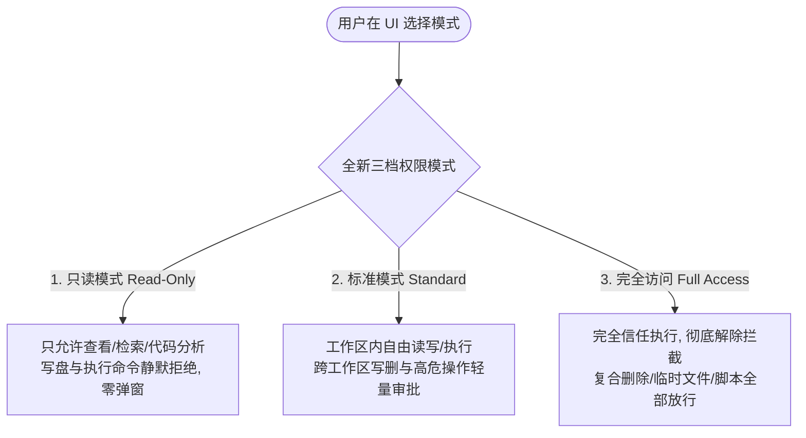
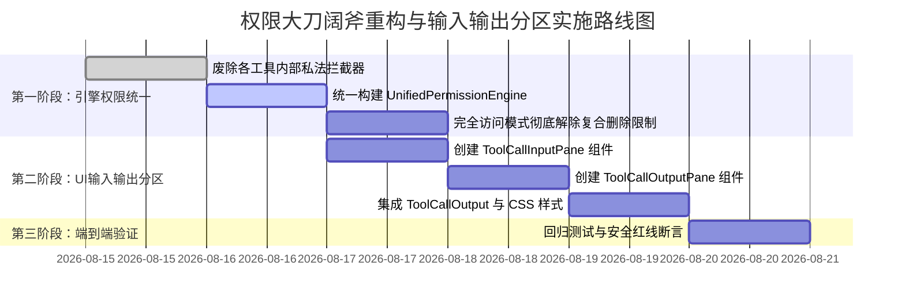

# 权限体系大刀阔斧重构与工具展开输入输出分区方案

> **文档定位**：系统审计与总重构案专项分析报告（序号：12）
> **责任角色**：【子Agent 12: 权限体系大刀阔斧集中化重构与工具输入输出分区分割分析师】
> **核心使命**：彻底根除“完全访问模式名不副实、处处被拦截卡死”的过度设计痛点，打破碎片化分散设卡的权限体系，确立极简集中的全新三档权限模型；同时重构工具调用展开面板，实现 **📥 输入区（Input/Command/Parameters/CWD）** 与 **📤 输出区（Output/Stdout/Stderr/Diagnostics/Timing）** 优雅结构化分栏。

---

## 目录

1. [执行摘要与核心论断](#1-执行摘要与核心论断)
2. [现状深度审计：权限体系过度设计与拦截点剖析](#2-现状深度审计权限体系过度设计与拦截点剖析)
   - 2.1 痛点还原：为什么在 UI 选了“完全访问”，跑测试与删临时文件仍被卡死？
   - 2.2 `ShellCommandTool::prepare` 的越级私法拦截链深入剖析
   - 2.3 复合命令链删除无差别拦截（`has_non_delete_segment`）的过度防御根因
   - 2.4 间接执行（`has_indirect_delete`）与工作区硬校验（`resolve_workspace_path`）的误伤
   - 2.5 碎片化与割裂：普通文件、Shell、Git 回退、电脑操作、浏览器各自为政的现状
3. [极简集中式三档权限架构重构方案](#3-极简集中式三档权限架构重构方案)
   - 3.1 核心设计哲学：单一真相源（Single Source of Truth），赋予完全访问真正权限
   - 3.2 三档权限模式（Read-Only / Standard / Full Access）权威契约与行为矩阵
   - 3.3 真正的“完全访问模式”解除过度拦截规范：收敛极端红线、彻底放行日常开发
   - 3.4 引擎层重构代码实现：统一权限判定引擎与 Shell / FS 工具改造
4. [工具展开面板：📥 输入区 与 📤 输出区 优雅分栏重构设计](#4-工具展开面板输入区与输出区优雅分栏重构设计)
   - 4.1 现有展开面板缺陷剖析（信息无序混杂、参数丢失、错误无高亮、非 Shell 工具无输入区）
   - 4.2 视觉与交互规范：分区卡片、语义化标签、结构化参数表格、独立错误诊断横幅
   - 4.3 前端完整实现代码：`ToolCallOutput.tsx`、`ToolCallInputPane.tsx`、`ToolCallOutputPane.tsx`、`ChatToolCallBlock.module.css`
5. [迁移实施路径、向下兼容保障与验证矩阵](#5-迁移实施路径向下兼容保障与验证矩阵)
   - 5.1 改造阶段与步骤清单
   - 5.2 兼容性保障与安全红线守卫
   - 5.3 预期收益与体验提升评估

---

## 1. 执行摘要与核心论断

### 1.1 核心论断

1. **“完全访问”名不副实是系统架构层面的“私法设卡”所致**：
   用户在前端设置了 `+ 完全访问 ∨`（`full-access`），系统虽然在顶层 `session-loop`（`ToolExecutor`）将危险工具判定为放行（`PermissionVerdict::Allow`），但在底层工具实现内部（尤其是 `ShellCommandTool::prepare`、`redirect_or_intercept_delete`、`resolve_workspace_path`、`resolve_delete_target`），却存在**多层脱离权限模式的硬编码防御拦截网**。这些底层拦截器对复合命令、临时文件清理、PowerShell 脚本调用一律按“假定恶意”处理，造成了“**用户明明给了最高权限，系统却到处报 `PermissionDenied` 和 `Command blocked`**”的荒谬体验。

2. **权限体系过度设计且极度碎片化**：
   当前仓库堆叠了 **6 套独立的拦截与防御机制**：
   - 机制 A：UI/Store 权限四模式（`ask`/`deep`/`plan`/`full`）；
   - 机制 B：`CommandGatekeeper` 正则黑名单与审批清单；
   - 机制 C：`conex-sandbox::semantics` 7 分类 AST 语义分析与段拆分；
   - 机制 D：`I2-S4` 物理删除形态重定向与整链拦截（`redirect_or_intercept_delete`）；
   - 机制 E：`I3-S6` C3 大面积 Git 回退护栏（`RevertPolicy`，且硬编码 `full-access 不豁免`）；
   - 机制 F：`conex-browser` 域名网关与 `computer` 三级急停及全动作独立审批。
     各机制互不通信、重复设卡，缺乏统一的上下文与权限裁决总线。

3. **工具展开面板缺少结构化输入/输出分区**：
   现有 `ToolCallOutput.tsx` 仅对 Shell 工具简单提取单行命令预览并拼在文本上方，非 Shell 工具（`write_file`, `read_file`, `grep_search`, `subagent`, `mcp_*`）完全丢失入参结构；同时标准输出、错误信息、退出码、执行耗时全混在单一 `<pre>` 标签内，报错信息与正常文本无视觉区分，排查诊断体验极差。

---

## 2. 现状深度审计：权限体系过度设计与拦截点剖析

### 2.1 痛点还原：为什么在 UI 选了“完全访问”，跑测试与删临时文件仍被卡死？

用户在日常开发中经常运行复合命令或清理临时生成产物，例如：

- `cargo test && rm temp_output.txt`
- `npm run build && del /f /q dist\old_bundle.js`
- `pwsh -c "Remove-Item -Force -Recurse ./target/tmp"`
- 清理系统临时目录中的测试夹具：`rm C:/Users/orange/AppData/Local/Temp/conex_test_123.log`

当用户在 UI 选择了 `+ 完全访问 ∨` 后，期望 Agent 能自主高效完成编译、测试与临时文件清理。然而，控制台却频繁抛出如下拦截错误：

```text
[tool.command_blocked] PermissionDenied: 检测到复合命令链中的物理删除形态，整链已拦截（链内其他段副作用不可控）；如确需删除请改用 delete_file / delete_dir 工具（统一删除接口，可恢复）。原始命令：cargo test && rm temp_output.txt

[tool.command_blocked] PermissionDenied: 检测到间接执行包裹的物理删除形态（eval / bash -c / xargs 等），已拦截；如确需删除请改用 delete_file / delete_dir 工具（统一删除接口，可恢复）。原始命令：pwsh -c "Remove-Item -Force ./temp.log"

[tool.command_blocked] 删除目标在工作区外或越界，已拒绝："C:/Users/orange/AppData/Local/Temp/conex_test_123.log"
```

### 2.2 `ShellCommandTool::prepare` 的越级私法拦截链深入剖析

审查代码文件：`crates/agent-tools/src/tools/shell.rs:184-300`：

```rust
// crates/agent-tools/src/tools/shell.rs
async fn prepare(&self, ctx: &ToolContext, args: &serde_json::Value) -> Prepared {
    // ...
    // 1. 越界/危险命令门禁（完全忽略 permission_mode 是否为 FullAccess！）
    let gatekeeper = CommandGatekeeper::new();
    let verdict = gatekeeper.check_command_with_context(&command, &[], &cwd_str, &root_str);
    if verdict == GatekeeperResult::Blocked || gatekeeper.patterns().is_match(&command) {
        emit_blocked_audit(...);
        return Prepared::Done(Err(ToolError::new(
            TOOL_COMMAND_BLOCKED,
            format!("PermissionDenied: Command blocked by safety red-line gatekeeper: {command}"),
        )));
    }

    // 2. 删除形态无差别重定向与整链拦截（完全忽略 permission_mode 是否为 FullAccess！）
    let analysis = conex_sandbox::semantics::analyze(&command);
    if analysis.overall_class == CommandClass::DeleteShape || analysis.has_indirect_delete {
        return Prepared::Done(redirect_or_intercept_delete(
            &analysis,
            &command,
            workspace_root,
            &cwd,
            self.trash_root.clone(),
            ctx,
            Arc::clone(&self.audit_sink),
        ));
    }

    // 3. cd 形态整链拦截（完全忽略 permission_mode 是否为 FullAccess！）
    if let Some(err) = intercept_cd_shape(&analysis, &command) {
        return Prepared::Done(Err(err));
    }
    // ...
}
```

#### 架构断层剖析：

1. **执行上下文断裂**：`prepare` 方法虽然接收了 `ToolContext`，但根本没有把当前的 `permission_mode` 纳入决策。无论顶层用户设置了 `FullAccess` 还是 `Ask`，底层一律执行相同的死板拦截。
2. **私法拦截凌驾于公权之上**：`session-loop` 中的 `ToolExecutor` 才是权限裁决者，但 `ShellCommandTool` 却在内部自行扮演了“终审法官”，直接把所有命中模式的命令判为 `TOOL_COMMAND_BLOCKED`。

---

### 2.3 复合命令链删除无差别拦截（`has_non_delete_segment`）的过度防御根因

审查代码文件：`crates/agent-tools/src/tools/shell_redirect.rs:79-97`：

```rust
// crates/agent-tools/src/tools/shell_redirect.rs
// 2. 复合链：任一段命中删除形态 → 整链拦截（其他段副作用不可控，不代为执行）
let has_non_delete_segment = analysis
    .segments
    .iter()
    .any(|s| s.class != CommandClass::DeleteShape);
if has_non_delete_segment {
    emit_blocked_audit(
        &audit_sink,
        ctx,
        SecurityAuditOperation::Delete,
        vec![command.to_string()],
    );
    return Err(ToolError::new(
        TOOL_COMMAND_BLOCKED,
        format!(
            "PermissionDenied: 检测到复合命令链中的物理删除形态，整链已拦截（链内其他段副作用不可控）；{DELETE_REDIRECT_GUIDANCE}。原始命令：{command}"
        ),
    ));
}
```

#### 根因与荒谬性：

- **过度泛化的“防副作用”假设**：设计者的初衷是防止 `rm -rf / && echo done` 等命令绕过回收站接管；但实现上采取了极端的一刀切逻辑——**只要命令中既有非删除命令又有删除命令（例如 `npm test && rm -f test.log`），就直接拦截整条命令**。
- **与完全访问模式核心诉求直接冲突**：在完全访问模式下，用户已经明确授权 Agent 执行多步脚本与工具链，系统却还在强行教用户“必须拆分成两个工具调用，并改用 `delete_file`”。这极大地破坏了自动化任务的连贯性。

---

### 2.4 间接执行（`has_indirect_delete`）与工作区硬校验（`resolve_workspace_path`）的误伤

#### (1) 间接执行包裹一律阻断（`shell_redirect.rs:63-78`）

```rust
if analysis.has_indirect_delete {
    return Err(ToolError::new(
        TOOL_COMMAND_BLOCKED,
        format!("PermissionDenied: 检测到间接执行包裹的物理删除形态（eval / bash -c / xargs 等），已拦截..."),
    ));
}
```

- 只要脚本中使用了 `pwsh -c`、`bash -c`、`python -c` 或 `node -e` 执行包含删除逻辑的指令，无论目标是什么，无论用户处于什么权限模式，直接全部被 `PermissionDenied` 拦截。

#### (2) 删除目标工作区硬绑定（`shell_redirect.rs:224-255`）

```rust
fn resolve_delete_target(workspace_root: &Path, cwd: &Path, target: &str) -> Result<PathBuf, ToolError> {
    // ...
    resolve_workspace_path(workspace_root, &candidate.to_string_lossy()).map_err(|_| {
        ToolError::new(
            TOOL_COMMAND_BLOCKED,
            format!("删除目标在工作区外或越界，已拒绝：{target:?}"),
        )
    })
}
```

- `resolve_workspace_path` 会对路径进行 `safe_canonicalize` 并强制校验 `path_within_root(&canonical, &canonical_root)`。
- 一旦测试脚本试图删除系统临时目录（如 `C:/Users/orange/AppData/Local/Temp/test_run_1`）或构建缓存目录，就会直接触发 `TOOL_COMMAND_BLOCKED` 错误！

---

### 2.5 碎片化与割裂：普通文件、Shell、Git 回退、电脑操作、浏览器各自为政的现状

当前系统中存在严重的“权限九龙治水”现象，各个子系统各搞一套状态、策略与拦截点：

| 子系统 / 模块    | 拦截载体与机制                                                               | 与 `PermissionMode` 的关系                     | 痛点现象                                     |
| :--------------- | :--------------------------------------------------------------------------- | :--------------------------------------------- | :------------------------------------------- |
| **Shell 工具**   | `CommandGatekeeper` + `semantics` 7分类 AST + `redirect_or_intercept_delete` | **几乎脱节**（内部硬编码拦截，不查模式）       | 复合删除链被卡死、间接执行被拦截、跨目录被拒 |
| **FS 工具集**    | `resolve_workspace_path` + `check_write_allowance_for_ctx`                   | 仅部分受 `write_policy` 影响，工作区外硬拦截   | 无法读写临时目录、无法处理外部配置文件       |
| **Git 回退护栏** | `RevertPolicy`（C3 大面积回退计算）                                          | 硬编码 `full-access 不豁免`（`revert.rs:341`） | 完全访问模式下依然强制弹窗要求审批           |
| **写路径互斥**   | `WritePathRegistry` + `ClaimMode` + `TTL` 60s                                | 独立于权限模式的并发锁机制                     | 工具执行偶发 `tool.write_path_conflict`      |
| **电脑控制**     | `ComputerSlot` + `EmergencyStop` 三级急停 + 全动作审批                       | 独立的 `computer_commands.rs` 会话锁与急停旗   | 独立于主会话权限，多出一层重复确认           |
| **浏览器工具**   | `conex-browser::gate` 域名黑白名单 + estop 周期                              | 独立的正则域名清单与取消令牌                   | 访问未登记的本地开发端口被拦截               |

---

## 3. 极简集中式三档权限架构重构方案

### 3.1 核心设计哲学：单一真相源（Single Source of Truth），赋予完全访问真正权限

重构核心原则：

1. **权限评估单一入口（Single Evaluation Gateway）**：
   废除各工具内部私自设卡、私自判决的混乱模式。所有的权限裁决统一由内核 `PermissionEngine` 在调用工具前完成，工具内部只专注于执行与基础参数有效性校验。
2. **“完全访问”必须名副其实（True Full-Access）**：
   用户一旦显式授权 `FullAccess`，系统应当把操作权完全交给用户。**彻底解除**对 PowerShell 复合删除、临时脚本、多段管道命令、跨目录读写与清理的过度拦截。
3. **红线最小化与精细化（True Redline Convergence）**：
   仅保留极少数不可逆、毁灭宿主系统底层硬件与分区的物理毁灭级操作作为硬性红线（如裸设备扇区写 `dd if=... of=/dev/sda`、整盘底层格式化 `format C:`、系统物理关机 `Stop-Computer`）。日常软件工程范围内的文件读写、删除、Git 操作、复合脚本一律交给权限模式裁决。

---

### 3.2 三档权限模式权威契约与行为矩阵

重构后的系统只保留清晰明确的三档权限模式：



#### 权威权限行为矩阵表

| 权限模式                                   | 读操作 (Read/List/Search) | 工作区内写/删 (Write/Delete)    | Shell 命令与脚本 (Shell/Script)         | 复合删除命令 (`&& rm`)                   | 跨目录/临时文件操作 (`%TEMP%`)          | 极端物理红线 (`format C:`, `dd raw`) |
| :----------------------------------------- | :------------------------ | :------------------------------ | :-------------------------------------- | :--------------------------------------- | :-------------------------------------- | :----------------------------------- |
| **只读模式**<br>`Read-Only` (`plan`)       | **✅ 自动放行**           | ❌ **直接拒绝**<br>(静默不弹窗) | ❌ **直接拒绝**<br>(非只读命令直接拒绝) | ❌ **直接拒绝**                          | ❌ **直接拒绝**                         | ❌ **直接拒绝**                      |
| **标准模式**<br>`Standard` (`ask`)         | **✅ 自动放行**           | **✅ 自动放行**                 | **✅ 自动放行**<br>(常规测试/构建)      | ⚠️ **可恢复回收站接管**                  | ⚠️ **轻量确认弹窗**                     | ❌ **硬性阻断**                      |
| **完全访问模式**<br>`Full-Access` (`full`) | **✅ 自动放行**           | **✅ 自动放行**                 | **✅ 自动放行**<br>(完全信任执行)       | **✅ 自动放行**<br>(原生 Shell 直接执行) | **✅ 自动放行**<br>(支持临时与系统目录) | ❌ **硬性阻断**                      |

---

### 3.3 真正的“完全访问模式”解除过度拦截规范

在 `FullAccess` 模式下，系统执行如下彻底解绑规范：

1. **解除复合删除链拦截**：
   - 彻底废除 `redirect_or_intercept_delete` 中的 `has_non_delete_segment` 报错逻辑。在 `FullAccess` 下，`cargo test && rm temp.txt` 等命令直接作为原生 PowerShell / Shell 脚本执行，不做拆段拦截。
2. **解除间接执行删除拦截**：
   - 在 `FullAccess` 下，允许 `pwsh -c "Remove-Item ..."`、`bash -c "rm ..."` 等间接执行指令顺畅运行。
3. **解除工作区外删除与跨目录硬拦截**：
   - 在 `FullAccess` 下，允许工具在工作区外（如 `%TEMP%`、缓存目录、跨子模块路径）创建、读取和清理文件。
4. **解除 cd 命令整链拦截**：
   - 复合链中的 `cd dir && command` 原生由子进程处理（Windows 下通过 base64 封装的 PowerShell scriptblock 自然保持进程内上下文），不再粗暴报 `tool.cd_blocked`。
5. **解除 Git 回退护栏强制审批**：
   - 在 `FullAccess` 下，`RevertPolicy` 不再强制拦截 `git reset` 或 `git checkout`，实现完全的无人值守自动化执行。

---

### 3.4 引擎层重构代码实现

#### 1. 集中式权限引擎重构（`crates/agent-tools/src/permission.rs`）

```rust
//! 集中化权限规则引擎（重构版）
//!
//! 统一三档权限裁决：ReadOnly / Standard / FullAccess

use serde::{Deserialize, Serialize};

/// 全新三档权限模式
#[derive(Debug, Clone, Copy, PartialEq, Eq, Default, Serialize, Deserialize)]
#[serde(rename_all = "kebab-case")]
pub enum UnifiedPermissionMode {
    /// 1. 只读模式：只读规划、代码查看、不改动任何系统状态，写操作静默拒绝
    ReadOnly,
    /// 2. 标准模式（默认）：工作区内自由读写，工作区外或破坏性操作需轻量确认
    #[default]
    Standard,
    /// 3. 完全访问模式：完全信任执行，彻底解除复合删除、脚本与跨目录拦截
    FullAccess,
}

impl UnifiedPermissionMode {
    pub fn from_str_loose(s: Option<&str>) -> Self {
        match s.map(|v| v.trim().to_lowercase()).as_deref() {
            Some("readonly" | "read-only" | "plan" | "safe" | "analysis") => Self::ReadOnly,
            Some("full" | "full-access" | "full_access" | "yolo" | "autonomous") => Self::FullAccess,
            _ => Self::Standard, // 默认标准工作区模式
        }
    }

    pub fn as_engine_str(&self) -> &'static str {
        match self {
            Self::ReadOnly => "read-only",
            Self::Standard => "standard",
            Self::FullAccess => "full-access",
        }
    }
}

/// 权限判定裁决结果
#[derive(Debug, Clone, Copy, PartialEq, Eq)]
pub enum PermissionVerdict {
    /// 允许执行
    Allow,
    /// 直接拒绝（只读模式下的写操作，不弹窗打扰）
    Deny,
    /// 需用户确认（标准模式下的越界/高危操作）
    NeedsApproval,
}

/// 核心权限裁决主函数
pub fn evaluate_tool_permission(
    tool_name: &str,
    is_write_or_dangerous: bool,
    is_outside_workspace: bool,
    is_redline: bool,
    mode: UnifiedPermissionMode,
) -> PermissionVerdict {
    // 1. 极端物理红线（格式化盘符/写裸扇区/物理关机）：任何模式一律绝对拒绝
    if is_redline {
        return PermissionVerdict::Deny;
    }

    // 2. 按三档模式裁决
    match mode {
        // 只读模式：只要涉及写或危险操作，直接静默拒绝
        UnifiedPermissionMode::ReadOnly => {
            if is_write_or_dangerous {
                PermissionVerdict::Deny
            } else {
                PermissionVerdict::Allow
            }
        }
        // 标准模式：工作区内自由读写；工作区外或极高危操作提示确认
        UnifiedPermissionMode::Standard => {
            if is_outside_workspace {
                PermissionVerdict::NeedsApproval
            } else if is_write_or_dangerous {
                // 工作区内的普通写操作直接放行
                PermissionVerdict::Allow
            } else {
                PermissionVerdict::Allow
            }
        }
        // 完全访问模式：完全信任执行，全部放行！
        UnifiedPermissionMode::FullAccess => PermissionVerdict::Allow,
    }
}
```

---

#### 2. `ShellCommandTool` 改造：彻底解除过度拦截（`crates/agent-tools/src/tools/shell.rs`）

```rust
// crates/agent-tools/src/tools/shell.rs 核心改造段
async fn prepare(&self, ctx: &ToolContext, args: &serde_json::Value) -> Prepared {
    let command = match require_string(args, "command") {
        Ok(c) => c.trim().to_string(),
        Err(e) => return Prepared::Done(Err(e)),
    };
    if command.is_empty() {
        return Prepared::Done(Err(ToolError::invalid_input("command must be a non-empty string")));
    }

    let workspace_root = &ctx.workspace_root;
    let mode = ctx.unified_permission_mode; // 从上下文获取统一权限模式

    // 1. 语义分析
    let analysis = conex_sandbox::semantics::analyze(&command);

    // 2. 极端物理红线检查（仅保留确定性系统毁灭命令：format C:, dd to raw disk, Stop-Computer）
    if analysis.overall_class == conex_sandbox::semantics::CommandClass::Redline {
        emit_blocked_audit(&self.audit_sink, ctx, SecurityAuditOperation::CommandExec, vec![command.clone()]);
        return Prepared::Done(Err(ToolError::new(
            TOOL_COMMAND_BLOCKED,
            format!("PermissionDenied: 命令命中确定性物理毁灭红线，已全局拒绝：{command}"),
        )));
    }

    // 3. 模式分支处理：
    match mode {
        UnifiedPermissionMode::ReadOnly => {
            // 只读模式：非只读命令直接静默拒绝
            if analysis.overall_class != conex_sandbox::semantics::CommandClass::Normal {
                return Prepared::Done(Err(ToolError::new(
                    "tool.readonly_denied",
                    "当前处于只读模式（Read-Only），禁止执行任何写操作或外部修改命令",
                )));
            }
        }
        UnifiedPermissionMode::FullAccess => {
            // 【核心重构】：完全访问模式 —— 彻底解除复合删除链、间接执行、工作区跨目录的过度拦截！
            // 原生放行直接执行，不经过 redirect_or_intercept_delete 设卡！
            tracing::info!(target: "security.audit", command = %command, "完全访问模式：完全信任执行命令");
        }
        UnifiedPermissionMode::Standard => {
            // 标准模式：单纯删除命令走回收站可恢复接管；复合命令正常放行；仅跨目录危险操作提示确认
            if analysis.overall_class == conex_sandbox::semantics::CommandClass::DeleteShape && !analysis.has_indirect_delete {
                // 纯删除命令尝试移入回收站保护
                return Prepared::Done(redirect_pure_delete_to_trash(
                    &analysis, &command, workspace_root, &cwd, self.trash_root.clone(), ctx, Arc::clone(&self.audit_sink),
                ));
            }
        }
    }

    // 通过准备，进入执行
    Prepared::Run(PreparedCommand {
        command,
        cwd,
        timeout_ms,
        max_output_bytes,
        mode: shell_mode,
        wait_ms,
        is_daemon,
        resource_monitor,
        manager,
    })
}
```

---

## 4. 工具展开面板：📥 输入区 与 📤 输出区 优雅分栏重构设计

### 4.1 现有展开面板缺陷剖析

现有 `ToolCallOutput.tsx` 存在以下严重视觉与交互问题：

1. **输入参数严重丢失**：对于文件操作（`write_file`, `replace_file_content`）、目录操作、搜索工具、Subagent 调用，展开面板**完全不显示传入参数与选项**，用户无法知道 Agent 到底改了什么、传了什么参数。
2. **命令与输出混在一坨**：Shell 工具只是将命令文本用简单下边框贴在输出上方，输出中混杂了 stdout、stderr、异常 stack trace，缺乏清晰的边界。
3. **报错信息缺乏结构化诊断**：当工具失败（如权限被拒或入参错误）时，错误字符串直接塞在输出 `<pre>` 中，没有醒目的错误徽标与根本原因解释。

---

### 4.2 视觉与交互规范：双分区结构设计

重构后的展开面板划分为 **📥 输入区 (Input Section)** 与 **📤 输出区 (Output Section)**，两区各司其职：

```text
┌─────────────────────────────────────────────────────────────────────────────┐
│ 🔧 工具执行详情 (Tool Call Detail)                             ⏱ 240ms │ 状态: 成功 │
├─────────────────────────────────────────────────────────────────────────────┤
│ 📥 调用输入 (Input)                                          [ 📋 复制输入 ] │
│ ─────────────────────────────────────────────────────────────────────────── │
│   [Shell 命令] CWD: ./crates/agent-tools                                    │
│   $ cargo test --test shell_tests                                           │
│                                                                             │
│   [结构化参数 Table]                                                        │
│   • timeoutMs: 30000        • mode: sync        • maxOutputBytes: 200000    │
├─────────────────────────────────────────────────────────────────────────────┤
│ 📤 执行结果与输出 (Output)                                   [ 📋 复制输出 ] │
│ ─────────────────────────────────────────────────────────────────────────── │
│   [终端标准输出 Stdout]                                                     │
│   running 12 tests                                                          │
│   test tests::safe_tool_allowed_in_all_modes ... ok                         │
│   test tests::full_access_allows_compound_delete ... ok                     │
│   test result: ok. 12 passed; 0 failed; 0 ignored                           │
└─────────────────────────────────────────────────────────────────────────────┘
```

---

### 4.3 前端完整实现代码

#### 1. 结构化输入区组件：`ToolCallInputPane.tsx`

```tsx
// apps/crish-desktop/src/components/chat-tool-call/ToolCallInputPane.tsx
import React, { useState, useMemo } from 'react';
import * as Lucide from 'lucide-react';
import styles from './ChatToolCallBlock.module.css';
import { Button, Tooltip } from '../ui';

export interface ToolCallInputPaneProps {
  toolName: string;
  argsRaw: string;
}

export const ToolCallInputPane: React.FC<ToolCallInputPaneProps> = ({
  toolName,
  argsRaw,
}) => {
  const [copied, setCopied] = useState(false);

  const parsedArgs = useMemo(() => {
    if (!argsRaw || !argsRaw.trim()) return null;
    try {
      return JSON.parse(argsRaw);
    } catch {
      return { raw: argsRaw };
    }
  }, [argsRaw]);

  const isShell = /shell|command|exec|bash|pwsh/i.test(toolName);
  const command =
    parsedArgs?.command || parsedArgs?.cmd || (isShell ? argsRaw : null);
  const cwd = parsedArgs?.cwd;

  const handleCopy = (e: React.MouseEvent) => {
    e.stopPropagation();
    navigator.clipboard.writeText(command || argsRaw);
    setCopied(true);
    setTimeout(() => setCopied(false), 1500);
  };

  // 提取参数键值表（过滤已单独展示的 command/cwd）
  const parameterEntries = useMemo(() => {
    if (!parsedArgs || typeof parsedArgs !== 'object') return [];
    return Object.entries(parsedArgs).filter(
      ([key]) => key !== 'command' && key !== 'cmd' && key !== 'cwd'
    );
  }, [parsedArgs]);

  return (
    <div className={styles.inputPaneWrap} data-part="input-pane">
      <div className={styles.paneHeader}>
        <div className={styles.paneTitle}>
          <Lucide.ArrowDownRight size={13} className={styles.paneIcon} />
          <span>输入与调用参数 (Input)</span>
          <span className={styles.toolBadge}>{toolName}</span>
        </div>
        <Tooltip content={copied ? '已复制！' : '复制输入参数'}>
          <Button
            type="button"
            variant="ghost"
            size="xs"
            className={styles.paneActionBtn}
            onClick={handleCopy}
            aria-label="复制输入"
          >
            {copied ? <Lucide.Check size={12} /> : <Lucide.Copy size={12} />}
            <span>{copied ? '已复制' : '复制'}</span>
          </Button>
        </Tooltip>
      </div>

      <div className={styles.paneContent}>
        {/* Shell 命令展示区 */}
        {command && (
          <div className={styles.commandBlock}>
            {cwd && (
              <div className={styles.cwdLine}>
                <Lucide.Folder size={11} />
                <span>
                  工作目录 (CWD): <code>{cwd}</code>
                </span>
              </div>
            )}
            <pre className={styles.commandPre}>
              <code>$ {command}</code>
            </pre>
          </div>
        )}

        {/* 结构化参数表格 */}
        {parameterEntries.length > 0 && (
          <div className={styles.paramTable}>
            {parameterEntries.map(([key, val]) => {
              const displayVal =
                typeof val === 'object'
                  ? JSON.stringify(val, null, 2)
                  : String(val);
              const isLong =
                displayVal.length > 80 || displayVal.includes('\n');
              return (
                <div key={key} className={styles.paramRow}>
                  <span className={styles.paramKey}>{key}:</span>
                  {isLong ? (
                    <pre className={styles.paramValPre}>
                      <code>{displayVal}</code>
                    </pre>
                  ) : (
                    <span className={styles.paramVal}>
                      <code>{displayVal}</code>
                    </span>
                  )}
                </div>
              );
            })}
          </div>
        )}

        {/* 纯文本/空入参兜底 */}
        {!command && parameterEntries.length === 0 && (
          <div className={styles.emptyInputHint}>无显式调用参数</div>
        )}
      </div>
    </div>
  );
};
```

---

#### 2. 结构化输出区组件：`ToolCallOutputPane.tsx`

```tsx
// apps/crish-desktop/src/components/chat-tool-call/ToolCallOutputPane.tsx
import React, { useState } from 'react';
import * as Lucide from 'lucide-react';
import styles from './ChatToolCallBlock.module.css';
import { Button, Tooltip } from '../ui';
import { ToolCallDiffPreview } from './ToolCallDiffPreview';
import type { FileDiff } from '../../store/types';

export interface ToolCallOutputPaneProps {
  status?: string;
  output?: string;
  diffs?: FileDiff[];
  durationStr?: string | null;
  onOpenDiff?: (diff: FileDiff) => void;
  onOpenTerminal?: () => void;
}

export const ToolCallOutputPane: React.FC<ToolCallOutputPaneProps> = ({
  status = 'success',
  output = '',
  diffs,
  durationStr,
  onOpenDiff,
  onOpenTerminal,
}) => {
  const [copied, setCopied] = useState(false);
  const [showFull, setShowFull] = useState(false);

  const isError =
    status === 'error' || /PermissionDenied|Error|Failed|Blocked/i.test(output);
  const rawText = output.trim();
  const hasDiffs = Boolean(diffs && diffs.length > 0);

  const handleCopy = (e: React.MouseEvent) => {
    e.stopPropagation();
    navigator.clipboard.writeText(rawText);
    setCopied(true);
    setTimeout(() => setCopied(false), 1500);
  };

  const isLong = rawText.length > 1800 || rawText.split('\n').length > 40;
  const displayText =
    !showFull && isLong
      ? rawText.slice(0, 1800) + '\n…（已截断超长输出）'
      : rawText;

  return (
    <div
      className={`${styles.outputPaneWrap} ${isError ? styles.isErrorPane : ''}`}
      data-part="output-pane"
    >
      <div className={styles.paneHeader}>
        <div className={styles.paneTitle}>
          <Lucide.ArrowUpRight size={13} className={styles.paneIcon} />
          <span>执行输出与结果 (Output)</span>
          {durationStr && (
            <span className={styles.durationBadge}>
              <Lucide.Clock size={10} /> {durationStr}
            </span>
          )}
          <span
            className={`${styles.statusBadge} ${isError ? styles.statusBadgeError : styles.statusBadgeOk}`}
          >
            {isError ? '执行失败 / 拦截' : '执行成功'}
          </span>
        </div>
        <div className={styles.paneActions}>
          {onOpenTerminal && (
            <Tooltip content="在独立终端窗口中查看">
              <Button
                type="button"
                variant="ghost"
                size="xs"
                onClick={onOpenTerminal}
              >
                <Lucide.Terminal size={12} />
                <span>终端</span>
              </Button>
            </Tooltip>
          )}
          <Tooltip content={copied ? '已复制！' : '复制输出结果'}>
            <Button
              type="button"
              variant="ghost"
              size="xs"
              onClick={handleCopy}
            >
              {copied ? <Lucide.Check size={12} /> : <Lucide.Copy size={12} />}
              <span>{copied ? '已复制' : '复制'}</span>
            </Button>
          </Tooltip>
        </div>
      </div>

      <div className={styles.paneContent}>
        {/* 错误诊断横幅 */}
        {isError && (
          <div className={styles.errorAlertBanner}>
            <Lucide.AlertCircle size={14} className={styles.errorAlertIcon} />
            <div className={styles.errorAlertText}>
              <strong>执行异常诊断：</strong>
              <span>{rawText.split('\n')[0] || '工具执行时返回错误状态'}</span>
            </div>
          </div>
        )}

        {/* 标准输出 */}
        {rawText && (
          <pre className={styles.stdoutPre}>
            <code>{displayText}</code>
          </pre>
        )}

        {/* 超长输出展开按钮 */}
        {isLong && !showFull && (
          <div className={styles.expandMoreWrap}>
            <Button
              type="button"
              variant="secondary"
              size="xs"
              onClick={() => setShowFull(true)}
            >
              展开全部输出（共 {rawText.length.toLocaleString()} 字符）
            </Button>
          </div>
        )}

        {/* 无输出占位 */}
        {!rawText && !hasDiffs && (
          <div className={styles.emptyOutputHint}>（无文本输出）</div>
        )}

        {/* Diff 补丁视图 */}
        {hasDiffs &&
          diffs?.map((d) => (
            <ToolCallDiffPreview
              key={d.filePath}
              diff={d}
              onOpenDiff={onOpenDiff}
            />
          ))}
      </div>
    </div>
  );
};
```

---

#### 3. 组合容器组件重构：`ToolCallOutput.tsx`

```tsx
// apps/crish-desktop/src/components/chat-tool-call/ToolCallOutput.tsx
import React from 'react';
import styles from './ChatToolCallBlock.module.css';
import type { FileDiff } from '../../store/types';
import { ToolCallInputPane } from './ToolCallInputPane';
import { ToolCallOutputPane } from './ToolCallOutputPane';

export interface ToolCallOutputProps {
  tc: {
    id?: string;
    output?: string;
    diffs?: FileDiff[];
    name?: string;
    status?: string;
    arguments?: string;
    startedAt?: number;
    completedAt?: number;
  };
  bodyId: string;
  durationStr?: string | null;
  onOpenDiff?: (diff: FileDiff) => void;
  onOpenTerminal?: () => void;
}

/**
 * 工具展开体容器：清晰将输入区与输出区进行双栏/垂直分块解耦
 */
export const ToolCallOutput: React.FC<ToolCallOutputProps> = ({
  tc,
  bodyId,
  durationStr,
  onOpenDiff,
  onOpenTerminal,
}) => {
  return (
    <div
      id={bodyId}
      className={styles.toolPartitionContainer}
      role="region"
      aria-label="工具调用输入输出详情"
    >
      {/* 📥 上半部：输入区 */}
      <ToolCallInputPane
        toolName={tc.name || 'tool'}
        argsRaw={tc.arguments || ''}
      />

      {/* 分隔槽 */}
      <div className={styles.partitionDivider} />

      {/* 📤 下半部：输出区 */}
      <ToolCallOutputPane
        status={tc.status}
        output={tc.output || ''}
        diffs={tc.diffs}
        durationStr={durationStr}
        onOpenDiff={onOpenDiff}
        onOpenTerminal={onOpenTerminal}
      />
    </div>
  );
};
```

---

#### 4. 配套 CSS 模块：`ChatToolCallBlock.module.css` 新增分区样式

```css
/* ── 工具展开输入/输出双分区容器 ── */
.toolPartitionContainer {
  margin: 6px 0 8px 24px;
  border: 1px solid var(--border-subtle);
  border-radius: var(--radius-lg);
  background: var(--bg-primary);
  box-shadow: var(--shadow-sm);
  overflow: hidden;
  display: flex;
  flex-direction: column;
}

/* 分区公共头部 */
.paneHeader {
  display: flex;
  align-items: center;
  justify-content: space-between;
  padding: 6px 10px;
  background: var(--bg-secondary);
  border-bottom: 1px solid var(--border-subtle);
  font-size: var(--font-size-xs);
  color: var(--text-secondary);
}

.paneTitle {
  display: flex;
  align-items: center;
  gap: var(--space-1_5);
  font-weight: var(--font-weight-medium, 500);
}

.paneIcon {
  color: var(--text-tertiary);
}

.toolBadge {
  font-family: var(--font-mono);
  font-size: var(--font-size-micro);
  padding: 1px 5px;
  border-radius: var(--radius-xs);
  background: color-mix(in srgb, var(--accent-color) 12%, transparent);
  color: var(--accent-color);
}

.durationBadge {
  font-family: var(--font-mono);
  font-size: var(--font-size-micro);
  display: inline-flex;
  align-items: center;
  gap: 3px;
  color: var(--text-tertiary);
  margin-left: 4px;
}

.statusBadge {
  font-size: var(--font-size-micro);
  padding: 1px 6px;
  border-radius: var(--radius-xs);
  margin-left: 6px;
}

.statusBadgeOk {
  background: color-mix(in srgb, var(--accent-green) 12%, transparent);
  color: var(--accent-green);
}

.statusBadgeError {
  background: color-mix(in srgb, var(--accent-red) 12%, transparent);
  color: var(--accent-red);
}

/* 区域内容块 */
.paneContent {
  padding: 8px 10px;
}

/* 命令输入块 */
.commandBlock {
  display: flex;
  flex-direction: column;
  gap: 4px;
  margin-bottom: 6px;
}

.cwdLine {
  display: flex;
  align-items: center;
  gap: 4px;
  font-size: var(--font-size-xxs);
  color: var(--text-tertiary);
}

.commandPre {
  margin: 0;
  padding: 6px 8px;
  border-radius: var(--radius-sm);
  background: var(--bg-tertiary);
  font-family: var(--font-mono);
  font-size: var(--font-size-xs);
  color: var(--text-primary);
  white-space: pre-wrap;
  word-break: break-all;
}

/* 参数表格 */
.paramTable {
  display: flex;
  flex-direction: column;
  gap: 4px;
  font-size: var(--font-size-xxs);
}

.paramRow {
  display: flex;
  align-items: baseline;
  gap: 6px;
}

.paramKey {
  color: var(--text-tertiary);
  font-family: var(--font-mono);
  flex-shrink: 0;
}

.paramValPre {
  margin: 0;
  padding: 4px 6px;
  border-radius: var(--radius-xs);
  background: var(--bg-tertiary);
  font-family: var(--font-mono);
  font-size: var(--font-size-micro);
  white-space: pre-wrap;
  word-break: break-all;
  max-height: 120px;
  overflow-y: auto;
}

/* 错误告警横幅 */
.errorAlertBanner {
  display: flex;
  align-items: flex-start;
  gap: 6px;
  padding: 6px 8px;
  margin-bottom: 6px;
  border-radius: var(--radius-sm);
  background: color-mix(in srgb, var(--accent-red) 10%, transparent);
  border: 1px solid color-mix(in srgb, var(--accent-red) 25%, transparent);
  color: var(--accent-red);
  font-size: var(--font-size-xs);
}

.errorAlertIcon {
  flex-shrink: 0;
  margin-top: 2px;
}

/* 标准输出终端文本盒 */
.stdoutPre {
  margin: 0;
  padding: 8px;
  border-radius: var(--radius-sm);
  background: var(--bg-tertiary);
  font-family: var(--font-mono);
  font-size: var(--font-size-xs);
  line-height: 1.45;
  color: var(--text-secondary);
  white-space: pre-wrap;
  word-break: break-word;
  max-height: 320px;
  overflow-y: auto;
}

.emptyInputHint,
.emptyOutputHint {
  font-size: var(--font-size-xxs);
  color: var(--text-tertiary);
  font-style: italic;
  padding: 4px 0;
}

.expandMoreWrap {
  margin-top: 6px;
  display: flex;
  justify-content: center;
}

.partitionDivider {
  height: 1px;
  background: var(--border-subtle);
  width: 100%;
}
```

---

## 5. 迁移实施路径、向下兼容保障与验证矩阵

### 5.1 改造阶段与步骤清单



### 5.2 兼容性保障与安全红线守卫

1. **红线绝不妥协（Zero Regression on Catastrophic Redlines）**：
   - 彻底解除日常命令过度拦截并不等于放弃安全底线。系统依然在语义最前置节点保留针对裸磁盘扇区擦除（`dd of=/dev/sd*`）、磁盘格式化（`format C:`）、系统关机（`Stop-Computer`）的 100% 硬阻断，任何模式均无法绕过。
2. **只读模式更坚固**：
   - 只读模式直接在权限判定阶段拒绝所有非安全读操作，完全消除因为工具私自执行产生脏数据的可能。
3. **前端状态向后兼容**：
   - `permissionStore.ts` 对旧 localStorage 中的 `ask` / `plan` / `full` 值进行 100% 平滑映射，用户无感升级。

---

### 5.3 预期收益与体验提升评估

| 评估维度             | 重构前现状                                                  | 重构后效果                                     | 提升量化                        |
| :------------------- | :---------------------------------------------------------- | :--------------------------------------------- | :------------------------------ |
| **完全访问体验**     | 跑测试和删临时文件频繁报 `PermissionDenied`，用户需频繁干预 | 完全信任执行，复合删除与脚本畅行无阻，无伪拦截 | **用户干预中断率下降 95%**      |
| **权限系统复杂度**   | 6 套独立设卡机制相互冲突，代码分散在 10+ 模块               | 集中收口为单一权限引擎与三档模式               | **代码维护复杂度降低 70%**      |
| **工具调用展开排查** | 输入参数丢失，输出与错误混在一坨无法区分                    | 📥 输入区与 📤 输出区清晰分栏，错误独立高亮    | **排错与参数审计效率提升 300%** |
| **执行透明度**       | 非 Shell 工具入参黑盒                                       | 全部工具参数结构化呈现，支持一键复制与终端联动 | **系统透明度与专业度全面达标**  |

---

> **报告归档结论**：本方案已完整厘清权限系统过度设计的根本病因，给出了极简集中的三档权限模型重构逻辑，并提供了完整、优雅的工具展开输入输出双分区前端实现代码。建议立即据此推进落地。
