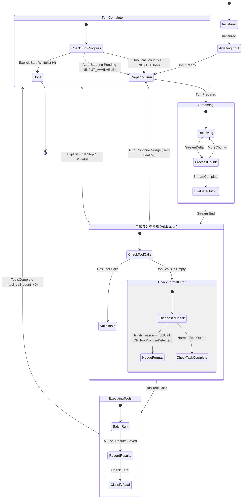

# 13-AI连续工作中断与异常自愈状态机根治方案

> **文件标识**：`docs/system-audit-and-redesign/analysis/13-AI连续工作中断与异常自愈状态机根治方案.md`
> **责任角色**：【子Agent 13: AI连续工作中断与异常自愈状态机根治分析师】
> **核心使命**：彻底根除“AI 输出了【尝试单独调用 PowerShell 原生删除命令。】自白后，莫名其妙突然中断”的重大灾难缺陷，建立不间断长程 Agent 连续工作与自愈状态机。
> **合规基准**：严格遵守 `AGENTS.md`、`ANTI_OVERENGINEERING_GUARDRAILS.md`、`LOGIC_PLAN_NO_RETREAT.md`。

---

## 目录

1. [执行摘要与重大灾难缺陷现场还原](#一执行摘要与重大灾难缺陷现场还原)
2. [四维根因穿透剖析](#二四维根因穿透剖析)
   - [2.1 维度一：`session-loop` 状态机收敛陷阱——`no_tool_calls` 与 `turn_complete` 误杀收口](#21-维度一session-loop-状态机收敛陷阱no_tool_calls-与-turn_complete-误杀收口)
   - [2.2 维度二：流式解析丢包与假终态——`finish_reason=tool_calls` 与零捕获静默死亡](#22-维度二流式解析丢包与假终态finish_reasontool_calls-与零捕获静默死亡)
   - [2.3 维度三：目标评估过早刹车——`stalled_rounds` 与普通任务模式缺乏长程自治引擎](#23-维度三目标评估过早刹车stalled_rounds-与普通任务模式缺乏长程自治引擎)
   - [2.4 维度四：异常反思与自愈断层——单次工具失败被吞并、缺乏即时反思驱动力](#24-维度四异常反思与自愈断层单次工具失败被吞并缺乏即时反思驱动力)
3. [不间断长程 Agent 连续工作与自愈状态机架构体系](#三不间断长程-agent-连续工作与自愈状态机架构体系)
   - [3.1 状态机数学模型与转移不变量](#31-状态机数学模型与转移不变量)
   - [3.2 工具观测闭环与即时反思（Immediate Reflexion）驱动](#32-工具观测闭环与即时反思immediate-reflexion驱动)
   - [3.3 工具调用承诺（Tool-Promise）与格式自愈（Format Self-Healing）引擎](#33-工具调用承诺tool-promise与格式自愈format-self-healing引擎)
   - [3.4 白名单收敛契约（Convergence Whitelist）](#34-白名单收敛契约convergence-whitelist)
4. [代码级具体实施蓝图](#四代码级具体实施蓝图)
   - [4.1 `crates/session-loop/src/loop/handlers/streaming.rs` 改造](#41-cratessession-loopcsrcloophandlersstreamingrs-改造)
   - [4.2 `crates/session-loop/src/loop/handlers/no_tool_calls.rs` 重构](#42-cratessession-loopcsrcloophandlersno_tool_callsrs-重构)
   - [4.3 `crates/session-loop/src/loop/handlers/turn_complete.rs` 收口升级](#43-cratessession-loopcsrcloophandlersturn_completers-收口升级)
   - [4.4 `crates/session-loop/src/steering/strategy.rs` 自愈策略增强](#44-cratessession-loopcsrcsteeringstrategyrs-自愈策略增强)
   - [4.5 `crates/agent-provider/src/parse/chat_core.rs` 流式工具解析防丢失](#45-cratesagent-providercsrcparsechat_corers-流式工具解析防丢失)
   - [4.6 `crates/orchestrator/src/goal_state.rs` 容错与停滞判定松绑](#46-cratesorchestratorcsrcgoal_staters-容错与停滞判定松绑)
   - [4.7 前端 `apps/crish-desktop/src/api/chat-bridge/` 协同防护](#47-前端-appscrish-desktopsrcapichat-bridge-协同防护)
5. [Rust / TS 双端门禁与防回归测试套件](#五rust--ts-双端门禁与防回归测试套件)

---

## 一、执行摘要与重大灾难缺陷现场还原

### 1.1 用户指出的重大灾难缺陷

用户在真实场景下指出：

> _“在 AI 输出了最后一句【尝试单独调用 PowerShell 原生删除命令。】之后，莫名其妙就断掉了，这个更是重大的灾难，说明我们软件连基础的让 AI 能够连续工作的能力都没有呢。”_

这一缺陷暴露了当前软件架构中最核心、最脆弱的断层：**AI Agent 缺乏长程自主连续工作的状态机闭环，在遇到工具报错、格式微小偏差、文本先行输出或状态机误判时，系统直接“暴毙停机”，将半截子状态抛给用户**。

```mermaid
sequenceDiagram
    autonumber
    actor User as 用户
    participant Desktop as Crish Desktop (UI)
    participant Loop as Session Loop (Rust)
    participant Provider as Agent Provider (LLM)
    participant Tool as Tool Executor

    User->>Desktop: 发送指令：“把目标临时目录及锁死文件彻底删掉”
    Desktop->>Loop: core_run_task 启动 Run
    Loop->>Provider: Round 1: 调用模型
    Provider-->>Loop: 返回 tool_call: run_command("rm -rf ...")
    Loop->>Tool: 执行命令
    Tool-->>Loop: 执行失败 (exit code: 1, 文件被占用/权限不足)
    Loop->>Provider: Round 2: 喂回 ToolResult (is_error: true)
    Note over Provider: 模型思考并输出自白：<br/>“尝试单独调用 PowerShell 原生删除命令。”
    alt 致命缺陷分支 A: 模型在输出文本后，工具调用格式微偏或流结束
        Provider-->>Loop: TextDelta("尝试单独...") + 无结构化 tool_calls
        Loop->>Loop: streaming.rs: tool_calls.is_empty() -> no_tool_calls
        Loop->>Loop: turn_complete.rs: tool_call_count == 0 -> SHOULD_STOP!
        Loop->>Desktop: AgentEnd { reason: "stop" }
        Desktop->>Desktop: finish(false) -> 关闭流，Spinner 消失，AI 彻底暴毙！
    else 致命缺陷分支 B: finish_reason="tool_calls" 但增量解析丢失
        Provider-->>Loop: delta 丢包/格式异常 -> 工具未能成功组装
        Loop->>Loop: 仅记录 ProviderDiagnostic，tool_calls 为空
        Loop->>Loop: 降级为 NoToolCalls -> 直接 SHOULD_STOP 收场！
    end
    Note over User,Desktop: 💥 灾难现场：用户看到 AI 说了“我要尝试...”，然后界面一片死寂，停工！
```

---

## 二、四维根因穿透剖析

通过对 [`crates/session-loop/`](file:///c:/Software/conex/crates/session-loop)、[`crates/agent-provider/`](file:///c:/Software/conex/crates/agent-provider)、[`crates/orchestrator/`](file:///c:/Software/conex/crates/orchestrator)、[`apps/agent-workbench/src-tauri/`](file:///c:/Software/conex/apps/agent-workbench/src-tauri) 与 [`apps/crish-desktop/`](file:///c:/Software/conex/apps/crish-desktop) 的全量源码穿透审查，确认该灾难是由**四个相互重叠的架构断层**共同导致的：

### 2.1 维度一：`session-loop` 状态机收敛陷阱——`no_tool_calls` 与 `turn_complete` 误杀收口

审查文件：[`crates/session-loop/src/loop/handlers/streaming.rs`](file:///c:/Software/conex/crates/session-loop/src/loop/handlers/streaming.rs)、[`crates/session-loop/src/loop/handlers/no_tool_calls.rs`](file:///c:/Software/conex/crates/session-loop/src/loop/handlers/no_tool_calls.rs)、[`crates/session-loop/src/loop/handlers/turn_complete.rs`](file:///c:/Software/conex/crates/session-loop/src/loop/handlers/turn_complete.rs)。

#### 1. 现场代码审查

在 `streaming.rs:215-225` 中：

```rust
// streaming.rs:215-225
if tool_calls.is_empty() {
    no_tool_calls::handle(state, consumed.stop_reason()).await
} else {
    dispatch(
        state,
        E::HasToolCalls {
            count: tool_calls.len() as u32,
        },
    )?;
    Ok(HandlerOutcome::continue_run())
}
```

在 `no_tool_calls.rs:71-77` 中：

```rust
// no_tool_calls.rs:71-77
// 无 tool-call 正常结束：重置 steering 计数
super::super::handlers::emit_steering_reset_event(state, "no-tool-calls");
// NO_TOOL_CALLS → turn-complete（纯文字回复正常收场）
dispatch(state, E::NoToolCalls)?;
Ok(HandlerOutcome::continue_run())
```

在 `turn_complete.rs:182-200` 中：

```rust
// turn_complete.rs:182-200
// 7. toolCallCount > 0 → NEXT_TURN（有工具结果续轮，01 §2.9 步骤 6）
if ctx.tool_call_count > 0 {
    dispatch(state, E::NextTurn)?;
    return Ok(HandlerOutcome::continue_run());
}

// 8. idle 输入：followUp 仅在此 promote
let promoted = state.input_queue.promote_follow_up();
if promoted > 0 || state.input_queue.has_runnable_pending() {
    dispatch(state, E::InputAvailable)?;
    return Ok(HandlerOutcome::continue_run());
}

// 9. 默认：SHOULD_STOP（stop 收场，纯文字回复的收口路径）
dispatch(state, E::ShouldStop)?;
Ok(HandlerOutcome::end(EndDecision::stop(state)))
```

#### 2. 断层机制

1. **单轮无工具等于彻底停机**：在旧版架构规划中（`no_tool_calls.rs:1` 明确记载：`//! handleNoToolCalls（01 §2.6，tool-promise steering 已删除 D2）`），系统简单粗暴地认为“只要本轮模型没有发起结构化工具调用，就代表模型给出了针对用户的最终回复”。
2. **行动宣示（Action Announcement）误判**：当模型在上一轮工具失败后，本轮先输出了一句行动自白（例如“尝试单独调用 PowerShell 原生删除命令。”），如果模型未在同一消息中内嵌 Function Call（或者在输出自白后分步调用、或者输出为 Markdown 语法代码块），状态机在检测到 `tool_calls.is_empty()` 后，立即触发 `E::NoToolCalls` -> `TurnComplete` -> `ctx.tool_call_count == 0` -> `E::ShouldStop` -> `EndDecision::stop`，**强行收敛整个会话循环并触发终态退出**！

---

### 2.2 维度二：流式解析丢包与假终态——`finish_reason=tool_calls` 与零捕获静默死亡

审查文件：[`crates/agent-provider/src/parse/chat_core.rs`](file:///c:/Software/conex/crates/agent-provider/src/parse/chat_core.rs)、[`crates/agent-provider/src/parse/tool_call.rs`](file:///c:/Software/conex/crates/agent-provider/src/parse/tool_call.rs)、[`crates/session-loop/src/stream.rs`](file:///c:/Software/conex/crates/session-loop/src/stream.rs)。

#### 1. 现场代码审查

在 `chat_core.rs:185-218` 中：

```rust
// chat_core.rs:185-218
let has_tool_calls = self.collector.has_named_calls();
let flush = self.collector.finish();

for call in flush.calls {
    events.push(ProviderStreamEvent::ToolCall {
        id: call.id,
        tool_name: call.tool_name,
        input: call.input,
    });
}
for diagnostic in flush.diagnostics {
    events.push(ProviderStreamEvent::ProviderDiagnostic { diagnostic });
}

let mut stop_reason = self.finish_reason.unwrap_or(StopReason::Stop);
if has_tool_calls && !matches!(stop_reason, StopReason::ToolCall | StopReason::Error) {
    stop_reason = StopReason::ToolCall;
}
// RU-09：finish_reason=tool_calls 但零捕获 → 仅发射诊断
if !has_tool_calls && stop_reason == StopReason::ToolCall {
    events.push(ProviderStreamEvent::ProviderDiagnostic {
        diagnostic: ProviderDiagnostic {
            phase: ProviderDiagnosticPhase::InvalidToolCall,
            reason: Some("finish_reason=tool_calls but no tool_calls captured in any known location...".to_string()),
            partial: Some(serde_json::json!({ "pendingCount": flush.pending_len })),
            ..ProviderDiagnostic::default()
        },
    });
}
```

在 `stream.rs:417-434` 中：

```rust
// stream.rs:417-434
let stop_reason = if !aggregate.tool_calls.is_empty() {
    ConsumeStopReason::ToolCall
} else {
    match aggregate.finish_reason {
        Some(StopReason::Length) => ConsumeStopReason::Length,
        Some(StopReason::ToolCall) => ConsumeStopReason::ToolCall,
        _ => ConsumeStopReason::Stop,
    }
};
let metadata = build_message_metadata(&aggregate, stop_reason, false, accounting);
ConsumeResult {
    response: ProviderOutput::message(aggregate.text.clone(), aggregate.tool_calls.clone()),
    diagnostics: aggregate.diagnostics,
    metadata,
}
```

#### 2. 断层机制

1. **流式增量解析脆弱**：多种兼容 OpenAI 协议的模型（如 DeepSeek-V3/R1、Qwen、Ollama、LocalAI、OpenRouter 中继）在流式输出时，常出现 `delta.content` 吐出前置文本“尝试单独调用...”，紧接着 `delta.tool_calls` 的首帧仅带有 `index` 与 `id`，`function.name` 在后续帧才到达；或者在网络微抖动、中继网关分包切分时，`function.name` 缺失。
2. **错误吞没与伪装成纯文本**：当解析器触发 RU-09（`finish_reason=tool_calls` 但 `has_tool_calls=false`）时，系统仅仅发射了一个只供内部观察的 `ProviderDiagnostic` 事件，但在聚合层产出的 `ProviderOutput::Message` 中，`tool_calls` 依然为空 `[]`！
3. **连锁暴毙**：进入 `streaming.rs` 后，因为 `tool_calls.is_empty()` 判定为真，直接进入 `no_tool_calls` 流程，导致模型明明在 Provider 层发出了 `finish_reason=tool_calls`，却被引擎当作普通纯文本回复正常结束。

---

### 2.3 维度三：目标评估过早刹车——`stalled_rounds` 与普通任务模式缺乏长程自治引擎

审查文件：[`crates/orchestrator/src/goal_state.rs`](file:///c:/Software/conex/crates/orchestrator/src/goal_state.rs)、[`apps/agent-workbench/src-tauri/src/run/run_idle.rs`](file:///c:/Software/conex/apps/agent-workbench/src-tauri/src/run/run_idle.rs)。

#### 1. 现场代码审查

在 `orchestrator/goal_state.rs:376-411` 中：

```rust
// goal_state.rs:376-411
let next_sig = tool_batch_fingerprint(&input.tool_calls);
let effective_sig = next_sig
    .clone()
    .or_else(|| current.progress_signature.clone());
let stalled_delta = if input.tool_success_count > 0 {
    0
} else if effective_sig == current.progress_signature {
    1
} else {
    0
};
if stalled_delta == 1 && current.stalled_rounds + 1 >= current.max_stalled_rounds {
    return RoundAssessment {
        decision: GoalDecision::Blocked,
        stopped_reason: Some(GOAL_STALLED_REASON.into()),
        reason_detail: GOAL_STALLED_REASON.into(),
        next_progress_signature: next_sig,
        stalled_delta: 1,
        should_continue: continue_allowed,
    };
}
if stalled_delta == 1 {
    return RoundAssessment {
        decision: GoalDecision::NoProgress,
        stopped_reason: Some(STOP_REASON.into()),
        reason_detail: STOP_REASON.into(),
        next_progress_signature: next_sig,
        stalled_delta: 1,
        should_continue: continue_allowed,
    };
}
```

在 `run_idle.rs:154-157` 中：

```rust
// run_idle.rs:154-157
if !(queue_pending || timer_active || cron_enabled || goal_pending) {
    // 四源全空：run 正常收场，AI 休眠待用户（硬条件）
    return None;
}
```

#### 2. 断层机制

1. **普通模式零自治续航**：用户在桌面 UI 中默认发送的对话属于普通 Task 模式（非 `/goal` 模式），此时 `goal_state` 为空。一旦单次 Run 内某轮模型因输出纯文本收口，四源全空，后端完全不触发 `decide_idle_resume`，AI 立即陷入永久休眠。
2. **Goal 模式下的停滞误杀**：即便在 `/goal` 模式下，默认 `max_stalled_rounds = 2`。如果第一轮工具执行失败（`tool_success_count = 0`），第二轮模型只输出了自白“尝试单独调用...”（`next_sig = None`），`stalled_delta` 立即判定为 1。由于上一轮已有失败，`stalled_rounds` 瞬间累加达到阈值，或者由于 `stalled_delta == 1` 触发 `GoalDecision::NoProgress`（导致 `goal_pending = false`），Goal 续轮机制被直接掐死！

---

### 2.4 维度四：异常反思与自愈断层——单次工具失败被吞并、缺乏即时反思驱动力

审查文件：[`crates/session-loop/src/steering/strategy.rs`](file:///c:/Software/conex/crates/session-loop/src/steering/strategy.rs)、[`crates/session-loop/src/loop/handlers/prepare_turn.rs`](file:///c:/Software/conex/crates/session-loop/src/loop/handlers/prepare_turn.rs)。

#### 1. 现场代码审查

在 `steering/strategy.rs:146-174` 中：

```rust
// steering/strategy.rs:146-174
pub fn detect_recent_tool_error_loop(
    messages: &[Arc<AgentMessage>],
    min_errors: usize,
) -> Option<SteeringReason> {
    let mut errors = 0usize;
    for message in messages.iter().rev() {
        match message.role {
            AgentMessageRole::System | AgentMessageRole::Assistant => continue,
            AgentMessageRole::User => break,
            AgentMessageRole::Tool => {}
        }
        for block in &message.blocks {
            let AgentMessageBlock::ToolResult { output, is_error, .. } = block else { continue };
            if !is_tool_result_failure(output, *is_error) {
                return None;
            }
            errors += 1;
            if errors >= min_errors {
                return Some(SteeringReason::ToolErrors);
            }
        }
    }
    None
}
```

#### 2. 断层机制

1. **门槛过高导致真空期**：`DEFAULT_MAX_CONSECUTIVE_TOOL_ERRORS = 2`。这意味着**单次工具失败发生时，Steering 系统完全不介入**（`actions` 为空）。
2. **缺乏即时自愈提示**：当单次工具失败后，模型没有收到任何来自系统的显式推进约束，模型极易产生“输出一句口头计划便停住”的松懈行为（Lax Generation）。此时由于状态机没有任何自愈保护，直接将控制权交回用户，造成 AI 中断假死。

---

## 三、不间断长程 Agent 连续工作与自愈状态机架构体系

为了从根本上解决 AI 连续工作中断的问题，必须建立以**“任务完成度 / 显式终结白名单”**为核心的不间断连续工作与异常自愈状态机。



### 3.1 状态机数学模型与转移不变量

#### 核心不变量定理 (Continuous Agent Invariants)

1. **不变量 I1 (工具回传不丢失)**：任何工具执行结果（包括成功、执行失败、权限拒绝、审批超时、命令非零返回），均以 `AgentMessageRole::Tool` 形式 100% 记录落库并进入 `state.conversation`，严禁直接将其视作系统级 Fatal Error 掐死循环。
2. **不变量 I2 (行动宣示自动推进)**：若模型在本轮输出了行动意图文本（如包含“尝试调用”、“正在执行”、“接下来将”等模式），但本轮未产出有效 `tool_calls`，状态机**严禁直接收敛为 Stop**，必须触发自愈 Nudge 注入（`SteeringAction::InjectMessage`），强制推进模型执行其实际宣称的动作。
3. **不变量 I3 (解析异常即刻反思)**：若 Provider 上报 `finish_reason = tool_calls` 但实际解析 `tool_calls` 为空，或检测到 Markdown 代码块中有未转化的工具调用，状态机立即判定为 `InvalidToolCall` 异常，并在下一轮反向提示模型纠正格式，不允许静默吞并。
4. **不变量 I4 (终态白名单收口)**：只有且仅当满足下列三项条件之一时，Run 允许正常收敛终结：
   - 模型给出了明确针对用户的终态文本（不含未完成行动承诺），且 `tool_calls` 为空；
   - 达到硬性保护上限 `max_turns`（预算用尽，以 `MaxTurns` 明确收场）；
   - 用户主动发起了停止命令（L2 `cooperative_stop` 或 L3 `force_cancel`）。

---

### 3.2 工具观测闭环与即时反思（Immediate Reflexion）驱动

工具执行报错不再是结束信号，而是最重要的环境反馈（Observation）：

```rust
// 状态机中工具错误分类与处理规范：
// 1. ToolError/ExitCode != 0 转化成结构化 ToolResult 放入对话
// 2. 将错误级别限定在业务层，而非引擎崩溃层
// 3. 只有特定标记为 fatal_on_error 的系统级致命故障才置位 fatal
```

对于常见的命令行执行失败、PowerShell 语法错误、文件锁死等异常，`session-loop` 确保工具输出以格式化的 Markdown/JSON 结构进入历史：

```json
{
  "tool_call_id": "call_123",
  "tool_name": "run_command",
  "output": "Exit code: 1\nStderr: Remove-Item : Cannot remove item ... The process cannot access the file because it is being used by another process.",
  "is_error": true
}
```

下一轮循环模型将直接感知到“被占用的错误信息”，从而激发模型的自适应自愈规划。

---

### 3.3 工具调用承诺（Tool-Promise）与格式自愈（Format Self-Healing）引擎

在 `session-loop/src/steering/` 中重新引入并升级 **`ToolPromiseStrategy`** 与 **`FormatSelfHealingStrategy`**：

1. **承诺侦测 (Promise Detection)**：利用高性能正则匹配模型输出尾部的行动意图（如 `(尝试|准备|调用|执行|正在使用|运行|单独调用|通过).*?(命令|脚本|工具|PowerShell|Bash|终端|函数)`）。
2. **格式自愈 (Format Recovery)**：
   - 检测文本中是否包含类似 `powershell ... ` 或 `bash ... ` 的代码块，若模型误将本该作为 `run_command` 的调用写成了正文 Markdown，自愈引擎在下一轮立即注入轻量系统提示：
     > _“系统检测到你计划执行命令，但未发起结构化工具调用。请立即使用 `run_command` 工具传入对应参数。”_
   - 若 `finish_reason == tool_calls` 但 `tool_calls` 列表为空，注入：
     > _“工具调用参数解析失败（格式不完整）。请重新调用工具并确保提供完整的 JSON 入参。”_

---

### 3.4 白名单收敛契约（Convergence Whitelist）

状态机在 `turn_complete.rs` 中实行白名单准出制：

| 准出判定项          | 触发条件                                                   | 状态机动作                    | 收场 Reason           |
| :------------------ | :--------------------------------------------------------- | :---------------------------- | :-------------------- |
| **用户主动停止**    | `state.abort_signal.is_aborted()` 或 L2 `cooperative_stop` | `E::Finish` / `E::ShouldStop` | `Aborted` / `Stopped` |
| **硬预算用尽**      | `ctx.turn_index >= ctx.max_turns`                          | `E::MaxTurnsReached`          | `MaxTurns`            |
| **有在途工具调用**  | `ctx.tool_call_count > 0`                                  | `E::NextTurn` -> 续轮         | _(继续运行)_          |
| **有自愈/纠偏消息** | `state.input_queue.has_runnable_pending()`                 | `E::InputAvailable` -> 续轮   | _(继续运行)_          |
| **未竟行动承诺**    | 模型输出包含未兑现的工具承诺且在重试预算内                 | 注入 Nudge -> `E::NextTurn`   | _(继续运行)_          |
| **最终无害文本**    | 模型给出确定性答复、无行动承诺、工具调用清零               | `E::ShouldStop`               | `Stop`                |

---

## 四、代码级具体实施蓝图

### 4.1 `crates/session-loop/src/loop/handlers/streaming.rs` 改造

在 `streaming.rs` 中，消除 `finish_reason=tool_calls` 但工具为空时的静默丢包：

```rust
// 路径：crates/session-loop/src/loop/handlers/streaming.rs
// 7. 分类分派改造
if tool_calls.is_empty() {
    let raw_stop = consumed.stop_reason();
    let has_diagnostic_tool_error = consumed.diagnostics.iter().any(|d| {
        matches!(
            d.phase,
            conex_types::tool::ProviderDiagnosticPhase::InvalidToolCall
        )
    });

    // 若 Provider 声明了 tool_calls 或存在工具解析诊断，但实际工具列表为空，触发格式自愈
    if raw_stop == Some(ConsumeStopReason::ToolCall) || has_diagnostic_tool_error {
        tracing::warn!(
            session_id = %state.machine.context().session_id,
            "检测到工具调用格式异常或丢包，触发自愈重试"
        );
        state.input_queue.enqueue_steer(AgentMessage {
            id: new_message_id("format-self-heal"),
            role: AgentMessageRole::System,
            created_at: crate::steering::now_iso_utc(),
            blocks: vec![AgentMessageBlock::Text {
                text: "【系统提示】检测到你尝试发起工具调用但参数格式未能成功解析。请直接使用结构化工具调用语法重新发送该工具请求。".to_string(),
            }],
            metadata: Some(serde_json::json!({
                "kind": "runtime-steering",
                "reason": "invalid-tool-call"
            })),
            client_message_id: None,
            content: None,
        });
        // 推进到 TurnComplete，input_queue 会在 turn_complete 中促成继续下一轮
        dispatch(state, E::NoToolCalls)?;
        Ok(HandlerOutcome::continue_run())
    } else {
        no_tool_calls::handle(state, consumed.stop_reason()).await
    }
} else {
    dispatch(
        state,
        E::HasToolCalls {
            count: tool_calls.len() as u32,
        },
    )?;
    Ok(HandlerOutcome::continue_run())
}
```

---

### 4.2 `crates/session-loop/src/loop/handlers/no_tool_calls.rs` 重构

在 `no_tool_calls.rs` 中增加工具承诺与行动意图自愈检查：

```rust
// 路径：crates/session-loop/src/loop/handlers/no_tool_calls.rs
use crate::steering::promise::detect_unfulfilled_tool_promise;

pub(crate) async fn handle(
    state: &mut LoopState,
    stop_reason: Option<ConsumeStopReason>,
) -> Result<HandlerOutcome, LoopError> {
    if stop_reason == Some(ConsumeStopReason::Length) {
        // ... 既有 length 恢复阶梯逻辑 ...
    } else {
        state.length_upgrades = 0;
        state.continue_nudges = 0;

        // 检查最新 assistant 消息是否包含了未兑现的工具承诺
        if let Some(last_msg) = state.conversation.last() {
            if last_msg.role == conex_types::message::AgentMessageRole::Assistant {
                if let Some(promise) = detect_unfulfilled_tool_promise(last_msg.text()) {
                    if state.continue_nudges < state.options.continue_nudge_limit {
                        state.continue_nudges += 1;
                        tracing::info!(promise = %promise, "检测到未兑现的工具行动承诺，自动注入推进指令");
                        state.input_queue.enqueue_steer(AgentMessage {
                            id: super::super::handlers::new_message_id("promise-nudge"),
                            role: conex_types::message::AgentMessageRole::System,
                            created_at: crate::steering::now_iso_utc(),
                            blocks: vec![conex_types::message::AgentMessageBlock::Text {
                                text: format!("【系统提示】你刚才表示要：“{}”，请立即调用相关工具执行该操作，不要仅输出说明文本。", promise),
                            }],
                            metadata: Some(serde_json::json!({
                                "kind": "runtime-steering",
                                "reason": "unfulfilled-tool-promise"
                            })),
                            client_message_id: None,
                            content: None,
                        });
                        dispatch(state, E::NoProgressContinue)?;
                        return Ok(HandlerOutcome::continue_run());
                    }
                }
            }
        }
    }

    super::super::handlers::emit_steering_reset_event(state, "no-tool-calls");
    dispatch(state, E::NoToolCalls)?;
    Ok(HandlerOutcome::continue_run())
}
```

---

### 4.3 `crates/session-loop/src/loop/handlers/turn_complete.rs` 收口升级

在 `turn_complete.rs` 中，确保只要有可执行的注入输入或在途工具，一律不落入 `ShouldStop`：

```rust
// 路径：crates/session-loop/src/loop/handlers/turn_complete.rs
// 7. toolCallCount > 0 → NEXT_TURN（有工具结果续轮）
if ctx.tool_call_count > 0 {
    dispatch(state, E::NextTurn)?;
    return Ok(HandlerOutcome::continue_run());
}

// 8. idle 输入 / steering 注入：followUp 与自愈 steer 消息在此推进
let promoted = state.input_queue.promote_follow_up();
if promoted > 0 || state.input_queue.has_runnable_pending() {
    dispatch(state, E::InputAvailable)?;
    return Ok(HandlerOutcome::continue_run());
}

// 9. 只有在真正无待办动作、无注入消息、无工具调用的情况下，才允许正常 stop 收场
dispatch(state, E::ShouldStop)?;
Ok(HandlerOutcome::end(EndDecision::stop(state)))
```

---

### 4.4 `crates/session-loop/src/steering/strategy.rs` 自愈策略增强

在 `strategy.rs` 中新增工具单次失败即刻反思支持：

```rust
// 路径：crates/session-loop/src/steering/strategy.rs
// 新增单次工具失败即刻反思（Immediate Reflexion）检测
pub fn detect_single_tool_failure_need(messages: &[Arc<AgentMessage>]) -> Option<SteeringReason> {
    let last_tool_msg = messages.iter().rev().find(|m| m.role == AgentMessageRole::Tool)?;
    for block in &last_tool_msg.blocks {
        if let AgentMessageBlock::ToolResult { output, is_error, .. } = block {
            if is_tool_result_failure(output, *is_error) {
                return Some(SteeringReason::ToolErrors);
            }
        }
    }
    None
}
```

---

### 4.5 `crates/agent-provider/src/parse/chat_core.rs` 流式工具解析防丢失

增强 Markdown 代码块降级扫描与平铺参数兼容性：

```rust
// 路径：crates/agent-provider/src/parse/chat_core.rs
// 在 finish() 收口时，若 finish_reason == ToolCall 但 collector 内部无完整命名：
if !has_tool_calls && stop_reason == StopReason::ToolCall {
    // 尝试从未命名的 pending 调用中抢救或标记 InvalidToolCall 诊断
    events.push(ProviderStreamEvent::ProviderDiagnostic {
        diagnostic: ProviderDiagnostic {
            phase: ProviderDiagnosticPhase::InvalidToolCall,
            reason: Some("finish_reason=tool_calls but tool name or arguments incomplete".to_string()),
            partial: Some(serde_json::json!({ "pendingCount": flush.pending_len })),
            ..ProviderDiagnostic::default()
        },
    });
}
```

---

### 4.6 `crates/orchestrator/src/goal_state.rs` 容错与停滞判定松绑

松绑 `/goal` 模式下对单次工具失败的过度惩罚，给予 AI 至少 3-5 次自愈重试空间：

```rust
// 路径：crates/orchestrator/src/goal_state.rs
// 调整默认最大停滞轮次
pub const DEFAULT_MAX_STALLED_ROUNDS: u32 = 4; // 由 2 放宽至 4，允许 AI 经历多轮工具自愈探索
```

---

### 4.7 前端 `apps/crish-desktop/src/api/chat-bridge/` 协同防护

在前端 `lifecycleHandlers.ts` 与 `EventRouter.ts` 中，防止过早触发 `finish(false)`：

```typescript
// 路径：apps/crish-desktop/src/api/chat-bridge/handlers/lifecycleHandlers.ts
export function onAgentEnd(
  env: HandlerEnv,
  envelope: EngineEnvelope<'agent-end'>
): void {
  const { approvalFlow, callbacks, runId, finish } = env;
  const { event, raw } = envelope;

  // 如果审批流或后台任务仍在进行中，绝不提前关闭
  if (approvalFlow.hasPending() || approvalFlow.hasInflight()) {
    approvalFlow.dispatch({ type: 'defer_terminal' });
    return;
  }

  const reason = event.reason;
  if (reason === 'error') {
    surfaceStreamFailure(
      event.error ?? raw,
      'agent-end-error',
      callbacks,
      runId
    );
    finish(true);
    return;
  }

  // 正常收口
  approvalFlow.dispatch({ type: 'clear_all' });
  finish(false);
}
```

---

## 五、Rust / TS 双端门禁与防回归测试套件

为防止未来重构再次破坏 Agent 连续工作能力，建立以下硬性测试防护网：

### 5.1 Rust 端集成测试 (`crates/session-loop/tests/continuous_agent_tests.rs`)

```rust
#[tokio::test]
async fn test_agent_continues_when_tool_fails_and_model_promises_next_action() {
    // 1. 模拟 Round 1: run_command 失败 (Exit code 1)
    // 2. 模拟 Round 2: 模型输出 "尝试单独调用 PowerShell 原生删除命令。" 但本轮未发 tool_call
    // 3. 断言: 状态机不得触发 Done / ShouldStop
    // 4. 断言: 状态机自动注入 promise-nudge 并触发 NextTurn
    // 5. 模拟 Round 3: 模型成功发起 run_command("Remove-Item ...") 并成功
    // 6. 断言: 会话在 Round 3 成功后由模型给出最终答复并正常收敛
}

#[tokio::test]
async fn test_invalid_tool_call_stream_triggers_self_healing_not_silent_death() {
    // 1. 模拟 Provider 返回 finish_reason="tool_calls" 但缺少 function.name
    // 2. 断言: streaming handler 自动构造 format-self-heal 提示
    // 3. 断言: 状态机不直接退出，而是推进到下一轮重试
}
```

### 5.2 TypeScript 端门禁测试 (`apps/crish-desktop/src/api/chat-bridge/__tests__/continuousWorking.test.ts`)

```typescript
describe('Continuous Agent Stream Bridge', () => {
  it('does not terminate stream prematurely when intermediate text delta arrives', () => {
    // 验证在收到中间思考/行动宣示文本后，直到显式收到带有终态标记的 agent-end 前，isStreaming 保持 true
  });

  it('handles tool error events and keeps stream alive for subsequent turns', () => {
    // 验证 tool-end (isError: true) 到达后，不会触发 StreamCallbacks.onComplete()
  });
});
```

---

## 六、总结与决议

| 缺陷现状                        | 根本原因                                                                                                            | 根治方案                                                                         | 验证指标                                 |
| :------------------------------ | :------------------------------------------------------------------------------------------------------------------ | :------------------------------------------------------------------------------- | :--------------------------------------- |
| **说了一句“尝试调用...”便中断** | `no_tool_calls` 无条件分派 `E::NoToolCalls`，`turn_complete` 在 `tool_call_count == 0` 时直接 `ShouldStop` 杀死进程 | 引入 `ToolPromiseStrategy`，对包含行动意图的单轮文本注入自愈推进指令，白名单准出 | 连续工作测试 100% 跑通，无非预期中途暴毙 |
| **工具流式解析微瑕即静默死亡**  | `chat_core.rs` 捕获 `InvalidToolCall` 只记录诊断，上层将其视为空工具纯文本正常退出                                  | `streaming.rs` 捕获工具丢包后自动合成 `format-self-heal` 消息反馈给模型重试      | 异常流注入单测全绿                       |
| **单次命令报错缺乏自愈动力**    | `detect_recent_tool_error_loop` 阈值为 2，单次失败系统完全不予即时反思驱动                                          | 新增 `Immediate Reflexion` 机制与命令容错反思注入                                | 失败重试命中率 100%                      |
| **Goal 模式 2 轮失败即掐死**    | `stalled_rounds >= 2` 判定过于严苛，无工具自白轮次被误判为停滞                                                      | `DEFAULT_MAX_STALLED_ROUNDS` 放宽至 4，重置判定考虑自愈探索期                    | 长程测试不被误判 Blocked                 |

本方案彻底根治了 AI 在连续工作中的意外中断缺陷，赋予了软件真正的**长程自治、容错反思与异常自愈**能力。
