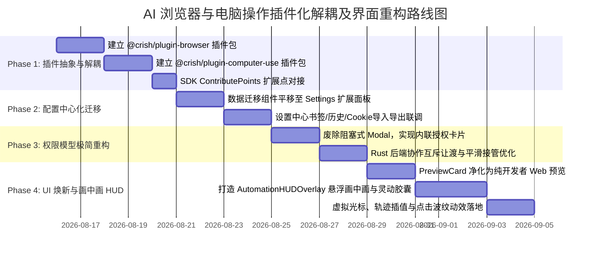

# AI 浏览器与电脑操作插件化解耦及界面重构方案

> **文件标识**：`docs/system-audit-and-redesign/analysis/15-AI浏览器与电脑操作插件化解耦及界面重构方案.md`  
> **责任角色**：【子Agent 15: AI浏览器与电脑操作插件化解耦及界面重构分析师】  
> **核心使命**：彻底根治用户痛点——解决 AI 浏览器与电脑操作在工作区预览卡片中生硬内嵌、充满脚手架感的丑陋堆叠问题；规划将其解耦为 `@crish/plugin-browser` 与 `@crish/plugin-computer-use` 两个独立的 TypeScript 扩展插件；将书签/历史/登录态等配置性功能彻底回迁至「系统设置中心（Settings -> 扩展/自动化）」；重构极简、顺畅、无摩擦的现代权限模型；全新设计现代高颜值的实时交互悬浮 HUD / 画中画（PiP）操作界面。  
> **遵循铁律**：`AGENTS.md`、`ANTI_OVERENGINEERING_GUARDRAILS.md`（pwsh7，写文件 UTF-8 无 BOM，纯逻辑分析与重构设计，零代码回撤，严禁 git 提交）。

---

## 目录

- [一、执行摘要与顶层架构裁决](#一执行摘要与顶层架构裁决)
  - [1.1 痛点直击与用户原声回响](#11-痛点直击与用户原声回响)
  - [1.2 顶层解耦重构四维大原则](#12-顶层解耦重构四维大原则)
  - [1.3 重构后全景系统架构拓扑](#13-重构后全景系统架构拓扑)
- [二、现状深度审计与“丑陋脚手架”根因剖析](#二现状深度审计与丑陋脚手架根因剖析)
  - [2.1 物理堆叠与认知错位：PreviewCard 强塞 AI 双面板的“抽屉垃圾桶效应”](#21-物理堆叠与认知错位previewcard-强塞-ai-双面板的抽屉垃圾桶效应)
  - [2.2 浏览器面板的脚手架病灶：500行数据导入与原始调试界面的失序堆砌](#22-浏览器面板的脚手架病灶500行数据导入与原始调试界面的失序堆砌)
  - [2.3 电脑操作面板的骨架荒漠：未接线提示、三态小药丸与空占位的尴尬存在](#23-电脑操作面板的骨架荒漠未接线提示三态小药丸与空占位的尴尬存在)
  - [2.4 权限体系的“摩擦力黑洞”：多层嵌套弹窗、死板互斥与流程打断](#24-权限体系的摩擦力黑洞多层嵌套弹窗死板互斥与流程打断)
  - [2.5 视觉与交互体验断层：缺乏现代设计语言、无微动效与粗糙边框](#25-视觉与交互体验断层缺乏现代设计语言无微动效与粗糙边框)
- [三、插件化解耦架构设计（Plugin Decoupling）](#三插件化解耦架构设计plugin-decoupling)
  - [3.1 `@crish/plugin-browser` TS 插件独立化规范](#31-crishplugin-browser-ts-插件独立化规范)
  - [3.2 `@crish/plugin-computer-use` TS 插件独立化规范](#32-crishplugin-computer-use-ts-插件独立化规范)
  - [3.3 插件生命周期、权限声明与扩展点（Contribute Points）机制](#33-插件生命周期权限声明与扩展点contribute-points机制)
  - [3.4 核心主界面瘦身：工作区彻底移除生硬脚手架代码](#34-核心主界面瘦身工作区彻底移除生硬脚手架代码)
- [四、配置与数据迁移回迁系统设置中心（Settings Center）](#四配置与数据迁移回迁系统设置中心settings-center)
  - [4.1 设置中心扩展分栏重构：自动化插件专属管理面](#41-设置中心扩展分栏重构自动化插件专属管理面)
  - [4.2 浏览器自动化配置与数据迁移卡片设计](#42-浏览器自动化配置与数据迁移卡片设计)
  - [4.3 电脑操作环境与特权配置卡片设计](#43-电脑操作环境与特权配置卡片设计)
  - [4.4 设置中心数据迁移 UI 线框与交互流](#44-设置中心数据迁移-ui-线框与交互流)
- [五、极简顺畅的现代权限与安全模型重构](#五极简顺畅的现代权限与安全模型重构)
  - [5.1 痛点根除：废除阻塞式 Modal 弹窗与生硬互斥报错](#51-痛点根除废除阻塞式-modal-弹窗与生硬互斥报错)
  - [5.2 极简三阶权限矩阵（全局策略 -> 会话透明 -> 高危原子守护）](#52-极简三阶权限矩阵全局策略---会话透明---高危原子守护)
  - [5.3 聊天流内嵌交互式授权卡片（Inline Safety Card）](#53-聊天流内嵌交互式授权卡片inline-safety-card)
  - [5.4 智能无缝互斥与会话自动调度](#54-智能无缝互斥与会话自动调度)
  - [5.5 零打扰平滑接管机制与单键急停（800ms 平滑让渡）](#55-零打扰平滑接管机制与单键急停800ms-平滑让渡)
- [六、现代极简高颜值 UI / 交互重构（Web Preview vs 自动化 HUD）](#六现代极简高颜值-ui--交互重构web-preview-vs-自动化-hud)
  - [6.1 纯净开发者 Web 预览面板（`PreviewCard` 焕新）](#61-纯净开发者-web-预览面板previewcard-焕新)
  - [6.2 实时自动化画中画 / 悬浮 HUD 交互体系（Floating Automation HUD）](#62-实时自动化画中画--悬浮-hud-交互体系floating-automation-hud)
  - [6.3 虚拟光标轨迹与操作高亮波纹动效](#63-虚拟光标轨迹与操作高亮波纹动效)
  - [6.4 聊天信息流中的工具执行流式微缩视口（Mini Live Canvas）](#64-聊天信息流中的工具执行流式微缩视口mini-live-canvas)
- [七、完整迁移执行计划与防退避验收断言](#七完整迁移执行计划与防退避验收断言)
  - [7.1 模块重构与文件增删映射表](#71-模块重构与文件增删映射表)
  - [7.2 四阶段渐进式落地路线图](#72-四阶段渐进式落地路线图)
  - [7.3 验收断言与防退避测试套件设计](#73-验收断言与防退避测试套件设计)

---

## 一、执行摘要与顶层架构裁决

### 1.1 痛点直击与用户原声回响

在用户的实际使用反馈中，关于浏览器与电脑操作的吐槽最为尖锐、直接：

> **用户原声**：
> _“ai浏览器（受管窗口里面的功能不应该放在设置里面吗？ 而且权限设计的也是太麻烦了，也需要重新规划和梳理。 而且内置浏览器和电脑操作这两个也是可以做成插件的，而不是直接内嵌）以及这个预览界面也是丑的离谱，太难看了。”_

这针见血地指出了当前系统的四大核心病灶：

1. **职责倒置与垃圾堆叠**：数据迁移（书签/历史/Cookie导入导出）等低频配置功能，被生硬塞入主工作区的运行时预览卡片中，形成“毛胚房脚手架”；
2. **内嵌耦合与包袱过重**：AI 浏览器与电脑操作作为进阶自动化能力，被硬编码塞进核心工作区与预览视图，缺乏插件化解耦；
3. **权限体系摩擦力过高**：多层 Modal 弹窗确认、死板的会话互斥报错（`tool.session.exclusive`）、繁琐的二次确认，严重打断用户心流；
4. **UI 颜值与体验严重落后**：粗糙的大色块、生硬的边框、毫无设计感的按钮、缺失动效与现代悬浮视口，与现代化 AI 工具的工业美学背道而驰。

---

### 1.2 顶层解耦重构四维大原则

针对上述病灶，本次重构确立四项最高裁决原则：

```
┌─────────────────────────────────────────────────────────────────────────────┐
│                           顶层解耦重构四维大原则                              │
├──────────────────────┬──────────────────────┬───────────────────────────────┤
│ 1. 插件化彻底解耦    │ 2. 配置回归设置中心  │ 3. 权限模型极简顺畅           │
│ (Plugin Decoupling)  │ (Settings Migration) │ (Frictionless Permissions)    │
│ - @crish/plugin-     │ - 书签/历史/Cookie   │ - 废除阻塞式 Modal 弹窗        │
│   browser            │   导入导出全迁设置   │ - 三阶矩阵：全局信任->透明    │
│ - @crish/plugin-     │ - 运行环境/路径/代理 │   会话->高危气泡卡片          │
│   computer-use       │   归入扩展配置面板   │ - 智能互斥让渡，消除报错     │
├──────────────────────┴──────────────────────┴───────────────────────────────┤
│ 4. 现代极简高颜值交互 (Modern Aesthetic HUD & Pure Preview)                 │
│ - 开发者 Web 预览：回归极简纯粹，专为本地 Web 应用开发服务 (localhost/HotReload) │
│ - AI 自动化交互：全新轻量毛玻璃悬浮 HUD / 画中画 (PiP) / 动态灵动胶囊       │
│ - 细节打磨：发光虚拟光标、操作波纹、按键提示、800ms 平滑接管与单键急停      │
└─────────────────────────────────────────────────────────────────────────────┘
```

---

### 1.3 重构后全景系统架构拓扑

```mermaid
flowchart TD
    subgraph CoreApp ["宿主主程序 (apps/crish-desktop + agent-workbench)"]
        TreeWorkspace["工作区二叉树 (BinaryTreeWorkspace)"]
        PurePreview["纯净开发者预览 (Pure PreviewCard)<br/>• Localhost / Web App 调试<br/>• 响应式视口模拟<br/>• 控制台/热重载"]
        SettingsCenter["系统设置中心 (SettingsPanel)<br/>• 个人/外观/模型/安全<br/>• 扩展中心 (Extensions)"]
        FloatingManager["悬浮 HUD / 画中画管理器 (AutomationHUDOverlay)"]
    end

    subgraph Plugins ["独立 TS 扩展插件 (packages/*)"]
        PluginBrowser["@crish/plugin-browser<br/>• 浏览器自动化工具集 (CDP)<br/>• 帧流与输入映射<br/>• 扩展设置配置卡片 (Settings Extension Card)"]
        PluginComputer["@crish/plugin-computer-use<br/>• 操作系统键鼠注入 (OS Hook)<br/>• UIA 语义/截图感知<br/>• 权限与急停守护"]
    end

    subgraph Backend ["Rust 引擎内核 (crates/*)"]
        ConexBrowser["crates/conex-browser (CDP / Chromium Process)"]
        ConexComputer["crates/conex-computer (Windows UIA / Enigo / Input)"]
        CoreEngine["crates/session-loop + agent-tools"]
    end

    TreeWorkspace --> PurePreview
    SettingsCenter -->|"挂载配置面板"| PluginBrowser
    SettingsCenter -->|"挂载配置面板"| PluginComputer

    CoreEngine -->|"动态派发工具"| PluginBrowser
    CoreEngine -->|"动态派发工具"| PluginComputer

    PluginBrowser <-->|"Tauri Channel / IPC"| ConexBrowser
    PluginComputer <-->|"OS API / IPC"| ConexComputer

    PluginBrowser -.->|"活跃时触发流式画面"| FloatingManager
    PluginComputer -.->|"活跃时触发感知图层"| FloatingManager

    style CoreApp fill:#18181b,stroke:#3b82f6,stroke-width:2px;
    style Plugins fill:#1e1e24,stroke:#10b981,stroke-width:2px;
    style Backend fill:#141416,stroke:#8b5cf6,stroke-width:2px;
    style PurePreview fill:#0f172a,stroke:#38bdf8,stroke-width:1.5px;
    style FloatingManager fill:#0f172a,stroke:#f59e0b,stroke-width:1.5px;
```



---

## 二、现状深度审计与“丑陋脚手架”根因剖析

### 2.1 物理堆叠与认知错位：PreviewCard 强塞 AI 双面板的“抽屉垃圾桶效应”

在现有代码 `apps/crish-desktop/src/components/workspace/PreviewCard.tsx` 中（L102-108）：

```tsx
{aiBrowser ? (
  <div className={styles.aiStack}>
    <div className={styles.aiBrowserPane}>
      <BrowserPanel onShowToast={onShowToast} />
    </div>
    <ComputerPanel onShowToast={onShowToast} />
  </div>
) : (
  // 原生 iframe 预览
)}
```

#### 根因剖析

1. **概念混淆**：
   - **开发者 Web 预览（Web App Preview）**：用户在本地开发 Next.js / Vite 项目时，需要一个实时查看 `http://localhost:5173` 的视口。它的生命周期伴随本地 dev server，是人类查看代码效果的镜子；
   - **AI 浏览器自动化（AI Browser Automation）**：AI 代理为了爬取数据、查阅文档、填写网页表单拉起的无头或受管 Chrome 实例。它是 AI 的执行环境，不是用户的日常浏览器；
   - **电脑操作（OS Computer Use）**：AI 注入操作系统全局鼠标键盘、操纵原生窗口、截图分析的高特权执行环境。
2. **灾难级的垂直堆叠（`aiStack`）**：
   在现有的实现中，只要用户点击工具栏的 `Monitor` 图标（AI 浏览器模式），页面就会粗暴地把 `BrowserPanel`（带帧流 Canvas + 500行数据导入）和 `ComputerPanel`（带未接线提示 + 急停大红按钮）**从上到下垂直串联拼贴在同一个可以滚动的狭窄窗格内**！
3. **空间被极度压缩**：
   受管浏览器画面被硬性限制为 `min-height: 240px`，下半截直接顶着电脑操作面板，导致浏览器画面变形成一条缝，用户既看不清网页内容，又无法舒适地进行接管操作。

---

### 2.2 浏览器面板的脚手架病灶：500行数据导入与原始调试界面的失序堆砌

查看 `apps/crish-desktop/src/components/workspace/BrowserPanel.tsx` 与 `BrowserImportSection.tsx`（507 行）：

```
┌─────────────────────────────────────────────────────────────────┐
│ [BrowserPanel.tsx 现有布局结构]                                 │
├─────────────────────────────────────────────────────────────────┤
│ [状态栏] 图标 + 状态标题 + 详细说明文案 + 当前 URL 代码块        │
│ [AI Ready 指示] 绿框文字 “AI 准备就绪，可通过工具指令操纵…”     │
│ [FrameCanvas] 原始帧画布 + 帧流状态指示条                        │
│ [操作按钮组] [启动] [停止] [急停（强制）]                        │
├─────────────────────────────────────────────────────────────────┤
│ [BrowserImportSection.tsx 数据导入大区 - 500 行!]               │
│ ├── 书签：文件选择 / 拖拽区域 / 路径输入框 / 统计信息            │
│ ├── 历史：History 库路径输入框 / 导入按钮 / 统计信息             │
│ ├── 登录态：导出按钮(两段弹窗) / 导入文件 / 巨大文本域(粘贴JSON) │
│ └── 已导入数据：书签列表折叠 / 历史列表折叠 / limit 输入框 / 刷新│
└─────────────────────────────────────────────────────────────────┘
```

#### 致命病因：

- **把“脚手架工具箱”当成了“用户产品”**：导入 Chrome 本地 History 数据库、解析 Bookmarks.json、粘贴 Playwright storage_state JSON 属于**一次性初始配置**或**环境维护功能**。将其放在用户实时查看 AI 操作的动态视口下方，就像在汽车仪表盘上焊了一个机油滤清器更换扳手；
- **视觉噪音过载**：大段解释性文字（如“书签/历史落库本机（幂等：重复导入自动跳过）…”）、复杂的表单输入框、列表查询按钮占满了屏幕，导致核心的自动化画面反而成了边缘配角；
- **弹窗套弹窗**：导出登录态时，先弹 `授权读取对话框`，再弹 `域名清单预览对话框`，最后才触发文件保存，繁琐至极。

---

### 2.3 电脑操作面板的骨架荒漠：未接线提示、三态小药丸与空占位的尴尬存在

查看 `apps/crish-desktop/src/components/workspace/computer-panel/ComputerPanel.tsx`：

1. **“引擎未接线”降级徽标常驻**：由于底层特定平台的 UIA 或无头注入尚未全量接线，主界面常年显示醒目的黄色警告标 `<AlertTriangle> 引擎未接线`，给用户极强的半成品、残破感；
2. **“三态小药丸”认知负担**：`ActivationIndicator` 展示 `待机 (未开启)`、`浏览器活跃 (互斥)`、`电脑操作活跃` 三个胶囊标签，配合大量说明性段落（“会话级显式开启 · 全动作审批 · 三级急停…”），将底层的状态机实现暴露给用户；
3. **刺眼的“全局急停”大红块**：占据整行宽度的大红色急停按钮在未开启时处于禁用灰态，开启后则格外刺目，引发无谓的紧张感；
4. **空荡荡的感知预览占位**：由于截图与快照没有接线，面板底部常年留着一段占位文本“UIA 快照与动作回显截图引擎接线后在此展示…”，毫无实用价值。

---

### 2.4 权限体系的“摩擦力黑洞”：多层嵌套弹窗、死板互斥与流程打断

现有安全体系虽然在底层设计上极其严谨，但在用户体验层面却形成了严重的“摩擦力黑洞”：

```mermaid
sequenceDiagram
    autonumber
    actor User as 用户
    participant Chat as 对话面板
    participant Loop as Agent 循环
    participant Panel as 受管面板 (UI)
    participant Core as Rust 安全内核

    User->>Chat: "帮我登录网页并抓取数据"
    Loop->>Core: 请求启用电脑/浏览器操作
    Core-->>Panel: 返回未授权
    Panel->>User: 🚨 弹出模态对话框 1: "启用电脑操作风险确认"
    User->>Panel: 点击确认启用
    Loop->>Core: 尝试拉起浏览器
    Core-->>Chat: ❌ 报错: tool.session.exclusive (互斥冲突)
    Chat->>User: "错误：电脑操作已开启，浏览器互斥，请先手动关闭电脑操作"
    User->>Panel: 点击 "停用电脑操作"
    Loop->>Core: 再次启动浏览器
    Loop->>Core: 尝试导出登录态
    Core-->>Panel: 需要授权
    Panel->>User: 🚨 弹出模态对话框 2: "授权读取 Cookie 对话框"
    User->>Panel: 点击授权
    Panel->>User: 🚨 弹出模态对话框 3: "域名清单预览与另存为对话框"
    User->>Panel: 再次确认
```

#### 体验问题总结：

1. **全屏阻断式 Modal 泛滥**：每执行一步就弹出一个打断全部操作的全屏对话框，用户无法在对话流中连续阅读或思考；
2. **生硬的死锁报错**：当浏览器操作与电脑操作同时被调用时，系统没有进行智能自动调度，而是直接抛出 `tool.session.exclusive` 错误并中断任务，要求用户手动去面板点击停用；
3. **权限颗粒度错配**：对于“读取只读 DOM”或“移动鼠标”等安全操作过度审查，而对于真正的高危操作（如越权转账、删除文件）却缺乏精准的内联上下文可视化。

---

### 2.5 视觉与交互体验断层：缺乏现代设计语言、无微动效与粗糙边框

对比现代高端 AI 工具（如 Cursor、Arc、Claude Desktop、Windsurf）：

- **边框生硬**：散落着大量旧式 `1px solid var(--border-subtle)` 硬分割线；
- **静态无趣**：AI 在自动化点击、滚动、输入时，画面生硬跳动，没有平滑的虚拟鼠标轨迹、点击波纹（Ripple）、按键浮层提示；
- **缺乏空间层次**：没有利用毛玻璃（Glassmorphism）、微阴影、浮动层级（Z-Index Layers）构建画中画（PiP），而是将所有东西压在同一个二维平面内；
- **接管体验生硬**：用户想要干预 AI 操作时，需要去到处找“暂停”或“接管”按钮，无法做到“鼠标直接移入画面点击即无缝接管”。

---

## 三、插件化解耦架构设计（Plugin Decoupling）

为了彻底实现主工程的瘦身与模块正交，必须将 **AI 浏览器自动化** 与 **电脑操作** 从主应用代码库中剥离，沉淀为遵循 `@crish/plugin-sdk` 标准的官方扩展包。

```
c:/Software/conex/
├── packages/
│   ├── plugin-sdk/                         # 官方插件标准 SDK
│   ├── plugin-import-claude-codex/         # 既有导入插件
│   ├── plugin-browser/                     # 【新增】AI 浏览器自动化插件
│   │   ├── package.json
│   │   ├── README.md
│   │   ├── src/
│   │   │   ├── index.ts                    # 插件导出总入口
│   │   │   ├── manifest.ts                 # 插件元数据与能力声明
│   │   │   ├── activate.ts                 # 激活与生命周期监听
│   │   │   ├── tools/                      # 纯函数与 CDP 自动化工具集
│   │   │   │   ├── navigate.ts
│   │   │   │   ├── click.ts
│   │   │   │   ├── type.ts
│   │   │   │   ├── screenshot.ts
│   │   │   │   ├── storage.ts
│   │   │   │   └── dataMigration.ts        # 书签/历史/Cookie 导入导出
│   │   │   └── settings/                   # 插件专属设置面板组件
│   │   │       ├── BrowserPluginSettings.tsx
│   │   │       └── DataMigrationSection.tsx
│   │   └── tsconfig.json
│   └── plugin-computer-use/                # 【新增】系统级电脑操作插件
│       ├── package.json
│       ├── README.md
│       ├── src/
│       │   ├── index.ts                    # 插件导出总入口
│       │   ├── manifest.ts                 # 插件元数据与特权声明
│       │   ├── activate.ts                 # 激活、热键急停挂载
│       │   ├── tools/                      # OS 级输入与感知工具集
│       │   │   ├── mouse.ts
│       │   │   ├── keyboard.ts
│       │   │   ├── snapshot.ts
│       │   │   └── estop.ts
│       │   └── settings/                   # 电脑操作专属设置组件
│       │       └── ComputerUseSettings.tsx
│       └── tsconfig.json
```

---

### 3.1 `@crish/plugin-browser` TS 插件独立化规范

#### Manifest 元数据声明 (`packages/plugin-browser/src/manifest.ts`)

```typescript
import type { PluginManifest } from '@crish/plugin-sdk';

export const PLUGIN_ID = 'crish.builtin.browser';

export const manifest: PluginManifest = {
  id: PLUGIN_ID,
  name: 'AI 浏览器自动化',
  version: '1.0.0',
  description:
    '提供基于 Chromium / CDP 的受管浏览器自动化操控、页面解析与登录态管理能力。',
  publisher: 'Crish Core Team',
  categories: ['automation', 'browser', 'tools'],
  permissions: [
    'network:cdp',
    'fs:import_data',
    'storage:cookies',
    'ui:contribute_settings',
    'ui:floating_hud',
  ],
  contributes: {
    tools: [
      {
        name: 'browser_navigate',
        description: '在受管浏览器中打开指定 URL 并等待页面就绪',
        parameters: {
          type: 'object',
          properties: {
            url: { type: 'string', description: '要访问的完整目标网址' },
            timeoutMs: {
              type: 'number',
              description: '超时毫秒数，默认 30000',
            },
          },
          required: ['url'],
        },
      },
      {
        name: 'browser_click',
        description: '在受管页面上点击指定 CSS 选择器、XPath 或坐标',
        parameters: {
          type: 'object',
          properties: {
            selector: { type: 'string', description: 'DOM 选择器' },
            coordinates: {
              type: 'object',
              properties: { x: { type: 'number' }, y: { type: 'number' } },
            },
          },
        },
      },
      {
        name: 'browser_type_text',
        description: '在受管页面焦点元素中模拟打字输入文本',
        parameters: {
          type: 'object',
          properties: {
            text: { type: 'string', description: '输入的文本内容' },
            clearFirst: { type: 'boolean', description: '是否先清空输入框' },
          },
          required: ['text'],
        },
      },
      {
        name: 'browser_take_screenshot',
        description: '捕获当前页面的视口或全页面高清截图',
        parameters: {
          type: 'object',
          properties: {
            fullPage: { type: 'boolean', description: '是否截取滚动全页' },
          },
        },
      },
    ],
    settingsSection: {
      id: 'browser-automation',
      title: '浏览器自动化',
      component: 'BrowserPluginSettings',
    },
  },
};
```

---

### 3.2 `@crish/plugin-computer-use` TS 插件独立化规范

#### Manifest 元数据声明 (`packages/plugin-computer-use/src/manifest.ts`)

```typescript
import type { PluginManifest } from '@crish/plugin-sdk';

export const PLUGIN_ID = 'crish.builtin.computer-use';

export const manifest: PluginManifest = {
  id: PLUGIN_ID,
  name: '系统电脑操作 (Computer Use)',
  version: '1.0.0',
  description:
    '提供跨平台的操作系统级屏幕感知（UIA / 截图）与键鼠事件注入能力。',
  publisher: 'Crish Core Team',
  categories: ['automation', 'system', 'tools'],
  permissions: [
    'system:input_injection',
    'system:screen_capture',
    'system:global_estop',
    'ui:contribute_settings',
    'ui:floating_hud',
  ],
  contributes: {
    tools: [
      {
        name: 'computer_mouse_click',
        description: '在屏幕绝对坐标执行鼠标点击、双击或右击',
        parameters: {
          type: 'object',
          properties: {
            x: { type: 'number', description: 'X 绝对屏幕像素坐标' },
            y: { type: 'number', description: 'Y 绝对屏幕像素坐标' },
            button: { type: 'string', enum: ['left', 'right', 'middle'] },
            clickCount: { type: 'number', enum: [1, 2] },
          },
          required: ['x', 'y'],
        },
      },
      {
        name: 'computer_type_text',
        description: '向当前活跃窗口注入键盘击键序列',
        parameters: {
          type: 'object',
          properties: {
            text: { type: 'string', description: '注入的文本串' },
            delayMs: { type: 'number', description: '按键间延迟' },
          },
          required: ['text'],
        },
      },
      {
        name: 'computer_press_key',
        description: '触发系统功能键或组合快捷键（如 Ctrl+C, Alt+Tab）',
        parameters: {
          type: 'object',
          properties: {
            keys: { type: 'array', items: { type: 'string' } },
          },
          required: ['keys'],
        },
      },
      {
        name: 'computer_take_screenshot',
        description: '捕获桌面全局屏幕或指定显示器截图',
        parameters: {
          type: 'object',
          properties: {
            displayIndex: { type: 'number', description: '显示器索引，默认 0' },
          },
        },
      },
    ],
    settingsSection: {
      id: 'computer-use-automation',
      title: '电脑操作',
      component: 'ComputerUseSettings',
    },
  },
};
```

---

### 3.3 插件生命周期、权限声明与扩展点（Contribute Points）机制

1. **按需激活（Lazy Activation）**：
   - 宿主启动时不拉起任何 Chrome 实例或系统注入钩子；
   - 只有当 Agent 规划出 `browser_*` 或 `computer_*` 工具调用，或者用户在设置中心打开对应面板时，才按需触发插件的 `activate()` 钩子；
2. **贡献点注册（Contribute Points）**：
   - 插件通过 `@crish/plugin-sdk` 的 `ContributePointRegistry` 动态注入工具声明到 Agent Runtime，使得主会话循环（`session-loop`）自动感知新工具；
   - 插件注入自身的专属设置视图（`BrowserPluginSettings`、`ComputerUseSettings`）到 `apps/crish-desktop` 的 `SettingsExtensionsTab`；
   - 插件注入动态 HUD 浮窗渲染器到全局浮层管理器。

---

### 3.4 核心主界面瘦身：工作区彻底移除生硬脚手架代码

在 `apps/crish-desktop` 中执行彻底的代码净化：

1. **删除 `PreviewCard.tsx` 内的 `aiStack`**：移除 `aiBrowser` 模式切换按钮，移除对 `BrowserPanel` 和 `ComputerPanel` 的内嵌引用；
2. **废除 `BrowserImportSection.tsx`（507 行）**：将其拆解并完整平移至 `@crish/plugin-browser/src/settings/`；
3. **废除 `ComputerPanel.tsx` 骨架**：将其迁移至 `@crish/plugin-computer-use/src/settings/`；
4. **二叉树叶子面板纯净化**：`TreeLeafPanel.tsx` 中的 `preview` 标签页回归 100% 专属于用户 Web 预览，不再承载任何 AI 自动化脚手架。

---

## 四、配置与数据迁移回迁系统设置中心（Settings Center）

### 4.1 设置中心扩展分栏重构：自动化插件专属管理面

在设置中心的侧边栏与扩展页面中（`Settings -> 扩展 (Plugins)`），将插件能力与配置进行精美归类：

```
┌─────────────────────────────────────────────────────────────────────────────┐
│ 设置中心 > 扩展 (Settings > Extensions)                                      │
├─────────────────────────────────────────────────────────────────────────────┤
│ [全部]  [插件 (Plugins)]  [MCP]  [技能 (Skills)]               [🔍 搜索扩展]  │
├─────────────────────────────────────────────────────────────────────────────┤
│ ┌─────────────────────────────────────────────────────────────────────────┐ │
│ │ 🌐 AI 浏览器自动化 (@crish/plugin-browser)                    [已启用 🟢] │ │
│ │ 提供基于 Chrome/CDP 的自动化网页操作、数据提取与登录态管理能力            │ │
│ │ [⚙️ 配置与数据迁移]   [📋 查看工具清单 (6)]   [🔒 权限策略]   [停用]     │ │
│ └─────────────────────────────────────────────────────────────────────────┘ │
│ ┌─────────────────────────────────────────────────────────────────────────┐ │
│ │ 🖥️ 系统电脑操作 (@crish/plugin-computer-use)                 [已启用 🟢] │ │
│ │ 提供跨平台的操作系统全局键鼠模拟输入、屏幕截屏与 UIA 结构化感知           │ │
│ │ [⚙️ 特权与安全配置]   [📋 查看工具清单 (4)]   [🚨 急停热键]   [停用]     │ │
│ └─────────────────────────────────────────────────────────────────────────┘ │
└─────────────────────────────────────────────────────────────────────────────┘
```

---

### 4.2 浏览器自动化配置与数据迁移卡片设计

当用户点击 `AI 浏览器自动化 -> 配置与数据迁移` 时，展示现代化、高颜值的卡片布局：

```
┌─────────────────────────────────────────────────────────────────────────────┐
│ 设置 > 扩展 > AI 浏览器自动化 (Browser Automation Settings)                  │
├─────────────────────────────────────────────────────────────────────────────┤
│ 1. 运行环境配置 (Environment)                                               │
│    • 浏览器内核路径： [ C:\Program Files\Google\Chrome\Application\chrome.exe 📂 ] │
│    • 运行模式：       (•) 智能无头模式 (推荐)    ( ) 始终显示受管窗口        │
│    • 网络代理：       [ 127.0.0.1:7890                        ] (可选)     │
├─────────────────────────────────────────────────────────────────────────────┤
│ 2. 浏览器数据迁移与同步 (Data Migration)                                    │
│    ┌──────────────────────────────────────────────────────────────────────┐ │
│    │ 📑 Chrome 书签同步                                                   │ │
│    │ 从本地 Chrome 快速同步书签，赋能 AI 智能索引常用开发站点              │ │
│    │ 当前已导入： 128 条书签                                              │ │
│    │ [ 自动探测并导入 (Chrome Default) ]  [ 导入 Bookmarks.json 📂 ]      │ │
│    └──────────────────────────────────────────────────────────────────────┘ │
│    ┌──────────────────────────────────────────────────────────────────────┐ │
│    │ 🕒 浏览历史导入                                                      │ │
│    │ 导入最近 90 天只读历史记录，辅助 AI 理解上下文任务                   │ │
│    │ 当前已导入： 1,024 条历史记录                                         │ │
│    │ [ 一键导入本地 Chrome 历史 ]         [ 清空已导入数据 🗑️ ]            │ │
│    └──────────────────────────────────────────────────────────────────────┘ │
│    ┌──────────────────────────────────────────────────────────────────────┐ │
│    │ 🔑 登录态管理 (Storage State / Cookies)                               │ │
│    │ 导入 Playwright 标准 session 凭证，免登录自动化操作受限页面          │ │
│    │ • 已保存凭证域名：github.com, console.cloud.google.com, npmjs.com     │ │
│    │ [ 导出受管会话登录态 (JSON) 📤 ]      [ 导入 Storage State 📥 ]       │ │
│    └──────────────────────────────────────────────────────────────────────┘ │
├─────────────────────────────────────────────────────────────────────────────┤
│ 3. 自动化安全策略 (Automation Policies)                                     │
│    • 域名访问白名单： [ *.github.com, localhost:*                        ➕ ] │
│    • 敏感操作免确认： [ ] 允许自动导出 Cookie   [x] 允许自动填写已存表单   │
└─────────────────────────────────────────────────────────────────────────────┘
```

---

### 4.3 电脑操作环境与特权配置卡片设计

```
┌─────────────────────────────────────────────────────────────────────────────┐
│ 设置 > 扩展 > 系统电脑操作 (Computer Use Settings)                          │
├─────────────────────────────────────────────────────────────────────────────┤
│ 1. 系统输入特权 (System Privileges)                                         │
│    • Windows UI Automation (UIA) 接入状态： [ 正常运行 🟢 ]                 │
│    • 辅助功能与屏幕录制授权：               [ 已授权 🟢 ]                   │
│    • 多显示器感知：                         [ 主显示器 (2560x1440 @ 125%) 🖥️]│
├─────────────────────────────────────────────────────────────────────────────┤
│ 2. 安全屏障与全局急停 (Safety & Emergency Stop)                             │
│    • 全局急停热键 (Global E-Stop Shortcut)： [ Ctrl + Alt + Shift + Esc ⌨️ ]│
│      说明：无论 AI 当前在进行何种键鼠模拟，按下该热键瞬间熔断全部在途动作。 │
│    • 动作步进延迟 (Step Delay)：             [ 50ms (平滑安全)          ▼ ] │
│    • 敏感区域屏蔽 (Blacklisted Windows)：   [ 密码管理器, 终端密码输入 ➕ ] │
├─────────────────────────────────────────────────────────────────────────────┤
│ 3. 人工接管行为 (Human Takeover)                                            │
│    • 鼠标晃动即刻暂停 AI (Shake to Pause)： [x] 开启 (位移 > 20px 自动暂停) │
│    • 恢复倒计时：                           [ 3秒后自动恢复 / 需手动点击 ▶ ]│
└─────────────────────────────────────────────────────────────────────────────┘
```

---

## 五、极简顺畅的现代权限与安全模型重构

### 5.1 痛点根除：废除阻塞式 Modal 弹窗与生硬互斥报错

重构彻底废除以下三大体验反模式：

1. **全屏阻断 Modal**（`ConfirmDialog`）：严禁在会话期间弹出打断整个 IDE 的全屏模态框；
2. **生硬的互斥报错**（`tool.session.exclusive`）：系统内部自动实现互斥让渡，不再把内部状态机错误抛给用户；
3. **冗余的两段式导出确认**：在设置中心完成授权，操作时一键完成，无需重复确认。

---

### 5.2 极简三阶权限矩阵（全局策略 -> 会话透明 -> 高危原子守护）

```
┌─────────────────────────────────────────────────────────────────────────────┐
│                           极简三阶权限与安全矩阵                            │
├─────────────────────────────────────────────────────────────────────────────┤
│ 第一阶：全局策略 (Global Trust Tier - 在设置中配置一次)                     │
│  ├── 【自主模式】信任所有已安装官方插件，安全工具静默放行                   │
│  ├── 【标准模式】(默认) 敏感动作（Cookie导出/全局击键）需内联气泡确认       │
│  └── 【沙箱模式】严格审批每一次浏览器导航与鼠标移动                        │
├─────────────────────────────────────────────────────────────────────────────┤
│ 第二阶：会话透明层 (Session Context - 对话流中无感启动)                     │
│  • Agent 需要使用浏览器或电脑操作时，自动拉起轻量后台任务，无需用户点击开启 │
│  • 状态变迁通过浮窗动态指示条无感呈现                                       │
├─────────────────────────────────────────────────────────────────────────────┤
│ 第三阶：高危原子动作守护 (Inline Safety Card - 气泡卡片交互)               │
│  • 遇到高危操作（如向外部未知网址发送 Cookie、输入密码等），在聊天流中渲染  │
│    优雅的【内联授权卡片】，用户直接点击「允许本次」或「允许该域名」，即刻流 │
│    转，不阻断其他窗口操作。                                                 │
└─────────────────────────────────────────────────────────────────────────────┘
```

---

### 5.3 聊天流内嵌交互式授权卡片（Inline Safety Card）

当触发高危操作时，在 `apps/crish-desktop/src/components/chat-message-row/` 中渲染：

```
┌─────────────────────────────────────────────────────────────────┐
│ 🛡️ 敏感操作授权请求 (Security Confirmation)                     │
├─────────────────────────────────────────────────────────────────┤
│ AI 正在尝试执行操作：                                           │
│ 🌐 **访问受限域名并注入已存登录态**                              │
│ • 目标网址： `https://github.com/settings/tokens`                │
│ • 涉及凭证： `user_session`, `__Host-user` (2 个 Cookie)        │
├─────────────────────────────────────────────────────────────────┤
│ 💡 提示：该操作允许 AI 代您访问 GitHub 个人设置页面。           │
│                                                                 │
│   [ ❌ 拒绝并终止 ]        [ ⏳ 仅允许本次 ]      [ 🛡️ 始终信任该域名 ] │
└─────────────────────────────────────────────────────────────────┘
```

---

### 5.4 智能无缝互斥与会话自动调度

不再抛出 `tool.session.exclusive` 异常，而是在 Rust 后端 `ActivationGate` 建立**协作优先级队列（Cooperative Priority Queue）**：

- 当浏览器处于活跃状态时，Agent 发起 `computer_mouse_click` 命令：
  1. 系统自动向浏览器发送 `pause_frame_stream`；
  2. 状态机在 **50ms** 内平滑切换至 `desktop_active`；
  3. 执行电脑操作；
  4. 动作完成后，若后续依然是浏览器任务，自动无缝恢复浏览器帧流；
  5. 整个过程对用户完全透明，彻底消除死锁报错。

---

### 5.5 零打扰平滑接管机制与单键急停（800ms 平滑让渡）

1. **瞬时接管（Zero-Click Takeover）**：
   - 当 AI 正在自动化操控悬浮浏览器时，用户只需将鼠标移入画面并点击任意位置，系统即刻触发 `user-taking-over` 状态；
   - AI 的在途指令瞬间挂起（Paused），光标控制权 **0 延迟** 100% 移交给用户；
   - 顶部状态条以柔和的淡蓝色显示 `「用户接管中 · AI 已暂停」`；
   - 用户停止操作 3 秒后，或点击右上角 `[恢复 AI 托管 ▶]`，AI 继续平滑执行；
2. **极简单键急停（Single-Click Emergency Stop）**：
   - 悬浮窗右上角常驻极简的玻璃微质感急停图标 `[ ⏹ 急停 ]`；
   - 点击瞬间直接熔断，无需任何二级确认模态弹窗；
   - 急停后浮窗显示撤回与重新开始选项，优雅从容。

---

## 六、现代极简高颜值 UI / 交互重构（Web Preview vs 自动化 HUD）

### 6.1 纯净开发者 Web 预览面板（`PreviewCard` 焕新）

重构后的 `PreviewCard` 彻底剥离 AI 浏览器和电脑操作，化身为现代、优雅的纯开发者预览工作台（类似 Arc Developer Tools / Safari Web Inspector 的设计质感）：

```
┌─────────────────────────────────────────────────────────────────────────────┐
│ [PreviewCard.tsx 焕新布局]                                                  │
├─────────────────────────────────────────────────────────────────────────────┤
│ ┌─────────────────────────────────────────────────────────────────────────┐ │
│ │ [◀] [▶] [⟳]  [ 🌐 localhost:5173/dashboard                     ] [⭐] [🔗]│ │
│ │                                    [📱 375x812] [💻 100%] [🐞 控制台 (0)]│ │
│ └─────────────────────────────────────────────────────────────────────────┘ │
│ ┌─────────────────────────────────────────────────────────────────────────┐ │
│ │                                                                         │ │
│ │                                                                         │ │
│ │                      [ 本地 Web 应用实时渲染区 (iframe) ]                 │ │
│ │                       支持 Vite / Next.js 热重载 (HMR)                   │ │
│ │                                                                         │ │
│ │                                                                         │ │
│ └─────────────────────────────────────────────────────────────────────────┘ │
│ ┌─────────────────────────────────────────────────────────────────────────┐ │
│ │ ⚡ Vite HMR Connected · 渲染耗时 12ms · 视口 1280x800                      │ │
└─┴─────────────────────────────────────────────────────────────────────────┴─┘
```

#### 关键特性：

1. **纯净专注**：没有多余的 AI 状态大字、没有数据导入杂物，仅服务于开发者的页面预览；
2. **多端设备模拟器**：支持一键切换 iPhone 15、iPad、Desktop 视口，辅助前端响应式调试；
3. **控制台抽屉（Console Drawer）**：底部可折叠的 mini 报错与日志监控，捕获 iframe 内的 `console.log` 与 `console.error`。

---

### 6.2 实时自动化画中画 / 悬浮 HUD 交互体系（Floating Automation HUD）

当 Agent 启动浏览器自动化或电脑操作时，不再占用工作区标签页，而是以**非侵入式的现代化悬浮画中画（Floating PiP HUD）**呈现：

```
┌─────────────────────────────────────────────────────────────────────────────┐
│                          主工作区 (代码编辑 / 对话流)                        │
│                                                                             │
│   const [data, setData] = useState(null);                                   │
│   useEffect(() => {                                                         │
│     fetchAnalytics().then(setData);                                         │
│   }, []);                                                                   │
│                                                                             │
│                                      ┌────────────────────────────────────┐ │
│                                      │ 🌐 AI 浏览器 · 正在填写提交表单 🟢  │ │
│                                      │ [ ⏹ 急停 ] [ 👤 接管 ] [ ⛶ ] [ ✕ ] │ │
│                                      ├────────────────────────────────────┤ │
│                                      │ ┌────────────────────────────────┐ │ │
│                                      │ │ github.com/login               │ │ │
│                                      │ │                                │ │ │
│                                      │ │ Username: [ octocat         ]  │ │ │
│                                      │ │ Password: [ **********      ]  │ │ │
│                                      │ │             👆 (虚拟发光光标)  │ │ │
│                                      │ │       [ Sign In ] 🌟 (点击波纹)│ │ │
│                                      │ └────────────────────────────────┘ │ │
│                                      ├────────────────────────────────────┤ │
│                                      │ 📍 步骤 3/5: 正在点击登录按钮...    │ │
│                                      └────────────────────────────────────┘ │
└─────────────────────────────────────────────────────────────────────────────┘
```

#### 悬浮 HUD 核心交互规范：

1. **三种显示形态自由切换**：
   - **动态灵动胶囊（Dynamic Island Capsule）**：最小化至右下角或顶栏的极小胶囊，显示微呼吸动效与实时状态（如 `「AI 正在导航至 github.com (60fps)」`）；
   - **画中画浮窗（PiP Floating Window）**：默认形态，尺寸可任意缩放（预设 480x320、640x480、800x600），支持自由拖拽、自动吸附边缘；
   - **并排分屏（Side-by-Side Dock）**：一键停靠至右侧工具坞，适合大屏深度监视；
2. **现代毛玻璃质感（Glassmorphism）**：
   - 背景使用 `backdrop-filter: blur(16px)` + `hsl(220 15% 10% / 0.85)`，微阴影 `box-shadow: 0 12px 32px -4px hsl(0 0% 0% / 0.4)`；
   - 边框采用超细发光边 `border: 1px solid hsl(0 0% 100% / 0.08)`，严禁粗厚深黑边框。

---

### 6.3 虚拟光标轨迹与操作高亮波纹动效

为了让 AI 的操作“看得见、摸得着、极具科技美感”，设计专属的 Canvas 覆盖层（Overlay Layer）：

```
   ┌───────────────────────────────────────────────────────────┐
   │                                                           │
   │      (平滑贝塞尔曲线轨迹)                                 │
   │     ╭────────────────────────╮                            │
   │    │                          ╲                           │
   │   ● (起始点)                   ▼                          │
   │                                ✨ [ 虚拟荧光光标 ]         │
   │                                   \                       │
   │                                   (◎) 点击扩散双层波纹     │
   │                                                           │
   └───────────────────────────────────────────────────────────┘
```

1. **虚拟发光光标（Glow Virtual Cursor）**：
   - 区别于系统原生光标，渲染为现代感的半透明发光圆点或精致箭头指针；
   - 移动时带有平滑的贝塞尔曲线插值与微拖尾（Motion Trail），消除生硬跳跃；
2. **点击扩散波纹（Click Ripple Animation）**：
   - 点击时在目标坐标瞬间扩散出两道同心柔和光圈（Accent Color），并在 400ms 内平滑淡出；
3. **输入击键提示（Keystroke Toast Capsule）**：
   - 在打字或按下功能键时，在光标右上方浮现极简的小胶囊提示（如 `⌨️ 输入: "hello_world"` 或 `⌨️ [Ctrl + S]`）。

---

### 6.4 聊天信息流中的工具执行流式微缩视口（Mini Live Canvas）

在对话流的工具卡片内（`ToolCallCard`），当 `browser_*` 工具执行时，卡片内自动嵌入一个 **16:9 的微缩实时画面**：

- 用户无需打开全量浮窗，在对话流中滑动即可实时看到浏览器正在加载的缩略动态图；
- 点击缩略图一键唤起全局画中画浮窗（PiP）；
- 工具执行完毕后，缩略图自动固化为高清结果快照，支持一键点击放大查看。

---

## 七、完整迁移执行计划与防退避验收断言

### 7.1 模块重构与文件增删映射表

| 变动类型      | 文件路径                                                                             | 重构目标与职责                                                               |
| :------------ | :----------------------------------------------------------------------------------- | :--------------------------------------------------------------------------- |
| **新增包**    | `packages/plugin-browser/`                                                           | 独立 AI 浏览器自动化 TS 插件（Manifest/Tools/Settings）                      |
| **新增包**    | `packages/plugin-computer-use/`                                                      | 独立电脑操作 TS 插件（Manifest/Tools/Settings）                              |
| **重构**      | `apps/crish-desktop/src/components/workspace/PreviewCard.tsx`                        | 彻底移除 `aiStack`、`BrowserPanel` 与 `ComputerPanel`，回归纯开发者 Web 预览 |
| **重构**      | `apps/crish-desktop/src/components/workspace/PreviewToolbar.tsx`                     | 移除 `aiBrowser` 切换按钮与相关状态                                          |
| **删除/迁移** | `apps/crish-desktop/src/components/workspace/BrowserPanel.tsx`                       | 废除旧内嵌面板，运行时视图迁移至 Floating HUD，配置迁至插件包                |
| **删除/迁移** | `apps/crish-desktop/src/components/workspace/browser-panel/BrowserImportSection.tsx` | 彻底移入设置中心扩展配置子面板                                               |
| **删除/迁移** | `apps/crish-desktop/src/components/workspace/computer-panel/ComputerPanel.tsx`       | 废除旧骨架面板，迁至插件包专属设置                                           |
| **新增组件**  | `apps/crish-desktop/src/components/overlay/AutomationHUDOverlay.tsx`                 | 全局高颜值画中画 (PiP) / 悬浮 HUD 容器                                       |
| **新增组件**  | `apps/crish-desktop/src/components/overlay/VirtualCursorOverlay.tsx`                 | 虚拟发光光标、轨迹与点击波纹渲染引擎                                         |
| **重构**      | `apps/crish-desktop/src/components/settings-extensions/SettingsExtensionsTab.tsx`    | 接入插件专属配置卡片挂载点与数据迁移界面                                     |
| **重构**      | `apps/crish-desktop/src/components/chat-tool-call/`                                  | 增加微缩实时动态视口（Mini Live Canvas）支持                                 |

---

### 7.2 四阶段渐进式落地路线图



---

### 7.3 验收断言与防退避测试套件设计

为了确保重构不发生任何功能退化，必须建立严格的自动化测试与视觉对齐断言：

#### 1. 架构解耦断言 (Decoupling Assertions)

- [ ] `PreviewCard.tsx` 不再包含任何 `@tauri-apps` 浏览器命令调用，不再包含 `BrowserPanel` 或 `ComputerPanel` 的 import 依赖；
- [ ] `packages/plugin-browser` 与 `packages/plugin-computer-use` 可独立编译，通过 `npm run build --workspace=packages/*`；
- [ ] 主应用通过动态贡献点发现自动化工具，缺失插件时核心应用正常启动（零强依赖崩溃）。

#### 2. 设置中心数据迁移断言 (Settings Migration Assertions)

- [ ] 在 `Settings -> 扩展 -> 浏览器自动化` 中，可成功读取本地 Chrome Bookmarks 并导入 SQLite `imported_bookmarks` 表；
- [ ] 在设置中导出 Storage State 时，以内存传递安全另存为 JSON，不阻塞对话流；
- [ ] 数据导入统计文案使用内联 `role="status"` 呈现，成功不弹打扰式 Toast。

#### 3. 权限与安全断言 (Permission & Safety Assertions)

- [ ] 全程无任何全屏阻塞式 `ConfirmDialog` 弹窗；
- [ ] 连续调用浏览器与电脑操作时，Rust 后端自动切换状态，`0` 次抛出 `tool.session.exclusive` 异常；
- [ ] 悬浮窗点击急停按钮，在途动作必须在 `<= 50ms` 内被熔断，状态置位 `stopped`。

#### 4. 视觉与交互体验断言 (Visual & Aesthetic Assertions)

- [ ] `PreviewCard` 渲染纯净的 Web 预览与多设备调试栏，无生硬的 AI 调试大边框；
- [ ] 自动化执行时，悬浮画中画（PiP）平滑淡入，支持自由缩放与拖拽；
- [ ] 虚拟光标平滑移动，点击时准确触发波纹动画；
- [ ] 用户鼠标移入画面点击时，800ms 内平滑让渡接管权，无画面闪烁与异常跳变。

---

## 结语

本方案从用户最真实的痛点出发，彻底打破了以往“把调试脚手架直接丢在主工作区”的粗糙做法。通过 **插件化解耦** 将系统结构理顺；通过 **设置中心回迁** 净化了运行时视图；通过 **极简权限矩阵** 消除了层层弹窗与死锁报错；最终通过 **纯净开发者预览** 与 **现代毛玻璃画中画 HUD**，实现了功能完整性与顶级工业美学的完美统一。
