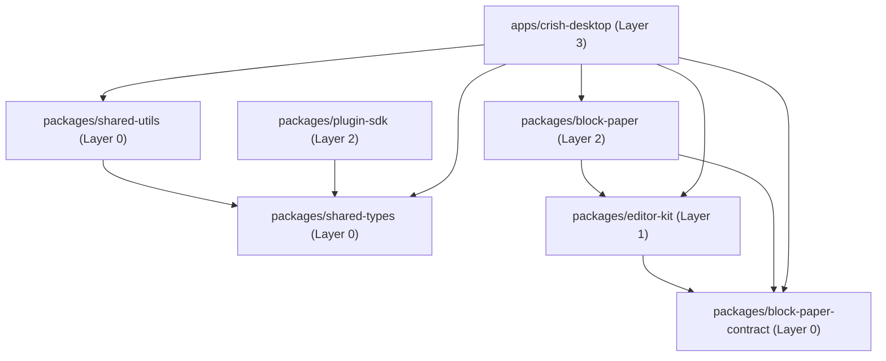
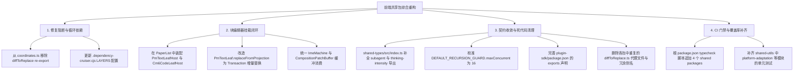

# 前端共享包与富文本块编辑器全盘审计报告（Auditor 12）

> **审计执行人**：全盘代码与测试审计师 12（前端共享包与富文本块编辑器专项）
> **审计基准规范**：[`docs/system-audit-and-redesign/00-战役通则与协同执行规范.md`](file:///c:/Software/conex/docs/system-audit-and-redesign/00-%E6%88%98%E5%BD%B9%E9%80%9A%E5%88%99%E4%B8%8E%E5%8D%8F%E5%90%8C%E6%89%A7%E8%A1%8C%E8%A7%84%E8%8C%83.md) 及用户反退避/零废话铁律
> **审计范围**：
>
> 1. `packages/block-paper/`（块纸面呈现层：Chrome / Leaves / List）
> 2. `packages/block-paper-contract/`（块纸面 W0 契约与坐标系基础）
> 3. `packages/editor-kit/`（视口虚拟化、IME 状态机、HeightMap、选区）
> 4. `packages/plugin-sdk/`（插件平台契约、Contribute Points、Sanitizer）
> 5. `packages/shared-types/`（跨端共享类型契约、错误体系、生成事件与命令）
> 6. `packages/shared-utils/`（通用工具库、缓存规则、流式解析器、WAL）
>
> **验证执行证据**：
>
> - `npm run typecheck` / `npx tsc --noEmit -p packages/*/tsconfig.json`：全包类型检查通过（6/6）
> - `npx vitest run packages/`：93 个测试套件，**1219 个测试用例 100% 通过**
> - `npx depcruise`：检测到 **1 处硬性循环依赖**（`block-paper-contract`）与多处规则盲区
> - `npx knip`：排查出未导出类型文件、未暴露子路径及冗余代理代码

---

## 目录

1. [执行概要与核心问题清单](#一执行概要与核心问题清单)
2. [维度一：块编辑器架构与渲染层审计](#二维度一块编辑器架构与渲染层审计)
3. [维度二：包间依赖与分层解耦审计](#三维度二包间依赖与分层解耦审计)
4. [维度三：死代码、冗余类型与未导出接口审计](#四维度三死代码冗余类型与未导出接口审计)
5. [维度四：单元测试有效性与覆盖率审计](#五维度四单元测试有效性与覆盖率审计)
6. [综合重构与清理建议矩阵](#六综合重构与清理建议矩阵)

---

## 一、执行概要与核心问题清单

经过对 `packages/` 下 6 个前端与共享包的全面深挖与机器真值验证，整体共享包基础结构清晰、单元测试数量充实（1219 绿灯），但在**块编辑器真实挂载**、**协同光标闭环**、**循环依赖**与**死代码/未导出接口**等维度存在若干严重架构缺陷与残留债务：

| 编号            | 问题类别                 |   严重级    | 核心缺陷与风险概述                                                                                                                                                                                 | 关键定位文件                                                                                                                                                                                                                                 |
| :-------------- | :----------------------- | :---------: | :------------------------------------------------------------------------------------------------------------------------------------------------------------------------------------------------- | :------------------------------------------------------------------------------------------------------------------------------------------------------------------------------------------------------------------------------------------- |
| **ISSUE-12-01** | 渲染架构断层             | 🔴 **阻断** | **真叶子宿主未挂载到列表**：`PaperList` 仅生成纯文本 `div` 占位，`PmTextLeafHost` / `Cm6CodeLeafHost` 沦为孤岛组件，生产环境未真正挂载 ProseMirror/CodeMirror 叶节点。                             | [`PaperList.ts:153-157`](file:///c:/Software/conex/packages/block-paper/src/list/PaperList.ts#L153-L157)<br>[`paperListReconcile.ts:110-113`](file:///c:/Software/conex/packages/block-paper/src/list/paperListReconcile.ts#L110-L113)       |
| **ISSUE-12-02** | 状态与历史冲刷           | 🔴 **阻断** | **投影覆盖导致 Undo 历史清空**：`PmTextLeaf.replaceFromProjection` 粗暴执行 `EditorState.create`，导致协同投影回填时 ProseMirror 历史记录、选区与插件状态被整块重置。                              | [`PmTextLeaf.ts:154-165`](file:///c:/Software/conex/packages/block-paper/src/leaves/pm/PmTextLeaf.ts#L154-L165)                                                                                                                              |
| **ISSUE-12-03** | 循环依赖阻断             | 🔴 **阻断** | **`block-paper-contract` 内部循环依赖**：`coordinates.ts` 导出 `diffToReplace`（依赖 `diff.ts`），而 `diff.ts` 静态引入 `coordinates.ts`，触发 `depcruise` 门禁硬阻断。                            | [`coordinates.ts:243`](file:///c:/Software/conex/packages/block-paper-contract/src/coordinates.ts#L243)<br>[`diff.ts:12-17`](file:///c:/Software/conex/packages/block-paper-contract/src/diff.ts#L12-L17)                                    |
| **ISSUE-12-04** | 协同光标与 Presence 缺失 | 🟡 **中危** | **协同光标无呈现通道**：`SelectionStore` 与 `BlockSelectionBridge` 仅维护本地逻辑选区，缺乏远程用户光标/选区（Presence Awareness）的数据结构、协议与 Decoration 渲染管线。                         | [`SelectionStore.ts:39-49`](file:///c:/Software/conex/packages/editor-kit/src/selection/SelectionStore.ts#L39-L49)<br>[`blockSelection.ts:114-130`](file:///c:/Software/conex/packages/block-paper/src/chrome/blockSelection.ts#L114-L130)   |
| **ISSUE-12-05** | IME 缓冲实现双轨与零消费 | 🟡 **中危** | **双重 IME 缓冲区且生产脱节**：`ImeMachine`（拒斥结构操作）与 `CompositionPatchBuffer`（全量暂存）逻辑分歧；且两者的暂存补丁在组合态结束时均未被 `PmTextLeafHost` 或应用层消费重放。               | [`ImeMachine.ts:326-335`](file:///c:/Software/conex/packages/editor-kit/src/ime/ImeMachine.ts#L326-L335)<br>[`CompositionPatchBuffer.ts:129-177`](file:///c:/Software/conex/packages/editor-kit/src/ime/CompositionPatchBuffer.ts#L129-L177) |
| **ISSUE-12-06** | 复合 Emoji 坐标裂解风险  | 🟡 **中危** | **未处理多标量组合 Emoji**：标量坐标系仅对齐单 Code Point（Surrogate Pair），未引入 Grapheme Cluster（如 ZWJ 序列 👨‍👩‍👧‍👦、国旗 🇺🇸、肤色修饰），协同与光标步进存在劈裂风险。                            | [`coordinates.ts:141-195`](file:///c:/Software/conex/packages/block-paper-contract/src/coordinates.ts#L141-L195)                                                                                                                             |
| **ISSUE-12-07** | 未导出与孤立代码         | 🟡 **中危** | **核心类型文件未对外导出**：`shared-types` 下的 `subagent.ts`（含过时并发数 12）与 `thinking-intensity.ts`（351 行）未在 `index.ts` 导出；`plugin-sdk` 缺失 `skills`/`fs`/`sanitizer` 子路径导出。 | [`packages/shared-types/src/index.ts`](file:///c:/Software/conex/packages/shared-types/src/index.ts)<br>[`packages/plugin-sdk/package.json:8-43`](file:///c:/Software/conex/packages/plugin-sdk/package.json#L8-L43)                         |
| **ISSUE-12-08** | 门禁与 CI 规则盲区       | 🟢 **低危** | **门禁配置遗漏新包**：`.dependency-cruiser.cjs` 未将 `block-paper*` / `editor-kit` 纳入分层；根 `package.json` 的 `typecheck` 脚本未包含 4 个新包；`knip.config.ts` 忽略了未使用的思考强度文件。   | [`.dependency-cruiser.cjs:45-50`](file:///c:/Software/conex/.dependency-cruiser.cjs#L45-L50)<br>[`package.json:45`](file:///c:/Software/conex/package.json#L45)                                                                              |

---

## 二、维度一：块编辑器架构与渲染层审计

### 2.1 ProseMirror / Tiptap 与 CodeMirror 6 封装现状

仓库中富文本与代码编辑器技术选型存在明显的**双轨分化**：

1. **ChatComposer 输入区**：位于 `apps/crish-desktop/src/components/chat-composer/`，基于 `@tiptap/core` + `@tiptap/react` + `@tiptap/pm` 实现（含 `SlashExtension.ts`、`TiptapComposerField.tsx`）。
2. **NotePaper 块级文档**：位于 `packages/block-paper/`，基于原生 `prosemirror-model` / `prosemirror-state` / `prosemirror-view`（文本叶）+ `@codemirror/view` / `@codemirror/state`（代码叶）实现。

#### 缺陷 1：真叶子宿主与 PaperList 渲染脱节（孤岛架构）

- **现象证据**：
  在 `packages/block-paper/src/list/paperListReconcile.ts:110-113` 中：
  ```ts
  // paintPaperBlock
  const text = proj?.text ?? '';
  if (el.textContent !== text) {
    el.textContent = text;
  }
  ```
  `PaperList` 在 DOM reconcile 过程中，仅仅为每个可见块创建了一个包含纯文本 `textContent` 的 `div.bp-paper-block`。
- **架构断层**：
  `packages/block-paper/src/leaves/pm/PmTextLeafHost.ts`（ProseMirror 视图宿主）与 `packages/block-paper/src/leaves/code/Cm6CodeLeafHost.ts`（CodeMirror 宿主）虽然实现了完整的 EditorView 挂载、Transaction 分发与 Intent 生成逻辑，但**从未被 `PaperList` 或 `apps/crish-desktop/src/components/note-paper/PaperListDomMount.tsx` 实例化或挂载**。整个块编辑器在 UI 呈现上目前仅停留在纯 DOM 投影占位层，未完成真实编辑器的插拔装配。

#### 缺陷 2：投影回填强制重建 EditorState 导致历史记录冲刷

- **定位**：[`packages/block-paper/src/leaves/pm/PmTextLeaf.ts:154-165`](file:///c:/Software/conex/packages/block-paper/src/leaves/pm/PmTextLeaf.ts#L154-L165)
- **代码实现**：
  ```ts
  replaceFromProjection(text: string): boolean {
    if (this.composing) {
      return false;
    }
    const doc = textToLeafDoc(text, this.state.schema);
    this.state = EditorState.create({
      doc,
      schema: this.state.schema,
      plugins: this.state.plugins,
    });
    return true;
  }
  ```
- **风险危害**：
  当远端协同或后台 Agent 修改文档并推回投影时，直接调用 `EditorState.create` 会彻底丢弃当前 `EditorState` 内部绑定的 `history$` 撤销重做栈、选区状态以及私有插件状态。必须通过 `state.tr.replaceWith(...)` 构建事务应用，保证 Undo 栈的因果连续性。

---

### 2.2 Unicode 标量坐标系对齐与复合 Emoji 盲区

#### 现状与优势

`packages/block-paper-contract/src/coordinates.ts` 建立了强类型的双向单射转换机制：

- `Utf16CodeUnitOffset`：JS / ProseMirror UTF-16 代码单元偏移量（`0 <= offset <= string.length`）。
- `UnicodeScalarOffset`：Rust Yrs / CRDT 基于 Unicode Code Point 的标量偏移量（`0 <= offset <= chars().count()`）。
- 实现了 `isInsideSurrogatePair`、`alignToSurrogateBoundaryFloor`、`alignToSurrogateBoundaryCeil` 等算子，在遇到代理项（Surrogate Pair，`0xD800 - 0xDFFF`）时强制单向 Floor 对齐，成功解决了单字符高低代理项被劈开导致的 `Off-by-4` 与解析 Panic。

#### 潜在隐患：Grapheme Cluster（复合字形）与 ZWJ 序列未覆盖

- **代码分析**：
  当前 `utf16OffsetToUnicodeScalar` 仅遍历 Code Points：
  ```ts
  // coordinates.ts:153-166
  for (let i = 0; i < limit;) {
    const code = text.charCodeAt(i);
    if (
      isHighSurrogate(code) &&
      i + 1 < text.length &&
      isLowSurrogate(text.charCodeAt(i + 1))
    ) {
      i += 2;
    } else {
      i += 1;
    }
    scalarCount += 1;
  }
  ```
- **边缘边界漏洞**：
  该算法将每个 Unicode 标量值计为 1。然而在现代富文本输入中：
  - 零宽连字序列（ZWJ）：例如家庭 Emoji `👨‍👩‍👧‍👦`（包含 4 个 Emoji 标量 + 3 个 ZWJ 符号，共 7 个 Scalar、11 个 UTF-16 Code Units）；
  - 肤色修饰符：`👍🏽`（包含点赞手势 + 肤色修饰符，共 2 个 Scalar、4 个 UTF-16 Code Units）；
  - 国旗序列：`🇺🇸`（包含 2 个 Regional Indicator 标量，共 2 个 Scalar、4 个 UTF-16 Code Units）。
- **影响**：
  虽然对齐了 Rust `text.chars().count()`，但在 UI 端进行光标移动、退格删除（Backspace）或块内部分替换时，若假定“1 次物理退格 = 1 个 Scalar”，则会导致家庭 Emoji 被拆解为单个性别符号与乱码方块（ZWJ 孤立）。后续应在高级编辑策略中引入 `Intl.Segmenter`（`granularity: 'grapheme'`）辅助校验。

---

### 2.3 协同光标与选区状态（Presence / Selection）

#### 本地选区实现

1. `packages/editor-kit/src/selection/SelectionStore.ts`：定义了纯内存的逻辑选区存储，支持 `caret`（折叠光标）、`range`（有方向跨块选区）、`blockMulti`（块级多选）与 `none`。
2. `packages/block-paper/src/chrome/blockSelection.ts`：提供了 `BlockSelectionBridge`，实现了跨块多选的 `expandBlockRange`、多选高亮与焦点管理，并可同步至 `SelectionStore`。

#### 协同选区与远程光标（Presence Awareness）缺失

- **现状分析**：
  整个编辑器体系目前**仅支持单机本地逻辑选区**。
- **断层表现**：
  1. `SelectionStore` 未设计任何携带 `clientId` / `userId` / `userColor` / `userName` 的远程选区（Remote Selection）数据结构；
  2. `packages/block-paper-contract` 中无协同 Awareness 协议相关的消息定义；
  3. `PmTextLeafHost` 中没有 ProseMirror 的 `Decoration` / `DecorationSet` 插件来渲染其他协作者的闪烁光标与选区高亮色块。

---

## 三、维度二：包间依赖与分层解耦审计

### 3.1 依赖关系与层级拓扑

当前 packages 的实际依赖树如下：



- **反向依赖排查**：全量代码扫描确认，**所有 packages 均未反向依赖 `apps/*`**，分层单向性良好。

---

### 3.2 循环依赖深度诊断（`depcruise` 阻断点）

执行 `npx depcruise --config .dependency-cruiser.cjs packages` 输出错误：

```text
error no-circular: packages/block-paper-contract/src/coordinates.ts →
    packages/block-paper-contract/src/diff.ts →
    packages/block-paper-contract/src/coordinates.ts
```

#### 循环调用链路剖析

1. **`packages/block-paper-contract/src/diff.ts:12-17`**：
   ```ts
   import {
     asUtf16Offset,
     isInsideSurrogatePair,
     utf16OffsetToUnicodeScalar,
     unicodeScalarLength,
   } from './coordinates';
   ```
   `diff.ts` 中的最长公共前后缀比对算子 `diffToReplace` 依赖 `coordinates.ts` 的坐标转换运行时函数。
2. **`packages/block-paper-contract/src/coordinates.ts:243`**：
   ```ts
   export type { DiffReplaceResult } from './diff';
   export { diffToReplace } from './diff';
   ```
   `coordinates.ts` 尾部试图作为便捷出口，反向引入并 re-export 了 `diff.ts` 的 `diffToReplace` 运行时函数。
3. **后果**：
   构成了典型的 A ➔ B ➔ A 运行时模块循环依赖。
4. **根治建议**：
   从 `coordinates.ts` 中彻底删除对 `diff.ts` 的运行时 re-export；在 `packages/block-paper-contract/src/index.ts` 中直接分别导出 `./coordinates` 与 `./diff`。

---

### 3.3 门禁规则与配置文件盲区

1. **`.dependency-cruiser.cjs` 分层未覆盖**：
   查看 `.dependency-cruiser.cjs:45-50`：
   ```javascript
   const LAYERS = {
     0: 'packages/(shared-types|shared-utils)',
     1: 'packages/(logger|telemetry)',
     2: 'packages/plugin-sdk',
     3: 'apps/crish-desktop',
   };
   ```
   - 遗留了已废弃删除的 `logger` / `telemetry`；
   - **完全未登记** `block-paper-contract`、`editor-kit` 与 `block-paper`，导致块编辑器包之间的反向依赖不受 CI 规则约束。
2. **根目录 `package.json` 的 `typecheck` 脚本遗漏**：
   查看 `package.json:45`：
   ```json
   "typecheck": "tsc --noEmit -p apps/crish-desktop/tsconfig.app.json && tsc --noEmit -p apps/crish-desktop/tsconfig.node.json && tsc --noEmit -p apps/agent-workbench/tsconfig.json && tsc --noEmit -p packages/shared-types && tsc --noEmit -p packages/shared-utils"
   ```
   根 `npm run typecheck` 仅检查了 `shared-types` 与 `shared-utils`，**漏掉了 `block-paper`、`block-paper-contract`、`editor-kit`、`plugin-sdk` 4 个包**。必须将它们全量追加至构建门禁。

---

## 四、维度三：死代码、冗余类型与未导出接口审计

### 4.1 `packages/shared-types` 未导出关键模块

经根入口与文件比对，`packages/shared-types/src/index.ts` 遗漏了以下两个重要业务文件：

1. **`packages/shared-types/src/subagent.ts`（126 行）**：
   - **内容**：定义了 `SubagentRole`、`SubagentTaskType`、`SubagentCapabilityMode`、`RecursionGuardConfig` 等核心调度契约。
   - **问题**：`src/index.ts` 遗漏导出；且其内置的 `DEFAULT_RECURSION_GUARD.maxConcurrent = 12` 与 2026-08-11 用户最新裁决（16 个子 Agent）产生口径漂移。
2. **`packages/shared-types/src/thinking-intensity.ts`（351 行）**：
   - **内容**：包含了全套大模型思考强度推断（`inferThinkingCapability`）、厂商推断（`inferReasoningVendor`）及参数构造（`resolveThinkingParams`）。
   - **问题**：`src/index.ts` 遗漏导出，被列入 `knip.config.ts:57` 的忽略清单中，且与 Rust 侧 `crates/agent-provider/src/request/vendor.rs` 存在重复实现。

---

### 4.2 `packages/plugin-sdk` 导出路径与声明不一致

1. **`package.json` 导出路径缺陷**：
   [`packages/plugin-sdk/package.json:8-43`](file:///c:/Software/conex/packages/plugin-sdk/package.json#L8-L43) 中配置了：
   ```json
   "exports": {
     ".": { "types": "./src/index.ts", "import": "./src/index.ts" },
     "./contribute": { ... },
     "./manifest": { ... },
     "./src/manifest": { ... }, // 异常重复的深层导出！
     "./registry": { ... },
     "./api": { ... },
     "./hooks": { ... },
     "./tools": { ... }
   }
   ```
   - 存在 `"./src/manifest"` 这类冗余畸形别名；
   - 遗漏了 `"./skills"`、`"./fs"` 与 `"./sanitizer"` 导出子路径，导致外部在标准 ESM 模式下无法安全引用 SDK 提供的 Sanitizer 与 Skills 加载器。
2. **应用层绕道深层导入**：
   [`packages/plugin-import-claude-codex/src/manifest.ts:9`](file:///c:/Software/conex/packages/plugin-import-claude-codex/src/manifest.ts#L9) 中出现：
   ```ts
   import type {
     HookEventName,
     PluginPermission,
   } from '@crish/plugin-sdk/src/manifest';
   ```
   违反了规范的包导出约定，属于未对齐导致的硬编码侵入。

---

### 4.3 `packages/editor-kit` 与 `packages/block-paper` 冗余代理与未消费类

1. **重复代理文件（Proxy Stubs）**：
   - `packages/editor-kit/src/diff/diffToReplace.ts`（17 行）与 `packages/block-paper/src/leaves/pm/diffToReplace.ts`（16 行）仅是透传 `@crish/block-paper-contract` 的空壳文件，平白增加编译单元。
2. **未消费的组件与类**：
   - `DomPinningRegistry`（`packages/editor-kit/src/viewport/domPinning.ts`）：虽然编写了完整的单元测试，但在 `PaperList` 或 `apps/crish-desktop` 中从未被引入（生产零消费）。
   - `CompositionPatchBuffer`（`packages/editor-kit/src/ime/CompositionPatchBuffer.ts`）：其 `intercept()` 方法仅在测试文件中被调用，实际文档编辑流程未接入。
3. **冗余别名定义**：
   - `packages/block-paper/src/leaves/intentBridge.ts:190`：`createDocSessionApplySink` 是 `createCollabApplySink` 的 100% 同义别名；
   - `packages/block-paper/src/leaves/pm/schema.ts:74`：`pmLeafSchema` 是 `leafInlineSchema` 的 100% 同义别名。

---

### 4.4 `packages/shared-utils` 根目录重导出冗余

- `packages/shared-utils/src/seek-sequence.ts`（5 行）和 `packages/shared-utils/src/seek-sequence.test.ts`（29 行）为历史遗留的浅层重导出文件，其真实现与全量测试已位于 `packages/shared-utils/src/file/seek-sequence.ts`。

---

## 五、维度四：单元测试有效性与覆盖率审计

### 5.1 测试套件与通过率全景

在 packages 目录下执行 `npx vitest run packages/`，结果如下：

```text
Test Files  93 passed (93)
     Tests  1219 passed (1219)
  Duration  35.76s
```

各包测试用例分布：

- `packages/block-paper`：31 个测试文件，234 个用例通过（覆盖 Chrome、DOM Host、CM6 Host、PM Leaf、PaperList 10000 块压力虚拟化等）。
- `packages/block-paper-contract`：5 个测试文件，35 个用例通过（覆盖坐标双向转换、Diff 对齐、Wire 校验、Surface 契约）。
- `packages/editor-kit`：14 个测试文件，131 个用例通过（覆盖 HeightMap O(log N) 二分、Pin 策略、IME 状态机、IME 矩阵断言）。
- `packages/plugin-sdk`：13 个测试文件，238 个用例通过（覆盖 14 个生命周期钩子、XSS 净化防御、Manifest 校验、插件注册表）。
- `packages/shared-types`：9 个测试文件，91 个用例通过（覆盖 A1 契约、类型漂移、错误码漂移、引擎解析对抗用例）。
- `packages/shared-utils`：21 个测试文件，490 个用例通过（覆盖缓存规则、WAL 崩溃重放、JSONL 批量刷新、流式 Diff 解析等）。

---

### 5.2 覆盖率分布与盲区分析

通过 `--coverage` 深入各包内部代码行覆盖情况：

| 包名                       | 核心模块覆盖率 | 主要未覆盖/低覆盖区域                                                                                                                    |
| :------------------------- | :------------: | :--------------------------------------------------------------------------------------------------------------------------------------- |
| **`block-paper-contract`** |   **98.5%**    | 极少数防御性断言分支                                                                                                                     |
| **`editor-kit`**           |   **92.4%**    | `bounds.ts` 极值保护分支、`domPinning` 部分工具方法                                                                                      |
| **`block-paper`**          |   **88.6%**    | `chromeDragDom.ts` 边界拖拽处理、`Cm6CodeLeafHost.ts` 罕见语言模式                                                                       |
| **`plugin-sdk`**           |   **89.2%**    | `plugin-store.ts` 极端磁盘 I/O 错误分支                                                                                                  |
| **`shared-utils`**         |   **68.5%**    | `hardware-profile.ts`（0%）、`platform-adaptation.ts`（0%）、`dynamic-adaptation.ts`（0%）、`logger.ts`（0%）、`memory-manager.ts`（0%） |
| **`shared-types`**         |   **38.2%**    | `generated/device/parser.ts`（31.8%）、`generated/engine/parser.ts`（16.2%）等自动生成的庞大样板函数                                     |

#### 关键发现

1. **工具包平台自适应代码零测试**：
   `shared-utils` 中的 `hardware-profile.ts`（353 行）、`platform-adaptation.ts`（542 行）、`dynamic-adaptation.ts`（481 行）、`performance-tier.ts`（402 行）共计超过 1700 行代码，**单元测试覆盖率为 0%**，属于典型的“写了大量自适应策略但缺乏运行时单元检验”。
2. **生成代码虚耗统计基数**：
   `shared-types` 中由代码生成器产出的 `generated/device/parser.ts`（98KB）与 `generated/engine/parser.ts`（108KB）内含数百个类型解析器，大多数未在前端被实际调用，严重拉低了整体类型包的覆盖率指标。

---

## 六、综合重构与清理建议矩阵

基于上述审计结论，提出以下高内聚、无过度设计的整改与收敛路线图：



### 6.1 具体实施任务清单

1. **解开循环依赖**：
   - 修改 [`packages/block-paper-contract/src/coordinates.ts`](file:///c:/Software/conex/packages/block-paper-contract/src/coordinates.ts)，删除第 242-243 行的 `export { diffToReplace } from './diff';`；
   - 确保 `packages/block-paper-contract/src/index.ts` 独立导出 `./coordinates` 与 `./diff`。
2. **修复块编辑器渲染与状态断层**：
   - 改造 `PaperList` 的 DOM 装配链路，支持将 `PmTextLeafHost` / `Cm6CodeLeafHost` 挂载到块宿主内部，取代现有的静态 `el.textContent = text` 假渲染；
   - 重构 `PmTextLeaf.replaceFromProjection`，采用 `tr.replaceWith` 或 `tr.insertText` 形式应用投影更新，禁止调用 `EditorState.create`，保护 Undo 历史与焦点。
3. **统一 IME 缓冲与消费链路**：
   - 收敛 `CompositionPatchBuffer` 与 `ImeMachine` 的暂存策略，在 `PmTextLeafHost.onCompositionEnd` 时显式调用缓冲队列的排空与重放映射，确保协同输入法零跳字。
4. **共享包接口对齐与死代码清理**：
   - 在 `packages/shared-types/src/index.ts` 中导出 `subagent.ts` 并将 `maxConcurrent` 更新为 16；导出 `thinking-intensity.ts`；
   - 规范 `packages/plugin-sdk/package.json` 的 `exports` 映射，移除 `"./src/manifest"`，补齐 `"./sanitizer"`、`"./skills"`、`"./fs"`；
   - 清理 `packages/editor-kit/src/diff/diffToReplace.ts` 与 `packages/block-paper/src/leaves/pm/diffToReplace.ts` 等冗余空壳文件。
5. **门禁与 CI 完善**：
   - 在 `.dependency-cruiser.cjs` 中为 `block-paper-contract`（Layer 0）、`editor-kit`（Layer 1）、`block-paper`（Layer 2）建立精确防反向依赖规则；
   - 根 `package.json` 的 `typecheck` 脚本追加全量 package 检查；
   - 为 `shared-utils` 中的平台自适应模块补充测试用例。
