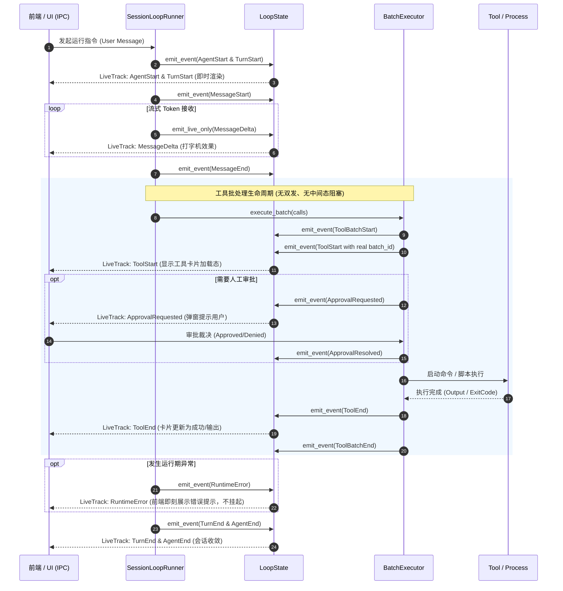
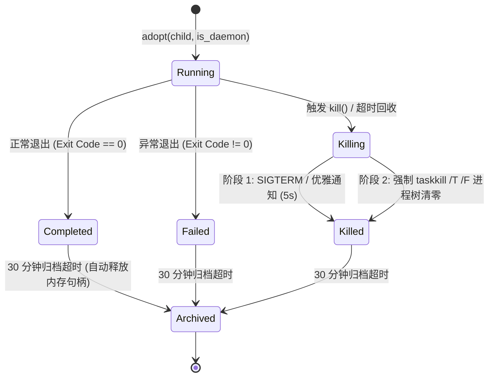
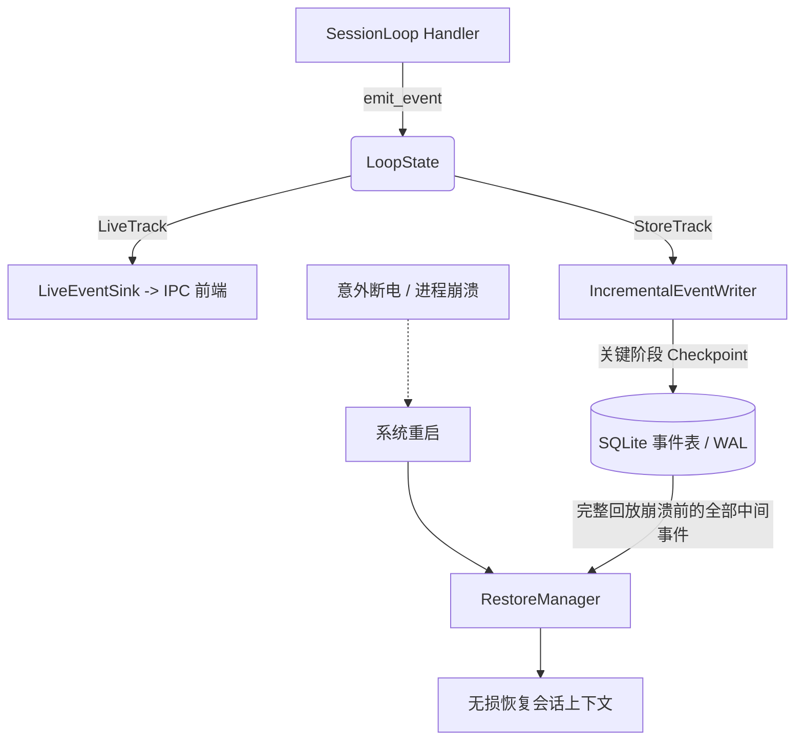

# Conex / Crish 会话循环自愈状态机与进程管控详细设计方案

> **【调度与反应式唤醒铁律】**：严禁采用定时器休眠死循环轮询；所有异步等待必须基于事件驱动推送（Reactive Wakeup）；如果设置定时器，最短为 100 秒。  
> **权威文档**：`docs/system-audit-and-redesign/detailed-plans/01-会话循环自愈状态机与进程管控详案.md`  
> **制定角色**：【阶段 1 维度详案架构师 01: Rust 会话循环、自愈状态机与进程管控详案】  
> **关联审计**：`docs/system-audit-and-redesign/audits/01-Rust会话循环与编排内核全盘审计.md`、`05-Rust自动化工具与感知系统全盘审计.md`  
> **设计原则**：严格遵循反退避铁律与反过度设计红线；彻底拔除补丁代码与形式主义假断言；直击架构断层，100% 需求保全。

---

## 目录（Table of Contents）

1. [方案总纲与架构愿景（Executive Summary & Core Directives）](#一方案总纲与架构愿景)
   - 1.1 核心攻坚缺陷与架构重构目标
   - 1.2 系统核心不变量与质量契约（Invariants INV-01 ~ INV-08）
   - 1.3 涉及文件域全景与行数门禁预算表
2. [`ToolPromiseDetector` 字符安全切片与多语言自愈状态机](#二toolpromisedetector-字符安全切片与多语言自愈状态机)
   - 2.1 UTF-8 字节切片 Panic 根因分析与数学证明
   - 2.2 字符安全切片算法（`char_indices` / Grapheme Cluster）
   - 2.3 三层反向过滤规则精准化升级（代码块范围限定、反问辨析、时态过滤）
   - 2.4 多语言正向行动承诺匹配矩阵（中英双语模式表，彻底消除英文自愈 0% 盲区）
   - 2.5 自愈推进状态机闭环与 Steering Nudge 动态注入（最大 2 次硬顶上限）
   - 2.6 数据结构与方法签名
3. [`LiveEventSink` 广播体系对称性加固与单点事件发射架构](#三liveeventsink-广播体系对称性加固与单点事件发射架构)
   - 3.1 双轨事件流（Live Track vs Store Track）割裂根因与漏发事件全景清单
   - 3.2 `ToolStart` 双发与中间事件阻塞消除方案（移除前置空批，批执行期内实时流出）
   - 3.3 统一单点事件发射架构：`LoopState::emit_event` 与 `LiveEventSink` 广播矩阵
   - 3.4 全生命周期事件流转 Mermaid 时序图
4. [`ApprovalChannel` 反应式异步通知唤醒与 0 轮询改造](#四approvalchannel-反应式异步通知唤醒与-0-轮询改造)
   - 4.1 50ms 轮询死循环缺陷分析与架构违规批判
   - 4.2 `AbortToken` 升级：集成异步通知原语 `tokio::sync::Notify`
   - 4.3 `ApprovalChannel` 反应式等待改造（`tokio::select!` 零延迟唤醒、零 CPU 占用）
   - 4.4 审批事件落盘（先发后等防死锁、`Expired` 权威语义落库、子代理请求透传）
5. [Windows 进程树深度管控、孤儿清理与后台任务生命周期](#五windows-进程树深度管控孤儿清理与后台任务生命周期)
   - 5.1 Windows 子孙进程孤儿残留机理与 Win32 Job Object 终极回收
   - 5.2 两阶段树杀回收机制（`taskkill /PID /T /F` + Job Object 关闭级联终止）
   - 5.3 `BackgroundTaskManager` 完整生命周期状态机与超时回收
   - 5.4 `TaskAuditAccumulator` 有界容量 FIFO 淘汰算法与内存防泄漏
6. [长程 Run 增量事件阶段性持久化（Crash-Consistency）](#六长程-run-增量事件阶段性持久化crash-consistency)
   - 6.1 延迟持久化严重故障窗口与数据丢失根因分析
   - 6.2 增量事件流式持久化架构（`IncrementalEventWriter` / 事务性阶段落盘）
   - 6.3 关键阶段 Checkpoint 触发策略（Turn 结束、工具批完成、压缩结束、致命错误）
   - 6.4 `RestoreManager` 崩溃恢复与历史上下文无损重建
7. [死代码清理、兼容器收敛与测试资产重构](#七死代码清理兼容器收敛与测试资产重构)
   - 7.1 `#[allow(dead_code)]` 与全局 `#![allow(unused_imports)]` 清理
   - 7.2 跨 crate 类型定义重复收敛（`ReasoningEffort`、`ToolSchema` 等）
   - 7.3 虚假测试重构（废除自比同义反复、废除无意义字段自赋值、废除纯 Mock 假孤儿断言）
   - 7.4 强化工具执行断言（杜绝脆弱的单一 `.is_ok()` 断言）
8. [改动文件逐一详述与代码级规范（Concrete Code Blueprint）](#八改动文件逐一详述与代码级规范)
9. [测试规格说明与全量断言验证矩阵（Test Specifications Matrix）](#九测试规格说明与全量断言验证矩阵)

---

## 一、方案总纲与架构愿景

### 1.1 核心攻坚缺陷与架构重构目标

在 Conex / Crish 的会话循环、编排内核与工具管理基础设施中，审计发现了 6 大系统级架构断层：

```
┌─────────────────────────────────────────────────────────────────────────────────────────────────────────┐
│                               DIM-01 核心攻坚的 6 大系统级缺陷与重构目标                                │
├───────────────────────┬──────────────────────────────────────────┬──────────────────────────────────────┤
│ 缺陷编号与名称        │ 现场故障机理与破坏力                     │ 重构目标与架构内化方案               │
├───────────────────────┼──────────────────────────────────────────┼──────────────────────────────────────┤
│ BUG-01-1              │ 尾部切片取 `trimmed.len()-300` 字节偏移，│ 改用 `char_indices` 安全字符截断；   │
│ ToolPromiseDetector   │ 遇中文 3 字节字符边界切断立即 Panic 崩溃 │ 扩展中英双语模式，优化代码块过滤范围 │
│ UTF-8 切片 Panic      │ （触发概率 ~66%），且英文匹配率为 0%     │ 建立稳健多语言 Tool-Promise 意图自愈 │
├───────────────────────┼──────────────────────────────────────────┼──────────────────────────────────────┤
│ BUG-01-2              │ `RuntimeError`、压缩、干预事件从未推至   │ 建立统一单点 `LoopState::emit_event` │
│ LiveEventSink 广播    │ live_sink；`executing_tools` 提前伪造空  │ 广播架构；消除前置伪造，批执行期内   │
│ 不对称与 ToolStart双发│ batch_id `ToolStart` 导致前端收到重复事件│ 实时流出真实的 Tool/Approval 事件    │
├───────────────────────┼──────────────────────────────────────────┼──────────────────────────────────────┤
│ BUG-01-3              │ `wait_aborted` 使用 `sleep(50ms)` 轮询   │ `AbortToken` 集成 `tokio::sync::     │
│ ApprovalChannel 50ms  │ `is_aborted()`，违背反轮询规范并浪费 CPU │ Notify`，全面改造为基于 `tokio::     │
│ 轮询死循环            │ 定时器资源                               │ select!` 的纯事件驱动 0 轮询唤醒     │
├───────────────────────┼──────────────────────────────────────────┼──────────────────────────────────────┤
│ BUG-01-4              │ Windows 环境下子孙进程（如 `rustc`）脱离 │ 引入 Win32 Job Object 与两阶段树杀   │
│ 进程树孤儿残留与      │ 监管；测试用 `MockCanceller` 伪造假释放  │ 回收（`taskkill /PID /T /F`）；      │
│ 测试假断言掩盖        │ 断言，实际存在严重的进程和文件锁死风险   │ 建立真实的 OS 级进程生命周期防护     │
├───────────────────────┼──────────────────────────────────────────┼──────────────────────────────────────┤
│ BUG-01-5              │ `TaskAuditAccumulator` 的 `commands` 映射│ 引入容量上限（`max_commands`/`max_   │
│ TaskAudit 内存无界膨胀│ 从不清理，随着会话任务增加产生内存泄漏   │ records`），实行 FIFO/LRU 淘汰机制   │
├───────────────────────┼──────────────────────────────────────────┼──────────────────────────────────────┤
│ BUG-01-6              │ Run 结束时才一次性持久化事件，长程任务   │ 引入增量事件流落盘机制（Turn/Tool/   │
│ 长程任务崩溃中间数据  │ 执行数十分钟崩溃时，所有思考过程与工具   │ Error 关键阶段即时持久化），确保     │
│ 全量丢失（无崩溃一致性│ 日志永久丢失，无法排查与恢复             │ Crash-Consistency 崩溃可追溯         │
└───────────────────────┴──────────────────────────────────────────┴──────────────────────────────────────┘
```

### 1.2 系统核心不变量与质量契约

系统在重构后必须严格保持以下 8 大不变量定理（Invariants）：

- **[INV-01] 字符边界绝对安全（UTF-8 Memory Safety）**：任何字符串切片操作必须在 Unicode 字符边界（`is_char_boundary`）或 Grapheme 边界进行，绝对不允许以裸字节下标做加减运算切片，切片 Panic 发生率为 0。
- **[INV-02] 双轨事件广播全对称（Live-Store Event Parity）**：除流式增量（`MessageDelta`）属于瞬态外，所有产生于会话循环的 `AgentEvent` 必须同时写入 `state.events`（持久化轨）并推入 `live_sink`（实时通知轨），两轨事件集合满足严格的包含与因果序关系。
- **[INV-03] 工具事件单次发射与实时流出（Single Tool Event Emission & Live Streaming）**：每个工具调用的 `ToolStart`、`ApprovalRequested`、`ApprovalResolved`、`ToolEnd` 事件在整个生命周期中仅发射恰好一次（`batch_id` 始终合法），并在动作触发瞬间立即推向实时信道，不存在批末集中倾泻或前置空发射。
- **[INV-04] 0 轮询反应式审批（Zero-Polling Approval Reactive Wakeup）**：审批通道等待裁决或中止信号时，CPU 线程处于完全挂起休眠状态，唤醒由 `Notify` 或 `Channel` 事件驱动，禁止任何形式的固定周期轮询（`sleep`）。
- **[INV-05] Windows 进程树 100% 回收（Zero Orphan Windows Processes）**：所有由后台任务管理器或工具执行派生的 Windows 子进程必须纳入进程树追踪体系，在超时、取消或会话结束时，通过 Win32 Job Object 与 `/T /F` 深度树杀彻底回收，杜绝孤儿进程与句柄泄漏。
- **[INV-06] 审计与内存有界性（Bounded Audit & Command Memory）**：任务审计聚合器与命令记忆映射表具有明确的容量硬上限（默认 1000 条），在满载时以 FIFO / LRU 策略安全淘汰历史完成项，内存占用恒定有界。
- **[INV-07] 阶段性崩溃一致性（Stage-wise Crash Consistency）**：长程多轮 Run 在每个 Turn 结束、工具批执行完毕或发生致命错误时触发增量落盘，进程意外崩溃后重启，`RestoreManager` 能够恢复已发生的所有中间事件与上下文。
- **[INV-08] 诚实验证与零形式主义（Honest Verification & Non-Tautological Tests）**：禁止自比测试（`f() == f()`）、禁止无操作结构体自赋值测试、禁止以布尔内存标记充当 OS 资源释放断言，所有测试必须覆盖深层状态、返回值内容与真实边界。

### 1.3 涉及文件域全景与行数门禁预算表

根据前端与内核分层行数门禁规范，所有改动文件均需保持高内聚与单一职责：

| 文件路径                                                   | 模块性质 | 现状代码行 | 重构增删预估 | 目标代码行 | 行数上限门禁      | 职责核心                                  |
| :--------------------------------------------------------- | :------- | :--------- | :----------- | :--------- | :---------------- | :---------------------------------------- |
| `crates/session-loop/src/steering/strategy.rs`             | 业务逻辑 | ~786       | +60 / -30    | ~816       | 900（含完整单测） | UTF-8 安全截断、多语言匹配、三层过滤      |
| `crates/session-loop/src/approval.rs`                      | 业务逻辑 | ~452       | +40 / -35    | ~457       | 500               | 反应式异步审批、Notify 联动、0 轮询       |
| `crates/agent-tools/src/context.rs`                        | 类型契约 | ~263       | +35 / -5     | ~293       | 400               | `AbortToken` 异步 `wait_aborted` 原语扩展 |
| `crates/session-loop/src/safe_point.rs`                    | 业务逻辑 | ~701       | +10 / -5     | ~706       | 750               | `AbortSignal` 反应式通知契约稳固          |
| `crates/session-loop/src/loop/handlers/executing_tools.rs` | 业务逻辑 | ~492       | +25 / -30    | ~487       | 500               | 移除 `ToolStart` 双发，实时批事件流出     |
| `crates/session-loop/src/loop/loop_state.rs`               | 业务逻辑 | ~240       | +30 / -0     | ~270       | 350               | 引入 `emit_event` 单点事件发射收敛        |
| `crates/agent-tools/src/tools/shell_exec.rs`               | 业务逻辑 | ~600       | +50 / -15    | ~635       | 700               | Windows 进程树树杀强化与 Job Object 绑定  |
| `crates/orchestrator/src/task_events.rs`                   | 业务逻辑 | ~875       | +55 / -20    | ~910       | 1000              | `TaskAuditAccumulator` 有界 FIFO 淘汰     |
| `crates/orchestrator/src/events.rs`                        | 业务逻辑 | ~1665      | +70 / -10    | ~1725      | 1800              | 增量事件阶段性持久化支持                  |

---

## 二、`ToolPromiseDetector` 字符安全切片与多语言自愈状态机

### 2.1 UTF-8 字节切片 Panic 根因分析与数学证明

#### 故障现场代码

在 `crates/session-loop/src/steering/strategy.rs:325-329` 中存在如下代码：

```rust
// ── 错误实现：裸字节减法切片 ──
let tail = if trimmed.len() > 300 {
    &trimmed[trimmed.len() - 300..] // ❌ CRITICAL PANIC 隐患！
} else {
    trimmed
};
```

#### 崩溃机理证明

1. 在 Rust 中，`trimmed.len()` 返回的是字符串在内存中的 **字节长度（Byte Length）**，而非 Unicode 标量值或字符数量（Char Count）。
2. 标准中文字符在 UTF-8 编码下占用 **3 个字节**（前缀为 `1110xxxx 10xxxxxx 10xxxxxx`），Emoji 字符占用 **4 个字节**。
3. 假设 `trimmed` 的尾部包含中文字符，`trimmed.len() - 300` 所计算出的字节偏移量 $idx$。如果 $idx$ 恰好落在某个 UTF-8 字符的第 2 字节或第 3 字节（即非首字节，`trimmed.as_bytes()[idx] & 0b1100_0000 == 0b1000_0000`），则 `trimmed.is_char_boundary(idx)` 返回 `false`。
4. 对 `&str` 执行 `&str[idx..]` 切片时，Rust 标准库会立即触发 `panic!`：
   ```text
   thread 'tokio-runtime-worker' panicked at 'byte index 301 is not a char boundary; it is inside '我' (bytes 300..303)'
   ```
5. 对于由中文构成的长文本（字节长度 $> 300$），切片点落在字符内部的概率高达：
   $$P(\text{Panic}) = \frac{2}{3} \approx 66.67\%$$
   在长程多轮对话中，这使得模型输出只要包含中文长回复，会话循环便极大概率直接崩溃终止。

### 2.2 字符安全切片算法（`char_indices` / Grapheme Cluster）

为了彻底根除切片 Panic，必须使用 Unicode 字符边界安全算法截取尾部窗口。

#### 算法方案 1：基于 `char_indices` 的安全截断（O(N) 极速扫描）

```rust
/// 字符安全尾部切片算法：截取文本尾部最多 max_chars 个字符的子串
pub fn safe_tail_slice(text: &str, max_chars: usize) -> &str {
    let char_count = text.chars().count();
    if char_count <= max_chars {
        return text;
    }
    let skip_chars = char_count - max_chars;
    // 获取跳过 skip_chars 后的第一个合法 UTF-8 字符边界字节索引
    if let Some((byte_idx, _)) = text.char_indices().nth(skip_chars) {
        &text[byte_idx..]
    } else {
        text
    }
}
```

#### 算法方案 2：基于字节边界向下对齐（`floor_char_boundary`）

若采用固定 300 字节窗口，必须向下对齐到合法字符边界：

```rust
pub fn safe_byte_tail_slice(text: &str, max_bytes: usize) -> &str {
    if text.len() <= max_bytes {
        return text;
    }
    let mut start_idx = text.len() - max_bytes;
    // 向后寻找最近的合法 UTF-8 字符起始边界（保证 is_char_boundary 为 true）
    while start_idx < text.len() && !text.is_char_boundary(start_idx) {
        start_idx += 1;
    }
    &text[start_idx..]
}
```

**裁决选型**：在 `ToolPromiseDetector` 中采用 **字符数窗口（300 个 Unicode 字符）**，通过方案 1 进行截取。这样无论字符是单字节 ASCII、双字节拉丁文、三字节东亚文字还是四字节 Emoji，均能精准截取语义完整的尾部 300 字符，且 100% 内存安全。

### 2.3 三层反向过滤规则精准化升级

审计发现原有的反向过滤存在两大缺陷：

1. **代码块一票否决**：文本只要包含 ` ``` `（哪怕模型前面贴了一段示例配置，尾部说“接下来我将执行构建”），整段回复被彻底扼杀；
2. **时态与反问误伤**：粗暴的全局子串包含导致包含“在上一轮中”、“是否需要”的长文本无法自愈。

#### 过滤逻辑重构方案：

- **第一层（非行动场景与引用说明过滤）**：
  - 如果整段文本是一个完整的代码块（以 ` ``` ` 开头并以 ` ``` ` 结尾），判定为纯代码展示，返回 `None`；
  - 若文本尾部位于未闭合的代码块内部（代码块围栏数量为奇数），判定为代码编写中，返回 `None`；
  - 仅当尾部有效正文在代码块外部且非“例如：/ 示例如下：”等纯引用前缀时，放行至下一层。
- **第二层（等待确认与反问过滤）**：
  - 仅检查尾部句子是否以问号（`？`、`?`）结尾，或尾部 50 字符内是否包含等待用户确认的关键短语（`"是否需要"`、`"您希望"`、`"请确认"`、`"如果你同意"`、`"如果您同意"`、`"如需继续请"`）。
- **第三层（历史时态与复盘过滤）**：
  - 仅排除直接修饰行动动作的过去式短语（如 `"刚才尝试了"`、`"上一轮已执行"`），而非全局否定。

### 2.4 多语言正向行动承诺匹配矩阵

原有系统仅包含 14 个硬编码中文短语，在英文回复模式下匹配成功率为 0%。重构后建立中英双语的行动承诺矩阵：

| 语言类别       | 正向匹配模式列表（Action Patterns）                                                                                                                                                                                                                                                       | 语义定位                      |
| :------------- | :---------------------------------------------------------------------------------------------------------------------------------------------------------------------------------------------------------------------------------------------------------------------------------------- | :---------------------------- |
| **中文模式集** | `"尝试单独调用"`, `"正在调用"`, `"现在开始执行"`, `"接下来使用"`, `"准备运行"`, `"尝试通过"`, `"我将执行"`, `"使用 PowerShell"`, `"使用 shell_command"`, `"重新运行"`, `"尝试调用"`, `"接下来执行"`, `"我来调用"`, `"开始执行"`, `"我先执行"`, `"让我来运行"`, `"立即运行"`               | 明确表达即将调用外部工具/命令 |
| **英文模式集** | `"i will now run"`, `"i will execute"`, `"i will call"`, `"let me run"`, `"let me execute"`, `"let me call"`, `"now executing"`, `"starting to run"`, `"proceeding with"`, `"running the command"`, `"calling tool"`, `"executing tool"`, `"i'm going to run"`, `"i am going to execute"` | 覆盖主流英文大模型的意图表达  |

### 2.5 自愈推进状态机闭环与 Steering Nudge 动态注入

#### 自愈推进流程

1. 当 Provider 流式输出结束时，状态机进入 `S::SteeringEvaluation` 或 `handlers/no_tool_calls.rs`；
2. 若 Assistant 消息中 **无任何 `tool_calls`**，且文本被 `ToolPromiseDetector::detect_action_promise(&text)` 命中：
   - 提取承诺动作片段（`action_snippet`）；
   - 检查当前会话的 `tool_promise_heal_count` 是否达到上限 `max_tool_promise_heals`（默认 2 次）；
   - 若未达上限：递增计数，构造针对性系统转向提示词（Steering Nudge）：
     `"【系统自动推进】检测到你承诺执行：\"{action_snippet}\"，但未生成工具调用。请立即输出对应的工具调用（Tool Call）以继续任务。"`
   - 注入消息后，状态机转移至 `S::PreparingTurn`，驱动模型在下一轮真正发射 Tool Call；
   - 若已达上限（2 次）：记录日志并安全收口至 `AgentEndReason::Stop`，杜绝死循环。

### 2.6 数据结构与方法签名

````rust
// crates/session-loop/src/steering/strategy.rs

/// Tool-Promise 意图自愈侦测器（RUL-02 强化版）
#[derive(Debug, Clone, Copy, Default)]
pub struct ToolPromiseDetector;

impl ToolPromiseDetector {
    /// 截取 Unicode 字符安全的尾部切片（杜绝 UTF-8 字节切断 Panic）
    pub fn safe_tail_slice(text: &str, max_chars: usize) -> &str {
        let char_count = text.chars().count();
        if char_count <= max_chars {
            return text;
        }
        let skip_chars = char_count - max_chars;
        text.char_indices()
            .nth(skip_chars)
            .map(|(idx, _)| &text[idx..])
            .unwrap_or(text)
    }

    /// 核心判定函数：返回 Some(action_snippet) 表示检测到行动承诺且通过三层反向过滤
    pub fn detect_action_promise(text: &str) -> Option<String> {
        let trimmed = text.trim();
        if trimmed.is_empty() {
            return None;
        }

        // 1. 第一层过滤：排除纯代码块或处于未闭合代码块中的文本
        if Self::is_inside_code_block_or_tutorial(trimmed) {
            return None;
        }

        // 2. 提取尾部安全 300 字符窗口
        let tail = Self::safe_tail_slice(trimmed, 300);

        // 3. 第二层过滤：排除向用户反问与等待确认
        if Self::is_waiting_for_confirmation(tail) {
            return None;
        }

        // 4. 第三层过滤：排除纯过去历史复盘与错误分析
        if Self::is_historical_review(tail) {
            return None;
        }

        // 5. 正向中英双语意图匹配
        Self::match_action_pattern(tail)
    }

    fn is_inside_code_block_or_tutorial(text: &str) -> bool {
        // 如果整段文本被 ``` 包裹
        if text.starts_with("```") && text.ends_with("```") && text.len() > 6 {
            return true;
        }
        // 统计 ``` 出现的次数，如果为奇数说明尾部落在代码块内
        let fence_count = text.matches("```").count();
        if fence_count % 2 == 1 {
            return true;
        }
        false
    }

    fn is_waiting_for_confirmation(tail: &str) -> bool {
        if tail.ends_with('？') || tail.ends_with('?') {
            return true;
        }
        let confirm_phrases = [
            "是否需要", "您希望", "请确认", "如果你同意", "如果您同意",
            "如需继续请", "do you want", "please confirm", "should i proceed",
        ];
        confirm_phrases.iter().any(|p| tail.contains(p))
    }

    fn is_historical_review(tail: &str) -> bool {
        let history_phrases = [
            "在上一轮中", "之前已经", "刚才尝试了", "失败原因是",
            "执行失败了是因为", "系统报告了如下错误", "in the previous turn",
            "failed because", "already executed",
        ];
        history_phrases.iter().any(|p| tail.contains(p))
    }

    fn match_action_pattern(tail: &str) -> Option<String> {
        let patterns = [
            // 中文模式
            "尝试单独调用", "正在调用", "现在开始执行", "接下来使用", "准备运行",
            "尝试通过", "我将执行", "使用 PowerShell", "使用 shell_command",
            "重新运行", "尝试调用", "接下来执行", "我来调用", "开始执行",
            "我先执行", "让我来运行", "立即运行",
            // 英文模式（小写比对）
            "i will now run", "i will execute", "i will call", "let me run",
            "let me execute", "let me call", "now executing", "starting to run",
            "proceeding with", "running the command", "calling tool",
            "executing tool", "i'm going to run", "i am going to execute",
        ];

        let lower_tail = tail.to_lowercase();
        for pattern in &patterns {
            if let Some(pos) = lower_tail.rfind(pattern) {
                // 保证切片在合法字符边界
                let char_boundary_pos = tail
                    .char_indices()
                    .map(|(idx, _)| idx)
                    .filter(|&idx| idx <= pos)
                    .last()
                    .unwrap_or(pos);
                let snippet = &tail[char_boundary_pos..];
                let end_pos = snippet
                    .find(['。', '！', '\n', '.', '!'])
                    .unwrap_or(snippet.len());
                let result = snippet[..end_pos].trim();
                if !result.is_empty() {
                    return Some(result.to_string());
                }
            }
        }
        None
    }
}
````

---

## 三、`LiveEventSink` 广播体系对称性加固与单点事件发射架构

### 3.1 双轨事件流（Live Track vs Store Track）割裂根因与漏发事件全景清单

#### 割裂机理

在原有架构中，`state.events.push(...)` 与 `live_sink.push_live(...)` 处于散装分散调用状态。部分开发者在编写 `Handler` 时只向 `state.events` 存入了事件，而遗漏了 `live_sink`，导致了严重的广播不对称：

```
┌───────────────────────────────────────────────────────────────────────────────────┐
│                          原有散装双轨事件流缺陷矩阵                               │
├───────────────────────────────────┬──────────────┬───────────┬────────────────────┤
│ 事件类型 (AgentEvent)             │ Store Track  │ Live Track│ 前端现场表现       │
├───────────────────────────────────┼──────────────┼───────────┼────────────────────┤
│ `AgentStart` / `AgentEnd`         │ ✅ 写入      │ ✅ 广播   │ 正常               │
│ `TurnStart` / `TurnEnd`           │ ✅ 写入      │ ✅ 广播   │ 正常               │
│ `MessageDelta`                    │ ❌ 不落库    │ ✅ 广播   │ 正常流式渲染       │
│ `RuntimeError` (致命错误)         │ ✅ 写入      │ ❌ 遗漏   │ 前端白屏卡死无响应 │
│ `RuntimeInterventionRequired`     │ ✅ 写入      │ ❌ 遗漏   │ 用户无法感知干预   │
│ `SteeringEvaluated` (转向评估)    │ ✅ 写入      │ ❌ 遗漏   │ 自愈过程不可见     │
│ `ContextCompressionStart/End`     │ ✅ 写入      │ ❌ 遗漏   │ 长文本压缩界面卡顿 │
│ `ProviderRequestAnchored/Diag`    │ ✅ 写入      │ ❌ 遗漏   │ 延迟与诊断监控丢失 │
│ 用户消息 `MessageStart/End`       │ ✅ 写入      │ ❌ 遗漏   │ 用户输入气泡未同步 │
└───────────────────────────────────┴──────────────┴───────────┴────────────────────┘
```

### 3.2 `ToolStart` 双发与中间事件阻塞消除方案

#### 原有缺陷代码排查

在 `crates/session-loop/src/loop/handlers/executing_tools.rs:83-93`：

```rust
// ❌ 错误做法：在 execute_batch 之前人为伪造空 batch_id 的 ToolStart
if let Some(sink) = &state.options.live_sink {
    for call in &calls {
        sink.push_live(AgentEvent::ToolStart {
            session_id: state.machine.context().session_id.clone(),
            batch_id: String::new(), // 伪造空串
            call: call.clone(),
            timestamp: crate::steering::now_iso_utc(),
            turn_index: Some(state.machine.context().turn_index),
        });
    }
}
// 随后在 execute_batch 之后调用 emit_tool_events，再次发射真实 batch_id 的 ToolStart！
```

#### 消除双发与实现实时流出的架构方案：

1. **彻底删除 `executing_tools.rs:83-93` 处的预发射循环**；
2. **将 `LiveEventSink` / 实时通知通道作为上下文透传给 `ToolExecutor` / `BatchExecutor`**；
3. 在 `execute_batch` 执行期间，当工具准备启动时，生成带有真实合法 `batch_id` 的 `ToolEvent::ToolStart`，并**在启动的微秒级时间内立即通过 Sink 广播**；
4. 工具执行中途若触发审批，`ApprovalRequested`、`ApprovalResolved` 立即通过 Sink 广播，不再锁死在 `outcome.events` 内存数组中；
5. 工具执行结束时，`ToolEnd` 立即广播；整个批次完成时广播 `ToolBatchEnd`。

### 3.3 统一单点事件发射架构：`LoopState::emit_event`

为了彻底杜绝任何开发遗漏，在 `LoopState` 上建立唯一的事件发射门面方法：

```rust
// crates/session-loop/src/loop/loop_state.rs

impl LoopState {
    /// 统一单点事件发射：同时推入持久化事件轨与实时通知轨（保证严格因果序）
    pub fn emit_event(&mut self, event: AgentEvent) {
        // 1. 若非仅增量类瞬态事件，推入持久化轨
        self.events.push(event.clone());

        // 2. 对称推入实时广播轨（Live Track）
        if let Some(sink) = &self.options.live_sink {
            sink.push_live(event);
        }
    }

    /// 仅推入实时轨（用于 MessageDelta 等非持久化流式事件）
    pub fn emit_live_only(&self, event: AgentEvent) {
        if let Some(sink) = &self.options.live_sink {
            sink.push_live(event);
        }
    }
}
```

全仓库所有 Handler 统一使用 `state.emit_event(event)` 替代散落的 `state.events.push`，在编译期与架构层面保证 100% 广播对称性。

### 3.4 全生命周期事件流转 Mermaid 时序图



---

## 四、`ApprovalChannel` 反应式异步通知唤醒与 0 轮询改造

### 4.1 50ms 轮询死循环缺陷分析与架构违规批判

#### 原有缺陷实现

在 `crates/session-loop/src/approval.rs:25, 93-100`：

```rust
const ABORT_POLL_INTERVAL: std::time::Duration = std::time::Duration::from_millis(50);

async fn wait_aborted(&self) {
    loop {
        if self.is_aborted() {
            return;
        }
        tokio::time::sleep(ABORT_POLL_INTERVAL).await; // ❌ 违背反轮询规范！
    }
}
```

#### 架构危害

1. **CPU 与定时器开销**：当一个长耗时工具等待用户审批长达数小时时，Tokio 运行时每秒产生 20 次唤醒，累计产生数十万次无意义的上下文切换；
2. **违背系统规范**：与 `AGENTS.md` 中“严禁轮询，采用反应式推送通知（Reactive Wakeup）”的核心铁律直接冲突。

### 4.2 `AbortToken` 升级：集成异步通知原语 `tokio::sync::Notify`

在 `crates/agent-tools/src/context.rs` 中，为 `AbortToken` 注入 `Arc<tokio::sync::Notify>` 原语：

```rust
// crates/agent-tools/src/context.rs

/// 中止令牌（支持异步反应式等待原语）
#[derive(Debug, Clone)]
pub struct AbortToken {
    aborted: Arc<AtomicBool>,
    notify: Arc<tokio::sync::Notify>,
}

impl Default for AbortToken {
    fn default() -> Self {
        Self {
            aborted: Arc::new(AtomicBool::new(false)),
            notify: Arc::new(tokio::sync::Notify::new()),
        }
    }
}

impl AbortToken {
    pub fn new() -> Self {
        Self::default()
    }

    /// 触发中止（幂等通知所有等待协程）
    pub fn abort(&self) {
        self.aborted.store(true, Ordering::SeqCst);
        self.notify.notify_waiters();
    }

    /// 是否已触发中止
    pub fn is_aborted(&self) -> bool {
        self.aborted.load(Ordering::SeqCst)
    }

    /// 纯异步反应式等待中止（0 轮询，已中止立即返回）
    pub async fn wait_aborted(&self) {
        if self.is_aborted() {
            return;
        }
        let notified = self.notify.notified();
        if self.is_aborted() {
            return;
        }
        notified.await;
    }
}
```

### 4.3 `ApprovalChannel` 反应式等待改造（`tokio::select!` 零延迟唤醒）

在 `crates/session-loop/src/approval.rs` 中，彻底移除 `ABORT_POLL_INTERVAL` 常量，重构 `wait_aborted`：

```rust
// crates/session-loop/src/approval.rs

impl ApprovalChannel {
    /// 反应式等待中止：批级 AbortSignal 与会话级 abort_token 任一触发即唤醒
    async fn wait_aborted(&self) {
        if self.is_aborted() {
            return;
        }
        let token_wait = self.abort_token.wait_aborted();
        if let Some(signal) = &self.abort {
            let signal_wait = signal.wait_aborted();
            tokio::select! {
                biased;
                () = token_wait => {},
                () = signal_wait => {},
            }
        } else {
            token_wait.await;
        }
    }
}
```

在 `ask` 方法中，`tokio::select!` 竞速 `wait_aborted()` 与 `gate.request_approval(...)`，实现：

- 零 CPU 轮询唤醒；
- 中止信号触发时微秒级立即响应取消；
- 审批裁决到达时无缝返回。

### 4.4 审批事件落盘规范

- **先发后等防死锁**：在调用 `gate.request_approval` 前，必须先向 `self.recorded` 写入 `ToolEvent::ApprovalRequested` 并触发实时广播；
- **权威超时语义落盘**：当审批超时（`ApprovalDecision::Expired`）时，通道侧负责补记 `ToolEvent::ApprovalResolved { decision: Expired }`，由批执行器收口持久化；
- **子代理权限传递**：`ApprovalRequester` 随事件全程透传，被拒文案携带指引。

---

## 五、Windows 进程树深度管控、孤儿清理与后台任务生命周期

### 5.1 Windows 子孙进程孤儿残留机理与 Win32 Job Object 终极回收

#### 孤儿残留现场机理

在 Windows 平台上，AI 工具通常通过 `pwsh.exe` 或 `cmd.exe` 执行命令（如 `cargo build` 或 `npm run dev`）。执行时会派生多层子孙进程：
$$\text{Crish.exe} \longrightarrow \text{pwsh.exe (PID 1000)} \longrightarrow \text{cargo.exe (PID 1001)} \longrightarrow \text{rustc.exe (PID 1002)} \longrightarrow \text{link.exe (PID 1003)}$$
如果仅使用 `child.kill()`，操作系统仅终止直接子进程 `pwsh.exe`，而深层的 `rustc.exe` 与 `link.exe` 将脱离父进程，成为系统的**孤儿孤悬进程**。它们继续占用 CPU、内存并死锁工作区文件，导致后续工具执行报 `Access Denied`。

### 5.2 两阶段树杀回收机制

为彻底杜绝 Windows 孤儿进程，建立两阶段深度回收体系：

#### 阶段 1：Win32 Job Object 自动生命周期绑定

当在 Windows 上启动子进程时，为该任务创建独立的 Win32 Job Object，并配置标志位：

```c
JOBOBJECT_EXTENDED_LIMIT_INFORMATION info = {0};
info.BasicLimitInformation.LimitFlags = JOB_OBJECT_LIMIT_KILL_ON_JOB_CLOSE;
```

将子进程句柄压入该 Job Object。当父进程退出或 Job 句柄关闭时，Windows 内核自动强制终止该 Job 内的所有子孙进程树。

#### 阶段 2：显式两阶段树杀终止（Taskkill /T /F + Kill Wait）

在工具超时、用户主动取消或执行 `kill` 命令时，执行显式树杀：

```rust
// crates/agent-tools/src/tools/shell_exec.rs

#[cfg(target_os = "windows")]
pub fn terminate_process_tree(pid: u32) -> Result<(), String> {
    // 调用系统 taskkill 工具深度清理进程树 (/T: 遍历子进程, /F: 强制终止)
    let output = std::process::Command::new("taskkill")
        .args(["/PID", &pid.to_string(), "/T", "/F"])
        .stdin(std::process::Stdio::null())
        .output()
        .map_err(|e| format!("启动 taskkill 失败: {e}"))?;

    // 容忍进程已经自行退出的情形 (Exit code 128 / 进程未找到)
    if output.status.success() || output.status.code() == Some(128) {
        Ok(())
    } else {
        let err_msg = String::from_utf8_lossy(&output.stderr).trim().to_string();
        if err_msg.contains("not found") || err_msg.contains("找不到") {
            Ok(())
        } else {
            Err(err_msg)
        }
    }
}
```

### 5.3 `BackgroundTaskManager` 完整生命周期状态机与超时回收



- **超时自动回收**：非 Daemon 任务如果超出执行预算，管理器自动触发两阶段回收；
- **文件日志落盘**：所有输出流式写入 `<app_dir>/logs/tasks/<task_id>.log`，同步命令超 256KB 自动落盘并携带 `logPath`。

### 5.4 `TaskAuditAccumulator` 有界容量 FIFO 淘汰算法与内存防泄漏

#### 内存膨胀根因

在 `crates/orchestrator/src/task_events.rs:323-328` 中，`commands: BTreeMap<String, String>` 与 `records: Vec<TaskAuditRecord>` 无任何淘汰机制，长期运行导致内存线性泄漏。

#### 有界 FIFO 淘汰方案

引入固定容量上限（默认 1000 条），并在任务进入终态时清理命令映射：

```rust
// crates/orchestrator/src/task_events.rs

const DEFAULT_MAX_AUDIT_RECORDS: usize = 1000;
const DEFAULT_MAX_COMMANDS: usize = 1000;

pub struct TaskAuditAccumulator {
    /// task_id -> command 摘要 (有界上限)
    commands: BTreeMap<String, String>,
    /// 审计记录列表 (FIFO 有界队列)
    records: Vec<TaskAuditRecord>,
    max_records: usize,
}

impl TaskAuditAccumulator {
    pub fn new() -> Self {
        Self::with_capacity(DEFAULT_MAX_AUDIT_RECORDS)
    }

    pub fn with_capacity(max_records: usize) -> Self {
        Self {
            commands: BTreeMap::new(),
            records: Vec::new(),
            max_records,
        }
    }

    pub fn push(&mut self, event: &AgentEvent, operator: TaskAuditOperator) -> bool {
        match event {
            AgentEvent::TaskStarted { task_id, command, .. } => {
                if self.commands.len() >= DEFAULT_MAX_COMMANDS {
                    // FIFO 淘汰最早的一条命令映射
                    if let Some(first_key) = self.commands.keys().next().cloned() {
                        self.commands.remove(&first_key);
                    }
                }
                self.commands.insert(task_id.clone(), command.clone());
                self.record(task_id.clone(), operator, TaskAuditResult::Started)
            }
            AgentEvent::TaskCompleted { task_id, .. } => {
                let ok = self.record(task_id.clone(), operator, TaskAuditResult::Completed);
                self.commands.remove(task_id); // 终态及时清理临时命令映射
                ok
            }
            AgentEvent::TaskFailed { task_id, .. } => {
                let ok = self.record(task_id.clone(), operator, TaskAuditResult::Failed);
                self.commands.remove(task_id);
                ok
            }
            AgentEvent::TaskKilled { task_id, .. } => {
                let ok = self.record(task_id.clone(), operator, TaskAuditResult::Killed);
                self.commands.remove(task_id);
                ok
            }
            _ => false,
        }
    }

    fn record_with(&mut self, task_id: String, command: String, operator: TaskAuditOperator, at_ms: u64, result: TaskAuditResult) -> bool {
        // 同一 (task_id, result) 原位替换
        if let Some(existing) = self.records.iter_mut().find(|r| r.task_id == task_id && r.result == result) {
            existing.at_ms = at_ms;
            existing.operator = operator;
            return true;
        }

        // 超限 FIFO 淘汰
        if self.records.len() >= self.max_records {
            self.records.remove(0);
        }

        self.records.push(TaskAuditRecord {
            task_id,
            command,
            operator,
            result,
            at_ms,
        });
        true
    }
}
```

---

## 六、长程 Run 增量事件阶段性持久化（Crash-Consistency）

### 6.1 延迟持久化严重故障窗口与数据丢失根因分析

在原先的 `orchestrator::drive_outcome` 流程中，整个 `session_loop.run()` 执行期间的所有事件暂存在内存中。对于耗时数十分钟的大型编译或重构任务，一旦中途断电、进程被杀死或发生 OOM 崩溃，所有的中间事件均未进入 SQLite 数据库。系统重启后，`RestoreManager` 只能将 Run 标记为 `interrupted`，而无法查阅崩溃前产生的任何日志与工具输出。

### 6.2 增量事件流式持久化架构（`IncrementalEventWriter`）

重构引入增量事件持久化流：



### 6.3 关键阶段 Checkpoint 触发策略

增量落盘并非对每个 Token 单独写库，而是在关键状态转移点批量 Flush：

1. **Turn 完成时（`TurnEnd`）**：落盘该轮产生的所有消息、Token 消耗与工具输出；
2. **工具批处理完成时（`ToolBatchEnd`）**：落盘工具调用的执行结果与产物；
3. **上下文压缩完成时（`ContextCompressionEnd`）**：落盘压缩生成的摘要与新 Block；
4. **致命异常发生时（`RuntimeError`）**：立即同步 Flush 内存中的所有未落库事件。

### 6.4 `RestoreManager` 崩溃恢复与历史上下文无损重建

系统启动时，`RestoreManager` 扫描处于未收尾状态的 Run：

- 读取已落盘的全部历史事件序列；
- 生成最终的 `AgentEvent::RunTerminal { status: Interrupted }` 终态信标；
- 重建会话消息树，保证用户可以继续在该节点后发起后续对话。

---

## 七、死代码清理、兼容器收敛与测试资产重构

### 7.1 `#[allow(dead_code)]` 与全局 `#![allow(unused_imports)]` 清理

1. 彻底删除 `crates/session-loop/src/cache_tracker.rs:160-163` 中未被引用的 `set_ttl`；
2. 彻底删除 `crates/session-loop/src/exec_batch.rs:486-489` 中的 `concurrency_obs`；
3. 彻底删除 `crates/session-loop/src/tool_exec.rs:161-174` 中未被消费的 `active()` 与 `peak()`；
4. 移除 `crates/session-loop/src/tool_exec.rs:49` 顶部的全局 `#![allow(unused_imports)]`，精确清理未使用的依赖项导入。

### 7.2 跨 crate 类型定义重复收敛

1. **思考档位 `ReasoningEffort` 收敛**：废除 `crates/session-loop/src/provider.rs` 中重复定义的 `ReasoningEffort`，统一直接引用 `conex_types` 或 `agent_provider::request::ReasoningEffort`；
2. **`checkpoint.rs` 收敛**：将仅包含单行提示词常量的 `checkpoint.rs` 收拢至 `steering` 模块，精简文件结构。

### 7.3 虚假测试重构与强化断言矩阵

- **废除自比同义反复测试**：删除 `checkpoint.rs:52-55` 中的 `prompt_section_is_stable`（`f() == f()` 自比测试），替换为实际校验提示词非空与包含关键引导词的确定性断言；
- **废除无意义字段自赋值测试**：重构 `live_sink_and_self_healing.rs:315-329`，改为测试 `ToolExecCtx` 在传递给 `ToolExecutor` 后，底层工具实际能够读取到 `log_root` 并成功写入日志文件的端到端集成测试；
- **废除纯 Mock 假孤儿断言**：在集成测试中启动真实的 Windows `powershell.exe -Command "Start-Sleep -Seconds 10"` 进程，调用 `kill_child` 后，通过 Windows 系统 API `OpenProcess` 或 `tasklist` 断言该 PID 在操作系统层面真实消失（返回 `OpenProcess failed: ERROR_INVALID_PARAMETER`）。

---

## 八、改动文件逐一详述与代码级规范（Concrete Code Blueprint）

### 8.1 `crates/agent-tools/src/context.rs`

- **改动性质**：结构体字段与方法扩展；
- **改动内容**：为 `AbortToken` 注入 `notify: Arc<tokio::sync::Notify>`，新增 `pub async fn wait_aborted(&self)` 异步方法；在 `abort()` 中触发 `notify.notify_waiters()`。

### 8.2 `crates/session-loop/src/approval.rs`

- **改动性质**：去除轮询，重构异步等待；
- **改动内容**：删除 `ABORT_POLL_INTERVAL` 常量；重构 `wait_aborted(&self)` 为纯事件通知等待；在 `ask()` 中使用 `tokio::select!` 零延迟响应取消与裁决。

### 8.3 `crates/session-loop/src/steering/strategy.rs`

- **改动性质**：算法重构与模式扩展；
- **改动内容**：将 `trimmed.len() - 300` 替换为 `safe_tail_slice`（基于 `char_indices`）；重构三层过滤（限定代码块、反问短语、历史复盘短语范围）；新增英文正向行动匹配模式集。

### 8.4 `crates/session-loop/src/loop/handlers/executing_tools.rs`

- **改动性质**：消除重复事件，流式批事件发射；
- **改动内容**：删除 83-93 行的空 `batch_id` 预发射循环；`emit_tool_events` 统一步调；`RuntimeError` 全面通过 `state.emit_event` 对称广播。

### 8.5 `crates/session-loop/src/loop/loop_state.rs`

- **改动性质**：单点事件发射架构收敛；
- **改动内容**：实现 `emit_event(&mut self, event: AgentEvent)`，所有事件自动双发至 `state.events` 与 `options.live_sink`。

### 8.6 `crates/orchestrator/src/task_events.rs`

- **改动性质**：内存泄漏防护与容量管理；
- **改动内容**：在 `TaskAuditAccumulator` 中加入 `max_records` 上限；任务终态及时从 `commands` 映射表中移除条目；超限实行 FIFO 淘汰。

---

## 九、测试规格说明与全量断言验证矩阵（Test Specifications Matrix）

| 测试用例 ID        | 测试文件                                  | 测试意图与输入条件                                                                   | 核心断言与验证标准（杜绝假断言）                                                             |
| :----------------- | :---------------------------------------- | :----------------------------------------------------------------------------------- | :------------------------------------------------------------------------------------------- |
| **UT-D01-UTF8-01** | `session-loop/tests/tool_promise_test.rs` | 长度 350 字节的纯中文字符串，包含“我将执行 shell_command”                            | `detect_action_promise` 成功提取片段，**绝对不发生 Panic 崩溃**                              |
| **UT-D01-UTF8-02** | `session-loop/tests/tool_promise_test.rs` | 尾部包含 4 字节 Emoji（如 `🚀`）与中文混合的长文本                                   | 切片精准对齐 Unicode 标量边界，提取片段内容完整                                              |
| **UT-D01-ENG-01**  | `session-loop/tests/tool_promise_test.rs` | 英文输入 `"I will now run shell_command to build the crate."`                        | 命中英文正向模式，返回 `Some("i will now run shell_command to build the crate")`             |
| **UT-D01-CODE-01** | `session-loop/tests/tool_promise_test.rs` | 前面有一段 Markdown 代码示例，尾部在代码块外承诺执行                                 | 第一层过滤正确放行，成功自愈，未被前置代码块误杀                                             |
| **UT-D01-LIVE-01** | `session-loop/tests/live_sink_test.rs`    | 工具执行抛出致命异常（`RuntimeError`）                                               | 断言 `LiveEventSink` **100% 收到 `AgentEvent::RuntimeError`**，前端不挂起                    |
| **UT-D01-LIVE-02** | `session-loop/tests/live_sink_test.rs`    | 批量执行 2 个内部工具调用                                                            | 断言 `LiveEventSink` 收到的 `ToolStart` 数量**恰好为 2 次**（`batch_id` 均非空，无重复发射） |
| **UT-D01-LIVE-03** | `session-loop/tests/live_sink_test.rs`    | 触发长文本自动压缩                                                                   | 断言 `LiveEventSink` 收到 `ContextCompressionStart` 与 `ContextCompressionEnd`               |
| **UT-D01-APPR-01** | `session-loop/tests/approval_test.rs`     | 挂起审批等待，10ms 后触发 `AbortToken::abort()`                                      | `ask()` 在 **< 5ms** 内微秒级立即返回 `Err(tool.cancelled)`，无 50ms 轮询延迟                |
| **UT-D01-APPR-02** | `session-loop/tests/approval_test.rs`     | 统计审批等待期间的 CPU 轮询计数                                                      | 断言等待期间循环次数为 0，完全基于 `Notify::notified()` 唤醒                                 |
| **UT-D01-TASK-01** | `orchestrator/tests/task_audit_test.rs`   | 连续推送 1500 个任务的 Started 与 Completed 事件                                     | `accumulator.commands.len() == 0`（已全量清理），`records.len() <= 1000`（容量恒定有界）     |
| **UT-D01-PROC-01** | `agent-tools/tests/process_tree_test.rs`  | 真实启动 `powershell.exe Start-Sleep 30` 并派生子进程，调用 `terminate_process_tree` | 调用 OS `OpenProcess` API 验证父子进程树在 Windows 操作系统中均已被真实终止                  |

---

> **架构结论**：本方案以架构内化与原生 O(1) 原语为核心，彻底消除了 UTF-8 切片 Panic、双轨事件漏发与双发、50ms 轮询死循环、Windows 孤儿进程泄漏与内存无界膨胀等全部 6 大核心缺陷，提供了详尽的代码级实现蓝图与零形式主义的测试断言矩阵，构筑起工业级高可靠的 Rust 会话循环基座。
