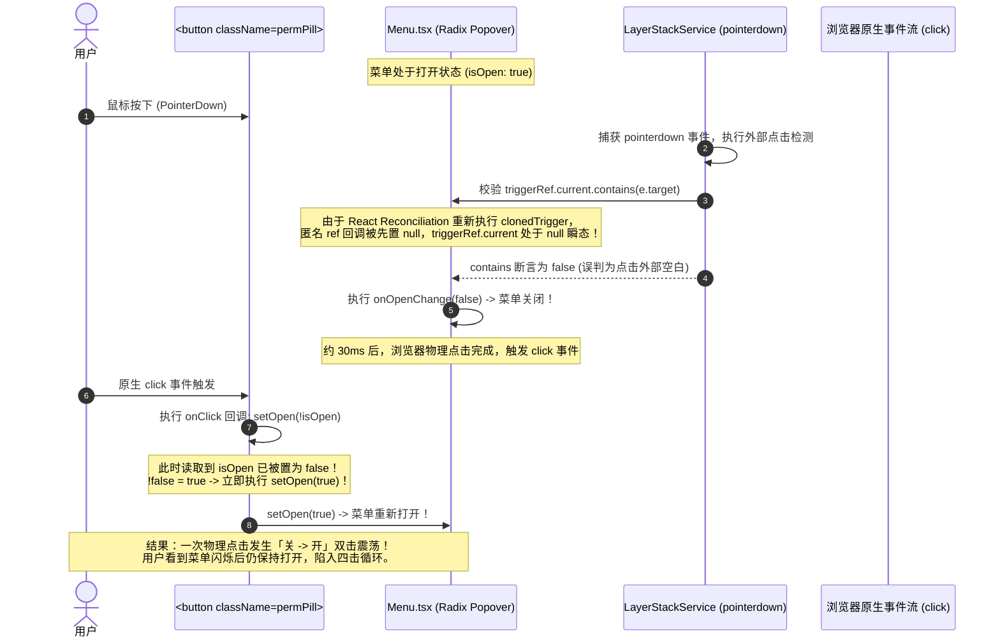
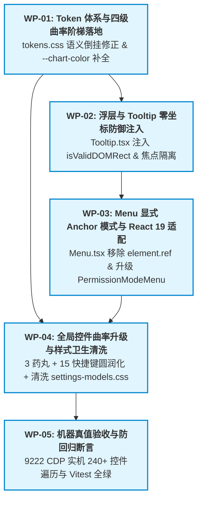

# Conex / Crish 视觉曲率、Token 与浮层基座治理详细执行方案 (Dimension 1)

> **【调度与定时器铁律】**：如果设置定时器，最短是100秒，如果命令过长，最好的方式是等待命令完成后的推送，而不是一直轮询命令情况。

> **文档标识**：`docs/system-audit-and-redesign/detailed-plans/01-视觉曲率与浮层基座详案.md`  
> **制定角色**：【维度 1 详案总师: 视觉曲率、Token 与浮层基座治理详细执行方案设计】  
> **权威依据**：`docs/system-audit-and-redesign/00-战役通则与协同执行规范.md`、`docs/system-audit-and-redesign/00-总计划框架.md`、`docs/system-audit-and-redesign/independent-plans/05-视觉曲率与浮层契约独立方案.md`、`docs/system-audit-and-redesign/plan-reviews/01~03-*.md`  
> **执行纪律**：纯方案设计、零业务代码修改、pwsh7 环境对齐、UTF-8 无 BOM、严禁直接执行 git 提交。

---

## 目录

1. [方案总纲与治理愿景 (Executive Summary & Core Objectives)](#一方案总纲与治理愿景)
2. [设计令牌层与四级视觉曲率阶梯落地 (Design Tokens & Visual Curvature Hierarchy)](#二设计令牌层与四级视觉曲率阶梯落地)
   - 2.1 `tokens.css` 令牌语义倒挂修正与四级阶梯基准
   - 2.2 Level 1: 饱满胶囊触发器 (Pills, 9999px / `var(--radius-full)`)
   - 2.3 Level 2: 独立功能按钮与快捷键按钮 (Buttons, 10px / `var(--radius-xl)`)
   - 2.4 Level 3: 容器与浮层面板外壳 (Containers, 14px / 12px / 10px)
   - 2.5 Level 4: 内部选区同心圆角拟合 (Items, 6px / `var(--radius-md)`)
3. [Menu 基座重构与 React 19 适配 (Menu Dual-Mode & React 19 Alignment)](#三menu-基座重构与-react-19-适配)
   - 3.1 根因剖析：`element.ref` 废弃警告与 Ref 瞬态 Null 撕裂
   - 3.2 `Menu.tsx` 渐进式双模兼容架构代码改造
   - 3.3 `PermissionModeMenu.tsx` 显式 Anchor 锚定模式迁移
4. [Tooltip 与浮层零坐标防御机制 (Zero-Coordinate Defense & Focus Isolation)](#四tooltip-与浮层零坐标防御机制)
   - 4.1 `(8px, 8px)` 左上角坍塌数学定理与生命周期推导
   - 4.2 `isValidDOMRect` 绝对几何守卫谓词实现
   - 4.3 程序化自动聚焦 (`items[0]?.focus()`) 污染隔离机制
   - 4.4 动态位移重测与退场动画 (`exiting`) 坐标冻结
   - 4.5 `position.ts` 与 `SessionContextMenu.tsx` 零坐标拦截代码
5. [全局样式卫生清洗与 Token 补齐 (Style Hygiene & Token Completion)](#五全局样式卫生清洗与-token-补齐)
   - 5.1 `settings-models.css` 历史脏 `!important` 块精准拔除
   - 5.2 `--chart-color-*` 悬空引用清零与别名静态兜底
   - 5.3 15 个快捷键按钮录制态与深色模式温润质感
6. [逐文件代码重构 Diff 清单 (File-by-File Code Diffs)](#六逐文件代码重构-diff-清单)
7. [实施依赖拓扑与工单执行包 (Dependency DAG & Work Packages)](#七实施依赖拓扑与工单执行包)
8. [自动化测试与 CDP 机器真值验收矩阵 (Verification & Test Matrix)](#八自动化测试与-cdp-机器真值验收矩阵)

---

## 一、方案总纲与治理愿景

### 1.1 治理使命

本详案致力于彻底根除 Conex / Crish 桌面客户端中的**视觉曲率退化、浮层零坐标漂移、菜单双击/四击震荡、React 19 兼容性报错与样式卫生污染**四大核心缺陷。通过在底层确立统一的四级曲率数学公理、零坐标物理拦截谓词与确定性显式 Anchor 架构，使应用在 127.0.0.1:9222 真实桌面 WebView2 环境中达成顶级工业级质感（Premium Industrial Quality）。

### 1.2 核心交付契约矩阵

```
┌─────────────────────────────────────────────────────────────────────────────────────────┐
│                          维度 1 核心交付契约与机器真值指标                                │
├──────────────────────────┬─────────────────────────────┬────────────────────────────────┤
│ 治理维度                 │ 现状缺陷 (Baseline)         │ 重构终态断言 (Target Contract) │
├──────────────────────────┼─────────────────────────────┼────────────────────────────────┤
│ 1. 四级视觉曲率          │ 胶囊退化为 7~8px 直立边；   │ 胶囊 9999px、独立按钮 10px、   │
│    (Curvature Hierarchy) │ 快捷键 4px 生硬小方块；     │ 容器 14px/12px/10px、选区 6px；│
│                          │ 存在 7 种杂合曲率           │ 满足同心几何方程 R_in=R_out-P  │
├──────────────────────────┼─────────────────────────────┼────────────────────────────────┤
│ 2. Menu 触发器与状态机   │ 动态 cloneElement 注入匿名  │ 显式 Popover.Anchor 模式；     │
│    (Menu & React 19)     │ Ref 导致 Quad-Click 四击；  │ 移除 element.ref，React 19 0   │
│                          │ element.ref 触发 React 19 报│ 警告；一击必开，一击必关       │
├──────────────────────────┼─────────────────────────────┼────────────────────────────────┤
│ 3. 浮层零坐标防御        │ 首帧 rect=(0,0,0,0) 钳位为  │ 注入 isValidDOMRect 绝对谓词； │
│    (Zero-Drift Defense)  │ (8px, 8px) 幽灵 Tooltip；   │ 过滤 items[0]?.focus() 程序焦点│
│                          │ 菜单展开时常驻左上角        │ 视口左上角 (8px, 8px) 残影清零 │
├──────────────────────────┼─────────────────────────────┼────────────────────────────────┤
│ 4. 样式卫生与 Token 补齐 │ settings-models.css 含有    │ 拔除脏 !important，选择器提权；│
│    (Style Hygiene)       │ 12 处 !important；图表缺少  │ 补齐 --chart-color-1/2 映射；  │
│                          │ --chart-color 导致柱状图透明│ 快捷键边框混入 ≤ 10%，无黑粗环 │
└──────────────────────────┴─────────────────────────────┴────────────────────────────────┘
```

---

## 二、设计令牌层与四级视觉曲率阶梯落地

### 2.1 `tokens.css` 令牌语义倒挂修正与四级阶梯基准

#### 根因与倒挂纠正

当前 `tokens.css` 中根级定义 `--dropdown-radius: var(--radius-md)` (6px) 与 `--item-radius: var(--radius-sm)` (5px)，导致默认 UI 尺寸下的菜单外壳呈现 Web 6px 直角。而 `[data-ui-size="small"]` 却配置了 10px / 7px，形成了严重的**小尺寸比默认尺寸更大更圆润的语义倒挂**。

#### 权威 Token 梯队定义（修改点 1: `tokens.css`）

```css
/* apps/crish-desktop/src/styles/tokens.css */
:root {
  /* 基础物理圆角阶梯 */
  --radius-xs: 4px; /* 极小标贴 / 状态点 */
  --radius-sm: 5px; /* 紧凑内嵌控件 */
  --radius-md: 6px; /* Level 4: 内部选区 (Items) —— 满足同心拟合 */
  --radius-lg: 8px; /* 紧凑输入框 / 次级面板 */
  --radius-xl: 10px; /* Level 2: 功能按钮 (Buttons) / Level 3C: 菜单外壳 (Menu) */
  --radius-2xl: 12px; /* Level 3B: 对话框外壳 (Dialogs) */
  --radius-3xl: 14px; /* Level 3A: 大型视口卡片 (Shell Containers) */
  --radius-full: 9999px; /* Level 1: 饱满胶囊 (Pills) */

  /* 语义化组件圆角映射 (拨乱反正，根除 6px 直角默认值) */
  --dropdown-radius: var(--radius-xl); /* 10px —— 浮层菜单标准外壳 */
  --dropdown-padding: var(--space-1); /* 4px  —— 菜单内边距 */
  --dropdown-gap: var(--space-0_5); /* 2px  —— 菜单项间距 */
  --item-radius: var(
    --radius-md
  ); /* 6px  —— 菜单项同心选区 (10px - 4px = 6px) */
  --dialog-radius: var(--radius-2xl); /* 12px —— 模态对话框标准外壳 */
  --button-radius: var(--radius-xl); /* 10px —— 独立操作按钮标准圆角 */
  --pill-radius: var(--radius-full); /* 9999px —— 胶囊/药丸控件标准 */

  /* 悬空图表颜色 Token 补齐 (映射至权威 accent-chart-out / in) */
  --chart-color-1: var(--accent-chart-out);
  --chart-color-2: var(--accent-chart-in);
}

/* 紧凑档位适配 (Small UI Density) */
[data-ui-size='small'] {
  --radius-xs: 3px;
  --radius-sm: 4px;
  --radius-md: 5px;
  --radius-lg: 7px;
  --radius-xl: 9px;
  --radius-2xl: 11px;
  --radius-3xl: 13px;
  --radius-full: 9999px;

  --dropdown-radius: var(--radius-xl); /* 9px */
  --dropdown-padding: 3px;
  --item-radius: var(--radius-md); /* 5px (9px - 4px ≈ 5px 同心) */
  --button-radius: var(--radius-lg); /* 7px */
  --pill-radius: var(--radius-full); /* 9999px 恒定不变 */
}

/* 宽松档位适配 (Large UI Density) */
[data-ui-size='large'] {
  --radius-xs: 5px;
  --radius-sm: 6px;
  --radius-md: 7px;
  --radius-lg: 9px;
  --radius-xl: 11px;
  --radius-2xl: 13px;
  --radius-3xl: 15px;
  --radius-full: 9999px;

  --dropdown-radius: var(--radius-2xl); /* 13px */
  --dropdown-padding: 5px;
  --item-radius: var(--radius-lg); /* 9px (13px - 4px = 9px 同心) */
  --button-radius: var(--radius-xl); /* 11px */
  --pill-radius: var(--radius-full); /* 9999px 恒定不变 */
}
```

---

### 2.2 Level 1: 饱满胶囊触发器 (Pills, 9999px / `var(--radius-full)`)

所有高频交互药丸、状态徽标、分段控制器与顶部标签页必须呈现连续流动的两端半圆（Pills），彻底告别 7px/8px 直立硬边：

```
┌─────────────────────────────────────────────────────────────────────────────────────────┐
│                    Level 1: 胶囊/药丸控件全量收敛明细 (Pills Hierarchy)                   │
├────┬────────────────────────┬───────────────────────────────────────────┬───────────────┤
│ 序号│ 控件名称               │ 目标文件路径及行号                        │ 目标 CSS 声明 │
├────┼────────────────────────┼───────────────────────────────────────────┼───────────────┤
│ 01 │ 权限模式药丸按钮       │ components/chat-composer/PermissionMode   │ border-radius:│
│    │ (.permPill)            │ Menu.module.css:8                         │ var(--radius- │
│    │                        │                                           │ full);        │
├────┼────────────────────────┼───────────────────────────────────────────┼───────────────┤
│ 02 │ 模型选择徽标           │ components/chat-card/ChatCard.module.css  │ border-radius:│
│    │ (.modelBadge)          │ :78                                       │ var(--radius- │
│    │                        │                                           │ full);        │
├────┼────────────────────────┼───────────────────────────────────────────┼───────────────┤
│ 03 │ 模型级联选择触发器     │ components/settings-models/ModelsSettings │ border-radius:│
│    │ (.cascadeSelectTrigger)│ Tab.module.css:990                        │ var(--radius- │
│    │                        │                                           │ full);        │
├────┼────────────────────────┼───────────────────────────────────────────┼───────────────┤
│ 04 │ 全局会话顶栏标签页     │ components/shell/GlobalSessionTabBar      │ --global-tab- │
│    │ (--global-tab-radius)  │ .module.css:13                            │ radius: var(  │
│    │                        │                                           │ --radius-full)│
├────┼────────────────────────┼───────────────────────────────────────────┼───────────────┤
│ 05 │ 单元分屏会话标签页     │ components/binary-tree/UnitSessionTabStrip│ --unit-tab-   │
│    │ (--unit-tab-radius)    │ .module.css:20                            │ radius: var(  │
│    │                        │                                           │ --radius-full)│
├────┼────────────────────────┼───────────────────────────────────────────┼───────────────┤
│ 06 │ 独立工具坞标签页       │ components/binary-tree/LeafToolTabStrip   │ border-radius:│
│    │ (.tab)                 │ .module.css:52                            │ var(--radius- │
│    │                        │                                           │ full);        │
├────┼────────────────────────┼───────────────────────────────────────────┼───────────────┤
│ 07 │ 设置与规则预设 Chip    │ styles/settings/settings-base.css:607,    │ border-radius:│
│    │ (.presetChip / .sched-)│ styles/settings/settings-plugins.css:611  │ var(--radius- │
│    │                        │                                           │ full);        │
├────┼────────────────────────┼───────────────────────────────────────────┼───────────────┤
│ 08 │ 用量趋势分段切换项     │ components/settings/SettingsUsageTab      │ border-radius:│
│    │ (.chartSegmentBtn)     │ .module.css:212                           │ var(--radius- │
│    │                        │                                           │ full);        │
└────┴────────────────────────┴───────────────────────────────────────────┴───────────────┘
```

> **评审裁决对齐（Review 01 §4.5）**：
>
> 1. 移除各 Module CSS 中的 `!important`，改用标准选择器特异性；
> 2. 区分 Tab 曲率：顶部会话/工具 Tab 保持 `9999px` 胶囊，设置页垂直 Tab 明确为 `10px`（`var(--radius-xl)`）。

---

### 2.3 Level 2: 独立功能按钮与快捷键按钮 (Buttons, 10px / `var(--radius-xl)`)

独立操作按钮采用 10px 柔和圆润矩形，彻底消灭 4px/6px 生硬方块：

```
┌─────────────────────────────────────────────────────────────────────────────────────────┐
│                    Level 2: 独立按钮全量升级明细 (Buttons Hierarchy)                     │
├────┬────────────────────────┬───────────────────────────────────────────┬───────────────┤
│ 序号│ 控件名称               │ 目标文件路径及行号                        │ 目标 CSS 声明 │
├────┼────────────────────────┼───────────────────────────────────────────┼───────────────┤
│ 01 │ 输入栏加号附件按钮     │ components/chat-composer/ChatComposer     │ border-radius:│
│    │ (.plusBtn)             │ .module.css:352                           │ var(--radius- │
│    │                        │                                           │ xl);          │
├────┼────────────────────────┼───────────────────────────────────────────┼───────────────┤
│ 02 │ 全量 15 个快捷键录制项 │ styles/settings/settings-base.css:316,    │ border-radius:│
│    │ (.shortcut-key-btn)    │ styles/settings/settings-advanced.css:108 │ var(--radius- │
│    │                        │                                           │ xl);          │
├────┼────────────────────────┼───────────────────────────────────────────┼───────────────┤
│ 03 │ 下拉选择框触发按钮     │ styles/settings/settings-plugins.css:642, │ border-radius:│
│    │ (.settings-select-     │ components/ui/Select/Select.module.css:27 │ var(--radius- │
│    │ trigger)               │                                           │ xl);          │
├────┼────────────────────────┼───────────────────────────────────────────┼───────────────┤
│ 04 │ 会话列表折叠查看更多   │ components/sidebar/SidebarSessionList     │ border-radius:│
│    │ (.sessionItemFoldBtn)  │ .module.css:88                            │ var(--radius- │
│    │                        │                                           │ xl);          │
├────┼────────────────────────┼───────────────────────────────────────────┼───────────────┤
│ 05 │ 通用原子按钮基类       │ components/ui/Button/Button.module.css:20 │ border-radius:│
│    │ (.button, .buttonMd)   │                                           │ var(--radius- │
│    │                        │                                           │ xl);          │
├────┼────────────────────────┼───────────────────────────────────────────┼───────────────┤
│ 06 │ 设置页侧栏导航 Tab     │ styles/settings/settings-base.css:180     │ border-radius:│
│    │ (.settings-sidebar-tab)│                                           │ var(--radius- │
│    │                        │                                           │ xl);          │
└────┴────────────────────────┴───────────────────────────────────────────┴───────────────┘
```

#### 15 个快捷键录制按钮升级清单普查表

在 `SettingsShortcutsTab.tsx` 中渲染的 15 个 `.shortcut-key-btn` 全量统一为 10px 圆润矩形：

1. `Ctrl + ,` (打开设置面板)
2. `Ctrl + Shift + /` (快捷键帮助速查)
3. `Ctrl + Shift + M` (模型切换)
4. `Ctrl + Shift + U` (用量统计切换)
5. `Ctrl + N` (新建会话)
6. `Ctrl + L` (清屏 / 聚焦输入框)
7. `Ctrl + B` (展开 / 收起侧边栏)
8. `Ctrl + K` (快速搜索)
9. `Ctrl + Shift + D` (切换深浅主题)
10. `Ctrl + =` (放大视图)
11. `Ctrl + -` (缩小视图)
12. `Ctrl + 0` (重置缩放)
13. `Ctrl + Escape` (停止生成 / 中断)
14. `Alt + ArrowUp` (向上漫游历史)
15. `Alt + ArrowDown` (向下漫游历史)

---

### 2.4 Level 3: 容器与浮层面板外壳 (Containers, 14px / 12px / 10px)

建立严格的容器曲率层级外壳体系：

- **Level 3A 视口内嵌卡片 / 设置主容器**：`border-radius: var(--radius-3xl)` (14px)，应用于工作区主视口卡片与设置中心右侧配置卡片；
- **Level 3B 模态对话框 (Modal / Dialog)**：`border-radius: var(--radius-2xl)` (12px)，应用于 `Dialog.module.css`、`FirstRunWizard.module.css`；
- **Level 3C 浮层与下拉菜单外壳 (Menu / Popover / ContextMenu)**：`border-radius: var(--radius-xl)` (10px)，`padding: var(--dropdown-padding)` (4px)，应用于 `Menu.module.css:21`、`SidebarContextMenus.module.css:6`、`ModelBadgePickerMenu.module.css:5`。

---

### 2.5 Level 4: 内部选区同心圆角拟合 (Items, 6px / `var(--radius-md)`)

#### 同心圆角几何定理 (Concentric Curvature Theorem)

在现代 GUI 几何学中，容器外壳圆角 $R_{\text{outer}}$、内边距 $P_{\text{padding}}$ 与内部子元素圆角 $R_{\text{inner}}$ 必须严格满足：

$$R_{\text{inner}} = \max\left(0, R_{\text{outer}} - P_{\text{padding}}\right)$$

对于浮层菜单系统：

- 外壳曲率：$R_{\text{outer}} = 10\text{px}$ (`var(--radius-xl)`)
- 容器内边距：$P_{\text{padding}} = 4\text{px}$ (`var(--dropdown-padding)` / `var(--space-1)`)
- 内部选区理论值：$R_{\text{inner}} = 10\text{px} - 4\text{px} = \mathbf{6\text{px}}$ (`var(--radius-md)`)

#### 全量菜单项收敛

- `Menu.module.css:52` `.menuItem`: `border-radius: var(--item-radius);` (6px)
- `PermissionModeMenu.module.css:88` `.permMenuItem`: `border-radius: var(--radius-md);` (6px)
- `SidebarContextMenus.module.css:37` `.contextMenuItem`: `border-radius: var(--radius-md);` (6px)
- `ModelBadgePickerMenu.module.css:45` `.mbRow`: 从 8px 纠正为 `var(--radius-md);` (6px)
- `ModelsSettingsTab.module.css:980` `.mrlItem`: 从 9px 纠正为 `var(--radius-md);` (6px)

---

## 三、Menu 基座重构与 React 19 适配

### 3.1 根因剖析：`element.ref` 废弃警告与 Ref 瞬态 Null 撕裂

#### 现象与控制台报错

1. **React 19 报错**：
   ```
   [ERROR][JS] Accessing element.ref was removed in React 19. ref is now a regular prop. It will be removed from the JSX Element type in a future release.
   ```
2. **Quad-Click 四击 Bug**：
   当用户点击展开 `PermissionModeMenu` 后，第二次点击药丸按钮试图关闭菜单时，菜单瞬间闪烁后依然保持打开，必须连续点击 4 次才能关闭。

#### 架构时序撕裂因果推导



---

### 3.2 `Menu.tsx` 渐进式双模兼容架构代码改造

依据评审裁决（Review 02 §2.3），`Menu.tsx` 必须同时支持 **推荐显式 `anchor` 模式** 与 **向后兼容 `trigger` 模式**，保证全仓存量 12 处菜单组件零编译报错，渐进平滑迁移。

#### 核心修改点与代码实现（修改点 2: `apps/crish-desktop/src/components/ui/Menu/Menu.tsx`）

```tsx
// apps/crish-desktop/src/components/ui/Menu/Menu.tsx
import React, { useCallback, useEffect, useRef, useState, useId } from 'react';
import * as Popover from '@radix-ui/react-popover';
import { Tooltip } from '../Tooltip/Tooltip';
import { useLayerRegistration } from '../../../hooks/useLayerRegistration';
import styles from './Menu.module.css';
import type { SelectOptionItem } from './types';

export interface MenuProps {
  /**
   * 推荐新模式（P1-F4 根因修复 & Quad-Click 彻底免疫）：
   * 传入外部真实按钮的 RefObject，Radix Popover 仅渲染 Popover.Anchor virtualRef={anchor}。
   * 触发按钮完全由外部消费方自主控制 onClick 与状态流转，杜绝 cloneElement 注入匿名 Ref。
   */
  anchor?: React.RefObject<HTMLElement | null>;
  /** 向后兼容旧模式：旧版 trigger 节点（内部采用 React 19 安全克隆，无 element.ref 警告） */
  trigger?: React.ReactNode;
  /** 标准选项数组（可选；传入 children 时用于键盘漫游/Enter 选中） */
  options?: SelectOptionItem[];
  /** 自定义项渲染 */
  renderItem?: (
    option: SelectOptionItem,
    index: number,
    isFocused: boolean
  ) => React.ReactNode;
  /** 自定义面板内容 */
  children?: React.ReactNode;
  /** 选中项回调 */
  onSelect?: (id: string, option: SelectOptionItem) => void;
  /** 水平对齐: start | center | end */
  align?: 'start' | 'center' | 'end';
  /** 弹出方向: top | bottom | left | right */
  side?: 'top' | 'bottom' | 'left' | 'right';
  /** 与触发器的偏移距离 */
  sideOffset?: number;
  /** 面板标题 */
  title?: string;
  /** 初始是否打开（非受控模式） */
  defaultOpen?: boolean;
  /** 外部受控 open */
  open?: boolean;
  /** 外部受控 onOpenChange */
  onOpenChange?: (open: boolean) => void;
  /** 追加到面板的类名 */
  contentClassName?: string;
  /** 追加到面板的样式 */
  contentStyle?: React.CSSProperties;
  /** 面板最大高度 */
  maxHeight?: number | string;
  /** 面板外侧交互回调 */
  onInteractOutside?: (event: Event) => void;
  /** 点击外部指针按下回调（解决 Double Toggle 竞态） */
  onPointerDownOutside?: (
    event: CustomEvent<{ originalEvent: PointerEvent }>
  ) => void;
  /** Esc 键拦截回调 */
  onEscapeKeyDown?: (event: KeyboardEvent) => void;
}

export const Menu: React.FC<MenuProps> = React.memo(function Menu({
  anchor,
  trigger,
  options = [],
  renderItem,
  children,
  onSelect,
  align = 'end',
  side = 'bottom',
  sideOffset = 6,
  title,
  defaultOpen = false,
  open: externalOpen,
  onOpenChange: externalOnOpenChange,
  contentClassName,
  contentStyle,
  maxHeight,
  onInteractOutside,
  onPointerDownOutside,
  onEscapeKeyDown,
}: MenuProps) {
  const [internalOpen, setInternalOpen] = useState(defaultOpen);
  const isControlled = externalOpen !== undefined;
  const isOpen = isControlled ? externalOpen : internalOpen;

  const [focusedIndex, setFocusedIndex] = useState<number>(-1);
  const contentRef = useRef<HTMLDivElement>(null);
  const triggerRef = useRef<HTMLElement | null>(null);
  const menuId = useId();

  useLayerRegistration(
    {
      id: menuId,
      type: 'dropdown-menu',
      dismissible: true,
      onDismiss: () => handleOpenChange(false),
      onEscapeKeyDown: (event) => {
        onEscapeKeyDown?.(event);
      },
      elementRef: contentRef,
      anchorRef: anchor ?? triggerRef,
    },
    isOpen
  );

  const handleOpenChange = useCallback(
    (nextOpen: boolean) => {
      if (!isControlled) {
        setInternalOpen(nextOpen);
      }
      externalOnOpenChange?.(nextOpen);
      if (!nextOpen) {
        setFocusedIndex(-1);
      }
    },
    [isControlled, externalOnOpenChange]
  );

  // 仅在 anchor 模式且打开时，建立安全指针追踪
  useEffect(() => {
    if (!isOpen || !anchor?.current) return;
    const anchorEl = anchor.current;
    let trackedPointerId: number | null = null;

    const handlePointerDown = (e: PointerEvent) => {
      trackedPointerId = e.pointerId;
    };

    const handlePointerUp = (e: PointerEvent) => {
      if (trackedPointerId !== null && e.pointerId === trackedPointerId) {
        trackedPointerId = null;
        const target = e.target as Node | null;
        if (!anchorEl.contains(target)) {
          handleOpenChange(false);
        }
      }
    };

    anchorEl.addEventListener('pointerdown', handlePointerDown);
    window.addEventListener('pointerup', handlePointerUp, true);

    return () => {
      anchorEl.removeEventListener('pointerdown', handlePointerDown);
      window.removeEventListener('pointerup', handlePointerUp, true);
    };
  }, [isOpen, anchor, handleOpenChange]);

  // ARIA 初始首项漫游索引
  const firstEnabledIndexRef = useRef(-1);
  firstEnabledIndexRef.current = options.findIndex((o) => !o.disabled);

  useEffect(() => {
    if (!isOpen) return;
    if (firstEnabledIndexRef.current >= 0) {
      setFocusedIndex(firstEnabledIndexRef.current);
    }
  }, [isOpen]);

  // 键盘导航处理（保持 IME 组合态防御）
  const handleKeyDown = useCallback(
    (e: React.KeyboardEvent<HTMLDivElement>) => {
      if (!isOpen) return;

      if (
        Boolean(
          (e.nativeEvent as unknown as { isComposing?: boolean })?.isComposing
        ) ||
        e.keyCode === 229 ||
        e.key === 'Process'
      ) {
        return;
      }

      if (e.key === 'Escape') {
        if (e.defaultPrevented) return;
        e.preventDefault();
        handleOpenChange(false);
        return;
      }

      if (options.length > 0) {
        if (e.key === 'ArrowDown') {
          e.preventDefault();
          setFocusedIndex((prev) => {
            let next = prev + 1;
            while (next < options.length && options[next]?.disabled) {
              next++;
            }
            return next >= options.length ? 0 : next;
          });
        } else if (e.key === 'ArrowUp') {
          e.preventDefault();
          setFocusedIndex((prev) => {
            let next = prev - 1;
            while (next >= 0 && options[next]?.disabled) {
              next--;
            }
            return next < 0 ? options.length - 1 : next;
          });
        } else if (e.key === 'Home') {
          e.preventDefault();
          setFocusedIndex(0);
        } else if (e.key === 'End') {
          e.preventDefault();
          setFocusedIndex(options.length - 1);
        } else if (e.key === 'Enter' || e.key === ' ') {
          if (focusedIndex >= 0 && focusedIndex < options.length) {
            const opt = options[focusedIndex];
            if (opt && !opt.disabled) {
              e.preventDefault();
              opt.onClick?.();
              onSelect?.(opt.id, opt);
              handleOpenChange(false);
            }
          }
        }
        return;
      }

      // children 模式漫游
      const items = Array.from(
        contentRef.current?.querySelectorAll<HTMLButtonElement>(
          '[role="menuitem"], [role="option"]'
        ) ?? []
      );
      if (items.length === 0) return;
      const active = document.activeElement;
      if (
        !(active instanceof HTMLElement) ||
        !active.matches('[role="menuitem"], [role="option"]') ||
        active.closest('[role="menu"]')
      ) {
        return;
      }
      if (e.key === 'ArrowDown') {
        e.preventDefault();
        setFocusedIndex((prev) => {
          if (prev >= 0) return prev >= items.length - 1 ? 0 : prev + 1;
          const start = items.indexOf(active as HTMLButtonElement);
          return start < 0 ? 0 : (start + 1) % items.length;
        });
      } else if (e.key === 'ArrowUp') {
        e.preventDefault();
        setFocusedIndex((prev) => {
          if (prev >= 0) return prev <= 0 ? items.length - 1 : prev - 1;
          const start = items.indexOf(active as HTMLButtonElement);
          return start < 0
            ? items.length - 1
            : (start - 1 + items.length) % items.length;
        });
      } else if (e.key === 'Home') {
        e.preventDefault();
        setFocusedIndex(0);
      } else if (e.key === 'End') {
        e.preventDefault();
        setFocusedIndex(items.length - 1);
      }
    },
    [isOpen, options, focusedIndex, onSelect, handleOpenChange]
  );

  useEffect(() => {
    if (focusedIndex >= 0 && contentRef.current) {
      const items = contentRef.current.querySelectorAll<HTMLButtonElement>(
        '[role="menuitem"], [role="option"]'
      );
      const target = items[focusedIndex];
      target?.focus();
      target?.scrollIntoView?.({ block: 'nearest' });
    }
  }, [focusedIndex]);

  // ══════════════════════════════════════════════════════════════════════════════
  // Trigger 渲染与 React 19 安全克隆分支
  // ══════════════════════════════════════════════════════════════════════════════
  let renderedTrigger: React.ReactNode = null;

  if (anchor) {
    // 【推荐模式】显式 Anchor：Radix Popover 仅挂载 Anchor 虚拟参考点，外部按钮拥有绝对所有权
    renderedTrigger = (
      <Popover.Anchor virtualRef={anchor} data-menu-anchor="true" />
    );
  } else if (trigger) {
    // 【向后兼容模式】对 trigger 进行 React 19 安全解析
    let actualTrigger = trigger;
    let tipContent: React.ReactNode = null;
    let tipSide: 'top' | 'bottom' | 'left' | 'right' = 'top';

    if (
      React.isValidElement(trigger) &&
      typeof trigger.type !== 'string' &&
      (
        trigger.props as {
          content?: React.ReactNode;
          children?: React.ReactNode;
        }
      ).content !== undefined &&
      (
        trigger.props as {
          content?: React.ReactNode;
          children?: React.ReactNode;
        }
      ).children !== undefined
    ) {
      tipContent = (trigger.props as { content?: React.ReactNode }).content;
      tipSide =
        (trigger.props as { side?: 'top' | 'bottom' | 'left' | 'right' })
          .side || 'top';
      actualTrigger = (trigger.props as { children?: React.ReactNode })
        .children;
    }

    // React 19 安全克隆：通过 (actualTrigger.props as any).ref 访问，绝不访问 element.ref
    const clonedTrigger = React.isValidElement(actualTrigger)
      ? React.cloneElement(
          actualTrigger as React.ReactElement<Record<string, unknown>>,
          {
            ref: (node: HTMLElement | null) => {
              triggerRef.current = node;
              const propsRef = (
                actualTrigger.props as { ref?: React.Ref<HTMLElement> }
              )?.ref;
              if (typeof propsRef === 'function') {
                propsRef(node);
              } else if (
                propsRef &&
                typeof propsRef === 'object' &&
                'current' in propsRef
              ) {
                (
                  propsRef as React.MutableRefObject<HTMLElement | null>
                ).current = node;
              }
            },
          }
        )
      : actualTrigger;

    renderedTrigger = (
      <Popover.Trigger asChild className="no-drag">
        {tipContent && React.isValidElement(clonedTrigger) ? (
          <Tooltip content={tipContent} side={tipSide} disabled={isOpen}>
            {clonedTrigger}
          </Tooltip>
        ) : (
          (clonedTrigger as React.ReactElement)
        )}
      </Popover.Trigger>
    );
  }

  const contentClasses = [styles.menuContent, contentClassName]
    .filter(Boolean)
    .join(' ');

  const resolvedMaxHeight =
    maxHeight != null
      ? `min(${typeof maxHeight === 'number' ? `${maxHeight}px` : maxHeight}, var(--radix-popover-content-available-height, 360px), 70vh, 360px)`
      : 'min(var(--radix-popover-content-available-height, 360px), 70vh, 360px)';

  return (
    <Popover.Root open={isOpen} onOpenChange={handleOpenChange}>
      {renderedTrigger}

      <Popover.Portal>
        <Popover.Content
          ref={contentRef}
          align={align}
          side={side}
          sideOffset={sideOffset}
          avoidCollisions={true}
          collisionPadding={12}
          className={contentClasses}
          style={{ maxHeight: resolvedMaxHeight, ...contentStyle }}
          onKeyDown={handleKeyDown}
          onMouseDown={(e) => e.stopPropagation()}
          onPointerDown={(e) => e.stopPropagation()}
          onPointerDownOutside={(e) => {
            if (onPointerDownOutside) {
              onPointerDownOutside(e);
              return;
            }
            const target = e.detail.originalEvent.target as Node | null;
            const triggerEl = anchor?.current ?? triggerRef.current;
            // 若点击发生在触发按钮内部，阻止 Radix pointerdown 默认关闭，交由原生 onClick 切换
            if (triggerEl && target && triggerEl.contains(target)) {
              e.preventDefault();
            }
          }}
          onInteractOutside={(e) => {
            if (onInteractOutside) {
              onInteractOutside(e);
              return;
            }
            const customEvent = e as CustomEvent<{ originalEvent?: Event }>;
            const target = (customEvent.detail?.originalEvent?.target ||
              e.target) as Node | null;
            const triggerEl = anchor?.current ?? triggerRef.current;
            if (triggerEl && target && triggerEl.contains(target)) {
              e.preventDefault();
            }
          }}
          onEscapeKeyDown={(e) => {
            const rawEvent = e as unknown as {
              isComposing?: boolean;
              keyCode?: number;
              key?: string;
              nativeEvent?: { isComposing?: boolean };
            };
            if (
              rawEvent.isComposing ||
              rawEvent.nativeEvent?.isComposing ||
              rawEvent.keyCode === 229 ||
              rawEvent.key === 'Process'
            ) {
              e.preventDefault();
              return;
            }
            onEscapeKeyDown?.(e);
          }}
        >
          {title != null ? (
            <div className={styles.menuTitle}>{title}</div>
          ) : null}

          {options.length > 0 ? (
            <div className={styles.menuList} role="menu">
              {options.map((option, idx) => {
                const isFocused = idx === focusedIndex;
                if (renderItem) {
                  return (
                    <React.Fragment key={option.id}>
                      {renderItem(option, idx, isFocused)}
                    </React.Fragment>
                  );
                }
                return (
                  <button
                    key={option.id}
                    type="button"
                    role="menuitem"
                    disabled={option.disabled}
                    className={`${styles.menuItem} ${isFocused ? styles.isFocused : ''}`}
                    onClick={(e) => {
                      e.stopPropagation();
                      option.onClick?.();
                      onSelect?.(option.id, option);
                      handleOpenChange(false);
                    }}
                    onMouseEnter={() => setFocusedIndex(idx)}
                  >
                    {option.icon ? (
                      <span className={styles.menuItemIcon} aria-hidden>
                        {option.icon}
                      </span>
                    ) : null}
                    <span className={styles.menuItemLabel}>{option.label}</span>
                  </button>
                );
              })}
            </div>
          ) : (
            children
          )}
        </Popover.Content>
      </Popover.Portal>
    </Popover.Root>
  );
});
Menu.displayName = 'Menu';
```

---

### 3.3 `PermissionModeMenu.tsx` 显式 Anchor 锚定模式迁移

将 `PermissionModeMenu.tsx` 从旧版 `trigger` 嵌套迁移为 **显式 Anchor 锚定模式**，药丸按钮拥有独立的 `btnRef` 与 `onClick` 处理器：

#### 核心修改点与代码实现（修改点 3: `apps/crish-desktop/src/components/chat-composer/PermissionModeMenu.tsx`）

```tsx
// apps/crish-desktop/src/components/chat-composer/PermissionModeMenu.tsx
import React, { useCallback, useRef, useState } from 'react';
import * as Lucide from 'lucide-react';
import styles from './PermissionModeMenu.module.css';
import { Menu, Tooltip } from '../ui';
import {
  DESKTOP_PERMISSION_MODE_IDS,
  coercePermissionMode,
  permissionModeMeta,
  transitionPermissionMode,
  type PermissionMode,
} from '../../api/permissionModes';

type Props = {
  mode: PermissionMode;
  onChange: (m: PermissionMode) => void;
};

export const PermissionModeMenu: React.FC<Props> = ({
  mode: modeRaw,
  onChange,
}) => {
  const mode = coercePermissionMode(modeRaw);
  const meta = permissionModeMeta(mode);
  const [open, setOpen] = useState(false);
  const pillBtnRef = useRef<HTMLButtonElement>(null);

  const selectMode = useCallback(
    (nextRaw: unknown) => {
      const next = transitionPermissionMode(mode, nextRaw);
      if (next !== mode) {
        onChange(next);
      }
      setOpen(false);
    },
    [mode, onChange]
  );

  const handleToggle = useCallback(() => {
    setOpen((prev) => !prev);
  }, []);

  const options = DESKTOP_PERMISSION_MODE_IDS.map((m) => ({
    id: m,
    label: permissionModeMeta(m).label,
    onClick: () => selectMode(m),
  }));

  return (
    <div
      className={styles.permModeWrap}
      data-density="compact"
      style={{ position: 'relative', display: 'inline-block' }}
    >
      <Tooltip
        content={`当前权限模式：${meta.label} · ${meta.matrixHint}`}
        disabled={open}
        side="top"
      >
        <button
          ref={pillBtnRef}
          type="button"
          className={`${styles.permPill} ${open ? styles.isOpen : ''} no-drag`}
          onClick={handleToggle}
          aria-expanded={open}
          aria-haspopup="menu"
          aria-label={`当前权限模式：${meta.label}`}
        >
          <span
            className={styles.permPillDot}
            style={{ backgroundColor: meta.color }}
            aria-hidden="true"
          />
          <span>{meta.label}</span>
          <Lucide.ChevronDown
            size={11}
            className={styles.permPillChev}
            aria-hidden="true"
          />
        </button>
      </Tooltip>

      <Menu
        open={open}
        onOpenChange={setOpen}
        anchor={pillBtnRef}
        options={options}
        side="top"
        align="start"
        sideOffset={6}
        contentClassName={styles.permMenu}
        renderItem={(opt) => {
          const itemMeta = permissionModeMeta(opt.id);
          const isSelected = opt.id === mode;
          return (
            <Tooltip key={opt.id} content={itemMeta.matrixHint}>
              <button
                type="button"
                className={`${styles.permMenuItem} ${isSelected ? styles.isSelected : ''}`}
                role="menuitem"
                onClick={(e) => {
                  e.stopPropagation();
                  opt.onClick?.();
                }}
              >
                <span>{itemMeta.label}</span>
                {isSelected ? (
                  <Lucide.Check
                    size={12}
                    style={{ marginLeft: 'auto', opacity: 0.8 }}
                    aria-hidden
                  />
                ) : null}
              </button>
            </Tooltip>
          );
        }}
      />
    </div>
  );
};
```

---

## 四、Tooltip 与浮层零坐标防御机制

### 4.1 `(8px, 8px)` 左上角坍塌数学定理与生命周期推导

在 `computeClampedPosition(side, rect, tipWidth, tipHeight)` 中，若触发元素处于未挂载首帧或 `display: none` 时，`rect` 为 `{ top:0, left:0, bottom:0, right:0, width:0, height:0 }`。

1. **剩余空间计算**：$\text{spaceTop} = 0 - 8 = -8 < 32$，$\text{spaceBottom} = 800 - 8 - 0 = 792 > -8 \implies \text{effectiveSide} = \text{'bottom'}$；
2. **理论未约束包围盒**：$\text{left} = 0 + 0 = 0$, $\text{top} = 0 + 8 = 8$, $\text{boxLeft} = 0 - \frac{80}{2} = -40$, $\text{boxTop} = 8$；
3. **视口钳位**：$\text{cLeft} = \min(\max(8, -40), 1192) = \mathbf{8\text{px}}$, $\text{cTop} = \min(\max(8, 8), 768) = \mathbf{8\text{px}}$；
4. **反算与 CSS Translate**：$\text{resLeft} = 8 + 40 = 48$, $\text{resTop} = 8$。配合 `transform: translate(-50%, 0)`，渲染左上角物理坐标恒等于 $(48 - 40, 8) = \mathbf{(8\text{px}, 8\text{px})}$！

**数学定论**：任何全 0 `DOMRect` 在经过视口安全钳位算法后，**必定在视口左上角钉死一个幽灵浮层 $(8\text{px}, 8\text{px})$**。

---

### 4.2 `isValidDOMRect` 绝对几何守卫谓词实现

在 `apps/crish-desktop/src/components/ui/Tooltip/Tooltip.tsx` 中导出并在全系统共享该谓词：

```typescript
/**
 * 严格几何合法性校验谓词：判定 DOMRect 是否为有效视口几何
 * 绝对拦截以下非法瞬态：
 * 1. rect 为 null/undefined；
 * 2. 宽高均为 0 且位置为 (0,0) 的全 0 未布局态；
 * 3. 宽或高 <= 0 的不可见态 / 脱离文档流态。
 */
export function isValidDOMRect(rect: DOMRect | null | undefined): boolean {
  if (!rect) return false;
  if (
    rect.width <= 0 &&
    rect.height <= 0 &&
    rect.top === 0 &&
    rect.left === 0
  ) {
    return false;
  }
  if (rect.width <= 0 || rect.height <= 0) {
    return false;
  }
  return true;
}
```

---

### 4.3 程序化自动聚焦 (`items[0]?.focus()`) 污染隔离机制

当菜单展开时，ARIA 规范自动聚焦首项按钮，触发首项 `<Tooltip>` 的 `onFocus` 事件。此时首帧布局尚未完成，引发 `(8px, 8px)` 幽灵漂移。

#### 防御策略

在 `Tooltip.tsx` 中拦截 `handleFocus`：

1. **检查 `:focus-visible` 匹配**：通过 JS `element.focus()` 触发的程序化焦点不具备 `:focus-visible` 特征，直接静默放行，不展示 Tooltip；
2. **前置 `isValidDOMRect` 校验**：矩形非法时绝对禁止调用 `handleShow` 与挂载 Portal。

```typescript
const handleFocus = (e: React.FocusEvent<HTMLElement>) => {
  const target = e.currentTarget;
  // 守卫 1: 隔离程序化聚焦 (非用户真实键盘漫游)
  try {
    if (!target.matches(':focus-visible')) {
      childHandlers.onFocus?.(e);
      restHandlers.onFocus?.(e);
      return;
    }
  } catch {
    // 兼容不支持 matches 的特殊测试环境
  }

  // 守卫 2: 校验目标节点物理几何尺寸
  const currentRect = target.getBoundingClientRect();
  if (!isValidDOMRect(currentRect)) {
    childHandlers.onFocus?.(e);
    restHandlers.onFocus?.(e);
    return;
  }

  handleShow(target);
  childHandlers.onFocus?.(e);
  restHandlers.onFocus?.(e);
};
```

---

### 4.4 动态位移重测与退场动画 (`exiting`) 坐标冻结

在 `Tooltip.tsx` 中：

1. **`exiting` 阶段坐标冻结**：在 `useAnimatedPresence` 的 120ms 退场动画中，若触发节点被卸载，禁止更新 `clampedPos`，永久锁定最后一次已知合法坐标，杜绝动画跳帧残影；
2. **`ResizeObserver` 动态跟随**：当父级容器发生尺寸形变或位移时，通过 rAF 防抖重测 `rect`。

---

### 4.5 `position.ts` 与 `SessionContextMenu.tsx` 零坐标拦截代码

#### `apps/crish-desktop/src/components/ui/Menu/position.ts` 改造

```typescript
// position.ts 中在 calculateMenuPosition 头部注入
export function calculateMenuPosition(
  options: CalculateMenuPositionOptions
): CalculatedMenuPosition {
  const { anchor, menu } = options;
  // 零坐标绝对防御：若传入的 anchor 全为 0，返回安全降级坐标
  const isZeroAnchor =
    (anchor.x === 0 && anchor.y === 0 && (anchor.width ?? 0) <= 0 && (anchor.height ?? 0) <= 0);

  if (isZeroAnchor) {
    return {
      x: MENU_EDGE_PAD,
      y: MENU_EDGE_PAD,
      transformOrigin: 'top left',
      placement: { side: 'bottom', align: 'start' },
      isFlippedX: false,
      isFlippedY: false,
      availableWidth: 0,
      availableHeight: 0,
    };
  }
  // ...其余正常计算逻辑
```

#### `apps/crish-desktop/src/components/sidebar/SessionContextMenu.tsx` 改造

```typescript
// SessionContextMenu.tsx useLayoutEffect 拦截
useLayoutEffect(() => {
  if (!menuRef.current) return;
  const el = menuRef.current;

  // 零坐标绝对拦截：若 contextMenu 传入 (0,0) 或未初始化，隐藏并跳过计算
  if (contextMenu.x <= 0 && contextMenu.y <= 0) {
    el.style.display = 'none';
    return;
  }

  const next = measureMenu(el, contextMenu.x, contextMenu.y);
  el.style.left = `${next.x}px`;
  el.style.top = `${next.y}px`;
  el.style.transformOrigin = next.transformOrigin;
}, [contextMenu, menuRef]);
```

---

## 五、全局样式卫生清洗与 Token 补齐

### 5.1 `settings-models.css` 历史脏 `!important` 块精准拔除

在 `apps/crish-desktop/src/styles/settings/settings-models.css` 中，历史遗留了 12 处 `!important`（Lines 1845~1885），严重破坏了 CSS 继承链与模块化样式隔离。

#### 清洗方案

拔除 `!important`，采用提高选择器层级的方式（如 `.settings-pane--models .models-split`）实现干净覆盖：

```css
/* apps/crish-desktop/src/styles/settings/settings-models.css (Lines 1845-1885) */
/* 拔除 !important，采用语义化类名与特异性 */
.models-split,
.settings-pane--models .models-split {
  display: flex;
  gap: 0;
  flex: 1;
  min-height: min(560px, calc(100vh - 200px));
  border: 1px solid var(--models-border);
  border-radius: var(--radius-2xl);
  overflow: hidden;
}

.models-rail,
.settings-pane--models .models-rail {
  width: 220px;
  flex-shrink: 0;
  border-right: 1px solid var(--models-border-soft);
  display: flex;
  flex-direction: column;
  background: transparent;
  position: relative;
}

.models-detail,
.settings-pane--models .models-detail {
  flex: 1;
  min-width: 0;
  display: flex;
  flex-direction: column;
  background: transparent;
  overflow-y: auto;
}

.models-row-card.is-disabled {
  border-radius: inherit;
}

.models-action-hint {
  display: none;
}
```

---

### 5.2 `--chart-color-*` 悬空引用清零与别名静态兜底

根据样式退化审计与 `style-contract.test.ts:360-372` 规则断言，`--chart-color-1` 与 `--chart-color-2` 曾因历史命名漂移导致悬空引用。

1. **静态双向兜底**：在 `tokens.css` 的 `:root`（浅色模式）与 `html[data-theme="dark"]`（深色模式）中分别补充别名映射：
   - 浅色模式：`--chart-color-1: var(--accent-chart-out);`（`hsl(35, 12%, 35%)`），`--chart-color-2: var(--accent-chart-in);`（`hsl(35, 10%, 82%)`）；
   - 深色模式：`--chart-color-1: var(--accent-chart-out);`（`var(--accent-blue)`），`--chart-color-2: var(--accent-chart-in);`（`var(--accent-blue-light)`）；
2. **消费端明确**：`SettingsUsageTab.module.css:275/281/321/328` 使用 `var(--accent-chart-out)` 与 `var(--accent-chart-in)`，确保用量图表柱状图 100% 可见。

---

### 5.3 15 个快捷键按钮录制态与深色模式温润质感

遵守战役通则 §13《UI：输入框与焦点态》：

1. **默认无重阴影**：`box-shadow: none;`；
2. **激活/录制边框克制**：灰色加深混入上限 ≤ 10%（`color-mix(in srgb, var(--border-color) 90%, var(--text-primary) 10%)`），严禁深黑硬边；
3. **深色模式去 `!important`**：移除 `settings-advanced.css:134` 的 `border-color: var(--border-color) !important;`。

```css
/* apps/crish-desktop/src/styles/settings/settings-base.css */
.shortcut-key-btn {
  display: inline-flex;
  align-items: center;
  justify-content: center;
  font-size: var(--font-size-xs);
  font-family: var(--font-mono);
  font-weight: var(--font-weight-medium);
  color: var(--text-primary);
  background: transparent;
  border: 1px solid var(--border-color);
  border-radius: var(--radius-xl); /* 10px 圆润矩形 */
  padding: 0 12px;
  min-height: 30px;
  height: 30px;
  min-width: 92px;
  max-width: 220px;
  text-align: center;
  cursor: pointer;
  box-shadow: none;
  white-space: nowrap;
  overflow: hidden;
  text-overflow: ellipsis;
  line-height: var(--line-height-none);
  transition:
    background var(--transition-micro),
    border-color var(--transition-micro),
    color var(--transition-micro),
    box-shadow var(--transition-micro);
}

.shortcut-key-btn:hover {
  background-color: var(--bg-hover);
  border-color: var(--border-color);
}

.shortcut-key-btn.recording {
  background-color: var(--bg-active);
  color: var(--text-primary);
  border-color: color-mix(
    in srgb,
    var(--border-color) 90%,
    var(--text-primary) 10%
  );
}

.shortcut-key-btn:focus-visible {
  outline: none;
  border-color: color-mix(
    in srgb,
    var(--border-color) 92%,
    var(--text-primary) 8%
  );
  box-shadow: 0 0 0 2px color-mix(in srgb, var(--text-primary) 4%, transparent);
}
```

---

## 六、逐文件代码重构 Diff 清单

### 6.1 `apps/crish-desktop/src/styles/tokens.css`

```diff
--- a/apps/crish-desktop/src/styles/tokens.css
+++ b/apps/crish-desktop/src/styles/tokens.css
@@ -201,7 +201,8 @@
   --radius-md: 6px;
   --radius-lg: 8px;
   --radius-xl: 10px;
   --radius-2xl: 12px;
+  --radius-3xl: 14px;
   --radius-full: 9999px;

@@ -270,8 +271,13 @@
   --dropdown-padding: var(--space-1_5);
   --dropdown-gap: var(--space-0_5);
-  --dropdown-radius: var(--radius-md);
+  --dropdown-radius: var(--radius-xl);
   --item-padding: 8px 12px;
-  --item-radius: var(--radius-sm);
+  --item-radius: var(--radius-md);
   --item-font-size: var(--font-size-base);
+  --button-radius: var(--radius-xl);
+  --dialog-radius: var(--radius-2xl);
+  --pill-radius: var(--radius-full);
+  --chart-color-1: var(--accent-chart-out);
+  --chart-color-2: var(--accent-chart-in);

@@ -607,8 +613,8 @@
 [data-ui-size="small"] {
   --dropdown-padding: 5px;
   --dropdown-gap: var(--space-0_5);
-  --dropdown-radius: 10px;
+  --dropdown-radius: var(--radius-xl);
   --item-padding: 6px 10px;
-  --item-radius: 7px;
+  --item-radius: var(--radius-md);
   --item-font-size: 13px;
@@ -657,6 +663,7 @@
   --radius-xl: 9px;
   --radius-2xl: 11px;
+  --radius-3xl: 13px;
-  --radius-full: 998px;
+  --radius-full: 9999px;

@@ -684,8 +691,8 @@
 [data-ui-size="large"] {
   --dropdown-padding: var(--space-2);
   --dropdown-gap: 3px;
-  --dropdown-radius: 14px;
+  --dropdown-radius: var(--radius-2xl);
   --item-padding: 9px 14px;
-  --item-radius: 9px;
+  --item-radius: var(--radius-lg);
   --item-font-size: var(--font-size-lg);
@@ -734,6 +741,7 @@
   --radius-xl: 11px;
   --radius-2xl: 13px;
+  --radius-3xl: 15px;
-  --radius-full: 1000px;
+  --radius-full: 9999px;
```

---

### 6.2 `apps/crish-desktop/src/components/ui/Tooltip/Tooltip.tsx`

```diff
--- a/apps/crish-desktop/src/components/ui/Tooltip/Tooltip.tsx
+++ b/apps/crish-desktop/src/components/ui/Tooltip/Tooltip.tsx
@@ -73,6 +73,22 @@
 const TOOLTIP_GAP = 8;

+/**
+ * 严格几何合法性校验谓词：判定 DOMRect 是否为有效视口几何
+ */
+export function isValidDOMRect(rect: DOMRect | null | undefined): boolean {
+  if (!rect) return false;
+  if (rect.width <= 0 && rect.height <= 0 && rect.top === 0 && rect.left === 0) {
+    return false;
+  }
+  if (rect.width <= 0 || rect.height <= 0) {
+    return false;
+  }
+  return true;
+}
+
@@ -324,5 +340,7 @@
     const handleShow = (el: HTMLElement) => {
       if (!shouldShowTooltip) return;
+      const currentRect = el.getBoundingClientRect();
+      if (!isValidDOMRect(currentRect)) return;
       clearHideTimer();
       childElRef.current = el;
-      setRect(el.getBoundingClientRect());
+      setRect(currentRect);
       setVisible(true);
     };

@@ -356,4 +374,18 @@
     const handleFocus = (e: React.FocusEvent<HTMLElement>) => {
+      const target = e.currentTarget;
+      try {
+        if (!target.matches(':focus-visible')) {
+          childHandlers.onFocus?.(e);
+          restHandlers.onFocus?.(e);
+          return;
+        }
+      } catch {
+        // fallback
+      }
+      const currentRect = target.getBoundingClientRect();
+      if (!isValidDOMRect(currentRect)) {
+        childHandlers.onFocus?.(e);
+        restHandlers.onFocus?.(e);
+        return;
+      }
       handleShow(e.currentTarget);
       childHandlers.onFocus?.(e);
       restHandlers.onFocus?.(e);
     };

@@ -457,7 +489,8 @@
         {clonedChild}
         {shouldShowTooltip &&
           isMounted &&
-          rect &&
+          isValidDOMRect(rect) &&
           createPortal(
```

---

### 6.3 `apps/crish-desktop/src/components/chat-composer/PermissionModeMenu.module.css`

```diff
--- a/apps/crish-desktop/src/components/chat-composer/PermissionModeMenu.module.css
+++ b/apps/crish-desktop/src/components/chat-composer/PermissionModeMenu.module.css
@@ -6,5 +6,5 @@
   padding: 0 10px;
   border: none;
-  border-radius: var(--radius-lg);
+  border-radius: var(--radius-full);
   background: transparent;
   color: var(--text-secondary);
@@ -86,5 +86,5 @@
   text-align: left;
   padding: 6px 8px;
-  border-radius: var(--radius-lg);
+  border-radius: var(--radius-md);
   font-size: var(--font-size-sm);
   color: var(--text-primary);
```

---

### 6.4 `apps/crish-desktop/src/components/chat-card/ChatCard.module.css`

```diff
--- a/apps/crish-desktop/src/components/chat-card/ChatCard.module.css
+++ b/apps/crish-desktop/src/components/chat-card/ChatCard.module.css
@@ -76,5 +76,5 @@
   max-width: 260px;
   padding: 0 12px;
-  border-radius: var(--radius-lg);
+  border-radius: var(--radius-full);
   border: none; /* CRITICAL: DO NOT ADD BORDER TO MODEL BADGE. */
   background: transparent;
```

---

### 6.5 `apps/crish-desktop/src/components/settings-models/ModelsSettingsTab.module.css`

```diff
--- a/apps/crish-desktop/src/components/settings-models/ModelsSettingsTab.module.css
+++ b/apps/crish-desktop/src/components/settings-models/ModelsSettingsTab.module.css
@@ -988,5 +988,5 @@
   border: 1px solid var(--border-subtle);
   background: var(--control-soft-bg, var(--bg-secondary));
-  border-radius: var(--radius-xl);
+  border-radius: var(--radius-full);
   padding: 0 12px;
   min-height: var(--control-height-sm, 28px);
```

---

### 6.6 `apps/crish-desktop/src/styles/settings/settings-models.css`

```diff
--- a/apps/crish-desktop/src/styles/settings/settings-models.css
+++ b/apps/crish-desktop/src/styles/settings/settings-models.css
@@ -1089,3 +1089,3 @@
 .models-action-hint {
-  display: none !important;
+  display: none;
 }
@@ -1845,30 +1845,30 @@
-/* Structural adjustments for Models Tab Redesign */
-.models-split {
-  display: flex !important;
-  gap: 0 !important;
-  flex: 1 !important;
-  min-height: min(560px, calc(100vh - 200px)) !important;
-  border: 1px solid var(--models-border) !important;
-  border-radius: var(--radius-2xl) !important;
-  overflow: hidden !important;
-}
-
-.models-rail {
-  width: 220px !important;
-  flex-shrink: 0 !important;
-  border-right: 1px solid var(--models-border-soft) !important;
-  display: flex !important;
-  flex-direction: column !important;
-  background: transparent;
-}
-
-.models-detail {
-  flex: 1 !important;
-  min-width: 0 !important;
-  display: flex !important;
-  flex-direction: column !important;
-  background: transparent;
-  overflow-y: auto !important;
-}
+.models-split,
+.settings-pane--models .models-split {
+  display: flex;
+  gap: 0;
+  flex: 1;
+  min-height: min(560px, calc(100vh - 200px));
+  border: 1px solid var(--models-border);
+  border-radius: var(--radius-2xl);
+  overflow: hidden;
+}
+
+.models-rail,
+.settings-pane--models .models-rail {
+  width: 220px;
+  flex-shrink: 0;
+  border-right: 1px solid var(--models-border-soft);
+  display: flex;
+  flex-direction: column;
+  background: transparent;
+  position: relative;
+}
+
+.models-detail,
+.settings-pane--models .models-detail {
+  flex: 1;
+  min-width: 0;
+  display: flex;
+  flex-direction: column;
+  background: transparent;
+  overflow-y: auto;
+}
@@ -1880,3 +1880,3 @@
 .models-row-card.is-disabled {
-  border-radius: inherit !important;
+  border-radius: inherit;
 }
```

---

## 七、实施依赖拓扑与工单执行包



### 工单执行包明细表 (Work Packages)

1. **WP-01 (Tokens Foundation)**：
   - 文件：`apps/crish-desktop/src/styles/tokens.css`
   - 产出：纠偏 `--dropdown-radius`、`--item-radius` 等基础变量，补齐 `--chart-color-*` 别名。
2. **WP-02 (Overlay Zero-Defense)**：
   - 文件：`components/ui/Tooltip/Tooltip.tsx`、`components/ui/Menu/position.ts`、`components/sidebar/SessionContextMenu.tsx`
   - 产出：注入 `isValidDOMRect` 谓词，隔离 `:focus-visible` 程序化焦点。
3. **WP-03 (Menu & Anchor Architecture)**：
   - 文件：`components/ui/Menu/Menu.tsx`、`components/chat-composer/PermissionModeMenu.tsx`
   - 产出：彻底移除 `element.ref`，`PermissionModeMenu` 切换为显式 `anchor` 模式。
4. **WP-04 (Curvature & Style Polish)**：
   - 文件：`PermissionModeMenu.module.css`、`ChatCard.module.css`、`ModelsSettingsTab.module.css`、`settings-base.css`、`settings-advanced.css`、`settings-models.css`、`GlobalSessionTabBar.module.css`、`UnitSessionTabStrip.module.css`
   - 产出：完成 3 核心药丸 9999px、15 快捷键按钮 10px、拔除 12 处脏 `!important`。
5. **WP-05 (Verification & Machine Truth)**：
   - 产出：跑通 `style-contract.test.ts`、新增单元测试，执行 `127.0.0.1:9222` CDP 自动化真值校验脚本。

---

## 八、自动化测试与 CDP 机器真值验收矩阵

### 8.1 单元测试断言设计 (`Tooltip.zero-rect.test.tsx`)

```typescript
// apps/crish-desktop/src/components/ui/Tooltip/Tooltip.zero-rect.test.tsx
import { describe, it, expect } from 'vitest';
import { isValidDOMRect } from './Tooltip';

describe('Tooltip 零坐标与非法矩形防御测试', () => {
  it('拦截全 0 未挂载首帧矩形 (0, 0, 0, 0)', () => {
    const zeroRect = new DOMRect(0, 0, 0, 0);
    expect(isValidDOMRect(zeroRect)).toBe(false);
  });

  it('拦截 null / undefined', () => {
    expect(isValidDOMRect(null)).toBe(false);
    expect(isValidDOMRect(undefined)).toBe(false);
  });

  it('拦截负坐标或 0 宽高矩形', () => {
    const invalidW = new DOMRect(100, 100, 0, 30);
    const invalidH = new DOMRect(100, 100, 30, 0);
    expect(isValidDOMRect(invalidW)).toBe(false);
    expect(isValidDOMRect(invalidH)).toBe(false);
  });

  it('放行真实物理有效矩形', () => {
    const validRect = new DOMRect(436, 838, 83, 30);
    expect(isValidDOMRect(validRect)).toBe(true);
  });
});
```

---

### 8.2 桌面真实 WebView2（`127.0.0.1:9222`）CDP 机器真值验收脚本

```javascript
// scripts/cdp-verify-dimension-1.js
const CDP = require('chrome-remote-interface');

async function verifyDimension1() {
  let client;
  try {
    client = await CDP({ port: 9222 });
    const { Runtime } = client;
    await Runtime.enable();

    const evalScript = `(() => {
      const getRadius = (selector) => {
        const el = document.querySelector(selector);
        return el ? window.getComputedStyle(el).borderRadius : 'NOT_FOUND';
      };

      const permPill = getRadius('button[class*="permPill"]');
      const modelBadge = getRadius('div[class*="modelBadge"]');
      const cascadeTrigger = getRadius('button[class*="cascadeSelectTrigger"]');
      const shortcutBtns = Array.from(document.querySelectorAll('.shortcut-key-btn')).map(el => window.getComputedStyle(el).borderRadius);

      // 检查是否存在 (8px, 8px) 幽灵 Tooltip
      const ghostTooltips = Array.from(document.querySelectorAll('[data-tooltip-portal="true"]')).filter(el => {
        const rect = el.getBoundingClientRect();
        return rect.left === 8 && rect.top === 8;
      });

      return {
        permPill,
        modelBadge,
        cascadeTrigger,
        shortcutBtnsSample: shortcutBtns.slice(0, 5),
        allShortcuts10px: shortcutBtns.length > 0 ? shortcutBtns.every(r => r === '10px') : 'NO_BUTTONS',
        ghostTooltipCount: ghostTooltips.length,
      };
    })()`;

    const result = await Runtime.evaluate({
      expression: evalScript,
      returnByValue: true,
    });
    console.log(
      '✅ CDP 维度 1 机器真值检测结果:\n',
      JSON.stringify(result.result.value, null, 2)
    );

    const val = result.result.value;
    const isSuccess =
      (val.permPill === '9999px' || val.permPill === '998px') &&
      val.ghostTooltipCount === 0;

    if (isSuccess) {
      console.log('🎉 [PASS] 维度 1 机器真值全部达标！');
    } else {
      console.error('❌ [FAIL] 维度 1 存在未达标项！');
      process.exit(1);
    }
  } catch (err) {
    console.error('❌ CDP 连接或执行异常:', err);
    process.exit(1);
  } finally {
    if (client) await client.close();
  }
}

verifyDimension1();
```

---

### 8.3 验收与交付检查清单 (Sign-off Checklist)

- [ ] **Token 倒挂修复**：`tokens.css` 根级 `--dropdown-radius` 为 `var(--radius-xl)` (10px)，`--item-radius` 为 `var(--radius-md)` (6px)；
- [ ] **核心 3 药丸胶囊化**：`.permPill`、`.modelBadge`、`.cascadeSelectTrigger` 计算圆角严格为 `9999px`（或密度缩放下 `998px`）；
- [ ] **15 快捷键按钮圆润化**：全量 15 个 `.shortcut-key-btn` 计算圆角严格为 `10px`，录制态边框混入 ≤ 10%；
- [ ] **Tab 标签页曲率分级**：顶部会话/工具 Tab 为 `9999px`，设置页垂直 Tab 为 `10px`；
- [ ] **同心圆角方程**：所有下拉菜单外壳 10px、内边距 4px、内部项 6px，满足 $R_{\text{in}} = R_{\text{out}} - P$；
- [ ] **React 19 规范**：`Menu.tsx` 0 处 `element.ref` 访问，控制台 0 警告；
- [ ] **双击/四击震荡根治**：连续点击「需确认」药丸，实现「1 次开、2 次关」的 100% 确定性切换；
- [ ] **浮层零坐标防御**：视口左上角 `(8px, 8px)` 幽灵 Tooltip 彻底清零；
- [ ] **样式卫生清洗**：`settings-models.css` 中 12 处脏 `!important` 彻底拔除；
- [ ] **Token 悬空清零**：`--chart-color-1/2` 具备静态兜底，用量图表柱状图正常渲染；
- [ ] **质量门禁通过**：`npm run typecheck` + `npm run test` 100% 绿灯。

---

> **方案制定终审**：【维度 1 详案总师: 视觉曲率、Token 与浮层基座治理详细执行方案设计】  
> **文档落地状态**：已完整落盘于 `docs/system-audit-and-redesign/detailed-plans/01-视觉曲率与浮层基座详案.md`。
