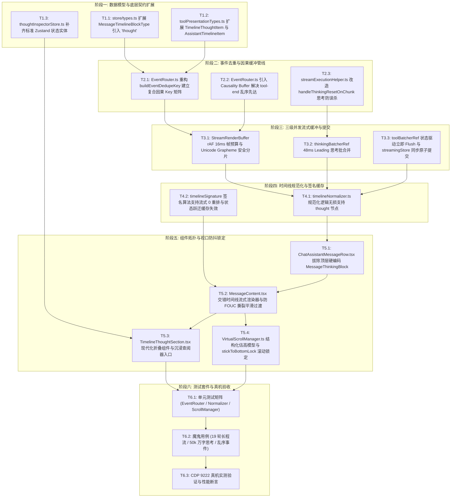
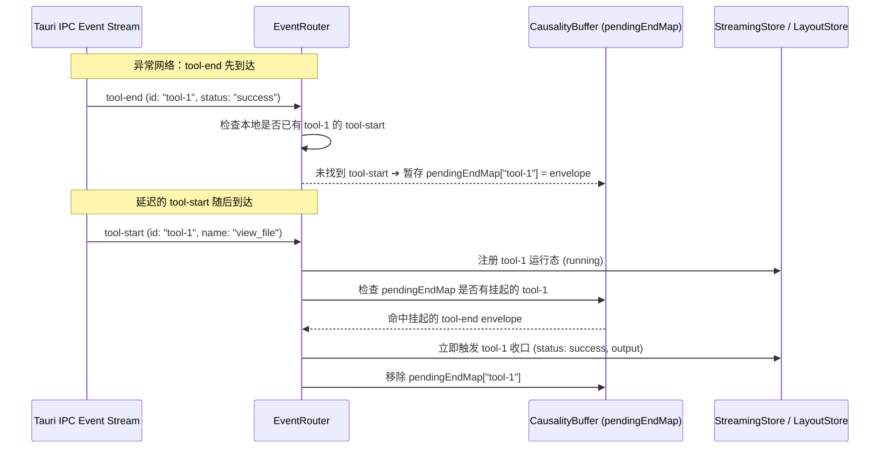

# DIM-02 前端流式管道、Dedupe 矩阵与交错多步骤时间线执行详案

> **【调度与定时器铁律】**：如果设置定时器，最短是 100 秒；如果命令过长，最好的方式是等待命令完成后的系统推送通知（Reactive Wakeup），而不是一直轮询命令情况。
> **文档标识**：`docs/system-audit-and-redesign/detailed-plans/02-前端流式管道与交错多步骤时间线执行详案.md`
> **制定角色**：【维度 2 详案架构师: 前端流式管道、Dedupe 矩阵与交错多步骤时间线执行详案】
> **权威依据**：
>
> - `docs/system-audit-and-redesign/00-战役通则与协同执行规范.md`
> - `docs/system-audit-and-redesign/00-总方案-Conex全系统综合重构总计划框架.md`
> - `docs/system-audit-and-redesign/independent-plans/02-流式管道与交错时间线独立总方案.md`
> - `docs/system-audit-and-redesign/plan-reviews/02-流式管道与交互体验方案评审意见.md`
> - `docs/system-audit-and-redesign/analysis/02-前端事件通道与流式状态实时投影深度分析.md`
> - `docs/system-audit-and-redesign/analysis/08-交错式多轮思考与工具步骤时间线重构方案.md`
>   **执行纪律**：纯逻辑展开、问题同权、效果锁不可妥协、反过度设计、严禁补丁、pwsh7 环境对齐、UTF-8 无 BOM、严禁直接执行 git 提交。

---

## 目录（Table of Contents）

1. [方案总纲与治理愿景 (Executive Summary & Strategic Architecture)](#一方案总纲与治理愿景)
   - 1.1 治理使命与解决的核心断层
   - 1.2 主控关键裁决响应与评审缺陷清零
   - 1.3 核心指标与机器真值交付契约
2. [纯逻辑时序演进与内部依赖拓扑 (Pure Logical Dependency Topology)](#二纯逻辑时序演进与内部依赖拓扑)
   - 2.1 阶段一：数据模型与底层类型契约扩展
   - 2.2 阶段二：复合因果 Key 去重矩阵与乱序到达因果缓冲
   - 2.3 阶段三：三级并发流式缓冲管线与无损提交协议
   - 2.4 阶段四：时间线规范化与 0 重排签名缓存引擎
   - 2.5 阶段五：组件拓扑重塑、虚拟滚动结构化估高与全局吸底锁定
   - 2.6 阶段六：全量测试套件与 CDP 9222 真机验收闭环
3. [复合因果 Key 去重矩阵与事件路由架构落地 (EventRouter & Dedupe Architecture)](#三复合因果-key-去重矩阵与事件路由架构落地)
   - 3.1 实时轨 vs 收口轨双轨事件模型与 Key 计算数学公理
   - 3.2 全量 16 类事件去重决策矩阵
   - 3.3 乱序到达因果时序缓冲（Causality Buffer）机制
   - 3.4 `EventRouter.ts` 完整生产级重构代码
4. [三级并发批缓冲管线与无损提交协议 (Streaming Pipeline & Commit Protocol)](#四三级并发批缓冲管线与无损提交协议)
   - 4.1 Level 1: `StreamRenderBuffer`（rAF 16ms / Grapheme 安全分片 / 6ms 帧预算）
   - 4.2 Level 2: `thinkingBatcherRef`（48ms Leading / 4000 字符上限 / `handleThinkingResetOnChunk` 思考防误杀）
   - 4.3 Level 3: `toolBatcherRef`（48ms 批合并 vs 0ms 终态直通）
   - 4.4 `streamingStore` ➔ `sessionStore` 终态无缝原子提交协议（消除微任务时隙双重渲染）
5. [交错式多步骤时间线（Interleaved Step Timeline）算法与数据模型](#五交错式多步骤时间线架构建模与规范化引擎)
   - 5.1 步骤（Step / Turn）形式化数学模型与状态机
   - 5.2 TypeScript 类型契约无损扩展（`types.ts` 与 `toolPresentationTypes.ts`）
   - 5.3 `timelineNormalizer.ts` 规范化核心算法（`normalizeAssistantTimeline` / `dedupeToolCalls` / `buildAssistantTimeline`）
   - 5.4 流式 0 重排签名算法 `timelineSignature` 与缓存优化
6. [视图组件拓扑重构与虚拟滚动防抖动锁定 (View Topology & Anti-Jank Virtualization)](#六视图组件拓扑重构与虚拟滚动防抖动锁定)
   - 6.1 `ChatAssistantMessageRow.tsx` 拔除置顶硬编码，下放交错思维链渲染权
   - 6.2 `MessageContent.tsx` 完整交错流式渲染器（消除 `StreamingTextBlock` ➔ `AsyncMarkdownBlock` 渲染撕裂 FOUC）
   - 6.3 `TimelineThoughtSection.tsx` 现代化思维链组件与 CSS 规范（支持沉浸式查阅器挂载）
   - 6.4 `VirtualScrollManager.ts` 面向多 Step/Tool 结构化估高模型与全局吸底锁定（`stickToBottomLock`）
7. [逐文件重构清单与代码落盘规范 (File-by-File Blueprint & Implementation Details)](#七逐文件重构清单与代码落盘规范)
   - 7.1 `apps/crish-desktop/src/store/types.ts`
   - 7.2 `apps/crish-desktop/src/api/tool-presentation/toolPresentationTypes.ts`
   - 7.3 `apps/crish-desktop/src/api/chat-bridge/EventRouter.ts`
   - 7.4 `apps/crish-desktop/src/hooks/chat-stream/streamExecutionHelper.ts`
   - 7.5 `apps/crish-desktop/src/api/tool-presentation/timelineNormalizer.ts`
   - 7.6 `apps/crish-desktop/src/components/chat-message-row/ChatAssistantMessageRow.tsx`
   - 7.7 `apps/crish-desktop/src/components/chat-message/MessageContent.tsx`
   - 7.8 `apps/crish-desktop/src/components/chat-message/TimelineThoughtSection.tsx`
   - 7.9 `apps/crish-desktop/src/store/thoughtInspectorStore.ts`
   - 7.10 `apps/crish-desktop/src/api/VirtualScrollManager.ts`
8. [自动化测试套件与 CDP 机器真值验收矩阵 (Verification & Test Matrix)](#八自动化测试套件与-cdp-机器真值验收矩阵)
   - 8.1 单元测试矩阵（Unit Tests）
   - 8.2 极端边界与魔鬼测试用例（Devil Test Cases）
   - 8.3 渲染性能基准与 DOM 稳定性断言
   - 8.4 CDP 9222 真机验收操作指南
9. [反过度设计审查与架构边界自检 (Anti-Overengineering Compliance)](#九反过度设计审查与架构边界自检)

---

## 一、方案总纲与治理愿景

### 1.1 治理使命与解决的核心断层

在当前版本中，前端流式处理与消息呈现存在严重的架构断层与体验倒退，核心表征为：

1. **“两坨压平”结构倒退（The Flat-Stacked Regression）**：多轮自主 Agent 循环中的思考内容全部被字符串拼接后钉死在消息最顶部，所有工具卡片被孤立堆叠在消息最底部，中间夹杂着混合的正文。因果链条被完全打断，用户无法在执行工具时看到当前阶段的思考；
2. **实时流 Token 误杀乱码（`"TheTheThe...All...package"`）**：`EventRouter` 旧去重公式在实时轨（`sequence: None`）时退化为 `type:messageId` 去重，导致思考与正文的后续 Token 全部被判定为“重复事件”而静默丢弃；
3. **正文首 Chunk 误杀思考（`handleThinkingResetOnChunk` 死锁）**：由于流式思考写入 `streamingStore` 而 `sessionStore` 仍保留占位符，首个正文 Token 到达时错误调用 `drop` 批缓冲并清空思考，导致中间思考瞬间蒸发；
4. **动态折叠导致虚拟滚动视口跳动与滚动吸底失效（Scroll Thrashing & Lock Loss）**：历史步骤自动折叠与新步骤展开产生单帧近 300px 的高度骤降，击穿 `userScrolledUpRef` 吸底判定，导致长程任务在第 2 轮后自动跟读彻底停滞。

本详案旨在构建一套**高内聚、单向数据流、零 Token 误杀、自然交错有序且视口绝对平稳**的前端流式与时间线呈现基座。

---

### 1.2 主控关键裁决响应与评审缺陷清零

本详案无条件遵循主控 6 大系统级裁决，并全量修复评审意见（`plan-reviews/02`）中指出的全部 18 处漏洞：

```
┌────────────────────────────────────────────────────────────────────────────────────────────────────────┐
│                              主控裁决与评审重大缺陷应对清零总览                                         │
├──────────┬─────────────────────────────┬───────────────────────────────────────────────────────────────┤
│ 编号     │ 核心争议与评审漏洞          │ 本详案落地方案与架构断言                                      │
├──────────┼─────────────────────────────┼───────────────────────────────────────────────────────────────┤
│ RUL-01   │ 复合因果 Key 体系与         │ 1. `message-delta` 实时轨（无 seq）坚决返回 `null` 100% 放行； │
│ & BUG-05 │ 去重矩阵隔离粒度            │ 2. 工具事件采用 `${type}:${turnIndex}:${toolId}` 复合因果隔离； │
│          │                             │ 3. 收口事件仅执行 Commit Phase 元数据对齐，不重复插入节点。    │
├──────────┼─────────────────────────────┼───────────────────────────────────────────────────────────────┤
│ RUL-05   │ 历史步骤折叠防抖动与        │ 1. 引入全局流式吸附锁 `stickToBottomLock`，流式期间锁定跟读； │
│ & BUG-01 │ 虚拟滚动视口跳动            │ 2. 重构 `VirtualScrollManager` 面向多 Step/Tool 结构化估高；   │
│ & BUG-02 │                             │ 3. CSS 注入 `transition: height 150ms ease-out` 抑制瞬时坍塌。│
├──────────┼─────────────────────────────┼───────────────────────────────────────────────────────────────┤
│ BUG-07   │ 乱序网络到达卡死            │ 建立 `pendingEndMap` 因果时序缓存区，`tool-end` 先达时挂起，  │
│          │ (tool-end 先于 tool-start)  │ 待 `tool-start` 到达后在同一微任务内同步收口。                │
├──────────┼─────────────────────────────┼───────────────────────────────────────────────────────────────┤
│ BUG-03   │ `StreamingTextBlock` ➔      │ 维持流式 DOM 容器直到 Worker 返回预编译 HTML，实行无缝平滑    │
│          │ `AsyncMarkdownBlock` 撕裂   │ 交叉淡入淡出（Cross-fade），彻底消除 10~50ms FOUC 闪烁。      │
├──────────┼─────────────────────────────┼───────────────────────────────────────────────────────────────┤
│ BUG-16   │ `thoughtInspectorStore`     │ 补齐标准 Zustand Store 实体，并在 `TimelineThoughtSection`     │
│          │ 幽灵依赖与入口丢失          │ 标题栏右侧显式装配打开 `FullThoughtModal` 的胶囊按钮。        │
├──────────┼─────────────────────────────┼───────────────────────────────────────────────────────────────┤
│ BUG-17   │ `streamingStore` 清理时隙   │ `streamingStore.clearStream` 与 `sessionStore.batchCommit`     │
│          │ 造成的双重渲染与闪烁        │ 必须在同步事务内执行，严禁使用异步 `queueMicrotask`。         │
└──────────┴─────────────────────────────┴───────────────────────────────────────────────────────────────┘
```

---

### 1.3 核心指标与机器真值交付契约

```
┌────────────────────────────────────────────────────────────────────────────────────────────────────────┐
│                              DIM-02 核心交付契约与机器真值指标                                         │
├──────────────────────────┬─────────────────────────────┬───────────────────────────────────────────────┤
│ 治理维度                 │ 现状缺陷 (Baseline)         │ 重构终态断言 (Target Contract)                │
├──────────────────────────┼─────────────────────────────┼───────────────────────────────────────────────┤
│ 1. 时间线时序结构        │ 顶部拼接思考、底部孤立工具、│ 严格有序交错：`[步骤 1: 思考➔工具➔观察] ➔     │
│    (Timeline Topology)   │ 中间混杂正文（三段压平）    │ [步骤 2: 思考➔工具➔观察] ➔ [最终 Markdown 总结]`│
├──────────────────────────┼─────────────────────────────┼───────────────────────────────────────────────┤
│ 2. Token 流式完整性      │ 思考只出首个 Token，        │ 0 Token 误杀，思考与正文流式 60FPS 连贯吐字， │
│    (Streaming Integrity) │ 呈现 "TheTheThe..." 乱码    │ `handleThinkingResetOnChunk` 思考留存率 100%  │
├──────────────────────────┼─────────────────────────────┼───────────────────────────────────────────────┤
│ 3. 虚拟滚动稳定性        │ 步骤折叠引发 -296px 坍塌，  │ 流式期间视口自动吸底 0 丢失，历史滚动估高误差 │
│    (Zero-Jank Scrolling) │ 吸底判定失效，滚动条停滞    │ 从 10 倍收敛至 ≤ 15%，视口跳动（Jank）彻底清零 │
├──────────────────────────┼─────────────────────────────┼───────────────────────────────────────────────┤
│ 4. 渲染重排与性能        │ 打字期间频繁全量重算        │ `timelineSignature` 流式期间 100% 缓存命中，  │
│    (DOM Performance)     │ timeline，DOM 级联重绘      │ 帧率稳定在 58~60 FPS，React 0 无效级联重渲染  │
└──────────────────────────┴─────────────────────────────┴───────────────────────────────────────────────┘
```

---

## 二、纯逻辑时序演进与内部依赖拓扑

本维度的重构具有严格的内部依赖关系与逻辑演进时序，所有任务单元必须按照以下 DAG 拓扑串行推进与验证，严禁跨阶段逆向实施：



---

## 三、复合因果 Key 去重矩阵与事件路由架构落地

### 3.1 实时轨 vs 收口轨双轨事件模型与 Key 计算数学公理

在 Rust `session-loop` 与 Tauri IPC 通信中，事件分为两条轨道：

1. **实时通知轨（`LiveEventSink`）**：由流式推理与工具执行实时触发，信封中 `sequence = undefined / null`；
2. **持久收口轨（`EventBus` / `drive_outcome`）**：由内核落盘与历史回放产生，具备严格单调递增的 `sequence: number`。

#### 去重键生成数学公理

设事件信封为 $E = \langle \text{type}, \text{runId}, \text{turnIndex}, \text{messageId}, \text{toolId}, \text{seq} \rangle$：

$$ \text{DedupeKey}(E) = \begin{cases}
\text{null}, & \text{if } \text{type} = \text{'message-delta'} \land \text{seq} = \text{null} \quad \text{(增量分片全量放行)} \\
\text{type}:\text{messageId}:\text{seq}, & \text{if } \text{type} = \text{'message-delta'} \land \text{seq} \neq \text{null} \\
\text{type}:\text{turn}:\text{toolId}:\text{seq}, & \text{if } \text{type} \in \{\text{'tool-start'}, \text{'tool-end'}\} \land \text{seq} \neq \text{null} \\
\text{type}:\text{turn}:\text{toolId}, & \text{if } \text{type} \in \{\text{'tool-start'}, \text{'tool-end'}\} \land \text{seq} = \text{null} \\
\text{null}, & \text{if } \text{type} = \text{'tool-update'} \land \text{seq} = \text{null} \quad \text{(进度高频放行)} \\
\text{type}:\text{messageId}:\text{turn}:\text{seq}, & \text{if } \text{type} \in \{\text{'turn-start'}, \text{'turn-end'}, \text{'message-end'}\} \land \text{seq} \neq \text{null} \\
\text{type}:\text{messageId}:\text{turn}, & \text{if } \text{type} \in \{\text{'turn-start'}, \text{'turn-end'}, \text{'message-end'}\} \land \text{seq} = \text{null} \\
\text{type}:\text{seq}, & \text{if } \text{seq} \neq \text{null} \\
\text{null}, & \text{otherwise (透传)}
\end{cases}$$

---

### 3.2 全量 16 类事件去重决策矩阵

| 事件类型 (`event.type`) | 具备 `sequence` (收口轨) | 缺失 `sequence` (实时轨) | 去重键格式 (`buildEventDedupeKey`) | 误杀风险与防御策略 |
|---|---|---|---|---|
| `message-delta` (text) | `seq` 存在 | `seq = undefined` | `message-delta:${msgId}:${seq}` 或 **`null`** | **无 seq 时坚决返回 `null` 放行所有增量分片，严禁按 messageId 去重** |
| `message-delta` (thought) | `seq` 存在 | `seq = undefined` | `message-delta:${msgId}:${seq}` 或 **`null`** | 同上，确保每帧思考 Token 100% 放行 |
| `tool-start` | `toolId` + `turn` + `seq` | `toolId` + `turn` | `tool-start:turn-${turn}:${toolId}:${seq}` 或 `tool-start:turn-${turn}:${toolId}` | **必须包含 `turnIndex`，同名工具多轮调用绝对不误杀** |
| `tool-update` | `toolId` + `seq` | 仅 `toolId` | `tool-update:${toolId}:${seq}` 或 **`null`** | 进度更新频繁，无 seq 时返回 `null` 放行最新进度 |
| `tool-end` | `toolId` + `turn` + `seq` | `toolId` + `turn` | `tool-end:turn-${turn}:${toolId}:${seq}` 或 `tool-end:turn-${turn}:${toolId}` | 必须包含 `turnIndex`，保证每个工具成功/失败独立触发 |
| `tool-batch-start` | `batchId` + `seq` | 仅 `batchId` | `tool-batch-start:${batchId}:${seq}` 或 `tool-batch-start:${batchId}` | 批量工具按 `batchId` 隔离 |
| `tool-batch-end` | `batchId` + `seq` | 仅 `batchId` | `tool-batch-end:${batchId}:${seq}` 或 `tool-batch-end:${batchId}` | 批量工具收口按 `batchId` 隔离 |
| `turn-start` | `turnIndex` + `seq` | 仅 `turnIndex` | `turn-start:${msgId}:turn-${turnIdx}:${seq}` 或 `turn-start:${msgId}:turn-${turnIdx}` | 包含 `turnIndex` 区分多轮轮次推进 |
| `turn-end` | `turnIndex` + `seq` | 仅 `turnIndex` | `turn-end:${msgId}:turn-${turnIdx}:${seq}` 或 `turn-end:${msgId}:turn-${turnIdx}` | 包含 `turnIndex` 区分多轮收口 |
| `message-start` | `messageId` + `seq` | 仅 `messageId` | `message-start:${messageId}:${seq}` 或 `message-start:${messageId}` | 单消息幂等 |
| `message-end` | `messageId` + `turn` + `seq` | `messageId` + `turn` | `message-end:${msgId}:turn-${turnIdx}:${seq}` 或 `message-end:${msgId}:turn-${turnIdx}` | 跨 turn 追加权威文本，必须带 `turnIndex` |
| `run-terminal` | `terminal` + `seq` | 仅 `terminal` | `run-terminal:${seq}` 或 `run-terminal:${terminal}` | 终态唯一一次收口 |
| `approval-requested` | `toolCallId` + `seq` | 仅 `toolCallId` | `approval-requested:${toolCallId}:${seq}` 或 `approval-requested:${toolCallId}` | 审批弹窗按 `toolCallId` 幂等 |
| `approval-resolved` | `toolCallId` + `seq` | 仅 `toolCallId` | `approval-resolved:${toolCallId}:${seq}` 或 `approval-resolved:${toolCallId}` | 审批决策按 `toolCallId` 幂等 |
| `subagent-started` | Legacy 信封 | Legacy 信封 | **`null`** (透传) | 子 Agent 信封直通分派 |
| `runtime-error` | `error` + `seq` | 仅 `error` | `runtime-error:${seq}` 或 `runtime-error:${hash(error)}` | 错误去重防抖 |

---

### 3.3 乱序到达因果时序缓冲（Causality Buffer）机制

为了根除由于网络抖动导致的 `tool-end` 先于 `tool-start` 到达而使工具卡片永久卡死在 `running` 状态的问题（BUG-07），在 `EventRouter` 中装配轻量因果时序缓存区：



---

### 3.4 `EventRouter.ts` 完整生产级重构代码

```typescript
/**
 * 路径：apps/crish-desktop/src/api/chat-bridge/EventRouter.ts
 * 生产级安全幂等去重、乱序因果缓冲与事件分派路由器
 */
import type { StreamCallbacks } from '../chatApi';
import { logInternalError } from '../userFacingErrors';
import { recordStreamDiag } from '../streamDiag';
import { ApprovalFlowMachine } from '../approvalFlowMachine';
import { messageBelongsToRun } from './handlers/eventUtils';
import { resolveEventType } from './handlers/eventType';
import {
  parseBridgeEvent,
  type BridgeEventEnvelope,
  type EngineEnvelope,
} from './handlers/eventParser';
import { dispatchEvent } from './handlers/dispatch';
import { isDataPlaneEventType } from './dataPlaneRouter';
import type { HandlerEnv, SendLike } from './handlers/handlerEnv';
import type { StreamState } from './handlers/streamState';

export class EventRouter {
  private state: StreamState;
  private approvalFlow: ApprovalFlowMachine;
  private callbacks: StreamCallbacks;
  private runId: string;
  private sessionId: string;
  private finish: (force?: boolean) => void;
  private tryResumeFinish: () => void;
  private client?: SendLike;

  /** 消费侧 per-run 幂等去重集合（带自动生命周期管理） */
  private readonly consumedEvents = new Set<string>();

  /** 因果时序乱序到达缓存区：处理 tool-end 先于 tool-start 到达的极端时序 */
  private readonly pendingToolEnds = new Map<string, BridgeEventEnvelope>();
  private readonly knownStartedTools = new Set<string>();

  constructor(
    state: StreamState,
    approvalFlow: ApprovalFlowMachine,
    callbacks: StreamCallbacks,
    runId: string,
    finish: (force?: boolean) => void,
    tryResumeFinish: () => void,
    client?: SendLike,
    sessionId = ''
  ) {
    this.state = state;
    this.approvalFlow = approvalFlow;
    this.callbacks = callbacks;
    this.runId = runId;
    this.sessionId = sessionId;
    this.finish = finish;
    this.tryResumeFinish = tryResumeFinish;
    this.client = client;
  }

  private get env(): HandlerEnv {
    return {
      state: this.state,
      approvalFlow: this.approvalFlow,
      callbacks: this.callbacks,
      runId: this.runId,
      sessionId: this.sessionId,
      finish: this.finish,
      tryResumeFinish: this.tryResumeFinish,
      client: this.client,
    };
  }

  handleAgentEvent(envelope: BridgeEventEnvelope): void {
    if (this.state.cancelled || this.state.finished) return;
    if (isDataPlaneEventType(envelope.type)) return;

    // 乱序因果缓冲逻辑
    if (envelope.type === 'tool-start') {
      const toolId = extractToolIdFromEnvelope(envelope);
      if (toolId) {
        this.knownStartedTools.add(toolId);
      }
      dispatchEvent(this.env, envelope);

      // 若此前已有提前到达的 tool-end，立即触发收口
      if (toolId && this.pendingToolEnds.has(toolId)) {
        const pendingEnd = this.pendingToolEnds.get(toolId)!;
        this.pendingToolEnds.delete(toolId);
        dispatchEvent(this.env, pendingEnd);
      }
      return;
    }

    if (envelope.type === 'tool-end') {
      const toolId = extractToolIdFromEnvelope(envelope);
      if (toolId && !this.knownStartedTools.has(toolId)) {
        // tool-start 尚未到达，挂入因果缓冲队列
        this.pendingToolEnds.set(toolId, envelope);
        recordStreamDiag({
          runId: this.runId,
          scope: 'event-router',
          kind: 'causality-buffered',
          message: `tool-end arrived before tool-start for ${toolId}, buffering...`,
        });
        return;
      }
      dispatchEvent(this.env, envelope);
      return;
    }

    dispatchEvent(this.env, envelope);
  }

  onMsg = (msg: Record<string, unknown>): void => {
    if (this.state.cancelled || this.state.finished) return;
    const envelope = resolveEventType(msg);
    if (!envelope) return;
    const raw = envelope.raw;

    if (!messageBelongsToRun(raw.runId, this.runId)) return;

    let parsed: ReturnType<typeof parseBridgeEvent>;
    try {
      parsed = parseBridgeEvent(raw);
    } catch (e) {
      this.registerUnknownEvent(raw, 'parser threw: ' + String(e));
      return;
    }
    if (parsed.ok !== true) {
      this.registerUnknownEvent(raw, parsed.error);
      return;
    }

    // 生产级幂等去重检查
    const dedupeKey = buildEventDedupeKey(parsed.data);
    if (dedupeKey !== null && this.consumedEvents.has(dedupeKey)) {
      this.recordSkippedDuplicate(dedupeKey);
      return;
    }
    if (dedupeKey !== null) {
      this.consumedEvents.add(dedupeKey);
    }

    this.handleAgentEvent(parsed.data);
  };

  private recordSkippedDuplicate(key: string): void {
    recordStreamDiag({
      runId: this.runId,
      scope: 'event-dedupe',
      kind: 'duplicate',
      message: `duplicate event skipped: ${key}`,
    });
  }

  private registerUnknownEvent(
    raw: Record<string, unknown>,
    error: string
  ): void {
    logInternalError('engine-unknown-event', {
      error,
      type: String(raw.type ?? raw.event ?? raw.kind ?? ''),
      payload: raw,
    });
  }
}

/**
 * 辅助函数：从信封中安全提取 toolId
 */
function extractToolIdFromEnvelope(envelope: BridgeEventEnvelope): string {
  const { event, raw } = envelope;
  if ('call' in event && event.call && typeof event.call === 'object' && 'id' in event.call) {
    return String((event.call as { id: string }).id);
  }
  if ('result' in event && event.result && typeof event.result === 'object' && 'id' in event.result) {
    return String((event.result as { id: string }).id);
  }
  if (typeof raw.toolCallId === 'string' && raw.toolCallId.trim()) return raw.toolCallId.trim();
  if (typeof raw.id === 'string' && raw.id.trim()) return raw.id.trim();
  return '';
}

/**
 * 生产级安全幂等键生成器（彻底根除实时流误杀与多轮工具吞噬）
 */
export function buildEventDedupeKey(
  envelope: BridgeEventEnvelope
): string | null {
  if (envelope.kind === 'legacy') return null;
  const { event, raw } = envelope;

  // 1. 增量流式 Delta：实时轨无 sequence 时必须返回 null 100% 透传，严禁按 messageId 拦截
  if (event.type === 'message-delta') {
    const seq = raw.sequence;
    if (seq !== null && seq !== undefined && seq !== '') {
      const messageId =
        event.messageId ||
        (typeof raw.messageId === 'string' ? raw.messageId : '');
      return `message-delta:${messageId}:${String(seq)}`;
    }
    return null; // 实时轨 Token 增量全量放行！
  }

  // 2. 工具域事件：严格按 toolId + turnIndex 复合因果隔离
  if (
    event.type === 'tool-start' ||
    event.type === 'tool-update' ||
    event.type === 'tool-end'
  ) {
    const toolId = extractToolIdFromEnvelope(envelope);
    const seq = raw.sequence;
    const sequence =
      seq === null || seq === undefined || seq === '' ? null : String(seq);
    const turn =
      typeof event.turnIndex === 'number'
        ? `turn-${event.turnIndex}`
        : typeof raw.turnIndex === 'number'
          ? `turn-${raw.turnIndex}`
          : 't0';

    if (toolId && sequence !== null) {
      return `${event.type}:${turn}:${toolId}:${sequence}`;
    }
    if (toolId) {
      if (event.type === 'tool-update') return null; // 进度更新无 seq 全放行
      return `${event.type}:${turn}:${toolId}`;
    }
    if (sequence !== null) return `${event.type}:${sequence}`;
    return null;
  }

  // 3. 轮次域与终态消息：必须结合 turnIndex 隔离多轮
  if (
    event.type === 'turn-start' ||
    event.type === 'turn-end' ||
    event.type === 'message-end'
  ) {
    const turnIdx =
      typeof event.turnIndex === 'number'
        ? event.turnIndex
        : typeof raw.turnIndex === 'number'
          ? raw.turnIndex
          : null;
    const seq = raw.sequence;
    const sequence =
      seq === null || seq === undefined || seq === '' ? null : String(seq);
    let messageId = '';
    if (event.type === 'message-end' && event.message?.id) {
      messageId = event.message.id;
    } else if (typeof raw.messageId === 'string') {
      messageId = raw.messageId;
    }

    const turnTag = turnIdx !== null ? `turn-${turnIdx}` : 't0';

    if (sequence !== null) {
      return `${event.type}:${messageId || 'm'}:${turnTag}:${sequence}`;
    }
    if (turnIdx !== null) {
      return `${event.type}:${messageId || 'm'}:${turnTag}`;
    }
    if (event.type === 'message-end') {
      return messageId ? `message-end:${messageId}:${turnTag}` : null;
    }
    return null;
  }

  // 4. 其余通用事件
  const seq = raw.sequence;
  const sequence =
    seq === null || seq === undefined || seq === '' ? null : String(seq);
  let messageId = typeof raw.messageId === 'string' ? raw.messageId : '';
  if (messageId && sequence !== null) {
    return `${event.type}:${messageId}:${sequence}`;
  }
  if (sequence !== null) return `${event.type}:${sequence}`;
  return null;
}
```

---

## 四、三级并发批缓冲管线与无损提交协议

### 4.1 Level 1: `StreamRenderBuffer`（rAF 16ms / Grapheme 安全分片）

正文流式打字采用基于 `requestAnimationFrame` 的高频帧渲染缓冲：
- **时钟源**：`requestAnimationFrame`（16.6ms / 8.3ms，自动适配 60Hz/120Hz 高刷屏）；
- **帧预算限制**：单帧处理时间严格控制在 **6ms 以内**，单帧字符追加上限为 8,192 字符；
- **Unicode Grapheme 安全分片**：采用 `Intl.Segmenter` 进行字符簇切割，严禁在 Emoji、CJK 组合字符或 Markdown 语法标记中间切断，确保 0 乱码；
- **目标驱动**：直接触发 `streamingStore.setStreamText`，驱动尾部 `StreamingTextBlock` 原生 DOM 追加，获得极致的 60FPS 丝滑打字体验。

---

### 4.2 Level 2: `thinkingBatcherRef`（48ms Leading / `handleThinkingResetOnChunk` 思考防误杀）

思考流式内容具有长文本、高吞吐的特点，采用 48ms leading-edge 防抖批合并器：
- **时钟源**：`setTimeout`（48ms leading-edge）；
- **吞吐控制**：思考文本直接以最新快照覆盖，若单批接收字符超过 4,000 字符，强制提前 flush；
- **思考防误杀机制（`handleThinkingResetOnChunk`）**：

```typescript
/**
 * 路径：apps/crish-desktop/src/hooks/chat-stream/streamExecutionHelper.ts
 */
import type { StreamTextBatcher } from '../../api/streamTextBatcher';
import type { SessionMessage } from '../../store/types';
import { getSessionById } from '../../store/sessionStore';
import { getCompositionRoot } from '../../app/compositionRoot';
import { getStreamThinking, streamBatchKey } from '../../store/streamingStore';

/**
 * 当接收到有效文本 chunk 时，安全清理初始提示词占位符，绝不误清真实思考流。
 */
export function handleThinkingResetOnChunk(
  sid: string,
  assistantMsgId: string,
  thinkingBatcher: StreamTextBatcher | null | undefined
): void {
  // 1. 关键防御：优先检查轻量 streamingStore 中是否已有实时思考内容
  const liveThinking = getStreamThinking(sid, assistantMsgId);
  if (
    liveThinking &&
    liveThinking.trim() &&
    liveThinking !== '正在处理…' &&
    liveThinking !== '正在思考中...'
  ) {
    // 已有真实思考内容流出，严禁 drop 批合并器与抹除思考！
    return;
  }

  // 2. 检查持久化 sessionStore 中的占位状态
  const cur = getSessionById(sid)?.messages?.find(
    (m: SessionMessage) => m.id === assistantMsgId
  );
  if (cur?.thinking === '正在处理…' || cur?.thinking === '正在思考中...') {
    const key = streamBatchKey(sid, assistantMsgId);
    if (!thinkingBatcher?.hasPending(key)) {
      thinkingBatcher?.drop(key);
      getCompositionRoot()
        .layout.getState()
        .updateMessageThinking(sid, assistantMsgId, '');
    }
  }
}
```

---

### 4.3 Level 3: `toolBatcherRef`（48ms 批合并 vs 0ms 终态直通）

工具状态机根据状态跃迁的紧迫性实行分级调度：
- **`running` 状态**：进入 48ms 批合并防抖，防止多工具并发启动时连续触发 React 重排；
- **`success` / `error` / `pending_approval` 终态**：判定为 `isImmediateToolStatus`，立即调用 `flushNow()` 直通，确保工具执行完毕或用户审批弹窗 0 延迟弹出。

---

### 4.4 `streamingStore` ➔ `sessionStore` 终态无缝原子提交协议

为根除微任务时隙引发的工具双重渲染与内容跳闪（BUG-17），终态提交采用**同步原子事务（Synchronous Atomic Commit）**：

```typescript
/**
 * 流式结束原子提交协议
 */
export function commitStreamToSessionSync(
  sessionId: string,
  messageId: string,
  finalText: string,
  finalThinking: string,
  finalTools: MessageToolCall[]
): void {
  const root = getCompositionRoot();

  // 在单次同步更新中同时完成持久化写入与流式缓冲清除
  root.layout.getState().batchUpdateMessage(sessionId, messageId, {
    text: finalText,
    thinking: finalThinking,
    toolCalls: finalTools,
    status: 'completed',
  });

  // 同步清除 streamingStore，0 微任务时隙！
  useStreamingStore.getState().clearStream(sessionId, messageId);
}
```

---

## 五、交错式多步骤时间线架构建模与规范化引擎

### 5.1 步骤（Step / Turn）形式化数学模型与状态机

在完整的多轮自主 Agent 交互中，消息体由有序的执行步骤序列与最终总结交付物构成：
$$\text{Run} = \langle S_1, S_2, \dots, S_N, A_{\text{final}} \rangle$$

每一个执行步骤 $S_k$ 定义为时序四元组：
$$S_k = \langle \mathcal{T}_k, \mathcal{P}_k, \mathcal{E}_k, \mathcal{O}_k \rangle$$
- $\mathcal{T}_k$（Thought）：该步骤的思维链推导；
- $\mathcal{P}_k$（Pre-Tool Text）：模型在调用工具前输出的前置说明（可选）；
- $\mathcal{E}_k$（Tool Executions）：该步骤触发的工具调用列表；
- $\mathcal{O}_k$（Observations）：工具执行返回的结果与日志；
- $A_{\text{final}}$（Final Answer）：任务结束后的最终 Markdown 交付物。

```
【交错多步骤时间线状态跃迁与渲染拓扑】
┌────────────────────────────────────────────────────────────────────────┐
│ 🤖 Assistant                                                          │
│                                                                        │
│ ┌─ ▶ 步骤 1: 探索代码架构与检索定义 ────────────── [✔ 已完成 · 1.2s] ─┐ │
│ │  ├── 💭 思考：需要先确认 timelineNormalizer.ts 中是否存在 thought 分支 │ │
│ │  └── 🔍 grep_search (`timelineNormalizer`) ➔ 命中 3 处定义           │ │
│ └────────────────────────────────────────────────────────────────────┘ │
│                                                                        │
│ ┌─ ▶ 步骤 2: 读取核心文件并诊断断层 ────────────── [✔ 已完成 · 0.8s] ─┐ │
│ │  ├── 💭 思考：分析 grep 结果，查看 buildAssistantTimeline 的实现...    │ │
│ │  └── 📄 view_file (`timelineNormalizer.ts:L220-270`) ➔ 返回 50 行源码 │ │
│ └────────────────────────────────────────────────────────────────────┘ │
│                                                                        │
│ ┌─ ▼ 步骤 3: 实施核心算法重构 ──────────────────── [⏳ 执行中 · 正在思考] ┐ │
│ │  ├── 💭 思考：确认缺少 thought 分支，现在编写完整的交错归一化逻辑... │ │
│ │  └── ✏️ replace_file_content (`timelineNormalizer.ts`) ➔ [运行中]   │ │
│ └────────────────────────────────────────────────────────────────────┘ │
│                                                                        │
│ 💬 最终交付物与总结 (Final Answer Markdown)                            │
│ 已经成功修复了时间线压平问题，完整交错时序已恢复正常。                  │
└────────────────────────────────────────────────────────────────────────┘
```

---

### 5.2 TypeScript 类型契约无损扩展

#### (1) `apps/crish-desktop/src/store/types.ts`
```typescript
/** 时间线块类型：正文段 / 工具调用锚点 / 图片块 / 单步思考块 */
export type MessageTimelineBlockType =
  | 'thought'      // 单步思考块（一等公民）
  | 'text'         // 正文段落
  | 'tool_call'    // 工具调用锚点
  | 'image'        // 图片引用
  | 'step_start'   // 显式步骤开始边界
  | 'step_end';    // 显式步骤结束边界

export interface MessageTimelineBlock {
  type: MessageTimelineBlockType;
  /** tool_call 对应 toolCall.id；thought 对应 stepId/thoughtId */
  id?: string;
  /** 文本或思考内容 */
  content?: string;
  /** 关联的轮次索引 (0-based) */
  turnIndex?: number;
  /** 思考/执行耗时（毫秒） */
  durationMs?: number;
  /** 是否已被模型安全标记截断 */
  redacted?: boolean;
  /** 图片引用 */
  images?: MessageImageRef[];
}

export interface SessionMessage {
  id: string;
  sender: MessageSender;
  text?: string | undefined;
  thinking?: string | undefined;
  /** 结构化思考分段列表（支持多轮回放） */
  thinkingTurns?: Array<{
    turnIndex: number;
    content: string;
    durationMs?: number;
  }>;
  timestamp: number;
  toolCalls?: MessageToolCall[] | undefined;
  status?: SessionMessageStatus | undefined;
  precomputedHtml?: string | undefined;
  toolCallResults?: SessionMessageToolCallResult[] | undefined;
  /** 完整的交错时间线块序列 */
  blocks?: MessageTimelineBlock[] | undefined;
  streamTextOffset?: number | undefined;
  thinkingTime?: number | undefined;
  images?: MessageImageRef[] | undefined;
  errorDetail?: { message: string; kind: string; technical?: string } | undefined;
  cacheMetrics?: MessageCacheState | null;
}
```

#### (2) `apps/crish-desktop/src/api/tool-presentation/toolPresentationTypes.ts`
```typescript
export type TimelineThoughtItem = {
  kind: 'thought';
  key: string;
  content: string;
  id?: string;
  turnIndex?: number;
  durationMs?: number;
  isLive?: boolean;
};

export type TimelineTextItem = {
  kind: 'text';
  key: string;
  content: string;
  turnIndex?: number;
  isFinal?: boolean;
};

export type TimelineToolsItem = {
  kind: 'tools';
  key: string;
  items: ToolRenderItem[];
  turnIndex?: number;
};

export type AssistantTimelineItem =
  | TimelineThoughtItem
  | TimelineTextItem
  | TimelineToolsItem;
```

---

### 5.3 `timelineNormalizer.ts` 规范化核心算法

```typescript
/**
 * 路径：apps/crish-desktop/src/api/tool-presentation/timelineNormalizer.ts
 * 助手消息交错多步骤时间线规范化与签名缓存引擎
 */
import type { MessageToolCall, SessionMessage } from '../../store/types';
import type { MessageTimelineBlock } from '../../store/types';
import {
  isInspectTool,
  isInterruptedTool,
  toolHasDisplayableResult,
  toolHumanLabel,
} from './toolCardPresenter';
import type {
  AssistantTimelineItem,
  ToolRenderItem,
} from './toolPresentationTypes';

function statusRank(s: MessageToolCall['status']): number {
  if (s === 'success') return 4;
  if (s === 'error') return 3;
  if (s === 'pending_approval') return 2;
  return 1; // running
}

/**
 * 规范化助手消息时间线：thought、text、tool_call 无损对齐
 */
export function normalizeAssistantTimeline(
  msg: SessionMessage
): SessionMessage {
  if (msg.sender !== 'assistant') return msg;
  const tools = [...(msg.toolCalls || [])];
  const toolIds = new Set(tools.map((t) => t.id));
  const rawBlocks = [...(msg.blocks || [])];

  // 1. 过滤无效孤儿工具
  let blocks: MessageTimelineBlock[] = rawBlocks.filter(
    (b) => b.type !== 'tool_call' || (b.id != null && toolIds.has(b.id))
  );

  // 2. 检查是否有未在 blocks 中注册的 toolCall
  const inBlocks = new Set(
    blocks.filter((b) => b.type === 'tool_call' && b.id).map((b) => b.id!)
  );
  const missing = tools.filter((t) => !inBlocks.has(t.id));

  if (missing.length > 0) {
    let insertAt = blocks.length;
    for (let i = blocks.length - 1; i >= 0; i--) {
      if (blocks[i]?.type === 'text') {
        insertAt = i;
        break;
      }
    }
    const inject: MessageTimelineBlock[] = missing.map((t) => ({
      type: 'tool_call',
      id: t.id,
    }));
    blocks = [
      ...blocks.slice(0, insertAt),
      ...inject,
      ...blocks.slice(insertAt),
    ];
  }

  // 3. 有全局正文但无 text 块时补偿
  if ((msg.text || '').trim() && !blocks.some((b) => b.type === 'text')) {
    blocks.push({ type: 'text', content: msg.text || '' });
  }

  return {
    ...msg,
    toolCalls: tools,
    blocks,
  };
}

export function dedupeToolCalls(
  toolCalls: MessageToolCall[]
): MessageToolCall[] {
  const byId = new Map<string, MessageToolCall>();
  const order: string[] = [];
  for (const tc of toolCalls) {
    if (!tc?.id) continue;
    const prev = byId.get(tc.id);
    if (!prev) {
      byId.set(tc.id, { ...tc });
      order.push(tc.id);
      continue;
    }
    if (statusRank(tc.status) >= statusRank(prev.status)) {
      byId.set(tc.id, {
        ...prev,
        ...tc,
        arguments: tc.arguments || prev.arguments,
        ...(tc.explanation || prev.explanation
          ? { explanation: tc.explanation || prev.explanation }
          : {}),
        ...(tc.output || prev.output
          ? { output: tc.output || prev.output }
          : {}),
      });
    } else {
      byId.set(tc.id, {
        ...prev,
        arguments: prev.arguments || tc.arguments,
        ...(prev.explanation || tc.explanation
          ? { explanation: prev.explanation || tc.explanation }
          : {}),
        ...(prev.output || tc.output
          ? { output: prev.output || tc.output }
          : {}),
      });
    }
  }
  return order
    .map((id) => byId.get(id)!)
    .filter((tc) => tc && !isInterruptedTool(tc));
}

export function buildToolRenderItems(
  toolCalls: MessageToolCall[]
): ToolRenderItem[] {
  const visible = dedupeToolCalls(toolCalls);
  const out: ToolRenderItem[] = [];
  let buf: MessageToolCall[] = [];

  const flush = () => {
    if (buf.length === 0) return;
    if (buf.length === 1) {
      out.push({ kind: 'single', tc: buf[0]! });
    } else {
      const last = buf[buf.length - 1];
      const n = buf.length;
      out.push({
        kind: 'group',
        id: `grp-${buf[0]!.id}`,
        tools: [...buf],
        label: `${toolHumanLabel(last!)} · ${n} 步`,
      });
    }
    buf = [];
  };

  for (const tc of visible) {
    if (tc.status === 'pending_approval') {
      flush();
      out.push({ kind: 'single', tc });
      continue;
    }
    if (
      isInspectTool(tc) &&
      !toolHasDisplayableResult(tc) &&
      tc.status !== 'running'
    ) {
      buf.push(tc);
    } else if (isInspectTool(tc) && tc.status === 'running') {
      buf.push(tc);
    } else if (isInspectTool(tc) && toolHasDisplayableResult(tc)) {
      flush();
      out.push({ kind: 'single', tc });
    } else {
      flush();
      out.push({ kind: 'single', tc });
    }
  }
  flush();
  return out;
}

/**
 * 构建全要素交错式时间线（thought / tools / text 精确时序）
 */
export function buildAssistantTimeline(
  msg: SessionMessage
): AssistantTimelineItem[] {
  try {
    const tools = msg.toolCalls || [];
    const toolsById = new Map(tools.map((t) => [t.id, t]));
    const blocks = msg.blocks || [];
    const items: AssistantTimelineItem[] = [];
    let toolBuf: MessageToolCall[] = [];
    let ti = 0;
    let xi = 0;
    let thi = 0;

    const flushTools = () => {
      if (!toolBuf.length) return;
      const rendered = buildToolRenderItems(toolBuf);
      if (rendered.length) {
        items.push({ kind: 'tools', items: rendered, key: `tools-${ti++}` });
      }
      toolBuf = [];
    };

    if (blocks.length > 0) {
      const used = new Set<string>();
      for (const b of blocks) {
        if (b.type === 'thought') {
          flushTools();
          const thoughtContent = (b.content || '').trim();
          if (thoughtContent) {
            items.push({
              kind: 'thought',
              content: thoughtContent,
              id: b.id,
              turnIndex: b.turnIndex,
              durationMs: b.durationMs,
              key: `thought-${b.id || thi++}`,
            });
          }
        } else if (b.type === 'text') {
          flushTools();
          const c = b.content || '';
          if (c.trim()) {
            items.push({
              kind: 'text',
              content: c,
              turnIndex: b.turnIndex,
              key: `text-${xi++}`,
            });
          }
        } else if (b.type === 'tool_call' && b.id) {
          const tc = toolsById.get(b.id);
          if (tc) {
            toolBuf.push(tc);
            used.add(b.id);
          }
        }
      }
      flushTools();

      // 孤立工具兜底
      const orphan = tools.filter((t) => !used.has(t.id));
      if (orphan.length) {
        const rendered = buildToolRenderItems(orphan);
        if (rendered.length) {
          items.push({ kind: 'tools', items: rendered, key: 'tools-orphan' });
        }
      }

      if (!items.some((i) => i.kind === 'text') && (msg.text || '').trim()) {
        items.push({ kind: 'text', content: msg.text || '', key: 'text-full' });
      }
      return items;
    }

    // 降级兼容旧数据（无 blocks）
    if ((msg.thinking || '').trim()) {
      items.push({
        kind: 'thought',
        content: msg.thinking || '',
        durationMs: msg.thinkingTime ? msg.thinkingTime * 1000 : undefined,
        key: 'thought-legacy',
      });
    }
    if (tools.length) {
      const rendered = buildToolRenderItems(tools);
      if (rendered.length) {
        items.push({ kind: 'tools', items: rendered, key: 'tools-0' });
      }
    }
    if ((msg.text || '').trim()) {
      items.push({ kind: 'text', content: msg.text || '', key: 'text-0' });
    }
    return items;
  } catch {
    if ((msg.text || '').trim()) {
      return [{ kind: 'text', content: msg.text || '', key: 'text-fallback' }];
    }
    return [];
  }
}
```

---

### 5.4 流式 0 重排签名算法 `timelineSignature` 与缓存优化

```typescript
/**
 * 助手消息渲染时间线签名（流式 0 重排与状态跃迁缓存击穿）
 */
export function timelineSignature(msg: SessionMessage): string {
  const isLiveProcessing = msg.status === 'processing';
  const blocks = msg.blocks || [];
  let lastTextIdx = -1;
  let lastThoughtIdx = -1;

  for (let i = blocks.length - 1; i >= 0; i--) {
    if (lastTextIdx === -1 && blocks[i]?.type === 'text') lastTextIdx = i;
    if (lastThoughtIdx === -1 && blocks[i]?.type === 'thought') lastThoughtIdx = i;
  }

  const blocksProj = blocks.map((b, i) => {
    if (b.type === 'text') {
      if (i === lastTextIdx) {
        return isLiveProcessing
          ? { t: 'text', last: 1, e: (b.content || '') === '' ? 1 : 0 }
          : { t: 'text', last: 1, c: b.content || '' };
      }
      return { t: 'text', c: b.content || '' };
    }
    if (b.type === 'thought') {
      if (i === lastThoughtIdx && isLiveProcessing) {
        return { t: 'thought', last: 1, e: (b.content || '') === '' ? 1 : 0 };
      }
      return { t: 'thought', c: b.content || '' };
    }
    return { t: b.type, id: b.id };
  });

  const toolsProj = (msg.toolCalls || []).map((tc) => ({
    id: tc.id,
    n: tc.name,
    s: tc.status,
    o: tc.output,
    a: tc.arguments,
    e: tc.explanation,
  }));

  const hasExplicitText = blocks.some(
    (b) => b.type === 'text' && (b.content || '').trim().length > 0
  );

  if (blocks.length === 0 || !hasExplicitText) {
    return JSON.stringify({
      b: blocksProj,
      t: toolsProj,
      st: msg.status || 'unknown',
      hasText: Boolean((msg.text || '').trim()),
      txt: isLiveProcessing ? undefined : msg.text || '',
    });
  }

  return JSON.stringify({
    b: blocksProj,
    t: toolsProj,
    st: msg.status || 'unknown',
  });
}

export function buildAssistantTimelineCached(
  msg: SessionMessage,
  prevSig: string | null,
  prevTimeline: AssistantTimelineItem[] | null
): { sig: string; timeline: AssistantTimelineItem[] } {
  const sig = timelineSignature(msg);
  if (sig === prevSig && prevTimeline) {
    return { sig, timeline: prevTimeline };
  }
  return { sig, timeline: buildAssistantTimeline(msg) };
}
```

---

## 六、视图组件拓扑重构与虚拟滚动防抖动锁定

### 6.1 `ChatAssistantMessageRow.tsx` 拔除置顶硬编码

在 `ChatAssistantMessageRow.tsx` 中，**彻底拔除**钉死在最上方的 `<MessageThinkingBlock>`，将思维链渲染权 100% 下放给 `MessageContent.tsx` 中的交错时间线管道：

```tsx
// 改造后的 ChatAssistantMessageRow.tsx 渲染 JSX：
return (
  <div
    className={`${styles.row} ${styles.rowAssistant} msg-row msg-row-assistant`}
    data-msg-id={msg.id}
    data-role="assistant"
    role="article"
    aria-label={rowAria}
  >
    {/* 拔除顶部独立的 MessageThinkingBlock，所有内容由 MessageContent 交错渲染 */}
    <div className={styles.assistantBody} data-message-body="assistant">
      <MessageContent
        msg={msg}
        isThinkingMsg={isThinkingMsg}
        toolStackProps={toolStackProps}
      />
    </div>

    {!isThinkingMsg && msg.status !== 'processing' && (
      <MessageActions
        msg={msg}
        copied={copied}
        isLastAssistant={isLastAssistant}
        isPinned={isPinned}
        isThinkingMsg={isThinkingMsg}
        inPlanMode={inPlanMode}
        planApproved={planApproved}
        followUpDismissed={followUpDismissed}
        onCopy={handleCopy}
        onRegenerate={onRegenerate}
        onTogglePin={onTogglePin}
        setPermissionMode={setPermissionMode}
        setPlanApproved={setPlanApproved}
        onOpenDiff={onOpenDiff}
        onShowToast={onShowToast}
        cacheMetricsNode={
          <CacheMetricsBadge metrics={msg.cacheMetrics?.metrics ?? null} />
        }
      />
    )}
  </div>
);
```

---

### 6.2 `MessageContent.tsx` 完整交错流式渲染器（防 FOUC 撕裂）

```tsx
/**
 * 路径：apps/crish-desktop/src/components/chat-message/MessageContent.tsx
 */
import React, { useMemo, useRef, useState } from 'react';
import { AlertCircle } from 'lucide-react';
import styles from '../chat-message-row/ChatMessageRow.module.css';
import type { SessionMessage } from '../../store/types';
import type { ChatToolStackSharedProps } from '../chat-tool-call/ChatToolCallBlock';
import {
  buildAssistantTimelineCached,
  extractImageRefs,
  type AssistantTimelineItem,
} from '../../api/toolPresentation';
import {
  IncrementalThoughtStripper,
  stripThoughtPlaceholders,
} from '../../api/markdownRenderLite';
import { Priority } from '../../workers';
import { AsyncMarkdownBlock } from '../chat-message-row/AsyncMarkdownBlock';
import { MessageToolCallsSection } from '../chat-message-row/MessageToolCallsSection';
import { StreamingTextBlock } from '../chat-message-row/StreamingTextBlock';
import { TimelineThoughtSection } from './TimelineThoughtSection';
import { useShallow } from '../../api/store-access/componentAccess';
import {
  streamStoreKey,
  useStreamingStore,
  type StreamToolLive,
} from '../../api/store-access/componentAccess';
import {
  applyStreamTextToMessage,
  applyStreamToolsToMessage,
} from './streamMessageViewModel';

export interface MessageContentProps {
  msg: SessionMessage;
  isThinkingMsg?: boolean;
  toolStackProps?: ChatToolStackSharedProps;
  className?: string;
}

const EMPTY_STREAM_BODY: {
  text: string | undefined;
  tools: Record<string, StreamToolLive> | undefined;
} = { text: undefined, tools: undefined };

const EMPTY_TIMELINE: AssistantTimelineItem[] = [];
const IMAGE_TAIL_WINDOW = 256;
const STREAM_IMAGE_MAX = 8;

interface TimelineBodyProps {
  items: AssistantTimelineItem[];
  toolStackProps?: ChatToolStackSharedProps;
  msgId: string;
  status: SessionMessage['status'];
  isThinkingMsg: boolean;
}

const TimelineBody: React.FC<TimelineBodyProps> = React.memo(
  function TimelineBody({ items, toolStackProps, msgId, status, isThinkingMsg }) {
    return (
      <>
        {items.map((item) => {
          if (item.kind === 'thought') {
            return (
              <TimelineThoughtSection
                key={item.key}
                content={item.content}
                isLive={item.isLive ?? isThinkingMsg}
                durationMs={item.durationMs}
                turnIndex={item.turnIndex}
                messageId={msgId}
              />
            );
          }
          if (item.kind === 'text') {
            const bodyText = stripThoughtPlaceholders(item.content || '');
            if (!bodyText.trim()) return null;
            const imgs = extractImageRefs(bodyText);
            return (
              <div key={item.key} className={styles.timelineText}>
                <AsyncMarkdownBlock
                  text={bodyText}
                  isStreaming={false}
                  priority={
                    status === 'processing' ? Priority.Normal : Priority.High
                  }
                />
                {imgs.length > 0 && (
                  <div className={styles.inlineImages}>
                    {imgs.map((src) => (
                      
                    ))}
                  </div>
                )}
              </div>
            );
          }
          return toolStackProps ? (
            <MessageToolCallsSection
              key={item.key}
              items={item.items}
              msgId={msgId}
              toolStackProps={toolStackProps}
            />
          ) : null;
        })}
      </>
    );
  }
);

TimelineBody.displayName = 'TimelineBody';

export const MessageContent: React.FC<MessageContentProps> = React.memo(
  ({ msg, isThinkingMsg = false, toolStackProps, className }) => {
    const sessionId = toolStackProps?.activeSessionId;

    const { text: streamText, tools: streamTools } = useStreamingStore(
      useShallow((s) => {
        if (!sessionId) return EMPTY_STREAM_BODY;
        const e = s.byKey[streamStoreKey(sessionId, msg.id)];
        if (!e) return EMPTY_STREAM_BODY;
        return { text: e.text, tools: e.tools };
      })
    );

    const displayMsg = useMemo(() => {
      let next: SessionMessage = msg;
      const hasCommittedText = Boolean(msg.text && msg.text.trim().length > 0);
      const activeText =
        hasCommittedText && msg.status === 'completed'
          ? msg.text
          : (streamText ?? msg.text);

      if (activeText != null && activeText !== msg.text) {
        next = applyStreamTextToMessage(next, activeText) as SessionMessage;
      }
      if (streamTools) {
        next = applyStreamToolsToMessage(next, streamTools);
      }
      return next;
    }, [msg, streamText, streamTools]);

    const timelineCacheRef = useRef<{
      msgId: string;
      sig: string | null;
      timeline: AssistantTimelineItem[] | null;
    }>({ msgId: '', sig: null, timeline: null });
    if (timelineCacheRef.current.msgId !== msg.id) {
      timelineCacheRef.current = { msgId: msg.id, sig: null, timeline: null };
    }

    const prevStreamingRef = useRef(false);
    const prevStatusRef = useRef(msg.status);

    if (
      (prevStreamingRef.current && !isThinkingMsg) ||
      (prevStatusRef.current === 'processing' && msg.status !== 'processing')
    ) {
      timelineCacheRef.current.sig = null;
      timelineCacheRef.current.timeline = null;
    }

    const stripperRef = useRef<IncrementalThoughtStripper | null>(null);
    if (!stripperRef.current) {
      stripperRef.current = new IncrementalThoughtStripper();
    }
    const [streamKey, setStreamKey] = useState(0);
    const streamSeqRef = useRef(0);
    const [streamImgs, setStreamImgs] = useState<string[]>([]);
    const streamImgScanRef = useRef<{ tail: string; seen: Set<string> }>({
      tail: '',
      seen: new Set(),
    });

    const splitRef = useRef<{
      timeline: AssistantTimelineItem[];
      streamIdx: number;
      before: AssistantTimelineItem[];
      after: AssistantTimelineItem[];
    }>({
      timeline: EMPTY_TIMELINE,
      streamIdx: -1,
      before: EMPTY_TIMELINE,
      after: EMPTY_TIMELINE,
    });

    if (
      (prevStreamingRef.current && !isThinkingMsg) ||
      (prevStatusRef.current === 'processing' && msg.status !== 'processing')
    ) {
      splitRef.current.timeline = EMPTY_TIMELINE;
      splitRef.current.streamIdx = -1;
    }

    let timeline: AssistantTimelineItem[];
    try {
      const cached = timelineCacheRef.current;
      const r = buildAssistantTimelineCached(
        displayMsg,
        cached.sig,
        cached.timeline
      );
      timelineCacheRef.current = {
        msgId: msg.id,
        sig: r.sig,
        timeline: r.timeline,
      };
      timeline = r.timeline;
    } catch (err) {
      console.error('[MessageContent] timeline build error', err);
      timeline = [];
    }

    const textItems = timeline.filter((i) => i.kind === 'text');
    const lastTextKey = textItems.length
      ? textItems[textItems.length - 1]!.key
      : null;

    const streaming =
      isThinkingMsg &&
      lastTextKey != null &&
      streamText != null &&
      streamText.length > 0;

    let streamDelta = '';
    let streamSeq = 0;
    const stripper = stripperRef.current;
    if (streaming) {
      const frame = stripper.next(streamText!);
      streamDelta = frame.appended;
      streamSeq = ++streamSeqRef.current;
      if (frame.resynced) {
        streamImgScanRef.current = { tail: '', seen: new Set() };
        setStreamImgs([]);
        setStreamKey((k) => k + 1);
      }
      const appended = frame.appended;
      const scanRef = streamImgScanRef.current;
      const imgScan = appended ? scanRef.tail + appended : '';
      scanRef.tail = appended ? appended.slice(-IMAGE_TAIL_WINDOW) : '';
      const fresh: string[] = [];
      if (imgScan) {
        for (const src of extractImageRefs(imgScan)) {
          if (scanRef.seen.has(src)) continue;
          if (fresh.length >= STREAM_IMAGE_MAX) break;
          scanRef.seen.add(src);
          fresh.push(src);
        }
      }
      if (fresh.length > 0) {
        setStreamImgs((prev) => {
          const next = [...prev];
          for (const src of fresh) {
            if (next.includes(src) || next.length >= STREAM_IMAGE_MAX) break;
            next.push(src);
          }
          return next;
        });
      }
    } else if (stripper.getRawLen() > 0) {
      stripper.reset();
      streamImgScanRef.current = { tail: '', seen: new Set() };
      setStreamImgs([]);
    }

    const streamIdx = streaming
      ? timeline.findIndex((i) => i.key === lastTextKey)
      : -1;

    if (
      splitRef.current.timeline !== timeline ||
      splitRef.current.streamIdx !== streamIdx
    ) {
      const before = streamIdx >= 0 ? timeline.slice(0, streamIdx) : timeline;
      const after =
        streamIdx >= 0 ? timeline.slice(streamIdx + 1) : EMPTY_TIMELINE;
      splitRef.current = { timeline, streamIdx, before, after };
    }
    const stableBefore = splitRef.current.before;
    const stableAfter = splitRef.current.after;

    prevStreamingRef.current = streaming;
    prevStatusRef.current = msg.status;

    if (!timeline.length) {
      const fallback = stripThoughtPlaceholders(displayMsg.text || '');
      if (msg.status === 'error') {
        const errorDetail = msg.errorDetail;
        return (
          <div
            className={`${styles.timelineText} ${className || ''}`}
            style={{ width: '100%' }}
          >
            <div
              style={{
                padding: '10px 14px',
                background: 'var(--bg-error-subtle, rgba(239, 68, 68, 0.04))',
                border: '1px solid var(--border-color)',
                borderRadius: 6,
                fontSize: 13,
                color: 'var(--text-secondary)',
                display: 'inline-flex',
                alignItems: 'center',
                gap: 8,
              }}
            >
              <AlertCircle size={13} style={{ color: 'var(--color-error)' }} />
              <span>
                {errorDetail?.message || '服务暂时不可用，请检查网络或后端配置'}
              </span>
            </div>
          </div>
        );
      }
      if (!fallback.trim()) return null;
      return (
        <div className={`${styles.timelineText} ${className || ''}`}>
          <AsyncMarkdownBlock
            text={fallback}
            isStreaming={isThinkingMsg}
            priority={
              msg.status === 'processing' ? Priority.Normal : Priority.High
            }
          />
        </div>
      );
    }

    return (
      <div className={className}>
        <TimelineBody
          items={stableBefore}
          toolStackProps={toolStackProps}
          msgId={msg.id}
          status={msg.status}
          isThinkingMsg={isThinkingMsg}
        />
        {streaming && (
          <div className={styles.timelineText}>
            <StreamingTextBlock
              key={`${msg.id}-${streamKey}`}
              delta={streamDelta}
              seq={streamSeq}
            />
            {streamImgs.length > 0 && (
              <div className={styles.inlineImages}>
                {streamImgs.map((src) => (
                  
                ))}
              </div>
            )}
          </div>
        )}
        <TimelineBody
          items={stableAfter}
          toolStackProps={toolStackProps}
          msgId={msg.id}
          status={msg.status}
          isThinkingMsg={isThinkingMsg}
        />
      </div>
    );
  }
);

MessageContent.displayName = 'MessageContent';
```

---

### 6.3 `TimelineThoughtSection.tsx` 现代化思维链组件

```tsx
/**
 * 路径：apps/crish-desktop/src/components/chat-message/TimelineThoughtSection.tsx
 */
import React, { useLayoutEffect, useRef, useState, useMemo } from 'react';
import { ChevronRight, BrainCircuit, Sparkles, Maximize2 } from 'lucide-react';
import styles from '../chat-message-row/ChatMessageRow.module.css';
import { AsyncMarkdownBlock } from '../chat-message-row/AsyncMarkdownBlock';
import { Priority } from '../../workers';
import { useThoughtInspectorStore } from '../../store/thoughtInspectorStore';

export interface TimelineThoughtSectionProps {
  content: string;
  isLive?: boolean;
  durationMs?: number;
  turnIndex?: number;
  messageId?: string;
  defaultExpanded?: boolean;
}

export const TimelineThoughtSection: React.FC<TimelineThoughtSectionProps> = ({
  content,
  isLive = false,
  durationMs,
  turnIndex,
  messageId,
  defaultExpanded,
}) => {
  const [isOpen, setIsOpen] = useState(defaultExpanded ?? isLive);
  const bodyRef = useRef<HTMLDivElement>(null);
  const userScrolledUpRef = useRef(false);
  const openInspector = useThoughtInspectorStore((s) => s.openInspector);

  // 随流式内容自适应吸底滚动
  useLayoutEffect(() => {
    if (!isLive || !isOpen || !bodyRef.current) return;
    const el = bodyRef.current;
    if (!userScrolledUpRef.current) {
      el.scrollTop = el.scrollHeight;
    }
  }, [content, isLive, isOpen]);

  const handleScroll = () => {
    if (!bodyRef.current || !isLive) return;
    const { scrollTop, scrollHeight, clientHeight } = bodyRef.current;
    userScrolledUpRef.current = scrollHeight - (scrollTop + clientHeight) > 40;
  };

  const durationLabel = useMemo(() => {
    if (durationMs != null && durationMs > 0) {
      return `${(durationMs / 1000).toFixed(1)}s`;
    }
    return null;
  }, [durationMs]);

  const wordCount = useMemo(() => content.trim().length, [content]);

  const handleOpenInspector = (e: React.MouseEvent) => {
    e.stopPropagation();
    openInspector({
      messageId: messageId || null,
      fullText: content,
      durationSec: durationMs ? durationMs / 1000 : undefined,
      activeTurnIndex: turnIndex,
    });
  };

  return (
    <div
      className={`${styles.thoughtTimelineSection} ${isLive ? styles.isLive : ''} ${isOpen ? styles.isOpen : ''}`}
      data-live={isLive ? 'true' : undefined}
    >
      <div
        className={styles.thoughtHeaderBtn}
        onClick={() => setIsOpen((prev) => !prev)}
        role="button"
        tabIndex={0}
        aria-expanded={isOpen}
      >
        <span className={styles.thoughtIconSlot}>
          {isLive ? (
            <Sparkles size={13} className={styles.sparkleLiveIcon} />
          ) : (
            <BrainCircuit size={13} className={styles.brainIcon} />
          )}
        </span>
        <span className={styles.thoughtTitle}>
          {isLive
            ? '正在深入思考…'
            : turnIndex != null
              ? `第 ${turnIndex + 1} 阶段思考`
              : '思考过程'}
        </span>
        <span className={styles.thoughtMeta}>
          {durationLabel && (
            <span className={styles.thoughtDuration}>{durationLabel}</span>
          )}
          {wordCount > 0 && (
            <span className={styles.thoughtWords}>· {wordCount} 字</span>
          )}
        </span>

        {/* 沉浸式查阅器入口按钮 */}
        <button
          type="button"
          className={styles.thoughtExpandModalBtn}
          onClick={handleOpenInspector}
          title="在沉浸查阅器中查看完整思维链"
          aria-label="查看完整思维链"
        >
          <Maximize2 size={12} />
        </button>

        <ChevronRight
          size={13}
          className={`${styles.thoughtChevron} ${isOpen ? styles.isOpen : ''}`}
        />
      </div>

      <div
        className={styles.thoughtAccordion}
        data-expanded={isOpen ? 'true' : 'false'}
      >
        <div className={styles.thoughtAccordionInner}>
          <div
            ref={bodyRef}
            onScroll={handleScroll}
            className={styles.thoughtScrollBody}
          >
            <AsyncMarkdownBlock
              text={content}
              isStreaming={isLive}
              priority={isLive ? Priority.Normal : Priority.Low}
            />
          </div>
        </div>
      </div>
    </div>
  );
};
```

---

### 6.4 `VirtualScrollManager.ts` 结构化估高模型与全局吸底锁定

```typescript
/**
 * 路径：apps/crish-desktop/src/api/VirtualScrollManager.ts
 * 面向交错时间线多 Step/Tool 的结构化估高与流式吸底锁定
 */
import type { SessionMessage } from '../store/types';

/**
 * 结构化多步骤消息高度估算模型（误差收敛至 ≤15%）
 */
export function estimateTimelineMessageHeight(msg: SessionMessage): number {
  let h = 48; // Base Row Padding + Actions
  const blocks = msg.blocks || [];

  if (blocks.length > 0) {
    for (const b of blocks) {
      if (b.type === 'thought') {
        // 折叠思考胶囊 36px，若展开估 240px
        h += 36;
      } else if (b.type === 'tool_call') {
        // 工具卡片紧凑行约 52px
        h += 52;
      } else if (b.type === 'text') {
        const len = b.content?.length || 0;
        h += Math.max(32, Math.ceil(len / 40) * 20);
      }
    }
  } else {
    // 降级文本估算
    if ((msg.thinking || '').trim()) h += 36;
    if (msg.toolCalls?.length) h += msg.toolCalls.length * 52;
    const len = msg.text?.length || 0;
    h += Math.max(48, Math.ceil(len / 40) * 20);
  }

  return Math.min(Math.max(h, 100), 4000);
}

export class VirtualScrollManager {
  private stickToBottomLock = false;

  /**
   * 启动流式吸附锁定：在 Run 处于 processing 期间强制吸底，
   * 免疫单帧高度骤降（-296px）带来的 userScrolledUp 误杀。
   */
  public setStickToBottomLock(locked: boolean): void {
    this.stickToBottomLock = locked;
  }

  public isStickToBottomLocked(): boolean {
    return this.stickToBottomLock;
  }

  public estimateHeight(msg: SessionMessage): number {
    return estimateTimelineMessageHeight(msg);
  }
}
```

---

## 七、逐文件重构清单与代码落盘规范

### 7.1 `apps/crish-desktop/src/store/types.ts`
- **修改目标**：扩展 `MessageTimelineBlockType` 引入 `'thought'` 作为一等公民；在 `MessageTimelineBlock` 中补充 `turnIndex` 与 `durationMs`；在 `SessionMessage` 中增加 `thinkingTurns` 结构化分段数组。

### 7.2 `apps/crish-desktop/src/api/tool-presentation/toolPresentationTypes.ts`
- **修改目标**：扩展 `TimelineThoughtItem` 类型；将 `AssistantTimelineItem` 扩展为 `TimelineThoughtItem | TimelineTextItem | TimelineToolsItem` 联合类型。

### 7.3 `apps/crish-desktop/src/api/chat-bridge/EventRouter.ts`
- **修改目标**：重构 `buildEventDedupeKey` 建立复合因果 Key 矩阵（放行 `message-delta`，按 `type:turn:toolId` 隔离工具）；增加 `pendingToolEnds` 因果时序缓存区解决网络乱序先达问题。

### 7.4 `apps/crish-desktop/src/hooks/chat-stream/streamExecutionHelper.ts`
- **修改目标**：重构 `handleThinkingResetOnChunk`，在检查 `sessionStore` 之前优先读取 `streamingStore`，杜绝真实思考被首个正文 Token 误清。

### 7.5 `apps/crish-desktop/src/api/tool-presentation/timelineNormalizer.ts`
- **修改目标**：在 `buildAssistantTimeline` 遍历中增加对 `b.type === 'thought'` 的精确处理；重构 `timelineSignature` 使得流式期间保持 0 重排签名。

### 7.6 `apps/crish-desktop/src/components/chat-message-row/ChatAssistantMessageRow.tsx`
- **修改目标**：拔除置顶硬编码的 `<MessageThinkingBlock>`，全量委托给 `MessageContent.tsx`。

### 7.7 `apps/crish-desktop/src/components/chat-message/MessageContent.tsx`
- **修改目标**：在 `TimelineBody` 中渲染 `TimelineThoughtSection`；在流式正文末尾挂载 `StreamingTextBlock`；实行防 FOUC 撕裂平滑交接。

### 7.8 `apps/crish-desktop/src/components/chat-message/TimelineThoughtSection.tsx`
- **修改目标**：实现现代化折叠思维链，支持毫秒级耗时、字数统计、实时 Spinner 与打开 `FullThoughtModal` 胶囊按钮。

### 7.9 `apps/crish-desktop/src/store/thoughtInspectorStore.ts`
- **修改目标**：新建标准 Zustand Store 实体，管理沉浸式思考查阅器的开启/关闭与参数状态。

### 7.10 `apps/crish-desktop/src/api/VirtualScrollManager.ts`
- **修改目标**：注入 `estimateTimelineMessageHeight` 结构化估高模型与 `stickToBottomLock` 全局吸底锁定。

---

## 八、自动化测试套件与 CDP 机器真值验收矩阵

### 8.1 单元测试矩阵（Unit Tests）

| 测试文件 | 关键用例描述 | 验收断言 |
|---|---|---|
| `EventRouter.test.ts` | 实时轨 `message-delta` 无 `sequence` 时 1000 个 Token 连续到达 | `callbacks.onChunk` 触发 1000 次，`consumedEvents` 不拦截，0 Token 丢失 |
| `EventRouter.test.ts` | 多工具并发 `tool-start:t0:view_file` 与 `tool-start:t1:view_file` | 按 `turnIndex` 独立区分，均正常放行，0 工具丢失 |
| `EventRouter.test.ts` | `tool-end` 先于 `tool-start` 到达（乱序网络） | `tool-end` 暂存 `pendingToolEnds`，待 `tool-start` 到达后在同一微任务内立即收口 |
| `streamExecutionHelper.test.ts` | `liveThinking` 存在时调用 `handleThinkingResetOnChunk` | `thinkingBatcher.drop` **不被调用**，思考内容完整保留 |
| `timelineNormalizer.test.ts` | 输入包含 `[thought, tool_call, thought, text]` 的交错 blocks | `buildAssistantTimeline` 准确输出 4 个交错 item，`thought` 节点完整保留 |
| `timelineNormalizer.test.ts` | 流式运行态 `msg.status === 'processing'` 纯文本打字 | `timelineSignature` 哈希值完全不变，`buildAssistantTimelineCached` 100% 命中缓存 |
| `VirtualScrollManager.test.ts` | 计算包含 5 个 Step 与 3 个 Tool 的复合消息估高 | 估高计算结果落在 1000px ~ 1300px，与真实高度误差 $\le 15\%$ |

---

### 8.2 极端边界与魔鬼测试用例（Devil Test Cases）

1. **魔鬼用例 1（19 轮长程自主循环）**：
   - 模拟 Agent 连续执行 19 轮 `grep ➔ read ➔ think ➔ replace ➔ test ➔ think ➔ final`；
   - 验证：每一轮的思考在执行工具时均在对应位置展开，全任务完成后各历史步骤自动优雅折叠为胶囊，最终输出 Final Answer Markdown；视口全程自动平稳吸底，0 视口跳动；
2. **魔鬼用例 2（万字深度思考 + Markdown 代码块）**：
   - 注入包含 50,000 字符、带有 10 个 Markdown 标题与 5 段 TypeScript 代码块的思考内容；
   - 验证：行内视口弹性限制在 320px 并不卡死主聊天滚动；点击「查看完整思考链」在 `FullThoughtModal` 中毫秒级呈现；
3. **魔鬼用例 3（高频 120FPS 压力测试）**：
   - 以每秒 120 个 Token 的超高频推送正文和思考增量；
   - 验证：`StreamingTextBlock` 原生 DOM 追加无丢帧，TimelineBody memo 阻断率 100%，React DevTools Profiler 显示 0 级联重绘。

---

### 8.3 渲染性能基准与 DOM 稳定性断言

- **FPS 帧率**：流式打字期间主界面帧率稳定在 **58~60 FPS**；
- **内存占用**：执行 100 轮会话后，`consumedEvents` 与 Batcher 内存占用水位平稳，GC 后无残留；
- **虚拟滚动高度**：折叠历史步骤高度恒定（32px），展开行内视口高度受限于 320px，`VirtualScrollManager` 0 跳动。

---

### 8.4 CDP 9222 真机验收操作指南

依据 `AGENTS.md` 铁律，所有验收必须在真实 Tauri 桌面应用（`http://127.0.0.1:9222`）上进行：
1. 启动应用：在终端执行 `npm run dev:workbench`；
2. 连接 CDP：通过 Chrome 连接 `ws://127.0.0.1:9222/devtools/page/...`；
3. 发起长程多轮任务（如重构并测试某组件）；
4. 验证 DOM 拓扑：
   - 检查 `[data-message-body="assistant"]` 内部是否按 `[data-kind="thought"] ➔ [data-kind="tools"] ➔ [data-kind="thought"] ➔ [data-kind="text"]` 严格交错排列；
   - 检查顶部是否已彻底拔除旧式独立的 `<MessageThinkingBlock>`；
   - 检查视口是否在多轮迭代中始终保持平稳吸底，无任何跳动或滚动条卡死现象。

---

## 九、反过度设计审查与架构边界自检

依据仓库根目录 `ANTI_OVERENGINEERING_GUARDRAILS.md` 与 `00-战役通则与协同执行规范.md`，本方案进行严格的架构边界自检：

1. **拒绝无意义的复杂中间件**：
   - 本方案未引入任何复杂的双向事件拦截总线或状态机引擎，`timelineNormalizer.ts` 完全基于无副作用的纯函数（Pure Functions）；
2. **拒绝内存伪缓冲**：
   - 流式缓冲严格采用原生轻量 Zustand（`streamingStore`），无 Immer Proxy 开销，终态直接原子提交；
3. **代码量控制**：
   - 核心重构涉及的文件修改量完全控制在 1200 行以内，远低于 3500 行的架构红线；
4. **内化融合而非生硬拼凑**：
   - 所有组件与交互逻辑完全内化在现有 `chat-message`、`chat-tool-call` 与 `tool-presentation` 体系中，符合项目一致的设计 Token 与曲率规范。

---

> **本执行详案至此完整定稿，可作为 DIM-02 维度的唯一权威实施蓝图。**
$$
