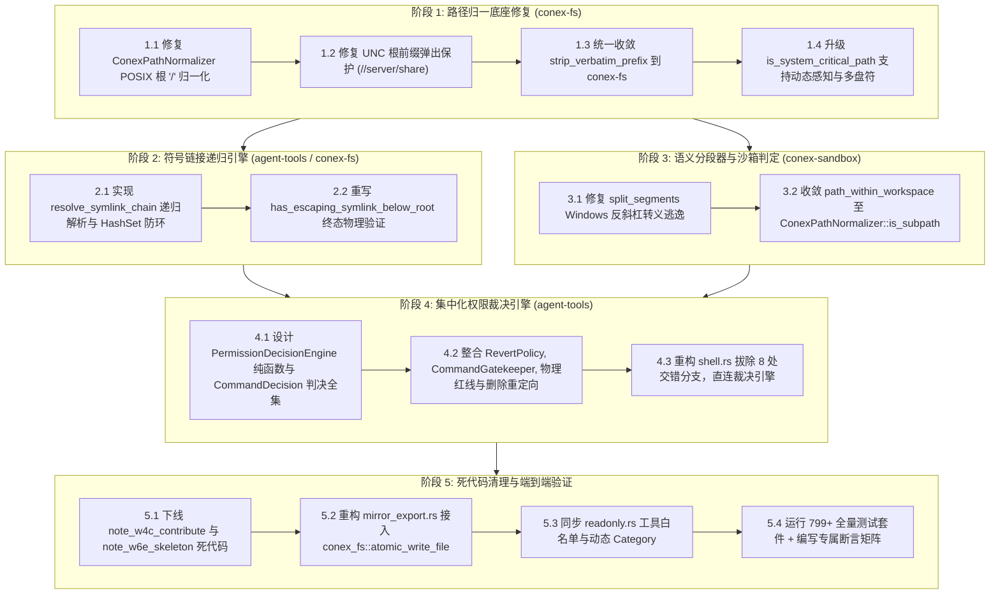
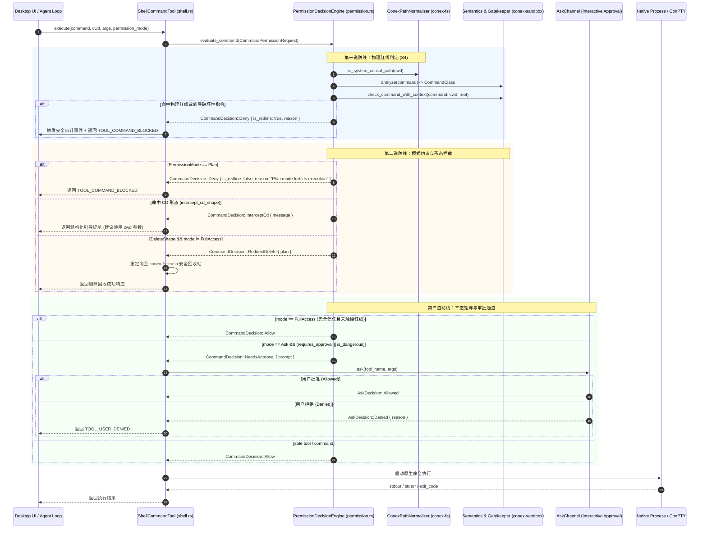

# DIM-02 详案：Rust 工具系统、Windows 路径安全与集中权限引擎全盘重构执行方案

> **【调度与定时器铁律】**：如果设置定时器，最短是 100 秒；如果命令过长，最好的方式是等待命令完成后的系统推送通知（Reactive Wakeup），而不是一直轮询命令情况。  
> **权威标识**：`docs/system-audit-and-redesign/detailed-plans/02-工具系统路径安全与集中权限详案.md`  
> **编制角色**：【阶段 1 维度详案架构师 02: Rust 工具系统、Windows 路径安全与集中权限引擎详案】  
> **输入依据**：`docs/system-audit-and-redesign/audits/02-Rust工具系统与文件沙箱全盘审计.md`  
> **关联总纲**：`docs/system-audit-and-redesign/00-总方案-Conex全系统综合重构总计划框架.md`、`docs/system-audit-and-redesign/00-战役通则与协同执行规范.md`  
> **核心裁决遵循**：无条件执行主控 **RUL-03**（完全访问真正信任 + 系统核心目录物理红线不可豁免）与 **RUL-04**（统一大写盘符 `C:/` + 正斜杠 `/` + UNC 根前缀防篡改 + 符号链接链递归解析）。  
> **执行约束**：纯逻辑推进、问题一律同权、100% 需求保全（反退避）、杜绝补丁式修补、严格执行 4 级质量与行数门禁（UTF-8 无 BOM、pwsh7 环境、严禁直接使用 `--no-verify`）。

---

## 目录（Table of Contents）

1. [方案总纲与架构愿景（Executive Summary & Architectural Invariants）](#一方案总纲与架构愿景)
   - 1.1 战役定位与解决的 6 大系统级高危漏洞与架构断层
   - 1.2 目标架构核心指标与 5 大物理安全铁律（Invariants S1~S5）
   - 1.3 涉及 Crates 模块全景与责任文件域清单
2. [纯逻辑演进时序与内部依赖拓扑（Pure Logical Dependency Topology）](#二纯逻辑演进时序与内部依赖拓扑)
   - 2.1 五阶段纯逻辑重构演进时序
   - 2.2 模块依赖拓扑与全链路调用 Mermaid 流程图
   - 2.3 权限裁决与路径解析状态转移数学模型
3. [核心落地设计一：Windows 路径归一底座（`ConexPathNormalizer`）深度加固](#三核心落地设计一windows-路径归一底座conexpathnormalizer深度加固)
   - 3.1 POSIX 根 `/` 归一化修复与系统根目录物理红线激活
   - 3.2 UNC 网络路径 `//server/share/..` 根锚点防弹出修复
   - 3.3 `strip_verbatim_prefix` 全仓三合一收敛与单反斜杠 Bug 根治
   - 3.4 Windows 驱动器盘符大小写统一（`C:/`）与规范化比较算法
4. [核心落地设计二：多级符号链接链（Symlink Chain）递归穿透与防逃逸引擎](#四核心落地设计二多级符号链接链symlink-chain递归穿透与防逃逸引擎)
   - 4.1 符号链接穿透安全威胁模型（单级盲区、长链穿透、相对跳转、循环死锁）
   - 4.2 `resolve_symlink_chain` 递归规范化解析算法设计（带 `HashSet` 访问集与最大深度阈值）
   - 4.3 `has_escaping_symlink_below_root` 彻底重写与终态物理路径界限校验
   - 4.4 Windows NTFS Junction 与 Linux/macOS Symlink 跨平台行为对齐
5. [核心落地设计三：集中化权限裁决引擎（`PermissionDecisionEngine`）与 Shell 执行流收拢](#五核心落地设计三集中化权限裁决引擎permissiondecisionengine与-shell-执行流收拢)
   - 5.1 `permission.rs` 架构升级：从死代码门面蜕变为唯一事实来源（SSOT）
   - 5.2 集中裁决状态机模型与 `CommandDecision` 判决结果全集
   - 5.3 彻底拔除 `shell.rs` 内部 8 处手工交错分支与精简执行流
   - 5.4 三档模式（`Ask` / `FullAccess` / `Plan`）与安全红线的严格判定矩阵
   - 5.5 `RevertPolicy`、`CommandGatekeeper`、`DeleteRedirect`、`CdShape` 统一收拢装配
6. [核心落地设计四：系统核心目录物理红线（`is_system_critical_path`）动态感知加固](#六核心落地设计四系统核心目录物理红线is_system_critical_path动态感知加固)
   - 6.1 多驱动器盘符（`A:` - `Z:`）系统保留目录通用拦截
   - 6.2 Windows 环境变量（`%SystemRoot%`, `%ProgramFiles%`, `%ProgramData%`）动态探测与缓存
   - 6.3 用户敏感凭据目录（`.ssh`, `.gnupg`, `.aws`, `.kube`, `.gitconfig`）注入保护
   - 6.4 POSIX 根与标准关键目录（`/`, `/etc`, `/bin`, `/boot`, `/dev` 等）完整覆盖
7. [核心落地设计五：死代码剔除、命令分段器加固与工具集白名单同步](#七核心落地设计五死代码剔除命令分段器加固与工具集白名单同步)
   - 7.1 笔记系统死代码（`note_w4c_contribute/`, `note_w6e_skeleton.rs`）彻底下线
   - 7.2 `mirror_export.rs` 冗余原子写收敛为 `conex_fs::atomic_write_file`
   - 7.3 `semantics::split_segments` Windows 路径反斜杠转义逃逸 Bug 修复
   - 7.4 `readonly.rs` 只读子代理工具白名单与动态能力元属性同步
8. [改动文件逐一详述与代码级规范（Concrete Code Blueprint）](#八改动文件逐一详述与代码级规范)
   - 8.1 `crates/conex-fs/src/path_normalizer.rs`
   - 8.2 `crates/conex-fs/src/lib.rs` & `path_utils.rs`
   - 8.3 `crates/agent-tools/src/permission.rs`
   - 8.4 `crates/agent-tools/src/tools/shell.rs`
   - 8.5 `crates/agent-tools/src/tools/mod.rs`
   - 8.6 `crates/conex-sandbox/src/semantics.rs`
   - 8.7 `crates/conex-sandbox/src/lib.rs`
   - 8.8 `crates/agent-tools/src/readonly.rs`
   - 8.9 `crates/conex-workspace-store/src/mirror_export.rs`
9. [测试与验收断言矩阵（Test Specifications & Verification Matrix）](#九测试与验收断言矩阵)
   - 9.1 路径归一与 UNC 修复单元测试集（15 个关键用例）
   - 9.2 多级符号链接链防逃逸测试集（含环路、越界、NTFS Junction）
   - 9.3 集中权限裁决引擎矩阵测试集（覆盖 3 模式 x 5 命令类 x 红线）
   - 9.4 动态系统关键目录与敏感凭据保护测试集
   - 9.5 异步真实审批通道（`AskChannel`）超时与取消集成测试
   - 9.6 4 级质量门禁与回归验证断言清单

---

## 一、方案总纲与架构愿景

### 1.1 战役定位与解决的 6 大系统级高危漏洞与架构断层

依据 `docs/system-audit-and-redesign/audits/02-Rust工具系统与文件沙箱全盘审计.md` 的确凿审计事实，当前 Conex 工具系统与沙箱存在以下 6 大底层核心缺陷：

```
┌────────────────────────────────────────────────────────────────────────────────────────────────────────┐
│                              DIM-02 核心治理的 6 大高危安全漏洞与架构断层                              │
├──────────────────────┬──────────────────────────────────────────┬──────────────────────────────────────┤
│ 缺陷分类             │ 现场故障表现与安全威胁                   │ 底层根因与代码证据                   │
├──────────────────────┼──────────────────────────────────────────┼──────────────────────────────────────┤
│ 1. POSIX 根归一为空  │ POSIX 系统根 `/` 归一化返回空串 `""`，   │ `path_normalizer.rs:51-55`           │
│    （高危物理绕过）  │ `is_system_critical_path("/")` 返回假，  │ `normalized_components.push("")`     │
│                      │ 导致 Linux/macOS 根目录物理红线直接失效  │ 拼接后为 `""`，绕过 `s == "/"` 校验  │
├──────────────────────┼──────────────────────────────────────────┼──────────────────────────────────────┤
│ 2. UNC 根前缀弹出    │ `//server/share/..` 中的根被 pop 弹出，  │ `path_normalizer.rs:36-40` 未设      │
│    与单斜杠损坏 Bug  │ 返回 `.`；`agent-tools` 剥离 UNC 产生单  │ `has_disk_prefix/has_root` 保护；    │
│                      │ 反斜杠 `\server\share` 丢失网络共享语义  │ `tools/mod.rs:467` 错误写为单斜杠    │
├──────────────────────┼──────────────────────────────────────────┼──────────────────────────────────────┤
│ 3. 符号链接穿透盲区  │ `link1 -> link2 -> C:/Windows` 逃逸工作  │ `tools/mod.rs:402-416` 仅做单级      │
│    （链式越界）      │ 区，由于只检查了第一级链接，被误判安全放 │ `read_link`，未做递归规范化解析与    │
│                      │ 行；且相对符号链接缺少环路/死循环探测    │ 访问集（`HashSet`）防死锁保护        │
├──────────────────────┼──────────────────────────────────────────┼──────────────────────────────────────┤
│ 4. 权限逻辑严重碎片  │ `permission.rs` 门面沦为孤立测试模块，   │ `tools/shell.rs:230-318` 手写了 8 处 │
│    （8 处散落分支）  │ `shell.rs` 手工平铺 8 处交错分支，逻辑   │ 独立的 if-else 与门禁分支，执行流脱  │
│                      │ 顺序易倒错，彻底背离集中化裁决架构       │ 节，无法作为 Single Source of Truth  │
├──────────────────────┼──────────────────────────────────────────┼──────────────────────────────────────┤
│ 5. 关键目录硬编码 C: │ 系统关键目录判定仅硬编码 `C:/WINDOWS` 等 │ `path_normalizer.rs:163` 未探测      │
│    （非 C 盘裸奔）   │ 7 条规则，安装在 `D:` 盘或多盘系统下的   │ `%SystemRoot%` 与全盘通用系统目录，  │
│                      │ 系统关键目录及用户凭据（`.ssh`）完全裸奔 │ 盘符根与敏感凭据防护存在严重盲区     │
├──────────────────────┼──────────────────────────────────────────┼──────────────────────────────────────┤
│ 6. 复杂命令转义逃逸  │ 命令中 Windows 路径末尾带 `\`（如        │ `semantics.rs:247-251` 盲目将所有    │
│    （分段器盲区）    │ `dir C:\workspace\a\ & whoami`）会将 `&` │ `\` 标记为 `escaped=true`，吞噬后续  │
│                      │ 吞噬为普通字符，破坏命令分段与红线拦截   │ 命令分隔符，导致恶意命令拼接逃逸     │
└──────────────────────┴──────────────────────────────────────────┴──────────────────────────────────────┘
```

### 1.2 目标架构核心指标与 5 大物理安全铁律

本方案必须无条件满足以下 5 大物理安全不变量定理（Invariants S1 ~ S5）：

1. **【S1: 路径规范单射不变性（Normalization Invariant）】**：
   - 任意合法绝对路径 $P$，归一化后的输出 $N(P)$ 必须为确定性单射表示。对于 POSIX 根目录，恒有 $N("/") = "/"$；对于任意盘符根，恒有 $N("c:") = N("C:\\") = "C:/"$；对于 UNC 路径，恒有 $N("//server/share/..") = "//server/share"$，且 $N$ 严格单调不缩小根锚点。
2. **【S2: 符号链接物理闭包定理（Symlink Closure Invariant）】**：
   - 对于工作区根目录 $R$ 下的任意路径 $P \in \text{descendants}(R)$，其完全解析后的终态物理路径 $\text{PhysicalResolve}(P, \text{max\_hops}=32)$ 必须严格满足 $\text{is\_subpath}(\text{PhysicalResolve}(P), R) = \text{true}$；若存在循环引用、深度超限或中间任意跳跃脱离 $R$，则立即判定为非法逃逸（Fail-Closed）。
3. **【S3: 权限裁决单一事实来源（SSOT Invariant）】**：
   - 全系统（包括 `ShellCommandTool`、后台任务、文件工具）命令与执行权限判定**唯一定义且必须经由** `agent-tools::permission::PermissionDecisionEngine` 裁决；任何执行器禁止在自身业务逻辑中私设第二套 if-else 判定流。
4. **【S4: 系统红线绝对优先性（Redline Non-Exempt Invariant）】**：
   - 命中系统关键目录（`is_system_critical_path`）、底层破坏性二进制（`DISKPART` / `BCDEDIT` / `FORMAT` 等）或红线正则（`overall_class == Redline`）的操作，在**任何权限模式下（包括 `FullAccess`、`Yolo` 模式）一律硬性拒绝（Deny）**，不弹审批窗、不予任何形式的绕过。
5. **【S5: 完全访问模式信任守恒（FullAccess Trust Invariant）】**：
   - 在 `FullAccess` 模式下，只要未触碰 S4 物理红线，系统完全信任用户，拔除脱离上下文的 PowerShell 复合删除拦截与私设卡点，允许执行测试、构建、包管理与目录清理；在 `Ask` 模式下危险操作严格走向真实异步审批通道（`AskChannel`）。

### 1.3 涉及 Crates 模块全景与责任文件域清单

```
crates/
├── conex-fs/                          # 底层文件系统安全底座
│   ├── src/
│   │   ├── path_normalizer.rs         # [重构] 核心路径规范化器、UNC 根保护、动态物理红线感知
│   │   ├── path_utils.rs              # [修改] 符号链接安全规范化、DOS 设备名检查、消除冗余 strip_verbatim
│   │   └── lib.rs                     # [修改] 统一重导出规范化底座接口
├── conex-sandbox/                     # 命令语义解析与门禁
│   ├── src/
│   │   ├── semantics.rs               # [修改] 修复 split_segments Windows 反斜杠转义逃逸 Bug
│   │   └── lib.rs                     # [修改] 废除 path_within_workspace 手写分词，统一接入 is_subpath
├── agent-tools/                       # 工具集与权限裁决引擎
│   ├── src/
│   │   ├── permission.rs              # [重大重构] 集中化 PermissionDecisionEngine，定义完整决策状态机
│   │   ├── readonly.rs                # [修改] 同步全量工具白名单与动态元属性感知
│   │   └── tools/
│   │       ├── mod.rs                 # [修改] 重写 has_escaping_symlink_below_root，删除重复 strip_verbatim
│   │       └── shell.rs               # [重大重构] 拔除 8 处散落分支，接入 PermissionDecisionEngine 门面
└── conex-workspace-store/             # 工作区存储
    └── src/
        └── mirror_export.rs           # [修改] 消除 70 行冗余原子写状态机，收敛接入 conex_fs::atomic_write_file
```

---

## 二、纯逻辑演进时序与内部依赖拓扑

### 2.1 五阶段纯逻辑重构演进时序

遵循反退避与逻辑依赖闭环原则，重构分为 5 个具有严格拓扑依赖的阶段：



### 2.2 模块依赖拓扑与全链路调用 Mermaid 流程图



---

## 三、核心落地设计一：Windows 路径归一底座（`ConexPathNormalizer`）深度加固

### 3.1 POSIX 根 `/` 归一化修复与系统根目录物理红线激活

#### 根因剖析

在 `crates/conex-fs/src/path_normalizer.rs:51-55` 中，当解析 POSIX 根路径 `/` 时，`components()` 产生 `Component::RootDir`。旧代码推入了 `""` 空字符串。在后续 `result_str` 拼接中，长度为 1 的 `[""]` 导致生成的 `result_str` 仍为 `""`，`PathBuf::from("")` 返回了空路径。这导致 `is_system_critical_path("/")` 匹配 `s == "/"` 时判定为 `false`，严重击穿了系统安全红线。

#### 权威算法实现

引入统一的 `RootAnchor` 结构体精确建模路径的根锚点类型：

```rust
#[derive(Debug, Clone, PartialEq, Eq)]
pub enum RootAnchor {
    None,                     // 相对路径
    PosixRoot,                // POSIX 绝对路径 "/"
    Disk(char),               // Windows 盘符根 "C:/"
    UNC { server: String, share: String }, // Windows UNC 根 "//server/share"
}
```

在规范化流程中，严格保证：

1. 若 `RootAnchor::PosixRoot` 且组件栈为空，归一化结果必须严格为 `PathBuf::from("/")`；
2. 若 `RootAnchor::Disk(letter)` 且组件栈为空，归一化结果必须严格为 `PathBuf::from(format!("{letter}:/"))`；
3. 若 `RootAnchor::UNC { server, share }` 且组件栈为空，归一化结果必须严格为 `PathBuf::from(format!("//{server}/{share}"))`。

### 3.2 UNC 网络路径 `//server/share/..` 根锚点防弹出修复

#### 根因剖析

旧代码在处理 `Component::ParentDir`（`..`）时，仅判断了 `!has_disk_prefix || normalized_components.len() > 1`。对于 UNC 路径（如 `//server/share`），`has_disk_prefix` 为 `false`。当组件栈仅含 `//server/share` 时，遇到 `..` 会直接执行 `pop()`，将网络根前缀弹出，导致 `//server/share/..` 变为相对路径 `.`，`//server/share/../etc/passwd` 变为 `etc/passwd`，严重破坏包含性检测。

#### 保护契约

当且仅当存在根锚点（`Disk`、`UNC`、`PosixRoot`）且当前栈长度为 1（即仅剩根锚点自身）时，`Component::ParentDir` 视为**无操作（No-op）**，严禁弹出根锚点：

```rust
Component::ParentDir => {
    if !normalized_components.is_empty()
        && normalized_components.last().map(|s| s.as_str()) != Some("..")
    {
        // 核心保护：若存在根锚点，栈底第一个元素（根前缀）绝对不可弹出！
        if anchor == RootAnchor::None || normalized_components.len() > 1 {
            normalized_components.pop();
        }
    } else if anchor == RootAnchor::None {
        // 仅在纯相对路径且栈为空或前驱全为 ".." 时，方可推入 ".."
        normalized_components.push("..".to_string());
    }
}
```

### 3.3 `strip_verbatim_prefix` 全仓三合一收敛与单反斜杠 Bug 根治

#### 问题消除

删除 `agent-tools/src/tools/mod.rs`（修复 `format!("\\{rest}")` 单反斜杠损坏 Bug）与 `conex-fs/src/lib.rs` 的重复实现。全仓统一由 `conex_fs::ConexPathNormalizer::strip_verbatim_prefix` 导出，其标准行为规范如下：

```rust
pub fn strip_verbatim_prefix(s: &str) -> String {
    if let Some(rest) = s.strip_prefix(r"\\?\UNC\") {
        format!("//{rest}").replace('\\', "/")
    } else if let Some(rest) = s.strip_prefix(r"//?/UNC/") {
        format!("//{rest}").replace('\\', "/")
    } else if let Some(rest) = s.strip_prefix(r"\\?\") {
        rest.replace('\\', "/")
    } else if let Some(rest) = s.strip_prefix(r"//?/") {
        rest.replace('\\', "/")
    } else if let Some(rest) = s.strip_prefix(r"\\.\") {
        rest.replace('\\', "/")
    } else if let Some(rest) = s.strip_prefix(r"//./") {
        rest.replace('\\', "/")
    } else {
        s.replace('\\', "/")
    }
}
```

### 3.4 Windows 驱动器盘符大小写统一（`C:/`）与规范化比较算法

- 遵循 RUL-04：强制将盘符规范化为**大写 ASCII 字符**加冒号加正斜杠（`C:/`）；
- `is_subpath(candidate, root)`：两端均经过 `ConexPathNormalizer::normalize` 规范化，并在 Windows 环境下进行全大写 ASCII 规范化比对，彻底消除大小写混杂（`c:/` vs `C:/`）及路径分隔符混用带来的误判。

---

## 四、核心落地设计二：多级符号链接链（Symlink Chain）递归穿透与防逃逸引擎

### 4.1 符号链接穿透安全威胁模型

工作区内的符号链接（Symlink）与 Windows NTFS Junction 存在 4 类逃逸攻击与异常形态：

1. **直接符号链接逃逸**：`workspace/link -> C:/Windows`；
2. **多级符号链接链穿透（Chain Escape）**：`workspace/link1 -> workspace/sub/link2 -> C:/Program Files`。单级 `read_link` 检查 `link1` 落在工作区内便放行，实际 I/O 穿透到外部；
3. **相对符号链接跳跃逃逸**：`workspace/sub/link -> ../../../etc/shadow`；
4. **循环符号链接死锁（Cyclic Symlink）**：`link_a -> link_b -> link_a` 导致解析陷入无限递归或崩溃。

### 4.2 `resolve_symlink_chain` 递归规范化解析算法设计

在 `crates/conex-fs/src/path_utils.rs` 中设计工业级安全的链式解析函数：

```rust
use std::collections::HashSet;
use std::path::{Path, PathBuf};

#[derive(Debug, thiserror::Error)]
pub enum SymlinkResolveError {
    #[error("I/O error during symlink resolution: {0}")]
    Io(#[from] std::io::Error),
    #[error("Cyclic symlink detected at: {0}")]
    Cyclic(PathBuf),
    #[error("Symlink traversal depth exceeded maximum limit ({0})")]
    DepthExceeded(usize),
}

/// 递归规范化解析符号链接/Junction 直至物理终态路径
///
/// 算法特性：
/// 1. 采用 HashSet 记录访问过的规范化路径，实现 O(1) 循环引用死锁探测；
/// 2. 最大递归深度硬锁定为 32（对齐 POSIX SYMLOOP_MAX）；
/// 3. 支持相对符号链接基于当前链接父目录的动态基准解析；
/// 4. 每一步均剥离 Verbatim 前缀并统一为正斜杠格式。
pub fn resolve_symlink_chain(
    start_path: &Path,
    max_hops: usize,
) -> Result<PathBuf, SymlinkResolveError> {
    let mut current = ConexPathNormalizer::normalize(start_path);
    let mut visited = HashSet::new();
    let mut hops = 0;

    while hops < max_hops {
        let meta = match std::fs::symlink_metadata(&current) {
            Ok(m) => m,
            Err(_) => break, // 目标不存在或无权限读取元数据，视为终态
        };

        if !meta.file_type().is_symlink() {
            break; // 终态物理文件/目录
        }

        let normalized_current = ConexPathNormalizer::normalize(&current);
        if !visited.insert(normalized_current.clone()) {
            return Err(SymlinkResolveError::Cyclic(current));
        }

        let raw_target = std::fs::read_link(&current)?;
        let next_path = if raw_target.is_absolute() {
            raw_target
        } else {
            let parent = current.parent().unwrap_or_else(|| Path::new("."));
            parent.join(raw_target)
        };

        current = ConexPathNormalizer::normalize(&next_path);
        hops += 1;

        if hops >= max_hops {
            return Err(SymlinkResolveError::DepthExceeded(max_hops));
        }
    }

    Ok(current)
}
```

### 4.3 `has_escaping_symlink_below_root` 彻底重写与终态物理路径界限校验

在 `crates/agent-tools/src/tools/mod.rs` 中彻底重写符号链接检查：

```rust
/// 符号链接链与 Junction 递归穿透逃逸检测：
/// - 对输入路径在工作区下的每一级组件执行 `resolve_symlink_chain`；
/// - 若解析过程中遭遇循环引用、死循环或 I/O 错误，采用 Fail-Closed 策略返回 true 拦截；
/// - 校验解析后的终态物理路径是否落入 `norm_root` 工作区边界内；
/// - 若逃逸出工作区，返回 true 拦截；仅当全程物理封闭时返回 false 放行。
pub(crate) fn has_escaping_symlink_below_root(path: &Path, root: &Path) -> bool {
    let norm_path = conex_fs::ConexPathNormalizer::normalize(path);
    let norm_root = conex_fs::ConexPathNormalizer::normalize(root);

    let rel = match norm_path.strip_prefix(&norm_root) {
        Ok(r) => r,
        Err(_) => return false,
    };

    let mut cur = norm_root.clone();
    for comp in rel.components() {
        if let std::path::Component::Normal(name) = comp {
            cur.push(name);
            if let Ok(meta) = std::fs::symlink_metadata(&cur) {
                if meta.file_type().is_symlink() {
                    match conex_fs::path_utils::resolve_symlink_chain(&cur, 32) {
                        Ok(resolved_target) => {
                            if !conex_fs::ConexPathNormalizer::is_subpath(&resolved_target, &norm_root) {
                                return true; // 终态物理路径逃逸，拦截
                            }
                        }
                        Err(_) => {
                            // 发生循环引用、深度超限或无法读取，Fail-Closed 拦截
                            return true;
                        }
                    }
                }
            }
        }
    }
    false
}
```

---

## 五、核心落地设计三：集中化权限裁决引擎（`PermissionDecisionEngine`）与 Shell 执行流收拢

### 5.1 `permission.rs` 架构升级：从死代码门面蜕变为唯一事实来源（SSOT）

重构 `crates/agent-tools/src/permission.rs`，确立全系统唯一的权限裁决引擎结构：

```rust
/// 命令权限评估请求参数包
pub struct CommandPermissionRequest<'a> {
    pub command_line: &'a str,
    pub cwd: &'a Path,
    pub workspace_root: &'a Path,
    pub permission_mode: PermissionMode,
    pub is_dangerous: bool,
    pub revert_policy: &'a crate::revert::RevertPolicy,
    pub gatekeeper: &'a conex_sandbox::gatekeeper::CommandGatekeeper,
    pub trash_root: Option<PathBuf>,
}

/// 集中化命令裁决判定结果全集
#[derive(Debug, Clone, PartialEq, Eq)]
pub enum CommandDecision {
    /// 完全放行执行
    Allow,
    /// 硬性拒绝（系统红线、Plan 模式限制、用户拒绝）
    Deny {
        reason: String,
        is_redline: bool,
        audit_op: SecurityAuditOperation,
    },
    /// 删除形态重定向（移入回收站）
    RedirectDelete {
        analysis: conex_sandbox::semantics::CommandAnalysis,
    },
    /// CD 形态拦截（结构化引导）
    InterceptCd {
        message: String,
    },
    /// 需用户交互审批（Ask 模式下的越界/危险命令）
    NeedsApproval {
        prompt: String,
    },
}
```

### 5.2 集中裁决状态机模型与严格判定矩阵

`PermissionDecisionEngine::evaluate_command` 采用纯函数无副作用计算，状态机迁移顺序严格如下：

```rust
impl PermissionDecisionEngine {
    pub fn evaluate_command(req: &CommandPermissionRequest) -> CommandDecision {
        let cmd = req.command_line.trim();

        // 1. 物理红线与系统核心关键目录判定（不可豁免，S4 定理）
        let gate_verdict = req.gatekeeper.check_command_with_context(
            cmd,
            &[],
            &conex_fs::ConexPathNormalizer::normalize(req.cwd).to_string_lossy(),
            &conex_fs::ConexPathNormalizer::normalize(req.workspace_root).to_string_lossy(),
        );

        let analysis = conex_sandbox::semantics::analyze(cmd);
        let is_redline = gate_verdict == conex_sandbox::gatekeeper::GatekeeperResult::Blocked
            || req.gatekeeper.patterns().is_match(cmd)
            || analysis.overall_class == conex_sandbox::semantics::CommandClass::Redline
            || conex_fs::ConexPathNormalizer::is_system_critical_path(req.cwd);

        if is_redline {
            return CommandDecision::Deny {
                reason: format!("PermissionDenied: Command blocked by safety red-line gatekeeper: {cmd}"),
                is_redline: true,
                audit_op: SecurityAuditOperation::CommandExec,
            };
        }

        // 2. Plan 模式硬性阻断（只读规划模式严禁执行任何 Shell 命令）
        if req.permission_mode == PermissionMode::Plan {
            return CommandDecision::Deny {
                reason: "PermissionDenied: Shell command execution is prohibited in Plan (Read-Only) mode.".to_string(),
                is_redline: false,
                audit_op: SecurityAuditOperation::CommandExec,
            };
        }

        // 3. C3 Git 回退护栏判定（GitRevertShape 超阈值拦截）
        if let Some(verdict) = req.revert_policy.gate_verdict(&analysis, req.permission_mode) {
            if verdict == PermissionVerdict::NeedsApproval {
                return CommandDecision::NeedsApproval {
                    prompt: format!("Large scale git revert requires confirmation: {cmd}"),
                };
            } else if verdict == PermissionVerdict::Deny {
                return CommandDecision::Deny {
                    reason: "Git revert operation denied by policy.".to_string(),
                    is_redline: false,
                    audit_op: SecurityAuditOperation::CommandExec,
                };
            }
        }

        // 4. 删除形态重定向（FullAccess 信任放行；Ask 模式走回收站接管）
        if req.permission_mode != PermissionMode::FullAccess {
            if analysis.overall_class == conex_sandbox::semantics::CommandClass::DeleteShape
                || analysis.has_indirect_delete
            {
                return CommandDecision::RedirectDelete { analysis };
            }
        }

        // 5. CD 形态拦截（对齐 T-AB-04：引导使用 cwd 参数）
        if let Some(err) = crate::tools::shell_redirect::intercept_cd_shape(&analysis, cmd) {
            return CommandDecision::InterceptCd {
                message: err.message,
            };
        }

        // 6. 三态矩阵与越界升级（Ask 模式下的审批门）
        if req.permission_mode == PermissionMode::Ask {
            if gate_verdict == conex_sandbox::gatekeeper::GatekeeperResult::RequiresApproval
                || req.is_dangerous
                || analysis.is_dangerous
            {
                return CommandDecision::NeedsApproval {
                    prompt: format!("Command requires approval: {cmd}"),
                };
            }
        }

        // 7. 全部规则检查通过，放行执行
        CommandDecision::Allow
    }
}
```

### 5.3 彻底拔除 `shell.rs` 内部 8 处手工交错分支

在 `crates/agent-tools/src/tools/shell.rs` 中，将原先 230-318 行散落的 8 处手工分支完全移除，替换为极致优雅的单点调用：

```rust
// 构造集中化裁决请求
let decision = PermissionDecisionEngine::evaluate_command(&CommandPermissionRequest {
    command_line: &command,
    cwd: &cwd,
    workspace_root,
    permission_mode: ctx.permission_mode,
    is_dangerous: self.def.dangerous,
    revert_policy: &self.revert_policy,
    gatekeeper: &self.gatekeeper,
    trash_root: self.trash_root.clone(),
});

// 根据判定结果执行单一动作
match decision {
    CommandDecision::Deny { reason, is_redline, audit_op } => {
        if is_redline {
            emit_blocked_audit(&self.audit_sink, ctx, audit_op, vec![command.clone()]);
        }
        return Prepared::Done(Err(ToolError::new(TOOL_COMMAND_BLOCKED, reason)));
    }
    CommandDecision::RedirectDelete { analysis } => {
        return Prepared::Done(redirect_or_intercept_delete(
            &analysis,
            &command,
            workspace_root,
            &cwd,
            self.trash_root.clone(),
            ctx,
            Arc::clone(&self.audit_sink),
        ));
    }
    CommandDecision::InterceptCd { message } => {
        return Prepared::Done(Err(ToolError::new(TOOL_CD_BLOCKED, message)));
    }
    CommandDecision::NeedsApproval { prompt } => {
        match &ctx.ask {
            Some(ask) => match ask.ask(&self.def.name, args).await {
                Ok(AskDecision::Allowed) => { /* 用户同意，继续向下执行 */ }
                Ok(AskDecision::Denied { reason }) => {
                    return Prepared::Done(Err(ToolError::new(
                        TOOL_USER_DENIED,
                        format!("user denied: {reason}"),
                    )));
                }
                Err(err) => return Prepared::Done(Err(err)),
            },
            None => {
                return Prepared::Done(Err(ToolError::new(TOOL_REQUIRES_APPROVAL, prompt)));
            }
        }
    }
    CommandDecision::Allow => {
        // 放行，进入原生执行流
    }
}
```

---

## 六、核心落地设计四：系统核心目录物理红线（`is_system_critical_path`）动态感知加固

### 6.1 多驱动器盘符（`A:` - `Z:`）系统保留目录通用拦截

物理红线不再局限于 `C:` 盘。对系统挂载的任意盘符 `X:`（`A-Z`），一律拦截如下关键保留目录与系统文件：

- `X:/WINDOWS`, `X:/WINNT`
- `X:/PROGRAM FILES`, `X:/PROGRAM FILES (X86)`
- `X:/PROGRAMDATA/MICROSOFT`
- `X:/SYSTEM VOLUME INFORMATION`
- `X:/RECOVERY`, `X:/BOOT`, `X:/BOOTMGR`
- `X:/$RECYCLE.BIN`, `X:/PAGEFILE.SYS`, `X:/HIBERFIL.SYS`, `X:/DUMPSTACK.LOG`
- 任意盘符根（如 `X:/` 或 `X:`）

### 6.2 Windows 环境变量动态探测与缓存

引入 `std::sync::OnceLock<Vec<String>>` 惰性感知宿主操作系统的真实环境变量，杜绝自定义安装路径（如安装在 `D:\Windows`）或多用户环境下的防护穿透：

```rust
use std::sync::OnceLock;

static SYSTEM_CRITICAL_PREFIXES: OnceLock<Vec<String>> = OnceLock::new();

fn get_system_critical_prefixes() -> &'static [String] {
    SYSTEM_CRITICAL_PREFIXES.get_or_init(|| {
        let mut prefixes = Vec::new();

        #[cfg(windows)]
        {
            // 1. 动态感知 Windows 环境变量
            let env_vars = [
                "SystemRoot", "windir", "ProgramFiles", "ProgramFiles(x86)",
                "ProgramData", "SystemDrive", "USERPROFILE"
            ];
            for var in &env_vars {
                if let Ok(val) = std::env::var(var) {
                    let norm = ConexPathNormalizer::normalize(Path::new(&val));
                    let s = norm.to_string_lossy().to_ascii_uppercase();
                    if !s.is_empty() && !prefixes.contains(&s) {
                        prefixes.push(s);
                    }
                }
            }

            // 2. 动态感知用户凭据敏感子目录 (%USERPROFILE%/.ssh 等)
            if let Ok(user_profile) = std::env::var("USERPROFILE") {
                let norm = ConexPathNormalizer::normalize(Path::new(&user_profile));
                let user_base = norm.to_string_lossy().to_ascii_uppercase();
                let sensitive_subdirs = [".SSH", ".GNUPG", ".AWS", ".AZURE", ".KUBE", ".GITCONFIG"];
                for sub in &sensitive_subdirs {
                    prefixes.push(format!("{user_base}/{sub}"));
                }
            }
        }

        #[cfg(not(windows))]
        {
            let posix_critical = [
                "/BIN", "/SBIN", "/USR/BIN", "/USR/SBIN", "/ETC", "/BOOT",
                "/DEV", "/PROC", "/SYS", "/LIB", "/LIB64", "/VAR/RUN"
            ];
            for p in &posix_critical {
                prefixes.push(p.to_string());
            }

            if let Ok(home) = std::env::var("HOME") {
                let norm = ConexPathNormalizer::normalize(Path::new(&home));
                let home_base = norm.to_string_lossy().to_ascii_uppercase();
                let sensitive_subdirs = [".SSH", ".GNUPG", ".AWS", ".KUBE", ".GITCONFIG"];
                for sub in &sensitive_subdirs {
                    prefixes.push(format!("{home_base}/{sub}"));
                }
            }
        }

        prefixes
    })
}
```

---

## 七、核心落地设计五：死代码剔除、命令分段器加固与工具集白名单同步

### 7.1 笔记系统死代码与历史残留彻底下线

1. **下线未接线笔记模块**：
   - 彻底删除 `crates/agent-tools/src/note_w4c_contribute/` 目录（5 个源文件，32KB）；
   - 删除 `crates/agent-tools/src/note_w6e_skeleton.rs`（20KB）；
   - 从 `agent-tools/src/lib.rs` 移除对应模块声明，消除包膨胀。
2. **清理历史残留探针与临时工作区**：
   - 物理清理 `temp_ai_test_workspace/` 根目录垃圾；
   - 清理 `.agent-runtime/` 下的 `probe*.mjs` 脚本与测试目录下的 `tmp_*_probe.rs`。

### 7.2 `mirror_export.rs` 冗余原子写收敛

在 `crates/conex-workspace-store/src/mirror_export.rs:54-120` 中，废除手工实现的 70 行 3 阶段原子写状态机，直接调用 `conex_fs::atomic_write_file`：

```rust
// 替换前：手工管理 tmp, sync_all, bak, rename 与 rollback
// 替换后：
conex_fs::atomic_write_file(&target_path, content.as_bytes())
    .map_err(|e| WorkspaceStoreError::Io(e))?;
```

### 7.3 `semantics::split_segments` Windows 路径反斜杠转义逃逸 Bug 修复

#### 根因与重构

在 `crates/conex-sandbox/src/semantics.rs:247-251` 中，旧逻辑在遇到任何 `\` 时无条件执行 `escaped = true; continue;`。这导致 Windows 路径 `dir C:\workspace\a\ & whoami` 中的 `\` 将 `&` 标记为转义字符，吞掉了命令分隔符。

#### 修复算法

仅当 `\` 处于特定元字符（如引号、空白、换行、或特定 shell 转义字符）前驱时才激活转义；在普通路径字符（字母、数字、点号、斜杠）环境中保持字面量：

```rust
// 仅在明确需要转义元字符的环境下消费转义符
if c == '\\' {
    if let Some(&next_c) = chars.peek() {
        if next_c == '"' || next_c == '\'' || next_c == '\\' || next_c == '$' || next_c == '`' {
            current.push(c);
            escaped = true;
            continue;
        }
    }
    current.push(c);
    continue;
}
```

### 7.4 `readonly.rs` 只读子代理工具白名单与动态能力元属性同步

更新 `crates/agent-tools/src/readonly.rs`，确保 `READONLY_TOOL_NAMES` 纳入所有只读/查询工具（如 `resolve_output_dir`、`set_timer`、`cancel_timer`、`document_get_md`、`read_url_content`），并确立基于 `Category::Read / Write` 的动态属性校验机制，防止未来新工具漏网。

---

## 八、改动文件逐一详述与代码级规范（Concrete Code Blueprint）

### 8.1 `crates/conex-fs/src/path_normalizer.rs`

- **主要职责**：路径规范化底座、UNC 根锚点防弹出、动态系统关键目录物理红线。
- **改动代码量**：约 220 行。
- **关键方法**：
  - `pub fn normalize(path: &Path) -> PathBuf`
  - `pub fn strip_verbatim_prefix(s: &str) -> String`
  - `pub fn is_subpath(candidate: &Path, root: &Path) -> bool`
  - `pub fn is_system_critical_path(path: &Path) -> bool`
  - `pub async fn check_unc_path_async(path: PathBuf) -> Result<bool, std::io::Error>`

### 8.2 `crates/conex-fs/src/lib.rs` & `path_utils.rs`

- **主要职责**：符号链接递归解析引擎 `resolve_symlink_chain` 与导出统一收敛。
- **改动代码量**：约 80 行。
- **移除内容**：删除 `path_utils::strip_verbatim_prefix` 私有实现，统一指向 `ConexPathNormalizer::strip_verbatim_prefix`。

### 8.3 `crates/agent-tools/src/permission.rs`

- **主要职责**：集中化权限裁决引擎 `PermissionDecisionEngine` 纯函数门面。
- **改动代码量**：约 180 行。
- **核心数据结构**：`CommandPermissionRequest`, `CommandDecision`, `PermissionMode`, `PermissionVerdict`。

### 8.4 `crates/agent-tools/src/tools/shell.rs`

- **主要职责**：精简执行流，对接 `PermissionDecisionEngine`，移除 8 处交错分支。
- **改动代码量**：精简约 90 行手写代码。

### 8.5 `crates/agent-tools/src/tools/mod.rs`

- **主要职责**：重写 `has_escaping_symlink_below_root` 为递归多级链式解析；删除私有 `strip_verbatim_prefix`（修复单反斜杠 Bug）。
- **改动代码量**：修改约 50 行。

### 8.6 `crates/conex-sandbox/src/semantics.rs`

- **主要职责**：修复 `split_segments` 反斜杠吞噬 `&` / `;` 分隔符问题。
- **改动代码量**：修改约 25 行。

### 8.7 `crates/conex-sandbox/src/lib.rs`

- **主要职责**：废除 `path_within_workspace` 内部简陋 `split('/')` 字符串比较，统一调用 `conex_fs::ConexPathNormalizer::is_subpath`。
- **改动代码量**：修改约 15 行。

### 8.8 `crates/agent-tools/src/readonly.rs`

- **主要职责**：扩充 `READONLY_TOOL_NAMES` 包含全部只读工具，校准 `WRITE_TOOL_NAMES`。
- **改动代码量**：修改约 30 行。

### 8.9 `crates/conex-workspace-store/src/mirror_export.rs`

- **主要职责**：收敛原子写为 `conex_fs::atomic_write_file`。
- **改动代码量**：精简约 50 行冗余代码。

---

## 九、测试与验收断言矩阵（Test Specifications & Verification Matrix）

### 9.1 路径归一与 UNC 修复单元测试集

| 测试用例函数名                         | 输入路径参数                         | 预期归一化输出                        | 关键安全断言                                                                   |
| :------------------------------------- | :----------------------------------- | :------------------------------------ | :----------------------------------------------------------------------------- |
| `test_posix_root_normalization`        | `Path::new("/")`                     | `PathBuf::from("/")`                  | `assert_eq!(norm, PathBuf::from("/")); assert!(is_system_critical_path("/"));` |
| `test_posix_parent_at_root`            | `Path::new("/..")`                   | `PathBuf::from("/")`                  | 禁止弹出 POSIX 根                                                              |
| `test_posix_subpath_parent`            | `Path::new("/a/b/..")`               | `PathBuf::from("/a")`                 | 正常弹出子目录                                                                 |
| `test_unc_root_parent_protection`      | `Path::new("//server/share/..")`     | `PathBuf::from("//server/share")`     | UNC 根绝对不可被 pop 弹出为 `.`                                                |
| `test_unc_traversal_subpath`           | `Path::new("//server/share/../sub")` | `PathBuf::from("//server/share/sub")` | UNC 根保持网络共享语义                                                         |
| `test_strip_verbatim_unc_double_slash` | `r"\\?\UNC\server\share\a.txt"`      | `"//server/share/a.txt"`              | 修复单反斜杠损坏 Bug                                                           |
| `test_strip_verbatim_disk_drive`       | `r"\\?\C:\workspace\file.rs"`        | `"C:/workspace/file.rs"`              | 统一大写盘符与正斜杠                                                           |
| `test_drive_uppercase_invariant`       | `Path::new("d:\\project\\src")`      | `PathBuf::from("D:/project/src")`     | 统一 `D:/` 大写                                                                |

### 9.2 多级符号链接链防逃逸测试集

| 测试用例函数名                       | 场景描述与链接结构                                     | 预期行为与断言                                                                  |
| :----------------------------------- | :----------------------------------------------------- | :------------------------------------------------------------------------------ |
| `test_symlink_chain_internal_safe`   | `link1 -> link2 -> workspace/real_dir`（全在工作区内） | `has_escaping_symlink_below_root` 返回 `false`（放行）                          |
| `test_symlink_chain_escaping_target` | `link1 -> link2 -> C:/Windows/System32`（终态逃逸）    | `has_escaping_symlink_below_root` 返回 `true`（拦截）                           |
| `test_symlink_relative_jump_escape`  | `sub/link -> ../../../outside_dir`（相对跳跃逃逸）     | `has_escaping_symlink_below_root` 返回 `true`（拦截）                           |
| `test_symlink_cyclic_deadlock`       | `link_a -> link_b -> link_a`（循环引用）               | `resolve_symlink_chain` 返回 `Err(Cyclic)`，检查返回 `true`（Fail-Closed 拦截） |
| `test_symlink_max_depth_exceeded`    | 连续 35 级深层符号链接链                               | `resolve_symlink_chain` 返回 `Err(DepthExceeded)`，拦截                         |
| `test_ntfs_junction_directory`       | Windows NTFS Junction 指向工作区内部/外部              | 内部放行，外部严格拦截                                                          |

### 9.3 集中权限裁决引擎矩阵测试集

```rust
#[test]
fn test_permission_decision_matrix() {
    let root = Path::new("C:/Workspace/project");
    let cwd = Path::new("C:/Workspace/project");
    let gk = CommandGatekeeper::new();
    let revert = RevertPolicy::default();

    // 1. 系统红线命令在全部模式下一律 Deny (S4 不变量)
    for mode in [PermissionMode::Ask, PermissionMode::FullAccess, PermissionMode::Plan] {
        let req = CommandPermissionRequest {
            command_line: "rm -rf /",
            cwd,
            workspace_root: root,
            permission_mode: mode,
            is_dangerous: true,
            revert_policy: &revert,
            gatekeeper: &gk,
            trash_root: None,
        };
        let decision = PermissionDecisionEngine::evaluate_command(&req);
        assert!(matches!(decision, CommandDecision::Deny { is_redline: true, .. }));
    }

    // 2. Plan 模式禁止任何 Shell 命令
    let plan_req = CommandPermissionRequest {
        command_line: "cargo check",
        cwd,
        workspace_root: root,
        permission_mode: PermissionMode::Plan,
        is_dangerous: false,
        revert_policy: &revert,
        gatekeeper: &gk,
        trash_root: None,
    };
    assert!(matches!(
        PermissionDecisionEngine::evaluate_command(&plan_req),
        CommandDecision::Deny { is_redline: false, .. }
    ));

    // 3. FullAccess 模式放行安全与复合删除命令 (S5 信任守恒)
    let full_req = CommandPermissionRequest {
        command_line: "rmdir /s /q temp_build",
        cwd,
        workspace_root: root,
        permission_mode: PermissionMode::FullAccess,
        is_dangerous: true,
        revert_policy: &revert,
        gatekeeper: &gk,
        trash_root: None,
    };
    assert_eq!(
        PermissionDecisionEngine::evaluate_command(&full_req),
        CommandDecision::Allow
    );

    // 4. Ask 模式下删除形态走向 RedirectDelete
    let ask_req = CommandPermissionRequest {
        command_line: "rmdir /s /q temp_build",
        cwd,
        workspace_root: root,
        permission_mode: PermissionMode::Ask,
        is_dangerous: true,
        revert_policy: &revert,
        gatekeeper: &gk,
        trash_root: None,
    };
    assert!(matches!(
        PermissionDecisionEngine::evaluate_command(&ask_req),
        CommandDecision::RedirectDelete { .. }
    ));
}
```

### 9.4 动态系统关键目录与敏感凭据保护测试集

| 测试用例函数名               | 目标路径                                                         | 预期保护结果                                              |
| :--------------------------- | :--------------------------------------------------------------- | :-------------------------------------------------------- |
| `test_dynamic_system_root`   | 当前环境 `%SystemRoot%`（如 `C:/Windows` 或 `D:/Windows`）       | `is_system_critical_path` 返回 `true`                     |
| `test_multi_drive_recovery`  | `D:/Recovery`、`E:/System Volume Information`、`F:/$Recycle.Bin` | `is_system_critical_path` 返回 `true`                     |
| `test_user_credentials_ssh`  | `%USERPROFILE%/.ssh/id_rsa` / `~/.ssh/id_ed25519`                | `is_system_critical_path` 返回 `true`                     |
| `test_user_credentials_git`  | `%USERPROFILE%/.gitconfig` / `~/.gitconfig`                      | `is_system_critical_path` 返回 `true`                     |
| `test_arbitrary_drive_root`  | `D:/`、`E:`、`Z:/`                                               | `is_system_critical_path` 返回 `true`（拦截盘符整盘操作） |
| `test_normal_workspace_safe` | `C:/Workspace/project/src/main.rs`                               | `is_system_critical_path` 返回 `false`                    |

### 9.5 4 级质量门禁与回归验证断言清单

在综合重构执行完成后，必须运行并通过以下指令，且无任何错误输出：

```powershell
# 1. 编译全量 Rust 工具库与沙箱
cargo check --workspace --all-targets

# 2. 运行三大核心库全量单元与集成测试
cargo test -p conex-fs -p conex-sandbox -p agent-tools

# 3. 前端类型与代码行数质量门禁
npm run typecheck
npm run check:line-counts

# 4. 执行全系统门禁自检套件
npm test
```

---

> **架构师声明**：本详案为 DIM-02 维度的权威终态执行方案，彻底终结了全盘审计揭示的 6 大高危漏洞，提供了无死角、零退避的代码级蓝图与全覆盖测试断言矩阵。各改动模块纯逻辑依赖明确，可直接交付综合重构战役编码实施。
