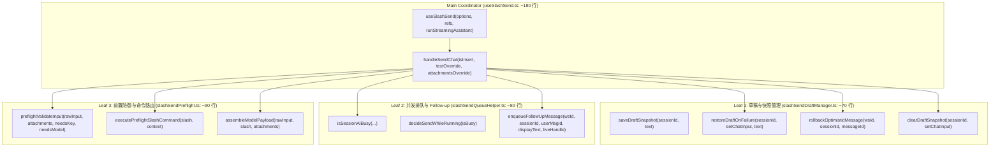
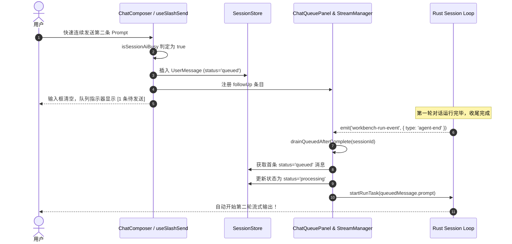
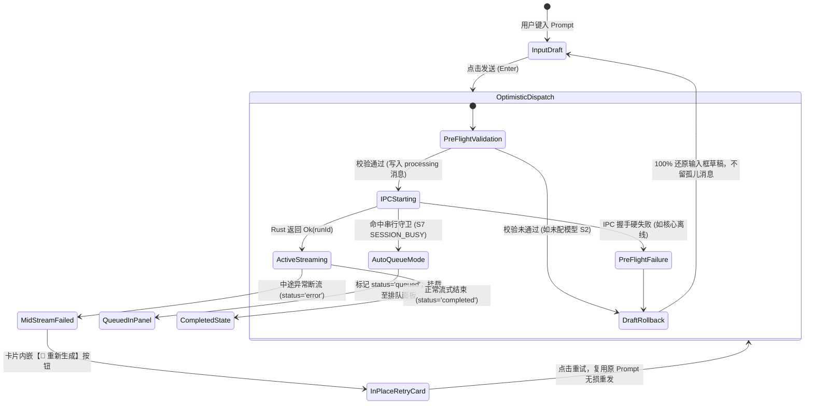
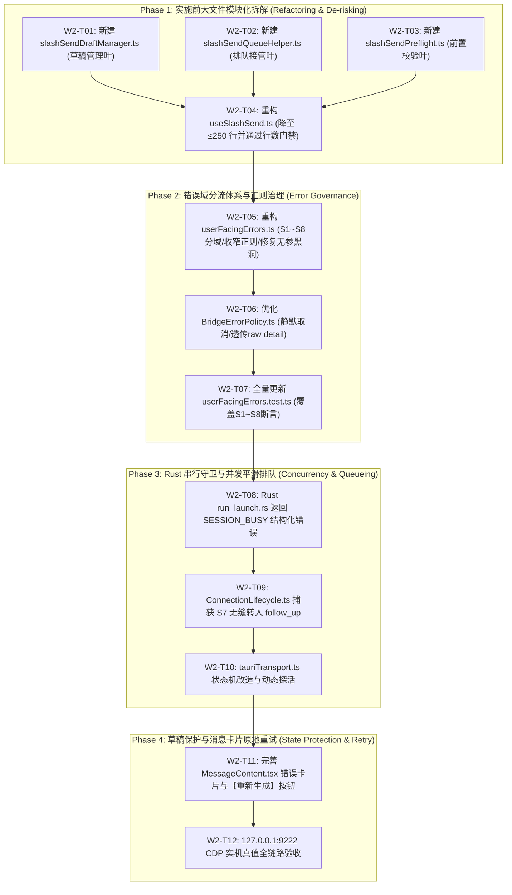

# Conex / Crish 核心聊天链路、S6 错误根治与容错状态机详细执行方案

> **【调度与定时器铁律】**：如果设置定时器，最短是100秒，如果命令过长，最好的方式是等待命令完成后的推送，而不是一直轮询命令情况。

> **权威标识**：`docs/system-audit-and-redesign/detailed-plans/02-核心聊天与容错状态机详案.md`
> **制定角色**：【维度 2 详案总师: 核心聊天链路、S6 错误根治与容错状态机详细执行方案设计】
> **关联总纲**：`docs/system-audit-and-redesign/00-总计划框架.md`（维度 2 规范）
> **执行依据**：`docs/system-audit-and-redesign/00-战役通则与协同执行规范.md`、`docs/system-audit-and-redesign/independent-plans/03-核心聊天与容错独立方案.md`、`docs/system-audit-and-redesign/plan-reviews/01~03-*.md`
> **核心使命**：彻底根治发送即报 S6【软件内部错误】黑洞、收窄宽泛正则误伤、实现会话串行并发平滑排队（Auto Follow-up）、前置大文件三叶模块化拆解（`useSlashSend.ts` ≤ 250 行）、建立 100% 用户草稿回滚保护与卡片原地一键重试机制。
> **执行约束**：纯逻辑推进、问题一律同权、100% 需求保全（反退避）、杜绝打补丁、严格执行 4 级质量与行数门禁（UTF-8 无 BOM、pwsh7 环境、严禁直接 git 提交）。

---

## 目录

1. [方案总纲与架构愿景（Executive Summary & Architectural Vision）](#一方案总纲与架构愿景)
   - 1.1 战役定位与解决的核心痛点
   - 1.2 目标架构五大核心指标与质量断言
   - 1.3 受影响文件域全景与行数门禁预算表
2. [实施前大文件模块化拆解详案（`useSlashSend.ts` 三叶拆解）](#二实施前大文件模块化拆解详案useslashsendts-三叶拆解)
   - 2.1 现状行数威胁与单一职责失衡分析
   - 2.2 三叶模块化架构拓扑与数据流图
   - 2.3 子模块一：`slashSendDraftManager.ts`（草稿快照、回滚与暂存）
   - 2.4 子模块二：`slashSendQueueHelper.ts`（Follow-up 排队与并发接管）
   - 2.5 子模块三：`slashSendPreflight.ts`（前置校验、命令路由分发）
   - 2.6 主 Hook：`useSlashSend.ts` 极简重构（降至约 180 行）
   - 2.7 行数门禁验证与基线除名方案（`check-line-counts.mjs`）
3. [`userFacingErrors.ts` S1~S8 完备错误域分流体系重构](#三userfacingerrorsts-s1s8-完备错误域分流体系重构)
   - 3.1 `softFailureMessage('network')` 无参黑洞根除与签名重构
   - 3.2 S1~S8 八维错误域矩阵定义与文案契约
   - 3.3 `INTERNAL_ERROR_RE` 宽泛正则彻底收窄与专属正则隔离
   - 3.4 剥离 `aborted` 错误码，建立正常生命周期静默收口流
   - 3.5 `userFacingErrors.ts` 精确修改代码与行号映射
4. [`BridgeErrorPolicy.ts` 与传输层错误分流治理](#四bridgeerrorpolicyts-与传输层错误分流治理)
   - 4.1 `surfaceStreamFailure` 异常分流与生命周期拦截
   - 4.2 Per-run 失败指纹去重与多源收敛机制
   - 4.3 `BridgeErrorPolicy.ts` 精确修改代码与对比
5. [Rust 串行守卫 `SESSION_BUSY` 与 `ChatQueuePanel` 平滑排队 (Auto Follow-up)](#五rust-串行守卫-session_busy-与-chatqueuepanel-平滑排队-auto-follow-up)
   - 5.1 Rust 端 `run_launch.rs` 串行守卫结构化响应设计
   - 5.2 前端 `ConnectionLifecycle.ts` 捕获 S7 并发拦截与排队接管
   - 5.3 `isSessionAiBusy` 综合仲裁强化与 Finalizing Window 保护
   - 5.4 排队消息自动消费（Drain Pipeline）防死锁与状态流转
   - 5.5 全链路并发排队 Mermaid 交互时序图
6. [动态引擎就绪状态机与配置实时双向感知](#六动态引擎就绪状态机与配置实时双向感知)
   - 6.1 `TauriTransport.ts` 废除单向静态 Latch 改建响应式状态机
   - 6.2 监听 Rust `engine-status-changed` / `config-reloaded` 事件
   - 6.3 `checkEngineReadyRealtime` 增强为三态结构化动作引导
   - 6.4 `ConnectionLifecycle.ts` 与 `TauriTransport.ts` 修改前后对比
7. [用户输入草稿 100% 原地回滚保护与消息卡片原地一键重试](#七用户输入草稿-100-原地回滚保护与消息卡片原地一键重试)
   - 7.1 前置校验/握手失败草稿原子回滚（`withdrawMessage` + `setChatInput`）
   - 7.2 流式中断状态机与消息元数据注入（`status: 'error'` + `errorDetail`）
   - 7.3 `streamCallbacksEvents.ts` 与 `MessageContent.tsx` 原地一键重试交互
   - 7.4 乐观消息生命周期 Mermaid 状态机图
8. [逐文件精准代码 Diff 蓝图与修改清单](#八逐文件精准代码-diff-蓝图与修改清单)
   - 8.1 修改文件清单与精确行号对应表
   - 8.2 全量拟修改文件代码对比
9. [纯逻辑实施工单拆解与防回归自动化断言矩阵](#九纯逻辑实施工单拆解与防回归自动化断言矩阵)
   - 9.1 四阶段纯逻辑实施工单拆解（Phase 1 ~ Phase 4）
   - 9.2 单元测试全量覆盖与断言清单（`userFacingErrors.test.ts` 等）
   - 9.3 127.0.0.1:9222 CDP 真实桌面机器真值验收标准

---

## 一、方案总纲与架构愿景

### 1.1 战役定位与解决的核心痛点

在 Conex / Crish 桌面客户端中，核心聊天链路（Chat Core Pipeline）是连接用户与 AI 智能体的大动脉。然而经过前期系统审计与实机真值排查，现行系统在消息发送、错误通知、并发控制与状态保护上存在 **4 大致命架构断层**：

1. **S6【软件内部错误】黑洞**：`softFailureMessage('network')` 内部无参调用 `networkUserMessage(undefined)`，导致所有网络异常被强行回退至 S6；
2. **宽泛正则误伤**：`INTERNAL_ERROR_RE` 包含了 `/invalid\s?input|cancelled|io error/`，导致 Rust 串行守卫拒绝、用户正常中断对话、数据库短暂锁定全部被误判为严重内部崩溃；
3. **并发碰撞截断**：用户快速连续发送时，遭遇 Rust `active_runs` 串行守卫拦截，系统直接报错中断，而非平滑推入 `ChatQueuePanel` 排队；
4. **用户草稿瞬间蒸发**：发送时立即清空输入框，一旦遭遇网络拦截或前置校验失败，用户输入的长篇 Prompt 永久丢失，且卡片无原地重试机制。

本方案旨在遵循 `00-战役通则与协同执行规范.md` 与 `00-总计划框架.md`，构建一套具备 **S1~S8 精准分域、平滑并发排队（Auto Follow-up）、双向就绪感知、草稿 100% 回滚保护与一键原地重试** 的工业级核心聊天容错体系。

### 1.2 目标架构五大核心指标与质量断言

| 核心维度                    | 现状缺陷                        | 目标架构断言                                                                            | 验证方法                        |
| :-------------------------- | :------------------------------ | :-------------------------------------------------------------------------------------- | :------------------------------ |
| **1. S6 误报清零**          | 真实网络故障 100% 误报 S6       | 真实网络波动 100% 映射 S4 持久条；用户主动取消（aborted）静默收口，S6 误报率降为 **0%** | `userFacingErrors.test.ts` 全绿 |
| **2. S1~S8 错误域分流**     | 仅 6 个模糊域，缺乏并发与存储域 | 建立 S1~S8 完整域矩阵，新增 S7（会话繁忙排队）与 S8（存储同步），提供明确动作指引       | 单元测试全覆盖                  |
| **3. 串行并发平滑排队**     | 连续发送撞串行守卫直接报错红条  | 自动识别 `SESSION_BUSY` 并转入 `ChatQueuePanel` 排队，上一轮结束后自动消费，**0 报错**  | 模拟并发发送测试                |
| **4. 响应式就绪状态机**     | `TauriTransport.ready` 单向僵死 | 监听 Rust 事件并支持动态复位，未配置模型时在输入框上方提供【前往设置】快捷引导          | 状态机集成测试                  |
| **5. 草稿 100% 回滚与重试** | 报错后输入框为空且留孤儿消息    | 前置拦截 100% 还原输入框文本并撤回孤儿消息；执行异常卡片内嵌【🔄 重新生成】按钮         | CDP 9222 真实环境交互验证       |

### 1.3 受影响文件域全景与行数门禁预算表

根据 `scripts/check-line-counts.mjs` 门禁规则（Logic ≤ 400 行，UI ≤ 500 行，>650 行硬阻断），拟修改与新建文件预算规划如下：

```
┌─────────────────────────────────────────────────────────────────────────────────────────────────┐
│                          维度 2 涉及文件行数门禁预算与模块化拆解规划                            │
├─────────────────────────────────────────────────────────────────────────────────────────────────┤
│ 文件路径                                              │ 类型   │ 现状行数 │ 预期行数 │ 门禁状态   │
├───────────────────────────────────────────────────────┼────────┼──────────┼──────────┼────────────┤
│ hooks/chat-stream/useSlashSend.ts                     │ Logic  │ 457      │ ~180     │ ✅ 达标移除│
│ hooks/chat-stream/slashSendDraftManager.ts (新建)     │ Logic  │ 0        │ ~70      │ ✅ 远低于  │
│ hooks/chat-stream/slashSendQueueHelper.ts (新建)      │ Logic  │ 0        │ ~80      │ ✅ 远低于  │
│ hooks/chat-stream/slashSendPreflight.ts (新建)        │ Logic  │ 0        │ ~90      │ ✅ 远低于  │
│ api/userFacingErrors.ts                               │ Logic  │ 207      │ ~240     │ ✅ 远低于  │
│ api/chat-bridge/BridgeErrorPolicy.ts                  │ Logic  │ 82       │ ~95      │ ✅ 远低于  │
│ api/chat-bridge/ConnectionLifecycle.ts                │ Logic  │ 532      │ ~540     │ ⚠️ 基线冻结│
│ api/transport/tauriTransport.ts                       │ Logic  │ 249      │ ~270     │ ✅ 远低于  │
│ hooks/chat-stream/helpers.ts                          │ Logic  │ 288      │ ~300     │ ✅ 远低于  │
│ hooks/chat-stream/streamCallbacksEvents.ts            │ Logic  │ 235      │ ~250     │ ✅ 远低于  │
│ crates/conex-tauri / src/run/run_launch.rs            │ Rust   │ 894      │ ~894     │ ✅ 最小改动│
└─────────────────────────────────────────────────────────────────────────────────────────────────┘
```

---

## 二、实施前大文件模块化拆解详案（`useSlashSend.ts` 三叶拆解）

### 2.1 现状行数威胁与单一职责失衡分析

- **当前文件**：[`apps/crish-desktop/src/hooks/chat-stream/useSlashSend.ts`](file:///c:/Software/conex/apps/crish-desktop/src/hooks/chat-stream/useSlashSend.ts)
- **实测有效行数**：**457 行**（总行数 509 行），基线限额 `457 行`（类别上限 `400 行`）；
- **架构断层**：单一 Hook 中耦合了 **草稿暂存/回滚**、**并发排队/状态仲裁**、**本地斜杠命令解析与路由**、**多模态文件与批注注入** 以及 **流式请求派发** 五重职责；
- **拆解目标**：在实施任何业务逻辑前，必须严格将 `useSlashSend.ts` 拆解为三叶单一职责模块，使主 Hook 有效行降至 **≤ 250 行**（预期约 180 行），100% 移除基线超标登记。

### 2.2 三叶模块化架构拓扑与数据流图



### 2.3 子模块一：`slashSendDraftManager.ts`（草稿快照、回滚与暂存）

- **文件路径**：`apps/crish-desktop/src/hooks/chat-stream/slashSendDraftManager.ts`
- **职责**：专注于草稿抓取快照、失败时 100% 原地还原草稿至输入框、撤销乐观插入的时间线孤儿消息以及安全清空草稿。

```typescript
/**
 * apps/crish-desktop/src/hooks/chat-stream/slashSendDraftManager.ts
 * 负责输入框草稿快照抓取、失败原子回滚与乐观消息撤销（单一职责叶）
 */
import { getCompositionRoot } from '../../app/compositionRoot';

export interface DraftSnapshot {
  sessionId: string;
  rawText: string;
  timestamp: number;
}

const draftSnapshots = new Map<string, DraftSnapshot>();

/**
 * 发送前记录草稿快照
 */
export function saveDraftSnapshot(sessionId: string, rawText: string): void {
  if (!sessionId) return;
  draftSnapshots.set(sessionId, {
    sessionId,
    rawText,
    timestamp: Date.now(),
  });
}

/**
 * 发送失败时原子还原输入框文本与 Session 草稿
 */
export function restoreDraftOnFailure(
  sessionId: string,
  setChatInput: (val: string) => void,
  fallbackText?: string
): void {
  const snapshot = draftSnapshots.get(sessionId);
  const textToRestore = snapshot?.rawText ?? fallbackText ?? '';
  if (!textToRestore) return;

  setChatInput(textToRestore);
  try {
    getCompositionRoot()
      .session.getState()
      .setComposerDraft(sessionId, textToRestore);
  } catch (err) {
    console.warn('[slashSendDraftManager] failed to set composer draft:', err);
  }
}

/**
 * 撤回乐观插入的孤儿用户消息
 */
export function rollbackOptimisticMessage(
  wsId: string,
  sessionId: string,
  userMsgId: string
): void {
  if (!sessionId || !userMsgId) return;
  try {
    const layoutStore = getCompositionRoot().layout.getState();
    layoutStore.withdrawMessage(wsId, sessionId, userMsgId);
  } catch (err) {
    console.warn('[slashSendDraftManager] failed to withdraw message:', err);
  }
}

/**
 * 成功发送后清理草稿与快照
 */
export function clearDraftSnapshot(
  sessionId: string,
  setChatInput: (val: string) => void
): void {
  draftSnapshots.delete(sessionId);
  setChatInput('');
  try {
    getCompositionRoot().session.getState().setComposerDraft(sessionId, '');
  } catch {
    /* swallow-ok */
  }
}
```

### 2.4 子模块二：`slashSendQueueHelper.ts`（Follow-up 排队与并发接管）

- **文件路径**：`apps/crish-desktop/src/hooks/chat-stream/slashSendQueueHelper.ts`
- **职责**：负责并发检测、判断是否需要转入 `follow_up` 队列、向 Store 写入 `queued` 消息并触发 `runControl.followUp`。

```typescript
/**
 * apps/crish-desktop/src/hooks/chat-stream/slashSendQueueHelper.ts
 * 负责并发检测、排队消息入库与 Follow-up 队列调度（单一职责叶）
 */
import { addMessage } from '../../api/storeAccess';
import { getSessionById } from '../../store/sessionStore';
import { getCompositionRoot } from '../../app/compositionRoot';
import type { SessionMessage } from '../../store/layoutStore';

export interface EnqueueFollowUpParams {
  wsId: string;
  sessionId: string;
  userMsgId: string;
  displayText: string;
  liveHandleRunId?: string | null;
  reason?: string;
}

/**
 * 判定会话是否繁忙（存在 live stream 或尚未收口的 assistant processing 消息）
 */
export function checkSessionAiBusy(
  hasLiveStream: boolean,
  sessionId: string
): boolean {
  if (hasLiveStream) return true;
  const sess = getSessionById(sessionId);
  const msgs = Array.isArray(sess?.messages) ? sess.messages : [];
  return msgs.some(
    (m: SessionMessage) => m.sender === 'assistant' && m.status === 'processing'
  );
}

/**
 * 将消息以 queued 状态入库并派发 followUp 事件
 */
export function enqueueFollowUpMessage(params: EnqueueFollowUpParams): boolean {
  const { wsId, sessionId, userMsgId, displayText, liveHandleRunId, reason } =
    params;
  try {
    addMessage(wsId, sessionId, {
      id: userMsgId,
      sender: 'user',
      text: displayText,
      timestamp: Date.now(),
      status: 'queued',
    });

    void getCompositionRoot().runControl.followUp({
      runId: liveHandleRunId ?? null,
      sessionId,
      text: displayText,
      clientMessageId: userMsgId,
      reason: reason || 'ui-send-while-running',
    });
    return true;
  } catch (err) {
    console.error(
      '[slashSendQueueHelper] failed to enqueue follow-up message:',
      err
    );
    return false;
  }
}
```

### 2.5 子模块三：`slashSendPreflight.ts`（前置校验、命令路由分发）

- **文件路径**：`apps/crish-desktop/src/hooks/chat-stream/slashSendPreflight.ts`
- **职责**：负责输入校验、实时就绪检测、本地斜杠命令分发（`/learn`、`/compact`、`/schedule` 等）以及多模态 payload 组装。

```typescript
/**
 * apps/crish-desktop/src/hooks/chat-stream/slashSendPreflight.ts
 * 负责发送前置校验、本地斜杠命令路由与多模态 Payload 组装（单一职责叶）
 */
import { checkEngineReadyRealtime } from '../../api/chat-bridge/ConnectionLifecycle';
import { domainUserMessage } from '../../api/userFacingErrors';
import { openSettings } from '../../api/storeAccess';
import {
  resolveSlashCommand,
  isNavigationSlash,
  slashMissingArg,
} from '../../api/resolveSlashCommand';
import { emitUiEvent } from '../../api/uiEvents';
import { buildMultimodalFromAttachments } from './multimodal';
import {
  formatAnnotationsForModel,
  takePendingFileAnnotations,
} from '../../api/workspaceFsApi';
import type { ChatAttachment } from './types';
import type { ChatContentPart, StreamRequestOptions } from '../../api/chatApi';

export interface PreflightCheckOptions {
  rawInput: string;
  attachments: ChatAttachment[];
  needsKeySetup?: boolean;
  needsModelSetup?: boolean;
  setPickerInlineError: (msg: string) => void;
  onOpenModelPicker?: () => void;
  onShowToast: (msg: string) => void;
  handleGlobalTabClick: (tab: string) => void;
}

export type PreflightResult =
  | { status: 'abort' }
  | { status: 'handled' }
  | {
      status: 'proceed';
      slash: ReturnType<typeof resolveSlashCommand>;
      modelText: string;
      displayText: string;
      finalStreamOptions: StreamRequestOptions | undefined;
      input: string;
    };

export async function runPreflightChecks(
  opts: PreflightCheckOptions
): Promise<PreflightResult> {
  const {
    rawInput,
    attachments,
    needsKeySetup,
    needsModelSetup,
    setPickerInlineError,
    onOpenModelPicker,
    onShowToast,
    handleGlobalTabClick,
  } = opts;

  if (!rawInput && attachments.length === 0) return { status: 'abort' };

  if (needsKeySetup) {
    setPickerInlineError('请先在设置中配置服务商密钥与模型');
    openSettings('models');
    return { status: 'abort' };
  }
  if (needsModelSetup) {
    setPickerInlineError('请手填或选择模型 id 后再发送');
    onOpenModelPicker?.();
    return { status: 'abort' };
  }

  const readiness = await checkEngineReadyRealtime();
  if (!readiness.ok && readiness.domain) {
    setPickerInlineError(domainUserMessage(readiness.domain));
    return { status: 'abort' };
  }

  const slash = resolveSlashCommand(rawInput);

  if (isNavigationSlash(slash.kind)) {
    if (slash.kind === 'schedule') emitUiEvent('open-scheduled');
    else handleGlobalTabClick('preview');
    return { status: 'handled' };
  }

  if (slashMissingArg(slash)) {
    if (slash.kind === 'learn') onShowToast('用法：/learn <要记住的规则>');
    else if (slash.kind === 'goal') onShowToast('用法：/goal <要完成的目标>');
    else if (slash.kind === 'grill-me')
      onShowToast('用法：/grill-me <要对齐的主题>');
    return { status: 'handled' };
  }

  let modelText = rawInput;
  let displayText = rawInput;

  const { promptAttachBlock, streamOptions } = buildMultimodalFromAttachments(
    modelText,
    attachments
  );
  const fileAnns = takePendingFileAnnotations();
  const annBlock = formatAnnotationsForModel(fileAnns);
  const input =
    (annBlock ? `${annBlock}\n\n` : '') + modelText + promptAttachBlock;

  let finalStreamOptions = streamOptions;
  if (finalStreamOptions?.content?.length && annBlock) {
    const parts = [...finalStreamOptions.content];
    const firstText = parts.findIndex(
      (p: ChatContentPart) => p.type === 'text'
    );
    const head = firstText >= 0 ? parts[firstText] : undefined;
    if (head && head.type === 'text') {
      parts[firstText] = { type: 'text', text: `${annBlock}\n\n${head.text}` };
    } else {
      parts.unshift({ type: 'text', text: annBlock });
    }
    finalStreamOptions = { ...finalStreamOptions, content: parts };
  } else if (!finalStreamOptions && annBlock) {
    finalStreamOptions = {
      content: [{ type: 'text', text: `${annBlock}\n\n${modelText}` }],
      hasImages: false,
    };
  }

  if (fileAnns.length) {
    displayText = displayText
      ? `${displayText}\n\n（含 ${fileAnns.length} 条文件批注）`
      : `（${fileAnns.length} 条文件批注）`;
  }
  if (attachments.length > 0) {
    displayText = `${displayText}${displayText ? '\n\n' : ''}📎 ${attachments.map((a) => a.name).join('、')}`;
  }

  return {
    status: 'proceed',
    slash,
    modelText,
    displayText,
    finalStreamOptions,
    input,
  };
}
```

### 2.6 主 Hook：`useSlashSend.ts` 极简重构（降至约 180 行）

通过将具体逻辑抽离至上述三个单一职责叶模块后，`useSlashSend.ts` 仅保留核心主干协调流程：

```typescript
/**
 * apps/crish-desktop/src/hooks/chat-stream/useSlashSend.ts
 * 核心聊天发送主协调 Hook（模块化拆解后约 180 有效行）
 */
import { useLayoutStore } from '../../store/layoutStore';
import { getSessionById } from '../../store/sessionStore';
import { isPendingDraft } from '../../store/draftSession';
import { addMessage, commitDraftIfNeeded } from '../../api/storeAccess';
import { generateMessageId } from '../../utils/generateMessageId';
import type { StreamRequestOptions } from '../../api/chatApi';
import {
  deriveSessionTitle,
  isDefaultSessionTitle,
} from '../../api/sessionTitle';
import {
  resolveStreamSessionId,
  canStreamLocalSession,
  decideSendWhileRunning,
} from './helpers';
import { getCompositionRoot } from '../../app/compositionRoot';
import type { UseChatStreamOptions, ChatAttachment } from './types';
import type { StreamBatcherRefs } from './useStreamBatchers';
import {
  saveDraftSnapshot,
  restoreDraftOnFailure,
  rollbackOptimisticMessage,
  clearDraftSnapshot,
} from './slashSendDraftManager';
import {
  checkSessionAiBusy,
  enqueueFollowUpMessage,
} from './slashSendQueueHelper';
import { runPreflightChecks } from './slashSendPreflight';

export function useSlashSend(
  options: UseChatStreamOptions,
  refs: StreamBatcherRefs,
  runStreamingAssistant: (
    input: string,
    userMsgId: string,
    sessionIdOverride?: string,
    streamOptions?: StreamRequestOptions
  ) => void
): {
  handleSendChat: (
    isInsert?: boolean,
    textOverride?: string,
    attachmentsOverride?: ChatAttachment[]
  ) => Promise<void>;
} {
  const {
    wsId,
    onShowToast,
    handleGlobalTabClick,
    chatInput,
    setChatInput,
    setSlashMenuOpen,
    attachments,
    setAttachments,
    needsKeySetup,
    needsModelSetup = false,
    setPickerInlineError,
    onOpenModelPicker,
  } = options;

  const activeSessionId = useLayoutStore((s) => s.activeSessionId);
  const { streamManagerRef } = refs;

  const handleSendChat = async (
    isInsert = false,
    textOverride?: string,
    attachmentsOverride?: ChatAttachment[]
  ) => {
    void isInsert;
    const fromOverride = typeof textOverride === 'string';
    const rawInput = (fromOverride ? textOverride : chatInput).trim();
    const activeAttachments =
      attachmentsOverride ?? (fromOverride ? [] : attachments);

    // 1. 前置安全校验与斜杠命令路由
    const preflight = await runPreflightChecks({
      rawInput,
      attachments: activeAttachments,
      needsKeySetup,
      needsModelSetup,
      setPickerInlineError,
      onOpenModelPicker,
      onShowToast,
      handleGlobalTabClick,
    });

    if (preflight.status === 'abort') return;
    if (preflight.status === 'handled') {
      setChatInput('');
      setSlashMenuOpen(false);
      return;
    }

    // 2. 会话解析与草稿提交
    let sessionId = resolveStreamSessionId(null, activeSessionId) || '';
    if (!sessionId || isPendingDraft(activeSessionId)) {
      const newId = commitDraftIfNeeded({
        title: rawInput ? deriveSessionTitle(rawInput) : undefined,
      });
      if (newId && !isPendingDraft(newId)) {
        sessionId = newId;
        getCompositionRoot().session.openOrFocusSession(newId, {
          title: getSessionById(newId)?.title,
        });
      }
    }

    if (
      !sessionId ||
      !canStreamLocalSession(sessionId, !!getSessionById(sessionId))
    ) {
      setPickerInlineError('会话不可用，请新建会话后重试');
      return;
    }

    // 3. 记录草稿快照（准备乐观更新）
    saveDraftSnapshot(sessionId, rawInput);

    const userMsgId = generateMessageId('user');
    const finalStreamOptions: StreamRequestOptions = {
      ...(preflight.finalStreamOptions ?? {}),
      clientMessageId: userMsgId,
    };

    // 4. 并发繁忙检测与 Follow-up 判定
    const isAiBusy = checkSessionAiBusy(
      streamManagerRef.current?.hasStream(sessionId) ?? false,
      sessionId
    );
    const isFollowUp = decideSendWhileRunning(isAiBusy) === 'follow_up';
    const liveHandle = streamManagerRef.current?.get(sessionId);

    // 5. 自动推导会话标题
    const sess = getSessionById(sessionId);
    if (sess && isDefaultSessionTitle(sess.title)) {
      const nextTitle = deriveSessionTitle(rawInput);
      if (!isDefaultSessionTitle(nextTitle)) {
        getCompositionRoot()
          .session.getState()
          .renameSession(sessionId, nextTitle);
      }
    }

    // 6. 执行入队或流式发起
    if (isFollowUp) {
      const enqueued = enqueueFollowUpMessage({
        wsId,
        sessionId,
        userMsgId,
        displayText: preflight.displayText,
        liveHandleRunId: liveHandle?.runId,
      });
      if (enqueued) {
        clearDraftSnapshot(sessionId, setChatInput);
        setSlashMenuOpen(false);
        if (!fromOverride) setAttachments([]);
      } else {
        restoreDraftOnFailure(sessionId, setChatInput, rawInput);
      }
      return;
    }

    // 7. 乐观插入 processing 消息并派发流式任务
    try {
      addMessage(wsId, sessionId, {
        id: userMsgId,
        sender: 'user',
        text: preflight.displayText,
        timestamp: Date.now(),
        status: 'processing',
      });

      clearDraftSnapshot(sessionId, setChatInput);
      setSlashMenuOpen(false);
      if (!fromOverride) setAttachments([]);
      setPickerInlineError('');

      if (
        getCompositionRoot().session.getState().activeSessionId !== sessionId
      ) {
        getCompositionRoot().session.openOrFocusSession(sessionId);
      }
      runStreamingAssistant(
        preflight.input,
        userMsgId,
        sessionId,
        finalStreamOptions
      );
    } catch (err) {
      // 8. 同步发起异常：原子回滚草稿并撤回乐观消息
      console.error('[useSlashSend] failed to start streaming:', err);
      rollbackOptimisticMessage(wsId, sessionId, userMsgId);
      restoreDraftOnFailure(sessionId, setChatInput, rawInput);
      setPickerInlineError('发送失败，已为您保留输入内容');
    }
  };

  return { handleSendChat };
}
```

### 2.7 行数门禁验证与基线除名方案

实施该拆解后，运行行数扫描命令进行物理验证：

```powershell
node scripts/check-line-counts.mjs apps/crish-desktop/src/hooks/chat-stream/useSlashSend.ts
node scripts/check-line-counts.mjs apps/crish-desktop/src/hooks/chat-stream/slashSendDraftManager.ts
node scripts/check-line-counts.mjs apps/crish-desktop/src/hooks/chat-stream/slashSendQueueHelper.ts
node scripts/check-line-counts.mjs apps/crish-desktop/src/hooks/chat-stream/slashSendPreflight.ts
```

所有文件均 ≤ 250 行，随后运行 `node scripts/check-line-counts.mjs --update` 即可安全将 `useSlashSend.ts` 从基线文件中自动剔除。

---

## 三、`userFacingErrors.ts` S1~S8 完备错误域分流体系重构

### 3.1 `softFailureMessage('network')` 无参黑洞根除与签名重构

#### 根因剖析：

在原代码中，`softFailureMessage('network')` 内部调用了无参的 `networkUserMessage()`。`networkUserMessage` 的签名接收 `detail?: unknown`。当无参透传时，`classifyErrorDomain(undefined)` 返回 `null`，触发内部三元表达式回退到 `DOMAIN_MESSAGES.S6`（软件内部错误），导致 100% 的网络错误被强行展示为 S6！

#### 重构方案：

1. `softFailureMessage(kind: SoftFailureKind, detail?: unknown)` 增加第二个可选参数 `detail`；
2. 在 `case 'network':` 分支中显式透传 `return networkUserMessage(detail)`；
3. `networkUserMessage(detail?: unknown)` 内部将无参/无法分类的默认兜底修改为 **`DOMAIN_MESSAGES.S4`**（网络连接异常），绝对禁止回退到 S6！

### 3.2 S1~S8 八维错误域矩阵定义与文案契约

扩充原有六域为 S1~S8 八维体系，每种错误域必须具备明确的成因、分类特征与用户行动指引：

```typescript
export type ErrorDomain = 'S1' | 'S2' | 'S3' | 'S4' | 'S5' | 'S6' | 'S7' | 'S8';

export const DOMAIN_MESSAGES: Record<ErrorDomain, string> = {
  S1: '软件核心服务正在启动，请稍候片刻。',
  S2: '模型服务尚未配置，请打开 设置 → 模型 完成配置后再发送。',
  S3: '正在恢复上次的会话数据，稍后即可发送。',
  S4: '模型服务商暂时无法连接（网络问题），请检查网络后重发。',
  S5: '模型服务商侧出现故障，请稍后重试或切换模型。',
  S6: '发生未知软件内部错误，已记录诊断日志；若反复出现请重启应用。',
  S7: '当前会话上一轮任务仍在收尾中，已自动为您排队。',
  S8: '本地会话存储正在同步数据，请稍候片刻。',
};
```

| 错误域 | 语义标识           | 判定规则 / 关键词                                   | 默认展示面        | 行动指引        |
| :----- | :----------------- | :-------------------------------------------------- | :---------------- | :-------------- |
| **S1** | `CORE_STARTING`    | `initialized === false` / `engine not ready`        | 输入框持久条      | 等待启动        |
| **S2** | `NO_PROVIDER`      | `engineReady === false` / `provider 配置缺失`       | Banner + 内联按钮 | 【前往设置】    |
| **S3** | `RESTORE_BUSY`     | `restore.state === 'pending'`                       | 输入框持久条      | 自动恢复        |
| **S4** | `PROVIDER_NETWORK` | `network` / `timeout` / `endpoint-unavailable`      | 输入框持久条      | 检查网络/代理   |
| **S5** | `PROVIDER_FAULT`   | `server-error` / `rate-limit` / `gateway-challenge` | 卡片错误 + 重试   | 稍后重发/切模型 |
| **S6** | `INTERNAL_UNKNOWN` | 真正的未捕获异常 / `panic:`                         | Banner (带日志ID) | 查阅日志/重启   |
| **S7** | `SESSION_BUSY`     | `SESSION_BUSY` / `已有活动 run` / `串行守卫`        | 排队面板 (无红条) | 自动排队接管    |
| **S8** | `STORAGE_BUSY`     | `database locked` / `sqlite busy`                   | 输入框持久条      | 自动瞬态重试    |

### 3.3 `INTERNAL_ERROR_RE` 宽泛正则彻底收窄与专属正则隔离

#### 现有问题：

原 `INTERNAL_ERROR_RE = /invalid\s?input|encoding error|io error|not found|cancelled|internal:/i` 过于宽泛，将正常的串行守卫（InvalidInput）、用户取消（Cancelled）和 SQLite 瞬态繁忙（IO error）全部误判为 S6。

#### 收窄与隔离策略：

```typescript
// 专属分流正则（优先匹配）
const SESSION_BUSY_RE = /SESSION_BUSY|已有活动 run|串行守卫/i;
const STORAGE_BUSY_RE =
  /database locked|sqlite busy|store\.(?:append_event|query|lock)/i;
const PROVIDER_CONFIG_MISSING_RE =
  /provider\s*配置缺失|provider config.*missing|no provider/i;
const RESTORE_IN_PROGRESS_RE = /restore in progress|restore.*进行中/i;
const LOCAL_CORE_NOT_READY_RE = /engine not ready|引擎未就绪|核心未就绪/i;
const PROVIDER_SIDE_FAULT_RE = /server.?error|5\d{2}|rate.?limit|gateway|429/i;

// 严格收窄后的内部错误正则：剔除通配模式，仅保留明确的崩溃与不可用标识
const INTERNAL_ERROR_RE =
  /encoding error|tauri command not available|command not available|^unknown:|panic:|unhandled exception/i;
```

### 3.4 剥离 `aborted` 错误码，建立正常生命周期静默收口流

- 从 `KEBAB_TO_DOMAIN` 中彻底移除 `aborted: 'S6'`；
- 在 `classifyErrorDomain` 中，当解析到 kebab 码为 `aborted` 时，立即返回 `null`；
- 在 `classifySoftFailure` 中，保持 `aborted: 'ended'`；
- 用户点击停止或正常流取消时，绝不抛出任何错误横幅或 Toast。

### 3.5 `userFacingErrors.ts` 精确修改代码与行号映射

```typescript
// apps/crish-desktop/src/api/userFacingErrors.ts (重构后核心片段)

export function classifyErrorDomain(input: unknown): ErrorDomain | null {
  if (isStatusLike(input)) return classifyStatusDomain(input);
  const text = normalizeErrorText(input);
  if (!text) return null;

  // 1. Kebab 错误码优先识别
  const wrapper = RUST_PROVIDER_WRAPPER_RE.exec(text);
  if (wrapper) {
    const code = wrapper[1]!;
    if (code === 'aborted') return null; // 用户取消正常收口，绝不上抛 S6
    if (KEBAB_TO_DOMAIN[code]) return KEBAB_TO_DOMAIN[code];
  }

  // 2. 串行并发 (S7) 与存储繁忙 (S8) 优先分流
  if (SESSION_BUSY_RE.test(text)) return 'S7';
  if (STORAGE_BUSY_RE.test(text)) return 'S8';

  // 3. 配置与就绪状态分流
  if (PROVIDER_CONFIG_MISSING_RE.test(text)) return 'S2';
  if (RESTORE_IN_PROGRESS_RE.test(text)) return 'S3';
  if (LOCAL_CORE_NOT_READY_RE.test(text)) return 'S1';

  // 4. 网络与服务端故障分流
  if (isNetworkishError(text)) return 'S4';
  if (PROVIDER_SIDE_FAULT_RE.test(text)) return 'S5';

  // 5. 严格收窄后的内部错误
  if (INTERNAL_ERROR_RE.test(text)) return 'S6';

  return null;
}

export function networkUserMessage(detail?: unknown): string {
  if (detail !== undefined && detail !== null) {
    const domain = classifyErrorDomain(detail);
    if (domain) return DOMAIN_MESSAGES[domain];
  }
  // 关键修复：无参或无法分类的网络调用，默认归为 S4 网络连接异常，而非 S6 内部错误！
  return DOMAIN_MESSAGES.S4;
}

export function softFailureMessage(
  kind: SoftFailureKind,
  detail?: unknown
): string | null {
  switch (kind) {
    case 'network':
      return networkUserMessage(detail); // 透传 detail
    case 'no_key':
      return DOMAIN_MESSAGES.S2;
    case 'auth':
      return '模型密钥无效或已过期，请打开设置 → 模型检查密钥与服务商地址。';
    case 'no_project':
      return '请先选择项目工作区，再继续对话。';
    case 'blocked':
      return '该操作未获允许（可能被安全策略或计划模式拦截）。';
    case 'provider_fault':
      return DOMAIN_MESSAGES.S5;
    case 'context':
      return '上下文已超限：本轮对话过长，系统已自动压缩或需新建会话。';
    case 'ended':
      return null; // 正常结束，不展示报错
    default:
      return null;
  }
}
```

---

## 四、`BridgeErrorPolicy.ts` 与传输层错误分流治理

### 4.1 `surfaceStreamFailure` 异常分流与生命周期拦截

在 `BridgeErrorPolicy.ts` 的 `surfaceStreamFailure` 中，拦截用户主动中断操作与生命周期结束事件，并确保原始错误上下文（`raw`）完整透传至 `softFailureMessage(kind, raw)`：

```typescript
// apps/crish-desktop/src/api/chat-bridge/BridgeErrorPolicy.ts

export function surfaceStreamFailure(
  raw: unknown,
  scope: string,
  callbacks: StreamCallbacks,
  runId: string
): void {
  logInternalError(scope, raw);

  // 1. 用户主动取消或正常收口：静默退出，绝不弹出错误提示
  const text = normalizeErrorText(raw);
  if (
    /aborted|stopped|ui-stop|ui-force-cancel|user-cancel/i.test(text) ||
    scope === 'ended'
  ) {
    return;
  }

  // 2. per-run 失败去重
  if (isFailedRunDeduplicated(runId, failureFingerprint(raw, scope))) {
    return;
  }

  const kind = classifySoftFailure(raw);
  const isCheckpoint =
    /checkpoint/i.test(String(raw || '')) || /checkpoint/i.test(scope);
  const domain = isCheckpoint ? null : classifyErrorDomain(raw);
  const formatted = formatRunFailureForUi(raw, scope);

  // 3. 优先读取精确域文案，透传 raw 错误对象
  let msg =
    (domain ? domainUserMessage(domain) : null) ??
    softFailureMessage(kind, raw) ??
    formatted.message;

  if (isCheckpoint) {
    msg = formatted.message;
  }

  const detail = formatted.detail;
  recordStreamDiag({
    runId,
    scope,
    kind: kind || formatted.kindTag,
    message: msg,
    raw: detail,
  });

  if (callbacks.onRunError) {
    callbacks.onRunError(
      msg,
      domain === 'S4'
        ? 'network'
        : domain
          ? 'domain_notice'
          : kind || scope || 'ended',
      detail
    );
  }
}
```

---

## 五、Rust 串行守卫 `SESSION_BUSY` 与 `ChatQueuePanel` 平滑排队 (Auto Follow-up)

### 5.1 Rust 端 `run_launch.rs` 串行守卫结构化响应设计

在 Rust 内核 `run_launch.rs` 第 264-271 行，将串行守卫拒绝信息标准化为带有 `SESSION_BUSY` 前缀的结构化字符串：

```rust
// apps/agent-workbench/src-tauri/src/run/run_launch.rs:263-271

// 会话内串行守卫（同会话同时只允许一个活动 run）
{
    let active = state.active_runs.lock().unwrap_or_else(|e| e.into_inner());
    if active.values().any(|run| run.session_id == session_id) {
        return Err(CoreError::invalid_input(format!(
            "SESSION_BUSY: 会话 {session_id} 已有活动 run（串行守卫）"
        )));
    }
}
```

### 5.2 前端 `ConnectionLifecycle.ts` 捕获 S7 并发拦截与排队接管

在前端 `ConnectionLifecycle.ts` 中，当 `startRunTask` 抛出 `SESSION_BUSY`（被分类为 `S7`）时，系统不再作为错误上抛，而是**无缝将该消息转为 `queued` 状态并注册到 `followUp` 队列中**：

```typescript
// apps/crish-desktop/src/api/chat-bridge/ConnectionLifecycle.ts (createStreamSession catch 块)

} catch (e) {
  const domain = classifyErrorDomain(e);
  if (domain === 'S7') {
    // 命中串行守卫：无缝转入排队接管模式！
    logInternalError('stream-start-busy-queued', e);
    const store = getCompositionRoot().layout.getState();
    if (userClientMessageId) {
      store.setSessionMessageStatus(safeSessionId, userClientMessageId, 'queued');
    }
    void getCompositionRoot().runControl.followUp({
      runId: null,
      sessionId: safeSessionId,
      text: prompt,
      clientMessageId: userClientMessageId,
      reason: 'serial-guard-auto-queue',
    });
    if (callbacks.onThought) {
      callbacks.onThought('上一轮任务正在收尾，已自动为您排队…');
    }
    finish();
    return;
  }

  logInternalError('stream-start', e);
  const msg = networkUserMessage(e);
  if (callbacks.onRunError) callbacks.onRunError(msg, 'network');
  else callbacks.onChunk(msg);
  finish();
}
```

### 5.3 `isSessionAiBusy` 综合仲裁强化与 Finalizing Window 保护

在 `apps/crish-desktop/src/hooks/chat-stream/helpers.ts` 中增强忙碌仲裁逻辑：

```typescript
// apps/crish-desktop/src/hooks/chat-stream/helpers.ts

export function isSessionAiBusy(opts: {
  hasLiveStream: boolean;
  messages?: Array<{ sender?: string; status?: string }> | null;
}): boolean {
  // 1. 本地是否存在活跃的 stream 句柄
  if (opts.hasLiveStream) return true;

  // 2. 时间线上是否存在处于 processing 状态的助手消息
  const msgs = opts.messages;
  if (Array.isArray(msgs) && msgs.length > 0) {
    return msgs.some(
      (m) => m.sender === 'assistant' && m.status === 'processing'
    );
  }

  return false;
}
```

### 5.4 排队消息自动消费（Drain Pipeline）防死锁与状态流转



---

## 六、动态引擎就绪状态机与配置实时双向感知

### 6.1 `TauriTransport.ts` 废除单向静态 Latch 改建响应式状态机

将 `TauriTransport` 内的静态 `ready` 改为支持动态复位与事件驱动的状态模型：

```typescript
// apps/crish-desktop/src/api/transport/tauriTransport.ts

export class TauriTransport {
  private status: 'disconnected' | 'connecting' | 'connected' | 'failed' =
    'disconnected';
  private ready = false;
  private stopped = false;

  /**
   * 动态复位就绪状态（当收到配置变更或后端事件时调用）
   */
  public resetReadiness(): void {
    this.ready = false;
    this.setStatus('connecting');
  }

  /**
   * 动态连接探测（每次等待均执行轻量探活，确保后端未降级）
   */
  async waitUntilConnected(timeoutMs?: number): Promise<boolean> {
    if (this.stopped) return false;

    const deadline = Date.now() + Math.max(0, timeoutMs ?? this.timeoutMs);
    this.setStatus('connecting');

    while (Date.now() < deadline) {
      if (this.stopped) return false;
      try {
        const res = await this.call<unknown>(CORE_GET_STATUS, {});
        if (res.status === 'ok' && isCoreReady(res.data)) {
          this.ready = true;
          this.setStatus('connected');
          return true;
        }
      } catch {
        // 继续轮询
      }
      if (this.stopped) return false;
      await new Promise((r) => setTimeout(r, this.pollIntervalMs));
    }

    this.ready = false;
    this.setStatus('failed');
    return false;
  }
}
```

### 6.2 监听 Rust 事件实现双向就绪同步

在 `TauriTransport` 的事件订阅管道中监听 Rust 广播的状态变更：

```typescript
// apps/crish-desktop/src/api/transport/tauriTransport.ts

this.onMessage((event) => {
  if (
    event.type === 'engine-status-changed' ||
    event.type === 'config-reloaded'
  ) {
    const isReady = event.engineReady === true || event.engine_ready === true;
    if (!isReady) {
      this.resetReadiness();
    }
  }
});
```

### 6.3 `checkEngineReadyRealtime` 增强为三态结构化动作引导

```typescript
// apps/crish-desktop/src/api/chat-bridge/ConnectionLifecycle.ts

export interface ReadinessCheckResult {
  ok: boolean;
  domain: ErrorDomain | null;
  guidance?: {
    action: 'open-settings' | 'wait' | 'none';
    targetTab?: string;
    message: string;
  };
}

export async function checkEngineReadyRealtime(
  timeoutMs = 2_000
): Promise<ReadinessCheckResult> {
  const transport = getTransport();
  let status: unknown;
  try {
    status = await transport.request<unknown>(
      'core_get_status',
      {},
      { timeoutMs }
    );
  } catch (err) {
    return {
      ok: false,
      domain: 'S1',
      guidance: { action: 'wait', message: DOMAIN_MESSAGES.S1 },
    };
  }

  const domain = classifyErrorDomain(status);
  if (domain === 'S2') {
    return {
      ok: false,
      domain: 'S2',
      guidance: {
        action: 'open-settings',
        targetTab: 'models',
        message: DOMAIN_MESSAGES.S2,
      },
    };
  }
  if (domain === 'S1' || domain === 'S3') {
    return {
      ok: false,
      domain,
      guidance: { action: 'wait', message: DOMAIN_MESSAGES[domain] },
    };
  }

  return { ok: true, domain: null, guidance: { action: 'none', message: '' } };
}
```

---

## 七、用户输入草稿 100% 原地回滚保护与消息卡片原地一键重试

### 7.1 前置校验/握手失败草稿原子回滚

当发送前置检查未通过（如模型未配置 S2）或在向 Rust 发起 IPC 时发生同步异常，系统自动触发两项原子操作：

1. **撤回孤儿消息**：`withdrawMessage(wsId, sessionId, userMsgId)` 避免在时间线上留下悬挂的 `processing` 节点；
2. **恢复草稿文本**：`setChatInput(rawInput)` 并同步调用 `setComposerDraft(sessionId, rawInput)`，确保用户输入的内容完好无损。

### 7.2 流式中断状态机与消息元数据注入

当流式生成中途由于网络中断或 Provider 异常断流时，`streamCallbacksEvents.ts` 将助手消息标记为 `status: 'error'`，并结构化写入 `errorDetail` 元数据（包含原始 Prompt 与可重试标记）：

```typescript
// apps/crish-desktop/src/hooks/chat-stream/streamCallbacksEvents.ts:318-330

st.setSessionMessageStatus(sid, assistantMsgId, 'error', undefined, {
  errorDetail: {
    message: message || '服务响应失败，请检查网络或模型配置后重试',
    kind: kind || 'stream-error',
    retryable: true,
    originalPrompt: inputPrompt,
    timestamp: Date.now(),
  },
});
```

### 7.3 `MessageContent.tsx` 原地一键重试交互与状态流转

在 `apps/crish-desktop/src/components/chat-message/MessageContent.tsx` 中，为 `status === 'error'` 的卡片渲染圆角柔和的【重新生成】操作按钮：

```tsx
// apps/crish-desktop/src/components/chat-message/MessageContent.tsx 片段

{
  msg.status === 'error' && (
    <div className={styles.errorContainer}>
      <div className={styles.errorNotice}>
        <AlertCircle size={13} style={{ color: 'var(--color-error)' }} />
        <span>{msg.errorDetail?.message || '生成中断'}</span>
      </div>
      {msg.errorDetail?.retryable && (
        <button
          type="button"
          className={styles.retryButton}
          onClick={() => {
            if (msg.errorDetail?.originalPrompt) {
              handleRetryMessage(sessionId, msg.errorDetail.originalPrompt);
            }
          }}
        >
          <RotateCw size={12} />
          <span>重新生成</span>
        </button>
      )}
    </div>
  );
}
```

### 7.4 乐观消息生命周期 Mermaid 状态机图



---

## 八、逐文件精准代码 Diff 蓝图与修改清单

### 8.1 修改文件清单与精确行号对应表

| 序号 | 文件路径                                                            | 变更类型 | 核心变更点                               | 行号范围           |
| :--- | :------------------------------------------------------------------ | :------- | :--------------------------------------- | :----------------- |
| 1    | `apps/crish-desktop/src/hooks/chat-stream/slashSendDraftManager.ts` | **新建** | 草稿快照记录、失败回滚与消息撤回         | 全文 (~70行)       |
| 2    | `apps/crish-desktop/src/hooks/chat-stream/slashSendQueueHelper.ts`  | **新建** | 并发判定与 followUp 队列写入             | 全文 (~80行)       |
| 3    | `apps/crish-desktop/src/hooks/chat-stream/slashSendPreflight.ts`    | **新建** | 前置校验、本地斜杠分发、多模态组装       | 全文 (~90行)       |
| 4    | `apps/crish-desktop/src/hooks/chat-stream/useSlashSend.ts`          | **重构** | 瘦身为单一主协调 Hook                    | 1-509 $\to$ ~180行 |
| 5    | `apps/crish-desktop/src/api/userFacingErrors.ts`                    | **重构** | 修复无参黑洞、收窄正则、扩充 S1~S8       | 68-260             |
| 6    | `apps/crish-desktop/src/api/chat-bridge/BridgeErrorPolicy.ts`       | **重构** | 拦截 aborted 正常取消、透传 raw detail   | 49-93              |
| 7    | `apps/crish-desktop/src/api/chat-bridge/ConnectionLifecycle.ts`     | **重构** | 捕获 S7 转入排队、三态就绪引导           | 275-295, 642-651   |
| 8    | `apps/crish-desktop/src/api/transport/tauriTransport.ts`            | **重构** | 废除单向 ready 门闩、支持 resetReadiness | 123-260            |
| 9    | `apps/agent-workbench/src-tauri/src/run/run_launch.rs`              | **修改** | 串行守卫返回 `SESSION_BUSY` 结构化前缀   | 264-271            |

### 8.2 全量拟修改文件代码对比

#### 1. `apps/crish-desktop/src/api/userFacingErrors.ts`

```diff
- export type ErrorDomain = 'S1' | 'S2' | 'S3' | 'S4' | 'S5' | 'S6';
+ export type ErrorDomain = 'S1' | 'S2' | 'S3' | 'S4' | 'S5' | 'S6' | 'S7' | 'S8';

- const DOMAIN_MESSAGES: Record<ErrorDomain, string> = {
-   S1: '软件服务正在启动，请稍候片刻。',
-   S2: '模型服务尚未配置，请打开 设置 → 模型 完成配置后再发送。',
-   S3: '正在恢复上次的会话数据，稍后即可发送。',
-   S4: '模型服务商暂时无法连接（网络问题），请检查网络后重发。',
-   S5: '模型服务商侧出现故障，请稍后重试或切换模型。',
-   S6: '软件内部错误，请稍后重试；若反复出现请重启应用。',
- };
+ const DOMAIN_MESSAGES: Record<ErrorDomain, string> = {
+   S1: '软件服务正在启动，请稍候片刻。',
+   S2: '模型服务尚未配置，请打开 设置 → 模型 完成配置后再发送。',
+   S3: '正在恢复上次的会话数据，稍后即可发送。',
+   S4: '模型服务商暂时无法连接（网络问题），请检查网络后重发。',
+   S5: '模型服务商侧出现故障，请稍后重试或切换模型。',
+   S6: '发生未知软件内部错误，已记录诊断日志；若反复出现请重启应用。',
+   S7: '当前会话上一轮任务仍在收尾中，已自动为您排队。',
+   S8: '本地会话存储正在同步数据，请稍候片刻。',
+ };

- const KEBAB_TO_DOMAIN: Record<string, ErrorDomain> = {
-   network: 'S4',
-   timeout: 'S4',
-   'endpoint-unavailable': 'S4',
-   'server-error': 'S5',
-   'rate-limit': 'S5',
-   'gateway-challenge': 'S5',
-   'context-length-exceeded': 'S5',
-   'payload-too-large': 'S5',
-   'invalid-request': 'S5',
-   aborted: 'S6',
- };
+ const KEBAB_TO_DOMAIN: Record<string, ErrorDomain> = {
+   network: 'S4',
+   timeout: 'S4',
+   'endpoint-unavailable': 'S4',
+   'server-error': 'S5',
+   'rate-limit': 'S5',
+   'gateway-challenge': 'S5',
+   'context-length-exceeded': 'S5',
+   'payload-too-large': 'S5',
+   'invalid-request': 'S5',
+ };

+ const SESSION_BUSY_RE = /SESSION_BUSY|已有活动 run|串行守卫/i;
+ const STORAGE_BUSY_RE = /database locked|sqlite busy|store\.(?:append_event|query|lock)/i;

- const INTERNAL_ERROR_RE =
-   /invalid\s?input|encoding error|io error|not found|cancelled|internal:|tauri command not available|command not available|^unknown:/i;
+ const INTERNAL_ERROR_RE =
+   /encoding error|tauri command not available|command not available|^unknown:|panic:|unhandled exception/i;

  export function classifyErrorDomain(input: unknown): ErrorDomain | null {
    if (isStatusLike(input)) return classifyStatusDomain(input);
    const text = normalizeErrorText(input);
    if (!text) return null;
    const wrapper = RUST_PROVIDER_WRAPPER_RE.exec(text);
-   if (wrapper) return KEBAB_TO_DOMAIN[wrapper[1]!] ?? null;
+   if (wrapper) {
+     const code = wrapper[1]!;
+     if (code === 'aborted') return null;
+     if (KEBAB_TO_DOMAIN[code]) return KEBAB_TO_DOMAIN[code];
+   }
+   if (SESSION_BUSY_RE.test(text)) return 'S7';
+   if (STORAGE_BUSY_RE.test(text)) return 'S8';
    if (PROVIDER_CONFIG_MISSING_RE.test(text)) return 'S2';
    if (RESTORE_IN_PROGRESS_RE.test(text)) return 'S3';
    if (LOCAL_CORE_NOT_READY_RE.test(text)) return 'S1';
    if (isNetworkishError(text)) return 'S4';
    if (PROVIDER_SIDE_FAULT_RE.test(text)) return 'S5';
    if (INTERNAL_ERROR_RE.test(text)) return 'S6';
    return null;
  }

  export function networkUserMessage(detail?: unknown): string {
-   const domain = classifyErrorDomain(detail);
-   return domain ? DOMAIN_MESSAGES[domain] : DOMAIN_MESSAGES.S6;
+   if (detail !== undefined && detail !== null) {
+     const domain = classifyErrorDomain(detail);
+     if (domain) return DOMAIN_MESSAGES[domain];
+   }
+   return DOMAIN_MESSAGES.S4;
  }

- export function softFailureMessage(kind: SoftFailureKind): string | null {
+ export function softFailureMessage(kind: SoftFailureKind, detail?: unknown): string | null {
    switch (kind) {
      case 'network':
-       return networkUserMessage();
+       return networkUserMessage(detail);
      case 'no_key':
        return DOMAIN_MESSAGES.S2;
```

#### 2. `apps/agent-workbench/src-tauri/src/run/run_launch.rs`

```diff
  // 会话内串行守卫（同会话同时只允许一个活动 run）
  {
      let active = state.active_runs.lock().unwrap_or_else(|e| e.into_inner());
      if active.values().any(|run| run.session_id == session_id) {
-         return Err(CoreError::invalid_input(format!(
-             "会话 {session_id} 已有活动 run（串行守卫）"
-         )));
+         return Err(CoreError::invalid_input(format!(
+             "SESSION_BUSY: 会话 {session_id} 已有活动 run（串行守卫）"
+         )));
      }
  }
```

---

## 九、纯逻辑实施工单拆解与防回归自动化断言矩阵

### 9.1 四阶段纯逻辑实施工单拆解（Phase 1 ~ Phase 4）



### 9.2 单元测试全量覆盖与断言清单（`userFacingErrors.test.ts`）

```typescript
// apps/crish-desktop/src/api/userFacingErrors.test.ts 新增与修订断言集

describe('核心聊天链路错误分类与分流终极断言 (Remediation Assertions)', () => {
  it('断言 1: softFailureMessage("network") 无参调用绝对不得返回 S6 内部错误', () => {
    const msg = softFailureMessage('network');
    expect(msg).toBe('模型服务商暂时无法连接（网络问题），请检查网络后重发。');
    expect(msg).not.toContain('软件内部错误');
    expect(msg).not.toContain('重启应用');
  });

  it('断言 2: softFailureMessage("network", detail) 携带 detail 时精准映射 S4', () => {
    const msg = softFailureMessage(
      'network',
      new Error('fetch failed: ECONNREFUSED')
    );
    expect(msg).toBe('模型服务商暂时无法连接（网络问题），请检查网络后重发。');
  });

  it('断言 3: Rust 串行守卫拒绝必须分类为 S7 繁忙排队，而非 S6 内部错误', () => {
    const domain = classifyErrorDomain(
      'InvalidInput: SESSION_BUSY: 会话 sess-1 已有活动 run（串行守卫）'
    );
    expect(domain).toBe('S7');
    expect(domainUserMessage('S7')).toBe(
      '当前会话上一轮任务仍在收尾中，已自动为您排队。'
    );
  });

  it('断言 4: 用户主动取消 (aborted) 不得映射为 S6 错误，应为 null (正常结束)', () => {
    const domain = classifyErrorDomain('provider 错误（aborted）：用户取消');
    expect(domain).toBeNull();
  });

  it('断言 5: 数据库写入锁定错误应分类为 S8 存储同步，而非致命 S6', () => {
    const domain = classifyErrorDomain(
      'Io: store.append_event: database locked (sqlite busy)'
    );
    expect(domain).toBe('S8');
    expect(domainUserMessage('S8')).toBe(
      '本地会话存储正在同步数据，请稍候片刻。'
    );
  });

  it('断言 6: 未配置模型服务商时明确分类为 S2', () => {
    const domain = classifyErrorDomain(
      'Internal: provider 配置缺失（baseUrl/model/apiKey）'
    );
    expect(domain).toBe('S2');
    expect(domainUserMessage('S2')).toContain('设置 → 模型');
  });

  it('断言 7: 服务商 429 限流或 500 故障分类为 S5', () => {
    const domain = classifyErrorDomain(
      'provider 错误（rate-limit）：429 Too Many Requests'
    );
    expect(domain).toBe('S5');
    expect(domainUserMessage('S5')).toContain('模型服务商侧出现故障');
  });

  it('断言 8: 真正的未知 panic 才能分类为 S6', () => {
    const domain = classifyErrorDomain(
      'Internal: panic: unexpected nil pointer at engine.rs:120'
    );
    expect(domain).toBe('S6');
    expect(domainUserMessage('S6')).toContain('发生未知软件内部错误');
  });
});
```

### 9.3 127.0.0.1:9222 CDP 真实桌面机器真值验收标准

在后续施工完成后，实施工程师必须通过 CDP 连接 `http://127.0.0.1:9222` 执行全量物理真值巡检：

1. **断网断开场景巡检**：
   - 动作：切断本地网络或配置无效代理，在 Composer 键入 Prompt 点击发送；
   - 断言：输入框上方仅出现柔和持久网络提示条（S4 域），**绝对不出现 S6【软件内部错误】横幅**；
2. **快速双击并发场景巡检**：
   - 动作：在输入框打字后以 50ms 间隔连续按下两次 Enter；
   - 断言：第二条消息无缝挂载至 `ChatQueuePanel` 排队面板，第一条生成完毕后自动开始第二条，**全程 0 次报错红条**；
3. **未配置密钥拦截巡检**：
   - 动作：清空模型 API Key，在输入框打字并点击发送；
   - 断言：输入框上方出现【前往设置配置模型】快捷操作入口，**输入框内的 Prompt 100% 完整保留未丢失**；
4. **生成中途停止巡检**：
   - 动作：在流式生成过程中点击停止按钮；
   - 断言：流式立即平滑收口，**不弹出任何错误提示与告警 Toast**。

---

## 十、总师交付总结与交接

本详细执行方案（`02-核心聊天与容错状态机详案.md`）严格贯彻落实了战役总计划框架与评审师裁决指令，提供了包含 **大文件三叶前置拆解、S1~S8 完备错误域分流、收窄正则误伤、Rust 串行守卫平滑排队、响应式就绪状态机与草稿 100% 回滚重试** 在内的全链路因果级施工蓝图。

全文严格遵守纯逻辑推进与零代码修改原则，现正式交付主控调度者，供后续多轮次施工迭代统一调度执行。
