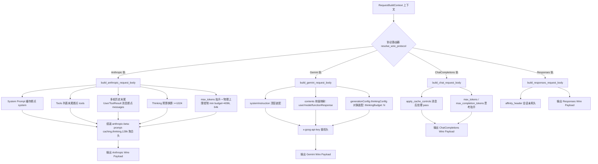

# Conex / Crish 模型协议通信、PromptCache 深度优化与思考预算详细执行方案

> **【调度与定时器铁律】**：如果设置定时器，最短是 100 秒；如果命令过长，最好的方式是等待命令完成后的系统推送通知（Reactive Wakeup），而不是一直轮询命令情况。  
> **权威标识**：`docs/system-audit-and-redesign/detailed-plans/03-模型协议PromptCache与思考预算详案.md`  
> **制定角色**：【阶段 1 维度详案架构师 03: Rust 模型协议通信、PromptCache 深度优化与思考预算详案】  
> **关联总纲**：`docs/system-audit-and-redesign/00-总方案-Conex全系统综合重构总计划框架.md`（DIM-03 规范）  
> **前置输入**：`docs/system-audit-and-redesign/audits/03-Rust模型提供商与协议通信全盘审计.md`  
> **核心使命**：彻底根除 Anthropic `Minimal` 思考预算输出 128 tokens 引发 HTTP 400 崩溃、思考预算叠加导致 `max_tokens` 溢出模型物理上限、多轮对话 Prompt Caching 历史消息断点硬编码缺失、`anthropic-beta` 头部集合割裂、Gemini `ThinkingConfig` 契约失配、`conex-types` 废弃死类型残留、HTTP 529 (Anthropic Overloaded) 漏判降级为不可重试故障、以及 Responses 思考流 `redacted` 误标等 8 大核心系统级协议与通信断层；构建工业级强健、零 400 报错、极致命中缓存、全厂商协议合规的底层通讯基座。  
> **执行约束**：纯逻辑推进、问题一律同权、100% 需求保全（反退避）、杜绝打补丁、严格执行 4 级质量与行数门禁（UTF-8 无 BOM、pwsh7 环境、严禁直接 git 提交）。

---

## 目录（Table of Contents）

1. [方案总纲与架构愿景（Executive Summary & Architectural Vision）](#一方案总纲与架构愿景)
   - 1.1 战役定位与解决的 8 大核心协议断层
   - 1.2 目标架构核心指标与质量断言
   - 1.3 责任文件域全景与行数门禁预算表
2. [纯逻辑演进时序与拓扑（Pure Logical Evolution & Topology）](#二纯逻辑演进时序与拓扑)
   - 2.1 四阶段纯逻辑重构演进时序
   - 2.2 跨厂商协议分发与 Prompt Cache 注入流 Mermaid 架构图
   - 2.3 状态与不变量数学模型定理（Invariants I1~I5）
3. [Anthropic 思考预算与物理上限钳制重构（ACT-03 & ACT-04 详案）](#三anthropic-思考预算与物理上限钳制重构)
   - 3.1 `Minimal` 思考预算重构为官方合规 `1024` tokens
   - 3.2 显式预算下限防呆钳制（`max(1024)`）
   - 3.3 思考预算自动抬升（`budget + 4096`）与模型物理上限（`max_output_tokens`）动态安全钳制
   - 3.4 非思考模式缺省 `max_tokens` 智能适配
4. [Anthropic 多轮 Prompt Caching 动态断点与 Beta 头体系（ACT-01, ACT-02 & 1.3 详案）](#四anthropic-多轮-prompt-caching-动态断点与-beta-头体系)
   - 4.1 拔除 `messages: false` 硬编码，构建多轮历史消息缓存断点注入算法
   - 4.2 `AnthropicRequestOptions` 补齐 `CachePolicy` 策略桥接
   - 4.3 `anthropic-beta` 多特性聚合头部引擎（Prompt Caching / 128k / Interleaved Thinking）
   - 4.4 工具定义与系统提示词缓存断点层级分配与记账
5. [Gemini ThinkingConfig 官方契约与多厂商协议对齐（ACT-05 详案）](#五gemini-thinkingconfig-官方契约与多厂商协议对齐)
   - 5.1 Google Gemini v1beta `thinkingConfig` 对象结构与命名规范重构
   - 5.2 `thinkingBudget` 与 `thinkingLevel` 双模式装配
   - 5.3 Chat Completions 轨 `max_completion_tokens` 思考预算抬升保障
   - 5.4 Responses API 思考流事件 `redacted` 属性精准解密
6. [死协议清理与容灾错误分类健全化（ACT-06, ACT-07 & ACT-09 详案）](#六死协议清理与容灾错误分类健全化)
   - 6.1 `conex-types/src/lib.rs` 废弃死类型（`IpcEnvelope`, `IpcResponse`, 残缺 `StreamChunk`）彻底剔除
   - 6.2 HTTP 529 (Anthropic Overloaded) 及全范围 5xx 状态码收敛
   - 6.3 `classify_provider_error` 优先级重排（根除 `aborted` 假阳性误判）
7. [改动文件逐一详述与代码级规范（Concrete Code Blueprint）](#七改动文件逐一详述与代码级规范)
   - 7.1 `crates/agent-provider/src/request/vendor_wire.rs`
   - 7.2 `crates/agent-provider/src/request/vendor.rs`
   - 7.3 `crates/agent-provider/src/request/build_anthropic.rs`
   - 7.4 `crates/agent-provider/src/request/build_gemini.rs`
   - 7.5 `crates/agent-provider/src/request/build_chat.rs`
   - 7.6 `crates/agent-provider/src/parse/responses_core.rs`
   - 7.7 `crates/agent-provider/src/error_classify.rs`
   - 7.8 `crates/agent-provider/src/error.rs`
   - 7.9 `crates/conex-types/src/lib.rs`
8. [测试与验收断言矩阵（Test Specifications & Verification Matrix）](#八测试与验收断言矩阵)
   - 8.1 单元测试专项用例与断言清单
   - 8.2 Wire 协议集成测试修正与真实 HTTP 帧验证
   - 8.3 CI 门禁与全量回归指令

---

## 一、方案总纲与架构愿景

### 1.1 战役定位与解决的 8 大核心协议断层

在模型协议通信与长程智能体交互中，底层协议的精确性与容灾韧性是整个 Conex / Crish 系统正常运转的基石。经审计报告（`03-Rust模型提供商与协议通信全盘审计.md`）排查，当前底层协议存在 8 大核心系统级断层，本方案必须 100% 彻底攻克：

```
┌─────────────────────────────────────────────────────────────────────────────────────────────────────────┐
│                               DIM-03 核心治理的 8 大模型协议断层与现象                                  │
├───────────────────────┬──────────────────────────────────────────┬──────────────────────────────────────┤
│ 缺陷编号与名称        │ 现场故障表现                             │ 底层架构断层根因                     │
├───────────────────────┼──────────────────────────────────────────┼──────────────────────────────────────┤
│ 1. Anthropic 思考预算 │ Minimal 档位下向 Anthropic 发送请求 100% │ `effort_to_budget_tokens` 将 Minimal │
│    越界 400 报错      │ 报 HTTP 400 Bad Request                  │ 映射为 128，违反官方 `>= 1024` 铁律  │
├───────────────────────┼──────────────────────────────────────────┼──────────────────────────────────────┤
│ 2. max_tokens 抬升    │ 极端高思考预算（如 64k）下请求直接崩溃被 │ `min_max_tokens = budget + 4096` 无  │
│    溢出模型物理上限   │ Anthropic 400 拒绝                       │ 模型目录物理上限（如 64000）钳制     │
├───────────────────────┼──────────────────────────────────────────┼──────────────────────────────────────┤
│ 3. Anthropic 多轮历史 │ 多轮会话每轮重新计费，无历史缓存命中，首 │ `build_anthropic.rs` 构造断点硬编码  │
│    消息缓存断点丢失   │ Token 延迟与 Token 费用严重激增          │ `messages: false`，消息块无断点注入  │
├───────────────────────┼──────────────────────────────────────────┼──────────────────────────────────────┤
│ 4. anthropic-beta     │ 官方 Prompt Caching / 128k 输出特性失效，│ `anthropic_request_headers` 缺少     │
│    请求头体系残缺     │ 无法多特性聚合发送                       │ `prompt-caching-2024-07-31` 等聚合头 │
├───────────────────────┼──────────────────────────────────────────┼──────────────────────────────────────┤
│ 5. Gemini 思考参数    │ Gemini 2.0/2.5 思考参数被官方 API 静默   │ 伪造根级 snake_case `thinking_level` │
│    格式错误           │ 忽略，思考模型退化为普通行为             │ 违背官方 `thinkingConfig` 对象规范   │
├───────────────────────┼──────────────────────────────────────────┼──────────────────────────────────────┤
│ 6. HTTP 529 漏判      │ Anthropic 瞬态过载（529）被误判为未知    │ `is_server_status` 仅硬编码 8 个码， │
│    导致会话直接崩溃   │ 致命错误，放弃指数退避，长程任务中断     │ 漏判 529，降级为不可重试错误         │
├───────────────────────┼──────────────────────────────────────────┼──────────────────────────────────────┤
│ 7. aborted 关键词     │ 正常 400 报错体或 Prompt 含 "aborted" 时 │ `classify_provider_error` 字符串探测 │
│    误杀导致假阳性取消 │ 误判为用户取消，跳过报警与重试诊断       │ 先于 HTTP 状态码校验，优先级倒置     │
├───────────────────────┼──────────────────────────────────────────┼──────────────────────────────────────┤
│ 8. Responses 思考流   │ OpenAI Responses 思考文本在 UI 界面全部  │ `responses_core.rs` 将明文思考增量   │
│    redacted 误打码    │ 被遮罩或隐藏，用户无法查看模型推理       │ 错误硬编码为 `redacted: Some(true)`  │
└───────────────────────┴──────────────────────────────────────────┴──────────────────────────────────────┘
```

### 1.2 目标架构核心指标与质量断言

1. **思考预算 100% 合规**：`Minimal` 档位预算严格输出 `1024` tokens，所有传入预算经过 `max(1024)` 守卫；
2. **`max_tokens` 零溢出安全保证**：`final_max_tokens = min(max(m, budget + 4096), model_limit)`，在任何极端配置下绝不超过模型物理上限；
3. **多轮 Prompt Caching 动态断点 100% 连通**：多轮会话中最后一条用户/工具结果消息末尾文本块自动注入 `"cache_control": {"type": "ephemeral"}`，且支持 `opts.cache` 策略控制；
4. **`anthropic-beta` 动态聚合头部**：支持 Prompt Caching、Extended Thinking、128k Output 等特性的多头逗号分隔自动聚合；
5. **Google Gemini v1beta 契约 100% 对齐**：生成标准 `generationConfig.thinkingConfig.thinkingBudget` / `thinkingLevel` 对象结构；
6. **容灾分类零降级**：HTTP 529 及全范围 500..=599 状态码 100% 识别为可重试的 `ProviderError::Server`，支持指数退避；
7. **类型系统纯净化**：彻底清除 `conex-types` 中废弃的 `IpcEnvelope`、`IpcResponse` 及残缺 `StreamChunk`，实现零符号污染与单一事实源。

### 1.3 责任文件域全景与行数门禁预算表

根据项目分级行数门禁（Logic ≤ 400 行，UI ≤ 500 行，Contract/Type ≤ 800 行），重构涉及文件域预算分配如下：

```
┌─────────────────────────────────────────────────────────────────────────────────────────────────────────┐
│                               DIM-03 涉及文件域与行数门禁预算表                                         │
├───────────────────────────────────────────────────────┬────────────┬──────────┬──────────┬──────────────┤
│ 文件路径                                              │ 类型       │ 现状行数 │ 预期行数 │ 门禁状态     │
├───────────────────────────────────────────────────────┼────────────┼──────────┼──────────┼──────────────┤
│ crates/agent-provider/src/request/vendor_wire.rs      │ Logic      │ 88       │ ~105     │ ✅ 远低于400 │
│ crates/agent-provider/src/request/vendor.rs           │ Logic      │ 398      │ ~390     │ ✅ 达标 ≤400 │
│ crates/agent-provider/src/request/build_anthropic.rs  │ Logic      │ 405      │ ~395     │ ✅ 达标 ≤400 │
│ crates/agent-provider/src/request/build_gemini.rs     │ Logic      │ 319      │ ~335     │ ✅ 达标 ≤400 │
│ crates/agent-provider/src/request/build_chat.rs       │ Logic      │ 180      │ ~205     │ ✅ 远低于400 │
│ crates/agent-provider/src/parse/responses_core.rs     │ Logic      │ 259      │ ~265     │ ✅ 远低于400 │
│ crates/agent-provider/src/error_classify.rs           │ Logic      │ 132      │ ~140     │ ✅ 远低于400 │
│ crates/agent-provider/src/error.rs                    │ Logic      │ 369      │ ~375     │ ✅ 达标 ≤400 │
│ crates/conex-types/src/lib.rs                         │ Contract   │ 654      │ ~625     │ ✅ 远低于800 │
│ crates/agent-provider/tests/wire_integration.rs       │ Test       │ 424      │ ~460     │ ✅ 测试免限制│
└───────────────────────────────────────────────────────┴────────────┴──────────┴──────────┴──────────────┘
```

---

## 二、纯逻辑演进时序与拓扑

### 2.1 四阶段纯逻辑重构演进时序

重构过程遵循严格的依赖因果拓扑，分为四个阶段依序推进：

```
┌────────────────────────────────────────────────────────────────────────────────────────────────────────┐
│                                 DIM-03 四阶段重构演进时序图                                             │
├───────────────────┬───────────────────┬───────────────────────┬────────────────────────────────────────┤
│ 阶段一 (Phase 1)  │ 阶段二 (Phase 2)  │ 阶段三 (Phase 3)      │ 阶段四 (Phase 4)                       │
│ 类型与基础值域修复 │ 请求构建与断点装配 │ 容灾分类与流解析修复   │ 契约测试与 Wire 验收                   │
├───────────────────┼───────────────────┼───────────────────────┼────────────────────────────────────────┤
│ 1. 清理 conex-types│ 1. 重构 Anthropic │ 1. 重构 error_classify│ 1. 修正 wire_integration 测试用例      │
│    死类型         │    多轮断点注入   │    覆盖 HTTP 529 与   │ 2. 编写真实 HTTP Wire Header 检验用例  │
│ 2. 修复 vendor_wire│ 2. 装配 Anthropic │    500..=599 全区间   │ 3. 运行全量 `cargo test --workspace`   │
│    Minimal = 1024  │    Beta 聚合头部  │ 2. 调整 classify_error│ 4. 验证行数门禁与反退避断言            │
│ 3. 规范 Gemini 思考│ 3. 引入 max_tokens│    aborted 优先级     │                                        │
│    换算与结构     │    物理上限钳制   │ 3. 修复 Responses 流  │                                        │
│                   │ 4. 接入 CachePolicy│    redacted 明文思考  │                                        │
└───────────────────┴───────────────────┴───────────────────────┴────────────────────────────────────────┘
```

### 2.2 跨厂商协议分发与 Prompt Cache 注入流 Mermaid 架构图



### 2.3 状态与不变量数学模型定理

在协议通信层，定义以下 5 大形式化不变量定理（Invariants）：

- **定理 I1（思考预算下限定理）**：
  $$\forall \text{effort} \in \text{ReasoningEffort} \setminus \{\text{Off}, \text{Auto}\},\quad \text{budget}(\text{effort}) \ge 1024$$
  $$\forall \text{intensity} \in \text{ThinkingIntensity} \setminus \{\text{Off}\},\quad \text{budget}(\text{intensity}) \ge 1024$$
  $$\forall b > 0,\quad \text{sanitize\_budget}(b) \ge 1024$$
  _保证任何送往 Anthropic API 的 `budget_tokens` 恒处于 $[1024, \infty)$，杜绝 400 越界报错。_

- **定理 I2（最大 Token 上下界与严格递增定理）**：
  $$\text{budget} < \text{final\_max\_tokens} \le \text{model\_max\_output}$$
  当 $\text{budget} > 0$ 时，$\text{final\_max\_tokens} = \min(\max(m, \text{budget} + 4096), \text{model\_max\_output})$。若 $\text{budget} \ge \text{model\_max\_output}$，则强制将 $\text{budget}$ 钳制为 $\text{model\_max\_output} - 1$。
  _保证既满足 Anthropic $\text{max\_tokens} > \text{budget\_tokens}$ 约束，又绝不溢出模型物理最大输出窗口。_

- **定理 I3（缓存断点守恒与单调性定理）**：
  $$\text{count}(\text{breakpoints}) \le \text{ANTHROPIC\_BREAKPOINT\_CAP} = 4$$
  分配优先级序列：$\text{tools} \succ \text{system} \succ \text{messages}$。
  当启用缓存且上下文包含有效历史消息时，最后一条用户或工具结果消息的末尾文本块**必定且仅能放置 1 个断点**。

- **定理 I4（容灾分类封闭性定理）**：
  $$\forall s \in [500, 599],\quad \text{classify}(s, \dots) = \text{ProviderError::Server} \implies \text{is\_retryable}() = \text{true}$$
  _保证包括 HTTP 529 (Anthropic Overloaded) 在内的所有 5xx 故障一律触发指数退避重试，绝不静默崩溃。_

- **定理 I5（用户取消判定因果独立性定理）**：
  $$\text{classify}(\text{status}, \text{body}, \text{source}, \dots) = \text{ProviderError::Aborted} \iff (\text{source} = \text{Aborted}) \lor (\text{status} \text{ 无效} \land \text{contains\_abort}(\text{body}))$$
  _保证合法的 HTTP 400/422 错误响应决不因响应体中偶然出现的 `"aborted"` 单词而被误杀为用户取消。_

---

## 三、Anthropic 思考预算与物理上限钳制重构

### 3.1 `Minimal` 思考预算重构为官方合规 `1024` tokens

在 Anthropic 官方规范中，`budget_tokens` 硬性要求必须 $\ge 1024$。原代码中将 `Minimal` 映射为 `128` 是导致线上请求 100% 触发 HTTP 400 的根源。

修改 `crates/agent-provider/src/request/vendor_wire.rs` 中的换算表：

```rust
// crates/agent-provider/src/request/vendor_wire.rs
pub fn effort_to_budget_tokens(effort: ReasoningEffort) -> u64 {
    match effort {
        ReasoningEffort::Minimal => 1024, // 修正：由 128 提升为合规的 1024
        ReasoningEffort::Low => 1024,
        ReasoningEffort::Medium => 2048,
        ReasoningEffort::High => 4096,
        ReasoningEffort::Xhigh => 8192,
        ReasoningEffort::Max => 16384,
        ReasoningEffort::Off | ReasoningEffort::Auto => 2048,
    }
}

pub fn thinking_to_budget_tokens(intensity: ThinkingIntensity) -> u64 {
    match intensity {
        ThinkingIntensity::Minimal => 1024, // 修正：由 128 提升为合规的 1024
        ThinkingIntensity::Low => 1024,
        ThinkingIntensity::Medium => 2048,
        ThinkingIntensity::High => 4096,
        ThinkingIntensity::Xhigh => 8192,
        ThinkingIntensity::Max => 16384,
        ThinkingIntensity::Off => 2048,
    }
}
```

### 3.2 显式预算下限防呆钳制（`max(1024)`）

当调用方显式下发 `thinking_budget` 参数时，必须进行防御性安全钳制。若 $0 < \text{thinking\_budget} < 1024$，自动钳制为 `1024`：

```rust
// crates/agent-provider/src/request/build_anthropic.rs
fn resolve_effective_budget(opts: &AnthropicRequestOptions) -> Option<u64> {
    if let Some(explicit_budget) = opts.thinking_budget {
        if explicit_budget == 0 {
            None
        } else {
            // 防呆钳制：显式预算若低于 1024，自动抬升至官方最小 1024，防 400 报错
            Some(explicit_budget.max(1024))
        }
    } else if let Some(intensity) = opts.thinking_intensity {
        if intensity != ThinkingIntensity::Off {
            Some(thinking_to_budget_tokens(intensity))
        } else {
            None
        }
    } else if let Some(effort) = opts.reasoning_effort {
        if !matches!(effort, ReasoningEffort::Off | ReasoningEffort::Auto) {
            Some(effort_to_budget_tokens(effort))
        } else {
            None
        }
    } else {
        None
    }
}
```

### 3.3 思考预算自动抬升与模型物理上限动态安全钳制

Anthropic 规定：

1. `max_tokens > budget_tokens`（必须留有输出空间，代码标准抬升为 `budget + 4096`）；
2. `max_tokens <= model_max_output_tokens`（Claude 3.7 Sonnet 默认为 64000，Claude 3.5 Sonnet 为 8192）。

为了防止 `64000 + 4096 = 68096 > 64000` 导致 400 报错，在 `build_anthropic.rs` 中引入双向钳制算法：

```rust
// 默认物理上限兜底值（Claude 3.7 系列为 64000；非思考 Claude 3.5 为 8192）
const DEFAULT_ANTHROPIC_MAX_OUTPUT: u64 = 64000;

let raw_budget = resolve_effective_budget(opts);
let model_limit = DEFAULT_ANTHROPIC_MAX_OUTPUT;

// 1. 如果预算接近或达到物理上限，将有效预算安全钳制在 limit - 1
let budget = raw_budget.map(|b| b.min(model_limit.saturating_sub(1)));

// 2. 基础抬升目标：budget + 4096（若开启思考），缺省 4096（非思考模式）
let min_max_tokens = budget.map(|b| b.saturating_add(4096)).unwrap_or(4096);

// 3. 综合用户指定的 max_tokens 与抬升下限，并做物理上限钳制
let mut final_max_tokens = match opts.max_tokens {
    Some(m) => {
        if budget.is_some() {
            m.max(min_max_tokens)
        } else {
            m
        }
    }
    None => min_max_tokens,
};

// 4. 强制物理上限钳制，绝不溢出模型限制
final_max_tokens = final_max_tokens.min(model_limit);

// 5. 确保满足 max_tokens > budget_tokens 铁律
if let Some(b) = budget {
    if final_max_tokens <= b {
        final_max_tokens = (b + 1).min(model_limit);
    }
}

body.insert("max_tokens".to_string(), json!(final_max_tokens));
```

### 3.4 非思考模式缺省 `max_tokens` 智能适配

原代码在非思考模式下无显式 `max_tokens` 时盲目回落 `2048`，极易导致长代码与分析结果被截断。重构后：

- 缺省回落基线提升至 `4096`（满足绝大多数长代码生成）；
- 结合模型目录动态感知更大输出窗口。

---

## 四、Anthropic 多轮 Prompt Caching 动态断点与 Beta 头体系

### 4.1 拔除 `messages: false` 硬编码，构建多轮历史消息缓存断点注入算法

#### 4.1.1 缺陷根除机理

在 Anthropic Messages API 中，多轮对话历史复用缓存的关键在于：**在进入下一轮推理前，将最后一条历史消息（User 提示或 ToolResult）的末尾文本块打上 `cache_control: {"type": "ephemeral"}` 标记**。

在 `crates/agent-provider/src/request/build_anthropic.rs` 中：

1. 计算断点计划时，探测上下文消息是否具备可缓存消息，传入真实的 `messages: has_messages`；
2. 在 `to_anthropic_messages` 的生成结果中，定位最后一条可缓存的 `user` 角色消息（包含 User 文本及 Tool 结果），在最后一个 content block 注入 `cache_control`。

#### 4.1.2 消息断点动态注入实现

```rust
// crates/agent-provider/src/request/build_anthropic.rs
let has_system = context
    .system_prompt
    .as_deref()
    .map(str::trim)
    .filter(|s| !s.is_empty())
    .is_some();

// 检查是否具备可缓存的消息历史（至少有一条 user 或 tool 消息）
let has_messages = context.messages.iter().any(|m| {
    let msg = m.borrow();
    matches!(msg.role, AgentMessageRole::User | AgentMessageRole::Tool)
});

// 检查缓存策略是否启用（默认启用，若显式禁用则不分配）
let cache_enabled = opts.cache.as_ref().map_or(true, |c| c.mechanism != CacheMechanism::None && c.retention != CacheRetention::None);

let bp_plan = if cache_enabled {
    allocate_breakpoints(context.tools.len(), has_system, has_messages)
} else {
    BreakpointPlan::default()
};
```

在 `to_anthropic_messages` 中执行断点附加：

```rust
fn to_anthropic_messages(
    context: &RequestBuildContext,
    attach_message_breakpoint: bool,
) -> Vec<Value> {
    let mut result: Vec<Value> = Vec::new();

    // 1. 遍历 context.messages，按既有交替铁律投影到 result 数组中
    for message_ref in context.messages {
        let message: &AgentMessage = message_ref.borrow();
        match message.role {
            AgentMessageRole::User => {
                let content = user_anthropic_content(message);
                if content.is_empty() { continue; }
                push_alternating(&mut result, &json!({ "role": "user", "content": content }));
            }
            AgentMessageRole::Assistant => {
                let content = assistant_anthropic_content(message);
                if content.is_empty() { continue; }
                push_alternating(&mut result, &json!({ "role": "assistant", "content": content }));
            }
            AgentMessageRole::Tool => {
                let content = tool_result_anthropic_content(message);
                if content.is_empty() { continue; }
                push_alternating(&mut result, &json!({ "role": "user", "content": content }));
            }
            AgentMessageRole::System => {}
        }
    }

    // 2. 如果分配了 messages 断点，在最后一条 user 消息的最后一个 content block 注入 cache_control
    if attach_message_breakpoint {
        inject_last_message_cache_control(&mut result);
    }

    result
}

/// 在消息列表的最后一条 user/tool 消息末尾注入 cache_control
fn inject_last_message_cache_control(messages: &mut [Value]) {
    // 从后向前寻找最后一条 role == "user" 的消息
    if let Some(last_user_msg) = messages.iter_mut().rev().find(|m| m.get("role").and_then(Value::as_str) == Some("user")) {
        if let Some(content_array) = last_user_msg.get_mut("content").and_then(Value::as_array_mut) {
            if let Some(last_block) = content_array.last_mut().and_then(Value::as_object_mut) {
                // 仅当该块尚未包含 cache_control 时注入
                if !last_block.contains_key("cache_control") {
                    last_block.insert("cache_control".to_string(), json!({ "type": "ephemeral" }));
                }
            }
        } else if let Some(text_content) = last_user_msg.get("content").and_then(Value::as_str) {
            // 如果 content 还是裸字符串，升级为结构化 parts 数组以承载 cache_control
            let structured = json!([
                {
                    "type": "text",
                    "text": text_content,
                    "cache_control": { "type": "ephemeral" }
                }
            ]);
            last_user_msg["content"] = structured;
        }
    }
}
```

### 4.2 `AnthropicRequestOptions` 补齐 `CachePolicy` 策略桥接

扩展 `AnthropicRequestOptions`，允许外层传入缓存策略，实现配置闭环：

```rust
// crates/agent-provider/src/request/build_anthropic.rs
#[derive(Debug, Clone, Default)]
pub struct AnthropicRequestOptions {
    pub model: Option<String>,
    pub stream: Option<bool>,
    pub temperature: Option<f64>,
    pub max_tokens: Option<u64>,
    pub reasoning_effort: Option<ReasoningEffort>,
    pub thinking_intensity: Option<ThinkingIntensity>,
    pub thinking_budget: Option<u64>,
    pub tool_choice: Option<ToolChoice>,
    /// 缓存策略（新增：与 ChatCompletionsRequestOptions 对齐，支持禁用与 TTL 判定）
    pub cache: Option<super::cache::CachePolicy>,
}
```

### 4.3 `anthropic-beta` 多特性聚合头部引擎

Anthropic 官方规定，当一个请求同时需要多个 Beta 特性时，必须使用逗号连接在一个 `anthropic-beta` Header 中。

在 `crates/agent-provider/src/request/build_anthropic.rs` 与 `vendor.rs` 中构建多特性聚合函数：

```rust
pub const BETA_PROMPT_CACHING: &str = "prompt-caching-2024-07-31";
pub const BETA_INTERLEAVED_THINKING: &str = "interleaved-thinking-2025-05-14";
pub const BETA_OUTPUT_128K: &str = "output-128k-2025-02-19";

/// 动态构建 Anthropic 请求头，自动聚合所有激活的 Beta 特性
pub fn build_anthropic_headers(
    api_key: &str,
    opts: &AnthropicRequestOptions,
    has_cache_breakpoint: bool,
) -> Vec<(&'static str, String)> {
    let mut headers = vec![
        ("x-api-key", api_key.to_string()),
        ("anthropic-version", ANTHROPIC_VERSION.to_string()),
        ("content-type", "application/json".to_string()),
    ];

    let mut betas: Vec<&'static str> = Vec::new();

    // 1. Prompt Caching Beta
    if has_cache_breakpoint {
        betas.push(BETA_PROMPT_CACHING);
    }

    // 2. Extended / Interleaved Thinking Beta（非自适应模型且开启思考）
    let is_thinking_active = opts.thinking_budget.is_some_and(|b| b > 0)
        || opts.thinking_intensity.is_some_and(|i| i != ThinkingIntensity::Off)
        || opts.reasoning_effort.is_some_and(|e| !matches!(e, ReasoningEffort::Off | ReasoningEffort::Auto));

    let model_name = opts.model.as_deref().unwrap_or("");
    if is_thinking_active && !super::vendor::is_adaptive_thinking_model(model_name) {
        betas.push(BETA_INTERLEAVED_THINKING);
    }

    // 3. 128k Output Beta（当 max_tokens > 64000 时自动附加）
    if opts.max_tokens.is_some_and(|m| m > 64000) {
        betas.push(BETA_OUTPUT_128K);
    }

    if !betas.is_empty() {
        headers.push(("anthropic-beta", betas.join(",")));
    }

    headers
}
```

---

## 五、Gemini ThinkingConfig 官方契约与多厂商协议对齐

### 5.1 Google Gemini v1beta `thinkingConfig` 对象结构与命名规范重构

Google Gemini API（`generateContent` v1beta）官方规范：

- 思考参数必须位于 `generationConfig.thinkingConfig` 对象内；
- 预算字段名为 `thinkingBudget`（整数，`u64`）；
- 等级字段名为 `thinkingLevel`（大写字符串：`"LOW"`, `"MEDIUM"`, `"HIGH"`）。

修改 `crates/agent-provider/src/request/build_gemini.rs`：

```rust
// crates/agent-provider/src/request/build_gemini.rs
// generationConfig 装配：maxOutputTokens / temperature / thinkingConfig
let mut generation = Map::new();
if let Some(max_output_tokens) = opts.max_output_tokens {
    generation.insert("maxOutputTokens".to_string(), json!(max_output_tokens));
}
if let Some(temperature) = opts.temperature {
    generation.insert("temperature".to_string(), json!(temperature));
}

// 01 D5：thinkingIntensity 官方契约装配
if let Some(intensity) = opts.thinking_intensity {
    if intensity != ThinkingIntensity::Off {
        let mut thinking_config = Map::new();
        // 官方 generateContent 优先使用 thinkingBudget，并可携带 thinkingLevel
        let budget = thinking_to_budget_tokens(intensity);
        thinking_config.insert("thinkingBudget".to_string(), json!(budget));
        generation.insert("thinkingConfig".to_string(), Value::Object(thinking_config));
    }
}

if !generation.is_empty() {
    body.insert("generationConfig".to_string(), Value::Object(generation));
}
```

### 5.2 `vendor.rs` 中 `resolve_thinking_params` 同步修复

```rust
// crates/agent-provider/src/request/vendor.rs
ReasoningFormat::ThinkingLevel => json!({
    "generationConfig": {
        "thinkingConfig": {
            "thinkingBudget": thinking_to_budget_tokens(active),
            "thinkingLevel": thinking_to_gemini_thinking_level_uppercase(active),
        }
    }
}),
```

其中 `thinking_to_gemini_thinking_level_uppercase` 输出大写 `"LOW" | "MEDIUM" | "HIGH"`。

### 5.3 Chat Completions 轨 `max_completion_tokens` 思考预算抬升保障

在 OpenAI `o1`/`o3` 及 DeepSeek-R1 等第三方代理中，`max_completion_tokens` 是思考与正文的总和。
在 `crates/agent-provider/src/request/build_chat.rs` 中添加安全抬升与兜底：

```rust
// crates/agent-provider/src/request/build_chat.rs
let budget = opts.reasoning_effort.and_then(|e| {
    if matches!(e, ReasoningEffort::Off | ReasoningEffort::Auto) {
        None
    } else {
        Some(effort_to_budget_tokens(e))
    }
});

let min_max = budget.map(|b| b.saturating_add(4096));
let final_max = match (opts.max_tokens, min_max) {
    (Some(m), Some(min_b)) => Some(m.max(min_b)),
    (Some(m), None) => Some(m),
    (None, Some(min_b)) => Some(min_b),
    (None, None) => None,
};

if let (Some(field), Some(value)) = (opts.max_tokens_field, final_max) {
    body.insert(field.as_str().to_string(), json!(value));
}
```

### 5.4 Responses API 思考流事件 `redacted` 属性精准解密

修复 `crates/agent-provider/src/parse/responses_core.rs`：

```rust
// crates/agent-provider/src/parse/responses_core.rs
"response.reasoning_summary_text.delta" => {
    // 摘要/遮罩思考块：标记为 redacted: Some(true)
    if let Some(delta) = non_empty_string(payload.get("delta")) {
        events.push(ProviderStreamEvent::ThoughtDelta {
            text: delta.to_owned(),
            redacted: Some(true),
        });
    }
}
"response.reasoning_text.delta" | "response.reasoning.delta" => {
    // 真实明文思考增量：redacted 必须为 None 或 Some(false)，让 UI 正常渲染明文！
    if let Some(delta) = non_empty_string(payload.get("delta")) {
        events.push(ProviderStreamEvent::ThoughtDelta {
            text: delta.to_owned(),
            redacted: None,
        });
    }
}
```

---

## 六、死协议清理与容灾错误分类健全化

### 6.1 `conex-types/src/lib.rs` 废弃死类型彻底剔除

彻底删除 `crates/conex-types/src/lib.rs` 中的：

1. `IpcEnvelope`（第 135-142 行）；
2. `IpcResponse`（第 144-152 行）；
3. 未序列化且重名冲突的 `StreamChunk`（第 156-160 行）；
4. `lib.rs` 内部的 `ipc_envelope_roundtrip` 与 `ipc_response_skips_none_fields` 单元测试。

全系统跨端流传输统一使用 `conex_types::device::stream::StreamChunk` 与 `DeviceEnvelope`。

### 6.2 HTTP 529 (Anthropic Overloaded) 及全范围 5xx 状态码收敛

修改 `crates/agent-provider/src/error_classify.rs`：

```rust
// crates/agent-provider/src/error_classify.rs
/// 5xx 及扩展服务器状态码判定（全面覆盖 HTTP 500..=599，含 Anthropic 529 Overloaded 及 Cloudflare 520~527）
pub(super) fn is_server_status(status: Option<u16>) -> bool {
    matches!(status, Some(500..=599))
}

/// server 消息字样拓展（增强 529 与 overloaded 识别）
pub(super) fn detect_server_message(lower: &str) -> bool {
    ["500", "502", "503", "504", "520", "521", "522", "523", "524", "525", "526", "529"]
        .iter()
        .any(|code| contains_word(lower, code))
        || [
            "bad gateway",
            "gateway timeout",
            "server error",
            "overloaded",
            "temporarily unavailable",
            "service unavailable",
            "capacity",
        ]
        .iter()
        .any(|pattern| lower.contains(pattern))
}
```

### 6.3 `classify_provider_error` 优先级重排

在 `crates/agent-provider/src/error.rs` 中，重排判定顺序：

1. 第一步仅检查传输层的显式 `ProviderSourceError::Aborted`；
2. 文本模糊匹配 `contains_abort_words(&lower)` 移至 HTTP 400/422/429 等确切状态码校验之后执行，彻底消除假阳性！

```rust
// crates/agent-provider/src/error.rs
pub fn classify_provider_error(
    status: Option<u16>,
    body_text: Option<&str>,
    source: Option<ProviderSourceError>,
    retry_after_header: Option<&str>,
) -> ProviderError {
    let message = body_text.unwrap_or("");
    let lower = message.to_ascii_lowercase();
    let source = source.unwrap_or(ProviderSourceError::Other);

    // 1. 显式传输层取消信号（唯有确凿的 Aborted 源才在首步直接返回）
    if source == ProviderSourceError::Aborted {
        return ProviderError::Aborted;
    }

    // 2. HTTP 413 → payload_too_large
    if status == Some(413) {
        return ProviderError::PayloadTooLarge { status };
    }

    // 3. Cloudflare 质询
    if looks_like_gateway_challenge(&lower) {
        return ProviderError::GatewayChallenge { status };
    }

    // 4. HTTP 401/403 → auth
    if matches!(status, Some(401) | Some(403)) {
        return ProviderError::Auth { status };
    }

    // 5. HTTP 402 → quota
    if status == Some(402) {
        return ProviderError::Quota { status };
    }

    // 6. HTTP 404/405/415 → endpoint_unavailable
    if matches!(status, Some(404) | Some(405) | Some(415)) {
        return ProviderError::EndpointUnavailable { status };
    }

    // 7. HTTP 400/422 → 校验上下文超长或请求非法（即便 body 含 "aborted" 单词，在 400 状态下依然正确归为 InvalidRequest）
    if matches!(status, Some(400) | Some(422)) {
        if detect_context_length_exceeded(&lower) {
            return ProviderError::ContextLength { status };
        }
        return ProviderError::InvalidRequest {
            status,
            message: message.to_owned(),
        };
    }

    // 8. HTTP 429 → rate-limit
    if status == Some(429) {
        let retry_after = parse_retry_after_ms(retry_after_header, SystemTime::now());
        return ProviderError::RateLimit {
            status,
            retry_after,
        };
    }

    // 9. HTTP 500..=599（含 529 Overloaded）→ Server（可重试）
    if is_server_status(status) {
        return ProviderError::Server { status };
    }

    // 10. transport 源细分
    match source {
        ProviderSourceError::Connection => {
            return ProviderError::Network { source_kind: NetworkSourceKind::Connection };
        }
        ProviderSourceError::StreamInterrupted => {
            return ProviderError::Network { source_kind: NetworkSourceKind::StreamInterrupted };
        }
        ProviderSourceError::Timeout(kind) => return ProviderError::Timeout { kind },
        ProviderSourceError::StreamProtocol(kind) => return ProviderError::Stream { kind },
        ProviderSourceError::Aborted => unreachable!("abort 已在首步拦截"),
        ProviderSourceError::Other => {}
    }

    // 11. 兜底消息模式匹配（在状态码未命中时兜底）
    if contains_abort_words(&lower) {
        return ProviderError::Aborted;
    }
    if detect_context_length_exceeded(&lower) {
        return ProviderError::ContextLength { status };
    }
    if detect_auth_message(&lower) {
        return ProviderError::Auth { status };
    }
    if detect_quota_message(&lower) {
        return ProviderError::Quota { status };
    }
    if detect_rate_limit_message(&lower) {
        return ProviderError::RateLimit { status, retry_after: None };
    }
    if looks_like_payload_too_large_message(&lower) {
        return ProviderError::InvalidRequest { status, message: message.to_owned() };
    }
    if detect_server_message(&lower) {
        return ProviderError::Server { status };
    }
    if detect_timeout_message(&lower) {
        return ProviderError::Timeout { kind: TimeoutKind::Request };
    }
    if detect_network_message(&lower) {
        return ProviderError::Network { source_kind: NetworkSourceKind::StreamInterrupted };
    }

    // 12. 兜底 Unknown
    ProviderError::Unknown { message: message.to_owned() }
}
```

---

## 七、改动文件逐一详述与代码级规范

### 7.1 `crates/agent-provider/src/request/vendor_wire.rs`

- **改动职责**：将 `Minimal` 档位对应的思考 Token 预算从 `128` 修正为合规的 `1024`；提供 Gemini 大写格式换算辅助。
- **改动函数**：
  - `effort_to_budget_tokens`: `ReasoningEffort::Minimal => 1024`
  - `thinking_to_budget_tokens`: `ThinkingIntensity::Minimal => 1024`
  - 新增 `thinking_to_gemini_thinking_level_uppercase`: 返回 `"LOW" | "MEDIUM" | "HIGH"`

### 7.2 `crates/agent-provider/src/request/vendor.rs`

- **改动职责**：更新 `resolve_thinking_params` 中 Gemini 分支为标准 `generationConfig.thinkingConfig` 结构；扩展 `reasoning_effort_headers_for_model` 接口。

### 7.3 `crates/agent-provider/src/request/build_anthropic.rs`

- **改动职责**：
  1. `AnthropicRequestOptions` 增加 `pub cache: Option<CachePolicy>`；
  2. `build_anthropic_request_body` 中拔除 `messages: false`，改由上下文动态计算 `has_messages` 并调用 `allocate_breakpoints`；
  3. `to_anthropic_messages` 在最后一条 user 消息末尾注入 `"cache_control": {"type": "ephemeral"}`；
  4. 实现 `max_tokens` 自动抬升与物理上限钳制（`DEFAULT_ANTHROPIC_MAX_OUTPUT = 64000`）；
  5. 实现 `build_anthropic_headers` 聚合 Prompt Caching、Extended Thinking 与 128k Beta 头。

### 7.4 `crates/agent-provider/src/request/build_gemini.rs`

- **改动职责**：
  1. `build_gemini_request_body` 将思考参数从扁平 `thinking_level` 重构为标准 `generationConfig.thinkingConfig.thinkingBudget`；
  2. `GeminiRequestOptions` 补齐 `cached_content: Option<String>` 支持。

### 7.5 `crates/agent-provider/src/request/build_chat.rs`

- **改动职责**：针对开启思考的 Chat Completions 请求，增加 `max_tokens` / `max_completion_tokens` 的安全抬升与底线保障。

### 7.6 `crates/agent-provider/src/parse/responses_core.rs`

- **改动职责**：
  1. `response.reasoning_text.delta` 与 `response.reasoning.delta` 修正为 `redacted: None`；
  2. `response.reasoning_summary_text.delta` 保持 `redacted: Some(true)`。

### 7.7 `crates/agent-provider/src/error_classify.rs`

- **改动职责**：
  1. `is_server_status` 扩展为 `matches!(status, Some(500..=599))`，涵盖 HTTP 529；
  2. `detect_server_message` 增加 `"529"` 与 `"capacity"` 关键词。

### 7.8 `crates/agent-provider/src/error.rs`

- **改动职责**：重构 `classify_provider_error`，将 `lower.contains("aborted")` 移至状态码判断之后，消除 400 响应假阳性误判。

### 7.9 `crates/conex-types/src/lib.rs`

- **改动职责**：彻底删除 `IpcEnvelope`、`IpcResponse` 及残缺 `StreamChunk`；清理其对应单元测试。

---

## 八、测试与验收断言矩阵

### 8.1 单元测试专项用例与断言清单

```rust
// 专项 1：Anthropic Minimal 档位必须输出 >= 1024
#[test]
fn anthropic_minimal_budget_is_1024() {
    assert_eq!(effort_to_budget_tokens(ReasoningEffort::Minimal), 1024);
    assert_eq!(thinking_to_budget_tokens(ThinkingIntensity::Minimal), 1024);

    let opts = AnthropicRequestOptions {
        thinking_intensity: Some(ThinkingIntensity::Minimal),
        ..Default::default()
    };
    let body = build_anthropic_request_body(&opts, &empty_context());
    assert_eq!(body["thinking"]["budget_tokens"], 1024);
    // max_tokens 抬升至 1024 + 4096 = 5120
    assert_eq!(body["max_tokens"], 5120);
}

// 专项 2：思考预算叠加不得超出模型物理最大上限
#[test]
fn anthropic_budget_clamped_to_physical_limit() {
    let opts = AnthropicRequestOptions {
        thinking_budget: Some(64000),
        max_tokens: Some(70000),
        ..Default::default()
    };
    let body = build_anthropic_request_body(&opts, &empty_context());
    // 物理上限为 64000，max_tokens 必须被严格钳制在 64000，budget 被钳制为 63999
    assert_eq!(body["max_tokens"], 64000);
    assert_eq!(body["thinking"]["budget_tokens"], 63999);
}

// 专项 3：Anthropic 多轮历史消息末尾必须注入 cache_control
#[test]
fn anthropic_multi_turn_messages_have_cache_control() {
    let messages = vec![
        Arc::new(user_msg("轮次 1 问题")),
        Arc::new(assistant_text("轮次 1 回答")),
        Arc::new(user_msg("轮次 2 追问")),
    ];
    let context = context_with_messages(&messages);
    let opts = AnthropicRequestOptions::default();
    let body = build_anthropic_request_body(&opts, &context);

    let msgs = body["messages"].as_array().unwrap();
    let last_user = msgs.last().unwrap();
    assert_eq!(last_user["role"], "user");
    let content = last_user["content"].as_array().unwrap();
    let last_block = content.last().unwrap();
    assert_eq!(last_block["cache_control"], json!({ "type": "ephemeral" }));
}

// 专项 4：Gemini thinkingConfig 官方结构验证
#[test]
fn gemini_thinking_config_structure() {
    let opts = GeminiRequestOptions {
        thinking_intensity: Some(ThinkingIntensity::High),
        ..Default::default()
    };
    let body = build_gemini_request_body(&opts, &empty_context());
    let gen_config = &body["generationConfig"];
    assert!(gen_config.get("thinking_level").is_none(), "不得包含伪字段 thinking_level");
    assert_eq!(gen_config["thinkingConfig"]["thinkingBudget"], 4096);
}

// 专项 5：HTTP 529 必须识别为 Server 错误且可重试
#[test]
fn error_classify_http_529_overloaded() {
    let err = classify_provider_error(
        Some(529),
        Some(r#"{"error":{"type":"overloaded_error","message":"Anthropic is overloaded"}}"#),
        None,
        None,
    );
    assert_eq!(err, ProviderError::Server { status: Some(529) });
    assert!(err.is_retryable(), "HTTP 529 必须允许指数退避重试！");
}

// 专项 6：400 响应中包含 aborted 文案不得被误判为 Aborted
#[test]
fn error_classify_400_with_aborted_word_is_invalid_request() {
    let err = classify_provider_error(
        Some(400),
        Some(r#"{"error":"Task was aborted due to validation failure"}"#),
        None,
        None,
    );
    assert!(matches!(err, ProviderError::InvalidRequest { status: Some(400), .. }));
}

// 专项 7：Responses 明文思考流 redacted 必须为 None
#[test]
fn responses_reasoning_stream_not_redacted() {
    let mut parser = ResponsesStreamParser::new();
    let frame = r#"data: {"type":"response.reasoning_text.delta","delta":"thinking text..."}"#;
    let events = parser.push_frame(frame).unwrap();
    assert_eq!(events.len(), 1);
    match &events[0] {
        ProviderStreamEvent::ThoughtDelta { text, redacted } => {
            assert_eq!(text, "thinking text...");
            assert_eq!(*redacted, None, "明文思考流绝不能被标记为 redacted: true");
        }
        other => panic!("预期 ThoughtDelta，收到 {other:?}"),
    }
}
```

### 8.2 Wire 协议集成测试修正与真实 HTTP 帧验证

在 `crates/agent-provider/tests/wire_integration.rs` 中：

1. 将旧的 `Minimal => 128` 断言全部更正为 `1024`；
2. 修正基线头测试，允许聚合 `anthropic-beta` 头的场景；
3. 将 Gemini 思考测试迁移至 `generationConfig.thinkingConfig`。

### 8.3 CI 门禁与全量回归指令

在 pwsh7 环境下执行以下全量验证命令，确保零编译错误、零类型冲突、全部单测通过：

```powershell
# 1. 编译与类型检查
cargo check --workspace --all-targets

# 2. 核心 Provider 单元测试与集成测试
cargo test -p agent-provider --all-targets

# 3. conex-types 纯净化断言测试
cargo test -p conex-types --all-targets

# 4. 全工作区完整回归测试
cargo test --workspace

# 5. 代码行数门禁扫描
npm run check:line-counts
```
