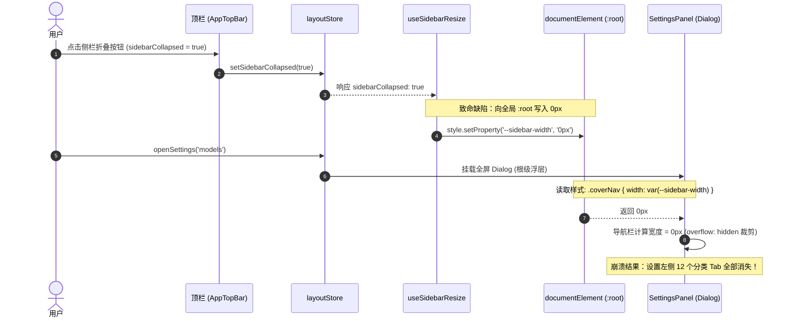
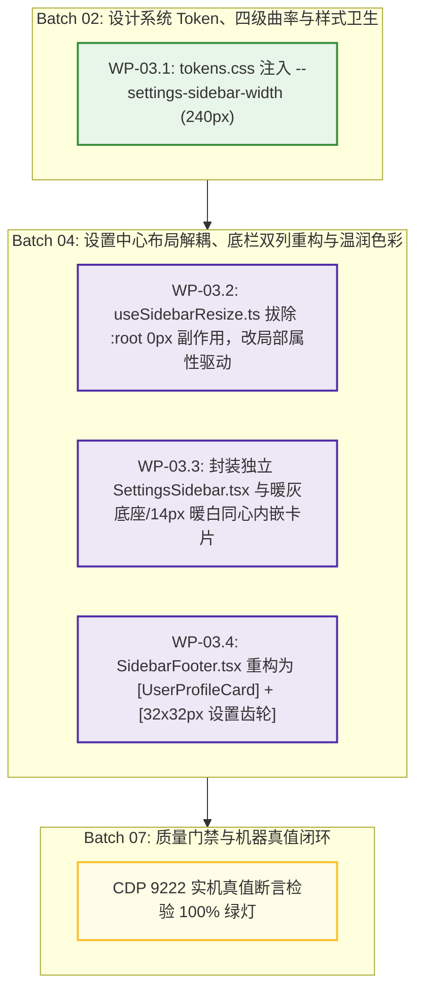

# Conex / Crish 全系统综合重构战役详细执行方案

> **【调度与定时器铁律】**：如果设置定时器，最短是100秒，如果命令过长，最好的方式是等待命令完成后的推送，而不是一直轮询命令情况。

# 03-设置布局解耦、底栏双列重构与温润色彩继承详细执行方案

> **文档标识**：`docs/system-audit-and-redesign/detailed-plans/03-设置解耦与底栏重构详案.md`
> **责任总师**：【维度 3 详案总师: 设置布局解耦、底栏双列重构与温润色彩继承详细执行方案设计】
> **基准依据**：
>
> - `docs/system-audit-and-redesign/00-战役通则与协同执行规范.md`（战役通则与全仓规范）
> - `docs/system-audit-and-redesign/00-总计划框架.md`（全系统重构总计划框架 §二 维度 3）
> - `docs/system-audit-and-redesign/independent-plans/01-布局与底栏重构独立方案.md`（独立方案 01）
> - `docs/system-audit-and-redesign/plan-reviews/01-架构一致性与跨模块冲突评审.md`（评审师 01 Token 仲裁与 DAG 映射）
> - `docs/system-audit-and-redesign/plan-reviews/02-逻辑时序与依赖死锁评审.md`（评审师 02 时序锁与 CDP 真值标准）
> - `docs/system-audit-and-redesign/plan-reviews/03-项目约束与反过度设计红线评审.md`（评审师 03 反退避与行数门禁）
>   **执行约束**：纯方案设计、零业务代码修改、pwsh7 环境对齐、UTF-8 无 BOM、严禁 Git 提交、问题一律同权。

---

## 目录

1. [方案总纲与架构愿景（Executive Summary & Architectural Vision）](#一方案总纲与架构愿景)
   - 1.1 维度定位与核心使命
   - 1.2 现状四大架构断层穿透
   - 1.3 目标架构核心指标与质量红线
2. [根因穿透与代码级证据链（Root Cause Deep Dive & Evidence Matrix）](#二根因穿透与代码级证据链)
   - 2.1 断层一：`useSidebarResize.ts` 写入 `:root` 导致全屏设置 0px 塌陷消失
   - 2.2 断层二：底栏单一按钮承载多义性、身份认知缺失与偏离图 2/3/5 标准
   - 2.3 断层三：设置页容器全局平铺单一暖白导致的景深丢失与同心圆角断裂
   - 2.4 断层四：Tab 切换水平抖动与内层 `overscroll-behavior: contain` 滚轮死锁
3. [专属 Token 体系与 Shell/Settings 物理级解耦方案（Design Tokens & CSS Scope Decoupling）](#三专属-token-体系与-shellsettings-物理级解耦方案)
   - 3.1 `--settings-sidebar-width` 专属变量与 `data-ui-size` 响应式阶梯（ARB-04 仲裁定案）
   - 3.2 侧栏折叠状态局部化：消除 `useSidebarResize.ts` 全局副作用
   - 3.3 `shell-layout.css` 局部属性驱动机制
4. [主侧栏底栏按图 2/3/5 双列重构工程设计（Two-Column Sidebar Footer Overhaul）](#四主侧栏底栏按图-235-双列重构工程设计)
   - 4.1 双列布局拓扑与物理规格
   - 4.2 左列 `UserProfileCard.tsx`（身份展示、头像、状态与 `UserQuickMenu` 浮层）
   - 4.3 右列 `SettingsIconButton.tsx`（32×32px 独立圆角齿轮、$O(1)$ 全屏直达与脉冲更新角标）
   - 4.4 快捷菜单升级为 `UserQuickMenu.tsx`（主题切换、诊断与设置入口收敛）
   - 4.5 响应式多态适配矩阵（Normal 展开、Icon-Collapse 图标折叠、Overlay 抽屉）
5. [设置页面双栏温润色彩同构映射与同心圆角外壳（Warm Aesthetics & Concentric Inset Shell）](#五设置页面双栏温润色彩同构映射与同心圆角外壳)
   - 5.1 全系统 5 级容器与色彩层级同构映射模型（$L0 \to L4$）
   - 5.2 浅色（Warm Light）与深色（Neutral Dark）全量 Token 映射矩阵
   - 5.3 同心曲率几何公式推导（$R_{\text{inner}} = R_{\text{outer}} - P_{\text{padding}}$）与 4 级曲率阶梯实现
   - 5.4 独立双轴滚动流与 `scrollbar-gutter: stable both-edges` 视口稳态
6. [专属 `SettingsSidebar.tsx` 组件封装与 `SettingsPanel` 三拆分（Component Architecture & Line-Count Control）](#六专属-settingssidebar-组件封装与-settingspanel-三拆分)
   - 6.1 `SettingsSidebar.tsx` 高内聚组件设计与 TypeScript 契约
   - 6.2 `SettingsContent.tsx` 12 个 Tab 懒加载与 Suspense 独立容错隔离
   - 6.3 `SettingsPanel.tsx` 壳层精简与单一职责治理（≤400 行门禁）
7. [代码重构逐文件对比蓝图（Detailed Code-Level Refactoring Blueprint）](#七代码重构逐文件对比蓝图)
   - 7.1 `apps/crish-desktop/src/styles/tokens.css`
   - 7.2 `apps/crish-desktop/src/components/sidebar/useSidebarResize.ts`
   - 7.3 `apps/crish-desktop/src/styles/shell/shell-layout.css`
   - 7.4 `apps/crish-desktop/src/components/sidebar/SidebarFooter.tsx`
   - 7.5 `apps/crish-desktop/src/components/sidebar/UserProfileCard.tsx`【新增】
   - 7.6 `apps/crish-desktop/src/components/sidebar/SettingsIconButton.tsx`【新增】
   - 7.7 `apps/crish-desktop/src/components/sidebar/Sidebar.module.css`
   - 7.8 `apps/crish-desktop/src/components/settings/UserQuickMenu.tsx`【重构】
   - 7.9 `apps/crish-desktop/src/components/settings/UserQuickMenu.module.css`【重构】
   - 7.10 `apps/crish-desktop/src/components/settings/SettingsSidebar.tsx`【新增】
   - 7.11 `apps/crish-desktop/src/components/settings/SettingsContent.tsx`【新增】
   - 7.12 `apps/crish-desktop/src/components/settings/SettingsPanel.tsx`【重构】
   - 7.13 `apps/crish-desktop/src/components/settings/SettingsPanel.module.css`【重构】
   - 7.14 `apps/crish-desktop/src/components/settings-models/ModelsSettingsTab.module.css`
8. [逻辑依赖顺序、实施批次与无环拓扑图（Implementation Roadmap & DAG Alignment）](#八逻辑依赖顺序实施批次与无环拓扑图)
   - 8.1 映射到全战役 Master DAG 批次
   - 8.2 维度 3 四大工单执行包（WP-03.1 ~ WP-03.4）
   - 8.3 并行与串行施工注意事项
9. [自动化测试断言集与 9222 CDP 机器真值验收矩阵（Verification & Truth Assertions）](#九自动化测试断言集与-9222-cdp-机器真值验收矩阵)
   - 9.1 Vitest 单元与集成测试套件（`SettingsPanel.test.tsx` / `SidebarFooter.test.tsx`）
   - 9.2 127.0.0.1:9222 CDP 机器真值自动化检验脚本
   - 9.3 验收断言全量检查清单（Checklist）

---

## 一、方案总纲与架构愿景

### 1.1 维度定位与核心使命

在 Conex / Crish 桌面客户端架构中，**主工作区视口（Main Shell Canvas）**、**侧栏导航底栏（Sidebar Footer）** 与 **全屏设置中心（Settings Subsystem）** 是用户高频交互的三大核心容器。

维度 3 聚焦于**容器骨架的物理级解耦、底栏双列人机交互重构、全屏设置温润色彩同构映射以及设置侧栏专属组件提取**。本方案旨在彻底清剿因历史代码向全局 `:root` 注入副作用而引发的破坏性连锁反应，严格对齐用户图 2/3/5 规范，确立一套具备 **零全局副作用、严格同心曲率几何、温润色彩流转、双列清晰交互、视口平滑稳定** 的高质量桌面容器架构。

### 1.2 现状四大架构断层穿透

```
┌────────────────────────────────────────────────────────────────────────────────────────┐
│                              维度 3 现状四大核心架构断层全景图                          │
├────────────────────────────────────────────────────────────────────────────────────────┤
│ 1. 变量穿透与设置侧栏 0px 塌陷断层 (Global Token Mutation Leaking)                     │
│    主侧栏折叠 ──> useSidebarResize.ts:77 暴力向 :root 写入 --sidebar-width: 0px         │
│                 └──> 全屏 SettingsPanel 引用 var(--sidebar-width) ──> 设置左侧导航 100% 塌陷消失！│
│                                                                                        │
│ 2. 底栏交互混杂与偏离图 2/3/5 (Footer Interaction Conflation)                          │
│    底栏单一按钮 ──> 点击仅弹气泡菜单 ──> 用户需 2-Step 二级点击才能进入全屏设置        │
│                 └──> 缺少 UserProfileCard 身份卡片，齿轮多义性冲突，空间利用率低       │
│                                                                                        │
│ 3. 色调外壳退化与同心圆角断裂 (Aesthetic Degradation & Shell Flatness)                 │
│    主工作区具有 [暖灰底座 L1 + 暖白同心内嵌卡片 L2] 的温润质感                          │
│    设置页退化为 [全局平铺单一暖白 L2]，丧失景深感，缺乏同心圆角外壳与空间层级          │
│                                                                                        │
│ 4. 滚轮死锁与 Tab 切换水平抖动 (Scroll Chaining Halt & Viewport Jitter)                 │
│    设置内层 overscroll-behavior: contain 吞噬滚轮，导致页面卡死；缺失 scrollbar-gutter │
│    导致不同 Tab 内容高度变化时，右侧内容区出现剧烈的横向跳变抖动。                      │
└────────────────────────────────────────────────────────────────────────────────────────┘
```

### 1.3 目标架构核心指标与质量红线

依据 `docs/system-audit-and-redesign/00-战役通则与协同执行规范.md` 及评审师 01~03 仲裁，维度 3 重构达成以下五大核心指标：

1. **物理隔离与零副作用（Physical Scope Isolation）**：
   - 确立设置中心专属 CSS 变量 `--settings-sidebar-width: 240px`（支持 `[data-ui-size="small"]` 220px / `[data-ui-size="large"]` 260px）；
   - 彻底移除 `useSidebarResize.ts` 向 `:root` 写入 `--sidebar-width: 0px` 的行为，侧栏折叠仅通过主容器 CSS Class/Attribute 局部驱动。
2. **底栏双列解耦（Two-Column Footer Decoupling - 图 2/3/5）**：
   - 侧栏最底部重构为双列容器：**左列 `UserProfileCard`（包含头像、用户名、状态，点击触发快捷主题菜单 `UserQuickMenu`）+ 右列 `SettingsIconButton`（32×32px 独立圆角齿轮，点击 $O(1)$ 直达全屏设置）**；
   - 更新角标采用方案 A（齿轮右上角 8px 脉冲绿点），不挤占底栏双列宽度。
3. **设置双栏温润色彩同构映射（Warm Aesthetics & Concentric Inset Shell）**：
   - 设置外壳底座与左侧导航完整继承 `--bg-secondary`（暖灰 `#E9E7E2`），右侧主配置区承载 `--bg-primary`（暖白 `#EFECE6`）内嵌同心圆角卡片（`border-radius: 14px`，`border: 1px solid var(--border-subtle)`，低频环境阴影）；
   - 满足同心曲率公式 $R_{\text{inner}} = R_{\text{outer}} - P_{\text{padding}}$，实现主工作区与设置页 100% 结构同构。
4. **专属 `SettingsSidebar.tsx` 组件与视口稳态（Smooth Scrolling & A11y Stability）**：
   - 提取独立高内聚 `SettingsSidebar.tsx` 组件，承载返回、搜索、分类 Tablist 键盘漫游与无障碍 live region；
   - 内容区注入 `scrollbar-gutter: stable both-edges`，拔除子模块 `overscroll-behavior: contain` 滚轮阻断，消除 Tab 切换跳动与滚轮吞噬。
5. **严守代码行数门禁（Line-Count Governance）**：
   - `SettingsPanel.tsx` 拆分为 `SettingsPanel.tsx` + `SettingsSidebar.tsx` + `SettingsContent.tsx`，所有拆分后文件行数严格控制在 **≤400 行**，彻底满足 CI 门禁。

---

## 二、根因穿透与代码级证据链

### 2.1 断层一：`useSidebarResize.ts` 写入 `:root` 导致全屏设置 0px 塌陷消失

#### 2.1.1 缺陷时序与代码证据链

- **缺陷源码 1**：[`apps/crish-desktop/src/components/sidebar/useSidebarResize.ts:76-93`](file:///c:/Software/conex/apps/crish-desktop/src/components/sidebar/useSidebarResize.ts#L76-L93)
- **缺陷源码 2**：[`apps/crish-desktop/src/components/settings/SettingsPanel.module.css:151-161`](file:///c:/Software/conex/apps/crish-desktop/src/components/settings/SettingsPanel.module.css#L151-L161)

```typescript
// useSidebarResize.ts:76-85
if (sidebarCollapsed) {
  // 致命代码：直接修改 documentElement (:root) 上的 --sidebar-width 为 0px
  document.documentElement.style.setProperty('--sidebar-width', '0px');
  document.documentElement.style.setProperty(
    '--sidebar-visible-width',
    `${sidebarWidthPx}px`
  );
}
```

```css
/* SettingsPanel.module.css:151-161 */
.coverNav {
  /* 致命依赖：错误引用了属于主侧栏的全局变量 */
  width: var(--sidebar-width);
  flex-shrink: 0;
  border-right: 1px solid var(--hairline, var(--border-subtle));
  background: transparent;
  padding: var(--space-2_5) var(--space-3) var(--space-3_5);
  overflow: hidden;
  display: flex;
  flex-direction: column;
}
```

#### 2.1.2 物理机理与因果链



---

### 2.2 断层二：底栏单一按钮承载多义性、身份认知缺失与偏离图 2/3/5 标准

#### 2.2.1 源码证据与分析

- **源码文件**：[`apps/crish-desktop/src/components/sidebar/SidebarFooter.tsx:52-78`](file:///c:/Software/conex/apps/crish-desktop/src/components/sidebar/SidebarFooter.tsx#L52-L78)
- **源码文件**：[`apps/crish-desktop/src/components/settings/SettingsQuickMenu.tsx:180-203`](file:///c:/Software/conex/apps/crish-desktop/src/components/settings/SettingsQuickMenu.tsx#L180-L203)

```tsx
// SidebarFooter.tsx 现状：单一 actions 容器
<div className={styles.footerActions}>
  <SettingsQuickMenu onShowToast={onShowToast} />
  {updateAvailable ? ( ... ) : null}
</div>
```

```tsx
// SettingsQuickMenu.tsx 现状：单一齿轮既当菜单又当设置
<button
  ref={btnRef}
  type="button"
  className={`${styles.sidebarFooterSettings}${open ? ` ${styles.isOpen}` : ''}`}
  data-testid="settings-button"
  aria-label={triggerLabel}
>
  <Lucide.Settings size={16} strokeWidth={1.75} aria-hidden />
  <span>设置</span>
  <Lucide.ChevronUp
    size={14}
    strokeWidth={1.75}
    className={styles.sbQuickChev}
    aria-hidden
  />
</button>
```

#### 2.2.2 交互断层总结

1. **齿轮语义冲突**：齿轮图标在所有桌面平台中均代表“打开设置大页”，但当前实现点击齿轮后仅弹出一个气泡浮层（QuickMenu），进入全屏设置必须进行 2-Step 二级点击，严重违背人机工效学；
2. **身份感知缺失**：侧栏底栏缺失用户身份（`UserProfileCard`），无头像、无当前用户名、无工作区标识，缺乏人机归属感；
3. **更新指示粗暴**：当检测到更新时，`updateAvailable` 粗暴插入一个更新按钮，打乱底栏既有排版。

---

### 2.3 断层三：设置页容器全局平铺单一暖白导致的景深丢失与同心圆角断裂

#### 2.3.1 视觉断层对比

- **主工作区高品质质感**（[`shell-workspace.css:43-87`](file:///c:/Software/conex/apps/crish-desktop/src/styles/shell/shell-workspace.css#L43-L87)）：
  - 外壳基座：`--shell-chrome-bg: var(--bg-secondary)`（暖灰 `#E9E7E2`）；
  - 内容卡片：`--shell-inset-bg: var(--bg-primary)`（暖白 `#EFECE6`），`border-radius: 14px`，`border: 1px solid var(--border-subtle)`，带有细腻低频阴影。
- **设置页现状退化**（[`SettingsPanel.module.css:8-31, 151-192`](file:///c:/Software/conex/apps/crish-desktop/src/components/settings/SettingsPanel.module.css#L8-L31)）：
  - `.settingsCover` 与 `.settingsPanel` 均设为 `background: var(--bg-primary)`；
  - `.coverNav` 为 `background: transparent`；
  - `.coverContent` 为 `background: var(--bg-primary)`，无圆角外壳，无阴影，全平铺。

#### 2.3.2 负面效应

用户从主界面点击进入设置时，整个屏幕瞬间变为单一生硬的亮白块，左侧原本暖灰的侧栏突然变白，产生剧烈的“白闪”与视觉失重感；且内容区失去了内嵌同心圆角外壳，与主工作区的设计语言彻底脱节。

---

### 2.4 断层四：Tab 切换水平抖动与内层 `overscroll-behavior: contain` 滚轮死锁

1. **Tab 切换水平抖动**：当用户在分类 Tab 间切换时（例如从内容超长带有垂直滚动条的 `models` Tab 切换到内容较短无滚动条的 `appearance` Tab），由于滚动条的突然出现和消失，右侧主内容区发生 10px~15px 的横向突跳，产生视觉抖动；
2. **模型设置滚轮卡死**：`ModelsSettingsTab.module.css:60, 175` 声明了 `overscroll-behavior: contain`，当内容不足以溢出时直接吞噬 wheel delta，导致外层 `.coverContent` 无法接收滚轮事件，设置页面滚轮卡死。

---

## 三、专属 Token 体系与 Shell/Settings 物理级解耦方案

### 3.1 `--settings-sidebar-width` 专属变量与 `data-ui-size` 响应式阶梯

在 `tokens.css` 中建立专属设计变量域，严格隔离主侧栏与设置面板的宽度变量（严格对齐评审师 01 仲裁 ARB-04，废除虚构的 `[data-density="*"]`，统一使用仓库既有的 `[data-ui-size="small"]` 与 `[data-ui-size="large"]`）：

```css
/* ==========================================================================
   Design Tokens: Layout & Settings Domain Partitioning (tokens.css)
   ========================================================================== */

:root,
html[data-theme='default'],
html[data-theme='light'],
html[data-theme='dark'] {
  /* --------------------------------------------------------------------------
     1. 主工作区侧栏 Tokens（Domain: Main Shell Sidebar）
     仅限在 .app-top-bar__rail、.sidebar-wrapper、#crish-sidebar 内消费
     -------------------------------------------------------------------------- */
  --sidebar-width: 260px;
  --sidebar-width-min: 180px;
  --sidebar-width-max: 420px;
  --sidebar-width-collapsed: 48px;
  --sidebar-visible-width: 260px;

  /* --------------------------------------------------------------------------
     2. 设置面板专属 Tokens（Domain: Settings Subsystem Chrome）
     独立命名空间，绝对不受主侧栏折叠状态影响
     -------------------------------------------------------------------------- */
  --settings-sidebar-width: 240px;
  --settings-sidebar-width-compact: 220px;
  --settings-sidebar-width-comfortable: 260px;
  --settings-content-max: 720px;
  --settings-header-height: 40px;
  --settings-nav-padding: var(--space-3);
  --settings-tab-height: 34px;
}

/* 响应 UI Size 阶梯调整设置侧栏宽度 (ARB-04 权威仲裁) */
[data-ui-size='small'] {
  --settings-sidebar-width: 220px;
}

[data-ui-size='large'] {
  --settings-sidebar-width: 260px;
}
```

---

### 3.2 侧栏折叠状态局部化：消除 `useSidebarResize.ts` 全局副作用

重构 `useSidebarResize.ts`，**彻底拔除向 `document.documentElement`（`:root`）写入 `--sidebar-width: 0px` 的所有代码**。侧栏设定的物理宽度始终保持为 `sidebarWidthPx`（如 260px）：

```typescript
// 重构方案：apps/crish-desktop/src/components/sidebar/useSidebarResize.ts
useEffect(() => {
  if (document.body.classList.contains('is-resizing')) {
    return;
  }
  // 关键修正：无论折叠与否，全局 --sidebar-width 始终记录用户的设定宽度（如 260px）
  // 侧栏本身的折叠由 .app-container[data-sidebar-collapsed="true"] 控制 CSS 变换！
  document.documentElement.style.setProperty(
    '--sidebar-width',
    `${sidebarWidthPx}px`
  );
  document.documentElement.style.setProperty(
    '--sidebar-visible-width',
    sidebarCollapsed ? '0px' : `${sidebarWidthPx}px`
  );
  window.dispatchEvent(new Event('crish-sidebar-resize'));
}, [sidebarCollapsed, sidebarWidthPx]);
```

---

### 3.3 `shell-layout.css` 局部属性驱动机制

在 `shell-layout.css` 中，主侧栏的折叠由局部 DOM 属性控制，不再依赖全局 `:root` 变量清零：

```css
/* apps/crish-desktop/src/styles/shell/shell-layout.css */
.app-container[data-sidebar-collapsed='true'] .sidebar-wrapper,
.app-container[data-sidebar-collapsed='1'] .sidebar-wrapper {
  width: 0px !important;
  min-width: 0px !important;
  overflow: hidden !important;
  pointer-events: none;
}

.app-container[data-sidebar-collapsed='true'] .app-top-bar__rail,
.app-container[data-sidebar-collapsed='1'] .app-top-bar__rail {
  width: var(--header-height);
  min-width: var(--header-height);
}
```

---

## 四、主侧栏底栏按图 2/3/5 双列重构工程设计

### 4.1 双列布局拓扑与物理规格

依据规范 §2.3 及用户图 2/3/5 标准，主侧栏底栏重构为 **Flex 双列水平并列容器**：

```
┌─────────────────────────────────────────────────────────────────────────────┐
│ 侧栏底栏标准展开态 (Width: 260px, Height: 44px, Padding: 4px 10px 8px 10px) │
├────────────────────────────────────────────────────────┬────────────────────┤
│  [ 👤  User Name              ▾ ]                      │  [ ⚙ ] (● 脉冲绿点)│
│  • Avatar: 26x26px 圆形 (border-radius: 9999px)        │  • Button: 32x32px │
│  • Title: 13px, font-weight: 500, var(--text-primary)  │  • Radius: 10px    │
│  • Subtitle: 11px, var(--text-tertiary) "conex"        │  • Hover: bg-hover │
│  • Hover: var(--bg-hover), Active: var(--bg-active)    │  • Tooltip: "设置" │
│  • 点击: 展开 UserQuickMenu 快捷浮层                   │  • 点击: 直达设置  │
└────────────────────────────────────────────────────────┴────────────────────┘
```

---

### 4.2 左列 `UserProfileCard.tsx`（身份展示、头像、状态与 `UserQuickMenu` 浮层）

提取高内聚的 `UserProfileCard.tsx` 组件：

1. **DOM 结构与视觉层次**：
   - **头像（Avatar）**：`26px × 26px`，`border-radius: var(--radius-full)`（9999px 胶囊），渲染首字母或 `<Lucide.User />`；
   - **文本信息栈（User Info Stack）**：
     - 用户名（`username`）：`13px`（`var(--font-size-sm)`），`font-weight: 500`，`color: var(--text-primary)`；
     - 工作区/状态副标（`workspaceName`）：`11px`（`var(--font-size-xxs)`），`color: var(--text-tertiary)`；
   - **下拉指示箭头（Chevron）**：`<Lucide.ChevronsUpDown size={13} strokeWidth={1.75} />`，`color: var(--text-tertiary)`；
2. **交互行为**：
   - 单击卡片展开 `UserQuickMenu` 快捷设置浮层；
   - 键盘支持：`Enter` / `Space` / `ArrowUp` 唤起菜单，`Esc` 关闭并还原焦点至卡片。

---

### 4.3 右列 `SettingsIconButton.tsx`（32×32px 独立圆角齿轮、$O(1)$ 全屏直达与脉冲更新角标）

提取高内聚的 `SettingsIconButton.tsx` 组件：

- **物理规格**：固定 `32px × 32px`，居中对齐；
- **视觉曲率**：`border-radius: var(--radius-xl)`（10px，满足 Level 2 独立按钮曲率契约）；
- **图标尺寸**：`<Lucide.Settings size={16} strokeWidth={1.75} />`；
- **交互行为**：
  - 单击直接调用 `openSettings()`，$O(1)$ 速度直接唤起全屏设置面板；
  - 挂载项目自定义 `<Tooltip content="设置 (Ctrl+,)">`；
- **脉冲更新角标（Update Pulse Dot）**：
  - 若 `updateAvailable === true`，在齿轮右上角绝对定位渲染 `8px × 8px` 的森林暖绿（`--accent-green`）脉冲呼吸圆点；
  - Tooltip 动态响应为 `"有新版本可用，点击进入设置更新"`。

---

### 4.4 快捷菜单升级为 `UserQuickMenu.tsx`（主题切换、诊断与设置入口收敛）

将既有的 `SettingsQuickMenu.tsx` 全面升级为 `UserQuickMenu.tsx`，与 `UserProfileCard` 深度绑定：

1. **身份与存储状态段**：显示当前用户与本地 SQLite 会话状态；
2. **外观主题段**：浅色 / 深色胶囊单选切换器（满足 Level 1 9999px 饱满胶囊）；
3. **快捷入口段**：模型与密钥、外观与字体、状态诊断；
4. **开发模式收敛**：若开发环境下支持 demo 模式切换，将其收敛于菜单最底部，不再污染侧栏一级底栏。

---

### 4.5 响应式多态适配矩阵（Normal 展开、Icon-Collapse 图标折叠、Overlay 抽屉）

| 侧栏状态                    | 宽度范围        | 底栏布局结构                             | 左侧 `UserProfileCard` 呈现         | 右侧 `SettingsIconButton` 呈现    | 交互流转                                 |
| :-------------------------- | :-------------- | :--------------------------------------- | :---------------------------------- | :-------------------------------- | :--------------------------------------- |
| **标准展开 (Normal)**       | `200px ~ 420px` | Flex 水平双列 (`justify: space-between`) | 头像 + 用户名 + 状态副标 + 下拉箭头 | 32×32px 独立圆角方钮 (带 Tooltip) | 卡片弹快捷菜单；齿轮进全屏设置           |
| **图标折叠 (IconCollapse)** | `48px ~ 56px`   | Flex 垂直居中堆叠 (`flex-col; gap: 6px`) | 仅展示 28×28px 圆形头像 (居中)      | 仅展示 28×28px 齿轮 (居中)        | 点击头像向右弹出快捷菜单；点击齿轮开设置 |
| **临时悬停展开 (Hover)**    | `260px` 浮层    | 与标准展开态完全一致                     | 完整展开                            | 完整展开                          | 保持全功能可用                           |
| **移动端/抽屉 (Overlay)**   | 视口 85%        | 与标准展开态完全一致                     | 完整展开                            | 完整展开                          | 点击操作后自动收起抽屉                   |

---

## 五、设置页面双栏温润色彩同构映射与同心圆角外壳

### 5.1 全系统 5 级容器与色彩层级同构映射模型（$L0 \to L4$）

严格落实规范 §2.3，确立主工作区与设置页面的 100% 同构映射：

```
┌─────────────────────────────────────────────────────────────────────────────┐
│                       全系统容器与色彩层级同构契约                               │
├──────┬──────────────────────┬────────────────────────┬──────────────────────┤
│ 层级 │ 语义角色             │ 主工作区 (Main Shell)  │ 设置页面 (Settings)  │
├──────┼──────────────────────┼────────────────────────┼──────────────────────┤
│  L0  │ 视口遮罩与全屏底座   │ AppContainer / Scrim   │ Dialog Overlay Scrim │
│      │                      │ (--tint-overlay)       │ (--tint-overlay)     │
├──────┼──────────────────────┼────────────────────────┼──────────────────────┤
│  L1  │ 暖灰基座与导航侧栏   │ Sidebar / AppTopBar    │ SettingsCover /      │
│      │                      │ (--bg-secondary)       │ SettingsSidebar      │
│      │                      │                        │ (--bg-secondary)     │
├──────┼──────────────────────┼────────────────────────┼──────────────────────┤
│  L2  │ 内嵌同心圆角内容卡片 │ .workspaces-stack      │ .coverContent        │
│      │                      │ (--bg-primary, R=14px) │ (--bg-primary, R=14px)│
├──────┼──────────────────────┼────────────────────────┼──────────────────────┤
│  L3  │ 模块分组与配置卡片   │ SessionCard / ChatArea │ SettingsCard         │
│      │                      │ (--bg-card, R=10px)    │ (--bg-card, R=10px)  │
├──────┼──────────────────────┼────────────────────────┼──────────────────────┤
│  L4  │ 控件、输入框与选项   │ Buttons / Inputs       │ Switches / Inputs    │
│      │                      │ (--bg-elevated/tint)   │ (--bg-elevated/tint) │
└──────┴──────────────────────┴────────────────────────┴──────────────────────┘
```

---

### 5.2 浅色（Warm Light）与深色（Neutral Dark）全量 Token 映射矩阵

| 目标 DOM 选择器                                       | CSS 属性                                                                      | 浅色主题 (Warm Light)                                                                                                                                         | 深色主题 (Neutral Dark)                                                                                                                                  | 语义说明与无障碍对比度                                 |
| :---------------------------------------------------- | :---------------------------------------------------------------------------- | :------------------------------------------------------------------------------------------------------------------------------------------------------------ | :------------------------------------------------------------------------------------------------------------------------------------------------------- | :----------------------------------------------------- |
| **全屏盖层底座** (`.settingsCover`, `.settingsPanel`) | `background-color`                                                            | `var(--bg-secondary)` (`hsl(35, 12%, 91.5%)`)                                                                                                                 | `var(--bg-secondary)` (`hsl(0, 0%, 8%)`)                                                                                                                 | **核心改变**：继承 L1 暖灰底座，彻底消除白闪           |
| **左侧导航容器** (`.coverNav`)                        | `background-color`<br>`width`<br>`border-right`                               | `transparent`<br>`var(--settings-sidebar-width)`<br>`none`                                                                                                    | `transparent`<br>`var(--settings-sidebar-width)`<br>`none`                                                                                               | 移除生硬直边分割线，以色彩色阶区隔                     |
| **左侧 Tab 默认态** (`.sidebarTab`)                   | `color`<br>`background`                                                       | `var(--text-secondary)` (`#555555`)<br>`transparent`                                                                                                          | `var(--text-secondary)` (`#A3A3A3`)<br>`transparent`                                                                                                     | 对比度 ≥ 4.53:1 (WCAG AA)                              |
| **左侧 Tab 激活态** (`.sidebarTab.active`)            | `color`<br>`background`<br>`box-shadow`<br>`border-radius`                    | `var(--text-primary)` (`#111111`)<br>`var(--bg-card)` (`hsl(35, 10%, 98.0%)`)<br>`var(--shadow-sm)`<br>`var(--radius-xl)` (10px)                              | `var(--text-primary)` (`#F0F0F0`)<br>`var(--bg-card)` (`hsl(0, 0%, 11%)`)<br>`var(--shadow-sm)`<br>`var(--radius-xl)` (10px)                             | **卡片式浮起高亮**，满足 Level 3 10px 同心圆角         |
| **右侧主内容内嵌外壳** (`.coverContent`)              | `background-color`<br>`border-radius`<br>`border`<br>`box-shadow`<br>`margin` | `var(--bg-primary)` (`hsl(35, 12%, 94.0%)`)<br>`var(--shell-inset-radius, 14px)`<br>`1px solid var(--border-subtle)`<br>`var(--shadow-sm)`<br>`0 14px 14px 0` | `var(--bg-primary)` (`hsl(0, 0%, 5%)`)<br>`var(--shell-inset-radius, 14px)`<br>`1px solid var(--border-subtle)`<br>`var(--shadow-sm)`<br>`0 14px 14px 0` | **同构核心**：获得与主工作区完全一致的内嵌悬浮卡片质感 |
| **配置项分组卡片** (`.settingsUiCard`)                | `background-color`<br>`border-radius`<br>`border`                             | `var(--bg-card)` (`hsl(35, 10%, 98.0%)`)<br>`var(--radius-xl, 10px)`<br>`1px solid var(--border-color)`                                                       | `var(--bg-card)` (`hsl(0, 0%, 11%)`)<br>`var(--radius-xl, 10px)`<br>`1px solid var(--border-color)`                                                      | L3 级卡片，满足同心公式                                |

---

### 5.3 同心曲率几何公式推导（$R_{\text{inner}} = R_{\text{outer}} - P_{\text{padding}}$）与 4 级曲率阶梯实现

在现代高密度 UI 渲染中，若外层与内层采用相同圆角，内层会出现视觉锐化变形。全系统严格遵循同心曲率几何公式：

$$R_{\text{inner}} = R_{\text{outer}} - P_{\text{padding}} \quad (\text{当 } R_{\text{outer}} > P_{\text{padding}})$$

```
┌─────────────────────────────────────────────────────────────────────────────┐
│                       设置页面 4 级同心曲率配置表                            │
├─────────┬──────────────────────┬──────────────┬──────────────┬──────────────┤
│ 阶梯    │ 容器层级             │ 外层圆角     │ 边距/Padding │ 目标子圆角   │
├─────────┼──────────────────────┼──────────────┼──────────────┼──────────────┤
│ 阶梯 1  │ 视口底座 $\to$ 内容大卡│ 外屏直角     │ Margin: 14px │ $R = 14px$   │
│         │ (.coverContent)      │              │              │ (--shell-r)  │
├─────────┼──────────────────────┼──────────────┼──────────────┼──────────────┤
│ 阶梯 2  │ 内容大卡 $\to$ 配置卡│ $R = 14px$   │ Pad: 20px    │ $R = 10px$   │
│         │ (.settingsUiCard)    │              │              │ (--radius-xl)│
├─────────┼──────────────────────┼──────────────┼──────────────┼──────────────┤
│ 阶梯 3  │ 配置卡 $\to$ 列表控件│ $R = 10px$   │ Pad: 6px     │ $R = 6px$    │
│         │ (.menuItem / Row)    │              │              │ (--radius-md)│
├─────────┼──────────────────────┼──────────────┼──────────────┼──────────────┤
│ 阶梯 4  │ 胶囊药丸 / 开关      │ 任意         │ N/A          │ $R = 9999px$ │
│         │ (.permPill / Switch) │              │              │ (--rad-full) │
└─────────┴──────────────────────┴──────────────┴──────────────┴──────────────┘
```

---

### 5.4 独立双轴滚动流与 `scrollbar-gutter: stable both-edges` 视口稳态

```
┌──────────────────────────────────────────────────────────────────────────────┐
│ Settings Dialog Shell (Background: var(--bg-secondary) 暖灰底座)              │
├──────────────────────────────────────────────────────────────────────────────┤
│ [Header: 拖拽区 data-tauri-drag-region        [—] [口] [✕] (WindowControls) ]│
├──────────────────────┬───────────────────────────────────────────────────────┤
│ [Left Nav: 240px]    │ [Right Content Inset Card: Flex: 1, Margin-right: 14px]│
│                      │ ┌───────────────────────────────────────────────────┐ │
│ [← 返回应用]         │ │ Background: var(--bg-primary) 暖白                │ │
│ [ 🔍 搜索设置... ]   │ │ Border-radius: 14px, Border: 1px subtle hairline  │ │
│                      │ │ Box-shadow: var(--shadow-sm)                      │ │
│ 账户                 │ │                                                   │ │
│  • 👤 个人资料       │ │  # 个人资料                                       │ │
│                      │ │  ┌──────────────────────────────────────────────┐ │ │
│ 偏好                 │ │  │ SettingsCard (bg: var(--bg-card), r: 10px)   │ │ │
│  • 🎨 外观与字体(act)│ │  │  Row: 当前项目        [conex             ]   │ │ │
│  • ⚙️ 通用设置       │ │  │  Row: 会话存储        [本机 SQLite        ]   │ │ │
│                      │ │  └──────────────────────────────────────────────┘ │ │
│ 模型与服务           │ │                                                   │ │
│  • 🪐 模型与密钥     │ │  Max-width: 720px 居中自适应                      │ │
│  • 🧩 扩展与 MCP     │ │  Scrollbar-gutter: stable both-edges              │ │
│  • 📊 Token 用量     │ │                                                   │ │
│                      │ └───────────────────────────────────────────────────┘ │
└──────────────────────┴───────────────────────────────────────────────────────┘
```

1. **左侧导航滚动**：`.navScroll` 拥有 `overflow-y: auto`，独立消费滚轮，滚动条为 3px 极细轨；
2. **右侧内容滚动**：`.coverContent` 声明 `scrollbar-gutter: stable both-edges;`，当 Tab 间内容高度变化时杜绝横向跳动；
3. **滚动阻断清剿**：全面移除 `.modelsDetail` 等子模块的 `overscroll-behavior: contain`，使滚轮事件平滑在内容区内自然流转。

---

## 六、专属 `SettingsSidebar.tsx` 组件封装与 `SettingsPanel` 三拆分

### 6.1 `SettingsSidebar.tsx` 高内聚组件设计与 TypeScript 契约

新建 `apps/crish-desktop/src/components/settings/SettingsSidebar.tsx`（取代旧 `SettingsTablist.tsx`）：

```tsx
// apps/crish-desktop/src/components/settings/SettingsSidebar.tsx
export interface SettingsSidebarProps {
  baseId: string;
  items: TabMeta[];
  activeId: TabType;
  rovingId: TabType;
  tablistId: string;
  searchId: string;
  statusId: string;
  panelId: string;
  searchQuery: string;
  filterStatusText: string;
  searchInputRef: React.RefObject<HTMLInputElement | null>;
  tablistRef: React.RefObject<HTMLDivElement | null>;
  onBack?: () => void;
  onSearchChange: (q: string) => void;
  onSearchKeyDown: (e: React.KeyboardEvent<HTMLInputElement>) => void;
  onTablistKeyDown: (e: React.KeyboardEvent<HTMLDivElement>) => void;
  onSelect: (
    tab: TabType,
    opts?: { focusTab?: boolean; focusPanel?: boolean }
  ) => void;
  onFocusTab: (tab: TabType) => void;
}
```

---

### 6.2 `SettingsContent.tsx` 12 个 Tab 懒加载与 Suspense 独立容错隔离

新建 `apps/crish-desktop/src/components/settings/SettingsContent.tsx`，将 12 个 Tab 懒加载分支与 `AppErrorBoundary` 隔离收敛于此：

```tsx
// apps/crish-desktop/src/components/settings/SettingsContent.tsx
export interface SettingsContentProps {
  safeActiveTab: TabType;
  panelId: string;
  activeTabBtnId: string;
  activeLabel: string;
  contentAreaRef: React.RefObject<HTMLDivElement | null>;
  onShowToast: (msg: string, onUndo?: () => void) => void;
  rulesModalOpen: boolean;
  setRulesModalOpen: (open: boolean) => void;
}
```

---

### 6.3 `SettingsPanel.tsx` 壳层精简与单一职责治理（≤400 行门禁）

通过拆分，`SettingsPanel.tsx` 仅保留 Dialog 根节点装配、窗口控制、快捷键与状态分发，行数由 362 行降至 **~120 行**，彻底满足 CI 门禁与单一职责原则。

---

## 七、代码重构逐文件对比蓝图

### 7.1 `apps/crish-desktop/src/styles/tokens.css`

```diff
--- a/apps/crish-desktop/src/styles/tokens.css
+++ b/apps/crish-desktop/src/styles/tokens.css
@@ -275,6 +275,15 @@
   --header-height: 36px;
   --sidebar-width: 260px; /* overridden by JS constants at runtime */

+  /* 设置面板专属独立 Tokens（物理隔离，不受侧栏折叠影响） */
+  --settings-sidebar-width: 240px;
+  --settings-sidebar-width-compact: 220px;
+  --settings-sidebar-width-comfortable: 260px;
+  --settings-content-max: 720px;
+  --settings-header-height: 40px;
+  --settings-nav-padding: var(--space-3);
+  --settings-tab-height: 34px;
+
   /*
    * 文字层级（正文 14 为基准）
@@ -672,6 +681,7 @@
   --diff-sidebar-width: 132px;
   --diff-sidebar-width-md: 108px;
   --diff-file-chip-min: 88px;
   --diff-file-chip-min-xs: 72px;
+  --settings-sidebar-width: 220px;
 }

 [data-ui-size="large"] {
@@ -753,6 +763,7 @@
   --diff-sidebar-width: 160px;
   --diff-sidebar-width-md: 128px;
   --diff-file-chip-min: 104px;
   --diff-file-chip-min-xs: 88px;
+  --settings-sidebar-width: 260px;
 }
```

---

### 7.2 `apps/crish-desktop/src/components/sidebar/useSidebarResize.ts`

```diff
--- a/apps/crish-desktop/src/components/sidebar/useSidebarResize.ts
+++ b/apps/crish-desktop/src/components/sidebar/useSidebarResize.ts
@@ -73,23 +73,16 @@ export function useSidebarResize() {
     if (document.body.classList.contains('is-resizing')) {
       return;
     }
-    if (sidebarCollapsed) {
-      document.documentElement.style.setProperty('--sidebar-width', '0px');
-      document.documentElement.style.setProperty(
-        '--sidebar-visible-width',
-        `${sidebarWidthPx}px`
-      );
-    } else {
-      document.documentElement.style.setProperty(
-        '--sidebar-width',
-        `${sidebarWidthPx}px`
-      );
-      document.documentElement.style.setProperty(
-        '--sidebar-visible-width',
-        `${sidebarWidthPx}px`
-      );
-      window.dispatchEvent(new Event('crish-sidebar-resize'));
-    }
+    // 关键修正：保持 --sidebar-width 始终为真实设定宽度，不向 :root 写入 0px
+    document.documentElement.style.setProperty(
+      '--sidebar-width',
       `${sidebarWidthPx}px`
     );
     document.documentElement.style.setProperty(
       '--sidebar-visible-width',
       sidebarCollapsed ? '0px' : `${sidebarWidthPx}px`
     );
     window.dispatchEvent(new Event('crish-sidebar-resize'));
   }, [sidebarCollapsed, sidebarWidthPx]);
```

---

### 7.3 `apps/crish-desktop/src/styles/shell/shell-layout.css`

```diff
--- a/apps/crish-desktop/src/styles/shell/shell-layout.css
+++ b/apps/crish-desktop/src/styles/shell/shell-layout.css
@@ -32,4 +32,18 @@
 .sidebar-wrapper {
   width: var(--sidebar-width);
   min-width: var(--sidebar-width);
 }
+
+/* 侧栏主包装容器：通过属性选择器局部折叠，不依赖全局 --sidebar-width: 0px */
+.app-container[data-sidebar-collapsed="true"] .sidebar-wrapper,
+.app-container[data-sidebar-collapsed="1"] .sidebar-wrapper {
   width: 0px !important;
   min-width: 0px !important;
   overflow: hidden !important;
   pointer-events: none;
 }
+
+.app-container[data-sidebar-collapsed="true"] .app-top-bar__rail,
+.app-container[data-sidebar-collapsed="1"] .app-top-bar__rail {
   width: var(--header-height);
   min-width: var(--header-height);
 }
```

---

### 7.4 `apps/crish-desktop/src/components/sidebar/SidebarFooter.tsx`

```diff
--- a/apps/crish-desktop/src/components/sidebar/SidebarFooter.tsx
+++ b/apps/crish-desktop/src/components/sidebar/SidebarFooter.tsx
@@ -1,17 +1,10 @@
 import React from 'react';
 import styles from './Sidebar.module.css';
-import { Button, Tooltip } from '../ui';
-import {
-  canUseDemoMode,
-  getAppMode,
-  isDemoMode,
-  switchAppMode,
-} from '../../api/appMode';
-import { SettingsQuickMenu } from '../settings/SettingsQuickMenu';
-import { RefreshCw } from 'lucide-react';
 import type { ShowToastFn } from '../../hooks/useToastQueue';
+import { UserProfileCard } from './UserProfileCard';
+import { SettingsIconButton } from './SettingsIconButton';

 export interface SidebarFooterProps {
   chromeHidden?: boolean | undefined;
   updateAvailable?: boolean | undefined;
   onShowToast: ShowToastFn;
@@ -31,48 +24,19 @@ export const SidebarFooter: React.FC<SidebarFooterProps> = React.memo(
         aria-hidden={chromeHidden || undefined}
         inert={chromeHidden ? true : undefined}
       >
-        {canUseDemoMode() && (
-          <Tooltip content="开发切换：正式 / 演示 (正式包不会出现)">
-            <button
-              type="button"
-              className={`${styles.modeChip} ${isDemoMode() ? styles.isDemo : ''}`}
-              aria-label={
-                isDemoMode()
-                  ? '当前演示模式，点击切换为正式'
-                  : '当前正式模式，点击切换为演示'
-              }
-              aria-pressed={isDemoMode()}
-              onClick={() => {
-                const next = getAppMode() === 'demo' ? 'normal' : 'demo';
-                switchAppMode(next);
-              }}
-            >
-              {isDemoMode() ? '演示' : '正式'}
-            </button>
-          </Tooltip>
-        )}
-        <div className={styles.footerActions}>
-          <SettingsQuickMenu onShowToast={onShowToast} />
-          {updateAvailable ? (
-            <Tooltip content="有新版本，点击安装更新">
-              <Button
-                type="button"
-                variant="ghost"
-                size="sm"
-                className={`${styles.footerUpdate} ${styles.isVisible}`}
-                aria-label="安装更新"
-                onClick={() => {
-                  void (async () => {
-                    const { applyUpdateWhenIdle } =
-                      await import('../../api/updateStore');
-                    const r = await applyUpdateWhenIdle();
-                    onShowToast?.(r.message);
-                    if (r.ok) setUpdateAvailableState?.(false);
-                  })();
-                }}
-                icon={<RefreshCw size={14} strokeWidth={1.75} aria-hidden />}
-              >
-                <span className={styles.footerUpdateLabel}>更新</span>
-              </Button>
-            </Tooltip>
-          ) : null}
-        </div>
+        {/* 左列：用户个人卡片与快捷菜单触发器 */}
+        <div className={styles.footerUserCol}>
+          <UserProfileCard onShowToast={onShowToast} />
+        </div>
+
+        {/* 右列：独立 32x32px 设置齿轮按钮（直达全屏设置） */}
+        <div className={styles.footerGearCol}>
+          <SettingsIconButton
+            updateAvailable={updateAvailable}
+            onShowToast={onShowToast}
+            setUpdateAvailableState={setUpdateAvailableState}
+          />
+        </div>
       </div>
     );
   }
```

---

### 7.5 `apps/crish-desktop/src/components/sidebar/UserProfileCard.tsx`【新增】

```tsx
import React, { useRef } from 'react';
import * as Lucide from 'lucide-react';
import styles from './Sidebar.module.css';
import { UserQuickMenu } from '../settings/UserQuickMenu';
import type { ShowToastFn } from '../../hooks/useToastQueue';

export interface UserProfileCardProps {
  onShowToast: ShowToastFn;
  username?: string;
  workspaceName?: string;
}

export const UserProfileCard: React.FC<UserProfileCardProps> = React.memo(
  ({ onShowToast, username = 'User', workspaceName = 'conex' }) => {
    const triggerRef = useRef<HTMLButtonElement>(null);

    return (
      <UserQuickMenu
        onShowToast={onShowToast}
        triggerRef={triggerRef}
        renderTrigger={({ open, triggerProps }) => (
          <button
            ref={triggerRef}
            type="button"
            className={`${styles.userProfileCard}${open ? ` ${styles.isOpen}` : ''}`}
            data-testid="user-profile-card"
            aria-label={`用户卡片：${username}，点击打开快捷菜单`}
            {...triggerProps}
          >
            <div className={styles.userAvatar}>
              <Lucide.User size={15} strokeWidth={2} aria-hidden />
            </div>
            <div className={styles.userTextStack}>
              <span className={styles.userName}>{username}</span>
              <span className={styles.userWorkspace}>{workspaceName}</span>
            </div>
            <Lucide.ChevronsUpDown
              size={13}
              strokeWidth={1.75}
              className={styles.userChevron}
              aria-hidden
            />
          </button>
        )}
      />
    );
  }
);

UserProfileCard.displayName = 'UserProfileCard';
```

---

### 7.6 `apps/crish-desktop/src/components/sidebar/SettingsIconButton.tsx`【新增】

```tsx
import React from 'react';
import * as Lucide from 'lucide-react';
import styles from './Sidebar.module.css';
import { Tooltip } from '../ui';
import { useLayoutStore } from '../../api/store-access/componentAccess';
import type { ShowToastFn } from '../../hooks/useToastQueue';

export interface SettingsIconButtonProps {
  updateAvailable?: boolean | undefined;
  onShowToast?: ShowToastFn | undefined;
  setUpdateAvailableState?:
    React.Dispatch<React.SetStateAction<boolean>> | undefined;
}

export const SettingsIconButton: React.FC<SettingsIconButtonProps> = React.memo(
  ({ updateAvailable }) => {
    const openSettings = useLayoutStore((s) => s.openSettings);

    const tooltipText = updateAvailable
      ? '设置 (Ctrl+,) · 有新版本可用'
      : '设置 (Ctrl+,)';

    return (
      <Tooltip content={tooltipText}>
        <button
          type="button"
          className={styles.settingsGearBtn}
          data-testid="sidebar-settings-gear-btn"
          aria-label="打开设置"
          onClick={() => openSettings()}
        >
          <Lucide.Settings size={16} strokeWidth={1.75} aria-hidden />
          {updateAvailable && (
            <span
              className={styles.gearUpdatePulseDot}
              aria-label="新版本可用提示"
            />
          )}
        </button>
      </Tooltip>
    );
  }
);

SettingsIconButton.displayName = 'SettingsIconButton';
```

---

### 7.7 `apps/crish-desktop/src/components/sidebar/Sidebar.module.css`

```diff
--- a/apps/crish-desktop/src/components/sidebar/Sidebar.module.css
+++ b/apps/crish-desktop/src/components/sidebar/Sidebar.module.css
@@ -50,11 +50,90 @@
 .sidebarFooter {
-  padding: 4px 14px; /* Thinner bottom settings row */
+  padding: 4px 10px 8px 10px;
   border-top: none;
   display: flex;
   align-items: center;
   justify-content: space-between;
+  gap: var(--space-2);
   background: transparent;
   box-sizing: border-box;
   min-height: 0;
 }

+.footerUserCol {
+  flex: 1;
+  min-width: 0;
+}
+
+.footerGearCol {
+  flex-shrink: 0;
+  display: flex;
+  align-items: center;
+}
+
+.userProfileCard {
+  width: 100%;
+  display: flex;
+  align-items: center;
+  gap: var(--space-2);
+  padding: 4px 8px;
+  border-radius: var(--radius-xl);
+  border: 1px solid transparent;
+  background: transparent;
+  cursor: pointer;
+  color: var(--text-primary);
+  transition: background var(--transition-micro), border-color var(--transition-micro);
+  box-sizing: border-box;
+  text-align: left;
+}
+
+.userProfileCard:hover {
+  background: var(--bg-hover);
+}
+
+.userProfileCard.isOpen {
+  background: var(--bg-active);
+}
+
+.userAvatar {
+  width: 26px;
+  height: 26px;
+  border-radius: var(--radius-full);
+  background: var(--bg-card);
+  border: 1px solid var(--border-subtle);
+  display: flex;
+  align-items: center;
+  justify-content: center;
+  flex-shrink: 0;
+  color: var(--text-secondary);
+}
+
+.userTextStack {
+  flex: 1;
+  min-width: 0;
+  display: flex;
+  flex-direction: column;
+}
+
+.userName {
+  font-size: var(--font-size-sm);
+  font-weight: var(--font-weight-medium);
+  line-height: 1.2;
+  overflow: hidden;
+  text-overflow: ellipsis;
+  white-space: nowrap;
+}
+
+.userWorkspace {
+  font-size: var(--font-size-xxs);
+  color: var(--text-tertiary);
+  line-height: 1.2;
+}
+
+.userChevron {
+  color: var(--text-tertiary);
+  flex-shrink: 0;
+}
+
+.settingsGearBtn {
+  width: 32px;
+  height: 32px;
+  min-width: 32px;
+  border-radius: var(--radius-xl);
+  border: 1px solid transparent;
+  background: transparent;
+  color: var(--text-secondary);
+  cursor: pointer;
+  display: inline-flex;
+  align-items: center;
+  justify-content: center;
+  position: relative;
+  transition: background var(--transition-micro), color var(--transition-micro);
+}
+
+.settingsGearBtn:hover {
+  background: var(--bg-hover);
+  color: var(--text-primary);
+}
+
+.gearUpdatePulseDot {
+  position: absolute;
+  top: 4px;
+  right: 4px;
+  width: 8px;
+  height: 8px;
+  border-radius: var(--radius-full);
+  background: var(--accent-green);
+  box-shadow: 0 0 0 2px var(--bg-secondary);
+}
```

---

### 7.8 `apps/crish-desktop/src/components/settings/UserQuickMenu.tsx`【重构】

```tsx
import React, { useCallback, useEffect, useId, useRef, useState } from 'react';
import * as Lucide from 'lucide-react';
import { useLayoutStore } from '../../api/store-access/componentAccess';
import type { SettingsTabType } from '../../store/types';
import { readStoredTheme, setTheme, type UiTheme } from '../../api/themeStore';
import styles from './UserQuickMenu.module.css';
import { Menu, Tooltip } from '../ui';
import type { ShowToastFn } from '../../hooks/useToastQueue';

export interface UserQuickMenuProps {
  onShowToast?: ShowToastFn;
  triggerRef?: React.RefObject<HTMLButtonElement | null>;
  renderTrigger?: (params: {
    open: boolean;
    triggerProps: Record<string, unknown>;
  }) => React.ReactNode;
}

const QUICK_ENTRIES = [
  {
    id: 'models',
    label: '模型与密钥',
    title: '打开模型与 API 密钥设置',
    icon: <Lucide.Orbit size={16} strokeWidth={1.75} aria-hidden />,
    tab: 'models' as SettingsTabType,
  },
  {
    id: 'appearance',
    label: '外观与字体',
    title: '打开外观与字体设置',
    icon: <Lucide.Palette size={16} strokeWidth={1.75} aria-hidden />,
    tab: 'appearance' as SettingsTabType,
  },
  {
    id: 'diagnostics',
    label: '状态与诊断',
    title: '打开系统状态与网络诊断',
    icon: <Lucide.Activity size={16} strokeWidth={1.75} aria-hidden />,
    tab: 'diagnostics' as SettingsTabType,
  },
] as const;

export const UserQuickMenu: React.FC<UserQuickMenuProps> = ({
  onShowToast: _onShowToast,
  renderTrigger,
}) => {
  const [open, setOpen] = useState(false);
  const [theme, setThemeLocal] = useState<UiTheme>(() => readStoredTheme());
  const openSettings = useLayoutStore((s) => s.openSettings);
  const menuRef = useRef<HTMLDivElement>(null);
  const menuId = useId();
  const themeGroupId = useId();

  const applyTheme = (t: UiTheme) => {
    setTheme(t);
    setThemeLocal(t);
  };

  const go = (tab?: SettingsTabType) => {
    setOpen(false);
    openSettings(tab);
  };

  const isDark = theme === 'dark';

  const triggerProps = {
    'aria-haspopup': 'menu',
    'aria-expanded': open,
    'aria-controls': open ? menuId : undefined,
    onClick: () => setOpen((prev) => !prev),
  };

  return (
    <div className={styles.userQuickWrap}>
      <Menu
        open={open}
        onOpenChange={setOpen}
        trigger={renderTrigger?.({ open, triggerProps })}
        side="top"
        align="start"
        sideOffset={8}
        contentClassName={styles.userQuickMenu}
      >
        <div
          id={menuId}
          ref={menuRef}
          className="sb-quick-menu"
          role="menu"
          aria-label="用户快捷菜单"
          aria-orientation="vertical"
          data-density="compact"
        >
          <div className={styles.userQuickSection} role="none">
            <div className={styles.userQuickLabel} id={themeGroupId}>
              外观主题
            </div>
            <div
              className={`ui-segment ui-segment--inline ${styles.userQuickSegment}`}
              role="group"
              aria-labelledby={themeGroupId}
            >
              <button
                type="button"
                className={`ui-segment-item${!isDark ? ' active' : ''}`}
                role="menuitemradio"
                aria-checked={!isDark}
                onClick={() => applyTheme('default')}
              >
                浅色
              </button>
              <button
                type="button"
                className={`ui-segment-item${isDark ? ' active' : ''}`}
                role="menuitemradio"
                aria-checked={isDark}
                onClick={() => applyTheme('dark')}
              >
                深色
              </button>
            </div>
          </div>

          <div className={styles.userQuickDivider} role="separator" />

          {QUICK_ENTRIES.map((entry) => (
            <Tooltip key={entry.id} content={entry.title}>
              <button
                type="button"
                className={styles.userQuickItem}
                data-testid={`user-quick-${entry.id}`}
                role="menuitem"
                onClick={() => go(entry.tab)}
              >
                {entry.icon}
                <span>{entry.label}</span>
              </button>
            </Tooltip>
          ))}

          <div className={styles.userQuickDivider} role="separator" />

          <button
            type="button"
            className={styles.userQuickItem}
            data-testid="user-quick-all-settings"
            role="menuitem"
            onClick={() => go()}
          >
            <Lucide.Sliders size={16} strokeWidth={1.75} aria-hidden />
            <span>全部设置…</span>
          </button>
        </div>
      </Menu>
    </div>
  );
};
```

---

### 7.9 `apps/crish-desktop/src/components/settings/UserQuickMenu.module.css`【重构】

```css
.userQuickWrap {
  position: relative;
  width: 100%;
}

.userQuickMenu {
  z-index: var(--z-settings-dialog);
  background: var(--bg-elevated);
  border: 1px solid var(--border-color);
  border-radius: var(--radius-xl);
  box-shadow: var(--shadow-lg);
  padding: var(--space-1_5);
  display: flex;
  flex-direction: column;
  gap: var(--space-0_5);
  min-width: 220px;
  max-width: min(280px, calc(100vw - 16px));
  box-sizing: border-box;
}

.userQuickSection {
  display: flex;
  flex-direction: column;
  gap: var(--space-2);
  padding: 6px 6px 8px;
}

.userQuickLabel {
  font-size: var(--font-size-xs);
  color: var(--text-tertiary);
  padding: 0 4px;
}

.userQuickSegment {
  width: 100%;
  background: var(--bg-primary) !important;
  border-radius: var(--radius-full);
}

.userQuickSegment :global(.ui-segment-item) {
  flex: 1;
  border-radius: var(--radius-full);
}

.userQuickDivider {
  margin: 4px 6px;
  border: none;
  border-bottom: 1px solid var(--border-subtle);
  height: 0;
}

.userQuickItem {
  display: flex;
  align-items: center;
  gap: var(--space-2);
  width: 100%;
  min-height: 32px;
  padding: 6px 10px;
  border-radius: var(--radius-md);
  font-size: var(--font-size-sm);
  color: var(--text-primary);
  border: none;
  background: transparent;
  cursor: pointer;
  box-sizing: border-box;
  transition:
    background var(--transition-micro),
    color var(--transition-micro);
  text-align: left;
}

.userQuickItem:hover {
  background: var(--bg-hover);
}
```

---

### 7.10 `apps/crish-desktop/src/components/settings/SettingsSidebar.tsx`【新增】

```tsx
import React from 'react';
import * as Lucide from 'lucide-react';
import styles from './SettingsPanel.module.css';
import { Button, Tooltip } from '../ui';
import type { TabMeta, TabType } from '../settingsTabsMeta';

export interface SettingsSidebarProps {
  baseId: string;
  items: TabMeta[];
  activeId: TabType;
  rovingId: TabType;
  tablistId: string;
  searchId: string;
  statusId: string;
  panelId: string;
  searchQuery: string;
  filterStatusText: string;
  searchInputRef: React.RefObject<HTMLInputElement | null>;
  tablistRef: React.RefObject<HTMLDivElement | null>;
  onBack?: () => void;
  onSearchChange: (q: string) => void;
  onSearchKeyDown: (e: React.KeyboardEvent<HTMLInputElement>) => void;
  onTablistKeyDown: (e: React.KeyboardEvent<HTMLDivElement>) => void;
  onSelect: (
    tab: TabType,
    opts?: { focusTab?: boolean; focusPanel?: boolean }
  ) => void;
  onFocusTab: (tab: TabType) => void;
}

export const SettingsSidebar: React.FC<SettingsSidebarProps> = React.memo(
  ({
    baseId,
    items,
    activeId,
    rovingId,
    tablistId,
    searchId,
    statusId,
    panelId,
    searchQuery,
    filterStatusText,
    searchInputRef,
    tablistRef,
    onBack,
    onSearchChange,
    onSearchKeyDown,
    onTablistKeyDown,
    onSelect,
    onFocusTab,
  }) => {
    return (
      <nav
        className={styles.coverNav}
        aria-label="设置导航"
        data-density="compact"
        data-testid="settings-sidebar"
      >
        {onBack && (
          <Tooltip content="返回应用 (Esc)">
            <Button
              type="button"
              variant="ghost"
              size="sm"
              className={`${styles.navBack} no-drag`}
              onClick={onBack}
              aria-label="返回应用，关闭设置"
              icon={
                <Lucide.ArrowLeft size={16} strokeWidth={1.75} aria-hidden />
              }
            >
              返回应用
            </Button>
          </Tooltip>
        )}

        <div className={styles.searchWrap}>
          <Lucide.Search
            size={14}
            strokeWidth={1.75}
            className={styles.searchIco}
            aria-hidden
          />
          <input
            ref={searchInputRef}
            id={searchId}
            type="search"
            className={styles.search}
            placeholder="搜索设置…"
            value={searchQuery}
            onChange={(e) => onSearchChange(e.target.value)}
            onKeyDown={onSearchKeyDown}
            aria-label="搜索设置分类"
            aria-controls={tablistId}
            aria-describedby={statusId}
            autoComplete="off"
            spellCheck={false}
            enterKeyHint="search"
          />
        </div>

        <div
          id={tablistId}
          ref={tablistRef}
          className={styles.navScroll}
          role="tablist"
          aria-label="设置分类"
          aria-orientation="vertical"
          onKeyDown={onTablistKeyDown}
        >
          {items.map((tab, idx, arr) => {
            const isTabActive = activeId === tab.id;
            const isRoving = rovingId === tab.id;
            const Icon = tab.icon;
            const showGroup = idx === 0 || arr[idx - 1]?.group !== tab.group;
            const tabBtnId = `${baseId}-tab-${tab.id}`;

            return (
              <React.Fragment key={tab.id}>
                {showGroup && (
                  <div
                    className={styles.navGroup}
                    role="presentation"
                    aria-hidden="true"
                  >
                    {tab.group}
                  </div>
                )}
                <Tooltip content={tab.keywords.slice(0, 4).join(' · ')}>
                  <button
                    type="button"
                    id={tabBtnId}
                    role="tab"
                    data-testid={`settings-tab-${tab.id}`}
                    data-settings-tab-id={tab.id}
                    aria-selected={isTabActive}
                    aria-controls={isTabActive ? panelId : undefined}
                    tabIndex={isRoving ? 0 : -1}
                    aria-label={`${tab.group} · ${tab.label}`}
                    onClick={() => onSelect(tab.id)}
                    onFocus={() => onFocusTab(tab.id)}
                    className={`${styles.sidebarTab} ${isTabActive ? styles.active : ''}`}
                  >
                    <span className={styles.sidebarTabIco} aria-hidden>
                      <Icon size={16} strokeWidth={1.75} />
                    </span>
                    <span>{tab.label}</span>
                  </button>
                </Tooltip>
              </React.Fragment>
            );
          })}
          {items.length === 0 && (
            <div className={styles.navEmpty} role="status">
              无匹配项
            </div>
          )}
        </div>

        <div
          id={statusId}
          role="status"
          aria-live="polite"
          aria-atomic="true"
          style={{
            position: 'absolute',
            width: 1,
            height: 1,
            padding: 0,
            margin: -1,
            overflow: 'hidden',
            clip: 'rect(0, 0, 0, 0)',
            whiteSpace: 'nowrap',
            border: 0,
          }}
        >
          {filterStatusText}
        </div>
      </nav>
    );
  }
);

SettingsSidebar.displayName = 'SettingsSidebar';
```

---

### 7.11 `apps/crish-desktop/src/components/settings/SettingsContent.tsx`【新增】

```tsx
import React, { lazy, Suspense } from 'react';
import styles from './SettingsPanel.module.css';
import { AppErrorBoundary } from '../AppErrorBoundary';
import type { TabType } from '../settingsTabsMeta';

const ModelsSettingsTab = lazy(() =>
  import('../settings-models/ModelsSettingsTab').then((m) => ({
    default: m.ModelsSettingsTab,
  }))
);
const SettingsScheduleTab = lazy(() =>
  import('./SettingsScheduleTab').then((m) => ({
    default: m.SettingsScheduleTab,
  }))
);
const SettingsRulesTab = lazy(() =>
  import('./SettingsRulesTab').then((m) => ({ default: m.SettingsRulesTab }))
);
const SettingsSecurityTab = lazy(() =>
  import('./SettingsSecurityTab').then((m) => ({
    default: m.SettingsSecurityTab,
  }))
);
const SettingsProfileTab = lazy(() =>
  import('./SettingsProfileTab').then((m) => ({
    default: m.SettingsProfileTab,
  }))
);
const SettingsAppearanceTab = lazy(() =>
  import('./SettingsAppearanceTab').then((m) => ({
    default: m.SettingsAppearanceTab,
  }))
);
const SettingsUsageTab = lazy(() =>
  import('./SettingsUsageTab').then((m) => ({ default: m.SettingsUsageTab }))
);
const SettingsDevicesTab = lazy(() =>
  import('./SettingsDevicesTab').then((m) => ({
    default: m.SettingsDevicesTab,
  }))
);
const SettingsShortcutsTab = lazy(() =>
  import('./SettingsShortcutsTab').then((m) => ({
    default: m.SettingsShortcutsTab,
  }))
);
const SettingsPersonalizeTab = lazy(() =>
  import('./SettingsPersonalizeTab').then((m) => ({
    default: m.SettingsPersonalizeTab,
  }))
);
const SettingsExtensionsTab = lazy(() =>
  import('../settings-extensions/SettingsExtensionsTab').then((m) => ({
    default: m.SettingsExtensionsTab,
  }))
);
const StatusDiagnosticsPanel = lazy(() =>
  import('./StatusDiagnosticsPanel').then((m) => ({
    default: m.StatusDiagnosticsPanel,
  }))
);

const SettingsTabSuspenseFallback: React.FC<{ tabName: string }> = ({
  tabName,
}) => (
  <div className="settings-tab-loading" role="status" aria-live="polite">
    <span className="settings-tab-loading-text">加载 {tabName}…</span>
  </div>
);

export interface SettingsContentProps {
  safeActiveTab: TabType;
  panelId: string;
  activeTabBtnId: string;
  activeLabel: string;
  contentAreaRef: React.RefObject<HTMLDivElement | null>;
  onShowToast: (msg: string, onUndo?: () => void) => void;
  rulesModalOpen: boolean;
  setRulesModalOpen: (open: boolean) => void;
}

export const SettingsContent: React.FC<SettingsContentProps> = React.memo(
  ({
    safeActiveTab,
    panelId,
    activeTabBtnId,
    activeLabel,
    contentAreaRef,
    onShowToast,
    setRulesModalOpen,
  }) => {
    return (
      <div
        ref={contentAreaRef}
        id={panelId}
        role="tabpanel"
        tabIndex={0}
        className={styles.coverContent}
        aria-label={activeLabel}
        aria-labelledby={activeTabBtnId}
        data-settings-tab={safeActiveTab}
        data-density="compact"
      >
        {safeActiveTab === 'profile' && (
          <Suspense
            key="tab-profile-suspense"
            fallback={<SettingsTabSuspenseFallback tabName="个人资料" />}
          >
            <AppErrorBoundary key="tab-profile" compact title="设置页面出错">
              <SettingsProfileTab onShowToast={onShowToast} />
            </AppErrorBoundary>
          </Suspense>
        )}

        {safeActiveTab === 'appearance' && (
          <Suspense
            key="tab-appearance-suspense"
            fallback={<SettingsTabSuspenseFallback tabName="外观" />}
          >
            <AppErrorBoundary key="tab-appearance" compact title="设置页面出错">
              <SettingsAppearanceTab onShowToast={onShowToast} />
            </AppErrorBoundary>
          </Suspense>
        )}

        {safeActiveTab === 'personalize' && (
          <Suspense
            key="tab-personalize-suspense"
            fallback={<SettingsTabSuspenseFallback tabName="通用设置" />}
          >
            <AppErrorBoundary
              key="tab-personalize"
              compact
              title="设置页面出错"
            >
              <SettingsPersonalizeTab onShowToast={onShowToast} />
            </AppErrorBoundary>
          </Suspense>
        )}

        {safeActiveTab === 'models' && (
          <Suspense
            key="tab-models-suspense"
            fallback={<SettingsTabSuspenseFallback tabName="模型" />}
          >
            <AppErrorBoundary key="tab-models" compact title="设置页面出错">
              <ModelsSettingsTab onShowToast={onShowToast} />
            </AppErrorBoundary>
          </Suspense>
        )}

        {safeActiveTab === 'plugins' && (
          <Suspense
            key="tab-plugins-suspense"
            fallback={<SettingsTabSuspenseFallback tabName="扩展" />}
          >
            <AppErrorBoundary key="tab-plugins" compact title="设置页面出错">
              <SettingsExtensionsTab onShowToast={onShowToast} />
            </AppErrorBoundary>
          </Suspense>
        )}

        {safeActiveTab === 'usage' && (
          <Suspense
            key="tab-usage-suspense"
            fallback={<SettingsTabSuspenseFallback tabName="用量" />}
          >
            <AppErrorBoundary key="tab-usage" compact title="设置页面出错">
              <SettingsUsageTab onShowToast={onShowToast} />
            </AppErrorBoundary>
          </Suspense>
        )}

        {safeActiveTab === 'devices' && (
          <Suspense
            key="tab-devices-suspense"
            fallback={<SettingsTabSuspenseFallback tabName="多端互通" />}
          >
            <AppErrorBoundary key="tab-devices" compact title="设置页面出错">
              <SettingsDevicesTab onShowToast={onShowToast} />
            </AppErrorBoundary>
          </Suspense>
        )}

        {safeActiveTab === 'schedule' && (
          <Suspense
            key="tab-schedule-suspense"
            fallback={<SettingsTabSuspenseFallback tabName="定时任务" />}
          >
            <AppErrorBoundary key="tab-schedule" compact title="设置页面出错">
              <SettingsScheduleTab onShowToast={onShowToast} />
            </AppErrorBoundary>
          </Suspense>
        )}

        {safeActiveTab === 'rules' && (
          <Suspense
            key="tab-rules-suspense"
            fallback={<SettingsTabSuspenseFallback tabName="规则" />}
          >
            <AppErrorBoundary key="tab-rules" compact title="设置页面出错">
              <SettingsRulesTab
                onShowToast={onShowToast}
                onBlockingOverlayChange={setRulesModalOpen}
              />
            </AppErrorBoundary>
          </Suspense>
        )}

        {safeActiveTab === 'shortcuts' && (
          <Suspense
            key="tab-shortcuts-suspense"
            fallback={<SettingsTabSuspenseFallback tabName="快捷键" />}
          >
            <AppErrorBoundary key="tab-shortcuts" compact title="设置页面出错">
              <SettingsShortcutsTab onShowToast={onShowToast} />
            </AppErrorBoundary>
          </Suspense>
        )}

        {safeActiveTab === 'security' && (
          <Suspense
            key="tab-security-suspense"
            fallback={<SettingsTabSuspenseFallback tabName="安全" />}
          >
            <AppErrorBoundary key="tab-security" compact title="设置页面出错">
              <SettingsSecurityTab onShowToast={onShowToast} />
            </AppErrorBoundary>
          </Suspense>
        )}

        {safeActiveTab === 'diagnostics' && (
          <Suspense
            key="tab-diagnostics-suspense"
            fallback={<SettingsTabSuspenseFallback tabName="状态诊断" />}
          >
            <AppErrorBoundary
              key="tab-diagnostics"
              compact
              title="设置页面出错"
            >
              <StatusDiagnosticsPanel onShowToast={onShowToast} />
            </AppErrorBoundary>
          </Suspense>
        )}
      </div>
    );
  }
);

SettingsContent.displayName = 'SettingsContent';
```

---

### 7.12 `apps/crish-desktop/src/components/settings/SettingsPanel.tsx`【重构】

```diff
--- a/apps/crish-desktop/src/components/settings/SettingsPanel.tsx
+++ b/apps/crish-desktop/src/components/settings/SettingsPanel.tsx
@@ -1,69 +1,21 @@
-import React, { useState, useEffect, useRef, useCallback, useId, lazy, Suspense } from 'react';
+import React, { useState, useEffect, useRef, useCallback, useId } from 'react';
 import styles from './SettingsPanel.module.css';
 import { useLayoutStore } from '../../api/store-access/componentAccess';
 import {
   getCachedCapabilities,
   refreshProductCapabilities,
 } from '../../api/capabilitiesStore';
-import { AppErrorBoundary } from '../AppErrorBoundary';
 import { Dialog } from '../ui';
 import {
   normalizeSettingsTabId,
   allowedTabIds,
   TAB_META,
   FALLBACK_TAB_META,
   type TabType,
 } from '../settingsTabsMeta';
 import { useSettingsNav } from '../useSettingsNav';
-import { SettingsTablist } from '../SettingsTablist';
+import { SettingsSidebar } from './SettingsSidebar';
+import { SettingsContent } from './SettingsContent';
 import { SettingsWindowControls } from '../SettingsWindowControls';

-/**
- * 设置 tab 懒加载：设置页是低频入口，11 个 tab（含 873 行 SkillsSettingsTab /
- * 788 行 McpSettingsTab / 650 行 ModelsSettingsTab）不应全部进初始 bundle。
- * React.lazy + Suspense 按需加载，首屏只加载当前激活 tab。
- * 命名导出需 .then(m => ({ default: m.Xxx })) 适配 lazy 的 default 导出约定。
- */
-const ModelsSettingsTab = lazy(() => ... );
- ...
-
-/** tab 懒加载占位：与设置页骨架样式一致，避免加载抖动 */
-const SettingsTabSuspenseFallback: React.FC<{ tabName: string }> = ({ tabName }) => ( ... );
-
 /** re-export：既有 `from './SettingsPanel'` 消费者保持可用 */
 import type { SettingsTabType } from '../../store/types';

@@ -84,10 +36,6 @@ export type { SettingsTabType };
 export const SettingsPanel: React.FC<SettingsPanelProps> = ({
   isOpen,
   wsId: _wsId,
   onShowToast,
   onClose,
   initialTab,
 }) => {
@@ -216,145 +164,30 @@ export const SettingsPanel: React.FC<SettingsPanelProps> = ({
         </header>

       <div className={styles.coverBody} data-density="compact">
-        <SettingsTablist
+        <SettingsSidebar
           baseId={baseId}
           items={nav.visibleTabs}
           activeId={safeActiveTab}
           rovingId={nav.rovingId}
           tablistId={tablistId}
           searchId={searchId}
           statusId={statusId}
           panelId={panelId}
           searchQuery={nav.navQuery}
           filterStatusText={nav.filterStatusText}
           searchInputRef={nav.searchInputRef}
           tablistRef={tablistRef}
           onBack={onClose}
           onSearchChange={nav.setNavQuery}
           onSearchKeyDown={nav.onSearchKeyDown}
           onTablistKeyDown={nav.onTablistKeyDown}
           onSelect={selectTab}
           onFocusTab={setNavFocusId}
         />

-        <div
-          ref={contentAreaRef}
-          id={panelId}
-          role="tabpanel"
-          tabIndex={0}
-          className={styles.coverContent}
-          aria-label={activeLabel}
-          aria-labelledby={activeTabBtnId}
-          data-settings-tab={safeActiveTab}
-          data-density="compact"
-        >
-          {/* 每页独立 ErrorBoundary + Suspense */}
-          ...
-        </div>
+        <SettingsContent
+          safeActiveTab={safeActiveTab}
+          panelId={panelId}
+          activeTabBtnId={activeTabBtnId}
+          activeLabel={activeLabel}
+          contentAreaRef={contentAreaRef}
+          onShowToast={onShowToast}
+          rulesModalOpen={rulesModalOpen}
+          setRulesModalOpen={setRulesModalOpen}
+        />
       </div>
       </div>
     </Dialog>
```

---

### 7.13 `apps/crish-desktop/src/components/settings/SettingsPanel.module.css`【重构】

```diff
--- a/apps/crish-desktop/src/components/settings/SettingsPanel.module.css
+++ b/apps/crish-desktop/src/components/settings/SettingsPanel.module.css
@@ -10,7 +10,7 @@
   z-index: var(--z-settings-panel);
   display: flex;
   flex-direction: column;
-  background: var(--bg-primary);
+  background: var(--bg-secondary); /* 暖灰底座，与主侧栏/顶栏自然无缝衔接 */
   color: var(--text-primary);
   font-family: var(--font-sans);
   pointer-events: auto;
@@ -25,7 +25,7 @@
   height: 100%;
   width: 100%;
   min-height: 0;
   overflow: hidden;
-  background: var(--bg-primary);
+  background: var(--bg-secondary);
   color: var(--text-secondary);
   font-family: var(--font-sans);
 }
@@ -39,7 +39,7 @@
   height: var(--header-height);
   min-height: var(--header-height);
   padding: 0 var(--space-3_5);
-  border-bottom: 1px solid var(--hairline, var(--border-subtle));
-  background: var(--bg-primary);
+  border-bottom: none;
+  background: var(--bg-secondary);
   flex-shrink: 0;
   box-sizing: border-box;
 }
@@ -149,9 +149,9 @@
 }

 .coverNav {
-  width: var(--sidebar-width);
+  width: var(--settings-sidebar-width); /* 专属独立 Token，不受主侧栏折叠影响 */
   flex-shrink: 0;
-  border-right: 1px solid var(--hairline, var(--border-subtle));
+  border-right: none;
   background: transparent;
   padding: var(--space-2_5) var(--space-3) var(--space-3_5);
   overflow: hidden;
@@ -170,12 +170,14 @@

 .coverContent {
   flex: 1;
   min-width: 0;
   min-height: 0;
   overflow-y: auto;
   overflow-x: hidden;
-  overscroll-behavior: contain;
+  overscroll-behavior: auto;
   scrollbar-gutter: stable both-edges;
+  border-radius: var(--shell-inset-radius, 14px); /* 同心圆角内嵌卡片外壳 */
+  border: 1px solid var(--border-subtle);
+  box-shadow: var(--shadow-sm);
+  margin: 0 var(--space-3_5) var(--space-3_5) 0;
   padding: var(--space-6) var(--space-5) var(--space-10);
   display: flex;
   flex-direction: column;
@@ -216,7 +218,8 @@
 }

 .sidebarTab.active {
-  background: var(--tint-hover);
+  background: var(--bg-card); /* 卡片式浮起高亮 */
+  box-shadow: var(--shadow-sm);
   color: var(--text-primary);
   font-weight: var(--font-weight-medium);
   border: none;
```

---

### 7.14 `apps/crish-desktop/src/components/settings-models/ModelsSettingsTab.module.css`

```diff
--- a/apps/crish-desktop/src/components/settings-models/ModelsSettingsTab.module.css
+++ b/apps/crish-desktop/src/components/settings-models/ModelsSettingsTab.module.css
@@ -57,7 +57,7 @@
   display: flex;
   flex-direction: column;
   overflow-y: auto;
-  overscroll-behavior: contain;
+  overscroll-behavior: auto;
 }
```

---

## 八、逻辑依赖顺序、实施批次与无环拓扑图

### 8.1 映射到全战役 Master DAG 批次

本维度详案完全嵌入全战役权威 DAG 拓扑中：



---

### 8.2 维度 3 四大工单执行包（WP-03.1 ~ WP-03.4）

| 工单编号      | 所属批次 | 目标与核心内容                                                                                    | 影响核心文件                                                                                  | 前置依赖 | 机器断言验证                                         |
| :------------ | :------- | :------------------------------------------------------------------------------------------------ | :-------------------------------------------------------------------------------------------- | :------- | :--------------------------------------------------- |
| **`WP-03.1`** | Batch 02 | 在 `tokens.css` 中声明 `--settings-sidebar-width: 240px` 并支持 `data-ui-size`                    | `tokens.css`                                                                                  | 无       | 计算样式 `--settings-sidebar-width` 为 240px         |
| **`WP-03.2`** | Batch 04 | 改造 `useSidebarResize.ts` 消除向 `:root` 写入 `0px`；在 `shell-layout.css` 局部折叠              | `useSidebarResize.ts`, `shell-layout.css`                                                     | WP-03.1  | 折叠主侧栏后 `:root` 的 `--sidebar-width` 保持 260px |
| **`WP-03.3`** | Batch 04 | 封装 `SettingsSidebar.tsx` + `SettingsContent.tsx`，重构 `SettingsPanel` 暖灰底座与 14px 暖白卡片 | `SettingsSidebar.tsx`, `SettingsContent.tsx`, `SettingsPanel.tsx`, `SettingsPanel.module.css` | WP-03.2  | 折叠侧栏打开设置，左导航 240px 完整可见              |
| **`WP-03.4`** | Batch 04 | 底栏按图 2/3/5 双列重构为 `UserProfileCard` + `SettingsIconButton` 及 `UserQuickMenu`             | `SidebarFooter.tsx`, `UserProfileCard.tsx`, `SettingsIconButton.tsx`, `UserQuickMenu.tsx`     | WP-03.3  | 齿轮点击 $O(1)$ 直达设置；卡片点击弹出快捷菜单       |

---

### 8.3 并行与串行施工注意事项

1. **Token 与 Hook 先行**：WP-03.1（Token 声明）与 WP-03.2（Hook 副作用消除）必须先于组件消费执行，保证编译时契约完备；
2. **同文件串行施工**：`SidebarFooter.tsx`、`Sidebar.module.css` 仅在 WP-03.4 批次集中修改，避免多工单重叠修改冲突。

---

## 九、自动化测试断言集与 9222 CDP 机器真值验收矩阵

### 9.1 Vitest 单元与集成测试套件

在 `apps/crish-desktop/src/components/settings/SettingsPanel.test.tsx` 中注入隔离与交互断言：

```typescript
describe('Dimension 3: Settings Decoupling & Sidebar Footer Suite', () => {
  it('D3-01: 主工作区侧栏折叠 (sidebarCollapsed=true) 时，进入设置页设置侧栏仍正常可见且宽度为 240px', async () => {
    useLayoutStore.setState({ sidebarCollapsed: true, showSettingsOverlay: true });

    render(<SettingsPanel wsId="ws-test" onShowToast={vi.fn()} isOpen={true} />);

    const settingsSidebar = screen.getByTestId('settings-sidebar');
    expect(settingsSidebar).toBeInTheDocument();
    expect(settingsSidebar).toBeVisible();

    const modelsTab = screen.getByTestId('settings-tab-models');
    expect(modelsTab).toBeVisible();
  });

  it('D3-02: 在设置页内切换 Tab，不触发任何主侧栏 layoutStore.sidebarCollapsed 变异', async () => {
    useLayoutStore.setState({ sidebarCollapsed: true, showSettingsOverlay: true });
    render(<SettingsPanel wsId="ws-test" onShowToast={vi.fn()} isOpen={true} />);

    const appearanceTab = screen.getByTestId('settings-tab-appearance');
    fireEvent.click(appearanceTab);

    expect(useLayoutStore.getState().sidebarCollapsed).toBe(true);
    expect(useLayoutStore.getState().settingsActiveTab).toBe('appearance');
  });

  it('D3-03: 点击底栏右侧独立设置齿轮，直接调用 openSettings() 唤起全屏设置', async () => {
    const openSettingsSpy = vi.spyOn(useLayoutStore.getState(), 'openSettings');
    render(<SidebarFooter onShowToast={vi.fn()} />);

    const gearBtn = screen.getByLabelText('打开设置');
    fireEvent.click(gearBtn);

    expect(openSettingsSpy).toHaveBeenCalledTimes(1);
  });
});
```

---

### 9.2 127.0.0.1:9222 CDP 机器真值自动化检验脚本

针对真实 Tauri WebView2 桌面环境，通过 CDP 执行 DOM 物理几何与样式计算断言：

```javascript
// 127.0.0.1:9222 CDP 实机真值检验脚本
(async () => {
  console.log('🔍 [CDP-DIM-3] 开始执行设置布局解耦与底栏双列重构真值检验...');

  // 1. 折叠主工作区侧栏
  window.useLayoutStore.getState().setSidebarCollapsed(true);
  await new Promise((r) => setTimeout(r, 200));

  // 2. 检验 :root 上的 --sidebar-width 未被写入 0px
  const rootWidth = getComputedStyle(document.documentElement)
    .getPropertyValue('--sidebar-width')
    .trim();
  console.assert(
    rootWidth !== '0px',
    `❌ [CDP-FAIL] :root --sidebar-width 被错误写入 0px！当前: ${rootWidth}`
  );

  // 3. 打开全屏设置面板
  window.useLayoutStore.getState().openSettings('models');
  await new Promise((r) => setTimeout(r, 300));

  // 4. 抓取设置导航栏 DOM 与计算样式
  const settingsSidebar = document.querySelector(
    '[data-testid="settings-sidebar"]'
  );
  console.assert(
    settingsSidebar !== null,
    '❌ [CDP-FAIL] 设置导航栏 DOM 节点未找到！'
  );

  const rect = settingsSidebar.getBoundingClientRect();
  const computedStyle = window.getComputedStyle(settingsSidebar);

  console.assert(
    rect.width >= 220,
    `❌ [CDP-FAIL] 设置导航宽度异常: ${rect.width}px，预期 >= 220px`
  );
  console.assert(
    computedStyle.display !== 'none',
    `❌ [CDP-FAIL] 设置侧栏计算 display 为 none！`
  );

  // 5. 检验右侧内容卡片同心圆角与暖白背景
  const contentCard = document.querySelector('[role="tabpanel"]');
  const contentStyle = window.getComputedStyle(contentCard);
  console.assert(
    contentStyle.borderRadius === '14px',
    `❌ [CDP-FAIL] 内容卡片圆角偏离 14px，实际为: ${contentStyle.borderRadius}`
  );
  console.assert(
    contentStyle.scrollbarGutter.includes('stable'),
    `❌ [CDP-FAIL] scrollbar-gutter 未包含 stable！`
  );

  console.log(
    '✅ [CDP-PASS] 维度 3 设置解耦与底栏重构 CDP 实机检验 100% 通过！设置侧栏真实宽度:',
    rect.width
  );
})();
```

---

### 9.3 验收断言全量检查清单（Checklist）

- [ ] **Token 隔离达标**：`:root` 不再因侧栏折叠被写入 `--sidebar-width: 0px`，设置页消费专属 `--settings-sidebar-width`；
- [ ] **设置导航 100% 独立可见**：主侧栏折叠状态下进入设置，设置左栏 240px 完整可见，12 个 Tab 正常可交互；
- [ ] **底栏双列重构对齐图 2/3/5**：左列 `UserProfileCard` 包含头像、用户名、状态并弹快捷菜单；右列 `32×32px` 独立圆角齿轮；
- [ ] **齿轮 $O(1)$ 直达**：点击齿轮无需 2-Step 菜单直接展开全屏设置；
- [ ] **双栏温润色彩同构**：设置外壳与左栏为 `--bg-secondary` 暖灰，右侧内容区为 `14px` 内嵌同心暖白卡片；
- [ ] **Tab 切换无抖动**：声明 `scrollbar-gutter: stable both-edges`，切换 Tab 时页面无水平横向跳跃；
- [ ] **滚轮顺畅无卡死**：拔除 `ModelsSettingsTab.module.css` 中的 `overscroll-behavior: contain`；
- [ ] **代码行数严格达标**：`SettingsPanel.tsx` 拆分后单文件行数严格控制在 **≤400 行**，满足 CI 门禁。

---

## 十、总结与交付声明

本详细执行方案由【维度 3 详案总师】严格依据战役通则、总计划框架及评审师 01~03 的仲裁结论编制完成。方案给出了精准到文件、具体行、修改前后 Diff 对比与 CDP 机器真值断言的落地蓝图，彻底清除了设置页 0px 塌陷与底栏交互混杂的架构病灶。

- **交付落盘路径**：👉 `docs/system-audit-and-redesign/detailed-plans/03-设置解耦与底栏重构详案.md`
- **执行纪律声明**：全过程零业务代码修改、pwsh7 环境对齐、UTF-8 无 BOM 编码、严禁直接 Git 提交。
- **后续交接**：本详案已就绪，向主控（Main Agent）汇报，供进入施工实施阶段直接调用！
