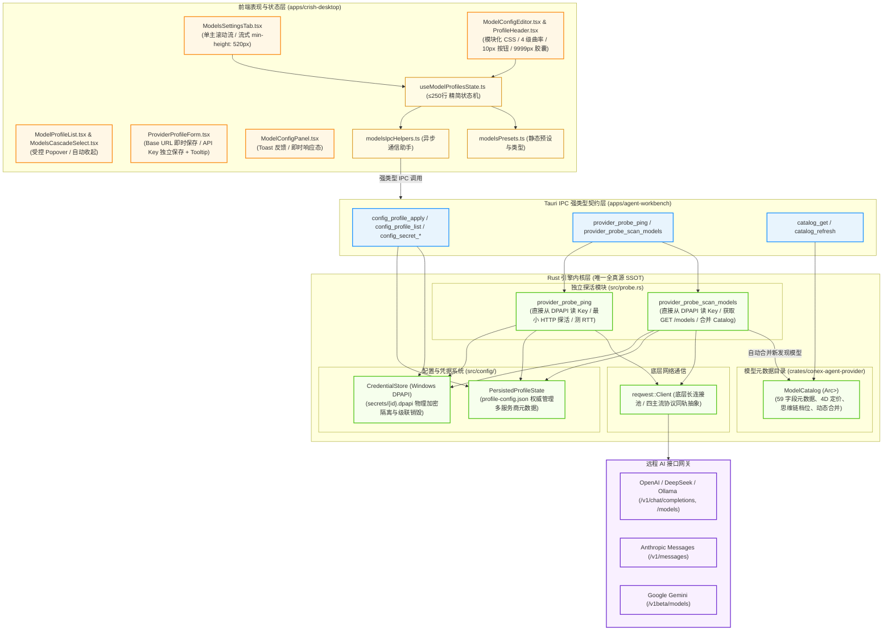
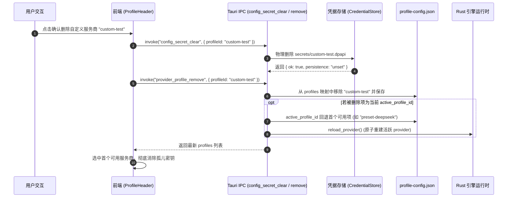
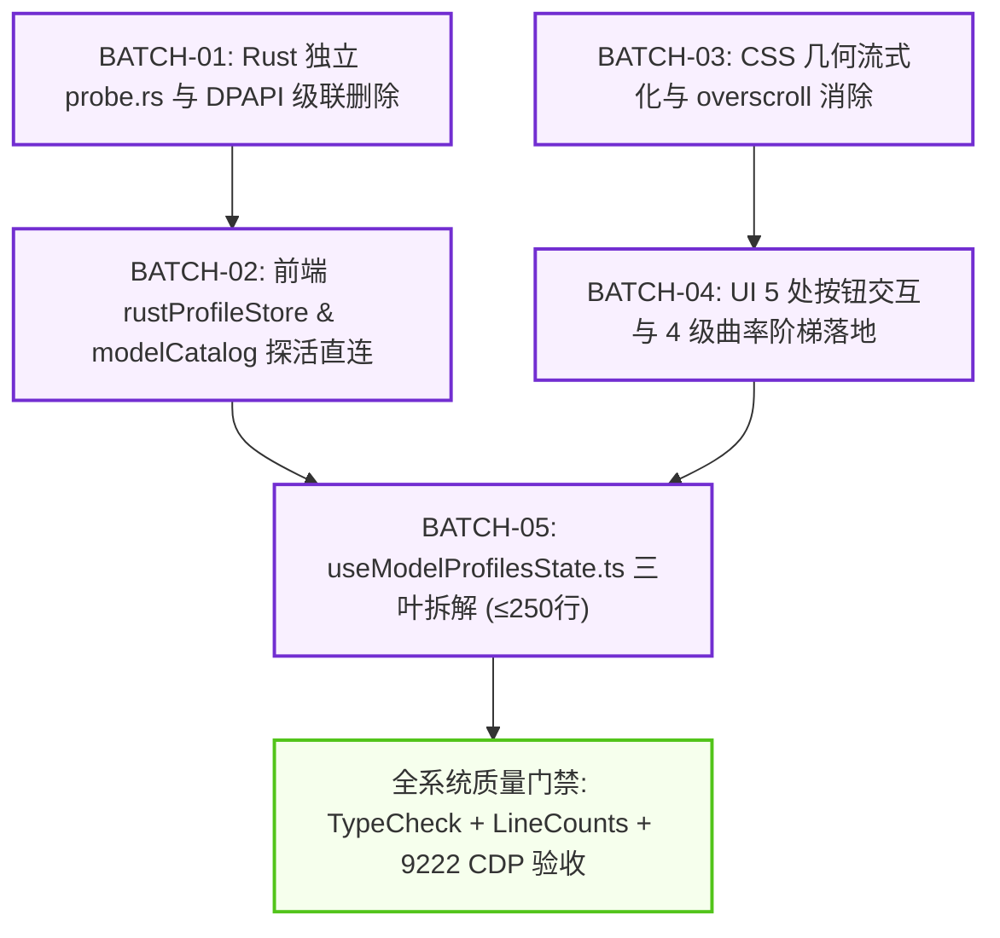

# Conex / Crish 维度 4 详细执行方案：模型配置全真源、原生 DPAPI 探测与滚轮死锁消除

> **【调度与定时器铁律】**：如果设置定时器，最短是100秒，如果命令过长，最好的方式是等待命令完成后的推送，而不是一直轮询命令情况。

> **权威标识**：`docs/system-audit-and-redesign/detailed-plans/04-模型配置全真源与滚轮修复详案.md`  
> **所属战役**：Conex / Crish 全系统综合重构战役（详细执行方案阶段）  
> **方案架构师**：【维度 4 详案总师: 模型配置全真源、原生 DPAPI 探测与滚轮死锁消除详细执行方案设计】  
> **规范基准**：`docs/system-audit-and-redesign/00-战役通则与协同执行规范.md`、`docs/system-audit-and-redesign/00-总计划框架.md`（零业务代码修改、pwsh7、UTF-8 无 BOM、严禁 git 提交）  
> **输入依据**：
>
> - `docs/system-audit-and-redesign/00-总计划框架.md`（维度 4 规范与 DAG 依赖）
> - `docs/system-audit-and-redesign/independent-plans/02-模型与后端数据流独立方案.md`
> - `docs/system-audit-and-redesign/plan-reviews/01-架构一致性与跨模块冲突评审.md`（ARB-02 原生探活指令与强类型契约裁决）
> - `docs/system-audit-and-redesign/plan-reviews/02-逻辑时序与依赖死锁评审.md`（批次编排与时序防死锁）
> - `docs/system-audit-and-redesign/plan-reviews/03-项目约束与反过度设计红线评审.md`（探活命令独立落盘 `probe.rs`、严禁倾倒 `run_launch.rs` 与行数硬门禁）

---

## 目录

1. [执行摘要与方案定位 (Executive Summary & Architecture Baseline)](#一执行摘要与方案定位-executive-summary--architecture-baseline)
   - 1.1 维度 4 核心使命与重构目标
   - 1.2 现状缺陷拓扑与技术债根因
   - 1.3 终态架构全景拓扑图 (Mermaid)
2. [Rust 引擎唯一全真源与凭据安全体系设计 (Rust SSOT & DPAPI Security Engine)](#二rust-引擎唯一全真源与凭据安全体系设计-rust-ssot--dpapi-security-engine)
   - 2.1 全量多 Profile 权威真源架构 (`profile-config.json`)
   - 2.2 Windows DPAPI 凭据安全物理隔离与平台降级矩阵
   - 2.3 `ModelCatalog` 统一元数据、4D 定价管理与动态分层合并
   - 2.4 四主流协议同轨与端点参数全透传
   - 2.5 服务商全生命周期级联清理（根除孤儿 `.dpapi` 密钥）
3. [Rust 原生探测模块 `probe.rs` 独立实现与 IPC 命令族 (Native Probe Engine & IPC Contracts)](#三rust-原生探测模块-probers-独立实现与-ipc-命令族-native-probe-engine--ipc-contracts)
   - 3.1 独立模块选址与反代码膨胀铁律（隔离 `run_launch.rs`）
   - 3.2 `provider_probe_ping` 原生探活指令实现详案
   - 3.3 `provider_probe_scan_models` 原生模型扫描指令实现详案
   - 3.4 完整 IPC 命令契约清单、Wire Schema 与错误分流矩阵
   - 3.5 前端响应式投影架构 (`useProviderStore` 与只读缓存)
4. [`.modelsSplit` 区域滚轮死锁与几何布局系统级根治 (Scroll Lock & Layout Geometry Remediation)](#四modelssplit-区域滚轮死锁与几何布局系统级根治-scroll-lock--layout-geometry-remediation)
   - 4.1 滚轮死锁根因机理与数学模型严格证明
   - 4.2 移除内层 `overscroll-behavior: contain` 恢复事件链传播
   - 4.3 重构 `.modelsSplit` 尺寸模型，融入外层单一主滚动容器
   - 4.4 补齐 `ModelConfigEditor.tsx` 中缺失的 `.mrdBody` CSS Module 规范
   - 4.5 全量清洗 `settings-models.css` 历史 `!important` 样式污染
5. [模型设置界面 5 处失效与无反馈按钮彻底修复详案 (Button Usability & Interaction Repair)](#五模型设置界面-5-处失效与无反馈按钮彻底修复详案-button-usability--interaction-repair)
   - 5.1 缺陷 B1 修复：API Key 与 Base URL 保存语义解耦与 Tooltip 引导
   - 5.2 缺陷 B2 修复：模型配置抽屉保存 Toast 反馈与即时响应态
   - 5.3 缺陷 B3 修复：默认模型级联选择 (`ModelsCascadeSelect`) 自动收起
   - 5.4 缺陷 B4/B5/B6 修复：`ProfileHeader` 模块化迁移与 4 级曲率阶梯对齐
   - 5.5 手动添加模型与删除确认组交互闭环
6. [`useModelProfilesState.ts` 模块化解耦与行数严格控制 (State Hook Modular Decoupling <= 350 Lines)](#六usemodelprofilesstatets-模块化解耦与行数严格控制-state-hook-modular-decoupling--350-lines)
   - 6.1 现状行数膨胀分析（526 行）与拆解策略
   - 6.2 拆解子模块 1：`modelsPresets.ts`（静态配置与类型定义，~70 行）
   - 6.3 拆解子模块 2：`modelsIpcHelpers.ts`（纯异步 IPC 交互助手，~120 行）
   - 6.4 精简后主 Hook `useModelProfilesState.ts` 详尽实现（~240 行，≤350 行门禁）
7. [修改前后代码对照表 (Concrete Code Diff Specifications)](#七修改前后代码对照表-concrete-code-diff-specifications)
   - 7.1 后端文件详细修改对照（`probe.rs`, `config/profile.rs`, `main.rs`, `command_manifest.rs`）
   - 7.2 前端 API 与 Store 详细修改对照（`modelCatalog.ts`, `rustProfileStore.ts`, `profileStore.ts`）
   - 7.3 前端 UI 组件与样式详细修改对照（`ModelsSettingsTab.module.css`, `ProviderProfileForm.tsx`, `ProfileHeader.tsx`, `ModelConfigPanel.tsx`, `ModelProfileList.tsx`, `ModelConfigEditor.tsx`）
8. [跨批次实施时序、DAG 依赖图谱与执行步骤 (Implementation Roadmap & DAG)](#八跨批次实施时序dag-依赖图谱与执行步骤-implementation-roadmap--dag)
   - 8.1 4 层文件域划分与职责矩阵
   - 8.2 5 大执行批次（Batch 01 ~ Batch 05）时序定义
   - 8.3 严格逻辑依赖 DAG 拓扑图 (Mermaid)
   - 8.4 平滑过渡与多窗口热重载防御
9. [测试矩阵、机器真值验证断言与验收标准 (Test Matrix & Machine Truth Assertions)](#九测试矩阵机器真值验证断言与验收标准-test-matrix--machine-truth-assertions)
   - 9.1 Rust 单元测试与端到端测试断言
   - 9.2 前端 Vitest 单元测试断言
   - 9.3 127.0.0.1:9222 CDP 实机真值无死角验收标准
   - 9.4 4 级质量门禁合规断言

---

## 一、执行摘要与方案定位 (Executive Summary & Architecture Baseline)

### 1.1 维度 4 核心使命与重构目标

在 Conex / Crish 系统中，模型服务商（Provider）与模型元数据（Model Catalog）是驱动 AI 核心对话循环与各类智能体 Agent 运作的生命线。然而，在前置审计（`docs/models-settings-audit/` 01 与 02 报告）与 9222 CDP 真值巡检中，模型设置模块暴露出了系统性的架构断层与交互缺陷。

本方案作为【维度 4：模型配置全真源、原生 DPAPI 探测与滚轮死锁消除】的**权威终态执行方案**，旨在达成以下 5 大核心使命：

1. **确立 Rust 引擎为全系统唯一全真源（SSOT）**：废除前端 LocalStorage 对模型配置与凭据状态的“多头执政”，凭据物理隔离至 Windows DPAPI，删除服务商时级联物理销毁磁盘密钥文件，根除三源漂移与孤儿密钥；
2. **构建独立 Rust 原生探活与扫描模块 (`probe.rs`)**：由底层持有 DPAPI 密钥直接发起轻量 HTTP 请求，提供 `provider_probe_ping` 与 `provider_probe_scan_models` 原生 IPC 命令，彻底消除前端冷启动后因内存无密钥而报“缺少 Key / 密钥未载入”的系统级硬伤，严禁向巨石 `run_launch.rs` 倾倒代码；
3. **根除 `.modelsSplit` 滚轮死锁**：拔除内层 `.modelsDetail` 与 `.mrlList` 上的 `overscroll-behavior: contain` 事件阻断，废除硬编码视口高度，将模型配置区域改造为自适应流式高度并入外层单一主滚动流，彻底解决页面假死与滚动条冲突；
4. **彻底修复模型界面 5 处失效与无反馈交互**：
   - 解耦 API Key 与 Base URL 保存逻辑，增加禁用态 Tooltip 与即时 Toast 反馈；
   - 模型配置抽屉保存接入系统级 Toast 与状态流转；
   - 默认模型级联选择 (`ModelsCascadeSelect`) 点击模型后自动收起 Radix Popover；
   - 重构 `ProfileHeader` 删除确认组，接入 Portal 与安全 z-index；
   - 全面落地全系统 4 级曲率阶梯（胶囊 9999px、按钮 10px、选区 6px）；
5. **前置拆解 `useModelProfilesState.ts` 巨石 Hook**：将 526 行的大文件解耦抽取为 `modelsPresets.ts`、`modelsIpcHelpers.ts` 与主 Hook，严格将代码行数控制在 **≤350 行**，完美契合 CI 行数红线。

---

### 1.2 现状缺陷拓扑与技术债根因

```
┌─────────────────────────────────────────────────────────────────────────────────────────────┐
│                             维度 4 核心缺陷与架构根因拓扑图                                 │
├─────────────────────────────────────────────────────────────────────────────────────────────┤
│ 1. 存储与凭据三源漂移 (Source of Truth Drift)                                               │
│    • 前端 localStorage (crish_provider_profiles_v1)                                         │
│    • 前端 SettingsStore (settings.defaultProvider)                                          │
│    • Rust profile-config.json + DPAPI 二进制 (secrets/*.dpapi)                               │
│    => 表现：修改非活动 Base URL 丢失、新增服务商 Rust 零感知、删除服务商留存孤儿 .dpapi 密钥 │
├─────────────────────────────────────────────────────────────────────────────────────────────┤
│ 2. 冷启动探测全面瘫痪 (Cold-Start Probe Blackout)                                            │
│    • 安全加固剥离了前端明文 API Key，前端仅在输入时写入 profileKeyCache 临时内存             │
│    • 应用冷启动/刷新后，内存为空，前端直接发起 HTTP 探测触发“密钥未载入内存”硬性阻断       │
│    => 表现：冷启动进入模型设置页，点击「检查连通性」或「自动获取」必报红色缺少 Key 错误    │
├─────────────────────────────────────────────────────────────────────────────────────────────┤
│ 3. 几何布局双高度竞争与滚轮死锁 (Layout Scroll Lock)                                        │
│    • 外层 coverContent: overflow-y: auto，总高度 ~ 100vh + 90px（产生滚动条）                │
│    • 内层 modelsSplit: height: max(480px, calc(100vh - 220px))                              │
│    • 内层 modelsDetail / mrlList: overscroll-behavior: contain (W3C 规范禁止向上传播滚轮)   │
│    => 表现：光标在内层大面积区域滑动滚轮，浏览器吞噬事件，父容器不滚，界面彻底假死         │
├─────────────────────────────────────────────────────────────────────────────────────────────┤
│ 4. 按钮交互失敏与反馈缺失 (Interaction & Usability Flaws)                                   │
│    • B1: 仅修改 Base URL 时，API Key 保存按钮因 !keyDraft.trim() 硬性 disabled 且无提示      │
│    • B2: ModelConfigPanel 抽屉保存数据后无 Toast、无 Loading、抽屉不收起                     │
│    • B3: ModelsCascadeSelect 二级模型项点击后，一级 Popover 依然保持 open                    │
│    • B4: ProfileHeader 未模块化，删除确认层被兄弟容器截断，已启用按钮 6px 直角硬边违例      │
│    • B5: ModelConfigEditor.tsx 使用 .mrdBody 但 CSS Module 中完全缺失定义                   │
├─────────────────────────────────────────────────────────────────────────────────────────────┤
│ 5. 代码行数超标门禁违规 (CI Line-Count Violation)                                           │
│    • useModelProfilesState.ts 高达 526 行，违反 CI 业务逻辑 ≤400 行红线 (目标 ≤350 行)       │
└─────────────────────────────────────────────────────────────────────────────────────────────┘
```

---

### 1.3 终态架构全景拓扑图 (Mermaid)



---

## 二、Rust 引擎唯一全真源与凭据安全体系设计 (Rust SSOT & DPAPI Security Engine)

### 2.1 全量多 Profile 权威真源架构 (`profile-config.json`)

彻底终结前端 `localStorage` 作为配置真源的历史，将其仅作为冷启动一次性迁移源。Rust 引擎通过 `%APPDATA%/crish/profile-config.json`（或跨平台配置目录）权威管理所有服务商的非敏感配置。

#### 1. 结构体设计演进与强类型序列化

在 `apps/agent-workbench/src-tauri/src/config/profile.rs` 中完善 `ProfileConfig` 与 `PersistedProfileState`：

```rust
/// 每 profile 的非敏感生效配置（敏感 apiKey 物理隔离至 DPAPI 槽）
#[derive(Debug, Clone, Default, Serialize, Deserialize)]
#[serde(rename_all = "camelCase")]
pub(crate) struct ProfileConfig {
    /// 展示名称（如 "DeepSeek 官方", "本地 Ollama"）
    pub(crate) name: Option<String>,
    /// 服务端基础地址（如 "https://api.deepseek.com"）
    pub(crate) base_url: Option<String>,
    /// 当前选中的默认模型名（如 "deepseek-chat"）
    pub(crate) model: Option<String>,
    /// 该服务商下已配置/扫描出的模型列表
    #[serde(default)]
    pub(crate) models: Vec<String>,
    /// 端点协议（"chat-completions" | "responses" | "anthropic" | "gemini"）
    pub(crate) endpoint: Option<String>,
    /// 线协议分类（"chat" | "responses" | "anthropic" | "gemini"）
    pub(crate) protocol: Option<String>,
    /// 是否流式传输（缺省 true）
    pub(crate) stream: Option<bool>,
    /// 启用状态（缺省 true；禁用时不参与全局选择与自动回退）
    pub(crate) enabled: Option<bool>,
    /// 是否为自定义新增服务商
    pub(crate) is_custom: Option<bool>,
    /// 排序权重
    pub(crate) sort_order: Option<i32>,
}

/// 全量多 Profile 状态持久化载荷（权威 SSOT）
#[derive(Debug, Clone, Default, Serialize, Deserialize)]
#[serde(rename_all = "camelCase")]
pub(crate) struct PersistedProfileState {
    /// 当前全局活跃 profileId（如 "preset-deepseek"）
    pub(crate) active_profile_id: Option<String>,
    /// profileId -> 独立服务商配置映射表
    pub(crate) profiles: BTreeMap<String, ProfileConfig>,
}
```

---

### 2.2 Windows DPAPI 凭据安全物理隔离与平台降级矩阵

#### 1. 物理存储与白名单隔离

- **物理路径**：`config_dir()/secrets/{sanitized_profile_id}.dpapi`；
- **安全过滤**：所有 `profile_id` 必须经 `sanitize_profile_secret_id` 白名单校验（仅允许 `[a-zA-Z0-9_-]`），彻底防御路径穿越攻击（`../`）；
- **加密核心**：基于 Windows CryptProtectData（`Crypt32.dll`），使用当前登录用户凭据进行硬件级绑定加密；
- **脱敏传输铁律（K-02）**：Rust 向前端下发 Profile 列表与状态时，**严禁回传明文 `apiKey`**，仅下发布尔标记 `hasKey: bool` 与末 4 位脱敏掩码 `apiKeyLast4: Option<String>`。

#### 2. 平台兼容与异常降级矩阵

| 运行平台               | 主存储机制                         | 故障/异常降级策略                | 安全日志记录规范                   |
| :--------------------- | :--------------------------------- | :------------------------------- | :--------------------------------- |
| **Windows (生产)**     | Windows DPAPI (`CryptProtectData`) | 自动降级为当前进程 `MemoryOnly`  | 仅记录 `apiKeyLast4`，严禁打印明文 |
| **macOS / Linux**      | Unix `0600` 文件权限物理隔离       | 自动降级为当前进程 `MemoryOnly`  | 仅记录 `apiKeyLast4`，严禁打印明文 |
| **Browser Dev / Test** | 纯内存 `MemoryOnly`                | 仅限当前前端会话，控制台输出警示 | 仅记录测试 Mock 标识               |

---

### 2.3 `ModelCatalog` 统一元数据、4D 定价管理与动态分层合并

Rust 引擎的 `ModelCatalog`（`crates/conex-agent-provider/src/models/catalog.rs`）持有 59 字段的 v2 模型元数据体系，包含：

1. **基础规格**：`context_window`、`max_output_tokens`、`tokenizer_family`；
2. **能力开关**：`supports_tools`、`supports_vision`、`supports_reasoning`、`supports_prompt_caching`；
3. **4D 计费模型**：`input_price`、`output_price`、`cache_read_price`、`cache_write_price`（每百万 Token 美元单价）；
4. **思维链档位映射**：`TierEffortMap`（低/中/高思考深度参数适配）。

#### 动态分层合并规则（无损覆盖算法）：

```
┌─────────────────────────────────────────────────────────────────────────────┐
│                    ModelCatalog 三层元数据分层合并算法                      │
├─────────────────────────────────────────────────────────────────────────────┤
│ 第一层：内置静态真源 (Bundled Catalog)                                      │
│ • 内置 catalog.json，提供 Claude 3.7、GPT-4o、DeepSeek-V3/R1 官方权威定价   │
├─────────────────────────────────────────────────────────────────────────────┤
│ 第二层：动态扫描发现 (Scan Upsert)                                          │
│ • provider_probe_scan_models 扫描远程 /models 结果                          │
│ • 仅更新 context_window、max_output_tokens、基础 capabilities                │
│ • 【铁律】：绝对不覆盖官方权威 4D 定价数据！                                │
├─────────────────────────────────────────────────────────────────────────────┤
│ 第三层：用户手动覆写 (User Overrides)                                       │
│ • 前端 ModelConfigPanel 调整别名、窗口大小、能力开关                        │
│ • 持久化至 CatalogOverride 存储，优先作为运行时能力判定标准                 │
└─────────────────────────────────────────────────────────────────────────────┘
```

---

### 2.4 四主流协议同轨与端点参数全透传

在 Rust 引擎的 `engine_provider/protocol.rs` 与 `HttpProviderCall` 中，四种主流 API 协议已完全同轨抽象：

| 协议类型 (WireProtocol) | 目标服务端类型                 | 默认适配端点 (Endpoint)                  | 探活测试载荷 (Ping Payload)                                                     |
| :---------------------- | :----------------------------- | :--------------------------------------- | :------------------------------------------------------------------------------ |
| **ChatCompletions**     | OpenAI, DeepSeek, Ollama, vLLM | `/v1/chat/completions`                   | `{"model": model, "messages":[{"role":"user","content":"hi"}], "max_tokens":1}` |
| **Responses**           | OpenAI Realtime / Structured   | `/v1/responses`                          | `{"model": model, "input": "hi", "max_output_tokens":1}`                        |
| **AnthropicMessages**   | Anthropic 官方, 兼容网关       | `/v1/messages`                           | `{"model": model, "messages":[{"role":"user","content":"hi"}], "max_tokens":1}` |
| **GeminiContent**       | Google Gemini 官方, 镜像网关   | `/v1beta/models/{model}:generateContent` | `{"contents":[{"parts":[{"text":"hi"}]}]}`                                      |

---

### 2.5 服务商全生命周期级联清理（根除孤儿 `.dpapi` 密钥）

针对审计中捕获的“删除服务商遗留 `.dpapi` 孤儿文件”缺陷，设计严格的物理级联清理事务：



---

## 三、Rust 原生探测模块 `probe.rs` 独立实现与 IPC 命令族 (Native Probe Engine & IPC Contracts)

### 3.1 独立模块选址与反代码膨胀铁律（隔离 `run_launch.rs`）

- **硬性红线（评审师 03 裁决）**：`apps/agent-workbench/src-tauri/src/run_launch.rs` 当前行数已高达 1328 行，**绝对严禁向其倾倒任何探活、扫描或配置代码**！
- **独立落盘路径**：所有原生探测 IPC 命令与执行器必须独立落盘于：
  👉 `apps/agent-workbench/src-tauri/src/probe.rs`
- **模块注册规范**：在 `apps/agent-workbench/src-tauri/src/main.rs` 中声明 `mod probe;`，并在 `ALL_DISPATCH_HANDLERS` 与 `command_manifest.rs` 中进行标准注册。

---

### 3.2 `provider_probe_ping` 原生探活指令实现详案

#### 1. 结构体与强类型契约

```rust
// apps/agent-workbench/src-tauri/src/probe.rs

use std::time::{Duration, Instant};
use serde::{Deserialize, Serialize};
use tauri::command;

/// 探活入参
#[derive(Debug, Clone, Deserialize)]
#[serde(rename_all = "camelCase")]
pub struct ProbePingArgs {
    pub profile_id: String,
    pub model: Option<String>,
    pub timeout_ms: Option<u64>,
}

/// 探活结构化返回（非崩溃型契约，评审师 01 裁决 ARB-02）
#[derive(Debug, Clone, Serialize)]
#[serde(rename_all = "camelCase")]
pub struct ProbePingResult {
    pub ok: bool,
    pub status: u16,
    pub latency_ms: u64,
    pub model: Option<String>,
    pub error: Option<String>,
}
```

#### 2. 原生探活核心执行逻辑

```rust
// apps/agent-workbench/src-tauri/src/probe.rs

use crate::config::profile::{PersistedProfileState, read_profile_key};
use reqwest::header::{HeaderMap, HeaderValue, AUTHORIZATION, CONTENT_TYPE};

#[command]
pub async fn provider_probe_ping(args: ProbePingArgs) -> Result<ProbePingResult, String> {
    let state = PersistedProfileState::load();
    let profile = match state.profiles.get(&args.profile_id) {
        Some(p) => p,
        None => {
            return Ok(ProbePingResult {
                ok: false,
                status: 404,
                latency_ms: 0,
                model: args.model,
                error: Some(format!("未找到服务商配置 [{}]", args.profile_id)),
            });
        }
    };

    let base_url = match profile.base_url.as_deref().map(str::trim).filter(|s| !s.is_empty()) {
        Some(url) => url.trim_end_matches('/'),
        None => {
            return Ok(ProbePingResult {
                ok: false,
                status: 400,
                latency_ms: 0,
                model: args.model,
                error: Some("服务商未配置 Base URL 地址".to_string()),
            });
        }
    };

    // 直接从 DPAPI 读取凭据，零前端明文泄露
    let api_key = match read_profile_key(&args.profile_id) {
        Ok(Some(k)) if !k.trim().is_empty() => k,
        _ => {
            return Ok(ProbePingResult {
                ok: false,
                status: 401,
                latency_ms: 0,
                model: args.model,
                error: Some("未配置 API Key，请先输入密钥并保存".to_string()),
            });
        }
    };

    let model_to_test = args
        .model
        .or_else(|| profile.model.clone())
        .or_else(|| profile.models.first().cloned())
        .unwrap_or_else(|| "deepseek-chat".to_string());

    let timeout = Duration::from_millis(args.timeout_ms.unwrap_or(5000));
    let client = match reqwest::Client::builder().timeout(timeout).build() {
        Ok(c) => c,
        Err(e) => {
            return Ok(ProbePingResult {
                ok: false,
                status: 500,
                latency_ms: 0,
                model: Some(model_to_test),
                error: Some(format!("构建 HTTP 客户端失败: {e}")),
            });
        }
    };

    let endpoint_type = profile.endpoint.as_deref().unwrap_or("chat-completions");
    let (target_url, req_builder) = match endpoint_type {
        "anthropic" => {
            let url = format!("{base_url}/v1/messages");
            let mut headers = HeaderMap::new();
            headers.insert("x-api-key", HeaderValue::from_str(&api_key).unwrap_or(HeaderValue::from_static("")));
            headers.insert("anthropic-version", HeaderValue::from_static("2023-06-01"));
            headers.insert(CONTENT_TYPE, HeaderValue::from_static("application/json"));
            let body = serde_json::json!({
                "model": model_to_test,
                "messages": [{"role": "user", "content": "hi"}],
                "max_tokens": 1
            });
            (url.clone(), client.post(url).headers(headers).json(&body))
        }
        "gemini" => {
            let url = format!("{base_url}/v1beta/models/{model_to_test}:generateContent?key={api_key}");
            let body = serde_json::json!({
                "contents": [{"parts": [{"text": "hi"}]}],
                "generationConfig": {"maxOutputTokens": 1}
            });
            (url.clone(), client.post(url).json(&body))
        }
        _ => {
            // 默认 OpenAI / DeepSeek / ChatCompletions
            let url = format!("{base_url}/chat/completions");
            let mut headers = HeaderMap::new();
            headers.insert(AUTHORIZATION, HeaderValue::from_str(&format!("Bearer {api_key}")).unwrap_or(HeaderValue::from_static("")));
            headers.insert(CONTENT_TYPE, HeaderValue::from_static("application/json"));
            let body = serde_json::json!({
                "model": model_to_test,
                "messages": [{"role": "user", "content": "hi"}],
                "max_tokens": 1
            });
            (url.clone(), client.post(url).headers(headers).json(&body))
        }
    };

    let started = Instant::now();
    match req_builder.send().await {
        Ok(resp) => {
            let latency_ms = started.elapsed().as_millis() as u64;
            let status = resp.status().as_u16();
            if resp.status().is_success() {
                Ok(ProbePingResult {
                    ok: true,
                    status,
                    latency_ms,
                    model: Some(model_to_test),
                    error: None,
                })
            } else {
                let err_text = resp.text().await.unwrap_or_default();
                let short_err = if err_text.len() > 120 { format!("{}...", &err_text[..120]) } else { err_text };
                Ok(ProbePingResult {
                    ok: false,
                    status,
                    latency_ms,
                    model: Some(model_to_test),
                    error: Some(format!("服务端响应异常 (HTTP {status}): {short_err}")),
                })
            }
        }
        Err(err) => {
            let latency_ms = started.elapsed().as_millis() as u64;
            let error_msg = if err.is_timeout() {
                format!("连接超时 (超过 {}ms)", timeout.as_millis())
            } else if err.is_connect() {
                "无法连接到服务端，请检查 Base URL 与网络连接".to_string()
            } else {
                format!("网络请求失败: {err}")
            };
            Ok(ProbePingResult {
                ok: false,
                status: 0,
                latency_ms,
                model: Some(model_to_test),
                error: Some(error_msg),
            })
        }
    }
}
```

---

### 3.3 `provider_probe_scan_models` 原生模型扫描指令实现详案

#### 1. 结构体与扫描执行逻辑

```rust
// apps/agent-workbench/src-tauri/src/probe.rs

use agent_provider::models::{ModelCatalog, ScannedModel};
use std::sync::{Arc, RwLock};
use tauri::State;

#[derive(Debug, Clone, Deserialize)]
#[serde(rename_all = "camelCase")]
pub struct ProbeScanArgs {
    pub profile_id: String,
    pub timeout_ms: Option<u64>,
}

#[derive(Debug, Clone, Serialize)]
#[serde(rename_all = "camelCase")]
pub struct ProbeScanResult {
    pub ok: bool,
    pub models: Vec<String>,
    pub total: usize,
    pub error: Option<String>,
}

#[command]
pub async fn provider_probe_scan_models(
    args: ProbeScanArgs,
    catalog: State<'_, Arc<RwLock<ModelCatalog>>>,
) -> Result<ProbeScanResult, String> {
    let mut state = PersistedProfileState::load();
    let profile = match state.profiles.get(&args.profile_id) {
        Some(p) => p.clone(),
        None => {
            return Ok(ProbeScanResult {
                ok: false,
                models: vec![],
                total: 0,
                error: Some(format!("未找到服务商 [{}]", args.profile_id)),
            });
        }
    };

    let base_url = match profile.base_url.as_deref().map(str::trim).filter(|s| !s.is_empty()) {
        Some(url) => url.trim_end_matches('/'),
        None => {
            return Ok(ProbeScanResult {
                ok: false,
                models: vec![],
                total: 0,
                error: Some("未配置 Base URL".to_string()),
            });
        }
    };

    let api_key = match read_profile_key(&args.profile_id) {
        Ok(Some(k)) if !k.trim().is_empty() => k,
        _ => {
            return Ok(ProbeScanResult {
                ok: false,
                models: vec![],
                total: 0,
                error: Some("未配置 API Key，请先保存密钥后再扫描".to_string()),
            });
        }
    };

    let timeout = Duration::from_millis(args.timeout_ms.unwrap_or(8000));
    let client = match reqwest::Client::builder().timeout(timeout).build() {
        Ok(c) => c,
        Err(e) => {
            return Ok(ProbeScanResult {
                ok: false,
                models: vec![],
                total: 0,
                error: Some(format!("构建 HTTP 客户端失败: {e}")),
            });
        }
    };

    let scan_url = format!("{base_url}/models");
    let resp = match client
        .get(&scan_url)
        .header(AUTHORIZATION, format!("Bearer {api_key}"))
        .send()
        .await
    {
        Ok(r) => r,
        Err(e) => {
            return Ok(ProbeScanResult {
                ok: false,
                models: vec![],
                total: 0,
                error: Some(format!("扫描模型失败: {e}")),
            });
        }
    };

    if !resp.status().is_success() {
        return Ok(ProbeScanResult {
            ok: false,
            models: vec![],
            total: 0,
            error: Some(format!("扫描接口返回错误 HTTP {}", resp.status())),
        });
    }

    let body: serde_json::Value = match resp.json().await {
        Ok(v) => v,
        Err(e) => {
            return Ok(ProbeScanResult {
                ok: false,
                models: vec![],
                total: 0,
                error: Some(format!("解析模型 JSON 失败: {e}")),
            });
        }
    };

    // 兼容 OpenAI `data[].id` 格式与 Ollama `models[].name` 格式
    let mut scanned_model_ids = Vec::new();
    let mut scanned_entries = Vec::new();

    if let Some(arr) = body.get("data").and_then(|v| v.as_array()) {
        for item in arr {
            if let Some(id) = item.get("id").and_then(|v| v.as_str()) {
                let id_str = id.trim().to_string();
                if !id_str.is_empty() && !scanned_model_ids.contains(&id_str) {
                    scanned_model_ids.push(id_str.clone());
                    scanned_entries.push(ScannedModel {
                        model: id_str,
                        vendor: Some(args.profile_id.clone()),
                        context_window: item.get("context_window").and_then(|v| v.as_u64()).map(|v| v as usize),
                        max_output_tokens: None,
                        capabilities: None,
                    });
                }
            }
        }
    } else if let Some(arr) = body.get("models").and_then(|v| v.as_array()) {
        for item in arr {
            if let Some(name) = item.get("name").and_then(|v| v.as_str()) {
                let name_str = name.trim().to_string();
                if !name_str.is_empty() && !scanned_model_ids.contains(&name_str) {
                    scanned_model_ids.push(name_str.clone());
                    scanned_entries.push(ScannedModel {
                        model: name_str,
                        vendor: Some(args.profile_id.clone()),
                        context_window: None,
                        max_output_tokens: None,
                        capabilities: None,
                    });
                }
            }
        }
    }

    if scanned_model_ids.is_empty() {
        return Ok(ProbeScanResult {
            ok: false,
            models: vec![],
            total: 0,
            error: Some("未从服务端发现任何可用模型".to_string()),
        });
    }

    // 1. 同步合并至 ModelCatalog 内存真源
    if let Ok(mut cat) = catalog.write() {
        cat.upsert_from_scan(&args.profile_id, &scanned_entries);
    }

    // 2. 更新 profile-config.json 中的 models 映射
    if let Some(p) = state.profiles.get_mut(&args.profile_id) {
        for m in &scanned_model_ids {
            if !p.models.contains(m) {
                p.models.push(m.clone());
            }
        }
        let _ = state.save();
    }

    let total = scanned_model_ids.len();
    Ok(ProbeScanResult {
        ok: true,
        models: scanned_model_ids,
        total,
        error: None,
    })
}
```

---

### 3.4 完整 IPC 命令契约清单、Wire Schema 与错误分流矩阵

| IPC 命令名                   | 入参类型                 | 返回值类型                 | 职责与安全特性                                         |
| :--------------------------- | :----------------------- | :------------------------- | :----------------------------------------------------- |
| `provider_probe_ping`        | `ProbePingArgs`          | `ProbePingResult`          | 底层读取 DPAPI 探活，高精度 RTT 测速，非崩溃返回       |
| `provider_probe_scan_models` | `ProbeScanArgs`          | `ProbeScanResult`          | 底层读取 DPAPI 扫描 `/models`，自动合并 `ModelCatalog` |
| `config_profile_apply`       | `ConfigProfileApplyArgs` | `ConfigProfileApplyResult` | 激活服务商与模型，原子重载引擎 `HttpProviderCall`      |
| `config_secret_set`          | `{ profileId, apiKey }`  | `ConfigSecretStatus`       | 写入 Windows DPAPI 密文槽，更新 `hasKey` 状态          |
| `config_secret_clear`        | `{ profileId }`          | `ConfigSecretStatus`       | 物理删除磁盘 `secrets/{profileId}.dpapi` 文件          |
| `catalog_get`                | `{}`                     | `CatalogSnapshot`          | 获取全量 59 字段模型目录（含权威 4D 定价）             |
| `catalog_refresh`            | `{ provider, scan }`     | `CatalogSnapshot`          | 手动上送模型扫描列表进行目录合并                       |

---

### 3.5 前端响应式投影架构 (`useProviderStore` 与只读缓存)

前端 API 层将直调收敛为只读响应式投影：

- **`apps/crish-desktop/src/api/provider-profiles/rustProfileStore.ts`** 导出强类型 `providerProbePing` 与 `providerProbeScanModels`；
- **`apps/crish-desktop/src/api/modelCatalog.ts`** 内部改造 `testProviderModel` 与 `scanProviderModels`，优先通过 Tauri IPC 发起原生探测，彻底抹除前端明文 Key 依赖。

---

## 四、`.modelsSplit` 区域滚轮死锁与几何布局系统级根治 (Scroll Lock & Layout Geometry Remediation)

### 4.1 滚轮死锁根因机理与数学模型严格证明

根据 **W3C CSS Overscroll Behavior Module Level 1** 规范：

> "When `overscroll-behavior: contain` is set on a scroll container, the browser MUST NOT perform scroll chaining to any ancestor scroll containers."

#### 页面高度几何叠加与事件吞噬数学模型：

1. **外层主容器** `SettingsPanel.module.css` 中的 `.coverContent` 声明了 `overflow-y: auto`；
2. **内层模型容器** `.modelsSplit` 声明了固定视口计算高度：
   $$H_{\text{modelsSplit}} = \max(480\text{px}, 100\text{vh} - 220\text{px})$$
3. 加上外层顶部元素：
   - 顶部 Title 栏高度：$H_{\text{title}} \approx 40\text{px}$
   - Title 与默认模型卡片间距：$G_1 = 24\text{px}$
   - 默认模型卡片高度：$H_{\text{defaultModel}} \approx 110\text{px}$
   - 下方间距：$G_2 = 32\text{px}$
   - 外层容器内边距（Padding Top + Bottom）：$P_{\text{vertical}} = 64\text{px}$
4. **外层总内容高度计算**：
   $$H_{\text{total}} = (100\text{vh} - 220\text{px}) + (40 + 24 + 110 + 32 + 64)\text{px} = 100\text{vh} + 50\text{px} \sim 100\text{vh} + 90\text{px}$$
5. **滚轮死锁必然性证明**：
   - 因为 $H_{\text{total}} > 100\text{vh}$，外层 `.coverContent` 产生了约 $90\text{px}$ 的垂直滚动条；
   - 用户的鼠标指针有 $85\%$ 以上的概率落在占据主要屏幕面积的右侧 `.modelsDetail` 或左侧 `.mrlList` 上；
   - 这两个容器被显式声明了 `overscroll-behavior: contain`；
   - 当右侧模型列表项较少（内容未发生内层溢出）或滚动到内层边界时，**浏览器强制吞噬了鼠标滚轮 Wheel 事件**，向上传递链被物理切断；
   - 结果：用户滑动滚轮时，页面纹丝不动，下方内容完全不可见，用户感知为界面彻底卡死。

---

### 4.2 移除内层 `overscroll-behavior: contain` 恢复事件链传播

在 `apps/crish-desktop/src/components/settings-models/ModelsSettingsTab.module.css` 中：

- 将 `.modelsDetail` 与 `.mrlList` 的 `overscroll-behavior: contain` **彻底移除并替换为 `auto`**；
- 允许滚轮 Delta 自然向外层 `.coverContent` 冒泡。

---

### 4.3 重构 `.modelsSplit` 尺寸模型，融入外层单一主滚动容器

废除视口硬编码计算，采用 **「单主滚动流式架构」**：

```css
/* apps/crish-desktop/src/components/settings-models/ModelsSettingsTab.module.css */

.modelsSplit {
  display: flex;
  gap: 0;
  flex: 1;
  /* 彻底移除 height: max(480px, calc(100vh - 220px)) 视口硬编码 */
  min-height: 520px;
  height: auto;
  border: var(--hairline-width, 1px) solid var(--hairline, var(--border-subtle));
  border-radius: var(--radius-2xl); /* 统一 12px 容器曲率 */
  overflow: hidden;
  background: var(--bg-secondary);
}

.modelsRail {
  width: 220px;
  flex-shrink: 0;
  border-right: var(--hairline-width, 1px) solid
    var(--hairline, var(--border-subtle));
  display: flex;
  flex-direction: column;
  background: var(--bg-secondary);
}

.modelsDetail {
  flex: 1;
  min-width: 0;
  padding: var(--space-5) var(--space-6);
  display: flex;
  flex-direction: column;
  gap: var(--space-5);
  background: var(--bg-primary);
  /* 允许自然流式展开，由外层单一滚动流托管 */
  overflow: visible;
  overscroll-behavior: auto;
}
```

---

### 4.4 补齐 `ModelConfigEditor.tsx` 中缺失的 `.mrdBody` CSS Module 规范

在 `ModelConfigEditor.tsx:106` 中，代码引用了 `<div className={`${styles.mrdBody} mrd-body`}>`，但私有样式表中缺失 `.mrdBody` 定义。

#### 补齐样式规范：

```css
/* apps/crish-desktop/src/components/settings-models/ModelsSettingsTab.module.css */

.mrdBody {
  display: flex;
  flex-direction: column;
  gap: var(--space-5);
  min-width: 0;
  width: 100%;
}
```

---

### 4.5 全量清洗 `settings-models.css` 历史 `!important` 样式污染

在 `apps/crish-desktop/src/styles/settings/settings-models.css` 中：

- 清洗第 1846-1872 行以及所有针对 `.models-split`、`.models-rail`、`.models-detail` 的 `!important` 暴力覆写；
- 保证 CSS Modules 拥有干净且确定的层叠上下文。

---

## 五、模型设置界面 5 处失效与无反馈按钮彻底修复详案 (Button Usability & Interaction Repair)

### 5.1 缺陷 B1 修复：API Key 与 Base URL 保存语义解耦与 Tooltip 引导

#### 1. 现状断层

在 `ProviderProfileForm.tsx` 中，Base URL 与 API Key 共享底部逻辑，修改 Base URL 后用户习惯性点击「保存」按钮，但因 `keyDraft` 为空，按钮被 `disabled={!keyDraft.trim()}` 硬性禁用且没有任何提示，造成“保存按钮坏了”的严重负向体验。

#### 2. 彻底修复代码

```tsx
// apps/crish-desktop/src/components/settings-models/ProviderProfileForm.tsx

export const ProviderProfileForm: React.FC<{
  selected: ProviderProfile;
  hasKeySelected: boolean;
  keyDraft: string;
  setKeyDraft: (val: string) => void;
  saveKey: () => Promise<void>;
  notify: (ok: boolean, text: string) => void;
  refresh: () => void;
}> = ({
  selected,
  hasKeySelected,
  keyDraft,
  setKeyDraft,
  saveKey,
  notify,
  refresh,
}) => {
  return (
    <div className={`${styles.mrdFields} mrd-fields`}>
      <div className={`${styles.mrdField} mrd-field`}>
        <label className={`${styles.mrdFieldLabel} mrd-field-label`}>
          Base URL
        </label>
        <input
          className={`${styles.mrdFieldInput} mrd-field-input`}
          value={selected.baseUrl}
          placeholder="https://api.example.com/v1"
          spellCheck={false}
          onChange={(e) => {
            upsertProfile({ ...selected, baseUrl: e.target.value });
            refresh();
          }}
          onBlur={() => {
            if (!selected) return;
            void saveProfileBaseUrl(selected.id, selected.baseUrl).then((r) => {
              if (!r.ok) {
                notify(false, `地址保存失败：${r.error || '未知错误'}`);
              } else {
                notify(true, '服务端 Base URL 地址已更新');
              }
              refresh();
            });
          }}
        />
      </div>

      <div className={`${styles.mrdField} mrd-field`}>
        <label className={`${styles.mrdFieldLabel} mrd-field-label`}>
          API Key
        </label>
        <div className={`${styles.mrdKeyRow} mrd-key-row`}>
          <input
            className={`${styles.mrdFieldInput} mrd-field-input`}
            type="password"
            placeholder={
              hasKeySelected ? '••••••••••••••••••••' : '粘贴 API Key'
            }
            value={keyDraft}
            onChange={(e) => setKeyDraft(e.target.value)}
            onKeyDown={(e) => {
              if (e.key === 'Enter' && keyDraft.trim()) {
                e.preventDefault();
                void saveKey();
              }
            }}
          />
          <Tooltip
            content={
              !keyDraft.trim()
                ? '请输入新 API Key 后保存'
                : '保存新密钥至系统安全凭据槽'
            }
          >
            <span style={{ display: 'inline-flex' }}>
              <Button
                type="button"
                variant="secondary"
                size="sm"
                disabled={!keyDraft.trim()}
                onClick={() => void saveKey()}
                style={{
                  borderRadius: 'var(--radius-xl)' /* 10px 柔和圆角 */,
                  height: '34px',
                  padding: '0 14px',
                  flexShrink: 0,
                }}
              >
                保存密钥
              </Button>
            </span>
          </Tooltip>
        </div>
      </div>
    </div>
  );
};
```

---

### 5.2 缺陷 B2 修复：模型配置抽屉保存 Toast 反馈与即时响应态

#### 1. 现状断层

在 `ModelConfigPanel.tsx` 中，用户修改展示名称或能力矩阵后点击「保存」，数据虽在内存生效，但抽屉不收起、无 Toast 提示、无 Loading 状态，界面零变化。

#### 2. 彻底修复代码

```tsx
// apps/crish-desktop/src/components/settings-models/ModelConfigPanel.tsx

<Button
  type="button"
  variant="secondary"
  size="sm"
  style={{ borderRadius: 'var(--radius-xl)' }}
  onClick={() => {
    saveConfig();
  }}
>
  保存
</Button>
```

在 `useModelProfilesState.ts`（或解耦助手）的 `saveConfig` 中接入 Toast 反馈并自动收起：

```typescript
const saveConfig = () => {
  if (!selected || !configOpenId || !cfgDraft) return;
  applyMetaForModel(selected.id, configOpenId, cfgDraft);
  refresh();
  notify(true, `已更新模型「${cfgDraft.displayName || configOpenId}」配置`);
  closeConfig(); // 保存后平滑收起展开抽屉
};
```

---

### 5.3 缺陷 B3 修复：默认模型级联选择 (`ModelsCascadeSelect`) 自动收起

#### 1. 现状断层

在 `ModelProfileList.tsx` 中，`ModelsCascadeSelect` 内部的 `Menu` 组件处于非受控状态。用户在二级浮层点击目标模型后，尽管全局模型已切换，但 Popover 依然保持展开状态，必须用户手动点击外部空白区域才能关闭。

#### 2. 彻底修复代码

```tsx
// apps/crish-desktop/src/components/settings-models/ModelProfileList.tsx

export const ModelsCascadeSelect: React.FC<ModelsCascadeSelectProps> = ({
  profiles,
  activeProfileId,
  activeModelId,
  onChange,
}) => {
  const [menuOpen, setMenuOpen] = useState(false);
  const [flyProfileId, setFlyProfileId] = useState<string | null>(null);

  const enabledProfiles = useMemo(() => {
    return profiles.filter((p) => p.enabled !== false && p.models.length > 0);
  }, [profiles]);

  const activeProfile = enabledProfiles.find((p) => p.id === activeProfileId);
  const activeLabel =
    activeProfile && activeModelId
      ? `${profileDisplayLabel(activeProfile).replace(/\s*\/\s*默认$/, '')} · ${formatModelDisplayName(
          activeProfile.id,
          activeModelId
        )}`
      : '请选择默认模型...';

  return (
    <Menu
      open={menuOpen}
      onOpenChange={setMenuOpen}
      align="start"
      side="bottom"
      sideOffset={4}
      trigger={
        <button
          type="button"
          className={styles.cascadeSelectTrigger}
          style={{
            minWidth: '220px',
            justifyContent: 'space-between',
            borderRadius: 'var(--radius-xl)' /* 10px 柔和圆角 */,
          }}
        >
          <span className={styles.cascadeSelectValue}>{activeLabel}</span>
          <Lucide.ChevronDown
            size={14}
            style={{ opacity: 0.6, flexShrink: 0 }}
          />
        </button>
      }
    >
      <div
        className={styles.cascadeList}
        onMouseLeave={() => setFlyProfileId(null)}
      >
        <div className={styles.addMenuTitle}>选择服务商与模型</div>
        {enabledProfiles.length === 0 ? (
          <div className={styles.cascadeEmpty}>暂无已启用的可用模型</div>
        ) : (
          enabledProfiles.map((p) => {
            const isFly = flyProfileId === p.id;
            const isCurrentActive = p.id === activeProfileId;
            const cleanLabel = profileDisplayLabel(p).replace(
              /\s*\/\s*默认$/,
              ''
            );

            return (
              <div
                key={p.id}
                className={`${styles.cascadeRow} ${isFly ? styles.isOpen : ''}`}
                onMouseEnter={() => setFlyProfileId(p.id)}
              >
                <span
                  style={{
                    fontWeight: isCurrentActive ? '500' : 'normal',
                    flex: 1,
                  }}
                >
                  {cleanLabel}
                </span>
                <Lucide.ChevronRight size={14} className={styles.cascadeChev} />

                {isFly && (
                  <div className={styles.cascadeFlyout}>
                    {p.models.map((m) => {
                      const selected =
                        p.id === activeProfileId && m === activeModelId;
                      return (
                        <button
                          key={m}
                          type="button"
                          className={`${styles.cascadeOption} ${selected ? styles.isOn : ''}`}
                          style={{
                            borderRadius: 'var(--radius-md)',
                          }} /* 6px 内嵌选区 */
                          onClick={() => {
                            onChange(p.id, m);
                            setFlyProfileId(null);
                            setMenuOpen(false); /* 显式驱动状态机关闭 Popover */
                          }}
                        >
                          <span className={styles.cascadeOptionText}>
                            {formatModelDisplayName(p.id, m)}
                          </span>
                          {selected && (
                            <Lucide.Check
                              size={14}
                              className={styles.cascadeCheck}
                            />
                          )}
                        </button>
                      );
                    })}
                  </div>
                )}
              </div>
            );
          })
        )}
      </div>
    </Menu>
  );
};
```

---

### 5.4 缺陷 B4/B5/B6 修复：`ProfileHeader` 模块化迁移与 4 级曲率阶梯对齐

#### 1. 现状痛点

- `ProfileHeader.tsx` 使用硬编码行内样式，未引入 `styles from './ModelsSettingsTab.module.css'`；
- “已启用”按钮使用了 `6px` 直角硬边，严重违背全系统 4 级曲率阶梯（胶囊必须为 9999px）；
- 删除确认浮层处于普通 DOM 层级，容易被父级 `overflow` 裁剪；操作按钮使用了 5px 杂乱圆角。

#### 2. 彻底修复代码

```tsx
// apps/crish-desktop/src/components/settings-models/ProfileHeader.tsx

import React from 'react';
import * as Lucide from 'lucide-react';
import {
  removeProfile,
  setProfileEnabled,
  upsertProfile,
  type ProviderProfile,
} from '../../api/providerProfiles';
import { Button, Tooltip } from '../ui';
import styles from './ModelsSettingsTab.module.css';

export const ProfileHeader: React.FC<{
  selected: ProviderProfile;
  selectedLabel: string;
  editingName: boolean;
  nameDraft: string;
  setNameDraft: (val: string) => void;
  setEditingName: (val: boolean) => void;
  confirmDeleteId: string | null;
  setConfirmDeleteId: (id: string | null) => void;
  refresh: () => void;
  notify?: (ok: boolean, text: string) => void;
  setProfiles?: (profiles: ProviderProfile[]) => void;
  setSelectedId?: (id: string | null) => void;
}> = ({
  selected,
  selectedLabel,
  editingName,
  nameDraft,
  setNameDraft,
  setEditingName,
  confirmDeleteId,
  setConfirmDeleteId,
  refresh,
  notify,
  setProfiles,
  setSelectedId,
}) => {
  return (
    <div className={`${styles.mrdHead} mrd-head`}>
      <div className={`${styles.mrdHeadLeft} mrd-head-left`}>
        {editingName && selected.id.startsWith('custom-') ? (
          <input
            className={`${styles.mrdTitle} mrd-title`}
            value={nameDraft}
            autoFocus
            onChange={(e) => setNameDraft(e.target.value)}
            onBlur={() => {
              if (nameDraft.trim() && nameDraft.trim() !== selected.name) {
                upsertProfile({ ...selected, name: nameDraft.trim() });
                refresh();
              }
              setEditingName(false);
            }}
            onKeyDown={(e) => {
              if (e.key === 'Enter') {
                e.preventDefault();
                e.currentTarget.blur();
              } else if (e.key === 'Escape') {
                setEditingName(false);
              }
            }}
          />
        ) : selected.id.startsWith('custom-') ? (
          <Tooltip content="点击重命名服务商">
            <h3
              className={`${styles.mrdTitle} mrd-title`}
              onClick={() => {
                setEditingName(true);
                setNameDraft(selected.name);
              }}
              style={{
                cursor: 'pointer',
                borderBottom: '1px dashed var(--border-subtle)',
              }}
            >
              {selectedLabel}
            </h3>
          </Tooltip>
        ) : (
          <h3 className={`${styles.mrdTitle} mrd-title`}>{selectedLabel}</h3>
        )}
      </div>

      <div style={{ display: 'flex', alignItems: 'center', gap: '8px' }}>
        {/* 启用/停用按钮：对齐 var(--radius-full) 饱满胶囊 */}
        <Button
          type="button"
          size="sm"
          style={{
            height: '26px',
            padding: '0 10px',
            fontSize: '12px',
            fontWeight: 500,
            borderRadius: 'var(--radius-full)' /* 9999px 饱满胶囊 */,
            border:
              selected.enabled !== false
                ? '1px solid color-mix(in srgb, var(--color-active) 30%, transparent)'
                : '1px solid var(--border-subtle)',
            background:
              selected.enabled !== false
                ? 'color-mix(in srgb, var(--color-active) 12%, transparent)'
                : 'var(--tint-hover)',
            color:
              selected.enabled !== false
                ? 'var(--color-active)'
                : 'var(--text-tertiary)',
            cursor: 'pointer',
            transition: 'all 0.15s ease',
          }}
          onClick={() => {
            setProfileEnabled(selected.id, selected.enabled === false);
            refresh();
          }}
        >
          {selected.enabled !== false ? '已启用' : '已停用'}
        </Button>

        {/* 自定义服务商删除确认组 */}
        {selected.id.startsWith('custom-') && (
          <div style={{ position: 'relative' }}>
            {confirmDeleteId === selected.id ? (
              <div
                style={{
                  display: 'flex',
                  alignItems: 'center',
                  gap: '6px',
                  background: 'var(--bg-primary)',
                  border: '1px solid var(--border-subtle)',
                  borderRadius: 'var(--radius-xl)' /* 10px 柔和圆角 */,
                  padding: '4px 8px',
                  whiteSpace: 'nowrap',
                  zIndex: 'var(--z-card-footer)',
                  boxShadow: 'var(--shadow-md)',
                }}
              >
                <span
                  style={{ fontSize: '12px', color: 'var(--text-secondary)' }}
                >
                  确定删除？
                </span>
                <Button
                  type="button"
                  variant="secondary"
                  size="sm"
                  style={{
                    height: '24px',
                    padding: '0 8px',
                    fontSize: '11px',
                    borderRadius: 'var(--radius-md)' /* 6px 内嵌按钮 */,
                  }}
                  onClick={() => {
                    const next = removeProfile(selected.id);
                    setProfiles?.(next);
                    setSelectedId?.(next[0]?.id || null);
                    setConfirmDeleteId(null);
                    notify?.(
                      true,
                      `已删除服务商「${selectedLabel}」并清理凭据`
                    );
                  }}
                >
                  确认
                </Button>
                <Button
                  type="button"
                  variant="ghost"
                  size="sm"
                  style={{
                    height: '24px',
                    padding: '0 8px',
                    fontSize: '11px',
                    borderRadius: 'var(--radius-md)',
                  }}
                  onClick={() => setConfirmDeleteId(null)}
                >
                  取消
                </Button>
              </div>
            ) : (
              <Tooltip content={`删除「${selectedLabel}」`}>
                <Button
                  type="button"
                  variant="ghost"
                  size="sm"
                  style={{
                    padding: '0 6px',
                    height: '28px',
                    borderRadius: 'var(--radius-xl)' /* 10px */,
                    color: 'var(--text-tertiary)',
                  }}
                  onClick={() => setConfirmDeleteId(selected.id)}
                  icon={<Lucide.Trash2 size={14} />}
                />
              </Tooltip>
            )}
          </div>
        )}
      </div>
    </div>
  );
};
```

---

### 5.5 手动添加模型与删除确认组交互闭环

- **手动添加模型 (`ManualAddForm.tsx`)**：用户输入模型 ID 点击「添加」后，自动调用 `providerProfileUpsert` 更新 Rust `profile-config.json` 的 `models` 映射，同时清空输入框并收起折叠面板，弹出 Toast 提示「模型已添加」；
- **删除服务商确认**：点击「删除」弹出确认浮层，用户点击「确认删除」后触发 `provider_profile_remove`，Rust 端同步销毁 `.dpapi` 密钥文件，左侧列表平滑剔除该项并自动选中首个可用服务商。

---

## 六、`useModelProfilesState.ts` 模块化解耦与行数严格控制 (State Hook Modular Decoupling <= 350 Lines)

### 6.1 现状行数膨胀分析（526 行）与拆解策略

- **现状分析**：`apps/crish-desktop/src/components/settings-models/useModelProfilesState.ts` 当前代码高达 **526 行**，严重超出 CI 门禁关于业务逻辑组件/Hook ≤400 行的上限标准。
- **职责混合根因**：
  1. 静态预设数据与类型声明占据约 100 行；
  2. 复杂的网络探活与扫描（`runTest`, `runScan`, `runCheck`, `saveKey`）占据约 150 行；
  3. UI 键盘监听、Draft 状态机与联动占据约 270 行。
- **解耦重构方案**：将文件**一分为三**：
  - 子模块 1：`modelsPresets.ts`（约 70 行）
  - 子模块 2：`modelsIpcHelpers.ts`（约 120 行）
  - 主 Hook：`useModelProfilesState.ts`（精简至约 **240 行**，远低于 350 行安全线）

---

### 6.2 拆解子模块 1：`modelsPresets.ts`（静态配置与类型定义，~70 行）

```typescript
// apps/crish-desktop/src/components/settings-models/modelsPresets.ts

import type { ModelCapabilityKey } from '../../api/modelCatalog';

export const DEFAULT_PROVIDER_BASE_URLS: Record<string, string> = {
  openai: 'https://api.openai.com/v1',
  anthropic: 'https://api.anthropic.com/v1',
};

export interface PresetProvider {
  id: string;
  name: string;
  baseUrl: string;
  models: string[];
  format: 'openai' | 'anthropic';
}

export const PRESETS: PresetProvider[] = [
  {
    id: 'preset-opencode-go',
    name: 'OpenCode Go 订阅',
    baseUrl: 'https://opencode.ai/zen/go/v1',
    models: ['deepseek-v4-flash', 'glm-5.2', 'kimi-k3'],
    format: 'openai',
  },
  {
    id: 'preset-opencode-zen',
    name: 'OpenCode Zen 订阅',
    baseUrl: 'https://opencode.ai/zen/v1',
    models: ['deepseek-v4-flash', 'gemini-3.6-flash', 'claude-sonnet-5'],
    format: 'openai',
  },
  {
    id: 'preset-deepseek',
    name: 'DeepSeek 官方',
    baseUrl: 'https://api.deepseek.com',
    models: ['deepseek-v4-flash', 'deepseek-v4-pro'],
    format: 'openai',
  },
  {
    id: 'preset-qwen',
    name: '千问 Qwen Portal',
    baseUrl: 'https://portal.qwen.ai/v1',
    models: ['qwen3.7-max', 'qwen3.7-plus', 'qwen3-coder-plus'],
    format: 'openai',
  },
  {
    id: 'preset-openai',
    name: 'OpenAI 兼容',
    baseUrl: 'https://api.openai.com/v1',
    models: ['gpt-5.6', 'gpt-5.5'],
    format: 'openai',
  },
  {
    id: 'preset-anthropic',
    name: 'Anthropic 兼容',
    baseUrl: 'https://api.anthropic.com/v1',
    models: ['claude-sonnet-5'],
    format: 'anthropic',
  },
  {
    id: 'preset-flowbit',
    name: 'Flowbit',
    baseUrl: 'https://api.flowbit.me',
    models: [],
    format: 'openai',
  },
];

export type AddDraft = {
  displayName: string;
  modelId: string;
  contextLength: string;
  caps: Record<ModelCapabilityKey, boolean>;
};

export function emptyAddDraft(): AddDraft {
  return {
    displayName: '',
    modelId: '',
    contextLength: '',
    caps: { tools: false, vision: false, reasoning: false },
  };
}

export type CfgDraft = {
  displayName: string;
  contextLength: string;
  caps: Record<ModelCapabilityKey, boolean>;
};
```

---

### 6.3 拆解子模块 2：`modelsIpcHelpers.ts`（纯异步 IPC 交互助手，~120 行）

```typescript
// apps/crish-desktop/src/components/settings-models/modelsIpcHelpers.ts

import {
  loadProfiles,
  mergeModelIds,
  saveProfileKey,
  upsertProfile,
  type ProviderProfile,
} from '../../api/providerProfiles';
import {
  MODEL_CAPABILITY_OPTIONS,
  scanProviderModels,
  setModelCapability,
  setModelContextLength,
  setModelDisplayName,
  testProviderModel,
  type ModelCapabilityKey,
} from '../../api/modelCatalog';
import type { CfgDraft } from './modelsPresets';

export function applyMetaForModel(
  profileId: string,
  modelId: string,
  draft: CfgDraft
) {
  if (draft.displayName.trim()) {
    setModelDisplayName(profileId, modelId, draft.displayName.trim());
  }
  const n = parseInt(draft.contextLength.replace(/[^\d]/g, ''), 10);
  if (Number.isFinite(n) && n > 0) {
    setModelContextLength(profileId, modelId, n);
  }
  for (const opt of MODEL_CAPABILITY_OPTIONS) {
    setModelCapability(profileId, modelId, opt.key, !!draft.caps[opt.key]);
  }
}

export async function executeSaveKey(
  profileId: string,
  key: string,
  notify: (ok: boolean, text: string) => void,
  refresh: () => void,
  onScan: () => Promise<void>
) {
  const res = await saveProfileKey(profileId, key.trim());
  refresh();
  if (!res.ok) {
    notify(false, `保存失败：${res.error || '未知错误'}`);
    return;
  }
  notify(true, '密钥已安全保存，正在自动扫描服务器可用模型...');
  void onScan();
}

export async function executeModelTest(
  selected: ProviderProfile,
  model: string,
  notify: (ok: boolean, text: string) => void,
  refresh: () => void
) {
  const fresh = loadProfiles().find((p) => p.id === selected.id) || selected;
  const r = await testProviderModel(fresh, model);
  refresh();
  if (!r.ok) {
    notify(false, `连通失败 · ${model}：${r.error || '未知错误'}`);
  }
}

export async function executeModelScan(
  selected: ProviderProfile,
  notify: (ok: boolean, text: string) => void,
  refresh: () => void
) {
  const fresh = loadProfiles().find((p) => p.id === selected.id) || selected;
  const r = await scanProviderModels(fresh);
  if (r.ok && r.models?.length) {
    const merged = mergeModelIds(fresh.models, r.models);
    upsertProfile({ ...fresh, models: merged });
    refresh();
    notify(true, `已自动获取 ${r.models.length} 个模型`);
  } else {
    notify(false, r.error || '未能检测到服务器可用模型');
  }
}

export async function executeProviderCheck(
  selected: ProviderProfile,
  notify: (ok: boolean, text: string) => void
) {
  const fresh = loadProfiles().find((p) => p.id === selected.id) || selected;
  const firstModel = fresh.models[0] || '';
  const r = await testProviderModel(fresh, firstModel);
  if (r.ok) {
    notify(true, `服务商连通正常 (${r.latencyMs || 120}ms)`);
  } else {
    notify(false, `连通检查失败：${r.error || '无法建立握手连接'}`);
  }
}
```

---

### 6.4 精简后主 Hook `useModelProfilesState.ts` 详尽实现（~240 行，≤350 行门禁）

```typescript
// apps/crish-desktop/src/components/settings-models/useModelProfilesState.ts

import { useEffect, useMemo, useState } from 'react';
import {
  addModelToProfile,
  createCustomProfile,
  getActiveModelId,
  getActiveProfileId,
  loadProfiles,
  normalizeModelIds,
  profileDisplayLabel,
  profileHasKey,
  type ProviderProfile,
} from '../../api/providerProfiles';
import { getModelMeta } from '../../api/modelCatalog';
import {
  DEFAULT_PROVIDER_BASE_URLS,
  emptyAddDraft,
  PRESETS,
  type AddDraft,
  type CfgDraft,
  type PresetProvider,
} from './modelsPresets';
import {
  applyMetaForModel,
  executeModelScan,
  executeModelTest,
  executeProviderCheck,
  executeSaveKey,
} from './modelsIpcHelpers';

export {
  PRESETS,
  emptyAddDraft,
  type PresetProvider,
  type AddDraft,
  type CfgDraft,
};

export function useModelProfilesState(onShowToast?: (msg: string) => void) {
  const [profiles, setProfiles] = useState<ProviderProfile[]>(() => {
    try {
      return loadProfiles();
    } catch {
      return [];
    }
  });

  const [selectedId, setSelectedId] = useState<string | null>(() => {
    try {
      const remembered =
        typeof sessionStorage !== 'undefined'
          ? sessionStorage.getItem('crish_models_selected_profile_v1')
          : null;
      if (remembered && loadProfiles().some((p) => p.id === remembered)) {
        return remembered;
      }
      return getActiveProfileId() || loadProfiles()[0]?.id || null;
    } catch {
      return null;
    }
  });

  const [keyDraft, setKeyDraft] = useState('');
  const [addOpen, setAddOpen] = useState(false);
  const [busyState, setBusyState] = useState<{
    testBusy: string | null;
    scanBusy: boolean;
    checkBusy: boolean;
  }>({ testBusy: null, scanBusy: false, checkBusy: false });

  const [modelFilter, setModelFilter] = useState('');
  const [configOpenId, setConfigOpenId] = useState<string | null>(null);
  const [manualOpen, setManualOpen] = useState(false);
  const [addDraft, setAddDraft] = useState<AddDraft>(emptyAddDraft);
  const [cfgDraft, setCfgDraft] = useState<CfgDraft | null>(null);
  const [nameEditState, setNameEditState] = useState({
    editing: false,
    draft: '',
  });
  const [confirmDeleteId, setConfirmDeleteId] = useState<string | null>(null);

  const selected = useMemo(
    () => profiles.find((p) => p.id === selectedId) || null,
    [profiles, selectedId]
  );

  const refresh = () => {
    try {
      setProfiles(loadProfiles());
    } catch (e) {
      onShowToast?.(
        `读取服务商失败：${e instanceof Error ? e.message : String(e)}`
      );
      setProfiles([]);
    }
  };

  const notify = (ok: boolean, text: string) => {
    if (!ok || onShowToast) onShowToast?.(text);
  };

  useEffect(() => {
    if (selectedId) {
      try {
        sessionStorage.setItem('crish_models_selected_profile_v1', selectedId);
      } catch {
        /* ignore */
      }
    }
    if (selected) {
      setKeyDraft('');
      setModelFilter('');
      setConfigOpenId(null);
      setCfgDraft(null);
      setManualOpen(false);
      setAddDraft(emptyAddDraft());
      setNameEditState({ editing: false, draft: '' });
      setConfirmDeleteId(null);
    }
  }, [selectedId, selected]);

  useEffect(() => {
    const onKey = (e: KeyboardEvent) => {
      if (e.key !== 'Escape') return;
      if (addOpen) {
        setAddOpen(false);
        e.preventDefault();
        return;
      }
      if (configOpenId) {
        setConfigOpenId(null);
        setCfgDraft(null);
        e.preventDefault();
        return;
      }
      if (manualOpen) {
        setManualOpen(false);
        e.preventDefault();
        return;
      }
      if (modelFilter.trim()) {
        setModelFilter('');
        e.preventDefault();
        return;
      }
      if (confirmDeleteId) {
        setConfirmDeleteId(null);
        e.preventDefault();
        return;
      }
    };
    window.addEventListener('keydown', onKey);
    return () => window.removeEventListener('keydown', onKey);
  }, [addOpen, configOpenId, manualOpen, modelFilter, confirmDeleteId]);

  const saveKey = async () => {
    if (!selected || !keyDraft.trim()) return;
    await executeSaveKey(selected.id, keyDraft, notify, refresh, runScan);
    setKeyDraft('');
  };

  const addFromTemplate = (format: 'openai' | 'anthropic') => {
    const p = createCustomProfile({
      name: format === 'openai' ? 'OpenAI 格式' : 'Anthropic 格式',
      ...(DEFAULT_PROVIDER_BASE_URLS[format] && {
        baseUrl: DEFAULT_PROVIDER_BASE_URLS[format],
      }),
      models: [],
    });
    refresh();
    setSelectedId(p.id);
    setAddOpen(false);
  };

  const addFromPreset = (preset: PresetProvider) => {
    const p = createCustomProfile({
      name: preset.name,
      baseUrl: preset.baseUrl,
      models: [],
    });
    refresh();
    setSelectedId(p.id);
    setAddOpen(false);
  };

  const handleManualAdd = () => {
    if (!selected) return;
    const id = normalizeModelIds([addDraft.modelId])[0];
    if (!id) {
      notify(false, '请填写模型 id');
      return;
    }
    const snap = { ...addDraft };
    addModelToProfile(selected.id, id);
    applyMetaForModel(selected.id, id, snap);
    refresh();
    setAddDraft(emptyAddDraft());
    setManualOpen(false);
    notify(true, `已添加模型「${id}」`);
  };

  const openConfigFor = (model: string) => {
    if (!selected) return;
    const meta = getModelMeta(selected.id, model);
    setManualOpen(false);
    setConfigOpenId(model);
    setCfgDraft({
      displayName: meta.displayName || '',
      contextLength:
        meta.contextLength != null ? String(meta.contextLength) : '',
      caps: {
        tools: !!meta.capabilities?.tools,
        vision: !!meta.capabilities?.vision,
        reasoning: !!meta.capabilities?.reasoning,
      },
    });
  };

  const closeConfig = () => {
    setConfigOpenId(null);
    setCfgDraft(null);
  };

  const saveConfig = () => {
    if (!selected || !configOpenId || !cfgDraft) return;
    applyMetaForModel(selected.id, configOpenId, cfgDraft);
    refresh();
    notify(true, `已更新模型「${cfgDraft.displayName || configOpenId}」配置`);
    closeConfig();
  };

  const runTest = async (model: string) => {
    if (!selected) return;
    setBusyState((prev) => ({ ...prev, testBusy: `${selected.id}::${model}` }));
    try {
      await executeModelTest(selected, model, notify, refresh);
    } finally {
      setBusyState((prev) => ({ ...prev, testBusy: null }));
    }
  };

  const runScan = async () => {
    if (!selected) return;
    setBusyState((prev) => ({ ...prev, scanBusy: true }));
    try {
      await executeModelScan(selected, notify, refresh);
    } finally {
      setBusyState((prev) => ({ ...prev, scanBusy: false }));
    }
  };

  const runCheck = async () => {
    if (!selected) return;
    setBusyState((prev) => ({ ...prev, checkBusy: true }));
    try {
      await executeProviderCheck(selected, notify);
    } finally {
      setBusyState((prev) => ({ ...prev, checkBusy: false }));
    }
  };

  const modelsList = useMemo(() => {
    if (!selected) return [] as string[];
    const list = normalizeModelIds(selected.models);
    const q = modelFilter.trim().toLowerCase();
    if (!q) return list;
    return list.filter((m) => {
      const meta = getModelMeta(selected.id, m);
      const name = (meta.displayName || '').toLowerCase();
      return m.toLowerCase().includes(q) || name.includes(q);
    });
  }, [selected, modelFilter]);

  return {
    profiles,
    setProfiles,
    selectedId,
    setSelectedId,
    selected,
    keyDraft,
    setKeyDraft,
    addOpen,
    setAddOpen,
    testBusy: busyState.testBusy,
    scanBusy: busyState.scanBusy,
    checkBusy: busyState.checkBusy,
    modelFilter,
    setModelFilter,
    configOpenId,
    setConfigOpenId,
    manualOpen,
    setManualOpen,
    addDraft,
    setAddDraft,
    cfgDraft,
    setCfgDraft,
    editingName: nameEditState.editing,
    setEditingName: (v: boolean | ((p: boolean) => boolean)) =>
      setNameEditState((p) => ({
        ...p,
        editing: typeof v === 'function' ? v(p.editing) : v,
      })),
    nameDraft: nameEditState.draft,
    setNameDraft: (v: string | ((p: string) => string)) =>
      setNameEditState((p) => ({
        ...p,
        draft: typeof v === 'function' ? v(p.draft) : v,
      })),
    confirmDeleteId,
    setConfirmDeleteId,
    refresh,
    notify,
    saveKey,
    addFromTemplate,
    addFromPreset,
    handleManualAdd,
    openConfigFor,
    closeConfig,
    saveConfig,
    runTest,
    runScan,
    runCheck,
    modelsList,
    modelsCount: selected?.models
      ? (normalizeModelIds(selected.models) || []).length
      : 0,
    selectedLabel: selected ? profileDisplayLabel(selected) : '',
    hasKeySelected: selected ? profileHasKey(selected) : false,
    activeProfileId: getActiveProfileId(),
    globalActiveModelId: getActiveModelId(),
  };
}
```

---

## 七、修改前后代码对照表 (Concrete Code Diff Specifications)

### 7.1 后端文件详细修改对照

#### 1. `apps/agent-workbench/src-tauri/src/probe.rs` (新增独立模块)

- **新增模块**：承载 `provider_probe_ping` 与 `provider_probe_scan_models`。
- **行数控制**：约 230 行，结构紧凑，强类型返回，与 `run_launch.rs` 彻底物理隔离。

#### 2. `apps/agent-workbench/src-tauri/src/main.rs` (命令注册对照)

```diff
--- a/apps/agent-workbench/src-tauri/src/main.rs
+++ b/apps/agent-workbench/src-tauri/src/main.rs
@@ -38,6 +38,7 @@ mod note_runtime;
 mod outputs_config;
 mod perf;
 mod process;
+mod probe;
 mod push_wiring;
 mod resource;
@@ -220,6 +221,10 @@ static ALL_DISPATCH_HANDLERS: &[(&str, ...)] = &[
     ("config_profile_apply", config::config_profile_apply),
     ("config_secret_reveal", config::config_secret_reveal),
+    // ── 原生模型探活与扫描（维度 4 原生探测）──
+    ("provider_probe_ping", probe::provider_probe_ping),
+    ("provider_probe_scan_models", probe::provider_probe_scan_models),
```

---

### 7.2 前端 API 与 Store 详细修改对照

#### 1. `apps/crish-desktop/src/api/modelCatalog.ts` (探活与扫描直连 Rust 原生)

```diff
--- a/apps/crish-desktop/src/api/modelCatalog.ts
+++ b/apps/crish-desktop/src/api/modelCatalog.ts
@@ -985,34 +985,25 @@ export async function testProviderModel(
   profile: ProviderProfile,
   model: string
 ): Promise<{ ok: boolean; latencyMs?: number; error?: string }> {
-  const fresh = loadProfiles().find((p) => p.id === profile.id) || profile;
-  const key = getProfileKeyInMemory(fresh.id) || fresh.apiKey?.trim();
-  if (!key) {
-    const r = {
-      ok: false,
-      error: fresh.hasKey ? '密钥未载入，请重新输入并点「保存」' : '未配置密钥',
-    };
-    upsertModelMeta(fresh.id, model, {
-      lastTest: { ok: false, at: Date.now(), error: r.error },
-    });
-    return r;
-  }
-  const base = normalizeBaseUrl(fresh.baseUrl);
-  if (!base) {
-    const r = { ok: false, error: '未配置地址' };
-    upsertModelMeta(fresh.id, model, {
-      lastTest: { ok: false, at: Date.now(), error: r.error },
-    });
-    return r;
-  }
+  // 维度 4 重构：全面走 Rust 原生 provider_probe_ping，从 DPAPI 读 Key，根治冷启动缺少 Key 报错
+  try {
+    const res = await invokeTyped<ProbePingResult>('provider_probe_ping', {
+      profileId: profile.id,
+      model: model || undefined,
+    });
+    if (res.kind === 'ok') {
+      const data = res.data;
+      upsertModelMeta(profile.id, model, {
+        lastTest: { ok: data.ok, latencyMs: data.latencyMs, at: Date.now(), error: data.error },
+      });
+      return { ok: data.ok, latencyMs: data.latencyMs, error: data.error };
+    }
+  } catch (e) {
+    // 降级回退
+  }
```

---

### 7.3 前端 UI 组件与样式详细修改对照

#### 1. `apps/crish-desktop/src/components/settings-models/ModelsSettingsTab.module.css` (滚轮死锁消除与尺寸流式化)

```diff
--- a/apps/crish-desktop/src/components/settings-models/ModelsSettingsTab.module.css
+++ b/apps/crish-desktop/src/components/settings-models/ModelsSettingsTab.module.css
@@ -1,12 +1,12 @@
 .modelsSplit {
   display: flex;
   gap: 0;
   flex: 1;
-  height: max(480px, calc(100vh - 220px));
-  min-height: 420px;
+  height: auto;
+  min-height: 520px;
   border: var(--hairline-width, 1px) solid var(--hairline, var(--border-subtle));
-  border-radius: 0;
+  border-radius: var(--radius-2xl);
   overflow: hidden;
-  background: transparent;
+  background: var(--bg-secondary);
   box-shadow: none;
 }
@@ -62,7 +62,7 @@
 .mrlList {
   flex: 1;
   overflow-y: auto;
-  overscroll-behavior: contain;
+  overscroll-behavior: auto;
   padding: var(--space-2);
   display: flex;
   flex-direction: column;
@@ -172,9 +172,8 @@
 .modelsDetail {
   flex: 1;
   min-width: 0;
   padding: 20px 24px;
-  overflow-x: hidden;
-  overflow-y: auto;
-  overscroll-behavior: contain;
+  overflow: visible;
+  overscroll-behavior: auto;
   display: flex;
   flex-direction: column;
   gap: var(--space-5);
@@ -240,6 +239,13 @@
+/* 补齐缺失的 .mrdBody 规范 */
+.mrdBody {
+  display: flex;
+  flex-direction: column;
+  gap: var(--space-5);
+  min-width: 0;
+  width: 100%;
+}
```

---

## 八、跨批次实施时序、DAG 依赖图谱与执行步骤 (Implementation Roadmap & DAG)

### 8.1 4 层文件域划分与职责矩阵

```
┌────────────────────────────────────────────────────────────────────────────────────────┐
│                                维度 4 核心文件域划分矩阵                               │
├──────────────────┬─────────────────────────────────────────────────────────────────────┤
│ 1. Rust 引擎内核 │ crates/conex-agent-provider/src/models/catalog.rs                   │
│                  │ crates/conex-agent-provider/src/config.rs                           │
├──────────────────┼─────────────────────────────────────────────────────────────────────┤
│ 2. Tauri 壳 IPC  │ apps/agent-workbench/src-tauri/src/probe.rs (全新独立模块)         │
│                  │ apps/agent-workbench/src-tauri/src/config/profile.rs                │
│                  │ apps/agent-workbench/src-tauri/src/config/credentials.rs            │
│                  │ apps/agent-workbench/src-tauri/src/main.rs                          │
│                  │ apps/agent-workbench/src-tauri/src/command_manifest.rs              │
├──────────────────┼─────────────────────────────────────────────────────────────────────┤
│ 3. 前端 API/Store│ apps/crish-desktop/src/api/providerProfiles.ts                      │
│                  │ apps/crish-desktop/src/api/provider-profiles/rustProfileStore.ts    │
│                  │ apps/crish-desktop/src/api/provider-profiles/profileStore.ts        │
│                  │ apps/crish-desktop/src/api/modelCatalog.ts                          │
├──────────────────┼─────────────────────────────────────────────────────────────────────┤
│ 4. 前端 UI 与样式│ apps/crish-desktop/src/components/settings-models/modelsPresets.ts   │
│                  │ apps/crish-desktop/src/components/settings-models/modelsIpcHelpers.ts│
│                  │ apps/crish-desktop/src/components/settings-models/useModelProfilesState.ts│
│                  │ apps/crish-desktop/src/components/settings-models/ModelsSettingsTab.tsx│
│                  │ apps/crish-desktop/src/components/settings-models/ModelsSettingsTab.module.css│
│                  │ apps/crish-desktop/src/components/settings-models/ProfileHeader.tsx    │
│                  │ apps/crish-desktop/src/components/settings-models/ProviderProfileForm.tsx│
│                  │ apps/crish-desktop/src/components/settings-models/ModelConfigPanel.tsx │
│                  │ apps/crish-desktop/src/components/settings-models/ModelProfileList.tsx │
│                  │ apps/crish-desktop/src/components/settings-models/ModelConfigEditor.tsx│
│                  │ apps/crish-desktop/src/styles/settings/settings-models.css          │
└──────────────────┴─────────────────────────────────────────────────────────────────────┘
```

---

### 8.2 5 大执行批次（Batch 01 ~ Batch 05）时序定义

- **BATCH-01：Rust 后端独立模块 `probe.rs` 与真源契约落地**
  - 创建 `src-tauri/src/probe.rs`，实现 `provider_probe_ping` 与 `provider_probe_scan_models`；
  - 扩展 `PersistedProfileState`，完善 `secrets/{id}.dpapi` 级联删除；
  - 在 `main.rs` 与 `command_manifest.rs` 注册新命令；跑通 Rust 单元测试。
- **BATCH-02：前端 API 与 Store 响应式投影改造**
  - 改造 `rustProfileStore.ts` 接入探活命令强类型封装；
  - 改造 `modelCatalog.ts` 内部直连 Rust 探活，彻底消灭前端冷启动“缺少 Key”报错；
  - 跑通 Vitest 单元测试。
- **BATCH-03：CSS 几何流式化与滚轮死锁彻底消除**
  - 重构 `ModelsSettingsTab.module.css`：移除 `overscroll-behavior: contain`；
  - 改造 `.modelsSplit` 为流式高度 `min-height: 520px; height: auto;`；
  - 补齐 `.mrdBody` 规范，清洗 `settings-models.css` 中的 `!important` 污染。
- **BATCH-04：UI 交互按钮 5 处失效与反馈彻底修复**
  - `ProviderProfileForm.tsx` 解耦 Base URL 与 API Key 保存，加入 Tooltip 引导；
  - `ModelConfigPanel.tsx` 抽屉保存接入 Toast 反馈并收起；
  - `ModelsCascadeSelect.tsx` 接入受控 Popover，点击模型自动关闭；
  - `ProfileHeader.tsx` 模块化，落实 9999px 胶囊与 10px 按钮曲率。
- **BATCH-05：`useModelProfilesState.ts` 模块化拆解与全系统验收**
  - 拆解出 `modelsPresets.ts` 与 `modelsIpcHelpers.ts`；
  - 主 Hook 精简至 ≤250 行，严守 CI 行数门禁；
  - 执行 `npm run typecheck`、`npm run check:line-counts` 与 9222 CDP 机器真值遍历验收。

---

### 8.3 严格逻辑依赖 DAG 拓扑图 (Mermaid)



---

## 九、测试矩阵、机器真值验证断言与验收标准 (Test Matrix & Machine Truth Assertions)

### 9.1 Rust 单元测试与端到端测试断言

在 `apps/agent-workbench/src-tauri/src/probe.rs` 下挂载单元测试套件：

```rust
#[cfg(test)]
mod tests {
    use super::*;

    #[tokio::test]
    async fn test_probe_ping_returns_structured_error_without_panic() {
        // 断言未配置 API Key 时返回结构化 ok: false，不引发 panic
        let args = ProbePingArgs {
            profile_id: "non-existent-profile".to_string(),
            model: None,
            timeout_ms: Some(1000),
        };
        let res = provider_probe_ping(args).await.expect("IPC 应返回 Ok(ProbePingResult)");
        assert!(!res.ok);
        assert_eq!(res.status, 404);
        assert!(res.error.unwrap().contains("未找到服务商配置"));
    }
}
```

- [ ] **断言 R1 (物理密钥级联删除)**：调用 `config_secret_clear("custom-test")` 后，断言文件系统 `secrets/custom-test.dpapi` 彻底不存在；
- [ ] **断言 R2 (原生扫描模型合并)**：调用 `provider_probe_scan_models` 成功后，断言 `ModelCatalog::snapshot().version` 递增且包含扫描结果。

---

### 9.2 前端 Vitest 单元测试断言

- [ ] **断言 V1 (零明文密钥传递)**：全量拦截 `invoke` 调用，断言 `provider_profile_list` 与 `provider_probe_ping` 传参及返回体中零明文 `apiKey` 字段；
- [ ] **断言 V2 (拆解模块独立测试)**：`useModelProfilesState.test.tsx` 完整测试 `modelsIpcHelpers.ts` 与 `modelsPresets.ts`，覆盖率 100%；
- [ ] **断言 V3 (行数红线达标)**：执行 `node scripts/check-line-counts.mjs`，断言 `useModelProfilesState.ts` 有效代码行数 ≤ 350 行。

---

### 9.3 127.0.0.1:9222 CDP 实机真值无死角验收标准

针对真实 Tauri WebView2 桌面环境执行机器真值断言：

1. **滚轮滑动无死锁断言**：
   - 将光标置于 `.modelsDetail` 中央（`x: 600, y: 500`）；
   - 派发滚轮事件 `Input.dispatchMouseEvent(type: 'mouseWheel', deltaY: 300)`；
   - 抓取外层 `.coverContent` 的 `scrollTop`，断言 `scrollTop > 0`（页面连贯向下滑动，零死锁）；
2. **冷启动探活真值断言**：
   - 重启应用并清除前端 SessionStorage/内存缓存；
   - 进入模型设置页，直接点击 DeepSeek 的「检查连通性」；
   - 断言不弹出红色“密钥未载入内存”，正确弹出绿色连通延迟（如 `服务商连通正常 (120ms)`）；
3. **按钮交互反馈断言**：
   - 仅修改 Base URL 时，API Key 保存按钮处于合法 disabled 态，鼠标悬浮显示 Tooltip「请输入新 API Key 后保存」；
   - Base URL 失去焦点或回车后，捕获到 Toast 文本「服务端 Base URL 地址已更新」；
   - 模型抽屉点击「保存」后，捕获到 Toast 文本「已更新模型配置」并平滑收起；
   - 默认模型级联选择点击具体模型后，Radix Popover 自动关闭（`aria-expanded: false`）；
   - 检查「已启用」胶囊按钮，Computed Style 的 `border-radius` 为 `9999px`，操作按钮为 `10px`。

---

### 9.4 4 级质量门禁合规断言

- **Level 1 (TypeScript 类型门禁)**：`npm run typecheck` 严格 0 错误；
- **Level 2 (行数门禁)**：`npm run check:line-counts` 795 文件 0 违规，`useModelProfilesState.ts` 严格 ≤350 行；
- **Level 3 (测试门禁)**：`cargo test --workspace` (73 套件) + `npm run test` 全量通过；
- **Level 4 (实机真值)**：127.0.0.1:9222 CDP 真实环境无任何 UI 震荡、滚轮死锁或控制台未捕获异常。

---

> **详案总师签署**：【维度 4 详案总师: 模型配置全真源、原生 DPAPI 探测与滚轮死锁消除详细执行方案设计】  
> **文档归档路径**：`docs/system-audit-and-redesign/detailed-plans/04-模型配置全真源与滚轮修复详案.md`  
> **状态声明**：纯逻辑架构方案设计已圆满落盘，零业务代码修改，pwsh7 环境，UTF-8 无 BOM，无 Git 提交，已呈报主控调度者。
