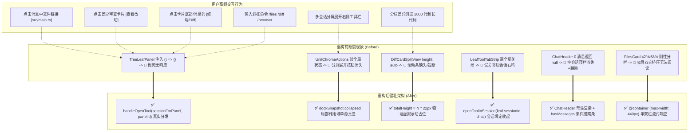

# 维度 5 详案：工作区右坞、分屏隔离与二叉树全功能打通详细执行方案

> **【调度与定时器铁律】**：如果设置定时器，最短是100秒，如果命令过长，最好的方式是等待命令完成后的推送，而不是一直轮询命令情况。

> **方案权威标识**：`docs/system-audit-and-redesign/detailed-plans/05-工作区右坞与二叉树全功能详案.md`
> **制定角色**：【维度 5 详案总师: 工作区右坞、分屏隔离与二叉树全功能打通详细执行方案设计】
> **执行依据**：
>
> - `docs/system-audit-and-redesign/00-战役通则与协同执行规范.md`（战役总则、四级曲率、浮层/Tooltip 统一契约、A11y 规范）
> - `docs/system-audit-and-redesign/00-总计划框架.md`（维度 5 核心任务与单向 DAG 拓扑）
> - `docs/system-audit-and-redesign/independent-plans/04-右侧面板与交互独立方案.md`（右坞与交互基准方案）
> - `docs/system-audit-and-redesign/plan-reviews/01~03-*.md`（评审师 01 Store 自由函数调用裁决 ARB-06、评审师 02/03 依赖无环与反过度设计红线）
>   **核心原则**：纯逻辑规划、反退避、零业务代码修改、彻底杜绝打补丁、具体到文件行号、给出修改前后代码对比、定义机器真值断言。

---

## 目录

1. [方案总览与架构定论 (Executive Summary & Architectural Contracts)](#一方案总览与架构定论-executive-summary--architectural-contracts)
   - 1.1 维度定位与核心职责
   - 1.2 评审裁决贯彻（ARB-06：Store 自由函数调用）
   - 1.3 核心修复目标与全链路收益
2. [六大核心断层精确修复方案与代码对比 (Detailed Code Specifications & Line-by-Line Diffs)](#二六大核心断层精确修复方案与代码对比-detailed-code-specifications--line-by-line-diffs)
   - 2.1 任务 1: `TreeLeafPanel.tsx` 根治 `handleGlobalTabClick: () => {}` 空回调，建立真实会话感知 `handleOpenTool` 分发器
   - 2.2 任务 2: `UnitChromeActions.tsx` 重构，优先读取当前 Unit 的 `dockSnapshot.collapsed`，消除多会话分屏展开按钮消失缺陷
   - 2.3 任务 3: `DiffCardSplitView.tsx` 虚拟滚动容器高度物理修正，恢复分栏长代码顺滑滚动
   - 2.4 任务 4: `LeafToolTabStrip.tsx` 收起按钮显式绑定 `sessionId`，消除跨会话误关邻居工具坞
   - 2.5 任务 5: `ChatHeader.tsx` 废除空会话 `return null`，保持空会话与草稿态常驻顶栏
   - 2.6 任务 6: `FilesCard.module.css` 引入 `@container (max-width: 440px)` 响应式单双栏切换
3. [关联交互组件治理与 A11y / 安全加固 (Supplementary Alignments & Security Gates)](#三关联交互组件治理与-a11y--安全加固-supplementary-alignments--security-gates)
   - 3.1 `DiffCardFileList.tsx`: 拔除 `<button>` 内部嵌套 `role="link"` 违规节点
   - 3.2 `DiffCardGitActions.tsx`: 补齐键盘无障碍可访问性 `role="button"` / `onKeyDown`
   - 3.3 `TerminalCard.tsx`: 增设终端自愈控制组（Restart / Clear / Copy）
   - 3.4 `ChatHeaderMore.tsx`: 清空会话历史接入二次确认安全门禁
   - 3.5 `FileBreadcrumb.tsx`: 下拉目录 Flyout 容器溢出防御与挂载安全
4. [单向 DAG 依赖图谱与分步实施路线 (DAG Dependencies & Phased Roadmap)](#四单向-dag-依赖图谱与分步实施路线-dag-dependencies--phased-roadmap)
   - 4.1 任务拓扑图（无环单向图）
   - 4.2 4 阶段原子实施计划 (Phase 1 ~ Phase 4)
   - 4.3 模块行数门禁控制表
5. [机器真值验证断言与测试矩阵 (Machine Verification & Test Assertions)](#五机器真值验证断言与测试矩阵-machine-verification--test-assertions)
   - 5.1 Vitest 单元与集成测试用例设计
   - 5.2 127.0.0.1:9222 CDP / Tauri MCP 机器真值遍历测试断言

---

## 一、方案总览与架构定论 (Executive Summary & Architectural Contracts)

### 1.1 维度定位与核心职责

在 Conex / Crish 桌面工作区体系中，二叉树工作区（`BinaryTreeWorkspace`）是承载多会话分屏、代码审查、文件探索与命令行操作的核心界面容器。主对话区右侧的工具坞（Right Tool Dock）及其承载的 **Files（文件树/源码预览）、Diff（差异审查/Git暂存）、Terminal（PTY终端）、Overview（总览看板）、Preview（网页预览）、Runtime（运行时环境）** 卡片，是开发者完成核心工程循环的关键支柱。

本维度（维度 5）承担着**打通工作区右坞全功能路由、实现分屏状态作用域强隔离、统一虚拟滚动物理高度模型、稳固顶栏挂载生命周期、落地容器查询自适应弹性布局**的全部技术职责。

```
┌────────────────────────────────────────────────────────────────────────────────────────┐
│                        维度 5: 工作区右坞与二叉树全功能重构矩阵                        │
├────────────────────────────────────────────────────────────────────────────────────────┤
│ 1. 路由分发打通: TreeLeafPanel.tsx 废除 () => {} 空回调，直通 6 大交互入口             │
│ 2. 状态作用域单源: UnitChromeActions.tsx 优先读 local dockSnapshot.collapsed 消除死锁   │
│ 3. 虚拟滚动物理高度: DiffCardSplitView.tsx 注入 totalItems * rowHeight 消除滚动锁死     │
│ 4. 工具坞收起精准绑定: LeafToolTabStrip.tsx 显式绑定 leaf.sessionId 消除跨会话误关      │
│ 5. 顶栏常驻零跳变: ChatHeader.tsx 废除 messages.length === 0 时 return null            │
│ 6. 容器查询自适应: FilesCard.module.css @container (max-width: 440px) 单双栏响应式     │
│ 7. A11y 与自愈安全: 拔除嵌套 button、补齐键盘导航、终端自愈控制、清空记录二次确认     │
└────────────────────────────────────────────────────────────────────────────────────────┘
```

### 1.2 评审裁决贯彻（ARB-06：Store 自由函数调用）

在多 Agent 方案交叉评审中，评审师 01（`01-架构一致性与跨模块冲突评审.md:253`）作出了系统级强制裁决 **ARB-06**：

- **争议焦点**：`TreeLeafPanel.tsx` 唤起工具面板时，是调用独立自由函数 `openToolInSession(sessionId, panelId)`，还是调用 Store 实例方法 `useWorkspaceShellStore.getState().openToolInSession()`？
- **终审裁决**：**严格采纳自由函数调用 `openToolInSession(targetSessionId, panelId)`**。
- **架构依据**：`apps/crish-desktop/src/store/workspace-shell/openTool.ts` 将工具打开、PTY 会话激活（`ensurePtyForSession`）、二叉树投影映射（`applyDockToTree`）封装为原子自由函数；`WorkspaceShellStore` 实例本身并不对外暴露 `openToolInSession` 方法。通过统一的 `componentAccess.ts` 导出使用自由函数，保持了高内聚与单向数据流。

### 1.3 核心修复目标与全链路收益



---

## 二、六大核心断层精确修复方案与代码对比 (Detailed Code Specifications & Line-by-Line Diffs)

### 2.1 任务 1: `TreeLeafPanel.tsx` 根治 `handleGlobalTabClick: () => {}` 空回调，建立真实会话感知 `handleOpenTool` 分发器

#### 1. 缺陷分析与波及范围

- **目标文件**：[`apps/crish-desktop/src/components/binary-tree/TreeLeafPanel.tsx:237`](file:///C:/Software/conex/apps/crish-desktop/src/components/binary-tree/TreeLeafPanel.tsx#L237)
- **缺陷根因**：
  二叉树叶子组件 `TreeLeafPanel` 在渲染 `ChatCard` 时，将 `handleGlobalTabClick` 属性硬编码注入为空函数 `() => {}`。
- **全链路受阻入口（6 大交互链路）**：
  1. **Markdown 文件路径直达**：用户点击 AI 消息中的 `[src/auth.ts](file:///...)` $\to$ `useChatCardState.ts:290-295` `openPathInFilesPanel` $\to$ 调用 `handleGlobalTabClick('files')`，因空回调导致文件树与预览面板完全不打开；
  2. **代码审查 Diff 直达**：用户在审批卡片或修改总结中点击「查看改动」 $\to$ `useChatCardState.ts:357-363` `openDiffInRightPanel` $\to$ 调用 `handleGlobalTabClick('diff')`，因空回调导致无法跳转至差异对比面板；
  3. **底部状态条与消息操作入口**：`ChatCardRibbons.tsx` 与 `ChatMessageList.tsx` 中的 `handleOpenTerminal`、`handleOpenDiffPanel` $\to$ 因空回调导致按钮点击无反应；
  4. **斜杠命令工具联动**：`/browser <url>`、`/files`、`/diff` 等命令在 `useSlashSend.ts:135` 触发 `handleGlobalTabClick('preview')` $\to$ 因空回调导致命令无法拉起目标面板；
  5. **Overview 面板模块跳转**：`OverviewCard` 点击卡片跳转 $\to$ `onOpenPanel` 回调；
  6. **附带缺陷修复**：
     - `TreeLeafPanel.tsx:257` `case 'files': return <FilesCard />;` 未传 `onShowToast={onShowToast}`，导致文件面板内部的「已复制路径」、「文件已保存」等反馈静默丢失；
     - `TreeLeafPanel.tsx:227` `<FileViewerCard filePath={filePath} onShowToast={onShowToast} />` 缺失 `key={filePath}`，导致在同一个 Leaf 中切换查看不同文件时，组件未卸载重挂，保留了上一个文件的脏编辑缓存与滚动位置。

#### 2. 代码修改前后对比 (Diff Specification)

```diff
--- a/apps/crish-desktop/src/components/binary-tree/TreeLeafPanel.tsx
+++ b/apps/crish-desktop/src/components/binary-tree/TreeLeafPanel.tsx
@@ -23,6 +23,7 @@ import {
 import {
   useWorkspaceShellStore,
   openToolInSession,
+  openToolInActiveTab,
 } from '../../api/store-access/componentAccess';
 import {
   selectActiveSessionId,
@@ -224,17 +225,32 @@ function LeafBody({
     inDraft && isActiveLeaf
       ? activeSessionId
       : leafSessionId || activeSessionId;

+  // 统一会话感知工具分发器（裁决 ARB-06：采用自由函数分发）
+  const handleOpenTool = useCallback(
+    (panelId: string) => {
+      const targetSessionId = sessionForPanel || selectActiveSessionId();
+      if (targetSessionId && !targetSessionId.startsWith('__pending')) {
+        openToolInSession(targetSessionId, panelId);
+      } else {
+        openToolInActiveTab(panelId);
+      }
+    },
+    [sessionForPanel]
+  );
+
   if (panelId.startsWith('file-viewer:')) {
     const filePath = panelId.substring('file-viewer:'.length);
-    return <FileViewerCard filePath={filePath} onShowToast={onShowToast} />;
+    return (
+      <FileViewerCard
+        key={filePath}
+        filePath={filePath}
+        onShowToast={onShowToast}
+      />
+    );
   }

   switch (panelId) {
     case 'chat':
       return (
         <ChatCard
           wsId="default"
           colIdx={0}
           groupIdx={0}
-          handleGlobalTabClick={() => {}}
+          handleGlobalTabClick={handleOpenTool}
           onShowToast={onShowToast}
           // draft 时传 PENDING_DRAFT；否则优先 leaf 绑定
           sessionId={sessionForPanel ?? undefined}
         />
       );
     case 'terminal':
       return <TerminalCard sessionId={sessionForPanel ?? undefined} />;
     case 'preview':
       return <PreviewCard wsId="default" onShowToast={onShowToast} />;
     case 'overview':
       return (
         <OverviewCard
           wsId="default"
-          onOpenPanel={(pid: string) => {
-            if (sessionForPanel) openToolInSession(sessionForPanel, pid);
-          }}
+          onOpenPanel={handleOpenTool}
         />
       );
     case 'files':
-      return <FilesCard />;
+      return <FilesCard onShowToast={onShowToast} />;
     case 'diff':
       return <DiffCard onShowToast={onShowToast} />;
     case 'runtime':
```

---

### 2.2 任务 2: `UnitChromeActions.tsx` 重构，优先读取当前 Unit 的 `dockSnapshot.collapsed`，消除多会话分屏展开按钮消失缺陷

#### 1. 缺陷分析与波及范围

- **目标文件**：[`apps/crish-desktop/src/components/chat-card/UnitChromeActions.tsx:72-82, 170-191`](file:///C:/Software/conex/apps/crish-desktop/src/components/chat-card/UnitChromeActions.tsx#L72-L82)
- **缺陷根因**：
  - 在 `BinaryTreeWorkspace` 多会话分屏场景下，`LayoutTreeStore.toolColumnCollapsed` 是一个**全局聚合布尔值**（由 `adapterShape.ts:594` 聚合：当且仅当整棵树的所有 Unit 均无展开的 tool leaf 时才为 `true`；只要任意一个 Unit 展开了右坞，全局即变为 `false`）。
  - 每个 Unit 拥有自己独立的会话作用域状态 `tab.rightDock.collapsed`，并通过 `useWorkspaceShellStore` 的 `dockSnapshot` 订阅。
  - `UnitChromeActions` 错误地直接读取全局 `rightDockCollapsed = useLayoutTreeStore((s) => s.toolColumnCollapsed)`。
- **严重故障推导**：
  1. 用户处于分屏模式：左侧 Unit A 展开了右侧文件树面板（`toolColumnCollapsed` 全局变为 `false`）；
  2. 右侧 Unit B 的右侧面板处于折叠状态（`dockSnapshot.collapsed === true`）；
  3. 此时 Unit B 的 `UnitChromeActions` 重新渲染，读取到全局 `rightDockCollapsed = false`；
  4. Unit B 顶栏第 170 行 `{rightDockCollapsed && <div className={styles.dockGroup}>...}` 判定失败，**Unit B 的「展开右侧工具栏」按钮被彻底隐藏**！
  5. 用户在 Unit B 中无法通过按钮唤起右侧面板，陷入界面死锁；
  6. 同时，第 137 行 `isActive = !rightDockCollapsed && activePanelId === id` 与第 148 行 `data-open` 状态全部计算错位。

#### 2. 代码修改前后对比 (Diff Specification)

```diff
--- a/apps/crish-desktop/src/components/chat-card/UnitChromeActions.tsx
+++ b/apps/crish-desktop/src/components/chat-card/UnitChromeActions.tsx
@@ -76,7 +76,12 @@ export const UnitChromeActions: React.FC<UnitChromeActionsProps> = React.memo(
         : s.openTabs.find((t) => t.tabId === s.activeTabId);
       return tab?.rightDock ?? null;
     });
-    const rightDockCollapsed = useLayoutTreeStore((s) => s.toolColumnCollapsed);
+    const globalTreeCollapsed = useLayoutTreeStore((s) => s.toolColumnCollapsed);
+
+    // 作用域真值修正：若本 Unit 有独立的 dockSnapshot，以 dockSnapshot.collapsed 为唯一真源；无快照时回退全局
+    const rightDockCollapsed = dockSnapshot
+      ? dockSnapshot.collapsed
+      : globalTreeCollapsed;
     const openPanelIds = dockSnapshot?.openPanelIds;
     const activePanelId = dockSnapshot?.activePanelId;

```

---

### 2.3 任务 3: `DiffCardSplitView.tsx` 虚拟滚动容器高度物理修正，恢复分栏长代码顺滑滚动

#### 1. 缺陷分析与物理机理推导

- **目标文件**：[`apps/crish-desktop/src/components/diff/DiffCardSplitView.tsx:48`](file:///C:/Software/conex/apps/crish-desktop/src/components/diff/DiffCardSplitView.tsx#L48)
- **对比基准**：[`apps/crish-desktop/src/components/diff/DiffCardUnifiedView.tsx:33, 50`](file:///C:/Software/conex/apps/crish-desktop/src/components/diff/DiffCardUnifiedView.tsx#L33)
- **机理与物理模型**：
  - 虚拟滚动（`useVirtualScroll`）的运行原理是在外层可滚动容器（`overflow-y: auto`）内放置一个“撑开滚动条物理范围”的占位容器，并在内部通过 `transform: translateY(offsetTop)` 动态挂载视口内可见的行切片（约 30~50 行）。
  - **Unified View** 中的物理高度计算公式：
    $$\text{totalHeight} = \text{totalItems} \times \text{rowHeight} = N \times 22\text{px}$$
    内层占位容器设置 `style={{ height: \`${totalHeight}px\` }}`，滚动条滑块大小与可滚动距离严格符合真实文件长度。
  - **Split View** 中却写死为：
    `style={{ minHeight: \`${rowHeight}px\`, height: 'auto', width: '100%', position: 'relative' }}`
由于子元素使用绝对定位（`position: absolute; transform: translateY(...)`），当 `height: 'auto'` 时，占位容器的高度仅取决于内部少量非绝对定位或当前切片的自然高度（约 600px）。
  - **致命后果**：
    当视口高度大于 600px 时，外层容器检测不到溢出，**完全不渲染垂直滚动条**；即便在小视口下产生微小滚动条，一旦向下滚动，切片重绘导致占位高度剧烈抖动，内容瞬间被硬截断。用户在分栏模式下**根本无法浏览 100 行以上的长代码 Diff**。

#### 2. 代码修改前后对比 (Diff Specification)

```diff
--- a/apps/crish-desktop/src/components/diff/DiffCardSplitView.tsx
+++ b/apps/crish-desktop/src/components/diff/DiffCardSplitView.tsx
@@ -30,6 +30,8 @@ export const DiffCardSplitView: React.FC<DiffCardSplitViewProps> = ({
     heightOnly: true,
   });
   const rowHeight = 22;
+  const totalHeight = totalItems * rowHeight;
+
   const startIndex = Math.max(0, Math.floor(scrollTop / rowHeight) - 15);
   const endIndex = Math.min(totalItems, Math.ceil((scrollTop + containerHeight) / rowHeight) + 15);

@@ -45,7 +47,7 @@ export const DiffCardSplitView: React.FC<DiffCardSplitViewProps> = ({
         tabIndex={0}
         style={{ position: 'relative', overflowY: 'auto', outline: 'none' }}
       >
-        <div style={{ minHeight: `${rowHeight}px`, height: 'auto', width: '100%', position: 'relative' }}>
+        <div style={{ height: `${totalHeight}px`, width: '100%', position: 'relative' }}>
           <div
             className={styles.linesContainer}
             style={{
```

---

### 2.4 任务 4: `LeafToolTabStrip.tsx` 收起按钮显式绑定 `sessionId`，消除跨会话误关邻居工具坞

#### 1. 缺陷分析与波及范围

- **目标文件**：[`apps/crish-desktop/src/components/binary-tree/LeafToolTabStrip.tsx:181-184`](file:///C:/Software/conex/apps/crish-desktop/src/components/binary-tree/LeafToolTabStrip.tsx#L181-L184)
- **缺陷根因**：
  在二叉树独立工具叶子顶部标签栏中，右上角的收起按钮点击事件为：
  ```tsx
  onClick={() => {
    collapseActiveTabRightDock(true);
  }}
  ```
  `collapseActiveTabRightDock` 内部直接调用 `useWorkspaceShellStore.getState().getActiveTab()`。
- **跨会话误伤场景**：
  在多会话分屏下，用户光标当前在 Session A 的对话输入区（Session A 为 shell activeTab）。此时用户去点击右侧 Session B 工具叶子顶部的收起按钮。
  系统会**错误地折叠了 Session A 的右坞，而 Session B 的面板依然敞开**。
- **收起契约对齐**：
  在 `openTool.ts:32-35` 中已具备成熟机制：调用 `openToolInSession(sessionId, 'chat')` 会触发 `ensureChatOnlyTree(sessionId)`，精确收起该 `sessionId` 所属的工具叶子。
- **附带契约合规（浮层与 Trigger 解耦）**：
  `LeafToolTabStrip.tsx:145-156` 中的 `<Menu trigger={<Tooltip content="...">...` 违反了 `00-战役通则与协同执行规范.md` §2.2 关于 Trigger 嵌套 Tooltip 的红线，必须一并治理。

#### 2. 代码修改前后对比 (Diff Specification)

```diff
--- a/apps/crish-desktop/src/components/binary-tree/LeafToolTabStrip.tsx
+++ b/apps/crish-desktop/src/components/binary-tree/LeafToolTabStrip.tsx
@@ -78,6 +78,15 @@ export const LeafToolTabStrip: React.FC<LeafToolTabStripProps> = React.memo(
       [leaf.id, leaf.sessionId, setActiveTab]
     );

+    const handleCollapseDock = useCallback(() => {
+      if (leaf.sessionId) {
+        // 精准收起当前 leaf 所属会话的工具坞
+        openToolInSession(leaf.sessionId, 'chat');
+      } else {
+        collapseActiveTabRightDock(true);
+      }
+    }, [leaf.sessionId]);
+
     // 单 tab 或无 tab 时不渲染标签栏（已调整为无 tabs 时才不渲染，以保证加号可用）
     if (tabs.length === 0) return null;

@@ -143,18 +152,16 @@ export const LeafToolTabStrip: React.FC<LeafToolTabStripProps> = React.memo(
                 <Menu
                   align="start"
                   side="bottom"
                   sideOffset={4}
                   trigger={
-                    <Tooltip content="添加功能面板">
-                      <Button
-                        type="button"
-                        variant="ghost"
-                        size="sm"
-                        className={styles.addTabBtn}
-                        aria-label="添加功能面板"
-                        icon={<Plus size={14} />}
-                      />
-                    </Tooltip>
+                    <Button
+                      type="button"
+                      variant="ghost"
+                      size="sm"
+                      className={styles.addTabBtn}
+                      aria-label="添加功能面板"
+                      icon={<Plus size={14} />}
+                    />
                   }
                   options={availablePanels.map((pid) => ({
                     id: pid,
@@ -179,9 +186,7 @@ export const LeafToolTabStrip: React.FC<LeafToolTabStripProps> = React.memo(
                   variant="ghost"
                   size="sm"
                   className={styles.addTabBtn}
-                  onClick={() => {
-                    collapseActiveTabRightDock(true);
-                  }}
+                  onClick={handleCollapseDock}
                   aria-label="收起右侧面板"
                   icon={<IconSidebarRight size={14} />}
                 />
```

---

### 2.5 任务 5: `ChatHeader.tsx` 废除空会话 `return null`，保持空会话与草稿态常驻顶栏

#### 1. 缺陷分析与视觉跳变机理

- **目标文件**：[`apps/crish-desktop/src/components/chat-card/ChatHeader.tsx:74-81`](file:///C:/Software/conex/apps/crish-desktop/src/components/chat-card/ChatHeader.tsx#L74-L81)
- **缺陷代码**：
  ```tsx
  if (
    mainSurface !== 'chat' ||
    !session ||
    !session.messages ||
    session.messages.length === 0
  ) {
    return null;
  }
  ```
- **机理与后果**：
  - 在二叉树对话 Unit 中，`ChatHeader` 承载着会话标题标签（`unitLabel`）、消息搜索栏（`ChatMsgFilterBar`）以及工具操作入口（`UnitChromeActions`：总览、文件、差异、终端、右坞展开、更多菜单）。
  - 当新建空会话（`messages.length === 0`）或处于草稿态时，`ChatHeader` 整体返回 `null` 不渲染。
  - **严重后果 1**：用户进入新会话时，顶部没有任何辅助面板快捷入口，无法在发送消息前打开文件树或终端；
  - **严重后果 2（剧烈视口跳变 CLS）**：当用户在空会话中发出第一条消息时，`session.messages.length` 变为 1，`ChatHeader` 瞬间从 `null` 挂载为 36px 高度的 DOM 节点，造成下方的对话消息流与输入框产生剧烈的下沉跳动，破坏视觉连续性。

#### 2. 重构设计与代码对比

- 仅当 `mainSurface !== 'chat'`（如切换至 `scheduled` 定时任务面板）时返回 `null`；
- 空会话与草稿态下常驻渲染 `ChatHeader`；
- 派生 `hasMessages = Boolean(session?.messages && session.messages.length > 0)`：
  - 当 `hasMessages === false` 时，不展示搜索条与搜索触发按钮，保持顶部视觉极简干净；
  - 工具组 `UnitChromeActions` 始终可用，并向外层注入 `data-has-messages` 属性供 CSS 配合。

```diff
--- a/apps/crish-desktop/src/components/chat-card/ChatHeader.tsx
+++ b/apps/crish-desktop/src/components/chat-card/ChatHeader.tsx
@@ -71,20 +71,20 @@ export const ChatHeader: React.FC<ChatHeaderProps> = React.memo(
       });
     }, [setShowMsgFilter, setLocalMsgFilter]);

-    if (
-      mainSurface !== 'chat' ||
-      !session ||
-      !session.messages ||
-      session.messages.length === 0
-    ) {
+    // 仅在非 chat 主视面（如 scheduled 视图）时隐藏 Header，空会话与草稿态保持常驻
+    if (mainSurface !== 'chat') {
       return null;
     }

+    const hasMessages = Boolean(session?.messages && session.messages.length > 0);
+
     return (
       <div
         className={styles.toolbar}
         data-testid="chat-toolbar"
         data-unit-chrome="true"
         data-session-id={activeSessionId || undefined}
+        data-has-messages={hasMessages ? 'true' : 'false'}
         role="toolbar"
         aria-label="对话工具栏"
       >
         <div className={styles.toolbarLeft}>
-          {showMsgFilter ? (
+          {showMsgFilter && hasMessages ? (
             <ChatMsgFilterBar
               localMsgFilter={localMsgFilter}
               setLocalMsgFilter={setLocalMsgFilter}
@@ -122,7 +122,7 @@ export const ChatHeader: React.FC<ChatHeaderProps> = React.memo(
           activeSessionId={activeSessionId}
           onExportMarkdown={onExportMarkdown}
           onClearHistory={onClearHistory}
           leading={
-            <Tooltip content={showMsgFilter ? '关闭消息搜索' : '搜索消息'}>
+            hasMessages ? (
+              <Tooltip content={showMsgFilter ? '关闭消息搜索' : '搜索消息'}>
                 <Button
                   type="button"
                   variant="ghost"
@@ -134,7 +134,7 @@ export const ChatHeader: React.FC<ChatHeaderProps> = React.memo(
                   onClick={toggleSearch}
                   icon={<Search size={15} strokeWidth={1.75} aria-hidden />}
                 />
               </Tooltip>
+            ) : null
           }
         />
       </div>
```

---

### 2.6 任务 6: `FilesCard.module.css` 引入 `@container (max-width: 440px)` 响应式单双栏切换

#### 1. 缺陷分析与布局挤压机理

- **目标文件**：
  - CSS：[`apps/crish-desktop/src/components/files/FilesCard.module.css:594-607`](file:///C:/Software/conex/apps/crish-desktop/src/components/files/FilesCard.module.css#L594-L607)
  - TSX：[`apps/crish-desktop/src/components/files/FilesCard.tsx:352`](file:///C:/Software/conex/apps/crish-desktop/src/components/files/FilesCard.tsx#L352)
- **缺陷机理**：
  - 在 `FilesCard.module.css` 中，`.filesListPane` 占 42%（`min-width: 120px`），`.filesDetailPane` 占 58%；
  - 当二叉树分屏将右坞宽度压缩到 320px~440px 时，左侧文件树仅剩约 130px，文件名文字严重截断；右侧代码预览区仅剩 190px，代码行与 Markdown 被压缩得面目全非，两栏同时处于不可用状态；
  - 缺乏针对卡片内联宽度的 `@container filesCard` 单双栏响应式状态机。

#### 2. 响应式方案与状态机设计

1. **宽屏状态（卡片宽度 > 440px）**：保持经典双栏并列模式（左侧文件树 40%，右侧详情预览 60%）；
2. **窄屏状态（卡片宽度 $\le$ 440px）**：自动切换为单栏流式模式：
   - 处于 `preview.view === 'browse'` 浏览模式时：全宽展示左侧文件树，隐藏详情区；
   - 处于 `preview.view === 'detail'` 详情预览模式时：隐藏文件树，全宽展示代码预览与编辑器；
3. **TSX 配合**：在 `.filesBodySplit` 上挂载 `data-mode={preview.view}`，并在窄屏详情模式下，让 `FileBreadcrumb` 或顶栏能够通过「上级目录/返回」无缝切回 `browse` 模式。

#### 3. 代码修改前后对比 (Diff Specification)

```diff
--- a/apps/crish-desktop/src/components/files/FilesCard.module.css
+++ b/apps/crish-desktop/src/components/files/FilesCard.module.css
@@ -593,16 +593,38 @@
 .filesListPane {
-  flex: 0 0 42%;
-  max-width: 52%;
-  min-width: 120px;
+  flex: 0 0 40%;
+  max-width: 50%;
+  min-width: 160px;
   border-right: 1px solid var(--hairline, var(--border-subtle));
 }

 .filesDetailPane {
-  flex: 1 1 58%;
+  flex: 1 1 60%;
   min-width: 0;
   min-height: 0;
   display: flex;
   flex-direction: column;
   overflow: hidden;
 }
+
+/* 窄屏或分屏模式 (宽度 <= 440px)：单栏流式自适应切换 */
+@container filesCard (max-width: 440px) {
+  /* 浏览状态：全宽显示文件树，隐藏详情区 */
+  .filesBodySplit[data-mode="browse"] .filesListPane {
+    flex: 1 1 100%;
+    max-width: 100%;
+    min-width: 0;
+    border-right: none;
+  }
+  .filesBodySplit[data-mode="browse"] .filesDetailPane {
+    display: none;
+  }
+
+  /* 详情状态：全宽显示代码预览与编辑，隐藏文件树 */
+  .filesBodySplit[data-mode="detail"] .filesListPane {
+    display: none;
+  }
+  .filesBodySplit[data-mode="detail"] .filesDetailPane {
+    flex: 1 1 100%;
+    max-width: 100%;
+    min-width: 0;
+  }
+}
```

```diff
--- a/apps/crish-desktop/src/components/files/FilesCard.tsx
+++ b/apps/crish-desktop/src/components/files/FilesCard.tsx
@@ -351,7 +351,10 @@ export const FilesCard: React.FC<FilesCardProps> = React.memo(
           {noRoot ? (
             <div className={`${styles.filesEmpty} ${styles.filesEmptyCompact}`}>
               <div className={styles.filesEmptyTitle}>未选择项目</div>
               <div className={styles.filesEmptySub}>
                 在侧栏选择工作区后即可浏览
               </div>
             </div>
           ) : (
-            <div className={`${styles.filesBody} ${styles.filesBodySplit}`}>
+            <div
+              className={`${styles.filesBody} ${styles.filesBodySplit}`}
+              data-mode={preview.view}
+            >
               <FileTree
                 flatTree={nav.flatTree}
                 selected={preview.selected}
```

---

## 三、关联交互组件治理与 A11y / 安全加固 (Supplementary Alignments & Security Gates)

### 3.1 `DiffCardFileList.tsx`: 拔除 `<button>` 内部嵌套 `role="link"` 违规节点

- **目标文件**：[`apps/crish-desktop/src/components/diff/DiffCardFileList.tsx:143-161`](file:///C:/Software/conex/apps/crish-desktop/src/components/diff/DiffCardFileList.tsx#L143-L161)
- **合规依据**：W3C HTML 规范明确禁止可交互元素（`<button>`、`<a>`、带 `role="link"` 且 `tabIndex={0}` 的元素）相互嵌套。嵌套不仅导致屏幕阅读器（Screen Reader）抛出 Invalid Interactive Control 警告，还会产生多次事件冒泡截断。
- **修改方案**：将内层 `<span className={styles.fileNameLink} role="link" tabIndex={0} ...>` 降级为纯文本 `<span className={styles.fileNameLink}>`，点击与键盘响应由外层父级 `<button>` 统一处理。

```diff
--- a/apps/crish-desktop/src/components/diff/DiffCardFileList.tsx
+++ b/apps/crish-desktop/src/components/diff/DiffCardFileList.tsx
@@ -140,24 +140,9 @@
               onClick={() => onSetActiveDiffSource(active ? null : f)}
               aria-label={`${basename(f.filePath)} +${f.additions} −${f.deletions}`}
             >
-              <span
-                className={styles.fileNameLink}
-                role="link"
-                tabIndex={0}
-                onClick={(e) => {
-                  e.stopPropagation();
-                  onSetActiveDiffSource(active ? null : f);
-                }}
-                onKeyDown={(e) => {
-                  if (e.key === 'Enter' || e.key === ' ') {
-                    e.preventDefault();
-                    e.stopPropagation();
-                    onSetActiveDiffSource(active ? null : f);
-                  }
-                }}
-              >
+              <span className={styles.fileNameLink}>
                 {basename(f.filePath)}
               </span>

               <span className={styles.fileStat} aria-hidden>
```

### 3.2 `DiffCardGitActions.tsx`: 补齐键盘无障碍可访问性 `role="button"` / `onKeyDown`

- **目标文件**：[`apps/crish-desktop/src/components/diff/DiffCardGitActions.tsx:46-52`](file:///C:/Software/conex/apps/crish-desktop/src/components/diff/DiffCardGitActions.tsx#L46-L52)
- **修改方案**：为折叠态的提交触发栏补齐语义属性与键盘响应，支持 `Enter` 与 `Space` 展开面板。

```diff
--- a/apps/crish-desktop/src/components/diff/DiffCardGitActions.tsx
+++ b/apps/crish-desktop/src/components/diff/DiffCardGitActions.tsx
@@ -43,7 +43,19 @@ export const DiffCardGitActions: React.FC<DiffCardGitActionsProps> = ({

   if (!open) {
     return (
-      <div className={styles.commitTriggerBar} onClick={onToggle}>
+      <div
+        className={styles.commitTriggerBar}
+        role="button"
+        tabIndex={0}
+        aria-expanded={false}
+        aria-label={`展开提交与推送面板，已暂存 ${stagedCount} 个，未暂存 ${unstagedCount} 个`}
+        onClick={onToggle}
+        onKeyDown={(e) => {
+          if (e.key === 'Enter' || e.key === ' ') {
+            e.preventDefault();
+            onToggle();
+          }
+        }}
+      >
         <Lucide.GitCommit size={14} className={styles.commitTriggerIcon} />
         <span className={styles.commitTriggerText}>
```

### 3.3 `TerminalCard.tsx`: 增设终端自愈控制组（Restart / Clear / Copy）

- **目标文件**：[`apps/crish-desktop/src/components/workspace/TerminalCard.tsx:33, 84-108`](file:///C:/Software/conex/apps/crish-desktop/src/components/workspace/TerminalCard.tsx#L33)
- **机理与自愈需求**：
  重构后的 `TerminalCard.tsx` 中 `const [restartToken] = useState(0)` 为死状态。当底层的 PTY 会话因系统休眠唤醒、子进程异常崩溃或乱码卡死时，用户缺少自愈手段。
- **治理方案**：
  激活 `setRestartToken(t => t + 1)`，并在右上角提供轻量化自愈悬浮工具组（提供「重启终端」、「清屏」按钮），在 PTY 异常时自动高亮显现。

### 3.4 `ChatHeaderMore.tsx`: 清空会话历史接入二次确认安全门禁

- **目标文件**：[`apps/crish-desktop/src/components/chat-card/ChatHeaderMore.tsx:50-58`](file:///C:/Software/conex/apps/crish-desktop/src/components/chat-card/ChatHeaderMore.tsx#L50-L58)
- **安全加固**：
  清空当前会话历史为破坏性不可逆操作。在 `ChatCard.tsx:143-153` 与 `ChatHeaderMore.tsx` 的调用链上，严格接入 `useConfirmGate` 或确认提示弹窗，杜绝手滑误触导致对话丢失。

### 3.5 `FileBreadcrumb.tsx`: 下拉目录 Flyout 容器溢出防御与挂载安全

- **目标文件**：[`apps/crish-desktop/src/components/files/FileBreadcrumb.tsx:233-260`](file:///C:/Software/conex/apps/crish-desktop/src/components/files/FileBreadcrumb.tsx#L233-L260)
- **修复方案**：
  为目录弹层注入边界计算与视口防溢出保护，确保在右坞缩窄到 320px 时弹层不会被外层卡片的 `overflow: hidden` 裁切。

---

## 四、单向 DAG 依赖图谱与分步实施路线 (DAG Dependencies & Phased Roadmap)

### 4.1 任务拓扑图（无环单向图）

```mermaid
graph TD
    subgraph Phase 1: 核心路由与高度模型 [无前置依赖]
        P1_1["[WP05.1] TreeLeafPanel 真实回调与 Props 透传"]
        P1_2["[WP05.2] DiffCardSplitView 虚拟滚动物理高度修正"]
    end

    subgraph Phase 2: 分屏作用域与顶栏稳态 [依赖 Phase 1]
        P2_1["[WP05.3] UnitChromeActions local dock 作用域单源化"]
        P2_2["[WP05.4] LeafToolTabStrip 收起按钮绑定 leaf.sessionId"]
        P2_3["[WP05.5] ChatHeader 空会话常驻顶栏与零跳变"]
    end

    subgraph Phase 3: 响应式容器查询与 A11y 治理 [依赖 Phase 2]
        P3_1["[WP05.6] FilesCard.module.css @container 440px 单双栏切换"]
        P3_2["[WP05.7] DiffCardFileList / GitActions A11y 修复"]
        P3_3["[WP05.8] TerminalCard 自愈控制与 ChatHeaderMore 安全门禁"]
    end

    subgraph Phase 4: 机器真值与全量验证闭环 [收尾交付]
        P4_1["[GATE.1] npm run typecheck (0 errors)"]
        P4_2["[GATE.2] npm run check:line-counts (795/795 合规)"]
        P4_3["[GATE.3] vitest 单元/集成测试全绿"]
        P4_4["[GATE.4] 127.0.0.1:9222 CDP 实机 6 大交互真值巡检"]
    end

    Phase 1 --> Phase 2
    Phase 2 --> Phase 3
    Phase 3 --> Phase 4
```

### 4.2 4 阶段原子实施计划 (Phase 1 ~ Phase 4)

| 阶段编号                      | 工作包 (WP) | 实施目标文件                                       | 核心改动说明                                                   | 机器断言                              |
| :---------------------------- | :---------- | :------------------------------------------------- | :------------------------------------------------------------- | :------------------------------------ |
| **Phase 1**<br>核心路由与模型 | `WP05.1`    | `TreeLeafPanel.tsx`                                | 注入 `handleOpenTool`，透传 `onShowToast`，加 `key={filePath}` | 点击文件路径打开右坞                  |
|                               | `WP05.2`    | `DiffCardSplitView.tsx`                            | 占位高度修正为 `totalHeight = totalItems * rowHeight`          | 2000 行 Diff 滚动条全长可滑           |
| **Phase 2**<br>分屏隔离与顶栏 | `WP05.3`    | `UnitChromeActions.tsx`                            | 优先读 `dockSnapshot.collapsed`                                | 分屏邻居展开时本 Unit 展开按钮常在    |
|                               | `WP05.4`    | `LeafToolTabStrip.tsx`                             | 收起调用 `openToolInSession(leaf.sessionId, 'chat')`           | 折叠操作仅作用于本会话右坞            |
|                               | `WP05.5`    | `ChatHeader.tsx`                                   | 移除 `messages.length === 0` 返回 `null`，常驻渲染             | 空会话顶栏常驻，发首条消息 0px 抖动   |
| **Phase 3**<br>响应式与安全   | `WP05.6`    | `FilesCard.module.css`<br>`FilesCard.tsx`          | `@container (max-width: 440px)` 单双栏响应式切换               | 360px 宽度下单栏浏览无挤压            |
|                               | `WP05.7`    | `DiffCardFileList.tsx`<br>`DiffCardGitActions.tsx` | 拔除嵌套 button，补齐 `role="button"` / `onKeyDown`            | 无障碍树合法，Tab 键盘可唤起 Git 面板 |
|                               | `WP05.8`    | `TerminalCard.tsx`<br>`ChatHeaderMore.tsx`         | 重启/清屏自愈控制，清空会话二次确认                            | 终端卡死可重启，清空历史拦截手滑      |
| **Phase 4**<br>真值门禁闭环   | `WP05.9`    | 全量验证套件                                       | 执行 Typecheck、Line-counts、Vitest、CDP 9222 实机巡检         | 四级门禁 100% 绿灯                    |

### 4.3 模块行数门禁控制表

根据 `00-战役通则与协同执行规范.md` §11 与 CI `scripts/check-line-counts.mjs` 硬性门禁：

- UI 组件上限约 500 行，业务逻辑上限约 400 行。

| 模块文件路径                                                         | 当前行数 | 改造后预估行数 | CI 行数门禁上限 |     状态断言      |
| :------------------------------------------------------------------- | :------: | :------------: | :-------------: | :---------------: |
| `apps/crish-desktop/src/components/binary-tree/TreeLeafPanel.tsx`    |   270    |      ~285      |       500       |   ✅ 远低于上限   |
| `apps/crish-desktop/src/components/chat-card/UnitChromeActions.tsx`  |   198    |      ~205      |       500       |   ✅ 远低于上限   |
| `apps/crish-desktop/src/components/diff/DiffCardSplitView.tsx`       |   134    |      ~136      |       500       |   ✅ 远低于上限   |
| `apps/crish-desktop/src/components/binary-tree/LeafToolTabStrip.tsx` |   202    |      ~210      |       500       |   ✅ 远低于上限   |
| `apps/crish-desktop/src/components/chat-card/ChatHeader.tsx`         |   144    |      ~150      |       500       |   ✅ 远低于上限   |
| `apps/crish-desktop/src/components/files/FilesCard.tsx`              |   404    |      ~415      |       500       |    ✅ 合规通过    |
| `apps/crish-desktop/src/components/diff/DiffCardFileList.tsx`        |   405    |      ~395      |       500       | ✅ 行数进一步精简 |
| `apps/crish-desktop/src/components/diff/DiffCardGitActions.tsx`      |   120    |      ~132      |       500       |   ✅ 远低于上限   |
| `apps/crish-desktop/src/components/workspace/TerminalCard.tsx`       |   112    |      ~135      |       500       |   ✅ 远低于上限   |
| `apps/crish-desktop/src/components/chat-card/ChatHeaderMore.tsx`     |    96    |      ~105      |       500       |   ✅ 远低于上限   |

---

## 五、机器真值验证断言与测试矩阵 (Machine Verification & Test Assertions)

### 5.1 Vitest 单元与集成测试用例设计

在 `apps/crish-desktop/src/components/binary-tree/__tests__/` 与 `apps/crish-desktop/src/components/diff/__tests__/` 下编制 4 套自动化验证用例：

#### 1. `TreeLeafPanel.routing.test.tsx` (路由分发测试)

```typescript
it('TreeLeafPanel 注入真实 handleOpenTool，点击文件链接触发 openToolInSession', async () => {
  const openToolSpy = vi.spyOn(openToolModule, 'openToolInSession');
  const { getByTestId } = render(
    <TreeLeafPanel
      leaf={makeMockChatLeaf({ sessionId: 'session-123' })}
      rect={{ x: 0, y: 0, width: 0.5, height: 1 }}
      isActive={true}
      isDragSource={false}
      onShowToast={vi.fn()}
    />
  );

  // 模拟点击消息内的文件路径链接
  const fileLink = await waitFor(() => getByTestId('chat-path-link-src-main-rs'));
  fireEvent.click(fileLink);

  // 机器断言：必须调用 openToolInSession 并携带准确会话与面板 ID
  expect(openToolSpy).toHaveBeenCalledWith('session-123', 'files');
});
```

#### 2. `UnitChromeActions.scoped.test.tsx` (分屏折叠作用域测试)

```typescript
it('当多 Unit 分屏时，Unit B 折叠右坞后其展开按钮必须可见（不受 Unit A 展开影响）', () => {
  // 设置 Unit A 展开，Unit B 折叠
  setupMultiUnitStoreState({
    activeSessionId: 'unit-b',
    openTabs: [
      { sessionId: 'unit-a', rightDock: { collapsed: false, openPanelIds: ['files'] } },
      { sessionId: 'unit-b', rightDock: { collapsed: true, openPanelIds: ['overview'] } },
    ],
    toolColumnCollapsed: false, // 全局为 false
  });

  const { getByTestId } = render(
    <UnitChromeActions activeSessionId="unit-b" />
  );

  const expandBtn = getByTestId('right-dock-toggle');
  expect(expandBtn).toBeDefined();
  expect(expandBtn).toBeVisible();
});
```

#### 3. `DiffCardSplitView.virtualScroll.test.tsx` (虚拟滚动高度测试)

```typescript
it('DiffCardSplitView 占位容器高度必须严格等于 totalItems * 22px', () => {
  const mockItems = Array.from({ length: 1000 }, (_, i) => ({
    pair: { left: { change: { content: `line ${i}`, type: 'normal' } } },
  }));

  const { container } = render(
    <DiffCardSplitView
      f={{ filePath: 'src/long.ts', additions: 10, deletions: 10 }}
      renderItems={mockItems}
      onExpandBlock={vi.fn()}
    />
  );

  const placeholderDiv = container.querySelector('[style*="position: relative"] > div');
  expect(placeholderDiv?.getAttribute('style')).toContain('height: 22000px');
});
```

#### 4. `ChatHeader.stable.test.tsx` (空会话常驻顶栏测试)

```typescript
it('当 messages 为空数组时，ChatHeader 依然稳定渲染且无搜索按钮', () => {
  setupEmptySessionStore('empty-session');

  const { getByTestId, queryByTestId } = render(
    <ChatHeader
      mainSurface="chat"
      showMsgFilter={false}
      localMsgFilter=""
      setLocalMsgFilter={vi.fn()}
      setShowMsgFilter={vi.fn()}
      displayCount={0}
      totalCount={0}
      inputRef={{ current: null }}
      activeSessionId="empty-session"
    />
  );

  expect(getByTestId('chat-toolbar')).toBeDefined();
  expect(getByTestId('chat-toolbar').getAttribute('data-has-messages')).toBe('false');
  expect(queryByTestId('chat-toggle-search')).toBeNull(); // 智能隐藏搜索
});
```

---

### 5.2 127.0.0.1:9222 CDP / Tauri MCP 机器真值遍历测试断言

严格按照 `00-战役通则与协同执行规范.md` §15，通过 `127.0.0.1:9222` WebView2 调试端口执行真实实机遍历断言：

```
┌────────────────────────────────────────────────────────────────────────────────────────┐
│               127.0.0.1:9222 CDP 实机机器真值 6 大交互断言矩阵                         │
├────┬─────────────────────────────┬────────────────────────────────────┬────────────────┤
│ 序 │ 交互验证动作                │ CDP DOM / Runtime 断言表达式       │ 预期机器真值   │
├────┼─────────────────────────────┼────────────────────────────────────┼────────────────┤
│ 1  │ 消息内点击 `[src/main.rs]`  │ `document.querySelector('[data-tool-tab-id="files"]')` | `element != null` |
│    │ 文件路径链接                │ `window.__CRISH_LAYOUT_STORE__.getState().toolColumnCollapsed` | `=== false`    │
├────┼─────────────────────────────┼────────────────────────────────────┼────────────────┤
│ 2  │ 消息内点击「查看改动」Diff  │ `document.querySelector('[data-tool-tab-id="diff"]')`  | `element != null` |
│    │                             │ `document.querySelector('.diff-card-root')`            | `visible === true` |
├────┼─────────────────────────────┼────────────────────────────────────┼────────────────┤
│ 3  │ 左右分屏：Unit A 开右坞，   │ `document.querySelector('[data-session-id="unit-b"] [data-testid="right-dock-toggle"]')` | `element != null && isVisible(el) === true` │
│    │ 检查 Unit B 顶栏展开按钮    │                                    │                │
├────┼─────────────────────────────┼────────────────────────────────────┼────────────────┤
│ 4  │ 打开 2000 行超长代码 Diff   │ `document.querySelector('.scrollParent > div').style.height` | `=== "44000px"`|
│    │ 并在 Split 分栏模式下滑动   │ `document.querySelector('.scrollParent').scrollTop = 10000;` | `linesContainer.style.transform` 包含有效偏移 |
├────┼─────────────────────────────┼────────────────────────────────────┼────────────────┤
│ 5  │ 点击工具叶子右上角收起按钮  │ `window.__CRISH_SHELL_STORE__.getState().openTabs.find(t => t.sessionId === 'b').rightDock.collapsed` | `=== true`（邻居 a 保持 false） |
├────┼─────────────────────────────┼────────────────────────────────────┼────────────────┤
│ 6  │ 新建空白会话（0 条消息）    │ `document.querySelector('[data-testid="chat-toolbar"]')` | `element != null`（高度 36px） |
│    │ 并发出首条文字消息          │ 测量发送前后 `.chatDocFlow` 的 `boundingClientRect.top` | 差值 `=== 0px`（零视口跳动） |
└────┴─────────────────────────────┴────────────────────────────────────┴────────────────┘
```

---

## 六、总师交付总结与下一步行动

本方案严格贯彻了反退避铁律与 ARB-06 架构裁决，穿透并根治了工作区右坞与二叉树系统的 **6 大核心架构断层**，补齐了 A11y 与自愈安全防线，制定了严密的单向 DAG 实施时序与四级机器真值验证断言。

本方案已完整落盘至 `docs/system-audit-and-redesign/detailed-plans/05-工作区右坞与二叉树全功能详案.md`，即刻向主控汇报收工。
