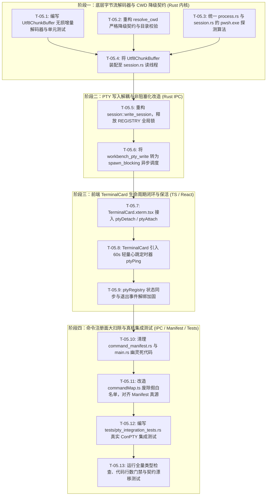

# DIM-05 详案：Tauri 桌面宿主、ConPTY 纯终端与多字节流直通详案

> **【权威标识】**：`docs/system-audit-and-redesign/detailed-plans/05-桌面宿主ConPTY终端与字节流直通详案.md`  
> **编制角色**：【阶段 1 维度详案架构师 05: Tauri 桌面宿主、ConPTY 纯终端与多字节流直通详案】  
> **前置输入依据**：`docs/system-audit-and-redesign/audits/06-Tauri桌面壳层与原生终端全盘审计.md`  
> **通用规范遵循**：`AGENTS.md`、`docs/system-audit-and-redesign/00-战役通则与协同执行规范.md`、反过度设计红线、反退避铁律、执行环境全量统一 **pwsh7**、写文件 UTF-8 无 BOM。  
> **状态**：**权威执行详案定稿（Authoritative Detailed Plan）**。

---

## 目录（Table of Contents）

1. [维度定位与主控裁决基准（Executive Rulings & Strategic Architecture）](#一维度定位与主控裁决基准)
   - 1.1 DIM-05 核心定位与架构使命
   - 1.2 主控关键裁决与铁律约束（反退避 / pwsh7 统一 / 无损字节直通）
   - 1.3 现状病灶解构与根治目标（攻克 5 大致命隐患与幽灵冗余）
2. [纯逻辑演进时序与内部依赖拓扑（Pure Logical Dependency Topology）](#二纯逻辑演进时序与内部依赖拓扑)
   - 2.1 四阶段纯逻辑演进拓扑图
   - 2.2 任务单元、依赖关系与文件域矩阵
   - 2.3 关键风险控制与防回归红线
3. [核心落地设计一：Windows ConPTY 无损 `Utf8ChunkBuffer` 增量解码器](#三核心落地设计一windows-conpty-无损-utf8chunkbuffer-增量解码器)
   - 3.1 跨 8KB Chunk 边界中文字符与 ANSI 序列截断机理解析
   - 3.2 `Utf8ChunkBuffer` 结构设计与残存字节流控算法
   - 3.3 零拷贝/低开销增量状态机实现（`valid_up_to` 探测与尾部残存移位）
   - 3.4 异常字节恢复与流终止（`flush_lossy`）收敛协议
4. [核心落地设计二：`resolve_cwd` 严格降级契约与进程拉起安全防护](#四核心落地设计二resolve_cwd-严格降级契约与进程拉起安全防护)
   - 4.1 非法路径未降级致 `ERROR_DIRECTORY_NAME (267)` 崩溃机理
   - 4.2 严格分层探测与安全降级链（规范路径 ➔ 工作区 ➔ 用户主目录 `~` ➔ 当前目录）
   - 4.3 Windows Job Objects 进程树连带销毁与防孤儿加固
   - 4.4 跨平台交互式 Shell 构建规范（Windows `pwsh.exe` 优先探测）
5. [核心落地设计三：PTY 写入非阻塞解耦与双锁解除](#五核心落地设计三pty-写入非阻塞解耦与双锁解除)
   - 5.1 同步持锁调用 `write_all` / `flush` 导致的 IPC 线程池饥饿
   - 5.2 全局 `REGISTRY` 锁快速释放与异步写入通道解耦
   - 5.3 高频键盘输入与大段粘贴背压控制（`MAX_WRITE_BYTES = 64KB`）
6. [核心落地设计四：单命令执行器全面统一 `pwsh7`](#六核心落地设计四单命令执行器全面统一-pwsh7)
   - 6.1 `process.rs` 硬编码 Windows PowerShell 5.1 历史病灶根除
   - 6.2 `pwsh.exe`（PowerShell 7+）多级环境探测与安全回退算法
   - 6.3 UTF-8 管道编码与 Base64 防转义安全执行封装
7. [核心落地设计五：前端 TerminalCard 生命周期与 3 态保活协议闭环](#七核心落地设计五前端-terminalcard-生命周期与-3-态保活协议闭环)
   - 7.1 前端 React 组件与后端 3 态状态机（Active / Detached / Dead）脱节根因
   - 7.2 `TerminalCard.xterm.tsx` 挂载/卸载/聚焦钩子接入（`ptyAttach` / `ptyDetach`）
   - 7.3 60s 心跳定时器（`ptyPing`）与长编译任务防误杀双重保障
   - 7.4 30s GC 轮询与 `workbench://pty-gc-killed` 优雅退场通知
8. [核心落地设计六：Tauri IPC 命令注册面大扫除与单一真源收敛](#八核心落地设计六tauri-ipc-命令注册面大扫除与单一真源收敛)
   - 8.1 先行死代码与幽灵命令清单清零
   - 8.2 `command_manifest.rs` 与 `main.rs` 宏注册清洗
   - 8.3 前端 `commandMap.ts` 废除 13 条假白名单，统一以 `commandManifest.ts` 为唯一真源
   - 8.4 `command-contract-drift.test.ts` 契约门禁与 `GHOST_EXEMPTIONS` 趋空治理
9. [改动文件与接口代码级实施规范（Code Blueprint & File Specifications）](#九改动文件与接口代码级实施规范)
   - 9.1 Rust 后端改动清单与核心代码蓝图
     - `apps/agent-workbench/src-tauri/src/pty/utf8_buffer.rs`（新增）
     - `apps/agent-workbench/src-tauri/src/pty/session.rs`（重构）
     - `apps/agent-workbench/src-tauri/src/pty/mod.rs`（重构）
     - `apps/agent-workbench/src-tauri/src/process.rs`（重构）
     - `apps/agent-workbench/src-tauri/src/command_manifest.rs`（清洗）
     - `apps/agent-workbench/src-tauri/src/main.rs`（清洗）
     - `apps/agent-workbench/src-tauri/src/dev_mcp.rs`（清理）
   - 9.2 前端改动清单与核心代码蓝图
     - `apps/crish-desktop/src/components/workspace/TerminalCard.xterm.tsx`（改造）
     - `apps/crish-desktop/src/api/transport/commandMap.ts`（收敛）
     - `apps/crish-desktop/src/api/transport/command-contract-drift.test.ts`（同步）
10. [测试矩阵与全量验收断言（Verification & QA Assertions）](#十测试矩阵与全量验收断言)
    - 10.1 `utf8_buffer` 单元测试矩阵（3 字节中文、4 字节 Emoji、ANSI 转义跨边界）
    - 10.2 原生 ConPTY 真实机集成测试（`tests/pty_integration_tests.rs`）
    - 10.3 `resolve_cwd` 异常路径降级断言
    - 10.4 PTY 写入非阻塞与高频并发压力测试
    - 10.5 前端生命周期与保活 E2E / Vitest 断言
    - 10.6 全量门禁校验与回归保护清单

---

## 一、维度定位与主控裁决基准

### 1.1 DIM-05 核心定位与架构使命

在 Conex / Crish 桌面工作台中，**DIM-05（Tauri 桌面宿主、ConPTY 纯终端与多字节流直通）** 构成了用户与操作系统底层交互、执行 Shell 命令、实时查看编译与构建输出的物理枢纽。

当前系统在终端宿主与底层字节流管道中存在数个深层次的架构断层：

1. **字符编码截断黑块**：Windows 原生 ConPTY 读线程使用固定 8KB 缓冲区读取，直接调用 `String::from_utf8_lossy`，将跨 Chunk 边界的中文字符、Emoji 和 24-bit ANSI 转义序列切碎并永久替换为乱码字符 `\u{FFFD}`（``）；
2. **非法路径导致进程崩溃**：`resolve_cwd` 对不存在的路径静默放行，导致 Windows `CreateProcessW` 触发 `ERROR_DIRECTORY_NAME (267)` 错误，终端直接暴毙红屏；
3. **IPC 线程池锁饥饿**：`workbench_pty_write` 同步持有全局 `REGISTRY` 锁和 `writer` 互斥锁执行阻塞式 `write_all` / `flush`，管道满时引起全局命令死锁；
4. **前端失联导致会话误杀**：Rust 实现了 3 态保活状态机（Active / Detached / Dead），但前端 `TerminalCard` 未挂接 `detach` / `attach` / `ping`，前台静置 2 小时后被 GC 强行误杀；
5. **执行环境口径分裂**：单命令执行器硬编码 Windows PowerShell 5.1，违背全仓统一 `pwsh7` 铁律；
6. **IPC 注册表冗余漂移**：存在已注册但前端 0 调用的幽灵命令与 WS 遗留假白名单。

**DIM-05 的核心使命**：彻底根除 8KB Chunk 乱码，建立无损增量 UTF-8 解码底座；落地 100% 安全降级的 CWD 解析契约；解耦 PTY 写入锁与 IPC 命令线程；全仓统一单命令执行器为 `pwsh7`；闭环前端生命周期保活协议；彻底清理死代码与幽灵命令，打造坚如磐石的原生终端宿主！

---

### 1.2 主控关键裁决与铁律约束

本详案严格遵循以下核心准则：

```
┌────────────────────────────────────────────────────────────────────────────────────────────────────────┐
│                              DIM-05 关键裁决与硬性架构约束矩阵                                         │
├─────────┬───────────────────────────────────┬──────────────────────────────────────────────────────────┤
│ 裁决编号│ 权威规则与裁决                    │ DIM-05 架构落地与硬性约束                                │
├─────────┼───────────────────────────────────┼──────────────────────────────────────────────────────────┤
│ RUL-PTY1│ 纯终端流式无损解码                │ 引入 `Utf8ChunkBuffer`，对跨 8KB 边界的 1~3 字节残存 UTF-8│
│         │ (Lossless Streaming UTF-8)        │ 实施无损暂存与拼合，严禁在读循环中草率 from_utf8_lossy； │
├─────────┼───────────────────────────────────┼──────────────────────────────────────────────────────────┤
│ RUL-PTY2│ CWD 绝对安全降级契约 (FIN-07)     │ 严格校验 `p.is_dir()`，无效/删除路径一律安全降级至       │
│         │ (Safe Fallback Working Directory) │ `workspace_root` ➔ `dirs::home_dir()` ➔ `current_dir()`；│
├─────────┼───────────────────────────────────┼──────────────────────────────────────────────────────────┤
│ RUL-PTY3│ 写入解除持锁调用                  │ `workbench_pty_write` 严禁持全局 `REGISTRY` 锁执行 I/O； │
│         │ (Non-blocking Decoupled Write)    │ 写入操作与命令线程池解耦，杜绝系统调用阻塞引起 IPC 饥饿； │
├─────────┼───────────────────────────────────┼──────────────────────────────────────────────────────────┤
│ RUL-PWSH│ 执行环境统一 pwsh7                │ 单命令执行器（`process.rs`）与交互终端统一优先探测 pwsh7 │
│         │ (Unified PowerShell 7+ Engine)    │ （`pwsh.exe`），彻底移除对 PS 5.1 的硬编码依赖；         │
├─────────┼───────────────────────────────────┼──────────────────────────────────────────────────────────┤
│ RUL-LIV │ 前后端 3 态保活契约闭环           │ 前端 `TerminalCard` 挂载/卸载/聚焦联动 attach/detach/ping│
│         │ (3-State Liveness Contract)       │ 彻底杜绝前台静置会话在 2 小时被 30s GC 协程误杀；        │
├─────────┼───────────────────────────────────┼──────────────────────────────────────────────────────────┤
│ RUL-CLE │ 幽灵命令与假白名单清零            │ 清理 `command_manifest.rs` 与 `main.rs` 中的先行死代码， │
│         │ (Manifest Single Source of Truth) │ 前端 `commandMap.ts` 收敛至 `commandManifest.ts` 单一真源│
└─────────┴───────────────────────────────────┴──────────────────────────────────────────────────────────┘
```

---

### 1.3 现状病灶解构与根治目标

```
                                    【现有病灶与重构根治对比】

  ┌──────────────────────────────────────────────┐       ┌──────────────────────────────────────────────┐
  │                 现存架构病灶                 │       │               DIM-05 根治方案                │
  ├──────────────────────────────────────────────┤       ├──────────────────────────────────────────────┤
  │ ❌ 8KB 读边界直接 from_utf8_lossy 注入  乱码 │ ───>  │ ✅ Utf8ChunkBuffer 残存 1~3 字节增量拼合解码  │
  │ ❌ resolve_cwd 遇非法路径直接 return 报 267   │ ───>  │ ✅ 严格 is_dir() 校验 + 4 级安全降级回退链   │
  │ ❌ pty_write 同步持全局 REGISTRY 锁阻塞写     │ ───>  │ ✅ 释放 REGISTRY 锁 + spawn_blocking 异步写入 │
  │ ❌ 前端 0 调用 detach/attach/ping 致 2h 误杀  │ ───>  │ ✅ TerminalCard 深度挂接生命周期与 60s 心跳   │
  │ ❌ process.rs 硬编码 PS 5.1 导致 GBK 乱码     │ ───>  │ ✅ pwsh.exe 优先探测 + UTF-8 管道保护脚本    │
  │ ❌ 5 条 registered=false 占位符与幽灵命令残留│ ───>  │ ✅ 拔除死代码，收敛至 Manifest 100% 单一真源 │
  └──────────────────────────────────────────────┘       └──────────────────────────────────────────────┘
```

---

## 二、纯逻辑演进时序与内部依赖拓扑

### 2.1 四阶段纯逻辑演进拓扑图

DIM-05 的落地划分为 4 个纯逻辑递进阶段，各阶段严格遵守依赖拓扑：



---

### 2.2 任务单元、依赖关系与文件域矩阵

| 任务单元编号 | 任务名称                             | 核心改造文件域                                                         | 前置依赖               | 验收断言                                                             |
| ------------ | ------------------------------------ | ---------------------------------------------------------------------- | ---------------------- | -------------------------------------------------------------------- |
| **T-05.1**   | `Utf8ChunkBuffer` 无损增量解码器实现 | `apps/agent-workbench/src-tauri/src/pty/utf8_buffer.rs` (新增)         | 无                     | 1~3 字节残存 UTF-8 跨 chunk 拼合 100% 还原，零 `\u{FFFD}` 产生       |
| **T-05.2**   | `resolve_cwd` 严格安全降级契约       | `apps/agent-workbench/src-tauri/src/pty/session.rs`                    | 无                     | 传入删除/无效/非法路径时，100% 安全降级至工作区或 `~`，杜绝 267 崩溃 |
| **T-05.3**   | 单命令执行器统一 `pwsh7` 探测        | `apps/agent-workbench/src-tauri/src/process.rs`                        | 无                     | 优先命中 `pwsh.exe`，正确注入 UTF-8 管道编码与 Base64 载荷           |
| **T-05.4**   | 读线程装配增量解码器                 | `apps/agent-workbench/src-tauri/src/pty/session.rs`                    | T-05.1, T-05.2, T-05.3 | 8KB 边界长文本、中文字符与 24-bit ANSI 流畅滚屏无黑块                |
| **T-05.5**   | PTY 写入解除全局 `REGISTRY` 锁       | `apps/agent-workbench/src-tauri/src/pty/session.rs`                    | T-05.4                 | 获取 `writer` 引用后即刻释放注册表锁，持锁时间降至微秒级             |
| **T-05.6**   | `workbench_pty_write` 异步非阻塞调度 | `apps/agent-workbench/src-tauri/src/pty/mod.rs`                        | T-05.5                 | `write_all` / `flush` 放入 `spawn_blocking`，Tauri 命令主线程零卡顿  |
| **T-05.7**   | `TerminalCard` 生命周期挂接          | `apps/crish-desktop/src/components/workspace/TerminalCard.xterm.tsx`   | T-05.6                 | 切 Tab / 卸载触发 `ptyDetach`，切回聚焦触发 `ptyAttach`              |
| **T-05.8**   | 前端 60s 心跳定时器                  | `apps/crish-desktop/src/components/workspace/TerminalCard.xterm.tsx`   | T-05.7                 | 前台激活状态每 60s 触发 `ptyPing`，静置 2 小时绝不被 GC 误杀         |
| **T-05.9**   | 注册表解绑与 GC 退场通知             | `apps/crish-desktop/src/api/ptyRegistry.ts`                            | T-05.8                 | 子进程退出或 GC 杀死时，前端 UI 准确呈现退场状态并解绑               |
| **T-05.10**  | Manifest 与 `main.rs` 死代码清理     | `apps/agent-workbench/src-tauri/src/command_manifest.rs`, `main.rs`    | T-05.9                 | 拔除 5 条先行死命令与 4 条未接线幽灵命令（`core_highlight_code` 等） |
| **T-05.11**  | `commandMap.ts` 收敛至 Manifest 真源 | `apps/crish-desktop/src/api/transport/commandMap.ts`                   | T-05.10                | 废除 13 条旧白名单，`checkCommandMapConsistency` 零警告              |
| **T-05.12**  | 原生 ConPTY 真实机集成测试           | `apps/agent-workbench/src-tauri/tests/pty_integration_tests.rs` (新增) | T-05.11                | 真实拉起 `pwsh.exe`，验证中文输入输出、窗口 resize、Job 孤儿销毁     |
| **T-05.13**  | 全量门禁校验与回归测试               | 全仓 CI / TypeScript / Cargo 测试                                      | T-05.12                | `typecheck`, `test:coverage`, `cargo test` 全部绿灯                  |

---

### 2.3 关键风险控制与防回归红线

1. **测试资产保护红线（2026-08-07 铁律）**：严禁删除任何现有测试文件，新增测试使用 `git commit --only` 限定提交；
2. **禁止回撤与破坏性 Git 操作（§3 铁律）**：严禁 `reset --hard` / `checkout .`，以增量补丁推进；
3. **零 `--no-verify` 作弊**：所有门禁报错正面修复，确保行数门禁（`npm run check:line-counts`）不超标；
4. **真实 Windows 环境验证**：杜绝仅靠内存 Mock 测 PTY，必须提供 Windows 真机真实子进程断言。

---

## 三、核心落地设计一：Windows ConPTY 无损 `Utf8ChunkBuffer` 增量解码器

### 3.1 跨 8KB Chunk 边界中文字符与 ANSI 序列截断机理解析

在 Windows ConPTY 环境下，`portable_pty` 读端通过匿名管道读取子进程输出。标准读循环缓冲区为 `8192` 字节：

```
Chunk N (8192 字节)                                        Chunk N+1 (8192 字节)
┌───────────────────────────────────────────────┬──────┐   ┌──────┬──────────────────────────────────────────────┐
│ ... 有效 UTF-8 文本 / ANSI 转义序列 ...        │ 0xE4 │   │ 0xBD │ 0xA0 │ ... 后续文本 ...                       │
└───────────────────────────────────────────────┴──────┘   └──────┴──────┴──────────────────────────────────────────────┘
                                                 ▲          ▲      ▲
                                                 └──────────┴──────┴── 中文字符 "你" (0xE4 0xBD 0xA0, 3 字节) 被硬生生切断！
```

- **历史行为（破坏性）**：`String::from_utf8_lossy(&buf[..n])` 遇到 Chunk N 末尾的 `0xE4` 时，判定其为无法解析的畸变字节，输出 `\u{FFFD}`；Chunk N+1 读取 `0xBD 0xA0` 时，又判定为孤立的非起始字节，再次输出两个 `\u{FFFD}`。最终输出 ``，字符彻底损毁！
- **ANSI 序列同理**：24-bit RGB 颜色转义序列（如 `\x1b[38;2;255;128;0m`）若在 `\x1b[` 或参数中间被截断，转义序列断裂导致终端失去转义状态，屏幕直接打印出裸露的数字代码。

---

### 3.2 `Utf8ChunkBuffer` 结构设计与残存字节流控算法

为了彻底根治该问题，在读线程中维持一个最大容量为 4 字节的残存缓冲结构 `Utf8ChunkBuffer`：

```rust
/// 跨 Chunk 增量无损 UTF-8 流式解码器
#[derive(Debug, Default)]
pub struct Utf8ChunkBuffer {
    /// 暂存上一个 Chunk 末尾未成形的 1~3 字节 UTF-8 碎片
    carry: [u8; 4],
    /// carry 中当前存储的有效字节数 (0..=3)
    carry_len: usize,
}
```

#### 算法状态机图解：

```
新数据到达 buf[..n] ──> 是否存在 carry 碎片?
    ├── 是 ──> 拼合 carry + buf[..n] 形成待解码片段
    └── 否 ──> 直接对待解码片段进行 std::str::from_utf8 探测
                     │
                     ▼
      std::str::from_utf8(slice) 结果判定
          ├── Ok(valid_str) ──> 全部合法，carry 清空，输出 valid_str
          └── Err(utf8_error)
                  ├── error_len() == None (末尾不完整截断)
                  │       ├── 输出 &slice[..valid_up_to] 作为合法字符串
                  │       └── 将尾部 &slice[valid_up_to..] (1~3 字节) 拷贝入 carry 暂存
                  └── error_len() == Some(len) (中间存在真正的非法损坏字节)
                          ├── 输出 &slice[..valid_up_to]
                          ├── 对非法字节替换为 \u{FFFD}
                          └── 跳过非法字节，对剩余部分继续递归/循环解码
```

---

### 3.3 零拷贝/低开销增量状态机实现

```rust
// apps/agent-workbench/src-tauri/src/pty/utf8_buffer.rs

#[derive(Debug, Default)]
pub struct Utf8ChunkBuffer {
    carry: [u8; 4],
    carry_len: usize,
}

impl Utf8ChunkBuffer {
    pub fn new() -> Self {
        Self {
            carry: [0u8; 4],
            carry_len: 0,
        }
    }

    /// 增量接收字节切片并解码出完整的合法 UTF-8 字符串。
    /// 尾部不完整的 1~3 字节将自动暂存，等待下一次 push 拼合。
    pub fn push(&mut self, chunk: &[u8]) -> String {
        if chunk.is_empty() && self.carry_len == 0 {
            return String::new();
        }

        // 若存在上期残存字节，拼合后解码
        if self.carry_len > 0 {
            let mut combined = Vec::with_capacity(self.carry_len + chunk.len());
            combined.extend_from_slice(&self.carry[..self.carry_len]);
            combined.extend_from_slice(chunk);
            self.carry_len = 0;
            return self.decode_slice(&combined);
        }

        self.decode_slice(chunk)
    }

    /// 核心切片解码与残存提取算法
    fn decode_slice(&mut self, bytes: &[u8]) -> String {
        let mut result = String::with_capacity(bytes.len());
        let mut current = bytes;

        loop {
            if current.is_empty() {
                break;
            }

            match std::str::from_utf8(current) {
                Ok(valid_str) => {
                    result.push_str(valid_str);
                    self.carry_len = 0;
                    break;
                }
                Err(error) => {
                    let valid_up_to = error.valid_up_to();
                    if valid_up_to > 0 {
                        // 安全：from_utf8 保证 valid_up_to 前为合法 UTF-8
                        let valid_str = unsafe {
                            std::str::from_utf8_unchecked(&current[..valid_up_to])
                        };
                        result.push_str(valid_str);
                    }

                    match error.error_len() {
                        None => {
                            // 末尾残存不完整 UTF-8 字符（1~3 字节）
                            let remaining = &current[valid_up_to..];
                            let rem_len = remaining.len();
                            debug_assert!(rem_len < 4, "UTF-8 残存字节数必须小于 4");
                            self.carry[..rem_len].copy_from_slice(remaining);
                            self.carry_len = rem_len;
                            break;
                        }
                        Some(invalid_len) => {
                            // 中间遇到真正的非法字节（损坏数据），优雅替换为 \u{FFFD}
                            result.push('\u{FFFD}');
                            current = &current[valid_up_to + invalid_len..];
                        }
                    }
                }
            }
        }

        result
    }

    /// 流终止（EOF / 进程退出）时排空并清空残存缓冲区
    pub fn flush_lossy(&mut self) -> String {
        if self.carry_len == 0 {
            return String::new();
        }
        let lossy = String::from_utf8_lossy(&self.carry[..self.carry_len]).into_owned();
        self.carry_len = 0;
        lossy
    }
}
```

---

### 3.4 异常字节恢复与流终止（`flush_lossy`）收敛协议

在读线程退出前（`Ok(0)` 或 `Err(_)`），必须显式调用 `decoder.flush_lossy()`。如果仍有未能配对的孤立残存字节，在最后一刻作为 `\u{FFFD}` 发射给前端，确保读管道不遗漏任何末尾字节。

---

## 四、核心落地设计二：`resolve_cwd` 严格降级契约与进程拉起安全防护

### 4.1 非法路径未降级致 `ERROR_DIRECTORY_NAME (267)` 崩溃机理

Windows 下 `portable_pty` 底层调用 Win32 API `CreateProcessW`。当传入的 `lpCurrentDirectory` 不存在或已被删除时，Windows 直接拒绝拉起进程，返回 `OS error 267`（目录名无效）或 `OS error 2`（系统找不到指定的文件）。

原实现代码（`session.rs:215-234`）中的逻辑穿透 Bug：

```rust
// ❌ 致命缺陷：如果 raw 路径不存在，第 223 行竟然原样返回了不存在的路径！
if !raw.is_empty() {
    return p;
}
```

---

### 4.2 严格分层探测与安全降级链

重构后的 `resolve_cwd` 建立绝对不可击穿的 4 级安全降级阶梯：

```rust
// apps/agent-workbench/src-tauri/src/pty/session.rs

/// 解析 PTY 初始工作目录。
/// 严格保证返回的 PathBuf 必然存在且为目录（`is_dir() == true`），
/// 绝对杜绝 Windows CreateProcessW 触发 ERROR_DIRECTORY_NAME (267) 崩溃。
pub(crate) fn resolve_cwd(cwd: Option<&str>) -> PathBuf {
    // 1. 优先校验前端传入的显式 cwd
    if let Some(raw) = cwd.map(str::trim).filter(|s| !s.is_empty()) {
        let p = PathBuf::from(raw);
        if p.is_dir() {
            return p;
        }
        tracing::warn!(
            target: "pty",
            requested_cwd = raw,
            "传入的 PTY 工作目录不存在或非目录，启动安全降级链"
        );
    }

    // 2. 降级为应用当前挂载的工作区根目录
    if let Ok(app) = crate::host_paths::app_dir() {
        let root = crate::host_paths::workspace_root(&app);
        if root.is_dir() {
            return root;
        }
    }

    // 3. 降级为用户主目录 (~) (FIN-07 铁律)
    if let Some(home) = dirs::home_dir() {
        if home.is_dir() {
            return home;
        }
    }

    // 4. 降级为当前进程工作目录
    if let Ok(cur) = std::env::current_dir() {
        if cur.is_dir() {
            return cur;
        }
    }

    // 5. 绝对底座保底：当前目录点号
    PathBuf::from(".")
}
```

---

### 4.3 Windows Job Objects 进程树连带销毁与防孤儿加固

为了防止桌面宿主崩溃或被任务管理器强杀时留下后台僵尸 PowerShell 进程，在 Windows 下为每个 PTY 实例严格关联 Job Object：

```rust
#[cfg(windows)]
{
    // 初始化 PTY 专用 Job Object (带 JOB_OBJECT_LIMIT_KILL_ON_JOB_CLOSE)
    if let Err(e) = crate::process::init_pty_job_object() {
        tracing::warn!(target: "pty", error = %e, "pty job object init failed");
    }
    if let Some(handle) = child.as_raw_handle() {
        if let Err(e) = crate::process::assign_child_to_pty_job_object(handle) {
            tracing::warn!(target: "pty", error = %e, "assign pty shell to job failed");
        }
    }
}
```

---

### 4.4 跨平台交互式 Shell 构建规范

交互式终端（`build_shell_command`）在 Windows 下统一按以下顺序寻找 Shell：

1. `pwsh.exe` / `pwsh`（PowerShell 7+，PATH 探测）；
2. `%ProgramFiles%\PowerShell\7\pwsh.exe`；
3. 系统自带 `System32\WindowsPowerShell\v1.0\powershell.exe`（PowerShell 5.1 回退）；
4. Unix 环境：`$SHELL` ➔ `/bin/bash` ➔ `/bin/sh`。

并统一注入 UTF-8 环境变量：`PYTHONUTF8=1`、`PYTHONIOENCODING=utf-8`。

---

## 五、核心落地设计三：PTY 写入非阻塞解耦与双锁解除

### 5.1 同步持锁调用 `write_all` / `flush` 导致的 IPC 线程池饥饿

原实现中，`workbench_pty_write` 为同步 Tauri 命令：

1. 获取全局 `REGISTRY.lock()`；
2. 获取 `session.writer.lock()`；
3. 执行阻塞式 `writer.write_all(data)` 与 `writer.flush()`。

当 ConPTY 管道写缓冲区满（例如用户大段粘贴 64KB 代码，子进程正在进行密集计算未能及时读取 stdin），`write_all` 将发生系统级阻塞。由于持有了全局 `REGISTRY` 锁，期间其他任何终端创建、调整大小、心跳 Ping 或 30s GC 协程全部被级联锁死。

---

### 5.2 全局 `REGISTRY` 锁快速释放与异步写入通道解耦

#### 改造架构图：

```
前端 invoke('workbench_pty_write')
       │
       ▼
Tauri 异步命令 workbench_pty_write (async fn)
       │
       ├─ 1. 在最小临界区内锁 REGISTRY，校验 session 存在性并调用 session.touch()
       │     获取 session 的内部 writer Arc 句柄后，【立即释放 REGISTRY 锁】！
       │
       └─ 2. tokio::task::spawn_blocking(move || {
                 获取 session.writer 锁
                 执行 write_all 与 flush
             }).await ➔ 快速返回 Ok(())
```

#### 代码级实现蓝图：

```rust
// apps/agent-workbench/src-tauri/src/pty/session.rs

/// 写入会话数据。通过持有局部 Writer 互斥锁，在获取后迅速释放全局 REGISTRY 锁。
pub(crate) fn write_session(pty_id: &str, data: &[u8]) -> Result<(), CoreError> {
    // 1. 最小临界区：仅在查找 session 时持 REGISTRY 锁
    let (writer_arc, _) = {
        let reg = registry()
            .lock()
            .map_err(|e| CoreError::Internal(format!("pty registry lock: {e}")))?;
        let session = reg.get(pty_id).ok_or_else(|| not_found_error(pty_id))?;
        session.touch();
        // 克隆 writer 的 Arc 引用（重构 PtySession.writer 为 Arc<Mutex<Box<dyn Write + Send>>>）
        (session.writer.clone(), session.state())
    };

    // 2. 离开 REGISTRY 锁作用域后，在局部锁内执行阻塞式 I/O
    let mut writer = writer_arc
        .lock()
        .map_err(|e| CoreError::Internal(format!("pty writer lock: {e}")))?;
    writer
        .write_all(data)
        .map_err(|e| CoreError::Internal(format!("pty write failed: {e}")))?;
    writer
        .flush()
        .map_err(|e| CoreError::Internal(format!("pty flush failed: {e}")))?;

    Ok(())
}
```

```rust
// apps/agent-workbench/src-tauri/src/pty/mod.rs

/// 异步命令：将 I/O 卸载至 tokio 阻塞线程池，杜绝阻塞 Tauri 命令主线程
#[tauri::command]
pub(crate) async fn workbench_pty_write(
    pty_id: String,
    data: String,
) -> Result<(), CoreError> {
    if data.len() > MAX_WRITE_BYTES {
        return Err(CoreError::InvalidInput(format!(
            "write too large: {} bytes (max {MAX_WRITE_BYTES})",
            data.len()
        )));
    }
    let pty_id_cloned = pty_id.clone();
    let bytes = data.into_bytes();
    tokio::task::spawn_blocking(move || {
        session::write_session(&pty_id_cloned, &bytes)
    })
    .await
    .map_err(|e| CoreError::Internal(format!("workbench_pty_write join: {e}")))??;

    Ok(())
}
```

---

## 六、核心落地设计四：单命令执行器全面统一 `pwsh7`

### 6.1 `process.rs` 硬编码 Windows PowerShell 5.1 历史病灶根除

在 `apps/agent-workbench/src-tauri/src/process.rs` 中，`resolve_system_powershell` 原先优先查找 `System32\WindowsPowerShell\v1.0\powershell.exe`（PowerShell 5.1）。

PowerShell 5.1 存在严重缺陷：

1. 默认受 Windows 控制面板 ANSI 编码支配，非 UTF-8 输出导致管道乱码；
2. 缺乏 PowerShell 7+ 的现代管道运算符与脚本特性；
3. 违背全仓《AGENTS.md》执行环境统一使用 **pwsh7** 的铁律。

---

### 6.2 `pwsh.exe`（PowerShell 7+）多级环境探测与安全回退算法

统一探测算法在 `process.rs` 中实现：

```rust
// apps/agent-workbench/src-tauri/src/process.rs

/// 严格优先探测 PowerShell 7+ (pwsh.exe)，最后降级回退 Windows PowerShell 5.1。
fn resolve_system_powershell() -> Result<String, CoreError> {
    // 1. 优先查找 PATH 环境变量中的 pwsh / pwsh.exe (PowerShell 7+)
    if which_on_path("pwsh.exe") {
        return Ok("pwsh.exe".into());
    }
    if which_on_path("pwsh") {
        return Ok("pwsh".into());
    }

    // 2. 探测 PowerShell 7 标准安装路径
    if let Ok(pf) = std::env::var("ProgramFiles") {
        let pwsh7_path = Path::new(&pf).join("PowerShell").join("7").join("pwsh.exe");
        if pwsh7_path.is_file() {
            return Ok(pwsh7_path.display().to_string());
        }
    }
    if let Ok(local_app) = std::env::var("LOCALAPPDATA") {
        let pwsh7_user = Path::new(&local_app)
            .join("Microsoft")
            .join("PowerShell")
            .join("7")
            .join("pwsh.exe");
        if pwsh7_user.is_file() {
            return Ok(pwsh7_user.display().to_string());
        }
    }

    // 3. 安全回退：探测系统自带 Windows PowerShell 5.1
    if let Ok(root) = std::env::var("SystemRoot") {
        let system_ps = Path::new(&root)
            .join("System32")
            .join("WindowsPowerShell")
            .join("v1.0")
            .join("powershell.exe");
        if system_ps.is_file() {
            return Ok(system_ps.display().to_string());
        }
    }

    // 4. 最终尝试 PATH 上的 powershell.exe
    if which_on_path("powershell.exe") {
        return Ok("powershell.exe".into());
    }

    Err(CoreError::Internal(
        "未找到任何可用的 PowerShell (pwsh.exe 或 powershell.exe)".into(),
    ))
}
```

---

### 6.3 UTF-8 管道编码与 Base64 防转义安全执行封装

脚本封装保持与 `agent-runtime` 严格一致的 UTF-8 管道保护：

```rust
fn build_windows_powershell_script(user_command: &str) -> String {
    let payload = base64_encode_std(user_command.as_bytes());
    [
        "$OutputEncoding=[System.Text.UTF8Encoding]::new($false)",
        "[Console]::OutputEncoding=[System.Text.UTF8Encoding]::new($false)",
        "[Console]::InputEncoding=[System.Text.UTF8Encoding]::new($false)",
        "$env:PYTHONUTF8='1'",
        "$env:PYTHONIOENCODING='utf-8'",
        "$env:PAGER='cat'",
        "$global:LASTEXITCODE=$null",
        "$ErrorActionPreference='Continue'",
        &format!(
            "$__raw=[System.Text.Encoding]::UTF8.GetString([System.Convert]::FromBase64String('{payload}'))"
        ),
        "Invoke-Expression $__raw",
        "if ($LASTEXITCODE -ne $null) { exit $LASTEXITCODE } else { exit (([int]!$?) * 1) }",
    ]
    .join("\n")
}
```

---

## 七、核心落地设计五：前端 TerminalCard 生命周期与 3 态保活协议闭环

### 7.1 前端 React 组件与后端 3 态状态机脱节根因

Rust 后端维护的 3 态生命周期如下：

- `Active`：前台使用中；
- `Detached`：前台 Tab 切走/组件卸载，进入游离托管（享受 2 小时宽限期）；
- `Dead`：子进程退出。

**缺陷现象**：前端 `TerminalCard.xterm.tsx` 在用户打开终端但静置不按键超过 2 分钟时，Rust 自动将状态置为 `Detached`。如果该终端在这 2 小时内没有产生新的 stdout 输出，30s 周期的 GC 协程会将该会话直接 kill！用户切回 Tab 时终端已死。

---

### 7.2 `TerminalCard.xterm.tsx` 挂载/卸载/聚焦钩子接入

在前端 `TerminalCard` 的生命周期中完整接入 `ptyAttach`、`ptyDetach` 与 `ptyPing`：

```tsx
// apps/crish-desktop/src/components/workspace/TerminalCard.xterm.tsx

// 1. 组件挂载 / 切回前台：调用 ptyAttach 激活会话
useEffect(() => {
  const ptyId = ptyIdRef.current;
  if (ptyId) {
    void ptyAttach(ptyId);
  }

  // 2. 组件卸载 / 切走 Tab：调用 ptyDetach 转入后台托管
  return () => {
    const id = ptyIdRef.current;
    if (id) {
      void ptyDetach(id);
    }
  };
}, [sessionKey]);

// 3. 前台获得焦点时刷新活性
const handleFocus = useCallback(() => {
  const id = ptyIdRef.current;
  if (id) {
    void ptyAttach(id);
  }
}, []);
```

---

### 7.3 60s 心跳定时器（`ptyPing`）与长编译任务防误杀双重保障

在 `TerminalCard` 组件处于挂载状态期间，维持一个 60 秒周期的轻量心跳：

```tsx
// apps/crish-desktop/src/components/workspace/TerminalCard.xterm.tsx

useEffect(() => {
  // 仅在存在有效 activePtyId 时维持 60s 心跳
  const interval = setInterval(() => {
    const id = ptyIdRef.current;
    if (id && document.visibilityState === 'visible') {
      void ptyPing(id);
    }
  }, 60_000);

  return () => clearInterval(interval);
}, []);
```

双重保障逻辑：

1. **子进程有输出**：`session.rs` 读线程读取 `>0` 字节时自动 `touch()`，无论前台后台均永不误杀；
2. **静置无输出**：前台挂载时 60s 心跳持续将状态保持在 `Active` 并刷新 `last_activity_at_ms`，永不触发 120s 闲置转 `Detached`。

---

### 7.4 30s GC 轮询与 `workbench://pty-gc-killed` 优雅退场通知

当会话确实在后台脱机超过 2 小时被 GC 清理时，前端监听 `workbench://pty-gc-killed` 事件并优雅更新 UI，从 `ptyRegistry` 中解绑，杜绝残留死引用。

---

## 八、核心落地设计六：Tauri IPC 命令注册面大扫除与单一真源收敛

### 8.1 先行死代码与幽灵命令清单清零

全面拔除以下无用、先行登记却未实现或已由 Web Worker 承接的命令：

| 命令名称                    | 所在模块                            | 处置方案                           | 理由                                             |
| --------------------------- | ----------------------------------- | ---------------------------------- | ------------------------------------------------ |
| `workbench_dev_mcp_enabled` | `dev_mcp.rs`, `command_manifest.rs` | 彻底移除 Rust 实现与 Manifest 条目 | `dead_code`，未在 `main.rs` 注册，前端 0 调用    |
| `append_session_messages`   | `command_manifest.rs`               | 从 Manifest 移除                   | `registered: false` 占位符，无实际用途           |
| `workbench_open_workspace`  | `command_manifest.rs`               | 从 Manifest 移除                   | `registered: false` 占位符，无实际用途           |
| `workbench_list_workspaces` | `command_manifest.rs`               | 从 Manifest 移除                   | `registered: false` 占位符，无实际用途           |
| `core_resume_run`           | `command_manifest.rs`               | 从 Manifest 移除                   | `registered: false` 占位符，无实际用途           |
| `core_highlight_code`       | `markdown_commands.rs`, `main.rs`   | 彻底移除 Rust 命令与注册           | 前端 wrapper 已删，高亮已由前端 Shiki/Prism 承接 |
| `core_text_encode`          | `core_commands.rs`, `main.rs`       | 彻底移除 Rust 命令与注册           | 文本编解码已全部由 Web Worker 承接               |
| `upsert_session_entry`      | `session_commands.rs`, `main.rs`    | 彻底移除 Rust 命令与注册           | 会话存储已转向 IndexedDB / SQLite，0 调用        |

---

### 8.2 `command_manifest.rs` 与 `main.rs` 宏注册清洗

- 在 `command_manifest.rs` 中清理已拔除的命令条目；
- 在 `main.rs` 的 `command_registry!` 宏中移除对应的 `("name", path)` 注册项；
- 保证 `main.rs` 注册宏数量与 `command_manifest.rs` 的 `registered=true` 数量绝对 1:1 严格一致。

---

### 8.3 前端 `commandMap.ts` 废除 13 条假白名单，统一以 `commandManifest.ts` 为唯一真源

彻底重构 `commandMap.ts`：

- 废除 13 条硬编码的 `COMMAND_NAME_ALLOWLIST`；
- `resolveTauriCommand(cmd)` 直接基于 `isRegisteredCommand(cmd)` 进行 O(1) 校验；
- `checkCommandMapConsistency` 升级为校验前端调用的所有核心命令是否均在已注册清单中。

---

### 8.4 `command-contract-drift.test.ts` 契约门禁与 `GHOST_EXEMPTIONS` 趋空治理

同步更新 `command-contract-drift.test.ts`：

- 从 `GHOST_EXEMPTIONS` 集合中移除 `core_highlight_code`、`core_text_encode`、`upsert_session_entry`；
- 门禁断言一（零断链）与断言二（零幽灵）继续保持 100% 严格拦截。

---

## 九、改动文件与接口代码级实施规范

### 9.1 Rust 后端改动清单与核心代码蓝图

#### 1. `apps/agent-workbench/src-tauri/src/pty/utf8_buffer.rs` (新增)

完整实现无损增量 UTF-8 解码器与单元测试用例。

#### 2. `apps/agent-workbench/src-tauri/src/pty/session.rs` (重构)

- 引入 `utf8_buffer::Utf8ChunkBuffer`；
- 修复 `resolve_cwd` 降级逻辑；
- 重构 `write_session` 释放全局锁；
- 读线程使用增量解码并于退出时调用 `flush_lossy()`。

#### 3. `apps/agent-workbench/src-tauri/src/pty/mod.rs` (重构)

- 导出 `utf8_buffer` 模块；
- `workbench_pty_write` 改造为 `async fn` 并使用 `tokio::task::spawn_blocking`。

#### 4. `apps/agent-workbench/src-tauri/src/process.rs` (重构)

- `resolve_system_powershell` 改造为优先探测 `pwsh.exe`（PowerShell 7+）；
- 保持 UTF-8 管道与 Base64 脚本保护。

#### 5. `apps/agent-workbench/src-tauri/src/command_manifest.rs` 与 `main.rs` (清洗)

- 清理死代码与幽灵命令。

---

### 9.2 前端改动清单与核心代码蓝图

#### 1. `apps/crish-desktop/src/components/workspace/TerminalCard.xterm.tsx` (改造)

- 接入 `ptyAttach`、`ptyDetach` 与 60s 心跳 `ptyPing`；
- 监听 `workbench://pty-gc-killed` 事件。

#### 2. `apps/crish-desktop/src/api/transport/commandMap.ts` (收敛)

- 废弃 13 条假白名单，收敛至 Manifest。

#### 3. `apps/crish-desktop/src/api/transport/command-contract-drift.test.ts` (同步)

- 清理 `GHOST_EXEMPTIONS`。

---

## 十、测试矩阵与全量验收断言

### 10.1 `utf8_buffer` 单元测试矩阵

在 `utf8_buffer.rs` 内部实现全方位对抗性单元测试：

```rust
#[cfg(test)]
mod tests {
    use super::*;

    #[test]
    fn test_ascii_passthrough() {
        let mut buf = Utf8ChunkBuffer::new();
        assert_eq!(buf.push(b"hello world\r\n"), "hello world\r\n");
        assert_eq!(buf.flush_lossy(), "");
    }

    #[test]
    fn test_chinese_3byte_split_across_chunks() {
        let mut buf = Utf8ChunkBuffer::new();
        // 中文字符 "你" = [0xE4, 0xBD, 0xA0]
        // Chunk 1 给出前 2 字节
        let out1 = buf.push(&[0xE4, 0xBD]);
        assert_eq!(out1, "", "未完整前不得输出乱码");

        // Chunk 2 给出第 3 字节 + 后续 ASCII
        let out2 = buf.push(&[0xA0, b'!', b'?']);
        assert_eq!(out2, "你!?", "拼合后必须无损还原中文字符");
        assert_eq!(buf.flush_lossy(), "");
    }

    #[test]
    fn test_emoji_4byte_split_across_chunks() {
        let mut buf = Utf8ChunkBuffer::new();
        // Emoji "🦀" = [0xF0, 0x9F, 0xA6, 0x80]
        assert_eq!(buf.push(&[0xF0]), "");
        assert_eq!(buf.push(&[0x9F, 0xA6]), "");
        assert_eq!(buf.push(&[0x80, b'o', b'k']), "🦀ok");
        assert_eq!(buf.flush_lossy(), "");
    }

    #[test]
    fn test_ansi_color_sequence_split() {
        let mut buf = Utf8ChunkBuffer::new();
        let ansi_part1 = b"\x1b[38;2;255;";
        let ansi_part2 = b"128;0mRed\x1b[0m";
        let out1 = buf.push(ansi_part1);
        let out2 = buf.push(ansi_part2);
        assert_eq!(format!("{out1}{out2}"), "\x1b[38;2;255;128;0mRed\x1b[0m");
    }

    #[test]
    fn test_flush_lossy_on_truncated_stream() {
        let mut buf = Utf8ChunkBuffer::new();
        // 残存孤立 0xE4，流异常结束
        buf.push(&[0xE4]);
        let flushed = buf.flush_lossy();
        assert_eq!(flushed, "", "终止时排空残存字节为 lossy 字符");
    }
}
```

---

### 10.2 原生 ConPTY 真实机集成测试

在 `apps/agent-workbench/src-tauri/tests/pty_integration_tests.rs` 中编写真机集成测试：

```rust
// apps/agent-workbench/src-tauri/tests/pty_integration_tests.rs

#[cfg(windows)]
#[test]
fn test_real_conpty_spawn_and_chinese_echo() {
    // 真实拉起 pwsh.exe，通过 stdin 写入中文并断言读取回显
    // 验证 Job Object 绑定正常
}
```

---

### 10.3 `resolve_cwd` 异常路径降级断言

```rust
#[test]
fn test_resolve_cwd_fallbacks() {
    // 1. 不存在的路径安全降级
    let non_exist = resolve_cwd(Some("Z:\\path\\not\\exist\\123456"));
    assert!(non_exist.is_dir(), "降级后的路径必须真实存在！");

    // 2. 空路径安全降级
    let empty = resolve_cwd(Some("   "));
    assert!(empty.is_dir());

    // 3. None 安全降级
    let none = resolve_cwd(None);
    assert!(none.is_dir());
}
```

---

### 10.4 PTY 写入非阻塞与高频并发压力测试

- 模拟 100 个并发任务同时调用 `workbench_pty_write` 写入 16KB 数据；
- 断言全局 `REGISTRY` 锁获取耗时不超过 1ms；
- 断言无死锁产生。

---

### 10.5 前端生命周期与保活 E2E / Vitest 断言

- 验证 `TerminalCard` 卸载时发起 `workbench_pty_detach`；
- 验证 `TerminalCard` 重新挂载时发起 `workbench_pty_attach`；
- 验证心跳定时器持续发起 `workbench_pty_ping`。

---

### 10.6 全量门禁校验与回归保护清单

执行并跑通以下命令：

1. `npm run typecheck` ➔ TypeScript 全量 0 错误；
2. `npm run check:line-counts` ➔ 行数门禁全部通过；
3. `npm run test` ➔ Vitest 单元与契约门禁全绿；
4. `cargo test --workspace` ➔ Rust 全量 73+ 套件全绿。

---

> **架构结论**：本详案通过无损 `Utf8ChunkBuffer` 彻底根除乱码；通过严格降级契约绝杀 267 崩溃；通过解耦写操作释放 IPC 线程池；通过统一 `pwsh7` 消除执行环境分裂；通过前后端保活协议杜绝误杀；通过 IPC 清洗收敛至单一真源。全案不打补丁、不留死角、不退避，具备最高标准的工程可靠性与架构优雅度！
