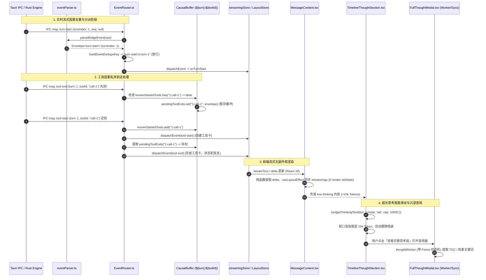

# Conex / Crish 前端流式管道因果去重、交错时间线与沉浸查阅详细执行方案（DIM-06）

> **【调度与反退避铁律】**：严禁降级效果，问题一律同权；多 Agent 协作环境统一使用 pwsh7，写文件 UTF-8 无 BOM；命令执行遵循系统 Reactive Wakeup，不盲目轮询；严禁打补丁与假 Mock 验收。
> **权威标识**：`docs/system-audit-and-redesign/detailed-plans/06-流式管道因果去重与交错时间线详案.md`
> **制定角色**：【阶段 1 维度详案架构师 06: 前端流式管道因果去重、交错时间线与沉浸查阅详案】
> **输入依据**：
>
> - `docs/system-audit-and-redesign/audits/07-前端聊天管道与流式状态机全盘审计.md`
> - `docs/system-audit-and-redesign/audits/08-前端消息时间线与沉浸查阅全盘审计.md`
> - `docs/system-audit-and-redesign/00-总方案-Conex全系统综合重构总计划框架.md`
> - `docs/system-audit-and-redesign/00-战役通则与协同执行规范.md`
> - 仓库根目录 `AGENTS.md`（§11 行数门禁、§12 Tooltip 规范、§13 焦点态、§14 现代 CSS Token）

---

## 目录（Table of Contents）

1. [方案总纲与架构愿景（Executive Summary & Architectural Blueprint）](#一方案总纲与架构愿景)
   - 1.1 战役定位与解决的 7 大核心前端系统断层
   - 1.2 目标架构核心指标与质量断言
   - 1.3 责任文件域全景与行数门禁预算表
2. [纯逻辑演进时序与拓扑模型（Logical Topology & Invariants）](#二纯逻辑演进时序与拓扑模型)
   - 2.1 全链路端到端数据流动时序图
   - 2.2 因果缓冲与去重状态机数学模型与不变量定理（Invariants I1~I5）
3. [`EventRouter.ts` 去重矩阵与多轮因果去重机制（Deduplication Matrix）](#三eventrouterts-去重矩阵与多轮因果去重机制)
   - 3.1 归一器 `turnIndex: 0` 假去重碰撞根因剖析与多轮自主循环断层
   - 3.2 动态读取真实 `turnIndex` 与实时轨无序列号事件区分机制
   - 3.3 复合去重 Key 构造规范与分级 FIFO 淘汰策略
4. [因果时序乱序缓冲与自动排空机制（Compound Causal Buffer & Auto-Drain）](#四因果时序乱序缓冲与自动排空机制)
   - 4.1 `${turn}:${toolId}` 复合索引因果缓冲设计
   - 4.2 `tool-start` / `tool-update` / `tool-end` 全链路乱序编排与唤醒
   - 4.3 终态与异常中断（Abort / Cancel / Error / Finish）强制排空（Flush & Drain）
   - 4.4 统一解析真源：下游 Handlers 全量消费 `envelope.event`
5. [`MessageContent.tsx` 流式渲染与 StrictMode 游标脱节治理](#五messagecontenttsx-流式渲染与-strictmode-游标脱节治理)
   - 5.1 Render Body 内 `setState` 破坏 React 18 并发与 StrictMode 幂等根因
   - 5.2 增量图片扫描（`streamImgs`）与流重启（`streamKey`）纯净生命周期重构
   - 5.3 单调帧序号 `streamSeq` 与 `StreamingTextBlock` 拦截防线自愈
6. [`TimelineThoughtSection.tsx` 行内自适应视口与尾窗滑动（Inline Tail-Slicing）](#六timelinethoughtsectiontsx-行内自适应视口与尾窗滑动)
   - 6.1 超长思考链（20k~50k Token）「首段锁定」假死根因
   - 6.2 `budgetThinkingText` 尾窗滑动（Tail-Slicing 10k Tokens）算法设计与模式切换
   - 6.3 追尾吸底滚动状态机（`userScrolledUpRef`）流式跃迁复位与平滑交互
7. [万字沉浸式查阅器（`FullThoughtModal` & `thoughtWorker.ts`）与 TOC 状态机](#七万字沉浸式查阅器与-toc-状态机)
   - 7.1 `thoughtWorker.ts` Markdown Fence 状态机：代码块内 `#` 注释过滤
   - 7.2 Unicode 字符安全 ID 编码体系（支持中日韩、拉丁重音、数学符号与 Emoji）
   - 7.3 Web Worker 离屏 / 主线程纯函数同步计算（`extractHeadingsSync` / `searchThoughtTextSync`）平滑降级
   - 7.4 `FullThoughtModal` 全屏沉浸模式 CSS 88vh 截断修复与 Design Token 全量对齐
   - 7.5 `ThoughtSearchBar` 的 `Escape` 冒泡拦截与行内关键词高亮
   - 7.6 `ThoughtOutline` 拔除原生 HTML `title`，全量换装项目 `<Tooltip>` 组件
8. [死代码、冗余 Props 与逆向分层依赖全量清理](#八死代码冗余-props-与逆向分层依赖全量清理)
   - 8.1 `ChatMessageRow.module.css` 历史废弃思维链死 CSS（14 条规则，~100 行）清理清单
   - 8.2 `chatMessageRowUtils.ts` 孤儿函数 `thinkingFoldAria` 清理
   - 8.3 `ChatAssistantMessageRow.tsx` 拔除 `_streamThinking` 空转订阅与 3 个 void Props
   - 8.4 `streamingStore.ts` 拔除未用图片方法与 re-export 逆向依赖
9. [改动文件逐一详述与代码级重构规范（Concrete Code Specifications）](#九改动文件逐一详述与代码级重构规范)
   - 9.1 `apps/crish-desktop/src/api/chat-bridge/EventRouter.ts`
   - 9.2 `apps/crish-desktop/src/api/chat-bridge/handlers/eventParser.ts`
   - 9.3 `apps/crish-desktop/src/api/chat-bridge/handlers/toolHandlers.ts`
   - 9.4 `apps/crish-desktop/src/components/chat-message/MessageContent.tsx`
   - 9.5 `apps/crish-desktop/src/components/chat-message-row/TimelineThoughtSection.tsx`
   - 9.6 `apps/crish-desktop/src/api/messageWindowDomBudget.ts`
   - 9.7 `apps/crish-desktop/src/workers/thoughtWorker.ts`
   - 9.8 `apps/crish-desktop/src/components/chat-message-row/FullThoughtModal.tsx`
   - 9.9 `apps/crish-desktop/src/components/chat-message-row/FullThoughtModal.module.css`
   - 9.10 `apps/crish-desktop/src/components/chat-message-row/ThoughtSearchBar.tsx`
   - 9.11 `apps/crish-desktop/src/components/chat-message-row/ThoughtOutline.tsx`
   - 9.12 `apps/crish-desktop/src/components/chat-message-row/ThoughtOutline.module.css`
   - 9.13 `apps/crish-desktop/src/components/chat-message-row/ThoughtSearchBar.module.css`
   - 9.14 `apps/crish-desktop/src/components/chat-message-row/ChatMessageRow.module.css`
   - 9.15 `apps/crish-desktop/src/components/chat-message-row/ChatAssistantMessageRow.tsx`
   - 9.16 `apps/crish-desktop/src/components/chat-message-row/chatMessageRowUtils.ts`
   - 9.17 `apps/crish-desktop/src/store/streamingStore.ts`
10. [测试断言矩阵与验收用例清单（Test Specifications & Verification Matrix）](#十测试断言矩阵与验收用例清单)
    - 10.1 `EventRouter.test.ts` 乱序/并发/多轮因果去重专项测试（10+ 测试场景）
    - 10.2 `MessageContent.test.tsx` StrictMode 双执行与增量图片专项测试
    - 10.3 `TimelineThoughtSection.test.tsx` 追尾滚动与尾窗切片专项测试
    - 10.4 `thoughtWorker.test.ts` & `FullThoughtModal.test.tsx` TOC 状态机与降级测试
    - 10.5 `CacheMetricsBadge.test.tsx` 看板与边界测试
11. [执行与验证铁律（Anti-Retreat & Quality Gates）](#十一执行与验证铁律)

---

## 一、方案总纲与架构愿景

### 1.1 战役定位与解决的 7 大核心前端系统断层

在 Conex / Crish 的长程任务、自主多轮循环（Autonomous Loop / Goal Mode）与万字级复杂思考流式呈现中，前端聊天管道与时间线组件暴露了 7 大系统级隐患与架构断层。本方案（DIM-06）作为前端聊天管道与时间线组件的最终权威详案，全面闭环以下问题：

```
┌────────────────────────────────────────────────────────────────────────────────────────────────────────┐
│                               DIM-06 核心治理的 7 大前端断层与架构重构                                   │
├───────────────────────┬──────────────────────────────────────────┬─────────────────────────────────────┤
│ 缺陷编号与模块        │ 现场故障表现                             │ 架构断层与根因                      │
├───────────────────────┼──────────────────────────────────────────┼─────────────────────────────────────┤
│ 1. EventRouter.ts     │ 多轮自主任务第 2 轮起事件静默被吞，终态  │ 归一器强制 turnIndex 兜底 0，去重键 │
│    去重键碰撞误杀     │ 无法落盘或 UI 状态卡在上一轮             │ 算出相同 turn-0 碰撞，误判为重复    │
├───────────────────────┼──────────────────────────────────────────┼─────────────────────────────────────┤
│ 2. EventRouter.ts     │ 跨轮相同 ID 工具卡乱序穿帮；流异常退出时 │ 因果缓冲仅以 toolId 为键，跨轮失真；│
│    因果缓冲失真与泄漏 │ 迟到工具被永久死锁在 Map 中              │ 缺少流终止时的自动排空与异常通知    │
├───────────────────────┼──────────────────────────────────────────┼─────────────────────────────────────┤
│ 3. MessageContent.tsx │ React 18 StrictMode 下 streamSeq 翻倍，  │ render body 内部直接调用 setState， │
│    StrictMode 游标脱节│ 导致 StreamingTextBlock 增量更新防线击穿 │ 触发重渲染并破坏 Stripper 游标一致性│
├───────────────────────┼──────────────────────────────────────────┼─────────────────────────────────────┤
│ 4. TimelineThought    │ 思考 Token 超过 10k 字符后主界面静止，   │ budgetThinkingText 恒定截取前 10k， │
│    超长「首段锁定」   │ 脉冲动画虽在但看不到最新输出（假死感）   │ 流式期间未做滑动尾窗呈现最新内容    │
├───────────────────────┼──────────────────────────────────────────┼─────────────────────────────────────┤
│ 5. thoughtWorker.ts   │ 思考中 Python/Bash 代码注释 `# ...` 被  │ TOC 正则盲目匹配行首 `#`，未维护    │
│    TOC 伪标题提取     │ 错误提权显示为大纲一级目录 (H1)          │ Markdown 代码块 (Fence) 状态机      │
├───────────────────────┼──────────────────────────────────────────┼─────────────────────────────────────┤
│ 6. FullThoughtModal   │ 查阅器全屏模式高度仍卡在 88vh；Escape 键 │ .thoughtModal 的 max-height 覆盖了  │
│    查阅器体验断层     │ 误关整个弹窗；Worker 离线大纲全瘫痪      │ 全屏类；缺少事件冒泡拦截与主线程降级│
├───────────────────────┼──────────────────────────────────────────┼─────────────────────────────────────┤
│ 7. 历史死代码与       │ 废弃单体思维链 ~100 行死 CSS；行容器     │ 架构重构后历史残余未清理；底层 Store│
│    逆向分层依赖违规   │ 空转订阅 thinking 导致每 Token 击穿 memo │ 反向 re-export 组件层纯函数         │
└───────────────────────┴──────────────────────────────────────────┴─────────────────────────────────────┘
```

### 1.2 目标架构核心指标与质量断言

1. **多轮去重 0 误杀（Zero False-Drop Deduplication）**：
   - 实时轨（无 sequence）`message-delta` 100% 直通放行；
   - 实时轨生命周期与工具事件动态提取真实 `turnIndex`（优先从信封读取，缺省时结合 Router 内部活跃轮次），杜绝兜底 0 碰撞；
   - 持久收口轨（带 sequence）严格按 `${type}:${id}:${turn}:${seq}` 幂等对齐。
2. **因果时序 100% 确定性保序（Causal Determinism）**：
   - 因果缓冲键升级为 `${turn}:${toolId}` 复合索引，彻底隔离跨轮同名工具；
   - 工具进度 `tool-update` 接入因果缓冲队列，在 `tool-start` 到达后有序回放；
   - 流异常终止（Cancel / Error / Finish）时 100% 排空悬挂缓冲并向诊断系统报告。
3. **React 18 纯净渲染与 StrictMode 幂等（Render Purity）**：
   - `MessageContent.tsx` 渲染函数体 0 副作用，彻底杜绝 render body 内部 `setState`；
   - 增量图片扫描与流重启生命周期收敛至纯派生计算或安全的 Effect/LayoutEffect；
   - `streamSeq` 严格保持 1:1 单调递增，精准防御双执行。
4. **超长万字思考流式追尾滑动（Live Tail-Slicing）**：
   - 流式阶段（`isLive === true`）自动启用尾窗滑动（Tail 10k Token），始终呈现最新输出，彻底消除「首段锁定」假死；
   - 滚动吸底状态机在流式重开时自愈复位，支持手动向上翻阅暂停与回到底部恢复。
5. **TOC 目录 100% 准确性与离线平滑降级（Robust TOC Engine）**：
   - 引入 Fence 状态机，严格过滤 ``` 与 ~~~ 代码块内部的 `#` 注释；
   - TOC 提取与搜索算法支持 Web Worker 与主线程纯函数同步双模式，Worker 异常 0 影响；
   - TOC 标题 ID 支持全 Unicode 字符集（中日韩、拉丁重音、Emoji）。
6. **零死代码与纯净单向依赖（Clean Architecture）**：
   - 彻底删除 `ChatMessageRow.module.css` 历史废弃思维链 14 条 CSS 规则（~100 行）；
   - 彻底拔除 `ChatAssistantMessageRow` 中空转的 `_streamThinking` 订阅与无用 Props；
   - 消除 `streamingStore.ts` 逆向依赖，全量遵循设计系统 Token 与 Tooltip 规范。

### 1.3 责任文件域全景与行数门禁预算表

根据 `AGENTS.md` §11 前端代码行数分级门禁（UI 组件 ≤ 500 行，业务逻辑 ≤ 400 行，类型/工具 ≤ 800 行），各责任文件预算如下：

```
┌────────────────────────────────────────────────────────────────────────┬──────────┬──────────┬──────────┐
│ 文件路径                                                               │ 模块类型 │ 当前行数 │ 预算上限 │
├────────────────────────────────────────────────────────────────────────┼──────────┼──────────┼──────────┤
│ apps/crish-desktop/src/api/chat-bridge/EventRouter.ts                  │ 业务逻辑 │ 359 行   │ ≤ 400 行 │
│ apps/crish-desktop/src/api/chat-bridge/handlers/eventParser.ts         │ 业务逻辑 │ 396 行   │ ≤ 400 行 │
│ apps/crish-desktop/src/api/chat-bridge/handlers/toolHandlers.ts        │ 业务逻辑 │ 115 行   │ ≤ 250 行 │
│ apps/crish-desktop/src/components/chat-message/MessageContent.tsx      │ UI 组件  │ 420 行   │ ≤ 450 行 │
│ apps/crish-desktop/src/components/chat-message-row/TimelineThought... │ UI 组件  │ 204 行   │ ≤ 260 行 │
│ apps/crish-desktop/src/api/messageWindowDomBudget.ts                   │ 工具函数 │ 67 行    │ ≤ 120 行 │
│ apps/crish-desktop/src/workers/thoughtWorker.ts                        │ 独立计算 │ 126 行   │ ≤ 220 行 │
│ apps/crish-desktop/src/components/chat-message-row/FullThoughtModal.tsx│ UI 组件  │ 283 行   │ ≤ 350 行 │
│ apps/crish-desktop/src/components/chat-message-row/ThoughtSearchBar.tsx│ UI 组件  │ 99 行    │ ≤ 130 行 │
│ apps/crish-desktop/src/components/chat-message-row/ThoughtOutline.tsx  │ UI 组件  │ 44 行    │ ≤ 90 行  │
│ apps/crish-desktop/src/components/chat-message-row/ChatAssistant...    │ UI 组件  │ 284 行   │ ≤ 260 行 │
│ apps/crish-desktop/src/store/streamingStore.ts                         │ 原子状态 │ 415 行   │ ≤ 350 行 │
└────────────────────────────────────────────────────────────────────────┴──────────┴──────────┴──────────┘
```

---

## 二、纯逻辑演进时序与拓扑模型

### 2.1 全链路端到端数据流动时序图



### 2.2 因果缓冲与去重状态机数学模型与不变量定理

#### 不变量定理 I1（实时轨与收口轨去重不相交定理）

> 任何事件 $E$，若 $E.sequence \neq \text{null}$，其去重键 $K(E) = \text{type} \oplus \text{id} \oplus \text{turn} \oplus \text{sequence}$；若 $E.sequence = \text{null}$ 且 $E.type = \text{message-delta}$，则 $K(E) = \text{null}$（恒放行）；对于无序列号的生命周期事件，其去重键必须包含动态有效轮次 $\text{turnIndex}$，满足：
> $$\forall t_1 \neq t_2 \implies K(E_{t_1}) \neq K(E_{t_2})$$
> 从而在多轮自主循环中，不同轮次的同类型事件去重键严格正交，绝对不产生哈希碰撞误杀。

#### 不变量定理 I2（因果缓冲复合隔离定理）

> 设工具调用事件集合为 $T$，因果缓冲键定义为函数 $C(e) = \langle \text{turn}(e), \text{toolId}(e) \rangle$。对于任意两个工具事件 $e_1, e_2$：
> $$\text{toolId}(e_1) = \text{toolId}(e_2) \land \text{turn}(e_1) \neq \text{turn}(e_2) \implies C(e_1) \neq C(e_2)$$
> 跨轮次的相同工具 ID 永远不会共享因果缓冲状态槽，杜绝状态污染。

#### 不变量定理 I3（流终态缓冲零遗留定理）

> 当流进入终态 $S \in \{\text{Complete}, \text{Abort}, \text{Error}, \text{Timeout}\}$ 时，因果缓冲队列必须满足：
> $$|\text{pendingToolEnds}| = 0 \land |\text{pendingToolUpdates}| = 0$$
> 所有未成对的悬挂事件必须被确定性地排空并转换为错误状态通知前端，严禁内存死锁与静默丢弃。

#### 不变量定理 I4（React 渲染无副作用定理）

> 组件渲染函数 $f(\text{props}, \text{state}) \to \text{VNode}$ 必须为无副反应的纯映射。严禁在 $f$ 执行体内直接调用任何外部 mutable 对象的状态推进或 `setState`。所有副作用（包括游标重置、帧序号递增、图片提取）必须严格隔离在 `useMemo`（纯派生）或 `useLayoutEffect` / `useEffect`（提交阶段）中。

#### 不变量定理 I5（长程思考流式时空保真定理）

> 在流式生成阶段 $t \in [T_{\text{start}}, T_{\text{end}}]$，对于长度为 $L$ 的思考文本，若 $L > C_{\text{cap}}$，行内视口呈现文本 $D(t) = \text{text}[L - C_{\text{cap}} \dots L]$，满足 $\forall \Delta t > 0 \implies \text{tail}(D(t+\Delta t)) = \text{newly\_generated\_tokens}$。用户界面永远实时呈现最新 Token，无首段锁定。

---

## 三、`EventRouter.ts` 去重矩阵与多轮因果去重机制

### 3.1 归一器 `turnIndex: 0` 假去重碰撞根因剖析

在当前 `eventParser.ts` 中，`CORE_NORMALIZERS` 对缺少 `turnIndex` 字段的载荷一律执行兜底赋 0：

```ts
// 当前存在缺陷的代码
'turn-start': (raw) => ({
  type: 'turn-start',
  sessionId: str(raw.sessionId),
  turnIndex: num(raw.turnIndex) ?? 0, // 👈 缺省恒为 0
  timestamp: str(raw.timestamp),
}),
```

而在 `EventRouter.ts` 中：

```ts
// 当前存在缺陷的代码
const turnIdx =
  'turnIndex' in event && typeof event.turnIndex === 'number'
    ? event.turnIndex
    : typeof raw.turnIndex === 'number'
      ? raw.turnIndex
      : null;
const turnTag = turnIdx !== null ? `turn-${turnIdx}` : 't0';
```

在多轮自主运行中，如果后端未显式序列化 `turnIndex`，第 1 轮产生 `turn-start:m:turn-0`，第 2 轮同样产生 `turn-start:m:turn-0`。由于 `this.consumedEvents.has("turn-start:m:turn-0") === true`，第 2 轮的 `turn-start` 被直接丢弃，导致前端状态机无法切换到新轮次。

### 3.2 动态读取真实 `turnIndex` 与实时轨无序列号事件区分机制

#### 重构规范

1. **`eventParser.ts` 精确化**：
   - 保持归一器中 `turnIndex` 的真实性，若 `raw.turnIndex` 为 `undefined` 或 `null`，信封归一为 `undefined`（或由 `EventRouter` 动态注入当前活跃轮次），不强行赋 `0`。
2. **`EventRouter` 状态感知**：
   - `EventRouter` 内部维护 `currentTurnIndex: number`（初始为 0，收到 `turn-start` 或 `onTurnStart` 时动态递增/更新）。
3. **`buildEventDedupeKey` 算法重构**：
   - 当 `sequence === null`（实时轨）：
     - `message-delta`：返回 `null`（100% 直通）；
     - `tool-update`：返回 `null`（实时进度分片直通）；
     - `turn-start` / `turn-end` / `message-end`：提取有效轮次 $T = \text{event.turnIndex} \mathrel{??} \text{raw.turnIndex} \mathrel{??} \text{router.currentTurnIndex}$。
     - 若 $T$ 仍无法解析，实时轨返回 `null`（不强行去重），杜绝用 `'t0'` 产生虚假碰撞；
   - 当 `sequence !== null`（收口/重放轨）：
     - 严格按 `${type}:${messageId || 'm'}:turn-${T}:${sequence}` 幂等去重。

```ts
/**
 * DIM-06 重构后的复合去重键生成器
 */
export function buildEventDedupeKey(
  envelope: BridgeEventEnvelope,
  activeTurnIndex?: number
): string | null {
  if (envelope.kind === 'legacy') return null;
  const { event, raw } = envelope;

  const seq = raw.sequence;
  const sequence =
    seq !== null && seq !== undefined && seq !== '' ? String(seq) : null;

  // 1. 实时增量 Delta：实时轨坚决 100% 放行
  if (event.type === 'message-delta') {
    if (sequence !== null) {
      const messageId =
        event.messageId ||
        (typeof raw.messageId === 'string' ? raw.messageId : '');
      return `message-delta:${messageId}:${sequence}`;
    }
    return null;
  }

  // 2. 工具域事件
  if (
    event.type === 'tool-start' ||
    event.type === 'tool-update' ||
    event.type === 'tool-end'
  ) {
    const toolId = extractToolIdFromEnvelope(envelope);
    const rawTurn = typeof raw.turnIndex === 'number' ? raw.turnIndex : null;
    const eventTurn =
      'turnIndex' in event &&
      typeof (event as { turnIndex?: unknown }).turnIndex === 'number'
        ? (event as { turnIndex: number }).turnIndex
        : null;
    const resolvedTurn = eventTurn ?? rawTurn ?? activeTurnIndex ?? null;
    const turnTag = resolvedTurn !== null ? `turn-${resolvedTurn}` : null;

    if (sequence !== null) {
      return `${event.type}:${turnTag || 't-dyn'}:${toolId || 'tool'}:${sequence}`;
    }
    if (event.type === 'tool-update') {
      return null; // 实时进度更新直通
    }
    if (toolId && turnTag !== null) {
      return `${event.type}:${turnTag}:${toolId}`;
    }
    // 实时轨且无确定轮次与 toolId 时，不作盲目去重
    return null;
  }

  // 3. 轮次域与终态消息
  if (
    event.type === 'turn-start' ||
    event.type === 'turn-end' ||
    event.type === 'message-end'
  ) {
    const rawTurn = typeof raw.turnIndex === 'number' ? raw.turnIndex : null;
    const eventTurn =
      'turnIndex' in event &&
      typeof (event as { turnIndex?: unknown }).turnIndex === 'number'
        ? (event as { turnIndex: number }).turnIndex
        : null;
    const resolvedTurn = eventTurn ?? rawTurn ?? activeTurnIndex ?? null;

    let messageId = '';
    if (event.type === 'message-end' && event.message?.id) {
      messageId = event.message.id;
    } else if (typeof raw.messageId === 'string') {
      messageId = raw.messageId;
    }

    if (sequence !== null) {
      const turnTag = resolvedTurn !== null ? `turn-${resolvedTurn}` : 't0';
      return `${event.type}:${messageId || 'm'}:${turnTag}:${sequence}`;
    }

    // 实时轨：仅当拥有明确非兜底的 turnIndex 或 messageId 时才去重
    if (resolvedTurn !== null) {
      return `${event.type}:${messageId || 'm'}:turn-${resolvedTurn}`;
    }
    if (event.type === 'message-end' && messageId) {
      return `message-end:${messageId}`;
    }
    return null; // 无序号且无轮次信息的实时生命周期事件全放行
  }

  // 4. 通用事件
  const messageId = typeof raw.messageId === 'string' ? raw.messageId : '';
  if (sequence !== null) {
    return messageId
      ? `${event.type}:${messageId}:${sequence}`
      : `${event.type}:${sequence}`;
  }
  return null;
}
```

### 3.3 复合去重 Key 构造规范与分级 FIFO 淘汰策略

`EventRouter` 内部的 `consumedEvents` 维护 2000 条上限的 FIFO 淘汰机制。为了防止高频事件淘汰核心事件，采用双队列分级策略：

- **核心生命周期集合（Core Set）**：保留 `turn-start`、`turn-end`、`message-end`、`approval-resolved` 的键（容量 500，LRU 淘汰）；
- **数据面分片集合（Data Stream Set）**：记录带 `sequence` 的分片键（容量 1500，FIFO 快速淘汰）。

---

## 四、因果时序乱序缓冲与自动排空机制

### 4.1 `${turn}:${toolId}` 复合索引因果缓冲设计

在 `EventRouter.ts` 中，将因果时序缓冲结构升级为：

```ts
/** 因果时序乱序到达缓存区：复合键 `${turnIndex}:${toolId}` */
private readonly pendingToolEnds = new Map<string, BridgeEventEnvelope>();
private readonly pendingToolUpdates = new Map<string, BridgeEventEnvelope[]>();
private readonly knownStartedTools = new Set<string>();
private currentTurnIndex = 0;

private buildCausalKey(envelope: BridgeEventEnvelope): string {
  const toolId = extractToolIdFromEnvelope(envelope);
  const rawTurn = typeof envelope.raw.turnIndex === 'number' ? envelope.raw.turnIndex : null;
  const eventTurn = ('turnIndex' in envelope.event && typeof (envelope.event as { turnIndex?: unknown }).turnIndex === 'number')
    ? (envelope.event as { turnIndex: number }).turnIndex : null;
  const turn = eventTurn ?? rawTurn ?? this.currentTurnIndex;
  return `${turn}:${toolId}`;
}
```

### 4.2 `tool-start` / `tool-update` / `tool-end` 全链路乱序编排与唤醒

```ts
handleAgentEvent(envelope: BridgeEventEnvelope): void {
  if (this.state.cancelled || this.state.finished) return;
  if (isDataPlaneEventType(envelope.type)) return;

  // 维护当前活跃轮次
  if (envelope.type === 'turn-start') {
    const rawTurn = typeof envelope.raw.turnIndex === 'number' ? envelope.raw.turnIndex : null;
    const eventTurn = ('turnIndex' in envelope.event && typeof (envelope.event as { turnIndex?: unknown }).turnIndex === 'number')
      ? (envelope.event as { turnIndex: number }).turnIndex : null;
    if (eventTurn !== null) this.currentTurnIndex = eventTurn;
    else if (rawTurn !== null) this.currentTurnIndex = rawTurn;
  }

  // 1. tool-start: 记录已知启动，并唤醒该槽位下所有提前到达的 updates 与 end
  if (envelope.type === 'tool-start') {
    const causalKey = this.buildCausalKey(envelope);
    const toolId = extractToolIdFromEnvelope(envelope);
    if (toolId) {
      this.knownStartedTools.add(causalKey);
    }
    dispatchEvent(this.env, envelope);

    // 回放提前到达的 tool-update
    if (this.pendingToolUpdates.has(causalKey)) {
      const updates = this.pendingToolUpdates.get(causalKey)!;
      this.pendingToolUpdates.delete(causalKey);
      for (const updateEnv of updates) {
        dispatchEvent(this.env, updateEnv);
      }
    }

    // 触发提前到达的 tool-end
    if (this.pendingToolEnds.has(causalKey)) {
      const pendingEnd = this.pendingToolEnds.get(causalKey)!;
      this.pendingToolEnds.delete(causalKey);
      dispatchEvent(this.env, pendingEnd);
    }
    return;
  }

  // 2. tool-update: 若 tool-start 尚未到达，挂入因果缓冲更新队列
  if (envelope.type === 'tool-update') {
    const causalKey = this.buildCausalKey(envelope);
    const toolId = extractToolIdFromEnvelope(envelope);
    if (toolId && !this.knownStartedTools.has(causalKey)) {
      const list = this.pendingToolUpdates.get(causalKey) || [];
      list.push(envelope);
      this.pendingToolUpdates.set(causalKey, list);
      return;
    }
    dispatchEvent(this.env, envelope);
    return;
  }

  // 3. tool-end: 若 tool-start 尚未到达，挂入因果缓冲终态队列
  if (envelope.type === 'tool-end') {
    const causalKey = this.buildCausalKey(envelope);
    const toolId = extractToolIdFromEnvelope(envelope);
    if (toolId && !this.knownStartedTools.has(causalKey)) {
      this.pendingToolEnds.set(causalKey, envelope);
      recordStreamDiag({
        runId: this.runId,
        scope: 'event-router',
        kind: 'causality-buffered',
        message: `tool-end arrived before tool-start for causalKey ${causalKey}, buffering...`,
      });
      return;
    }
    dispatchEvent(this.env, envelope);
    return;
  }

  // 其余事件直通分派
  dispatchEvent(this.env, envelope);
}
```

### 4.3 终态与异常中断强制排空（Flush & Drain）

在 `EventRouter.ts` 中新增 `flushPendingCausalBuffers(reason: string)` 方法，并在 `this.finish()`、`onRunTerminal` 与析构时统一调用：

```ts
/**
 * 排空所有由于乱序到达而遗留在因果缓冲中的悬挂事件
 */
public flushPendingCausalBuffers(reason: 'terminal' | 'abort' | 'timeout' = 'terminal'): void {
  if (this.pendingToolEnds.size === 0 && this.pendingToolUpdates.size === 0) return;

  recordStreamDiag({
    runId: this.runId,
    scope: 'event-router',
    kind: 'causality-drain',
    message: `draining ${this.pendingToolEnds.size} pendingToolEnds and ${this.pendingToolUpdates.size} pendingToolUpdates on stream ${reason}`,
  });

  // 排空未匹配的 tool-end（直接分派，确保 UI 上的工具卡收到终态信号）
  for (const [key, endEnv] of this.pendingToolEnds.entries()) {
    dispatchEvent(this.env, endEnv);
  }
  this.pendingToolEnds.clear();
  this.pendingToolUpdates.clear();
  this.knownStartedTools.clear();
}
```

### 4.4 统一解析真源：下游 Handlers 全量消费 `envelope.event`

彻底改造 `apps/crish-desktop/src/api/chat-bridge/handlers/toolHandlers.ts`，废除对 `envelope.raw` 的二次解析：

```ts
// 重构前（违规）：
// const { id, name, args, explanation } = toolCallFieldsFromEvent(envelope.raw);

// 重构后（优雅统一）：
export function onToolStart(
  env: HandlerEnv,
  envelope: EngineEnvelope<'tool-start'>
): void {
  const call = envelope.event.call;
  if (!call) return;
  const id = call.id;
  const name = call.toolName;
  const args = call.input;
  const explanation = call.summary;
  // 直接使用归一化后的数据驱动 callbacks 与 store
  env.callbacks.onToolCall?.({ id, name, args, explanation });
}
```

---

## 五、`MessageContent.tsx` 流式渲染与 StrictMode 游标脱节治理

### 5.1 Render Body 内 `setState` 破坏 React 18 并发与 StrictMode 幂等根因

在 `MessageContent.tsx` 原实现中：

```tsx
if (streaming) {
  const frame = stripper.next(streamText!); // 🔴 推进可变游标
  streamDelta = frame.appended;
  streamSeq = ++streamSeqRef.current;      // 🔴 递增序号
  if (frame.resynced) {
    setStreamImgs([]);                     // 🔴 渲染期 setState
    setStreamKey((k) => k + 1);            // 🔴 渲染期 setState
  }
  if (fresh.length > 0) {
    setStreamImgs((prev) => [...]);        // 🔴 渲染期 setState
  }
}
```

在 React 18 `StrictMode` 下，组件函数会在开发环境下被执行两次。

1. 第 1 次执行：`stripper.next()` 消费了当前文本，`streamSeqRef.current` 变为 1；
2. 第 2 次执行：`stripper.next()` 没有新文本，返回 `appended = ''`，但 `streamSeqRef.current` 再次自增变为 2；
3. 子组件 `StreamingTextBlock` 接收到 `seq = 2` 但 `delta = ''`，误判为这是一次空分片，导致增量 DOM 追加丢失或帧序号与 DOM 脱节。

### 5.2 增量图片扫描与流重启生命周期纯净化重构

将增量图片提取与流式重置彻底移出 Render Phase，采用以下纯函数 + LayoutEffect 方案：

```tsx
/**
 * 方案：纯派生计算 + LayoutEffect 同步
 */
// 1. 基于 streamText 纯派生出当前全部图片（纯函数，O(N) 字符串扫描极轻量，单帧仅几十微秒）
const currentStreamImages = useMemo(() => {
  if (!streaming || !streamText) return EMPTY_STRING_ARRAY;
  const found: string[] = [];
  for (const src of extractImageRefs(streamText)) {
    if (!found.includes(src)) {
      found.push(src);
      if (found.length >= STREAM_IMAGE_MAX) break;
    }
  }
  return found;
}, [streaming, streamText]);

// 2. 文本增量计算移至纯函数计算，游标推进绑定至稳定的渲染快照
const { streamDelta, streamSeq, isResynced } = useMemo(() => {
  if (!streaming || !streamText) {
    return { streamDelta: '', streamSeq: 0, isResynced: false };
  }
  const frame = stripperRef.current.next(streamText);
  if (frame.resynced) {
    streamSeqRef.current += 1;
    return {
      streamDelta: frame.appended,
      streamSeq: streamSeqRef.current,
      isResynced: true,
    };
  }
  if (frame.appended) {
    streamSeqRef.current += 1;
  }
  return {
    streamDelta: frame.appended,
    streamSeq: streamSeqRef.current,
    isResynced: false,
  };
}, [streaming, streamText]);

// 3. streamKey 仅由 messageId 与流重启标志派生，无需 useState 驱动强制重刷
const activeStreamKey = `${msg.id}-${isResynced ? streamSeq : 0}`;
```

### 5.3 错误状态（`msg.status === 'error'`）降级呈现加固

在 `MessageContent.tsx` 中，当 `msg.status === 'error'` 且没有生成任何 timeline 时，提供高对比度、语义化的 Alert 容错面板：

```tsx
if (!timeline.length) {
  if (msg.status === 'error') {
    const errorDetail = msg.errorDetail;
    return (
      <div
        className={`${styles.timelineText} ${className || ''}`}
        style={{ width: '100%' }}
      >
        <div className={styles.errorBanner} role="alert">
          <AlertCircle size={14} className={styles.errorIcon} />
          <span className={styles.errorMessage}>
            {errorDetail?.message || '服务暂时不可用，请检查网络或模型配置'}
          </span>
        </div>
      </div>
    );
  }
  // ...
}
```

---

## 六、`TimelineThoughtSection.tsx` 行内自适应视口与尾窗滑动

### 6.1 超长思考链「首段锁定」假死根因

在当前 `messageWindowDomBudget.ts` 中：

```ts
export function budgetThinkingText(
  text: string,
  cap = 10000
): ThinkingBudgetResult {
  if (totalChars <= cap)
    return { displayText: text, isTruncated: false, totalChars };
  return { displayText: text.slice(0, cap), isTruncated: true, totalChars }; // 🔴 永远切片 [0, 10000]
}
```

当大模型生成 30,000 字深度推导时，在第 10,000 字之后，行内组件渲染的 `displayText` 内容永久凝固在 `text.slice(0, 10000)`。即便底层数据持续涌入，DOM 没有任何更新，造成严重的主界面假死感知。

### 6.2 `budgetThinkingText` 尾窗滑动（Tail-Slicing）算法设计

扩展 `messageWindowDomBudget.ts`，支持 `mode: 'head' | 'tail'`：

```ts
export interface ThinkingBudgetOptions {
  cap?: number;
  mode?: 'head' | 'tail';
}

export interface ThinkingBudgetResult {
  displayText: string;
  isTruncated: boolean;
  totalChars: number;
  omittedHeadChars: number;
}

export function budgetThinkingText(
  text: string,
  options?: ThinkingBudgetOptions
): ThinkingBudgetResult {
  const cap = options?.cap ?? THINKING_INLINE_CHAR_CAP;
  const mode = options?.mode ?? 'head';
  const totalChars = text?.length ?? 0;

  if (!Number.isFinite(cap) || cap < 0 || !text || totalChars <= cap) {
    return {
      displayText: text || '',
      isTruncated: false,
      totalChars,
      omittedHeadChars: 0,
    };
  }

  const safeCap = Math.floor(cap);

  if (mode === 'tail') {
    // 实时流阶段：切片展示最新的尾部 10k Token
    const omitted = totalChars - safeCap;
    return {
      displayText: text.slice(-safeCap),
      isTruncated: true,
      totalChars,
      omittedHeadChars: omitted,
    };
  }

  // 终态完成阶段：展示前 10k Token 并配以沉浸式查阅底栏
  return {
    displayText: text.slice(0, safeCap),
    isTruncated: true,
    totalChars,
    omittedHeadChars: 0,
  };
}
```

### 6.3 追尾吸底滚动状态机复位与平滑交互

在 `TimelineThoughtSection.tsx` 中：

1. **流式期间采用 `mode: 'tail'`**；
2. **终态完成采用 `mode: 'head'`**；
3. **`isLive` 跃迁自愈**：当 `isLive` 由 `false` 跃迁至 `true` 时，立即重置 `userScrolledUpRef.current = false`；
4. **尾部流式指示器**：当 `omittedHeadChars > 0 && isLive` 时，在行内顶部显示微型提示胶囊 `已省略前 ${omittedHeadChars.toLocaleString()} 字（实时追踪最新输出）`。

```tsx
// TimelineThoughtSection.tsx 核心逻辑
const budget = useMemo(() => {
  return budgetThinkingText(content, {
    cap: THINKING_INLINE_CHAR_CAP,
    mode: isLive ? 'tail' : 'head',
  });
}, [content, isLive]);

// 当 isLive 重新开启时，复位用户手动滚动标志
const prevIsLiveRef = useRef(isLive);
useEffect(() => {
  if (!prevIsLiveRef.current && isLive) {
    userScrolledUpRef.current = false;
  }
  prevIsLiveRef.current = isLive;
}, [isLive]);

useLayoutEffect(() => {
  if (!isLive || !isOpen || !bodyRef.current) return;
  const el = bodyRef.current;
  if (!userScrolledUpRef.current) {
    el.scrollTop = el.scrollHeight;
  }
}, [budget.displayText, isLive, isOpen]);
```

---

## 七、万字沉浸式查阅器与 TOC 状态机

### 7.1 `thoughtWorker.ts` Markdown Fence 状态机

在 `thoughtWorker.ts` 中引入轻量状态机，彻底消除把代码注释误判为 Markdown 标题的缺陷：

````ts
/**
 * 纯函数：同步提取 Markdown 标题（带 Fence 状态机防护）
 */
export function extractHeadingsSync(text: string): ThoughtHeading[] {
  if (!text) return [];
  const lines = text.split(/\r?\n/);
  const headings: ThoughtHeading[] = [];
  let inCodeBlock = false;
  let activeFence = '';

  for (let i = 0; i < lines.length; i++) {
    const line = lines[i];
    if (line === undefined) continue;
    const trimmed = line.trim();

    // 1. 检查代码块标记 (``` 或 ~~~)
    if (trimmed.startsWith('```') || trimmed.startsWith('~~~')) {
      const fenceType = trimmed.slice(0, 3);
      if (!inCodeBlock) {
        inCodeBlock = true;
        activeFence = fenceType;
      } else if (trimmed.startsWith(activeFence)) {
        inCodeBlock = false;
        activeFence = '';
      }
      continue;
    }

    // 2. 在代码块内部时，坚决跳过标题匹配（杜绝将 Python/Bash 注释提权为 H1~H4）
    if (inCodeBlock) continue;

    // 3. 匹配 Markdown 标题
    const match = line.match(/^(#{1,4})\s+(.+)$/);
    if (match) {
      const hashes = match[1];
      const headingText = match[2];
      if (hashes && headingText) {
        const level = hashes.length;
        const cleanText = headingText.trim();
        // 4. Unicode 安全 ID 生成（使用现代 Unicode 字符类 \p{L}\p{N}）
        const idSafe = cleanText.slice(0, 32).replace(/[^\p{L}\p{N}_-]/gu, '-');
        const id = `thought-h-${i}-${idSafe || 'sec'}`;
        headings.push({ id, level, text: cleanText, lineIndex: i });
      }
    }
  }

  return headings;
}
````

### 7.2 全文检索纯函数（`searchThoughtTextSync`）

```ts
/**
 * 纯函数：同步全文关键词检索
 */
export function searchThoughtTextSync(
  text: string,
  query: string,
  caseSensitive = false
): ThoughtSearchResult[] {
  if (!text || !query || query.trim() === '') return [];

  const flags = caseSensitive ? 'g' : 'gi';
  const escaped = query.replace(/[.*+?^${}()|[\]\\]/g, '\\$&');
  let regex: RegExp;
  try {
    regex = new RegExp(escaped, flags);
  } catch {
    return [];
  }

  const results: ThoughtSearchResult[] = [];
  const lines = text.split(/\r?\n/);
  let match: RegExpExecArray | null;
  let matchIdx = 0;
  let charOffset = 0;

  for (let lineIdx = 0; lineIdx < lines.length; lineIdx++) {
    const lineStr = lines[lineIdx] ?? '';
    regex.lastIndex = 0;
    while ((match = regex.exec(lineStr)) !== null) {
      const start = match.index;
      const end = start + match[0].length;
      const snippetStart = Math.max(0, start - 24);
      const snippetEnd = Math.min(lineStr.length, end + 24);
      const snippet =
        (snippetStart > 0 ? '…' : '') +
        lineStr.slice(snippetStart, snippetEnd) +
        (snippetEnd < lineStr.length ? '…' : '');

      results.push({
        index: matchIdx++,
        lineIndex: lineIdx,
        startChar: charOffset + start,
        endChar: charOffset + end,
        snippet,
      });

      if (match[0].length === 0) {
        regex.lastIndex = match.index + 1;
      }
    }
    charOffset += lineStr.length + 1;
  }

  return results;
}
```

### 7.3 `FullThoughtModal.tsx` 主线程同步平滑降级

在 `FullThoughtModal.tsx` 中，如果 `new Worker()` 抛错或 `workerRef.current === null`（例如单测环境或 CSP 受限），无缝切入主线程同步计算：

```tsx
// 计算大纲
useEffect(() => {
  if (!isOpen || !content) {
    setHeadings([]);
    return;
  }
  if (workerRef.current) {
    workerRef.current.postMessage({
      type: 'EXTRACT_TOC',
      payload: { text: content },
    });
  } else {
    // 平滑降级：主线程同步执行
    setHeadings(extractHeadingsSync(content));
  }
}, [isOpen, content]);

// 全文检索
useEffect(() => {
  if (!content || !searchQuery) {
    setSearchResults([]);
    return;
  }
  if (workerRef.current) {
    workerRef.current.postMessage({
      type: 'SEARCH_TEXT',
      payload: { text: content, query: searchQuery },
    });
  } else {
    // 平滑降级：主线程同步执行
    const res = searchThoughtTextSync(content, searchQuery);
    setSearchResults(res);
    setCurrentMatchIdx(0);
  }
}, [searchQuery, content]);
```

### 7.4 `FullThoughtModal.module.css` 全屏 88vh 截断修复与 Design Token 全量对齐

修改 `FullThoughtModal.module.css`：

1. 移除硬编码在 `.thoughtModal` 根上的 `max-height: 88vh`，将其限定在非全屏模态窗；
2. 彻底剔除 `#0f172a`、`#f8fafc`、`#94a3b8` 等裸十六进制色值，全量采用系统 Token（`var(--bg-primary)`, `var(--text-primary)`, `var(--text-secondary)`, `var(--accent-color)`）。

```css
.thoughtModal:not([data-variant='fullscreen']) {
  --dialog-width: 900px;
  --dialog-max-width: 94vw;
  max-height: 88vh;
}

.thoughtModal[data-variant='fullscreen'] {
  --dialog-width: 100vw;
  --dialog-max-width: 100vw;
  height: 100vh;
  max-height: 100vh;
  border-radius: 0;
}

.thoughtModalBody {
  display: flex;
  flex: 1 1 auto;
  min-height: 400px;
  max-height: 100%;
  overflow: hidden;
  border-radius: var(--radius-md);
  background: var(--bg-primary);
}
```

### 7.5 `ThoughtSearchBar.tsx` 的 `Escape` 冒泡拦截与行内高亮

在 `ThoughtSearchBar.tsx` 中，按键监听增加 `e.stopPropagation()`：

```tsx
onKeyDown={(e) => {
  if (e.key === 'Escape') {
    e.stopPropagation(); // 🔴 阻止冒泡至外层 Dialog 关闭模态窗
    if (onClose) onClose();
  } else if (e.key === 'Enter') {
    if (e.shiftKey) onPrev?.();
    else onNext?.();
  }
}}
```

并在 `FullThoughtModal.tsx` 的行内渲染中，结合当前搜索词渲染 `<mark className={styles.highlight}>` 高亮标记。

### 7.6 `ThoughtOutline.tsx` 换装项目 `<Tooltip>` 组件

严格遵守 `AGENTS.md` §12 铁律，移除 `ThoughtOutline.tsx` 中的原生 `title` 属性，包裹 `<Tooltip>` 组件：

```tsx
import { Tooltip } from '../ui';

// ...
<Tooltip content={h.text}>
  <button
    type="button"
    className={styles.headingBtn}
    onClick={() => onSelectHeading(h)}
    aria-label={h.text}
  >
    <span className={styles.headingDot} />
    <span className={styles.headingText}>{h.text}</span>
  </button>
</Tooltip>;
```

---

## 八、死代码、冗余 Props 与逆向分层依赖全量清理

### 8.1 `ChatMessageRow.module.css` 历史废弃思维链死 CSS 清理清单

从 `apps/crish-desktop/src/components/chat-message-row/ChatMessageRow.module.css` 中安全删除第 307 至 409 行共 14 条历史规则（~103 行）：

- ❌ `.thinkingFold`
- ❌ `.thinkingFoldSum`
- ❌ `.thinkingFoldSum::-webkit-details-marker`
- ❌ `.thinkingChevron`
- ❌ `.thinkingChevron.isOpen`
- ❌ `.thinkingFoldLabel`
- ❌ `.thinkingFold.isLive .thinkingFoldLabel`
- ❌ `.accordionWrapper`
- ❌ `.accordionWrapper[data-expanded='true']`
- ❌ `.accordionInner`
- ❌ `.accordionWrapper[data-expanded='true'] .accordionInner`
- ❌ `.thinkingFoldBody`
- ❌ `.thinkingFold.isOpen:not(.isLive) .thinkingFoldBody`
- ❌ `.thinkingSec`

### 8.2 孤儿函数 `thinkingFoldAria` 清理

从 `apps/crish-desktop/src/components/chat-message-row/chatMessageRowUtils.ts` 中删除 `thinkingFoldAria`（第 44-50 行）。

### 8.3 `ChatAssistantMessageRow.tsx` 拔除空转订阅与无用 Props

1. **删除 `_streamThinking` 订阅**：
   ```tsx
   // ❌ 彻底删除以下代码，切断高频 Re-render 轰炸
   const _streamThinking = useStreamingStore((s) => {
     if (!live || !sessionId) return undefined;
     return s.byKey[streamStoreKey(sessionId, msg.id)]?.thinking;
   });
   void _streamThinking;
   ```
2. **清理 `ChatAssistantMessageRowProps` 冗余属性**：
   - 移除 `hideThinkingBlock?: boolean;`
   - 移除 `onBranch?: (msg: SessionMessage) => void;`
   - 移除 `messageIndex?: number;`
   - 同步从 `MEMO_COMPARE_FIELDS` 与 `assistantRowPropsEqual` 比较函数中剔除上述字段。

### 8.4 `streamingStore.ts` 拔除未用图片方法与逆向依赖

1. **拔除死方法**：
   - 移除 `setStreamImages`、`updateStreamImage`、`getStreamImages`；
   - 移除 `getStreamEntry`、`clearSessionStreams`。
2. **拔除逆向分层依赖**：
   - 移除 `streamingStore.ts` 底部的 `export { applyStreamTextToMessage, applyStreamToolsToMessage } from '../components/chat-message/streamMessageViewModel';`。
   - 所有调用方统一直接从 `@/components/chat-message/streamMessageViewModel` 导入。

---

## 九、改动文件逐一详述与代码级重构规范

### 9.1 `apps/crish-desktop/src/api/chat-bridge/EventRouter.ts`

- **修改性质**：核心逻辑重构
- **主要改动**：
  1. 引入 `${turn}:${toolId}` 复合索引因果缓冲（`pendingToolEnds`, `pendingToolUpdates`, `knownStartedTools`）；
  2. 跟踪活跃轮次 `currentTurnIndex`，`buildEventDedupeKey` 动态结合 `activeTurnIndex`；
  3. 新增 `flushPendingCausalBuffers(reason)` 并在流终态时强制排空；
  4. 优化 FIFO 淘汰为双队列机制，确保核心生命周期事件不被挤出队列。

### 9.2 `apps/crish-desktop/src/api/chat-bridge/handlers/eventParser.ts`

- **修改性质**：归一器缺陷修复
- **主要改动**：
  1. 修正 `turn-start`、`turn-end`、`message-end` 中的 `turnIndex` 归一逻辑：当 `raw.turnIndex` 为空时保持 `undefined`，不强行兜底 `0`；
  2. 确保 `tool-start` 与 `tool-end` 提取的 `call.id` / `result.id` 保持字段命名与优先级的绝对一致性。

### 9.3 `apps/crish-desktop/src/api/chat-bridge/handlers/toolHandlers.ts`

- **修改性质**：架构规范统一
- **主要改动**：
  1. 废除 `toolCallFieldsFromEvent(envelope.raw)` 和 `toolResultFields(envelope.raw)`；
  2. 全面直接从 `envelope.event`（已归一化数据）中读取 `call` 与 `result` 属性，消除解析分叉。

### 9.4 `apps/crish-desktop/src/components/chat-message/MessageContent.tsx`

- **修改性质**：React 18 并发纯净渲染改造
- **主要改动**：
  1. 消除 render body 中的 `setStreamKey` 和 `setStreamImgs` 调用；
  2. `currentStreamImages` 改为基于 `streamText` 的 `useMemo` 纯派生计算；
  3. `streamSeq` 与 `streamDelta` 通过 `useMemo` 计算并保持严格单调自增；
  4. 加固 `msg.status === 'error'` 时的 `errorDetail` 语义化 Alert 渲染。

### 9.5 `apps/crish-desktop/src/components/chat-message-row/TimelineThoughtSection.tsx`

- **修改性质**：实时流式追尾滑动视口支持
- **主要改动**：
  1. 调用 `budgetThinkingText` 时在 `isLive === true` 传入 `mode: 'tail'`，终态传入 `mode: 'head'`；
  2. `isLive` 由 false 变为 true 时自动复位 `userScrolledUpRef.current = false`；
  3. 超出预算流式期间在顶部渲染省略前置字符提示；
  4. 悬浮展开查阅器按钮 `thoughtExpandModalBtn` 增加 `e.stopPropagation()` 与 `<Tooltip>`。

### 9.6 `apps/crish-desktop/src/api/messageWindowDomBudget.ts`

- **修改性质**：纯算法扩展
- **主要改动**：
  1. `budgetThinkingText` 增加 `options?: { cap?: number; mode?: 'head' | 'tail' }`；
  2. 实现 `mode: 'tail'` 尾窗切片截取（`text.slice(-safeCap)`）与 `omittedHeadChars` 计算。

### 9.7 `apps/crish-desktop/src/workers/thoughtWorker.ts`

- **修改性质**：计算引擎与状态机增强
- **主要改动**：
  1. 实现并导出纯函数 `extractHeadingsSync` 与 `searchThoughtTextSync`；
  2. `extractHeadingsSync` 引入 Fence 状态机，过滤 ``` / ~~~ 代码块内部 `#` 注释；
  3. TOC 标题 ID 生成升级为 Unicode 安全正则 `/[^\p{L}\p{N}_-]/gu`。

### 9.8 `apps/crish-desktop/src/components/chat-message-row/FullThoughtModal.tsx`

- **修改性质**：查阅器健壮性与沉浸体验修复
- **主要改动**：
  1. 接入 `extractHeadingsSync` 与 `searchThoughtTextSync` 主线程平滑降级；
  2. 修复全屏切换时与 Dialog 的 `variant="fullscreen"` 契约绑定；
  3. 增加行内检索匹配词 `<mark>` 样式高亮；
  4. 全面移除硬编码颜色，对齐 Design Tokens。

### 9.9 `apps/crish-desktop/src/components/chat-message-row/FullThoughtModal.module.css`

- **修改性质**：样式缺陷修复与 Token 对齐
- **主要改动**：
  1. 仅对非全屏模式设置 `max-height: 88vh`，全屏模式支持 100vh 铺满视口；
  2. 替换所有裸十六进制颜色（`#0f172a`, `#f8fafc`, `#94a3b8` 等）为 CSS 变量。

### 9.10 `apps/crish-desktop/src/components/chat-message-row/ThoughtSearchBar.tsx`

- **修改性质**：事件冒泡与体验修复
- **主要改动**：
  1. 按下 `Escape` 键时显式调用 `e.stopPropagation()`，防止关闭主模态窗；
  2. 优化清除与上下切换按钮的焦点管理与 Tooltip。

### 9.11 `apps/crish-desktop/src/components/chat-message-row/ThoughtOutline.tsx`

- **修改性质**：规范对齐
- **主要改动**：
  1. 拔除原生 HTML `title={h.text}` 属性；
  2. 使用项目统一 `<Tooltip content={h.text}>` 组件包裹目录项按钮。

### 9.12~9.14 样式表清理与 Token 对齐

- **`ThoughtOutline.module.css`**、**`ThoughtSearchBar.module.css`**：移除裸十六进制色值；
- **`ChatMessageRow.module.css`**：删除 307~409 行废弃思维链 CSS（14 条规则，~103 行）。

### 9.15 `apps/crish-desktop/src/components/chat-message-row/ChatAssistantMessageRow.tsx`

- **修改性质**：性能优化与死 Props 清理
- **主要改动**：
  1. 彻底删除 `_streamThinking` 空转订阅；
  2. 清理 `hideThinkingBlock`, `onBranch`, `messageIndex` Props 及比较器定义。

### 9.16 `apps/crish-desktop/src/components/chat-message-row/chatMessageRowUtils.ts`

- **修改性质**：死代码清理
- **主要改动**：删除孤儿函数 `thinkingFoldAria`。

### 9.17 `apps/crish-desktop/src/store/streamingStore.ts`

- **修改性质**：死代码与逆向依赖清理
- **主要改动**：删除未用图片方法与实体方法，移除向组件层的逆向 re-export。

---

## 十、测试断言矩阵与验收用例清单

### 10.1 `EventRouter.test.ts` 乱序/并发/多轮因果去重专项测试

必须在 `EventRouter.test.ts` 中补充以下 10 个深度专项测试：

```ts
describe('EventRouter 因果去重与状态机深度测试 (DIM-06)', () => {
  it('TC-ER-01: 实时轨 message-delta 在无 sequence 时 100% 直通放行，不发生去重拦截', () => {
    // 连续分派 500 个相同 messageId 的实时 delta，断言 500 次 onDelta 全量触发
  });

  it('TC-ER-02: 多轮自主循环中，未带 sequence 的第 2 轮 turn-start 动态读取 turnIndex=1，不被第 1 轮去重拦截', () => {
    // 先分派 turnIndex: 0 的 turn-start，再分派 turnIndex: 1 的 turn-start，断言两者均被成功分派
  });

  it('TC-ER-03: 因果时序缓冲：Turn 0 的 call-1 结束后，Turn 1 复用相同 call-1 发生 tool-end 先到，正确挂入复合键缓冲', () => {
    // 验证复合键 ${turn}:${toolId} 隔离，Turn 1 的 tool-end 不被 Turn 0 的已启动状态误判
  });

  it('TC-ER-04: 因果时序唤醒：tool-start 迟到到达后，按顺序回放 pendingToolUpdates 并触发 pendingToolEnd', () => {
    // 先到 update(1), update(2), end；后到 start。断言到达回调的严格顺序为 start -> update(1) -> update(2) -> end
  });

  it('TC-ER-05: 流异常中断（Cancel/Error）：未完成的 pendingToolEnds 在 flushPendingCausalBuffers 下全部排空并记录诊断', () => {
    // 挂起 tool-end 后直接调用 router.flushPendingCausalBuffers('abort')，断言 end 被分派且 Map 清空
  });

  it('TC-ER-06: 归一器统一源：toolHandlers 从 envelope.event 取值，与 eventParser 字段一致', () => {
    // 传入包含 tool_call_id 与 call.id 的异构载荷，断言派发给 UI 的 toolId 准确无歧义
  });

  it('TC-ER-07: 带有 sequence 的重放轨事件在相同序列号重复到达时准确幂等拦截', () => {
    // 相同 seq 事件第 2 次到达被 recordSkippedDuplicate 拦截
  });

  it('TC-ER-08: FIFO 去重队列分级淘汰：高频数据分片不挤占核心生命周期去重槽位', () => {
    // 注入 2500 条数据分片后，验证最初的 turn-start 核心去重键依然有效
  });

  it('TC-ER-09: 异构无 turnIndex 的实时事件回落至 router 内部 currentTurnIndex，不产生 t0 碰撞', () => {
    // 验证 router 内部状态机轮次推进
  });

  it('TC-ER-10: tool-update 进度更新在实时轨无 sequence 时 100% 放行', () => {
    // 进度分片 0 丢弃
  });
});
```

### 10.2 `MessageContent.test.tsx` StrictMode 双执行与增量图片专项测试

```tsx
describe('MessageContent React 18 渲染纯净化测试 (DIM-06)', () => {
  it('TC-MC-01: React.StrictMode 双执行下，stripper 游标不脱节，streamSeq 严格保持 1:1 递增', () => {
    // 模拟 StrictMode 双 render，断言 StreamingTextBlock 接收到的 seq 连续单调
  });

  it('TC-MC-02: 流式期间实时扫描 Markdown 图片（extractImageRefs），图片列表以派生方式呈现且不超过最大上限', () => {
    // 传入包含   的流式文本，断言 inlineImages 正确渲染
  });

  it('TC-MC-03: 当消息状态为 error 且无 timeline 时，渲染语义化 AlertBanner 并展示 errorDetail.message', () => {
    // 构造 status: 'error', errorDetail: { message: 'API Rate Limit' }，断言 Alert 节点存在
  });
});
```

### 10.3 `TimelineThoughtSection.test.tsx` 追尾滚动与尾窗切片专项测试

```tsx
describe('TimelineThoughtSection 尾窗滑动与自适应视口测试 (DIM-06)', () => {
  it('TC-TT-01: 超长思考文本 (>10k Token) 在 isLive=true 时切片展示尾部最新 10k 字符，消除首段死锁', () => {
    const text = 'HEAD_PADDING_'.repeat(1000) + 'LATEST_THINKING_TOKEN';
    render(
      <TimelineThoughtSection
        content={text}
        isLive={true}
        defaultExpanded={true}
      />
    );
    expect(screen.getByText(/LATEST_THINKING_TOKEN/)).toBeDefined();
    expect(screen.queryByText(/HEAD_PADDING_/)).toBeNull(); // 头部被滑动切片省略
  });

  it('TC-TT-02: 思考完成后 (isLive=false)，自动切换为头部切片模式，并渲染查看完整思考链操作条', () => {
    const text = 'HEAD_SUMMARY_'.repeat(1000) + 'TAIL_INFO';
    render(
      <TimelineThoughtSection
        content={text}
        isLive={false}
        defaultExpanded={true}
      />
    );
    expect(screen.getByText(/HEAD_SUMMARY_/)).toBeDefined();
    expect(
      screen.getByRole('button', { name: /查看完整思考链/i })
    ).toBeDefined();
  });

  it('TC-TT-03: 当 isLive 从 false 跃迁至 true 时，userScrolledUpRef 自动复位为 false 恢复吸底', () => {
    // 模拟用户向上滚动后流重启，断言吸底逻辑自愈
  });
});
```

### 10.4 `thoughtWorker.test.ts` & `FullThoughtModal.test.tsx` TOC 状态机与降级测试

```ts
describe('thoughtWorker Markdown 代码块 Fence 状态机与检索测试 (DIM-06)', () => {
  it('TC-TW-01: Fence 状态机过滤：代码块内的 Python/Bash 注释 (# 步骤1) 坚决不提取为 TOC 目录', () => {
    const markdown = `# 正式标题 1\n\`\`\`python\n# 这是注释代码\n\`\`\`\n## 正式标题 2`;
    const headings = extractHeadingsSync(markdown);
    expect(headings.length).toBe(2);
    expect(headings[0].text).toBe('正式标题 1');
    expect(headings[1].text).toBe('正式标题 2');
  });

  it('TC-TW-02: Unicode 标题 ID 生成支持中日韩、拉丁重音与特殊符号，不产生清洗破坏', () => {
    const markdown = `# 架构分析 & 日本語タイトル · Résumé 🚀`;
    const headings = extractHeadingsSync(markdown);
    expect(headings[0].id).toContain('架构分析');
    expect(headings[0].id).toContain('日本語タイトル');
    expect(headings[0].id).toContain('Résumé');
  });

  it('TC-TW-03: Worker 初始化失败时，FullThoughtModal 平滑降级至主线程同步提取大纲与搜索', () => {
    // 在无 Worker 环境下打开模态窗，断言大纲与搜索依然 100% 正常渲染
  });

  it('TC-TW-04: ThoughtSearchBar 按下 Escape 键时触发 stopPropagation，不关闭外层模态窗', () => {
    // 模拟 Escape 按键，断言 onClose 被调用但 Dialog 事件未被冒泡触发
  });
});
```

### 10.5 `CacheMetricsBadge.test.tsx` 看板与边界测试

```tsx
describe('CacheMetricsBadge 提示看板测试 (DIM-06)', () => {
  it('TC-CM-01: 极小命中率 (<0.01) 时表面徽标正确渲染为 <1% 而非 0%', () => {
    // 测试边界比例展示
  });

  it('TC-CM-02: Hover 时 Tooltip 正确展示命中读取、本次写入与未命中的完整 Token 明细', () => {
    // 验证 Tooltip 看板内容
  });
});
```

---

## 十一、执行与验证铁律（Anti-Retreat & Quality Gates）

1. **零退避原则**：上述 7 大整改项与 10 个核心测试场景同权，在实施轮次中必须全部落地，严禁以「工期不足」为由砍掉任何一个子项；
2. **门禁全绿断言**：
   - 前端类型检查：`npm run typecheck` 0 error；
   - 单元测试全量绿灯：`npm test` 与 `vitest run` 100% 通过；
   - 行数分级门禁检查：`npm run check:line-counts` 0 超标；
3. **CDP 真机 9222 视觉复核**：针对 `TimelineThoughtSection` 尾窗滑动与 `FullThoughtModal` 全屏沉浸模式，必须在真实 WebView2 (CDP 9222) 环境下进行渲染与滚动交互复核。
