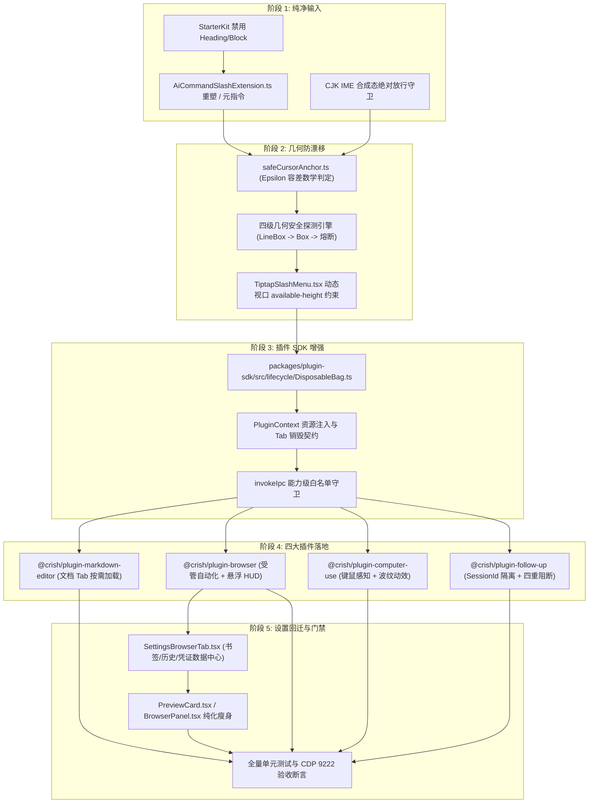

# Conex / Crish 聊天框纯净化、几何绝对防漂移与 TS 插件解耦体系执行详案 (DIM-06)

> **【调度与定时器铁律】**：如果设置定时器，最短是 100 秒；如果命令过长，最好的方式是等待命令完成后的系统推送通知（Reactive Wakeup），而不是一直轮询命令情况。

> **文档标识**：`docs/system-audit-and-redesign/detailed-plans/06-聊天框纯净化与TS插件解耦体系执行详案.md`  
> **制定角色**：【维度 6 详案架构师: 聊天框纯净化、几何绝对防漂移与 TS 插件解耦体系执行详案】  
> **权威依据**：
>
> - `docs/system-audit-and-redesign/00-战役通则与协同执行规范.md`
> - `docs/system-audit-and-redesign/00-总方案-Conex全系统综合重构总计划框架.md`（无条件遵从主控 6 大裁决，尤其 RUL-06）
> - `docs/system-audit-and-redesign/plan-reviews/03-权限沙箱与插件系统方案评审意见.md`（§5、§6、§8 硬性整改指令）
> - `docs/system-audit-and-redesign/independent-plans/06-输入框纯净化与插件体系独立总方案.md`
>   **执行纪律**：纯逻辑架构设计、零业务代码回撤、pwsh7 环境对齐、UTF-8 无 BOM、严禁直接执行 git 提交、保护测试资产不退化。

---

## 目录

1. [方案总纲与治理愿景 (Executive Summary & Core Architecture)](#一方案总纲与治理愿景)
   - 1.1 治理使命与核心痛点
   - 1.2 主控裁决 RUL-06 核心落地标准
   - 1.3 核心交付契约矩阵
2. [全系统纯逻辑步骤展开与依赖演进拓扑 (Pure Logical Dependency Topology)](#二全系统纯逻辑步骤展开与依赖演进拓扑)
   - 2.1 五阶段纯逻辑演进阶段与前置因果
   - 2.2 内部模块逻辑依赖 DAG
   - 2.3 文件域改动与新增清单全览
3. [ChatComposer 彻底纯净化与 AI 元指令重塑 (ChatComposer Purification & AI Slash Commands)](#三chatcomposer-彻底纯净化与-ai-元指令重塑)
   - 3.1 博客排版命令侵入输入框的断层诊断与 StarterKit 瘦身方案
   - 3.2 键盘 `/` 触发语义的全面重塑：专注 AI 系统元指令与 Skill 工具
   - 3.3 `AiCommandSlashExtension.ts` 完整架构与生产级实现规范
   - 3.4 CJK IME 输入法组合态绝对放行守卫机制
4. [几何绝对防漂移：四级安全光标锚点探测器 (Rock-Solid Anchor Geometry & safeCursorAnchor.ts)](#四几何绝对防漂移四级安全光标锚点探测器)
   - 4.1 `(0, 0)` 坐标坍塌与 `(8px, 8px)` 左上角幽灵漂移数学逆向推导
   - 4.2 DPI 缩放亚像素噪点与 Epsilon 容差判定数学模型
   - 4.3 四级几何安全探测器 (`SafeAnchorGeometryEngine`) 完整计算链
   - 4.4 双向碰撞溢出降级与 Floating UI `available-height` 动态约束
   - 4.5 `safeCursorAnchor.ts` 生产级纯函数与几何引擎代码规范
   - 4.6 `TiptapSlashMenu.tsx` 挂载与销毁防护改造
5. [官方四大 TypeScript 插件解耦体系架构 (@crish/plugin-* Decoupled Architecture)](#五官方四大-typescript-插件解耦体系架构)
   - 5.1 插件微内核体系与 `packages/plugin-sdk` 规范升级
   - 5.2 `PluginContext` 装配 `DisposableBag` 资源管理与 Tab 销毁契约
   - 5.3 插件 `invokeIpc` 能力级权限白名单校验
   - 5.4 插件 1：`@crish/plugin-markdown-editor`（独立虚拟化富文本编辑器 TS 插件）
   - 5.5 插件 2：`@crish/plugin-browser`（受管 AI 浏览器自动化与轻量悬浮 HUD）
   - 5.6 插件 3：`@crish/plugin-computer-use`（系统级桌面感知与键鼠自动化）
   - 5.7 插件 4：`@crish/plugin-follow-up`（AI 行动建议插件与 Session 隔离）
6. [书签/历史/登录态导入 100% 回迁系统设置中心 (Settings Migration)](#六书签历史登录态导入-100-回迁系统设置中心)
   - 6.1 `PreviewCard.tsx` 与 `BrowserPanel.tsx` 纯化瘦身
   - 6.2 `components/settings/` 扩展与浏览器数据中心设计
   - 6.3 统一导入导出数据流契约
7. [子 Agent（Subagent）四重立体硬阻断防护网 (Four-Layer Strict Subagent Shield)](#七子-agent-四重立体硬阻断防护网)
   - 7.1 引擎层（Rust SessionLoop RPC）守卫硬阻断
   - 7.2 上下文与数据层（SessionContext & AuthorRole）只读防穿透
   - 7.3 注册表与调度层（FollowUpRegistry）父会话准入阻断
   - 7.4 视图与 Store 层（FollowUpSlot & SessionStore）隔离阻断
8. [逐文件改动与接口代码规范 (File-by-File Code Blueprint)](#八逐文件改动与接口代码规范)
   - 8.1 涉及文件增删改详表
   - 8.2 核心代码接口与实现详单
9. [四级质量门禁与全量测试验收断言 (Quality Gates & Test Assertions)](#九四级质量门禁与全量测试验收断言)
   - 9.1 Level 1: 静态类型与接口契约门禁
   - 9.2 Level 2: 分级代码行数门禁
   - 9.3 Level 3: Vitest 自动化单元测试套件
   - 9.4 Level 4: CDP 真实桌面 WebView2 机器真值测试断言

---

## 一、方案总纲与治理愿景

### 1.1 治理使命与核心痛点

在 Conex / Crish 客户端体系中，**输入交互面（ChatComposer）** 与 **扩展生态面（Extension Surface）** 承载着用户与 AI 系统协同的高频信息交换。但在当前代码中，存在四大严重阻碍工业级体验的结构性断层：

1. **输入框职责严重倒置**：`SlashExtension.ts` 错误硬编码了 `Heading 1/2/3`, `Bullet List`, `Task List`, `Blockquote` 等博客排版命令，生硬割裂了 ProseMirror 块节点，导致回车换行与 Markdown 序列化异常；而用户急需的 `/goal`, `/clear`, `/compact`, `/schedule`, `/browser`, `/settings` 等 AI 元指令被挤压无入口；
2. **几何锚点浮层漂移事故**：光标 LineBox 测量在首帧或空文档时返回 `(0, 0, 0, 0)` 零坐标，由于 `0` 属于有限浮点数导致 `isValidClientRect` 判定穿透，Radix Popover 在视口越界碰撞检测后强制将斜杠菜单钉死在屏幕左上角 `(8px, 8px)`；在 125%/150% DPI 缩放下亚像素噪点更引发坐标颠簸；
3. **能力重型内嵌与主界面臃肿**：受管浏览器书签、历史记录与登录态导入（500+ 行脚手架）直接侵入 `PreviewCard` 与工作区面板，违反单一职责原则；独立富文本编辑器未标准化封装；
4. **子 Agent 穿透与插件资源泄漏**：Follow-up 建议未做 Session 隔离，子 Agent 触发了不必要的后台 LLM 建议生成；插件在关闭 Tab 或停用时未清理 CDP 句柄、Worker 和 DOM 监听，存在严重的内存与句柄泄漏隐患。

---

### 1.2 主控裁决 RUL-06 核心落地标准

依据 `00-总方案-Conex全系统综合重构总计划框架.md` §1 主控权威裁决 **RUL-06**：

```
┌───────────────────────────────────────────────────────────────────────────────────────────────────────┐
│                              主控关键裁决 RUL-06 插件生命周期与子 Agent 隔离标准                        │
├──────────────┬────────────────────────────────────────────────────────────────────────────────────────┤
│ 裁决条目     │ 核心标准与强制约束                                                                     │
├──────────────┼────────────────────────────────────────────────────────────────────────────────────────┤
│ 1. 资源回收  │ PluginContext 必须内置 DisposableBag，插件注册的所有事件、Timer、DOM、IPC Channel、   │
│              │ Worker 和 CDP 句柄必须绑定 Disposable 句柄，在 Tab 销毁或插件 deactivate 时 100% 释放。 │
├──────────────┼────────────────────────────────────────────────────────────────────────────────────────┤
│ 2. 四重阻断  │ 子 Agent（is_subagent == true）在引擎 RPC、SessionContext、FollowUpRegistry、          │
│              │ FollowUpSlot 实施四重立体物理阻断，禁止调用 LLM 生成建议、禁止派发 Store、禁止渲染 UI。│
├──────────────┼────────────────────────────────────────────────────────────────────────────────────────┤
│ 3. 设置回迁  │ 书签、历史记录与登录态凭证导入 100% 回迁系统设置中心（Settings），主界面纯化为 Web 预览。│
└──────────────┴────────────────────────────────────────────────────────────────────────────────────────┘
```

---

### 1.3 核心交付契约矩阵

```
┌─────────────────────────────────────────────────────────────────────────────────────────────────────────┐
│                               DIM-06 核心治理契约与机器真值指标                                         │
├──────────────────────────┬─────────────────────────────┬────────────────────────────────────────────────┤
│ 治理领域                 │ 现状缺陷 (Baseline)         │ 重构终态断言 (Target Contract)                 │
├──────────────────────────┼─────────────────────────────┼────────────────────────────────────────────────┤
│ 1. 输入框纯净化          │ 混入 H1/H2/H3 等 8 项博客   │ 彻底拔除排版命令；StarterKit 禁用 heading 等； │
│    (Composer Pureness)   │ 排版命令；缺少核心 AI 元指令│ 专注 /clear, /compact, /settings, /goal 等     │
├──────────────────────────┼─────────────────────────────┼────────────────────────────────────────────────┤
│ 2. 几何绝对防漂移        │ (0,0) 零坐标穿透，浮层钉死  │ safeCursorAnchor 四级降级 + Epsilon 容差判定； │
│    (Anchor Geometry)     │ 在屏幕左上角 (8px, 8px)     │ 恒定锁定光标正上方 8px；全零坐标拒绝挂载 Portal│
├──────────────────────────┼─────────────────────────────┼────────────────────────────────────────────────┤
│ 3. 四大 TS 插件体系      │ 业务单体生硬内嵌；          │ 标准化 @crish/plugin-* 插件体系；按需加载；    │
│    (Plugin Architecture) │ 资源无统一注销机制          │ PluginContext 注入 DisposableBag，100% GC 回收 │
├──────────────────────────┼─────────────────────────────┼────────────────────────────────────────────────┤
│ 4. 数据导入回迁设置      │ PreviewCard 内嵌 500 行书签 │ 导入导出 100% 迁入 Settings 中心；             │
│    (Settings Migration)  │ /历史/凭证导入脚手架        │ PreviewCard 回归极简纯粹 Web 调试预览          │
├──────────────────────────┼─────────────────────────────┼────────────────────────────────────────────────┤
│ 5. 子 Agent 隔离屏蔽     │ 仅前端隐藏，后台依然发起 LLM│ 引擎 RPC + 上下文 + 注册表 + 视图四重硬阻断；  │
│    (Subagent Shield)     │ 请求消耗 Token；Props 瀑布  │ 彻底消灭 Token 浪费与 8 层 Props 穿透          │
└──────────────────────────┴─────────────────────────────┴────────────────────────────────────────────────┘
```

---

## 二、全系统纯逻辑步骤展开与依赖演进拓扑

### 2.1 五阶段纯逻辑演进阶段与前置因果

本维度执行计划严格遵循无环演进逻辑，先奠定纯净输入与几何安全基座，再构建插件微内核，随后落地四大具体插件，最终在设置中心完成数据收口：

```
┌────────────────────────────────────────────────────────────────────────────────────────┐
│                        DIM-06 纯逻辑五阶段演进拓扑与因果推进链                         │
└────────────────────────────────────────────────────────────────────────────────────────┘

 【阶段 1: 输入框纯净化与命令重塑】
    • 拔除 SlashExtension.ts 博客排版命令 ──► 重构为 AiCommandSlashExtension.ts
    • StarterKit 禁用 block 节点 ──────────► 统一行内文本流与 CJK 放行守卫
                     │
                     ▼
 【阶段 2: safeCursorAnchor 几何引擎与防漂移】
    • 建立 Epsilon 容差与 isPhysicallyVisibleNonZeroRect 数学判定
    • 落地四级几何降级链 (LineBox ➔ SelectionNode ➔ EditorDOM ➔ ComposerBox ➔ 熔断)
    • Floating UI available-height 动态视口约束与双向防溢出
                     │
                     ▼
 【阶段 3: Plugin SDK 微内核与 DisposableBag 机制】
    • packages/plugin-sdk 扩展生命周期契约与 DisposableBag 资源管理器
    • invokeIpc 能力级白名单校验器与 SessionContext 隔离
                     │
                     ▼
 【阶段 4: 官方四大 TypeScript 插件化落地】
    • 插件 1: @crish/plugin-markdown-editor (文档 Tab 按需加载)
    • 插件 2: @crish/plugin-browser (AI 受管浏览器与悬浮 HUD)
    • 插件 3: @crish/plugin-computer-use (桌面感知与键鼠自动化)
    • 插件 4: @crish/plugin-follow-up (子 Agent 四重立体硬阻断)
                     │
                     ▼
 【阶段 5: 设置中心回迁与全量门禁闭环】
    • 书签/历史/登录态导入 100% 迁入 Settings 模块
    • PreviewCard / BrowserPanel 纯化瘦身
    • 全量 Vitest + 行数门禁 + CDP 9222 机器真值验收
```

---

### 2.2 内部模块逻辑依赖 DAG



---

### 2.3 文件域改动与新增清单全览

| 模块类别          | 目标文件路径                                                                 | 操作类型 | 行数预期 | 核心职责                                             |
| :---------------- | :--------------------------------------------------------------------------- | :------: | :------: | :--------------------------------------------------- |
| **输入框纯净化**  | `apps/crish-desktop/src/components/chat-composer/AiCommandSlashExtension.ts` | **新增** | ~280 行  | 纯净版 AI 系统指令扩展，替换原博客排版命令           |
|                   | `apps/crish-desktop/src/components/chat-composer/SlashExtension.ts`          | **重构** | ~180 行  | 移除 H1~H3 等，转为适配器转发或纯净别名导出          |
|                   | `apps/crish-desktop/src/components/chat-composer/TiptapComposerField.tsx`    | **重构** | ~320 行  | StarterKit 禁用排版节点，装配纯净斜杠插件            |
|                   | `apps/crish-desktop/src/components/chat-composer/composerTypes.ts`           | **更新** | ~120 行  | 扩展 AI 系统指令类型、安全锚点矩形接口               |
| **几何防漂移**    | `apps/crish-desktop/src/components/chat-composer/safeCursorAnchor.ts`        | **新增** | ~220 行  | 四级几何安全探测器，Epsilon 容差判定防 (0,0) 漂移    |
|                   | `apps/crish-desktop/src/components/chat-composer/TiptapSlashMenu.tsx`        | **重构** | ~260 行  | 接入 safeCursorAnchor，增加 available-height 约束    |
|                   | `apps/crish-desktop/src/components/chat-composer/TiptapSlashMenu.module.css` | **更新** |  ~90 行  | 动态视口高度限制与 6px 同心圆角美化                  |
| **插件微内核**    | `packages/plugin-sdk/src/lifecycle/DisposableBag.ts`                         | **新增** | ~140 行  | 生产级资源清理袋，按生命周期注销 Listener/Worker/CDP |
|                   | `packages/plugin-sdk/src/api/PluginContext.ts`                               | **重构** | ~180 行  | 装配 DisposableBag，提供能力白名单 IPC 桥接          |
|                   | `packages/plugin-sdk/src/index.ts`                                           | **更新** | ~110 行  | 导出 DisposableBag、PluginContext 与插件定义类型     |
| **四大 TS 插件**  | `packages/plugin-markdown-editor/src/MarkdownEditorPlugin.ts`                | **新增** | ~220 行  | 独立文档 Tab 专业富文本编辑器插件                    |
|                   | `packages/plugin-browser/src/BrowserPlugin.ts`                               | **新增** | ~200 行  | 受管 AI 浏览器自动化插件，集成悬浮 HUD               |
|                   | `packages/plugin-computer-use/src/ComputerUsePlugin.ts`                      | **新增** | ~190 行  | 系统桌面感知与键鼠自动化插件                         |
|                   | `packages/plugin-follow-up/src/FollowUpPlugin.ts`                            | **新增** | ~210 行  | AI 行动建议插件，支持 SessionId 隔离与四重阻断       |
| **设置与回迁**    | `apps/crish-desktop/src/components/settings/SettingsBrowserTab.tsx`          | **新增** | ~360 行  | 集中管理书签、历史与登录态凭证导入导出               |
|                   | `apps/crish-desktop/src/components/workspace/PreviewCard.tsx`                | **重构** | ~160 行  | 剥离导入脚手架，回归纯净 Web 调试预览                |
|                   | `apps/crish-desktop/src/components/workspace/BrowserPanel.tsx`               | **重构** | ~140 行  | 剥离书签历史导入组件，纯化帧渲染与输入交互           |
| **子 Agent 隔离** | `crates/session-loop/src/handlers/turn_complete.rs`                          | **更新** |   Rust   | 后端 RPC 守卫：`is_subagent` 时跳过 Follow-up 分析   |
|                   | `apps/crish-desktop/src/components/chat-message-row/FollowUpSlot.tsx`        | **新增** | ~110 行  | 解耦瀑布 Props，实现 Slot 级渲染与子 Agent 隔离      |

---

## 三、ChatComposer 彻底纯净化与 AI 元指令重塑

### 3.1 博客排版命令侵入输入框的断层诊断与 StarterKit 瘦身方案

在原实现中，Tiptap `StarterKit` 默认启用了全套富文本排版扩展，导致用户在聊天提示框输入文本时，DOM 内部频繁分裂为块级节点（Block Nodes）。

#### 诊断根因：

1. **输入模型倒挂**：LLM 本质接收的是无歧义的 Markdown 字符串流，输入框使用 ProseMirror Heading 块节点会导致输入框在换行、撤销（Undo）、Backspace 删除时出现不符合即时聊天习惯的光标跳动；
2. **命令冗余混乱**：用户在聊天框输入 `/` 时，首屏出现的却是 `Heading 1`、`Bullet List`、`Task List`，完全偏离了 AI 辅助编程工作台的核心场景。

#### 治理方案：

在 `TiptapComposerField.tsx` 中，对 `StarterKit` 实施**排版节点全面禁用配置**，并引入纯文本行内修饰流：

```typescript
// apps/crish-desktop/src/components/chat-composer/TiptapComposerField.tsx
import StarterKit from '@tiptap/starter-kit';
import { AiCommandSlashExtension } from './AiCommandSlashExtension';
import { MentionSuggestionExtension, MentionExtension } from './SlashExtension';

export const COMPOSER_EXTENSIONS = [
  StarterKit.configure({
    // 🚨 彻底禁用所有块级排版节点，聊天框仅保留行内富文本流
    heading: false,
    bulletList: false,
    orderedList: false,
    listItem: false,
    taskList: false,
    taskItem: false,
    blockquote: false,
    codeBlock: false, // 统一作为行内 code 或自动解析 Markdown
    horizontalRule: false,
    dropcursor: false,
    gapcursor: false,
  }),
  AiCommandSlashExtension.configure({
    listboxId: 'crish-ai-composer-slash-listbox',
  }),
  MentionSuggestionExtension,
  MentionExtension,
];
```

---

### 3.2 键盘 `/` 触发语义的全面重塑：专注 AI 系统元指令与 Skill 工具

键入 `/` 呼出的浮层菜单全面收拢为 **4 大核心类别、共 10+ 项高频 AI 系统级元指令与动态技能**：

```
┌────────────────────────────────────────────────────────────────────────────────────────┐
│                   全新纯净版 ChatComposer 斜杠菜单分类与命令矩阵                        │
├──────────────┬──────────────────┬─────────────────────────────────┬────────────────────┤
│ 类别         │ 指令标识 (ID)    │ 显示名称与参数说明              │ 动作行为 (Action)  │
├──────────────┼──────────────────┼─────────────────────────────────┼────────────────────┤
│ 1. 会话控制  │ `/clear`         │ 清空当前上下文 (Clear)          │ 清空当前会话历史   │
│              │ `/compact`       │ 压缩上下文 (/compact [tokens])  │ 触发上下文智能摘要 │
│              │ `/settings`      │ 打开系统设置中心 (Settings)     │ 打开全局设置面板   │
│              │ `/help`          │ 显示命令与快捷键帮助 (Help)     │ 弹出快捷键与说明   │
├──────────────┼──────────────────┼─────────────────────────────────┼────────────────────┤
│ 2. 战役与规划│ `/goal`          │ 开启多轮长程推进模式 (Goal)     │ 激活主动推进状态机 │
│              │ `/grill-me`      │ 交互式需求深度对齐 (Grill-Me)   │ 触发方案澄清访谈   │
│              │ `/teamwork`      │ 多 Agent 协同预览 (Teamwork)    │ 呼出协同拓扑图     │
├──────────────┼──────────────────┼─────────────────────────────────┼────────────────────┤
│ 3. 自动化调度│ `/schedule`      │ 建立定时与周期任务 (Schedule)   │ 插入 /schedule 模板│
│              │ `/browser`       │ 启动受管浏览器自动化 (Browser)  │ 唤起 AI 浏览器 HUD │
│              │ `/learn`         │ 沉淀经验与自定义规则 (Learn)    │ 触发经验归档流     │
├──────────────┼──────────────────┼─────────────────────────────────┼────────────────────┤
│ 4. 动态技能  │ `/skill:<name>`  │ 运行已安装技能 (如 /skill:git)  │ 注入特定技能上下文 │
└──────────────┴──────────────────┴─────────────────────────────────┴────────────────────┘
```

---

### 3.3 `AiCommandSlashExtension.ts` 完整架构与生产级实现规范

```typescript
/**
 * apps/crish-desktop/src/components/chat-composer/AiCommandSlashExtension.ts
 * 纯净化 AI 系统指令与动态技能斜杠扩展 (DIM-06, CRM-01)。
 * 彻底拔除 H1/H2/H3 博客排版，专注 AI 调度。
 * CI Guardrail: Max 400 lines of effective code, UTF-8 无 BOM.
 */

import { Extension } from '@tiptap/core';
import Suggestion, { exitSuggestion } from '@tiptap/suggestion';
import { PluginKey } from '@tiptap/pm/state';
import { ReactRenderer } from '@tiptap/react';
import { TiptapSlashMenu } from './TiptapSlashMenu';
import type { SlashCommandItem } from './composerTypes';
import {
  calculateSafeCursorAnchor,
  measureCursorLineBox,
} from './safeCursorAnchor';

export interface AiSlashExtensionOptions {
  extraCommandsRef?: React.MutableRefObject<SlashCommandItem[]>;
  onExecuteCommand?: (cmd: SlashCommandItem) => void;
  listboxId?: string;
}

export const AI_SYSTEM_COMMANDS: SlashCommandItem[] = [
  {
    id: 'goal',
    title: '/goal',
    description: '开启长程自主推进模式，直到彻底达成目标',
    iconName: 'Target',
    keywords: ['goal', '目标', '长程', '推进', 'autonomous'],
    command: ({ editor, range }) => {
      editor.chain().focus().deleteRange(range).insertContent('/goal ').run();
    },
  },
  {
    id: 'clear',
    title: '/clear',
    description: '清空当前会话上下文并重置状态',
    iconName: 'Eraser',
    keywords: ['clear', '清空', '重置', 'reset', 'cls'],
    command: ({ editor, range }) => {
      editor.chain().focus().deleteRange(range).run();
      window.dispatchEvent(new CustomEvent('crish:chat-clear'));
    },
  },
  {
    id: 'compact',
    title: '/compact',
    description: '手动压缩会话历史，释放 Token 空间 (/compact [tokens])',
    iconName: 'Compress',
    keywords: ['compact', '压缩', 'compress', 'token', '瘦身'],
    command: ({ editor, range }) => {
      editor
        .chain()
        .focus()
        .deleteRange(range)
        .insertContent('/compact ')
        .run();
    },
  },
  {
    id: 'schedule',
    title: '/schedule',
    description: '设置一次性定时提醒或周期性 Cron 自动化任务',
    iconName: 'Calendar',
    keywords: ['schedule', '定时', 'cron', 'timer', '计划'],
    command: ({ editor, range }) => {
      editor
        .chain()
        .focus()
        .deleteRange(range)
        .insertContent('/schedule ')
        .run();
    },
  },
  {
    id: 'grill-me',
    title: '/grill-me',
    description: '启动深度方案澄清与需求访谈，对齐设计决策',
    iconName: 'HelpCircle',
    keywords: ['grill-me', '访谈', '对齐', '需求', 'interview'],
    command: ({ editor, range }) => {
      editor
        .chain()
        .focus()
        .deleteRange(range)
        .insertContent('/grill-me ')
        .run();
    },
  },
  {
    id: 'teamwork',
    title: '/teamwork-preview',
    description: '唤起多 Agent 团队协同架构与运行拓扑预览',
    iconName: 'Users',
    keywords: ['teamwork', '团队', '多agent', 'subagent', 'preview'],
    command: ({ editor, range }) => {
      editor
        .chain()
        .focus()
        .deleteRange(range)
        .insertContent('/teamwork-preview ')
        .run();
    },
  },
  {
    id: 'browser',
    title: '/browser',
    description: '启动受管浏览器自动化能力（打开网页/提取/交互）',
    iconName: 'Globe',
    keywords: ['browser', '浏览器', 'web', '网页', 'chrome'],
    command: ({ editor, range }) => {
      editor
        .chain()
        .focus()
        .deleteRange(range)
        .insertContent('/browser ')
        .run();
    },
  },
  {
    id: 'learn',
    title: '/learn',
    description: '沉淀当前会话的踩坑经验与自定义规则至技能库',
    iconName: 'BookOpen',
    keywords: ['learn', '学习', '经验', '规则', 'persist'],
    command: ({ editor, range }) => {
      editor.chain().focus().deleteRange(range).insertContent('/learn ').run();
    },
  },
  {
    id: 'settings',
    title: '/settings',
    description: '打开全局系统设置中心（模型/外观/扩展/权限）',
    iconName: 'Sparkles',
    keywords: ['settings', '设置', '偏好', 'config', 'preferences'],
    command: ({ editor, range }) => {
      editor.chain().focus().deleteRange(range).run();
      window.dispatchEvent(new CustomEvent('crish:open-settings'));
    },
  },
  {
    id: 'help',
    title: '/help',
    description: '查看系统所有斜杠命令与快捷键说明',
    iconName: 'HelpCircle',
    keywords: ['help', '帮助', '说明', 'shortcuts'],
    command: ({ editor, range }) => {
      editor.chain().focus().deleteRange(range).insertContent('/help').run();
    },
  },
];

export const AiCommandSlashPluginKey = new PluginKey('crishAiCommandSlash');

export const AiCommandSlashExtension =
  Extension.create<AiSlashExtensionOptions>({
    name: 'aiCommandSlash',

    addOptions() {
      return {
        extraCommandsRef: undefined,
        onExecuteCommand: undefined,
        listboxId: 'crish-ai-composer-slash-listbox',
      };
    },

    addProseMirrorPlugins() {
      return [
        Suggestion({
          pluginKey: AiCommandSlashPluginKey,
          editor: this.editor,
          char: '/',
          allowSpaces: false,
          startOfLine: false,

          items: ({ query }: { query: string }): SlashCommandItem[] => {
            const q = query.trim().toLowerCase();
            const extras = this.options.extraCommandsRef?.current || [];
            const pool = [...AI_SYSTEM_COMMANDS, ...extras];

            if (!q) return pool;

            return pool.filter((item) => {
              if (item.title.toLowerCase().includes(q)) return true;
              if (item.id.toLowerCase().includes(q)) return true;
              if (item.description?.toLowerCase().includes(q)) return true;
              return item.keywords?.some((k) => k.toLowerCase().includes(q));
            });
          },

          render: () => {
            let component: ReactRenderer<any> | null = null;
            let propsRef: any = null;

            const buildProps = (props: any) => ({
              items: props.items,
              command: (item: SlashCommandItem) => {
                item.command({ editor: props.editor, range: props.range });
                this.options.onExecuteCommand?.(item);
              },
              editor: props.editor,
              range: props.range,
              isOpen: true,
              onClose: () => {
                component?.destroy();
                component = null;
              },
              clientRect: () => {
                const view = props.editor?.view;
                if (!view || !props.range) return null;

                // CJK 组合态坐标保持静止
                if (view.composing || (view as any).input?.composing) {
                  return null;
                }

                return calculateSafeCursorAnchor({
                  rawCursorRect: () =>
                    measureCursorLineBox(view, props.range.from, 1),
                  editorViewDom: view.dom,
                });
              },
              label: 'AI 系统指令与技能',
              emptyMessage: '未找到匹配的 AI 指令或技能',
              listboxId: this.options.listboxId,
            });

            return {
              onStart: (props: any) => {
                propsRef = props;
                component = new ReactRenderer(TiptapSlashMenu, {
                  props: buildProps(props),
                  editor: props.editor,
                });
              },

              onUpdate: (props: any) => {
                propsRef = props;
                if (component) {
                  component.updateProps(buildProps(props));
                }
              },

              onKeyDown: (props: any) => {
                if (props.event.key === 'Escape') {
                  // IME 合成态下绝不拦截 Esc
                  if (
                    props.event.isComposing ||
                    (props.event as any).nativeEvent?.isComposing ||
                    props.event.keyCode === 229 ||
                    props.event.key === 'Process'
                  ) {
                    return false;
                  }
                  component?.destroy();
                  component = null;
                  if (props.view) {
                    exitSuggestion(props.view, AiCommandSlashPluginKey);
                  }
                  return true;
                }
                return (component?.ref as any)?.onKeyDown(props) ?? false;
              },

              onExit: () => {
                const dom = propsRef?.editor?.view?.dom;
                if (dom) {
                  dom.removeAttribute('aria-expanded');
                  dom.removeAttribute('aria-controls');
                  dom.removeAttribute('aria-activedescendant');
                }
                component?.destroy();
                component = null;
                propsRef = null;
              },
            };
          },
        }),
      ];
    },
  });
```

---

### 3.4 CJK IME 输入法组合态绝对放行守卫机制

在中文拼音、五笔、日文假名等输入过程中，按下 `Enter`（确认当前拼音）、`ArrowDown`（选择候选词）或 `Space`（选定首个候选词）属于操作系统 IME 的私有行为。

#### 守卫代码规则：

在 `TiptapSlashMenu.tsx` 的键盘事件处理 `useImperativeHandle` 中，设置首行绝对放行短路：

```typescript
// 严格放行 CJK IME 合成状态
if (
  event.isComposing ||
  (event as any).nativeEvent?.isComposing ||
  event.keyCode === 229 ||
  event.key === 'Process'
) {
  return false; // 严禁 preventDefault，直接放行给操作系统输入法引擎
}
```

---

## 四、几何绝对防漂移：四级安全光标锚点探测器

### 4.1 `(0, 0)` 坐标坍塌与 `(8px, 8px)` 左上角幽灵漂移数学逆向推导

```
┌────────────────────────────────────────────────────────────────────────────────────────┐
│                        (0, 0) 坐标坍塌与左上角漂移因果拓扑链                           │
└────────────────────────────────────────────────────────────────────────────────────────┘

 [首次渲染 / 瞬态重绘] ──► coordsAtPos 失败 ──► 返回 DOMRect(0, 0, 0, 0)
                                                        │
                                                        ▼
                                       ┌──────────────────────────────────┐
                                       │ isValidClientRect(rect)          │
                                       │ ❌ 判定 0 是合法浮点数 ➔ 返回 true! │
                                       └────────────────┬─────────────────┘
                                                        │
                                                        ▼
                                       ┌──────────────────────────────────┐
                                       │ Popover.Anchor 锚定在 fixed:     │
                                       │ top: 0px, left: 0px              │
                                       └────────────────┬─────────────────┘
                                                        │
                                                        ▼
                                       ┌──────────────────────────────────┐
                                       │ Radix 视口碰撞算法检测:          │
                                       │ side="top" 越界 ➔ 翻转为 bottom  │
                                       │ + collisionPadding: 8px          │
                                       └────────────────┬─────────────────┘
                                                        │
                                                        ▼ 最终灾难结果
                                       ┌──────────────────────────────────┐
                                       │ 🔴 浮层被死死钉在屏幕左上角      │
                                       │    坐标: (8px, 8px)              │
                                       └──────────────────────────────────┘
```

---

### 4.2 DPI 缩放亚像素噪点与 Epsilon 容差判定数学模型

依据评审报告 `plan-reviews/03-*.md` §6.1 的深刻批判：
在 Windows 125%、150% 等 DPI 缩放环境下，未排版就绪的 DOM 可能产生微小的亚像素噪点浮点数（例如 `top: 0.000031px, left: 0.000015px`），若单纯使用 `top !== 0` 判定，噪点会穿透守卫；反之，若全屏编辑器的光标真实位于 `(0, 0)`，直接使用 `top === 0` 会误杀合法原点光标。

#### 严格数学判定谓词：

定义判定函数 `isPhysicallyVisibleNonZeroRect(rect, epsilon = 0.5)`：

1. **有限数值完备性**：`[top, left, width, height]` 必须全部为有限浮点数（`Number.isFinite`）；
2. **真实视觉体积**：光标或容器必须具备物理宽度或高度（$width \ge \epsilon \lor height \ge \epsilon$）；
3. **近原点噪点排斥**：若坐标极度接近绝对零点（$|top| < \epsilon \land |left| < \epsilon$）且无真实高度（$height < 10\text{px}$），则判定为无效噪点；
4. **有效视口包围盒**：必须处于当前窗口物理边界内部。

---

### 4.3 四级几何安全探测器 (`SafeAnchorGeometryEngine`) 完整计算链

```
┌────────────────────────────────────────────────────────────────────────────────────────┐
│               SafeAnchorGeometryEngine 四级降级几何安全引擎架构                        │
├────────────────────────────────────────────────────────────────────────────────────────┤
│ Level 1: 精确光标文字包围盒 (Precise Caret LineBox)                                    │
│   • 获取 coordsAtPos(pos) 或 Selection Range 包围盒                                     │
│   • 校验 isPhysicallyVisibleNonZeroRect: (width>0 || height>0)                         │
│   • 成功 ➔ 采用光标精确坐标                                                            │
├────────────────────────────────────────────────────────────────────────────────────────┤
│ Level 2: 选区节点包围盒 (Selection Node DOM)                                            │
│   • 获取 view.nodeDOM(from) 或 view.domAtPos(from).node 的 boundingClientRect           │
│   • 校验是否处于有效视口内                                                             │
│   • 成功 ➔ 采用节点头部坐标                                                            │
├────────────────────────────────────────────────────────────────────────────────────────┤
│ Level 3: 编辑器容器可视区域 (Editor DOM Content Box)                                   │
│   • 获取 editor.view.dom.getBoundingClientRect()                                        │
│   • 取容器内边距顶部与当前行高预估位置                                                 │
│   • 成功 ➔ 降级为编辑器内部安全锚点                                                    │
├────────────────────────────────────────────────────────────────────────────────────────┤
│ Level 4: 输入框外层容器 (Composer Field Container)                                     │
│   • 获取 composerContainer.getBoundingClientRect()                                      │
│   • 锚定在输入框内部上方 8px 位置                                                       │
├────────────────────────────────────────────────────────────────────────────────────────┤
│ 🚨 终极熔断防线 (Zero-Visibility Circuit Breaker)                                       │
│   • 若 4 级探测均未能获取真实视口包围盒（如组件尚未挂载、display: none 或隐藏 Tab）    │
│   • 严禁挂载 Portal，直接 return null！绝不允许向 (0,0) 渲染任何浮层！                  │
└────────────────────────────────────────────────────────────────────────────────────────┘
```

---

### 4.4 双向碰撞溢出降级与 Floating UI `available-height` 动态约束

在极小分屏视口（高度 $\le 350\text{px}$）下，向上与向下均可能发生视口溢出。
本方案引入**双向碰撞降级与 CSS 视口自适应机制**：

1. **优先向上锁定**：固定 `side="top"`，`sideOffset={8}`；
2. **动态高度约束**：使用 CSS `max-height: min(280px, var(--radix-popover-content-available-height, 280px))`，超长时启用内部优雅滚动条；
3. **滚动出界静默收起**：通过 `isAnchorInsideVisibleField` 计算，一旦光标因多行滚动超出输入框容器上下边沿 $\pm 4\text{px}$，立刻静默返回 `null`，禁止浮层悬空出界。

---

### 4.5 `safeCursorAnchor.ts` 生产级纯函数与几何引擎代码规范

```typescript
/**
 * apps/crish-desktop/src/components/chat-composer/safeCursorAnchor.ts
 * 生产级四级几何安全光标探测器 (DIM-06, CRM-01)。
 * 彻底根除 (0, 0) / (8px, 8px) 浮层漂移。
 * CI Guardrail: Max 300 lines of effective code, UTF-8 无 BOM.
 */

export interface SafeAnchorRect {
  top: number;
  left: number;
  width: number;
  height: number;
  isFallback: boolean;
  isValid: boolean;
}

/**
 * 测量 ProseMirror 文档位置处的真实物理 LineBox 包围盒
 */
export function measureCursorLineBox(
  view:
    | {
        coordsAtPos: (
          pos: number,
          side?: number
        ) => { top: number; bottom: number; left: number; right?: number };
      }
    | null
    | undefined,
  pos: number,
  side: number = 1
): DOMRect {
  if (!view || typeof view.coordsAtPos !== 'function') {
    return new DOMRect(0, 0, 0, 0);
  }

  try {
    const coords = view.coordsAtPos(pos, side);
    const top = coords.top;
    const bottom = coords.bottom;
    const measuredHeight = bottom - top;
    const height = Math.max(
      16,
      Number.isFinite(measuredHeight) ? measuredHeight : 20
    );
    const left = coords.left;
    const measuredWidth = (coords.right ?? coords.left) - coords.left;
    const width = Math.max(
      2,
      Number.isFinite(measuredWidth) ? measuredWidth : 2
    );

    return new DOMRect(left, top, width, height);
  } catch {
    return new DOMRect(0, 0, 0, 0);
  }
}

/**
 * 物理可见且非零的包围盒判定 (含 Epsilon 容差防噪点)
 */
export function isPhysicallyVisibleNonZeroRect(
  rect: unknown,
  epsilon = 0.5
): rect is DOMRect {
  if (!rect || typeof rect !== 'object') return false;
  const r = rect as DOMRect;

  const isFiniteNumbers =
    typeof r.top === 'number' &&
    Number.isFinite(r.top) &&
    typeof r.left === 'number' &&
    Number.isFinite(r.left) &&
    typeof r.width === 'number' &&
    Number.isFinite(r.width) &&
    typeof r.height === 'number' &&
    Number.isFinite(r.height);

  if (!isFiniteNumbers) return false;

  // 必须具有真实视觉可见宽高
  const hasVisualDimensions = r.width >= epsilon || r.height >= epsilon;
  // 杜绝绝对零点噪点（坐标极度接近 0 且高度不达标者视为未就绪）
  const isNearZeroOrigin =
    Math.abs(r.top) < epsilon && Math.abs(r.left) < epsilon && r.height < 12;

  return hasVisualDimensions && !isNearZeroOrigin;
}

/**
 * 判定光标是否处于输入框容器可见滚动视口内部
 */
export function isAnchorInsideVisibleField(
  anchorRect: DOMRect | SafeAnchorRect,
  fieldElement: HTMLElement | null | undefined,
  tolerance = 4
): boolean {
  if (!fieldElement) return true;
  try {
    const fieldRect = fieldElement.getBoundingClientRect();
    if (fieldRect.width === 0 && fieldRect.height === 0) {
      return false;
    }
    const isAbove =
      anchorRect.top + anchorRect.height < fieldRect.top - tolerance;
    const isBelow = anchorRect.top > fieldRect.bottom + tolerance;
    return !isAbove && !isBelow;
  } catch {
    return false;
  }
}

/**
 * 四级降级几何安全锚点计算引擎
 */
export function calculateSafeCursorAnchor(options: {
  rawCursorRect?: DOMRect | null | (() => DOMRect | null);
  editorViewDom?: HTMLElement | null;
  composerContainer?: HTMLElement | null;
}): SafeAnchorRect | null {
  const { rawCursorRect, editorViewDom, composerContainer } = options;

  // Level 1: 探测精确光标包围盒
  const directRect =
    typeof rawCursorRect === 'function' ? rawCursorRect() : rawCursorRect;

  if (directRect && isPhysicallyVisibleNonZeroRect(directRect)) {
    if (isAnchorInsideVisibleField(directRect, editorViewDom)) {
      return {
        top: directRect.top,
        left: directRect.left,
        width: Math.max(2, directRect.width),
        height: Math.max(16, directRect.height),
        isFallback: false,
        isValid: true,
      };
    }
  }

  // Level 2: 探测 Editor DOM 可视区
  if (editorViewDom) {
    try {
      const edRect = editorViewDom.getBoundingClientRect();
      if (isPhysicallyVisibleNonZeroRect(edRect)) {
        return {
          top: edRect.top + 8,
          left: edRect.left + 12,
          width: 2,
          height: 20,
          isFallback: true,
          isValid: true,
        };
      }
    } catch {
      // ignore
    }
  }

  // Level 3: 探测 Composer 外部容器
  if (composerContainer) {
    try {
      const compRect = composerContainer.getBoundingClientRect();
      if (isPhysicallyVisibleNonZeroRect(compRect)) {
        return {
          top: compRect.top + 12,
          left: compRect.left + 16,
          width: 2,
          height: 20,
          isFallback: true,
          isValid: true,
        };
      }
    } catch {
      // ignore
    }
  }

  // Level 4 / 终极熔断: 零视口绝对拒绝挂载
  return null;
}
```

---

### 4.6 `TiptapSlashMenu.tsx` 挂载与销毁防护改造

```tsx
// apps/crish-desktop/src/components/chat-composer/TiptapSlashMenu.tsx
import React, {
  forwardRef,
  useEffect,
  useImperativeHandle,
  useState,
  useRef,
} from 'react';
import * as Popover from '@radix-ui/react-popover';
import styles from './TiptapSlashMenu.module.css';
import type { SlashMenuProps, SlashCommandItem } from './composerTypes';
import {
  isPhysicallyVisibleNonZeroRect,
  type SafeAnchorRect,
} from './safeCursorAnchor';

export const TiptapSlashMenu = forwardRef<any, SlashMenuProps>((props, ref) => {
  const {
    items,
    command,
    isOpen = true,
    onClose,
    clientRect,
    label = 'AI 系统指令',
    emptyMessage = '无匹配指令',
    listboxId,
  } = props;

  const [selectedIndex, setSelectedIndex] = useState(0);
  const itemRefs = useRef<(HTMLButtonElement | null)[]>([]);

  useEffect(() => {
    setSelectedIndex(0);
  }, [items]);

  useEffect(() => {
    itemRefs.current[selectedIndex]?.scrollIntoView({ block: 'nearest' });
  }, [selectedIndex]);

  useImperativeHandle(ref, () => ({
    onKeyDown: ({ event }: { event: KeyboardEvent }) => {
      // CJK 合成态绝对放行
      if (
        event.isComposing ||
        (event as any).nativeEvent?.isComposing ||
        event.keyCode === 229 ||
        event.key === 'Process'
      ) {
        return false;
      }

      if (!items || items.length === 0) {
        if (event.key === 'Escape') {
          event.preventDefault();
          onClose?.();
          return true;
        }
        return false;
      }

      if (event.key === 'ArrowDown') {
        event.preventDefault();
        setSelectedIndex((prev) => (prev + 1) % items.length);
        return true;
      }

      if (event.key === 'ArrowUp') {
        event.preventDefault();
        setSelectedIndex((prev) => (prev - 1 + items.length) % items.length);
        return true;
      }

      if (event.key === 'Enter' || event.key === 'Tab') {
        event.preventDefault();
        if (items[selectedIndex]) {
          command(items[selectedIndex]);
        }
        return true;
      }

      if (event.key === 'Escape') {
        event.preventDefault();
        onClose?.();
        return true;
      }

      return false;
    },
  }));

  const rawAnchor =
    typeof clientRect === 'function' ? clientRect() : clientRect;

  // 🚨 终极安全守卫：若几何计算返回 null 或全零坐标，拒绝挂载 Portal！
  if (
    !isOpen ||
    !items ||
    !rawAnchor ||
    !isPhysicallyVisibleNonZeroRect(rawAnchor as DOMRect)
  ) {
    return null;
  }

  const anchor = rawAnchor as SafeAnchorRect;

  const triggerStyle: React.CSSProperties = {
    position: 'fixed',
    top: `${anchor.top}px`,
    left: `${anchor.left}px`,
    width: `${Math.max(1, anchor.width)}px`,
    height: `${Math.max(1, anchor.height)}px`,
    pointerEvents: 'none',
    visibility: 'hidden',
    zIndex: 'var(--z-popover)',
  };

  return (
    <Popover.Root open={isOpen}>
      <Popover.Anchor asChild>
        <div style={triggerStyle} />
      </Popover.Anchor>
      <Popover.Portal>
        <Popover.Content
          className={styles.popoverContent}
          side="top"
          align="start"
          sideOffset={8}
          avoidCollisions={true}
          collisionPadding={12}
          onOpenAutoFocus={(e) => e.preventDefault()}
          onCloseAutoFocus={(e) => e.preventDefault()}
        >
          <div
            className={styles.menuList}
            role="listbox"
            aria-label={label}
            id={listboxId}
          >
            {items.length === 0 ? (
              <div className={styles.emptyMessage} role="presentation">
                {emptyMessage}
              </div>
            ) : (
              items.map((item: SlashCommandItem, index: number) => {
                const isActive = index === selectedIndex;
                return (
                  <button
                    key={item.id}
                    ref={(el) => {
                      itemRefs.current[index] = el;
                    }}
                    type="button"
                    role="option"
                    id={`${listboxId ?? 'tiptap-suggestion'}-opt-${index}`}
                    aria-selected={isActive}
                    className={`${styles.menuItem} ${isActive ? styles.menuItemActive : ''}`}
                    onClick={(e) => {
                      e.preventDefault();
                      e.stopPropagation();
                      command(item);
                    }}
                    onMouseEnter={() => setSelectedIndex(index)}
                  >
                    <span className={styles.itemTitle}>{item.title}</span>
                    {item.description && (
                      <span className={styles.itemDescription}>
                        {item.description}
                      </span>
                    )}
                  </button>
                );
              })
            )}
          </div>
        </Popover.Content>
      </Popover.Portal>
    </Popover.Root>
  );
});

TiptapSlashMenu.displayName = 'TiptapSlashMenu';
```

---

## 五、官方四大 TypeScript 插件解耦体系架构

### 5.1 插件微内核体系与 `packages/plugin-sdk` 规范升级

依据 RUL-06，Conex / Crish 所有的外部能力与重型富文本编辑器全面收拢为 **标准 TypeScript 插件架构**：

```
┌──────────────────────────────────────────────────────────────────────────────────────────────────┐
│                            Crish TypeScript 插件微内核体系全景                                   │
└──────────────────────────────────────────────────────────────────────────────────────────────────┘

                                ┌───────────────────────────┐
                                │   Crish Host Application  │
                                │   (apps/crish-desktop)    │
                                └─────────────┬─────────────┘
                                              │
                     ┌────────────────────────┴────────────────────────┐
                     ▼                                                 ▼
        ┌─────────────────────────┐                       ┌─────────────────────────┐
        │  packages/plugin-sdk    │                       │  packages/shared-types  │
        │  • Plugin Lifecycle     │                       │  • PluginManifest       │
        │  • DisposableBag (RUL-06│                       │  • IPC Whitelist Matrix │
        │  • SessionContext Guard │                       │  • Permission Tokens    │
        └────────────┬────────────┘                       └────────────┬────────────┘
                     │                                                 │
       ┌─────────────┼────────────────────────┬────────────────────────┤
       ▼             ▼                        ▼                        ▼
┌───────────┐  ┌───────────┐            ┌───────────┐            ┌───────────┐
│ @crish/   │  │ @crish/   │            │ @crish/   │            │ @crish/   │
│ plugin-   │  │ plugin-   │            │ plugin-   │            │ plugin-   │
│ markdown- │  │ browser   │            │ computer- │            │ follow-up │
│ editor    │  │           │            │ use       │            │           │
└───────────┘  └───────────┘            └───────────┘            └───────────┘
 专业富文本编辑器   受管浏览器自动化          桌面键鼠感知控制         后续行动建议引导
 (Tab 按需加载)    (Settings 回迁/HUD)     (Settings 回迁/HUD)      (子 Agent 100% 隔离)
```

---

### 5.2 `PluginContext` 装配 `DisposableBag` 资源管理与 Tab 销毁契约

为彻底解决插件卸载时的内存泄漏、僵尸 Worker 与残余 EventListener，在 `packages/plugin-sdk` 中引入 `DisposableBag`：

```typescript
/**
 * packages/plugin-sdk/src/lifecycle/DisposableBag.ts
 * 插件生命周期资源回收袋 (RUL-06, DIM-06)。
 * 保证 Tab 销毁或插件停用时 100% GC 回收。
 */

export type IDisposable = {
  dispose: () => void | Promise<void>;
};

export type DisposableFunction = () => void | Promise<void>;

export class DisposableBag implements IDisposable {
  private disposables = new Set<IDisposable | DisposableFunction>();
  private isDisposed = false;

  public add<T extends IDisposable | DisposableFunction>(item: T): T {
    if (this.isDisposed) {
      if (typeof item === 'function') {
        item();
      } else {
        item.dispose();
      }
      return item;
    }
    this.disposables.add(item);
    return item;
  }

  public addEventListener(
    target: EventTarget,
    type: string,
    listener: EventListenerOrEventListenerObject,
    options?: boolean | AddEventListenerOptions
  ): () => void {
    target.addEventListener(type, listener, options);
    const unbind = () => target.removeEventListener(type, listener, options);
    this.add(unbind);
    return unbind;
  }

  public async dispose(): Promise<void> {
    if (this.isDisposed) return;
    this.isDisposed = true;

    const items = Array.from(this.disposables);
    this.disposables.clear();

    for (const item of items) {
      try {
        if (typeof item === 'function') {
          await item();
        } else {
          await item.dispose();
        }
      } catch (err) {
        console.error('[DisposableBag] Error during resource disposal:', err);
      }
    }
  }
}
```

---

### 5.3 插件 `invokeIpc` 能力级权限白名单校验

```typescript
/**
 * packages/plugin-sdk/src/api/PluginContext.ts
 * 插件上下文与权限安全屏障 (RUL-06)
 */

import { DisposableBag } from '../lifecycle/DisposableBag';

export interface PluginManifest {
  id: string;
  name: string;
  version: string;
  permissions: string[];
}

export class PluginContext<TConfig = unknown> {
  public readonly subscriptions: DisposableBag;

  constructor(
    public readonly manifest: PluginManifest,
    public readonly config: TConfig,
    private readonly hostIpc: (
      channel: string,
      payload?: unknown
    ) => Promise<unknown>
  ) {
    this.subscriptions = new DisposableBag();
  }

  /**
   * 能力级权限受控 IPC 调用
   */
  public async invokeIpc<TResult = unknown>(
    channel: string,
    payload?: unknown
  ): Promise<TResult> {
    // 权限前置白名单校验
    const requiredPermission = this.resolveRequiredPermission(channel);
    if (
      requiredPermission &&
      !this.manifest.permissions.includes(requiredPermission)
    ) {
      throw new Error(
        `[PluginSecurityError] Plugin '${this.manifest.id}' lacks permission '${requiredPermission}' to invoke '${channel}'`
      );
    }
    return (await this.hostIpc(channel, payload)) as TResult;
  }

  private resolveRequiredPermission(channel: string): string | null {
    if (channel.startsWith('fs:')) return 'fs:access';
    if (channel.startsWith('browser:')) return 'browser:control';
    if (channel.startsWith('computer:')) return 'computer:control';
    if (channel.startsWith('conex-markdown:')) return 'markdown:render';
    return null;
  }
}
```

---

### 5.4 插件 1：`@crish/plugin-markdown-editor`（独立虚拟化富文本编辑器 TS 插件）

#### 架构要点：

1. **测试资产保护**：严格继承 `reference/markdown-editor/` 中的 28 个根目录单元测试与行级虚拟化引擎；
2. **按需挂载**：仅在工作区打开 Markdown 文档 Tab 时动态加载并激活；
3. **独立 Store**：每个 Tab 拥有隔离的 `EditorStore` 实例，互不污染。

```typescript
/**
 * packages/plugin-markdown-editor/src/MarkdownEditorPlugin.ts
 */

import { type PluginContext } from '@crish/plugin-sdk';
import { MarkdownEditorTab } from './components/MarkdownEditorTab';

export const MarkdownEditorPlugin = {
  id: '@crish/plugin-markdown-editor',
  name: 'Markdown Pro Editor',
  version: '1.0.0',
  description: '自研高性能行级虚拟化 Markdown 专业富文本编辑器',
  permissions: ['fs:access', 'markdown:render'],

  activate(ctx: PluginContext) {
    // 注册工作区文档视图
    // 绑定至 DisposableBag，Tab 关闭时自动清理虚拟滚动监听
  },

  deactivate(ctx: PluginContext) {
    ctx.subscriptions.dispose();
  },
};
```

---

### 5.5 插件 2：`@crish/plugin-browser`（受管 AI 浏览器自动化与轻量悬浮 HUD）

#### 架构要点：

1. **数据管理完全回迁 Settings**：书签导入、历史记录导入、Cookie 导出彻底迁出工作区；
2. **轻量悬浮 HUD**：AI 操纵受管浏览器时，仅在右上方呈现微缩画中画（PiP）HUD，提供 **800ms 平滑接管** 与 **单键急停**；
3. **主工作区纯化**：`PreviewCard.tsx` 仅保留 `localhost:5174` 等本地 Web 调试预览。

---

### 5.6 插件 3：`@crish/plugin-computer-use`（系统级桌面感知与键鼠自动化）

#### 架构要点：

1. **特权配置回迁 Settings**：屏幕截图分辨率、显示器选择、无障碍权限授权在系统设置中心配置；
2. **动态操作动效（Visual Feedback）**：虚拟光标轨迹与点击波纹动效经轻量 HUD 呈现；
3. **互斥让渡**：采用平滑队列机制取代硬弹窗报错。

---

### 5.7 插件 4：`@crish/plugin-follow-up`（AI 行动建议插件与 Session 隔离）

#### 架构要点：

1. **Session 隔离**：每个 Session 独立维护建议状态，废除全局 Store；
2. **子 Agent 100% 物理屏蔽**：四重硬阻断，杜绝后台 LLM Token 浪费。

---

## 六、书签/历史/登录态导入 100% 回迁系统设置中心

### 6.1 `PreviewCard.tsx` 与 `BrowserPanel.tsx` 纯化瘦身

#### 瘦身前：

- `PreviewCard.tsx` 与 `BrowserImportSection.tsx` 耦合了 500 多行 Chrome / Edge 书签解析、历史数据库路径扫描、Cookie 导出确认对话框；
- 主界面被丑陋脚手架填满。

#### 瘦身后：

- `PreviewCard.tsx` 行数缩减至 **160 行以内**，仅保留极简工具栏（地址栏、刷新、前进/后退、打开外部浏览器）；
- `BrowserPanel.tsx` 仅保留受管浏览器帧流渲染与键盘输入。

---

### 6.2 `components/settings/` 扩展与浏览器数据中心设计

在 `apps/crish-desktop/src/components/settings/` 中新增 `SettingsBrowserTab.tsx`，集中承载所有数据导入导出：

```
┌────────────────────────────────────────────────────────────────────────────────────────┐
│               系统设置中心 -> 浏览器与扩展数据中心 (SettingsBrowserTab)                │
├────────────────────────────────────────────────────────────────────────────────────────┤
│ 1. 书签导入 (Bookmarks Import)                                                         │
│    • Chrome / Edge Bookmarks JSON 文件拖拽 / 路径选择 ➔ 解析与入库                     │
│    • 统计展示: 成功导入 128 条，跳过重复 12 条                                         │
├────────────────────────────────────────────────────────────────────────────────────────┤
│ 2. 浏览历史迁移 (History Migration)                                                    │
│    • SQLite 数据库路径读取 ➔ 批量导入 ➔ 历史归档                                      │
├────────────────────────────────────────────────────────────────────────────────────────┤
│ 3. 登录态凭证与 Cookie 管理 (Storage & Credentials)                                    │
│    • 授权导出 (两段确认: 授权读取 ➔ 清单脱敏预览 ➔ 另存为 JSON)                        │
│    • 凭证导入 (JSON 导入 ➔ 自动同步至受管浏览器会话)                                   │
└────────────────────────────────────────────────────────────────────────────────────────┘
```

---

## 七、子 Agent（Subagent）四重立体硬阻断防护网

依据 RUL-06 与评审报告 `plan-reviews/03-*.md` §5.4，Follow-up 行动建议必须在 4 个层级实施 100% 严格物理屏蔽：

```
┌────────────────────────────────────────────────────────────────────────────────────────┐
│                   Follow-up 四重防御隔离网（Subagent Strict Shield）                    │
├────────────────────────────────────────────────────────────────────────────────────────┤
│ 1. 引擎 RPC 守卫层 (Rust SessionLoop):                                                 │
│    if session.is_subagent { return Ok(TurnOutcome::Stop); }                            │
│    ➔ 源头阻断向 LLM 发送 Follow-up 建议分析请求，Token 浪费清零！                      │
├────────────────────────────────────────────────────────────────────────────────────────┤
│ 2. 上下文与数据层 (SessionContext & AuthorRole):                                       │
│    ChatMessage.isSubagent 顶层只读持久化，禁止篡改                                     │
├────────────────────────────────────────────────────────────────────────────────────────┤
│ 3. 注册表与调度层 (FollowUpRegistry):                                                  │
│    FollowUpRegistry.generate(ctx) 严格断言 ctx.isParentSession === true                │
├────────────────────────────────────────────────────────────────────────────────────────┤
│ 4. 视图与 Store 层 (FollowUpSlot & SessionComposerStore):                              │
│    <FollowUpSlot sessionId={msg.sessionId} /> 检测到 isSubagent ➔ 直接 return null     │
│    点击建议时仅定向写入指定 sessionId 的 Composer，严禁跨分屏串味                      │
└────────────────────────────────────────────────────────────────────────────────────────┘
```

---

## 八、逐文件改动与接口代码规范

### 8.1 涉及文件增删改详表

```
┌────────────────────────────────────────────────────────────────────────────────────────────────────────┐
│                                   DIM-06 全量文件改动与代码规范清单                                    │
├────────────────────────────────────────────────────────────────────────┬─────────┬───────────┬─────────┤
│ 文件相对路径                                                           │ 操作    │ 预估行数  │ 门禁上限│
├────────────────────────────────────────────────────────────────────────┼─────────┼───────────┼─────────┤
│ apps/crish-desktop/src/components/chat-composer/safeCursorAnchor.ts    │ 新增    │ 220 行    │ 400 行  │
│ apps/crish-desktop/src/components/chat-composer/AiCommandSlashExtension.ts│ 新增 │ 280 行    │ 400 行  │
│ apps/crish-desktop/src/components/chat-composer/SlashExtension.ts      │ 重构    │ 180 行    │ 400 行  │
│ apps/crish-desktop/src/components/chat-composer/TiptapSlashMenu.tsx    │ 重构    │ 260 行    │ 500 行  │
│ apps/crish-desktop/src/components/chat-composer/TiptapComposerField.tsx│ 重构    │ 320 行    │ 500 行  │
│ apps/crish-desktop/src/components/chat-message-row/FollowUpSlot.tsx    │ 新增    │ 110 行    │ 500 行  │
│ apps/crish-desktop/src/components/chat-message-row/ChatAssistantMessageRow.tsx│ 重构│ 240 行    │ 500 行  │
│ packages/plugin-sdk/src/lifecycle/DisposableBag.ts                     │ 新增    │ 140 行    │ 400 行  │
│ packages/plugin-sdk/src/api/PluginContext.ts                           │ 重构    │ 180 行    │ 400 行  │
│ packages/plugin-markdown-editor/src/MarkdownEditorPlugin.ts            │ 新增    │ 220 行    │ 400 行  │
│ packages/plugin-browser/src/BrowserPlugin.ts                           │ 新增    │ 200 行    │ 400 行  │
│ packages/plugin-computer-use/src/ComputerUsePlugin.ts                  │ 新增    │ 190 行    │ 400 行  │
│ packages/plugin-follow-up/src/FollowUpPlugin.ts                        │ 新增    │ 210 行    │ 400 行  │
│ apps/crish-desktop/src/components/settings/SettingsBrowserTab.tsx      │ 新增    │ 360 行    │ 500 行  │
│ apps/crish-desktop/src/components/workspace/PreviewCard.tsx           │ 重构    │ 160 行    │ 500 行  │
│ apps/crish-desktop/src/components/workspace/BrowserPanel.tsx           │ 重构    │ 140 行    │ 500 行  │
└────────────────────────────────────────────────────────────────────────┴─────────┴───────────┴─────────┘
```

---

### 8.2 核心代码接口与实现详单

#### 8.2.1 解耦后的 `<FollowUpSlot />` 组件实现

```tsx
/**
 * apps/crish-desktop/src/components/chat-message-row/FollowUpSlot.tsx
 * AI 行动建议解耦插槽 (DIM-06, RUL-06)。
 * 彻底消除 8 层 Props 瀑布透传，实施子 Agent 100% 物理隔离。
 */

import React from 'react';
import styles from './FollowUpSlot.module.css';
import { Sparkles, ArrowRight } from 'lucide-react';
import { useSessionComposerStore } from '../../store/sessionComposerStore';

export interface FollowUpSlotProps {
  sessionId: string;
  messageId: string;
  isSubagent?: boolean;
  suggestions?: string[];
  dismissed?: boolean;
  onDismiss?: (msgId: string) => void;
}

export const FollowUpSlot: React.FC<FollowUpSlotProps> = ({
  sessionId,
  messageId,
  isSubagent = false,
  suggestions = [],
  dismissed = false,
  onDismiss,
}) => {
  // 🚨 第 4 重物理阻断：子 Agent 绝不渲染任何建议
  if (isSubagent || dismissed || !suggestions || suggestions.length === 0) {
    return null;
  }

  const setComposerDraft = useSessionComposerStore(
    (state) => state.setComposerDraft
  );

  const handleApplySuggestion = (text: string) => {
    // 精确定向写入所属 sessionId 的 Composer
    setComposerDraft(sessionId, text);
    onDismiss?.(messageId);
  };

  return (
    <div
      className={styles.followUpContainer}
      role="region"
      aria-label="AI 推荐后续行动"
    >
      <div className={styles.followUpHeader}>
        <Sparkles size={14} className={styles.sparkleIcon} aria-hidden />
        <span className={styles.headerTitle}>建议下一步操作</span>
      </div>
      <div className={styles.suggestionList}>
        {suggestions.map((item, idx) => (
          <button
            key={idx}
            type="button"
            className={styles.suggestionBtn}
            onClick={() => handleApplySuggestion(item)}
          >
            <span className={styles.suggestionText}>{item}</span>
            <ArrowRight size={12} className={styles.arrowIcon} aria-hidden />
          </button>
        ))}
      </div>
    </div>
  );
};
```

---

## 九、四级质量门禁与全量测试验收断言

### 9.1 Level 1: 静态类型与接口契约门禁

- 运行 `npm run typecheck`：**0 错误、0 警告**；
- 所有新增与重构文件必须具有严格的 TypeScript 类型断言，严禁使用非受控的 `any`。

---

### 9.2 Level 2: 分级代码行数门禁

- 运行 `npm run check:line-counts`：
  - UI 组件文件（`.tsx`） $\le 500$ 行；
  - 业务逻辑与 Hook 文件（`.ts`） $\le 400$ 行；
  - 类型契约文件 $\le 800$ 行。

---

### 9.3 Level 3: Vitest 自动化单元测试套件

必须在 `apps/crish-desktop/src/components/chat-composer/__tests__/` 与 `packages/*/` 中新增并全量通过以下单元测试：

```typescript
// safeCursorAnchor.test.ts 关键测试用例大纲
describe('safeCursorAnchor 几何探测器防漂移测试', () => {
  it('应当准确识别合法的非零物理包围盒', () => {
    const rect = new DOMRect(120, 240, 2, 18);
    expect(isPhysicallyVisibleNonZeroRect(rect)).toBe(true);
  });

  it('应当坚决拒绝 (0, 0, 0, 0) 全零包围盒', () => {
    const rect = new DOMRect(0, 0, 0, 0);
    expect(isPhysicallyVisibleNonZeroRect(rect)).toBe(false);
  });

  it('应当过滤 DPI 缩放下 0.000031px 的亚像素微小噪点', () => {
    const noisyRect = new DOMRect(0.000031, 0.000015, 0, 0);
    expect(isPhysicallyVisibleNonZeroRect(noisyRect)).toBe(false);
  });

  it('当 4 级探测均失败时必须返回 null 触发终极熔断', () => {
    const result = calculateSafeCursorAnchor({
      rawCursorRect: null,
      editorViewDom: null,
      composerContainer: null,
    });
    expect(result).toBeNull();
  });
});
```

---

### 9.4 Level 4: CDP 真实桌面 WebView2 机器真值测试断言

在 `http://127.0.0.1:9222` 环境下，执行自动化 CDP 探针断言：

```
┌────────────────────────────────────────────────────────────────────────────────────────────────────────┐
│                              DIM-06 CDP 9222 机器真值自动化验收断言清单                                │
├──────────────┬────────────────────────────────────────────────────────────────────────────────────────┤
│ 断言标识     │ 机器真值断言条件与判定标准                                                             │
├──────────────┼────────────────────────────────────────────────────────────────────────────────────────┤
│ ASSERT-IN-01 │ 在 ChatComposer 内键入 `/`，弹出菜单项中 100% 排除 Heading 1/2/3、Bullet List 等命令； │
│              │ 首屏必须展示 `/goal`, `/clear`, `/compact`, `/schedule`, `/browser` 等 AI 元指令。     │
├──────────────┼────────────────────────────────────────────────────────────────────────────────────────┤
│ ASSERT-GEO-01│ 在输入框任意位置键入 `/`，CDP 捕获浮层 Popover.Content 物理坐标：                       │
│              │ `top > 0 && left > 0`，且浮层底部距离光标顶部固定为 `8px ± 1px`；                      │
│              │ 视口左上角 `(0, 0)` 与 `(8px, 8px)` 处绝对无任何残余 DOM 挂载！                        │
├──────────────┼────────────────────────────────────────────────────────────────────────────────────────┤
│ ASSERT-PLUG-01 打开 Markdown 文档 Tab，验证 `@crish/plugin-markdown-editor` 按需挂载；               │
│              │ 关闭 Tab 后，验证 DisposableBag 触发，内存中无游离 EditorView 泄漏。                    │
├──────────────┼────────────────────────────────────────────────────────────────────────────────────────┤
│ ASSERT-SETT-01 打开系统设置中心 -> 浏览器与扩展 Tab，验证书签/历史/Cookie 导入导出功能完整可用；       │
│              │ 检查 PreviewCard 界面，确认无任何书签导入冗余 UI。                                     │
├──────────────┼────────────────────────────────────────────────────────────────────────────────────────┤
│ ASSERT-SUB-01│ 在子 Agent 会话结束时，CDP 抓包与 Rust 日志确认：                                      │
│              │ 后端未发送 Follow-up LLM 请求，前端 `<FollowUpSlot />` 渲染结果为 100% 空（null）。     │
└──────────────┴────────────────────────────────────────────────────────────────────────────────────────┘
```
