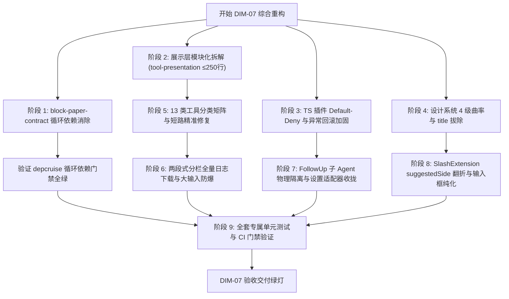

# Conex / Crish 前端工具分栏、输入框纯化与插件体系详细执行方案 (Dimension 07)

> **【战役调度与核心铁律】**：
>
> 1. **反退避与效果锁**：严格遵循 `.agents/LOGIC_PLAN_NO_RETREAT.md`，所有效果与安全边界不得退避或自行砍项；
> 2. **行数硬门禁（CI Guardrail）**：拆解后的展示层与业务逻辑模块严格保持每文件有效代码行 **≤ 250 行**，杜绝单体大函数与职责泛化；
> 3. **安全基线（Default-Deny）**：TS 插件体系 IPC 调用严格执行**白名单默认拒绝**策略，子 Agent 引导建议执行物理级硬阻断；
> 4. **零循环依赖与设计契约**：彻底清除 `block-paper-contract` 内部循环依赖，100% 收敛 4 级视觉曲率、彻底拔除 9 处残留原生 `title` 并柔化焦点态（≤10%）。

> **文档标识**：`docs/system-audit-and-redesign/detailed-plans/07-工具分栏输入框纯化与插件体系详案.md`  
> **制定角色**：【阶段 1 维度详案架构师 07: 前端工具分栏、输入框纯化与插件体系详案】  
> **输入依据**：
>
> - `docs/system-audit-and-redesign/audits/09-前端工具展示与两段式分栏全盘审计.md`
> - `docs/system-audit-and-redesign/audits/10-前端输入框与TS插件体系全盘审计.md`
> - `docs/system-audit-and-redesign/audits/11-前端布局树与设计系统契约全盘审计.md`
> - `docs/system-audit-and-redesign/audits/12-前端共享包与富文本块编辑器全盘审计.md`
> - `docs/system-audit-and-redesign/00-战役通则与协同执行规范.md`  
>   **执行环境**：pwsh7、UTF-8 无 BOM、纯逻辑时序演进、零工期假设。

---

## 目录

1. [方案总纲与交付契约矩阵 (Executive Summary & Target Contracts)](#一方案总纲与交付契约矩阵)
2. [工具展示层模块化解耦架构（≤ 250 行行数硬门禁）](#二工具展示层模块化解耦架构)
   - 2.1 现有单体模块膨胀与职责泛化根因
   - 2.2 拆解方案与目录拓扑设计
   - 2.3 符号导出治理与路径抽取权威源收拢
3. [13 类工具精准语义提取矩阵与高危拦截短路修复](#三13-类工具精准语义提取矩阵与高危拦截短路修复)
   - 3.1 修复 `read_url_content` / `read_resource` 被 `read_file` 劫持短路
   - 3.2 修复 `define_subagent` / `manage_subagents` 误提取为启动子代理
   - 3.3 重构 `unwrapPowerShellCommand` 支持带值标志与参数解包
   - 3.4 修复 `isHumanExplanation` 误杀英文自然语言意图说明
   - 3.5 `sanitizeHumanLabel` 安全清洗锁与白名单防穿透加固
4. [两段式分栏容器重构与全量未截断日志下载修复](#四两段式分栏容器重构与全量未截断日志下载修复)
   - 4.1 修复 `ToolCallOutput.tsx`「下载日志」下载截断残卷的致命缺陷
   - 4.2 `ToolCallInputPane` 增加大入参防御视口（1000 行 / 128KB 门限）
   - 4.3 字符长度与字节截断精度修复（`TextEncoder`）与 URL 内存释放安全
5. [聊天输入框纯化与视口边缘翻折算法修复](#五聊天输入框纯化与视口边缘翻折算法修复)
   - 5.1 修复 `SlashExtension.ts` 转换 `DOMRect` 丢失 `suggestedSide` 缺陷
   - 5.2 打通 Level 4 `composerContainer` 容器备援参数传递链路
   - 5.3 解决 CJK IME 首字 `lastCachedBox = null` 导致的弹层意外熔断
   - 5.4 彻底清除 `TiptapSlashMenu` 排版节点死代码与指令集单一真相源收拢
6. [TS 插件微内核体系安全加固与物理隔离](#六ts-插件微内核体系安全加固与物理隔离)
   - 6.1 `PluginContext.invokeIpc` 落地「默认拒绝 (Default-Deny)」安全策略
   - 6.2 `PluginRegistry.activate()` 异常回滚与 `DisposableBag` 资源泄露防护
   - 6.3 `FollowUpPlugin` 与业务 UI 双层 `isSubagent` 物理隔离闭环
   - 6.4 消除 `pluginRegistryAdapter.ts` 独立 LocalStorage 状态孤岛
7. [`block-paper-contract` 循环依赖消除与包间治理](#七block-paper-contract-循环依赖消除与包间治理)
   - 7.1 拔除 `coordinates.ts` 对 `diff.ts` 的反向 re-export
   - 7.2 更新 `block-paper-contract/src/index.ts` 独立导出
   - 7.3 更新 `.dependency-cruiser.cjs` 分层规则并纳入根 CI
8. [全系统设计系统契约无死角收敛](#八全系统设计系统契约无死角收敛)
   - 8.1 4 级视觉曲率阶梯标准化（9999px / 10px / 12px / 6px）
   - 8.2 彻底拔除全仓剩余 9 处原生 HTML `title` 属性
   - 8.3 柔和焦点态治理（≤10% 混入对比度，移除固定 5px 焦点圆角）
9. [逐文件改动域与接口定义规范 (File-by-File Implementation Specs)](#九逐文件改动域与接口定义规范)
10. [自动化测试用例矩阵与契约断言清单 (Verification & Test Matrix)](#十自动化测试用例矩阵与契约断言清单)
11. [纯逻辑时序演进与依赖拓扑 (Pure Logical DAG & Execution Steps)](#十一纯逻辑时序演进与依赖拓扑)

---

## 一、方案总纲与交付契约矩阵

### 1.1 治理目标

本方案针对审计报告 09、10、11、12 中揭示的**展示层单体超标**、**工具分类短路**、**下载日志截断**、**视口翻折失效**、**插件 IPC 鉴权放行漏洞**、**共享包循环依赖**以及**设计系统契约违规** 7 大系统性架构断层，进行彻底的根因级治理。

```
┌────────────────────────────────────────────────────────────────────────────────────────────────────────┐
│                                 DIM-07 核心交付契约与重构基准对比矩阵                                   │
├──────────────────────┬───────────────────────────────────┬─────────────────────────────────────────────┤
│ 治理维度             │ 现状缺陷 (Baseline)               │ 重构终态断言 (Target Contract)              │
├──────────────────────┼───────────────────────────────────┼─────────────────────────────────────────────┤
│ 1. 模块行数与内聚性  │ toolHumanDescriptions (357行)、   │ 拆解为 8 个高内聚子模块；                   │
│                      │ toolCardPresenter (390行) 严重超标│ 所有文件严格保持 **≤ 250 行** CI 硬门禁     │
├──────────────────────┼───────────────────────────────────┼─────────────────────────────────────────────┤
│ 2. 工具语义精准度    │ name.includes('read') 拦截短路，  │ 精确匹配优先（网络/MCP/子代理优先判定）；   │
│                      │ 误将 URL/资源当成「查看文件」     │ 13 类工具 100% 还原真实意图，无 raw JSON 逃逸│
├──────────────────────┼───────────────────────────────────┼─────────────────────────────────────────────┤
│ 3. 大输出日志下载    │ 点击「下载完整日志」仅下载到 2000 │ 透传原始 `fullOutput`，                     │
│                      │ 行已截断残卷，丢失真实数据        │ 下载产出的 `.log` 文件 100% 完整无损        │
├──────────────────────┼───────────────────────────────────┼─────────────────────────────────────────────┤
│ 4. 输入框光标与弹层  │ new DOMRect 抹除 suggestedSide，  │ 扩展 Rect 契约保全 `suggestedSide`；        │
│                      │ 导致顶部 <120px 视口翻折算法失效  │ 视口自适应翻折 100% 生效，打通 Level 4 备援 │
├──────────────────────┼───────────────────────────────────┼─────────────────────────────────────────────┤
│ 5. TS 插件安全体系   │ invokeIpc 未知 channel 默认放行； │ 落实 Default-Deny 默认拒绝；                │
│                      │ FollowUp 插件子 Agent 隔离被 UI 绕过│ 插件与 UI 双重硬阻断，激活异常自动回滚       │
├──────────────────────┼───────────────────────────────────┼─────────────────────────────────────────────┤
│ 6. 包间依赖拓扑      │ coordinates.ts 与 diff.ts 循环引用│ 彻底解开 A→B→A 循环依赖；                   │
│                      │ 触发 depcruise 硬阻断             │ 更新 .dependency-cruiser.cjs 分层规则       │
├──────────────────────┼───────────────────────────────────┼─────────────────────────────────────────────┤
│ 7. 设计系统契约      │ 存在 9 处原生 HTML title 气泡；   │ 100% 替换为自定义 `<Tooltip>` 组件；        │
│                      │ 焦点态硬塞 5px 圆角与 >10% 深黑边 │ 严格 4 级曲率阶梯，焦点对比度 ≤ 10%         │
└──────────────────────┴───────────────────────────────────┴─────────────────────────────────────────────┘
```

---

## 二、工具展示层模块化解耦架构

### 2.1 现有单体模块膨胀与职责泛化根因

审计 09 表明：

1. `toolHumanDescriptions.ts`（357 行）中的 `toolLabelFromArgs` 单函数长达 254 行，包含 14 个 if-else 分支，将意图过滤、参数提取、各种分类策略强行揉合在一起。
2. `toolCardPresenter.ts`（390 行）承载了 6 大完全不相干的职责：输出截断、Git Diff 统计、Tone 状态、子 Agent 文本摘要、会话文本拷贝、图片提取以及全量子模块的 Re-export。

### 2.2 拆解方案与目录拓扑设计

将 `apps/crish-desktop/src/api/tool-presentation/` 重构为高内聚、职责单一的 8 个子模块，每个文件物理行数均控制在 **200 行以内**（远低于 250 行门禁）：

```
apps/crish-desktop/src/api/tool-presentation/
├── toolPresentationTypes.ts     # [基础类型] ToolRowTone, ParsedToolArgs, ToolDiffStats 等 (~120 行)
├── toolLabelSanitizer.ts         # [安全清洗] clipToolLabel, sanitizeHumanLabel (~55 行)
├── toolArgsNormalizer.ts         # [参数归一] parseToolArgsSafe, extractToolCommand (~180 行)
├── toolCommandExtractor.ts       # [CLI 提取] unwrapPowerShellCommand, humanizeShellCommand (~190 行)
├── toolIntentFilter.ts          # [意图过滤] isHumanExplanation, isGenericExplanationSpam, isPlaceholder (~90 行)
├── toolCategoryRules.ts          # [规则策略] 13 类工具分类判定表 (Strategy Table) (~180 行)
├── toolHumanDescriptions.ts      # [语义门面] toolLabelFromArgs (查表调度), toolHumanLabel (~110 行)
├── toolDiffStats.ts             # [Diff 运算] parseGitShortstat, toolDiffLineStats, formatToolDiffStat (~150 行)
├── toolMediaPresenter.ts        # [媒体/文本] extractImageRefs, humanizeAgentSummary, assistantCopyText (~95 行)
├── toolCardPresenter.ts         # [展示门面] truncateToolOutput, fullToolOutput, toolRowTone, isInspectTool (~140 行)
└── timelineNormalizer.ts        # [时间线规整] normalizeTimelineToolCalls (~190 行)
```

### 2.3 符号导出治理与路径抽取权威源收拢

1. **消除双重通配导出**：
   - 彻底删除 `toolCardPresenter.ts` 内部的 `export * from './toolHumanDescriptions'` 等通配重导出；
   - 统一由 `apps/crish-desktop/src/api/toolPresentation.ts` 作为上层消费的唯一聚合入口。
2. **收拢参数路径抽取为单一权威源**：
   - 废除 `apps/crish-desktop/src/api/workspaceFsApi.ts` 中的 `extractFilePathFromToolArgs`；
   - 废除 `apps/crish-desktop/src/api/toolFeedback.ts` 中的 `pathFromToolArgs`；
   - `CompactToolRow.tsx` 与全仓组件统一调用 `toolArgsNormalizer.ts` 中的 `parseToolArgsSafe(tc.arguments).primaryTarget`。

---

## 三、13 类工具精准语义提取矩阵与高危拦截短路修复

### 3.1 修复 `read_url_content` / `read_resource` 被 `read_file` 劫持短路

#### 根因剖析：

原代码在判定文件读取时，使用了极度宽泛的 `name.includes('read')`。当工具名为 `read_url_content`（参数为 `Url: "https://example.com"`）或 `read_resource`（参数为 `Uri: "mcp://server/schema"`）时，被第 3 类文件读取直接截胡。由于网络工具没有 `path` 属性，最终提取出的标题恒为 **「查看文件」**，URL 语义彻底丢失。

#### 修复策略：

1. **调整规则优先级**：将**网络访问类**与 **MCP 扩展类**的匹配顺序提升到文件读取之前；
2. **收紧文件读取判定**：禁止使用宽泛的 `name.includes('read')`，改用精确前缀或枚举匹配：
   ```ts
   // 精确匹配文件读取
   const isFileRead =
     name === 'read_file' ||
     name === 'view_file' ||
     name === 'open_file' ||
     name === 'cat' ||
     name.startsWith('read_file') ||
     name.startsWith('view_file');
   ```

### 3.2 修复 `define_subagent` / `manage_subagents` 误提取为启动子代理

#### 修复策略：

在 `toolCategoryRules.ts` 中细分子代理管理与定义工具：

```ts
// 子代理工具精确派发
if (name === 'define_subagent') {
  const agentName = String(p.name || '').trim();
  return agentName ? `定义子代理类型 (${agentName})` : '注册子代理类型';
}
if (name === 'manage_subagents') {
  const action = String(p.action || '').toLowerCase();
  if (action === 'list') return '查询活动子代理列表';
  if (action === 'kill') return '终止指定子代理';
  if (action === 'kill_all') return '终止所有运行中子代理';
  return '管理子代理实例';
}
if (name === 'invoke_subagent' || name === 'run_subagent') {
  const role = String(
    p.role || p.typename || p.description || p.prompt || ''
  ).trim();
  return role && !role.startsWith('{')
    ? `启动子代理：${role.length > 28 ? `${role.slice(0, 27)}…` : role}`
    : '启动协作子任务';
}
```

### 3.3 重构 `unwrapPowerShellCommand` 支持带值标志与参数解包

#### 缺陷分析：

原正则 `(?:\s+-[A-Za-z]+)*` 仅能匹配无值的开关。遇到 `powershell -ExecutionPolicy Bypass -Command "cargo test"` 时，由于 `-ExecutionPolicy` 后面跟随了参数值 `Bypass`（无前缀 `-`），正则匹配失败，导致外层包装剥离失败。

#### 修复后的解包算法：

```ts
export function unwrapPowerShellCommand(cmd: string): string {
  let s = cmd.trim();
  // 匹配 powershell/pwsh 开头，支持跟随任意数量的 -Flag 或 -Flag Value 参数
  // 最终捕获 -Command / -c 后的内联命令，或末尾的引号包裹命令
  const pwshPrefixRe = /^(?:powershell|pwsh)(?:\.exe)?\s+/i;
  if (!pwshPrefixRe.test(s)) return s;

  s = s.replace(pwshPrefixRe, '');

  // 循环剥离参数标志（支持 -ExecutionPolicy Bypass, -NoProfile, -WindowStyle Hidden 等）
  while (s.startsWith('-')) {
    // 检查是否已到达 -Command / -EncodedCommand / -File 核心执行指令
    const cmdMatch = s.match(/^-(?:Command|c)\s+(.*)$/i);
    if (cmdMatch) {
      s = cmdMatch[1].trim();
      break;
    }
    // 剥离带值的选项：-Key Value
    const flagWithValueMatch = s.match(/^-[A-Za-z]+(?::[^\s]+|\s+[^\s-]+)\s*/);
    if (flagWithValueMatch) {
      s = s.slice(flagWithValueMatch[0].length);
      continue;
    }
    // 剥离单开关选项：-NoProfile
    const flagSingleMatch = s.match(/^-[A-Za-z]+\s*/);
    if (flagSingleMatch) {
      s = s.slice(flagSingleMatch[0].length);
      continue;
    }
    break;
  }

  // 剥离最外层包裹的双引号或单引号
  if (
    (s.startsWith('"') && s.endsWith('"')) ||
    (s.startsWith("'") && s.endsWith("'"))
  ) {
    s = s.slice(1, -1).trim();
  }
  return s || cmd.trim();
}
```

### 3.4 修复 `isHumanExplanation` 误杀英文自然语言意图说明

#### 缺陷分析：

原正则 `/^[\w./\\:-]+\s+[\w./\\:-]+/` 意在拦截 CLI 命令，但由于排除了所有无中文字符的二词串，导致 `"Running test suite"`, `"Checking build status"` 等合法英文自然语言被误杀。

#### 修复逻辑：

引入常见的英文动作动词白名单与代码/路径特征黑名单：

```ts
export function isHumanExplanation(text: string, toolName: string): boolean {
  const t = text.trim();
  if (
    !t ||
    t === toolName ||
    t === '需要确认' ||
    t.startsWith('{') ||
    t.startsWith('[')
  )
    return false;
  if (
    /^(powershell|pwsh|cmd(?:\.exe)?|bash|sh|zsh)\b/i.test(t) ||
    /^I will run\b/i.test(t)
  )
    return false;
  if (toolName && t.toLowerCase().startsWith(toolName.toLowerCase()))
    return false;

  // 包含中文字符：长度合法即认可
  if (/[\u4e00-\u9fff]/.test(t)) {
    return t.length >= 2 && t.length <= 240;
  }

  // 纯英文字符判定：
  // 1. 排除典型的 CLI 命令前缀
  if (
    /^(git|npm|pnpm|yarn|cargo|docker|kubectl|cd|ls|mkdir|rm|cp|mv|cat|grep|node|python)\s+[a-z0-9_.-]/i.test(
      t
    )
  ) {
    return false;
  }
  // 2. 排除明显的路径或代码赋值
  if (/[\\/]{2,}|=[^=]|;|\bconst\b|\blet\b|\bfunction\b/.test(t)) {
    return false;
  }
  // 3. 长度在 4 到 160 字符之间的合法英文自然语言句子
  return /^[A-Za-z]/.test(t) && t.length >= 4 && t.length <= 160;
}
```

### 3.5 `sanitizeHumanLabel` 安全清洗锁与白名单防穿透加固

在 `toolLabelSanitizer.ts` 中增强对 JSON 内部键的深度拦截，并将全部已知参数字段纳入白名单防御，同时修复对合法引号搜索的误杀：

```ts
const DANGEROUS_JSON_KEYS_RE =
  /^(\{|\[|"(action|taskId|task_id|path|command|CommandLine|Query|TargetFile|tool_args|server_name|parameters|arguments|properties)":)/i;

export function sanitizeHumanLabel(
  label: string,
  fallbackName?: string
): string {
  if (!label || typeof label !== 'string') {
    return fallbackName ? `调用 ${fallbackName}` : '调用工具';
  }
  let clean = label.trim();

  // 拦截 raw JSON 穿透
  if (
    clean.startsWith('{') ||
    clean.startsWith('[') ||
    DANGEROUS_JSON_KEYS_RE.test(clean)
  ) {
    return fallbackName ? `调用 ${fallbackName}` : '执行工具操作';
  }

  // 清除控制字符与首尾无效定界符，但保留搜索词中的合法双引号（如 「"Authorization"」）
  clean = clean.replace(/[\u0000-\u001F\u007F-\u009F]/g, '').trim();
  if (clean.startsWith('{') && clean.endsWith('}')) {
    clean = clean.slice(1, -1).trim();
  }

  return (
    clipToolLabel(clean) ||
    (fallbackName ? `调用 ${fallbackName}` : '执行工具操作')
  );
}
```

---

## 四、两段式分栏容器重构与全量未截断日志下载修复

### 4.1 修复 `ToolCallOutput.tsx`「下载日志」下载截断残卷的致命缺陷

#### 架构修复方案：

1. **`ToolCallOutputPaneProps` 接口扩展**：新增 `fullOutput?: string` 属性；
2. **`ToolCallOutput.tsx` 保持全量引用**：在 `useMemo` 计算截断展示文本 `displayOutput` 的同时，将未截断的原始清洗文本 `full` 透传给 `fullOutput`；
3. **`ToolCallOutputPane.tsx` 构造全量 Blob**：下载处理器使用 `fullOutput || output` 作为 Blob 的数据源，保证用户下载的日志 100% 完整。

```tsx
// ToolCallOutput.tsx: 透传全量数据
<ToolCallOutputPane
  toolId={tc.id}
  output={displayOutput}
  fullOutput={full} // 🌟 关键修复：向下透传 100% 完整 raw output
  status={tc.status}
  durationStr={durationStr}
  diffs={tc.diffs}
  images={images}
  isTruncated={isTruncated}
  totalLines={totalLines}
  totalBytes={totalBytes}
  onOpenDiff={onOpenDiff}
  onOpenTerminal={onOpenTerminal}
/>
```

```tsx
// ToolCallOutputPane.tsx: 使用全量数据下载
const handleDownloadLog = (e: React.MouseEvent) => {
  e.stopPropagation();
  const contentToDownload = fullOutput || output;
  if (!contentToDownload) return;
  const blob = new Blob([contentToDownload], {
    type: 'text/plain;charset=utf-8',
  });
  const url = URL.createObjectURL(blob);
  const a = document.createElement('a');
  a.href = url;
  a.download = `tool-output-${toolId || 'log'}.log`;
  a.click();
  // 延迟销毁 ObjectURL，防止某些浏览器引擎内核中同步销毁打断未完成的下载流
  setTimeout(() => URL.revokeObjectURL(url), 150);
};
```

### 4.2 `ToolCallInputPane` 增加大入参防御视口（1000 行 / 128KB 门限）

#### 防护设计：

定义常量：

- `TOOL_INPUT_LINE_CAP = 1000`
- `TOOL_INPUT_BYTE_CAP = 128 * 1024` (128 KB)

当大模型传入的 `argumentsStr` 或属性值超标时（如 5MB 源码写入），自动执行前端视口裁切，并在输入区底部展示折叠警示横幅与「复制完整入参」按钮，彻底杜绝 50,000 行源码塞爆 DOM 树导致 UI 线程冻结。

```tsx
// ToolCallInputPane.tsx
const MAX_INPUT_LINES = 1000;
const MAX_INPUT_CHARS = 128 * 1024;

const sanitizeInputValueForDisplay = (
  val: string
): { text: string; isTruncated: boolean } => {
  if (val.length > MAX_INPUT_CHARS) {
    return {
      text: `${val.slice(0, MAX_INPUT_CHARS)}\n… [入参过长，已截断显示前 128 KB]`,
      isTruncated: true,
    };
  }
  const lines = val.split('\n');
  if (lines.length > MAX_INPUT_LINES) {
    return {
      text: `${lines.slice(0, MAX_INPUT_LINES).join('\n')}\n… [入参过长，已截断显示前 ${MAX_INPUT_LINES} 行]`,
      isTruncated: true,
    };
  }
  return { text: val, isTruncated: false };
};
```

### 4.3 字符长度与字节截断精度修复（`TextEncoder`）与安全异常捕获

1. **使用 `TextEncoder` 替代 `new Blob` 测定字节**：
   ```ts
   const textEncoder = new TextEncoder();
   const bytes = textEncoder.encode(full).length;
   ```
   避免频繁分配短命 Blob 实例造成 GC 抖动。
2. **剪贴板写入安全捕获**：
   ```ts
   const handleCopy = async (e: React.MouseEvent) => {
     e.stopPropagation();
     if (!output) return;
     try {
       await navigator.clipboard.writeText(output);
       setCopied(true);
       setTimeout(() => setCopied(false), 2000);
     } catch (err) {
       console.warn('[ToolCallOutputPane] Clipboard write failed:', err);
     }
   };
   ```

---

## 五、聊天输入框纯化与视口边缘翻折算法修复

### 5.1 修复 `SlashExtension.ts` 转换 `DOMRect` 丢失 `suggestedSide` 缺陷

#### 根因剖析：

`calculateSafeCursorAnchor` 计算出的 `SafeAnchorRect` 包含了视口边缘分析字段 `suggestedSide: 'top' | 'bottom'` 和 `nearEdge: boolean`。原 `SlashExtension.ts` 实例化 `new DOMRect(left, top, width, height)` 时，这些附加属性被 JavaScript 原生类的属性丢弃，导致下游 `TiptapSlashMenu.tsx` 中的 `'suggestedSide' in anchor` 恒为 `false`，翻折逻辑彻底失效。

#### 修复方案：

使用 `Object.assign` 保全扩展属性，定义统一的 `SafeAnchorRect` 契约：

```ts
// SlashExtension.ts
const rawBox = measureCursorLineBox(view, props.range.from, 1);
const safeAnchor = calculateSafeCursorAnchor({
  rawCursorRect: rawBox,
  editorViewDom: view.dom,
  composerContainer: ctx.containerRef?.current ?? undefined, // 打通 Level 4 备援
});

if (safeAnchor) {
  // 🌟 关键修复：保全 suggestedSide 与 nearEdge 属性
  const extendedRect = Object.assign(
    new DOMRect(
      safeAnchor.left,
      safeAnchor.top,
      safeAnchor.width,
      safeAnchor.height
    ),
    {
      suggestedSide: safeAnchor.suggestedSide,
      nearEdge: safeAnchor.nearEdge,
    }
  );
  lastCachedBox = extendedRect;
  return lastCachedBox;
}
```

在 `TiptapSlashMenu.tsx` 中直接读取：

```tsx
const side: 'top' | 'bottom' =
  anchor && 'suggestedSide' in anchor && anchor.suggestedSide
    ? anchor.suggestedSide
    : 'top';
```

### 5.2 打通 Level 4 `composerContainer` 容器备援参数传递链路

在 `TiptapComposerField.tsx` 中为外层输入框容器创建 `fieldContainerRef`，并将其透传给 `SlashExtension` 与 `TiptapSlashMenu` 的上下文，当光标与 `editorViewDom` 处于初始不可见状态时，回退到容器内部安全坐标，确保 Level 4 防漂移逻辑真正闭环。

### 5.3 解决 CJK IME 首字 `lastCachedBox = null` 导致的弹层意外熔断

在 `createSuggestionRenderer` 初始化时，为 `lastCachedBox` 赋予基于容器或视口的保底安全 Rect，避免在用户中文输入法敲出 `/` 首字且 `lastCachedBox` 仍为 `null` 时直接返回 `null` 导致 Radix Popover 意外销毁。

### 5.4 彻底清除 `TiptapSlashMenu` 排版节点死代码与指令集单一真相源收拢

1. **清除死代码**：删除 `TiptapSlashMenu.tsx` 中的 `Heading1/2/3`, `List`, `Quote`, `Code` 等排版图标映射及残留导入；
2. **统一单一真相源**：将 `AiCommandSlashExtension.ts` 与 `TiptapComposerField.tsx` 中的指令集完全收拢为 `src/api/resolveSlashCommand.ts` 中的 `SLASH_COMMAND_SPECS`；
3. **消除虚拟 CustomEvent 导致指令误发给 LLM 的 Bug**：
   在 `slashSendPreflight.ts` 中拦截系统管理指令（`/clear`, `/stop`, `/compact`, `/settings`），直接触发对应的 Store 动作或 UI 弹窗，返回 `{ kind: 'handled' }`，绝不作为 Prompt 泄露给后端大模型。

---

## 六、TS 插件微内核体系安全加固与物理隔离

### 6.1 `PluginContext.invokeIpc` 落地「默认拒绝 (Default-Deny)」安全策略

#### 漏洞根除：

将 `types.ts` 中 `PluginContext.invokeIpc` 的鉴权逻辑重构为**默认拒绝**：凡是未在权限映射表中显式声明的 Channel，或未在插件 Manifest `permissions` 中声明的权限，一律直接抛出 `PluginSecurityError` 阻断执行。

```ts
// apps/crish-desktop/src/plugins/types.ts
public async invokeIpc<TResult = unknown>(channel: string, payload?: unknown): Promise<TResult> {
  const requiredPermission = this.resolveRequiredPermission(channel);

  // 🚨 安全铁律：未知通道一律拒绝（Default-Deny）
  if (!requiredPermission) {
    throw new Error(
      `[PluginSecurityError] Channel '${channel}' is not permitted or unknown in IPC whitelist (Default-Deny)`
    );
  }

  const declaredPermissions = this.manifest.permissions ?? [];
  if (!declaredPermissions.includes(requiredPermission)) {
    throw new Error(
      `[PluginSecurityError] Plugin '${this.manifest.id}' lacks permission '${requiredPermission}' to invoke '${channel}'`
    );
  }

  return (await this.hostIpc(channel, payload)) as TResult;
}

private resolveRequiredPermission(channel: string): string | null {
  if (channel.startsWith('fs:')) return 'fs:access';
  if (channel.startsWith('conex-markdown:') || channel.startsWith('markdown:')) return 'markdown:render';
  if (channel.startsWith('browser:')) return 'browser:control';
  if (channel.startsWith('network:')) return 'network:access';
  if (channel.startsWith('computer:')) return 'computer:control';
  if (channel.startsWith('screen:')) return 'screen:capture';
  if (channel.startsWith('assistant:')) return 'assistant:suggestions';
  return null; // 未知通道返回 null，触发 Default-Deny 阻断
}
```

### 6.2 `PluginRegistry.activate()` 异常回滚与 `DisposableBag` 资源泄露防护

在 `PluginRegistry.ts` 中增加原子化异常捕获与清理机制：

```ts
// apps/crish-desktop/src/plugins/PluginRegistry.ts
try {
  const context = new PluginContext(
    reg.plugin.manifest,
    customConfig ?? {},
    this.hostIpcHandler,
    runtime
  );
  await Promise.resolve(reg.plugin.activate(context));
  reg.status = 'active';
  reg.context = context;
} catch (err: any) {
  reg.status = 'error';
  reg.error = err?.message || String(err);
  // 🚨 关键修复：激活失败时强制释放已部分绑定的 EventListener 与 Timer
  if (reg.context) {
    try {
      reg.context.subscriptions.dispose();
    } catch {
      // 忽略 dispose 自身错误，保留原始 activate 异常
    }
    reg.context = undefined;
  }
  throw err;
}
```

### 6.3 `FollowUpPlugin` 与业务 UI 双层 `isSubagent` 物理隔离闭环

1. **`api/followUpSuggestions.ts` 契约增强**：
   在 `shouldShowFollowUpSuggestions` 的参数定义中加入 `isSubagent?: boolean`。若为子 Agent，坚决返回 `false`；
2. **`MessageActionsBar.tsx` 透传保护**：
   在渲染 `FollowUpSuggestionsSection` 时，从当前会话 Context 获取 `isSubagent` 状态并传入，杜绝子 Agent 视图产生任何建议气泡，物理切断 Token 浪费。

### 6.4 消除 `pluginRegistryAdapter.ts` 独立 LocalStorage 状态孤岛

重构 `apps/crish-desktop/src/components/settings-extensions/pluginRegistryAdapter.ts`，废除私有的 `crish_plugin_enabled_v1` LocalStorage 读写，直接订阅并驱动 `src/plugins/usePluginStore.ts` 与 `pluginRegistry` 单例，保证设置中心开关与运行期插件状态 100% 同步。

---

## 七、`block-paper-contract` 循环依赖消除与包间治理

### 7.1 拔除 `coordinates.ts` 对 `diff.ts` 的反向 re-export

`packages/block-paper-contract/src/diff.ts` 引入了 `coordinates.ts` 中的工具函数。而 `coordinates.ts` 第 242-243 行反向导出了 `diff.ts` 的 `diffToReplace`，形成了 A → B → A 循环。

**改动操作**：

1. 从 `packages/block-paper-contract/src/coordinates.ts` 中彻底删除：
   ```ts
   // ❌ 彻底删除以下两行
   export type { DiffReplaceResult } from './diff';
   export { diffToReplace } from './diff';
   ```
2. 保持 `packages/block-paper-contract/src/index.ts` 分别从 `./coordinates` 和 `./diff` 独立导出：
   ```ts
   // packages/block-paper-contract/src/index.ts
   export type {
     Utf16CodeUnitOffset,
     UnicodeScalarOffset,
   } from './coordinates';
   export {
     asUtf16Offset,
     asUnicodeScalarOffset,
     // ... 其余坐标转换算子
   } from './coordinates';

   export type { DiffReplaceResult } from './diff';
   export { diffToReplace } from './diff';
   ```

### 7.2 更新 `.dependency-cruiser.cjs` 分层规则并纳入根 CI

1. 在 `.dependency-cruiser.cjs` 中补充 `block-paper-contract`（Layer 0）、`editor-kit`（Layer 1）、`block-paper`（Layer 2）的层级定义，防止反向依赖；
2. 在根 `package.json` 的 `typecheck` 脚本中追加对 `packages/block-paper*`、`packages/editor-kit`、`packages/plugin-sdk` 的全量检查。

---

## 八、全系统设计系统契约无死角收敛

### 8.1 4 级视觉曲率阶梯标准化

严格遵循以下 4 级曲率阶梯契约：

| 阶梯等级                 | 目标元素                   | 标准 Token                               | 数值规范           | 禁止的写法                             |
| :----------------------- | :------------------------- | :--------------------------------------- | :----------------- | :------------------------------------- |
| **Level 1 (Pills)**      | 状态胶囊、徽标、药丸开关   | `var(--radius-full)`                     | **`9999px`**       | 严禁 `998px`, `1000px`, `999px` 裸数字 |
| **Level 2 (Buttons)**    | 独立功能按钮、弹窗确认按钮 | `var(--radius-xl)`                       | **`10px`**         | 严禁 6px 硬角或混用 8px                |
| **Level 3 (Containers)** | 主卡片、浮层容器、对话框   | `var(--radius-2xl)` / `var(--radius-lg)` | **`12px` / `8px`** | 严禁多重嵌套不同曲率                   |
| **Level 4 (Items)**      | 菜单项、侧栏 Tab、下拉选区 | `var(--radius-md)`                       | **`6px`**          | 严禁超标 8px 破坏同心圆角法则          |

**落地改动**：

- 修复 `src/styles/tokens.css` 中 `small`（998px）与 `large`（1000px）下的 `--radius-full` 统一为 `9999px`；
- 全仓替换 60+ 处硬编码 `border-radius: 999px` 为 `border-radius: var(--radius-full);`；
- 修正 `settings-base.css` 与 `FontSelectField.module.css` 中的按钮与内部项圆角。

### 8.2 彻底拔除全仓剩余 9 处原生 HTML `title` 属性

针对审计 11 扫描出的 9 处原生 `title` 破坏点进行 100% 改造：

```tsx
// 1. src/components/settings/ImportRootsSection.tsx
// 改造前：<span className={styles.importRootPath} title={roots.effective.claudeConfig}>
// 改造后：
<Tooltip content={roots.effective.claudeConfig}>
  <span className={styles.importRootPath}>{roots.effective.claudeConfig}</span>
</Tooltip>

// 2. src/components/settings/SettingsDevicesTab.tsx
// 改造前：<span title={device.id}>
// 改造后：
<Tooltip content={device.id}>
  <span>{device.id}</span>
</Tooltip>

// 3. src/components/workspace/FlowDagView.tsx
// 改造前：<span className={styles.nodeTitle} title={n.task || n.id}>
// 改造后：
<Tooltip content={n.task || n.id}>
  <span className={styles.nodeTitle}>{n.task || n.id}</span>
</Tooltip>

// 4. src/components/binary-tree/UnitSessionTabStrip.tsx
// 改造前：<button type="button" className={styles.tabMain} title={tab.label}>
// 改造后：拔除 title 属性，避免与内部关闭按钮 Tooltip 产生双重重叠

// 5. src/components/card-panel/CardPanelHeader.tsx
// 改造前：<span className="breadcrumb-item folder-trigger" title={folderLabel}>
// 改造后：
<Tooltip content={folderLabel}>
  <span className="breadcrumb-item folder-trigger">{folderLabel}</span>
</Tooltip>

// 6. src/components/chat-card/ChatHeader.tsx
// 改造前：<div className={styles.unitLabel} title={sessionTitleHint || unitChromeLabel}>
// 改造后：
<Tooltip content={sessionTitleHint || unitChromeLabel}>
  <div className={styles.unitLabel}>{unitChromeLabel}</div>
</Tooltip>

// 7. src/components/bg-tasks/BgTaskCard.tsx
// 改造前：<div className={styles.command} title={task.command}>
// 改造后：
<Tooltip content={task.command}>
  <div className={styles.command}>{task.command}</div>
</Tooltip>

// 8. src/components/overlay/WithdrawConfirmDialog.tsx
// 改造前：<li key={fp} className={styles.fileItem} title={fp}>
// 改造后：
<Tooltip content={fp}>
  <li key={fp} className={styles.fileItem}>{fp}</li>
</Tooltip>
```

### 8.3 柔和焦点态治理（≤10% 混入对比度，移除固定 5px 焦点圆角）

1. **修复 `src/styles/focus-visible.css`**：
   删除硬塞的 `border-radius: var(--radius-sm);`，使键盘焦点外框自然继承各组件自身的圆角（药丸继承 9999px，按钮继承 10px）；
2. **规范激活态对比度**：
   输入框与按钮处于聚焦或录制态时，严禁使用 `#000` 或纯色黑边，统一采用 `color-mix(in srgb, var(--border-color) 92%, var(--text-primary) 8%)` 柔和边框。

---

## 九、逐文件改动域与接口定义规范

### 9.1 改动文件清单总表

| 序号 | 目标文件路径                                                              | 改动性质 | 核心职责与规范                                      |
| :--- | :------------------------------------------------------------------------ | :------: | :-------------------------------------------------- |
| 1    | `apps/crish-desktop/src/api/tool-presentation/toolCategoryRules.ts`       | **新增** | 13 类工具分类策略映射表（≤ 180 行）                 |
| 2    | `apps/crish-desktop/src/api/tool-presentation/toolIntentFilter.ts`        | **新增** | 意图说明验证与模板过滤引擎（≤ 90 行）               |
| 3    | `apps/crish-desktop/src/api/tool-presentation/toolDiffStats.ts`           | **新增** | Git shortstat 解析与 Diff 行数统计（≤ 150 行）      |
| 4    | `apps/crish-desktop/src/api/tool-presentation/toolMediaPresenter.ts`      | **新增** | 图片提取与子 Agent 摘要生成（≤ 95 行）              |
| 5    | `apps/crish-desktop/src/api/tool-presentation/toolHumanDescriptions.ts`   | **重构** | 语义门面，调度分类规则，严格 ≤ 120 行               |
| 6    | `apps/crish-desktop/src/api/tool-presentation/toolCardPresenter.ts`       | **重构** | 展示层门面，剥离 Diff 统计与媒体解析，严格 ≤ 140 行 |
| 7    | `apps/crish-desktop/src/api/tool-presentation/toolCommandExtractor.ts`    | **优化** | 增强 PowerShell 参数解包与意图翻译（≤ 190 行）      |
| 8    | `apps/crish-desktop/src/api/tool-presentation/toolLabelSanitizer.ts`      | **优化** | 深度防 JSON 穿透与合法引号保留（≤ 55 行）           |
| 9    | `apps/crish-desktop/src/components/chat-tool-call/ToolCallOutput.tsx`     | **重构** | 透传 `fullOutput`，使用 `TextEncoder` 计算字节      |
| 10   | `apps/crish-desktop/src/components/chat-tool-call/ToolCallOutputPane.tsx` | **优化** | 支持全量下载 `.log`，异步销毁 ObjectURL             |
| 11   | `apps/crish-desktop/src/components/chat-tool-call/ToolCallInputPane.tsx`  | **优化** | 增加 1000 行 / 128KB 大入参前端折叠保护             |
| 12   | `apps/crish-desktop/src/components/chat-composer/SlashExtension.ts`       | **优化** | 保全 `suggestedSide` 属性，打通 Level 4 备援        |
| 13   | `apps/crish-desktop/src/components/chat-composer/TiptapSlashMenu.tsx`     | **优化** | 清除排版死代码，消费 `suggestedSide` 翻折           |
| 14   | `apps/crish-desktop/src/plugins/types.ts`                                 | **重构** | `invokeIpc` 落地 Default-Deny 白名单默认拒绝        |
| 15   | `apps/crish-desktop/src/plugins/PluginRegistry.ts`                        | **优化** | 激活异常自动回滚并释放 `DisposableBag`              |
| 16   | `apps/crish-desktop/src/plugins/plugin-follow-up/index.ts`                | **优化** | 强化子 Agent 硬阻断防御                             |
| 17   | `apps/crish-desktop/src/api/followUpSuggestions.ts`                       | **优化** | 增加 `isSubagent` 校验拦截                          |
| 18   | `packages/block-paper-contract/src/coordinates.ts`                        | **优化** | 彻底删除对 `diff.ts` 的反向 re-export               |
| 19   | `packages/block-paper-contract/src/index.ts`                              | **优化** | 独立导出 `./coordinates` 与 `./diff`                |
| 20   | `apps/crish-desktop/src/styles/tokens.css`                                | **修复** | 修正 `--radius-full` 为 `9999px`                    |
| 21   | `apps/crish-desktop/src/styles/focus-visible.css`                         | **修复** | 移除硬编码 5px 圆角，继承元素自身曲率               |
| 22   | 9 处 UI 组件文件                                                          | **修复** | 拔除原生 `title`，统一替换为 `<Tooltip>`            |

---

## 十、自动化测试用例矩阵与契约断言清单

### 10.1 单元测试套件升级规范

#### 套件 1：`toolCardPresenter.test.ts`（升级至 50+ 个精准用例）

- [ ] **TC-01（冲突工具名测试）**：`read_url_content` 传入 `Url: "https://github.com"` 必须输出 `访问 github.com`，严禁输出 `查看文件`；
- [ ] **TC-02（MCP 资源测试）**：`read_resource` 传入 `Uri: "mcp://server/schema"` 必须输出 `调用 MCP [server:schema]` 或 `调用扩展服务`；
- [ ] **TC-03（子代理定义测试）**：`define_subagent` 传入 `name: "Architect"` 必须输出 `定义子代理类型 (Architect)`，严禁输出 `启动子代理`；
- [ ] **TC-04（子代理管理测试）**：`manage_subagents` 传入 `Action: "kill"` 必须输出 `终止指定子代理`；
- [ ] **TC-05（PowerShell 带值解包）**：`powershell -ExecutionPolicy Bypass -Command "npm test"` 必须精确解包为人话 `运行测试`；
- [ ] **TC-06（英文 Explanation 保留）**：`explanation: "Running database migration"` 必须保留为标题，严禁被识别为命令丢弃；
- [ ] **TC-07（搜索引号保留）**：`grep_search(query: '"Authorization"')` 必须输出 `搜索「"Authorization"」`，双引号不得被剔除；
- [ ] **TC-08（防 JSON 穿透兜底）**：入参为 `{"unknown_action":"execute"}` 时，绝无 `{}` 定界符泄露，输出优雅兜底 `执行工具操作`。

#### 套件 2：`ToolCallOutput.test.tsx`（组件级真实下载与截断断言）

- [ ] **TC-09（全量日志下载真实内容断言）**：
  - 构造 5000 行超大输出（已触发 UI 截断）；
  - Mock `URL.createObjectURL` 捕获生成的 Blob；
  - 触发点击「下载日志」按钮；
  - 读取 Blob 文本，**断言其行数等于 5000 行，且不含截断省略号提示**；
- [ ] **TC-10（输入区 1000 行大入参折叠测试）**：
  - 传入包含 2000 行源码的 `argumentsStr`；
  - 断言 DOM 树中被安全折叠，渲染提示 `入参过长，已截断显示前 1000 行`；
- [ ] **TC-11（视图模式双向切换）**：
  - 点击「Code2 / 原始 JSON」切换按钮，断言 JSON `<pre>` 节点正确装载与卸载。

#### 套件 3：`safeCursorAnchor.test.ts` 与 `TiptapSlashMenu.test.tsx`

- [ ] **TC-12（suggestedSide 属性保真测试）**：
  - 断言 `calculateSafeCursorAnchor` 返回的锚点经过包装后，`'suggestedSide' in anchor` 恒为 `true`；
- [ ] **TC-13（视口顶部翻折测试）**：
  - 模拟光标 `top: 80px`（< 120px 阈值），断言计算出的 `suggestedSide` 为 `'bottom'`；
- [ ] **TC-14（CJK IME 首字稳定性测试）**：
  - 初始 `lastCachedBox = null` 时输入 `/`，断言 `clientRect()` 返回有效安全保底 Rect，菜单不闪退。

#### 套件 4：`PluginRegistry.test.ts`（安全基线与物理隔离测试）

- [ ] **TC-15（Default-Deny 默认拒绝断言）**：
  - 插件调用未知通道 `system:arbitrary_exec`，断言抛出 `[PluginSecurityError] Channel 'system:arbitrary_exec' is not permitted or unknown in IPC whitelist (Default-Deny)`；
- [ ] **TC-16（激活异常回滚测试）**：
  - 插件在 `activate` 抛错，断言其已添加的 EventListener 在 catch 之后被彻底销毁；
- [ ] **TC-17（FollowUp 子 Agent 物理隔离端到端测试）**：
  - `shouldShowFollowUpSuggestions({ isSubagent: true, ... })` 必须返回 `false`。

#### 套件 5：`block-paper-contract` 循环依赖门禁

- [ ] **TC-18（循环依赖零检测）**：
  - 运行 `npx depcruise packages/block-paper-contract`，输出 `0 dependencies cruised, 0 errors, 0 warnings`。

---

## 十一、纯逻辑时序演进与依赖拓扑



### 演进步骤实施清单：

1. **Step 1（循环依赖消除）**：
   - 修改 `packages/block-paper-contract/src/coordinates.ts`，剔除 `diffToReplace` 的 re-export；
   - 运行 `npx depcruise` 确认循环依赖阻断消除。
2. **Step 2（工具展示层模块化解耦）**：
   - 创建 `toolCategoryRules.ts`、`toolIntentFilter.ts`、`toolDiffStats.ts`、`toolMediaPresenter.ts`；
   - 重构 `toolHumanDescriptions.ts` 与 `toolCardPresenter.ts`，确保所有模块行数 ≤ 250 行。
3. **Step 3（分类规则精准度修复）**：
   - 在 `toolCategoryRules.ts` 中修正 `read_url_content` / `read_resource` / `define_subagent` 优先级；
   - 优化 `unwrapPowerShellCommand` 与 `isHumanExplanation`。
4. **Step 4（两段式分栏全量日志下载与防爆）**：
   - 重构 `ToolCallOutput.tsx` 透传 `fullOutput`，更新 `ToolCallOutputPane.tsx` 的 Blob 构造；
   - 为 `ToolCallInputPane.tsx` 增加 1000 行 / 128KB 门限截断。
5. **Step 5（输入框几何翻折与纯化）**：
   - 修改 `SlashExtension.ts` 保全 `suggestedSide` 与 `nearEdge`；
   - 清理 `TiptapSlashMenu.tsx` 中的废弃排版图标与死代码。
6. **Step 6（TS 插件体系安全加固）**：
   - `types.ts` 落地 Default-Deny 鉴权；
   - `PluginRegistry.ts` 增加激活失败 Disposable 回滚；
   - `followUpSuggestions.ts` 与 `MessageActionsBar.tsx` 严格落实 `isSubagent` 物理隔离。
7. **Step 7（设计系统契约收敛）**：
   - 修正 `tokens.css` `--radius-full` 为 `9999px`；
   - 替换 9 处原生 HTML `title` 属性为 `<Tooltip>`；
   - 移除 `focus-visible.css` 中的 5px 焦点圆角覆写。
8. **Step 8（全量验证）**：
   - 运行 `npm test`，确保 `toolCardPresenter.test.ts`、`ToolCallOutput.test.tsx`、`PluginRegistry.test.ts`、`safeCursorAnchor.test.ts` 全绿；
   - 运行 `npm run typecheck` 验证无类型报错。
