# Conex / Crish 全系统综合重构战役跨维度代码 Diff 与依赖冲突终审报告

> **【调度与定时器铁律】**：如果设置定时器，最短是100秒，如果命令过长，最好的方式是等待命令完成后的推送，而不是一直轮询命令情况。

> **报告标识**：`docs/system-audit-and-redesign/detailed-reviews/01-跨维度代码Diff与依赖冲突终审.md`  
> **责任终审师**：【维度详案评审师 01: 跨维度代码 Diff 与依赖冲突终审师】  
> **审查对象**：
>
> - `docs/system-audit-and-redesign/00-总计划框架.md`（战役框架总纲）
> - `docs/system-audit-and-redesign/detailed-plans/01-视觉曲率与浮层基座详案.md`（维度 1 详案）
> - `docs/system-audit-and-redesign/detailed-plans/02-核心聊天与容错状态机详案.md`（维度 2 详案）
> - `docs/system-audit-and-redesign/detailed-plans/03-设置解耦与底栏重构详案.md`（维度 3 详案）
> - `docs/system-audit-and-redesign/detailed-plans/04-模型配置全真源与滚轮修复详案.md`（维度 4 详案）
> - `docs/system-audit-and-redesign/detailed-plans/05-工作区右坞与二叉树全功能详案.md`（维度 5 详案）  
>   **基准规范**：`docs/system-audit-and-redesign/00-战役通则与协同执行规范.md`（零业务代码修改、pwsh7、UTF-8 无 BOM、严禁 git 提交、纯逻辑评审）。  
>   **终审结论**：**【条件放行（Conditional Sign-off）】** —— 5 份详细方案在整体架构、逻辑依赖 DAG、反退避原则与 4 级质量门禁上达成高度一致；但在 **3 处共享样式覆盖、1 处 TSX 行内圆角覆盖 CSS Module、1 处 Menu Anchor 调用规范** 上存在代码级微观冲突，必须严格按照本报告第三章给出的**黄金合并版本（Golden Merged Blueprint）**执行实施。

---

## 目录

1. [终审使命与评审总纲 (Executive Summary & Final Review Mandate)](#一终审使命与评审总纲)
2. [全仓跨维度文件修改冲突矩阵 (Cross-Dimension Shared File Conflict Matrix)](#二全仓跨维度文件修改冲突矩阵)
3. [关键共享文件代码级 Diff 冲突深度剖析与黄金合并版 (Golden Merged Code Blueprints)](#三关键共享文件代码级-diff-冲突深度剖析与黄金合并版)
   - 3.1 `tokens.css`：维度 1（四级曲率与图表色）与维度 3（设置侧栏隔离）黄金合并
   - 3.2 `ModelsSettingsTab.module.css`：维度 1（胶囊）、维度 3（滚轮）与维度 4（流式高度）黄金合并
   - 3.3 `settings-models.css`：维度 1 与维度 4 `!important` 清洗统一收敛
   - 3.4 `Menu.tsx` 与各维度消费端：双模 Anchor 架构调用契约终审
   - 3.5 `SettingsPanel.tsx` 拆分体系：维度 3 与维度 4 契约与 Tab 路由终审
4. [跨维度调用契约与数据流一致性终审 (Cross-Dimension Invocations & Routing Alignment)](#四跨维度调用契约与数据流一致性终审)
   - 4.1 `openSettings` 路由与 Tab ID 全链路一致性
   - 4.2 错误域体系（S1~S8）在前端与 Rust 端的全链路闭环
   - 4.3 `handleGlobalTabClick` 与 `openToolInSession` 自由函数分发契约（ARB-06）
   - 4.4 Rust DPAPI 凭据安全与原生探活命令契约（`provider_probe_ping` / `scan`）
5. [接口与强类型安全地毯式比对 (Type Safety & Wire Schema Cross-Verification)](#五接口与强类型安全地毯式比对)
   - 5.1 Rust Serde 结构体与前端 TypeScript 接口字段名与可选性对照表
   - 5.2 错误域类型 `ErrorDomain` 与文案契约 `DOMAIN_MESSAGES`
   - 5.3 响应式状态机与 Store 访问安全性
6. [大文件模块化拆解与 CI 质量门禁合规性终审 (Modularization & CI Line-Count Governance)](#六大文件模块化拆解与-ci-质量门禁合规性终审)
   - 6.1 `useSlashSend.ts` 拆解合规性（≤250 行，0 循环依赖）
   - 6.2 `useModelProfilesState.ts` 拆解合规性（≤350 行，0 循环依赖）
   - 6.3 `SettingsPanel.tsx` 拆解合规性（≤400 行，0 循环依赖）
   - 6.4 `run_launch.rs` 零膨胀与 `probe.rs` 独立性
7. [全战役 Master DAG 执行批次与防踩坑施工指南 (Master DAG & Execution Preventions)](#七全战役-master-dag-执行批次与防踩坑施工指南)
   - 7.1 五大批次单向推进流水线
   - 7.2 实施团队防踩坑与串行施工铁律
8. [终审裁决意见与放行结论 (Final Review Verdict & Sign-off)](#八终审裁决意见与放行结论)

---

## 一、终审使命与评审总纲

作为 Conex / Crish 全系统综合重构战役在正式实施前最关键的**代码级冲突终审人**，本评审师对 `docs/system-audit-and-redesign/detailed-plans/` 下的全部 5 份维度详细方案（01~05）以及 `00-总计划框架.md` 进行了逐行、地毯式的交叉比对，重点审查：

1. **共享文件 Diff 冲突**：排查多个维度对相同文件进行修改时是否存在变量命名冲突、相互覆盖的 CSS 声明或相互矛盾的 Hook 签名；
2. **跨维度契约一致性**：排查设置路由、错误域映射、工具分发器在跨模块消费时的传参一致性；
3. **接口与强类型安全**：排查 Rust Serde 序列化标注与前端 TypeScript 接口的字段名、可选性及驼峰命名映射；
4. **行数门禁与解耦安全**：排查拆解后模块是否满足 CI 行数限制且无循环依赖。

---

## 二、全仓跨维度文件修改冲突矩阵

经过全量代码比对，全仓涉及跨维度重叠修改的文件共计 **11 个**，其冲突定性与裁决如下：

| 序号 | 目标文件路径                                              | 涉及维度                                             | 冲突类型与风险等级                      | 冲突本质原因                                                                                                                                                                                                             | 终审裁决方案                                                                             |
| :--- | :-------------------------------------------------------- | :--------------------------------------------------- | :-------------------------------------- | :----------------------------------------------------------------------------------------------------------------------------------------------------------------------------------------------------------------------- | :--------------------------------------------------------------------------------------- |
| 1    | `apps/crish-desktop/src/styles/tokens.css`                | **维度 1**<br>**维度 3**                             | **属性追加冲突**<br>⚠️ 中风险           | 维度 1 追加 4 级曲率、图表色变量；维度 3 追加设置侧栏宽度与隔离变量。若分批次 patch 会产生行上下文冲突。                                                                                                                 | 统一在 **Batch 01 (WP-01)** 作为原子工单一次性合并入库（见 §3.1）。                      |
| 2    | `components/settings-models/ModelsSettingsTab.module.css` | **维度 1**<br>**维度 3**<br>**维度 4**               | **声明覆盖与圆角冲突**<br>🚨 **高风险** | 维度 1 要求 `.cascadeSelectTrigger` 为 `9999px` 胶囊；维度 3/4 要求移除 `overscroll-behavior: contain`；维度 4 要求 `.modelsSplit` 流式展开并追加 `.mrdBody`。但维度 4 在 TSX 行内写入 `borderRadius: '10px'` 发生冲突！ | 采纳维度 1 胶囊规范，删除 TSX 行内圆角覆写，CSS 合并三方改动（见 §3.2）。                |
| 3    | `styles/settings/settings-models.css`                     | **维度 1**<br>**维度 4**                             | **同构重复清洗**<br>ℹ️ 低风险           | 两个维度均要求拔除第 1845~1885 行中的 12 处 `!important` 块。                                                                                                                                                            | 维度 1 diff 更完整（含第 1089/1880 行），以**维度 1 的 diff 规范**统一收敛。             |
| 4    | `components/ui/Menu/Menu.tsx`                             | **维度 1**<br>**维度 3**<br>**维度 4**<br>**维度 5** | **调用范式差异**<br>⚠️ 中风险           | 维度 1 推出显式 `anchor` 模式（免疫 Quad-Click）；维度 3/4/5 的消费端存在混用 `trigger` 现象。                                                                                                                           | 维度 1 保持双模兼容；维度 3 的 `UserQuickMenu` 推荐升级为显式 `anchor` 模式（见 §3.4）。 |
| 5    | `components/settings/SettingsPanel.tsx`                   | **维度 3**<br>**维度 4**                             | **架构解耦契约**<br>ℹ️ 低风险           | 维度 3 将其三拆解；维度 4 的 `ModelsSettingsTab` 在 `SettingsContent.tsx` 中被懒加载。                                                                                                                                   | 检查两端 props 完全吻合，契约 100% 对齐（见 §3.5）。                                     |
| 6    | `hooks/chat-stream/useSlashSend.ts`                       | **维度 2**<br>**维度 5**                             | **依赖契约消费**<br>ℹ️ 低风险           | 维度 2 拆解该 Hook；维度 5 修复了其依赖的 `handleGlobalTabClick`。                                                                                                                                                       | 维度 2 拆解出的 `slashSendPreflight.ts` 正确透传并消费，契约一致。                       |
| 7    | `components/binary-tree/TreeLeafPanel.tsx`                | **维度 5**<br>**维度 2**                             | **工具路由打通**<br>ℹ️ 低风险           | 维度 5 将空回调 `() => {}` 替换为 `handleOpenTool`。                                                                                                                                                                     | 为维度 2 的斜杠命令与维度 5 的 6 大入口提供真实分发底座，无冲突。                        |
| 8    | `api/userFacingErrors.ts`                                 | **维度 2**                                           | **错误域扩充 (S1~S8)**<br>ℹ️ 低风险     | 扩充 S7（排队）与 S8（存储），修复无参黑洞。                                                                                                                                                                             | 全局单源修改，消费端全量适配，无冲突。                                                   |
| 9    | `crates/.../run_launch.rs` vs `src/probe.rs`              | **维度 2**<br>**维度 4**                             | **职责边界隔离**<br>ℹ️ 低风险           | 维度 2 仅在 `run_launch.rs` 更改 3 行（加前缀）；维度 4 严守红线，独立新建 `probe.rs`。                                                                                                                                  | 彻底规避大文件膨胀，职责分明，无冲突。                                                   |
| 10   | `components/sidebar/SidebarFooter.tsx`                    | **维度 3**                                           | **底栏双列重构**<br>ℹ️ 低风险           | 拆解为 `UserProfileCard` + `SettingsIconButton`。                                                                                                                                                                        | 独立工单集中在 Batch 03 施工，无冲突。                                                   |
| 11   | `api/chat-bridge/ConnectionLifecycle.ts`                  | **维度 2**                                           | **S7 排队捕获**<br>ℹ️ 低风险            | 捕获 S7 无缝转入 `follow_up` 队列。                                                                                                                                                                                      | 独立工单在 Batch 02 施工，无冲突。                                                       |

---

## 三、关键共享文件代码级 Diff 冲突深度剖析与黄金合并版

### 3.1 `tokens.css`：维度 1（四级曲率与图表色）与维度 3（设置侧栏隔离）黄金合并

#### 1. 冲突排查与重叠分析

- **维度 1** 修改了基础物理圆角阶梯（追加 `--radius-3xl: 14px`）、纠正了 `--dropdown-radius`、`--item-radius` 的语义倒挂，补齐了 `--button-radius`、`--dialog-radius`、`--pill-radius` 与 `--chart-color-1/2`，并在 `data-ui-size` 档位中进行了适配；
- **维度 3** 追加了设置中心专属变量 `--settings-sidebar-width: 240px` 及其衍生 Token，并在 `data-ui-size="small"`（220px）与 `data-ui-size="large"`（260px）中注入了响应式尺寸。

#### 2. 黄金合并代码蓝图（Golden Merged Diff）

```diff
--- a/apps/crish-desktop/src/styles/tokens.css
+++ b/apps/crish-desktop/src/styles/tokens.css
@@ -201,7 +201,8 @@
   --radius-md: 6px;
   --radius-lg: 8px;
   --radius-xl: 10px;
   --radius-2xl: 12px;
+  --radius-3xl: 14px;
   --radius-full: 9999px;

@@ -270,12 +271,28 @@
   --dropdown-padding: var(--space-1_5);
   --dropdown-gap: var(--space-0_5);
-  --dropdown-radius: var(--radius-md);
+  --dropdown-radius: var(--radius-xl);
   --item-padding: 8px 12px;
-  --item-radius: var(--radius-sm);
+  --item-radius: var(--radius-md);
   --item-font-size: var(--font-size-base);
+  --button-radius: var(--radius-xl);
+  --dialog-radius: var(--radius-2xl);
+  --pill-radius: var(--radius-full);
+  --chart-color-1: var(--accent-chart-out);
+  --chart-color-2: var(--accent-chart-in);

   --header-height: 36px;
   --sidebar-width: 260px; /* overridden by JS constants at runtime */
+
+  /* 设置面板专属独立 Tokens（维度 3 物理隔离，不受侧栏折叠影响） */
+  --settings-sidebar-width: 240px;
+  --settings-sidebar-width-compact: 220px;
+  --settings-sidebar-width-comfortable: 260px;
+  --settings-content-max: 720px;
+  --settings-header-height: 40px;
+  --settings-nav-padding: var(--space-3);
+  --settings-tab-height: 34px;

@@ -607,8 +624,8 @@
 [data-ui-size="small"] {
   --dropdown-padding: 5px;
   --dropdown-gap: var(--space-0_5);
-  --dropdown-radius: 10px;
+  --dropdown-radius: var(--radius-xl);
   --item-padding: 6px 10px;
-  --item-radius: 7px;
+  --item-radius: var(--radius-md);
   --item-font-size: 13px;
@@ -657,7 +674,9 @@
   --radius-xl: 9px;
   --radius-2xl: 11px;
+  --radius-3xl: 13px;
-  --radius-full: 998px;
+  --radius-full: 9999px;
+  --settings-sidebar-width: 220px;

@@ -684,8 +703,8 @@
 [data-ui-size="large"] {
   --dropdown-padding: var(--space-2);
   --dropdown-gap: 3px;
-  --dropdown-radius: 14px;
+  --dropdown-radius: var(--radius-2xl);
   --item-padding: 9px 14px;
-  --item-radius: 9px;
+  --item-radius: var(--radius-lg);
   --item-font-size: var(--font-size-lg);
@@ -734,7 +753,9 @@
   --radius-xl: 11px;
   --radius-2xl: 13px;
+  --radius-3xl: 15px;
-  --radius-full: 1000px;
+  --radius-full: 9999px;
+  --settings-sidebar-width: 260px;
```

---

### 3.2 `ModelsSettingsTab.module.css`：维度 1、维度 3 与维度 4 黄金合并

#### 1. 致命代码冲突曝光与纠偏

- **冲突焦点**：维度 1 详案要求级联触发器为饱满胶囊（`border-radius: var(--radius-full)` 即 9999px），而维度 4 详案 5.3 节的 TSX 代码片段中，在 `<button className={styles.cascadeSelectTrigger}>` 上写死了行内样式 `style={{ borderRadius: 'var(--radius-xl)' }}`（10px）。
- **终审裁决**：
  1. **TSX 修复**：必须在 `ModelProfileList.tsx` 的 `ModelsCascadeSelect` 组件中**删除行内 `borderRadius` 样式声明**；
  2. **CSS 模块统一**：在 `ModelsSettingsTab.module.css` 中将 `.cascadeSelectTrigger` 统一定义为 `border-radius: var(--radius-full)`；
  3. **尺寸与滚轮合并**：同时吸收维度 4 的 `.modelsSplit` 流式展开架构、`.mrdBody` 规范，以及维度 3/4 的 `overscroll-behavior: auto`。

#### 2. 黄金合并代码蓝图（Golden Merged Diff）

```diff
--- a/apps/crish-desktop/src/components/settings-models/ModelsSettingsTab.module.css
+++ b/apps/crish-desktop/src/components/settings-models/ModelsSettingsTab.module.css
@@ -1,12 +1,12 @@
 .modelsSplit {
   display: flex;
   gap: 0;
   flex: 1;
-  height: max(480px, calc(100vh - 220px));
-  min-height: 420px;
+  height: auto;
+  min-height: 520px;
   border: var(--hairline-width, 1px) solid var(--hairline, var(--border-subtle));
-  border-radius: 0;
+  border-radius: var(--radius-2xl);
   overflow: hidden;
-  background: transparent;
+  background: var(--bg-secondary);
   box-shadow: none;
 }
@@ -62,7 +62,7 @@
 .mrlList {
   flex: 1;
   overflow-y: auto;
-  overscroll-behavior: contain;
+  overscroll-behavior: auto;
   padding: var(--space-2);
   display: flex;
   flex-direction: column;
@@ -172,9 +172,8 @@
 .modelsDetail {
   flex: 1;
   min-width: 0;
   padding: 20px 24px;
-  overflow-x: hidden;
-  overflow-y: auto;
-  overscroll-behavior: contain;
+  overflow: visible;
+  overscroll-behavior: auto;
   display: flex;
   flex-direction: column;
   gap: var(--space-5);
@@ -240,6 +239,13 @@
+/* 维度 4 补齐缺失的 .mrdBody 规范 */
+.mrdBody {
+  display: flex;
+  flex-direction: column;
+  gap: var(--space-5);
+  min-width: 0;
+  width: 100%;
+}
@@ -980,5 +986,5 @@
 .mrlItem {
   display: flex;
   align-items: center;
-  border-radius: 9px;
+  border-radius: var(--radius-md);
 }
@@ -988,5 +994,5 @@
 .cascadeSelectTrigger {
   border: 1px solid var(--border-subtle);
   background: var(--control-soft-bg, var(--bg-secondary));
-  border-radius: var(--radius-xl);
+  border-radius: var(--radius-full);
   padding: 0 12px;
   min-height: var(--control-height-sm, 28px);
 }
```

---

### 3.3 `settings-models.css`：维度 1 与维度 4 `!important` 清洗统一收敛

#### 1. 冲突排查

维度 1 与维度 4 均识别到 `apps/crish-desktop/src/styles/settings/settings-models.css` 中第 1845~1885 行存在破坏 CSS 继承链的 12 处 `!important` 覆写。两者的清洗目标完全一致。

#### 2. 黄金合并代码蓝图

执行时以维度 1 详案 §6.6 的完整 Diff 为准，一并清理行 1089 的 `.models-action-hint` 与行 1880 的 `.models-row-card.is-disabled`，统一采用特异性选择器 `.settings-pane--models .models-split` 进行纯净样式声明。

---

### 3.4 `Menu.tsx` 与各维度消费端：双模 Anchor 架构调用契约终审

#### 1. 架构定论与 React 19 安全性

维度 1 详案 §3.2 重构的 `Menu.tsx` 完美实现了：

1. **推荐模式（显式 Anchor）**：接收 `anchor?: React.RefObject<HTMLElement | null>`，内部仅挂载 `<Popover.Anchor virtualRef={anchor} />`，触发器按钮完全由外部自治，**彻底免疫 Quad-Click 四击震荡**；
2. **向后兼容模式（Trigger）**：接收 `trigger?: React.ReactNode`，内部通过 `(actualTrigger.props as any).ref` 访问与合并 Ref，**0 处 `element.ref` 访问，100% 消除 React 19 控制台报错**。

#### 2. 全仓消费端规范对齐表

| 消费组件                  | 所属维度 | 当前调用范式                     | 终审裁决与建议                                                                |
| :------------------------ | :------- | :------------------------------- | :---------------------------------------------------------------------------- |
| `PermissionModeMenu.tsx`  | 维度 1   | `anchor={pillBtnRef}`            | ✅ **标杆示范**：推荐显式 Anchor 模式，杜绝外部点击竞态。                     |
| `UserQuickMenu.tsx`       | 维度 3   | `trigger={renderTrigger?.(...)}` | 建议在实现时直接升级为 `anchor={triggerRef}`，与 `UserProfileCard` 完美结合。 |
| `ModelsCascadeSelect.tsx` | 维度 4   | `trigger={<button ... />}`       | 依赖 `Menu.tsx` 向后兼容分支，注意去除行内圆角。                              |
| `LeafToolTabStrip.tsx`    | 维度 5   | `trigger={<Button ... />}`       | 依赖 `Menu.tsx` 向后兼容分支，拔除 Trigger 内嵌套 Tooltip。                   |

---

### 3.5 `SettingsPanel.tsx` 拆分体系：维度 3 与维度 4 契约与 Tab 路由终审

#### 1. 结构与模块化拆分验证

维度 3 详案将 `SettingsPanel.tsx` 拆分为：

- `SettingsPanel.tsx`（壳层容器，约 120 行，≤400 行门禁）
- `SettingsSidebar.tsx`（专属独立左侧导航，约 120 行，≤400 行门禁）
- `SettingsContent.tsx`（12 个 Tab 懒加载与 Suspense 独立容错隔离，约 120 行，≤400 行门禁）

#### 2. 跨维度消费端接口一致性验证

- **维度 4 接入点**：`ModelsSettingsTab` 在 `SettingsContent.tsx` 中被引入：
  ```tsx
  const ModelsSettingsTab = lazy(() =>
    import('../settings-models/ModelsSettingsTab').then((m) => ({
      default: m.ModelsSettingsTab,
    }))
  );
  ```
  其 Props 为 `{ onShowToast: ShowToastFn }`，与 `SettingsContentProps.onShowToast` 100% 匹配。
- **维度 2 接入点**：聊天发送前置检测（未配模型 S2）调用 `openSettings('models')`，通过 `useLayoutStore.openSettings` 触发 Dialog 展开并将 `safeActiveTab` 激活为 `'models'`，全链路畅通。

---

## 四、跨维度调用契约与数据流一致性终审

### 4.1 `openSettings` 路由与 Tab ID 全链路一致性

排查全系统所有调用 `openSettings(tabId)` 的模块，核验参数合法性：

```
┌────────────────────────────────────────────────────────────────────────────────────────┐
│                          openSettings(tabId) 跨维度调用契约拓扑表                       │
├──────────────────────────┬─────────────┬────────────────────┬──────────────────────────┤
│ 调用发起方               │ 所属维度    │ 传递参数 (tabId)   │ 终审判定与接收端状态     │
├──────────────────────────┼─────────────┼────────────────────┼──────────────────────────┤
│ `slashSendPreflight.ts`  │ 维度 2      │ `'models'`         │ ✅ 合法，直达模型设置Tab │
│ `ConnectionLifecycle.ts` │ 维度 2      │ `'models'`         │ ✅ 合法，S2 引导直达     │
│ `SettingsIconButton.tsx` │ 维度 3      │ `undefined` (无参) │ ✅ 合法，默认激活上次Tab │
│ `UserQuickMenu.tsx`      │ 维度 3      │ `'models'`/`'app'` │ ✅ 合法，快捷入口直达   │
│ `AppShortcuts.ts`        │ 全局快捷键  │ `undefined`        │ ✅ 合法，Ctrl+, 全屏直达 │
└──────────────────────────┴─────────────┴────────────────────┴──────────────────────────┘
```

**结论**：所有调用点传递的 `tabId` 均严格属于 `store/types.ts` 中定义的 12 个合法 `SettingsTabType` 之一，零无效路由。

---

### 4.2 错误域体系（S1~S8）在前端与 Rust 端的全链路闭环

维度 2 详案将错误分类体系扩充为完备的 S1~S8 八维域：

- **S1（核心启动）**：`CORE_STARTING` $\to$ 输入框持久条；
- **S2（配置缺失）**：`NO_PROVIDER` $\to$ 横幅 + 【前往设置】按钮；
- **S3（恢复繁忙）**：`RESTORE_BUSY` $\to$ 输入框持久条；
- **S4（网络异常）**：`PROVIDER_NETWORK` $\to$ **修复无参黑洞，100% 呈现网络重发提示**；
- **S5（服务商故障）**：`PROVIDER_FAULT` $\to$ 卡片错误态 + 原地重试；
- **S6（未知内部崩溃）**：`INTERNAL_UNKNOWN` $\to$ **收窄正则，0 误报**；
- **S7（会话繁忙排队）**：`SESSION_BUSY` $\to$ 捕获 Rust 串行守卫，**自动入队，0 报错红条**；
- **S8（存储同步）**：`STORAGE_BUSY` $\to$ 瞬态重试持久条。

**闭环验证**：

1. Rust 端 `run_launch.rs:264-271` 返回带有 `SESSION_BUSY: ` 前缀的标准字符串；
2. 前端 `userFacingErrors.ts` 中 `SESSION_BUSY_RE` 优先命中并返回 `'S7'`；
3. `ConnectionLifecycle.ts` 捕获到 `S7` 立即调用 `store.setSessionMessageStatus('queued')` 并触发 `followUp`，完成平滑排队。全链路闭环 100% 严密。

---

### 4.3 `handleGlobalTabClick` 与 `openToolInSession` 自由函数分发契约（ARB-06）

- **裁决执行情况**：
  维度 5 详案严格贯彻了评审师 01 的系统级裁决 **ARB-06**，在 `TreeLeafPanel.tsx` 中建立分发器：
  ```typescript
  const handleOpenTool = useCallback(
    (panelId: string) => {
      const targetSessionId = sessionForPanel || selectActiveSessionId();
      if (targetSessionId && !targetSessionId.startsWith('__pending')) {
        openToolInSession(targetSessionId, panelId);
      } else {
        openToolInActiveTab(panelId);
      }
    },
    [sessionForPanel]
  );
  ```
- **消费端受益**：
  将 `handleOpenTool` 透传给 `ChatCard` 的 `handleGlobalTabClick`，一举打通了 Markdown 文件链接、Diff 审批卡片跳转、终端按钮与斜杠命令等全部 6 大交互入口！

---

### 4.4 Rust DPAPI 凭据安全与原生探活命令契约（`provider_probe_ping` / `scan`）

- **数据流闭环**：
  1. 前端冷启动进入设置页，内存无 API Key；
  2. 点击「检查连通性」或「自动获取」，前端通过 IPC 调用 `provider_probe_ping` 或 `provider_probe_scan_models`；
  3. Rust 端 `probe.rs` 直接从 `secrets/{profile_id}.dpapi` 解密凭据并向远端发起 HTTP 请求；
  4. 测得真实 RTT 或扫描得到最新模型列表，结构化返回前端，并自动合并至 `ModelCatalog`；
  5. 前端收到结果即时弹出 Toast，**彻底消除“缺少 Key / 密钥未载入”的系统级硬伤**。

---

## 五、接口与强类型安全地毯式比对

### 5.1 Rust Serde 结构体与前端 TypeScript 接口字段名与可选性对照表

地毯式比对 Rust 端（`apps/agent-workbench/src-tauri/src/probe.rs`、`config/profile.rs`）与前端 TS 端（`modelCatalog.ts`、`rustProfileStore.ts`、`providerProfiles.ts`）：

```
┌────────────────────────────────────────────────────────────────────────────────────────┐
│                        Rust Serde <-> TypeScript 类型字段映射对照表                    │
├─────────────────────────┬──────────────────────────┬─────────────────┬─────────────────┤
│ Rust 字段名             │ Serde 序列化 (camelCase) │ TypeScript 字段 │ 可选性/类型对齐 │
├─────────────────────────┼──────────────────────────┼─────────────────┼─────────────────┤
│ `ProbePingArgs.profile_id`    │ `profileId`        │ `profileId`     │ `string` (必选) │
│ `ProbePingArgs.model`         │ `model`            │ `model`         │ `string?` (可选)│
│ `ProbePingArgs.timeout_ms`    │ `timeoutMs`        │ `timeoutMs`     │ `number?` (可选)│
│ `ProbePingResult.ok`          │ `ok`               │ `ok`            │ `boolean` (必选)│
│ `ProbePingResult.status`      │ `status`           │ `status`        │ `number` (必选) │
│ `ProbePingResult.latency_ms`  │ `latencyMs`        │ `latencyMs`     │ `number` (必选) │
│ `ProbePingResult.model`       │ `model`            │ `model`         │ `string?` (可选)│
│ `ProbePingResult.error`       │ `error`            │ `error`         │ `string?` (可选)│
├─────────────────────────┼──────────────────────────┼─────────────────┼─────────────────┤
│ `ProbeScanArgs.profile_id`    │ `profileId`        │ `profileId`     │ `string` (必选) │
│ `ProbeScanArgs.timeout_ms`    │ `timeoutMs`        │ `timeoutMs`     │ `number?` (可选)│
│ `ProbeScanResult.ok`          │ `ok`               │ `ok`            │ `boolean` (必选)│
│ `ProbeScanResult.models`      │ `models`           │ `models`        │ `string[]` (必选│
│ `ProbeScanResult.total`       │ `total`            │ `total`         │ `number` (必选) │
│ `ProbeScanResult.error`       │ `error`            │ `error`         │ `string?` (可选)│
├─────────────────────────┼──────────────────────────┼─────────────────┼─────────────────┤
│ `ProfileConfig.base_url`      │ `baseUrl`          │ `baseUrl`       │ `string?` (兼容)│
│ `ProfileConfig.sort_order`    │ `sortOrder`        │ `sortOrder`     │ `number?` (兼容)│
└─────────────────────────┴──────────────────────────┴─────────────────┴─────────────────┘
```

**结论**：所有字段名在 `#[serde(rename_all = "camelCase")]` 作用下与前端 TS 严格对应，数值类型（`u64` $\to$ `number`）、布尔与字符串可选性 100% 严密对齐。

---

### 5.2 错误域类型 `ErrorDomain` 与文案契约 `DOMAIN_MESSAGES`

- `type ErrorDomain = 'S1' | 'S2' | 'S3' | 'S4' | 'S5' | 'S6' | 'S7' | 'S8';`
- `DOMAIN_MESSAGES` 为每个枚举值均提供了标准中文文案；
- `domainUserMessage(domain: ErrorDomain)` 实现了穷举映射，无 `undefined` 风险。

---

### 5.3 响应式状态机与 Store 访问安全性

- `slashSendDraftManager.ts` 与 `slashSendQueueHelper.ts` 通过 `getCompositionRoot()` 安全访问 `sessionStore` 与 `layoutStore`；
- 所有 Store 操作均置于 `try-catch` 防御块中，确保即使在极端的测试或卸载环境下也不会引发整个 React 渲染树白屏。

---

## 六、大文件模块化拆解与 CI 质量门禁合规性终审

依据 `scripts/check-line-counts.mjs` 门禁规则（UI 组件 ≤ 500 行，业务逻辑 ≤ 400 行，>650 行硬阻断）：

```
┌────────────────────────────────────────────────────────────────────────────────────────┐
│                        大文件前置模块化解耦与行数合规审查表                            │
├──────────────────────────────────────────────────────┬──────────┬──────────┬───────────┤
│ 模块与文件路径                                       │ 现状行数 │ 拆解终态 │ 门禁状态  │
├──────────────────────────────────────────────────────┼──────────┼──────────┼───────────┤
│ **1. 聊天发送 Hook 体系 (维度 2)**                   │          │          │           │
│ • `hooks/chat-stream/useSlashSend.ts` (主协调)       │ 457 行   │ ~180 行  │ ✅ 达标   │
│ • `hooks/chat-stream/slashSendDraftManager.ts` (草稿)│ 0 行     │ ~70 行   │ ✅ 远低于 │
│ • `hooks/chat-stream/slashSendQueueHelper.ts` (排队) │ 0 行     │ ~80 行   │ ✅ 远低于 │
│ • `hooks/chat-stream/slashSendPreflight.ts` (前置)   │ 0 行     │ ~90 行   │ ✅ 远低于 │
├──────────────────────────────────────────────────────┼──────────┼──────────┼───────────┤
│ **2. 模型配置状态 Hook 体系 (维度 4)**               │          │          │           │
│ • `components/settings-models/useModelProfilesState` │ 526 行   │ ~240 行  │ ✅ 达标   │
│ • `components/settings-models/modelsPresets.ts`      │ 0 行     │ ~70 行   │ ✅ 远低于 │
│ • `components/settings-models/modelsIpcHelpers.ts`   │ 0 行     │ ~120 行  │ ✅ 远低于 │
├──────────────────────────────────────────────────────┼──────────┼──────────┼───────────┤
│ **3. 设置中心面板体系 (维度 3)**                     │          │          │           │
│ • `components/settings/SettingsPanel.tsx` (壳层)     │ 362 行   │ ~120 行  │ ✅ 达标   │
│ • `components/settings/SettingsSidebar.tsx` (导航)   │ 0 行     │ ~120 行  │ ✅ 远低于 │
│ • `components/settings/SettingsContent.tsx` (内容)   │ 0 行     │ ~120 行  │ ✅ 远低于 │
├──────────────────────────────────────────────────────┼──────────┼──────────┼───────────┤
│ **4. Rust 后端内核 (维度 4 隔离红线)**               │          │          │           │
│ • `src-tauri/src/run/run_launch.rs` (维持原状)       │ 1328 行  │ 1328 行  │ 🛡️ 零膨胀 │
│ • `src-tauri/src/probe.rs` (全新独立探活模块)        │ 0 行     │ ~230 行  │ ✅ 物理隔离│
└──────────────────────────────────────────────────────┴──────────┴──────────┴───────────┘
```

**结论**：所有拆解方案均将大文件降解为单一职责的纯粹子模块，不仅 100% 达标 CI 行数红线，而且模块间依赖均为单向树状无环结构，**零循环依赖（Zero Circular Dependency）**。

---

## 七、全战役 Master DAG 执行批次与防踩坑施工指南

### 7.1 五大批次单向推进流水线

```mermaid
graph TD
    classDef b1 fill:#E1F5FE,stroke:#0288D1,stroke-width:2px;
    classDef b2 fill:#E8F5E9,stroke:#388E3C,stroke-width:2px;
    classDef b3 fill:#FFF3E0,stroke:#F57C00,stroke-width:2px;
    classDef b4 fill:#EDE7F6,stroke:#512DA8,stroke-width:2px;
    classDef b5 fill:#FFFDE7,stroke:#FBC02D,stroke-width:2px;

    subgraph Batch1 ["Batch 01: 核心契约、设计系统 Token 与 Rust 探活模块 [无前置依赖]"]
        B1_1["[WP-01] tokens.css 4级曲率/图表色/设置侧栏隔离 (黄金合并版)"]:::b1
        B1_2["[WP-02] Menu.tsx 双模Anchor改造 & Tooltip isValidDOMRect 零坐标拦截"]:::b1
        B1_3["[WP-03] Rust probe.rs 独立模块落地 & command_manifest.rs 注册"]:::b1
    end

    subgraph Batch2 ["Batch 02: 核心聊天容错状态机与大文件三叶前置拆解 [依赖 Batch 01]"]
        B2_1["[WP-04] useSlashSend.ts 三叶拆解 (DraftManager/QueueHelper/Preflight)"]:::b2
        B2_2["[WP-05] userFacingErrors.ts S1~S8 重构与无参黑洞修复"]:::b2
        B2_3["[WP-06] ConnectionLifecycle.ts S7 串行排队接管与就绪状态机"]:::b2
    end

    subgraph Batch3 ["Batch 03: 设置中心布局解耦与主侧栏底栏双列重构 [依赖 Batch 01, 02]"]
        B3_1["[WP-07] useSidebarResize.ts 拔除:root副作用 & shell-layout 局部属性折叠"]:::b3
        B3_2["[WP-08] SettingsPanel 三拆分 (SettingsSidebar + SettingsContent + 暖灰底座)"]:::b3
        B3_3["[WP-09] SidebarFooter 重构为 [UserProfileCard] + [32x32px 设置齿轮]"]:::b3
    end

    subgraph Batch4 ["Batch 04: 模型配置界面 UI 修复与工作区右坞全功能打通 [依赖 Batch 01~03]"]
        B4_1["[WP-10] ModelsSettingsTab.module.css 流式高度与滚轮死锁消除 (黄金合并版)"]:::b4
        B4_2["[WP-11] useModelProfilesState.ts 模块化拆解与 5 处失效按钮修复"]:::b4
        B4_3["[WP-12] TreeLeafPanel 真实路由分发 & UnitChromeActions 本地作用域隔离"]:::b4
        B4_4["[WP-13] DiffCardSplitView 虚拟滚动物理高度 & ChatHeader 常驻顶栏"]:::b4
    end

    subgraph Batch5 ["Batch 05: 全系统四级质量门禁与 127.0.0.1:9222 CDP 实机真值闭环 [收尾交付]"]
        B5_1["Level 1: npm run typecheck 0 错误"]:::b5
        B5_2["Level 2: npm run check:line-counts 795 文件 0 违规"]:::b5
        B5_3["Level 3: cargo test --workspace + vitest 单元/集成全绿"]:::b5
        B5_4["Level 4: 127.0.0.1:9222 CDP 实机 240+ 控件交互真值巡检"]:::b5
    end

    Batch1 --> Batch2
    Batch2 --> Batch3
    Batch3 --> Batch4
    Batch4 --> Batch5
```



### 7.2 实施团队防踩坑与串行施工铁律

1. **同文件绝对串行修改铁律**：
   - `tokens.css` 严禁由多个子 Agent 分别提修改，必须由 Batch 01 施工者一次性应用 §3.1 的黄金合并补丁；
   - `ModelsSettingsTab.module.css` 必须由 Batch 04 施工者一次性应用 §3.2 的黄金合并补丁；
2. **TSX 行内样式防污染红线**：
   - 严禁在 JSX / TSX 中写入 `style={{ borderRadius: '10px' }}` 等硬编码行内圆角，所有曲率必须通过 CSS Modules 消费 `var(--radius-*)` 变量，防止覆盖胶囊规范；
3. **禁止向 `run_launch.rs` 塞入探测代码**：
   - Rust 探活与模型扫描必须严格写在独立的 `probe.rs` 中，严守反代码膨胀红线；
4. **验证真值铁律**：
   - 调试验收必须基于 `127.0.0.1:9222` 真实 WebView2 环境，严禁使用浏览器打开 `localhost:5174` 进行假验收。

---

## 八、终审裁决意见与放行结论

经过跨维度地毯式比对与代码级深度终审，【维度详案评审师 01】作出如下裁决：

> ### 终审裁决声明
>
> 1. **设计一致性评级**：**优秀（A+）**。5 份维度详细方案完全契合战役总计划框架与反退避原则，没有一处功能砍缩或退避自研；
> 2. **代码兼容性评级**：**已收敛（A）**。本报告指出的 3 处样式重叠与 1 处 TSX 行内圆角冲突已通过第三章黄金合并蓝图彻底化解；
> 3. **放行结论**：**【准予进入施工实施阶段（Approved for Execution）】**。各施工子 Agent 可严格遵照本文档的黄金合并代码与 DAG 批次指令展开多轮次代码实施！

---

> **终审师签名**：【维度详案评审师 01: 跨维度代码 Diff 与依赖冲突终审师】  
> **报告落盘完成**：`docs/system-audit-and-redesign/detailed-reviews/01-跨维度代码Diff与依赖冲突终审.md`  
> **向主控（Main Agent）汇报就绪**。
