# 内核通信与自愈状态机视角全系统重构维度划分建议报告

> **文档标识**：`docs/system-audit-and-redesign/dimension-proposals/01-内核与状态机视角维度划分建议.md`
> **报告类型**：全系统重构战役维度划分独立建议案（子 Agent A 产出）
> **责任角色**：【子 Agent A: 内核通信与自愈状态机视角维度划分分析师】
> **执行依据**：
>
> - [`docs/system-audit-and-redesign/00-战役通则与协同执行规范.md`](file:///c:/Software/conex/docs/system-audit-and-redesign/00-战役通则与协同执行规范.md)
> - [`AGENTS.md`](file:///c:/Software/conex/AGENTS.md) / [`.agents/LOGIC_PLAN_NO_RETREAT.md`](file:///c:/Software/conex/.agents/LOGIC_PLAN_NO_RETREAT.md)
> - `docs/system-audit-and-redesign/analysis/` 下全部 15 份专题分析报告（重点涵盖 01、05、11、13、14 专项分析）
>   **核心铁律**：纯逻辑规划、问题一律同权、100% 需求保全（零退避）、杜绝打补丁、严禁涉及工期/人天/优先级。

---

## 目录（Table of Contents）

1. [执行摘要与架构总愿景](#一执行摘要与架构总愿景)
2. [全系统重构 6 大核心维度清单与命名建议](#二全系统重构-6-大核心维度清单与命名建议)
3. [各维度深度解构：缺陷范围、文件域与核心机制](#三各维度深度解构缺陷范围文件域与核心机制)
   - [维度 1：Rust 内核会话循环双轨事件实时化与中间态打通](#31-维度-1rust-内核会话循环双轨事件实时化与中间态打通-dim-kernel-events)
   - [维度 2：长程自治不间断连续工作与多级异常自愈状态机](#32-维度-2长程自治不间断连续工作与多级异常自愈状态机-dim-self-healing)
   - [维度 3：后台任务管理器（BackgroundTaskManager）全链路装配与日志溢出落盘](#33-维度-3后台任务管理器backgroundtaskmanager全链路装配与日志溢出落盘-dim-bg-tasks)
   - [维度 4：原生 ConPTY 交互纯终端与 AI 命令输出监视面板双轨解耦](#34-维度-4原生-conpty-交互纯终端与-ai-命令输出监视面板双轨解耦-dim-dual-terminal)
   - [维度 5：三档权限体系集中化重构、工作区沙箱规范化与输入输出分栏](#35-维度-5三档权限体系集中化重构工作区沙箱规范化与输入输出分栏-dim-perms-workspace)
   - [维度 6：思考强度全链路透传、PromptCache 命中优化与 TS 扩展插件化](#36-维度-6思考强度全链路透传promptcache-命中优化与-ts-扩展插件化-dim-thinking-plugins)
4. [各维度之间的逻辑依赖拓扑与单向无环 DAG 执行顺序](#四各维度之间的逻辑依赖拓扑与单向无环-dag-执行顺序)
5. [系统级不变量证明与安全守卫契约](#五系统级不变量证明与安全守卫契约)
6. [全系统验证矩阵与防回归门禁契约](#六全系统验证矩阵与防回归门禁契约)
7. [总结与对总方案的建议](#七总结与对总方案的建议)

---

## 一、执行摘要与架构总愿景

在精读并穿透审计 `docs/system-audit-and-redesign/analysis/` 目录下的全部 15 份专题分析报告后，从 **Rust 内核引擎、双轨事件、进程与后台任务管理、不间断自愈状态机** 的核心架构视角出发，我们识别出当前系统最深层的结构性断层：

1. **事件发射的“双轨断层与黑盒滞留”**：Rust 会话循环在多轮长程任务中，将所有中间事件（`ToolStart`/`ToolEnd`/`TurnStart`/`TurnEnd`/`MessageStart`/`MessageEnd`）硬编码堆积在内存 `state.events` 中，导致执行中途前端处于 0 事件真空期，全任务完成才瞬间倾泻数百事件；同时前端 `EventRouter` 误将无序列号增量事件按 `messageId` 粗暴去重，误杀了首 Token 之后的所有思考增量（造成 `"TheTheThe..."` 乱象）。
2. **状态机的“意外暴毙与连续工作断裂”**：系统缺乏长程自主推进状态机，在模型输出行动意图自白（“尝试单独调用...”）、增量流式解析微瑕、或单次工具报错时，`no_tool_calls` 与 `turn_complete` 机械判定 `tool_call_count == 0` 并直接下发 `ShouldStop` 强行掐死循环，导致 AI 无法连续工作。
3. **任务与进程的“装配断裂与伪成功困惑”**：`ShellCommandTool` 凭借注册期静态持有实现了后台子进程托管（返回 `taskId: "task-0"`），但 `session-loop` 的 `ToolContext` 构造点硬编码 `background: None` 与 `log_root: None`，导致 AI 紧接着调用 `background_task` 工具时被直接拦截报错 `[common.unsupported]`，造成认知分裂与长日志溢出落盘失效。
4. **终端与监视器的“双轨混杂与指鹿为马”**：用户交互式 ConPTY 终端与 AI 自动化命令执行流在概念和状态上严重混淆，AI 输出被硬编码灌入 `terminalStore` 形成幽灵数据，聊天气泡中点击“在终端查看”却跳转到一个空白的全新 PowerShell，造成严重交互撕裂。
5. **权限与沙箱的“私法设卡与名不副实”**：用户选择“完全访问”后，底层工具内部（`ShellCommandTool::prepare`、`redirect_or_intercept_delete` 等）仍存在多层脱离权限模式的硬编码死板拦截；纯对话无工程时工作区被悄悄绑定为 Tauri 宿主内部目录（`src-tauri`），逼迫 AI 通过 PowerShell 内联脚本“越狱偷渡”。

基于上述核心洞察，我们主张：**全系统重构必须以“内核引擎唯一真源（SSOT）、事件管道实时透传、状态机自治自愈、进程双轨物理隔离、权限单一裁决”为基石，划分为 6 个正交、高内聚且具备严格数学依赖的重构维度**。

---

## 二、全系统重构 6 大核心维度清单与命名建议

```
┌─────────────────────────────────────────────────────────────────────────────────────────────────────────────────┐
│                                内核与状态机视角：全系统重构 6 大核心业务维度                                    │
├───────────────────┬─────────────────────────────────────────────────┬───────────────────────────────────────────┤
│ 维度标识          │ 维度官方命名 (Dimension Name)                   │ 核心关注点与架构使命                      │
├───────────────────┼─────────────────────────────────────────────────┼───────────────────────────────────────────┤
│ **维度 1 (D-KE)** │ **Rust 内核会话循环双轨事件实时化与中间态打通** │ 贯通 LiveEventSink，消除事件滞留与去重误杀 │
│ **维度 2 (D-SH)** │ **长程自治不间断连续工作与多级异常自愈状态机**   │ 根除行动自白后暴毙，建立白名单收敛与自愈  │
│ **维度 3 (D-BT)** │ **后台任务管理器全链路装配与日志溢出落盘**       │ 贯通 ToolContext.background，解封后台任务 │
│ **维度 4 (D-DT)** │ **原生 ConPTY 纯终端与命令输出监视面板双轨解耦** │ 100% 原生交互终端 vs AI 只读审计监视器   │
│ **维度 5 (D-PW)** │ **三档权限体系集中化、工作区沙箱规范与分区重构** │ 消除私法设卡，落实真实完全访问与输入输出分栏│
│ **维度 6 (D-TP)** │ **思考强度全链路透传、PromptCache 优化与插件化** │ 思考档位/预算透传，缓存四态与 TS 插件解耦 │
└───────────────────┴─────────────────────────────────────────────────┴───────────────────────────────────────────┘
```

---

## 三、各维度深度解构：缺陷范围、文件域与核心机制

### 3.1 维度 1：Rust 内核会话循环双轨事件实时化与中间态打通 (DIM-KERNEL-EVENTS)

#### 1. 拟解决的核心缺陷与现象

- **缺陷 1.1（19 轮长程多轮黑盒滞留）**：在 19 轮工具循环中，所有 `ToolStart`/`ToolEnd`/`TurnStart`/`TurnEnd`/`MessageStart`/`MessageEnd` 事件仅被 push 到内存 `state.events`，中途 0 次发射，前端数分钟处于真空期，全任务完成才一次性爆发 150+ 个事件。
- **缺陷 1.2（“TheTheThe...” 思考首 Token 误杀）**：实时轨无 `sequence` 信封被前端 `EventRouter.ts` 的 `buildEventDedupeKey` 回退为 `${type}:${messageId}`，导致每轮思考仅放行第 1 个 token，后续数千 token 全被当作重复事件静默丢弃。
- **缺陷 1.3（首个正文到达误清思考）**：`streamExecutionHelper.ts` 在首个 text chunk 到达时误判并丢弃 thinking 缓冲，导致思考内容瞬间归零。

#### 2. 涉及的核心文件域

- **Rust 内核层**：
  - [`crates/session-loop/src/provider.rs`](file:///c:/Software/conex/crates/session-loop/src/provider.rs)（定义通用 `LiveEventSink` trait）
  - [`crates/session-loop/src/loop/handlers/streaming.rs`](file:///c:/Software/conex/crates/session-loop/src/loop/handlers/streaming.rs)（思考流与消息生命周期实时发射）
  - [`crates/session-loop/src/loop/handlers/executing_tools.rs`](file:///c:/Software/conex/crates/session-loop/src/loop/handlers/executing_tools.rs)（逐工具 `ToolStart`/`ToolProgress`/`ToolEnd` 实时发射）
  - [`crates/session-loop/src/loop/handlers/prepare_turn.rs`](file:///c:/Software/conex/crates/session-loop/src/loop/handlers/prepare_turn.rs) 与 [`turn_complete.rs`](file:///c:/Software/conex/crates/session-loop/src/loop/handlers/turn_complete.rs)（`TurnStart`/`TurnEnd` 实时信标）
  - [`crates/session-loop/src/loop/loop_exec.rs`](file:///c:/Software/conex/crates/session-loop/src/loop/loop_exec.rs)（循环收敛与事件状态机）
- **Tauri 壳层**：
  - [`apps/agent-workbench/src-tauri/src/engine_channels.rs`](file:///c:/Software/conex/apps/agent-workbench/src-tauri/src/engine_channels.rs)（`BridgeLiveSink` 实现 `push_live`，立即 emit + flush）
  - [`apps/agent-workbench/src-tauri/src/run/run_idle.rs`](file:///c:/Software/conex/apps/agent-workbench/src-tauri/src/run/run_idle.rs) 与 [`run_launch.rs`](file:///c:/Software/conex/apps/agent-workbench/src-tauri/src/run/run_launch.rs)（双轨收敛与幂等落库）
- **前端事件通道与视图投影**：
  - [`apps/crish-desktop/src/api/chat-bridge/EventRouter.ts`](file:///c:/Software/conex/apps/crish-desktop/src/api/chat-bridge/EventRouter.ts)（去重键生成逻辑修复：实时流式增量事件不参与去重拦截）
  - [`apps/crish-desktop/src/hooks/chat-stream/streamExecutionHelper.ts`](file:///c:/Software/conex/apps/crish-desktop/src/hooks/chat-stream/streamExecutionHelper.ts)（移除 `handleThinkingResetOnChunk` 破坏性 drop）
  - [`apps/crish-desktop/src/store/streamingStore.ts`](file:///c:/Software/conex/apps/crish-desktop/src/store/streamingStore.ts) 与 [`useStreamBatchers.ts`](file:///c:/Software/conex/apps/crish-desktop/src/hooks/chat-stream/useStreamBatchers.ts)（流式卡片动态挂载）

#### 3. 核心机制与架构重构要点

- **双轨解耦契约**：
  - **实时通知轨（Live Track）**：信封 `sequence = None`，无锁即时推送，前端用于驱动 UI 动态打字机、运行中卡片展开与实时计时；
  - **持久化收口轨（Persistent Track）**：信封携带严格单调自增的全局原子 `sequence`，写入 SQLite `events` 表，作为历史回放与会话恢复的唯一真源；
- **前端 O(1) 幂等合并**：前端基于 `(event.type, call.id / message.id / turn_index)` 对实时通知与收口事件进行无损对齐，消灭重复渲染。

---

### 3.2 维度 2：长程自治不间断连续工作与多级异常自愈状态机 (DIM-SELF-HEALING)

#### 1. 拟解决的核心缺陷与现象

- **缺陷 2.1（输出行动自白后意外停机暴毙）**：AI 输出了“尝试单独调用 PowerShell 原生删除命令。”后，由于模型未在同消息中携带结构化工具调用，`no_tool_calls.rs` 与 `turn_complete.rs` 检测到 `tool_call_count == 0`，直接触发 `ShouldStop` 杀死进程。
- **缺陷 2.2（流式工具解析微瑕静默死亡）**：Provider 层上报 `finish_reason=tool_calls`，但在分包微抖动时未能组装出完整工具名，系统仅记录 `ProviderDiagnostic`，上层却误判为空工具纯文本正常退出。
- **缺陷 2.3（单次工具报错缺乏自愈驱动力）**：`detect_recent_tool_error_loop` 阈值写死为 2，单次工具执行非零退出或报错时，系统完全不介入注入反思，导致 AI 输出一句口头计划便停住。
- **缺陷 2.4（Goal 模式严苛停滞误杀）**：`/goal` 模式下 `stalled_rounds >= 2` 过于严苛，自愈探索轮次被误判为永久停滞而中断。

#### 2. 涉及的核心文件域

- **Rust 状态机核心**：
  - [`crates/session-loop/src/loop/handlers/streaming.rs`](file:///c:/Software/conex/crates/session-loop/src/loop/handlers/streaming.rs)（检测 `InvalidToolCall` 诊断并自动合成 `format-self-heal` 消息反馈）
  - [`crates/session-loop/src/loop/handlers/no_tool_calls.rs`](file:///c:/Software/conex/crates/session-loop/src/loop/handlers/no_tool_calls.rs)（集成 `ToolPromiseStrategy`，捕获未兑现行动承诺并自动注入推进指令）
  - [`crates/session-loop/src/loop/handlers/turn_complete.rs`](file:///c:/Software/conex/crates/session-loop/src/loop/handlers/turn_complete.rs)（实行白名单准出制，有自愈消息或在途工具绝对不落入 `ShouldStop`）
  - [`crates/session-loop/src/steering/strategy.rs`](file:///c:/Software/conex/crates/session-loop/src/steering/strategy.rs) 与 [`promise.rs`](file:///c:/Software/conex/crates/session-loop/src/steering/promise.rs)（即时反思 `Immediate Reflexion` 与行动意图正则匹配）
- **Provider 解析与编排层**：
  - [`crates/agent-provider/src/parse/chat_core.rs`](file:///c:/Software/conex/crates/agent-provider/src/parse/chat_core.rs)（流式工具解析容错与 Markdown 代码块回退扫描）
  - [`crates/orchestrator/src/goal_state.rs`](file:///c:/Software/conex/crates/orchestrator/src/goal_state.rs)（`DEFAULT_MAX_STALLED_ROUNDS` 放宽至 4，重置判定覆盖自愈探索期）
- **前端协同生命周期**：
  - [`apps/crish-desktop/src/api/chat-bridge/handlers/lifecycleHandlers.ts`](file:///c:/Software/conex/apps/crish-desktop/src/api/chat-bridge/handlers/lifecycleHandlers.ts)（审批流或后台任务未完成前，拦截过早 `finish(false)`）

#### 3. 核心机制与架构重构要点

- **白名单准出契约（Convergence Whitelist）**：
  状态机收口唯三合法条件：① 用户主动发起的停止信号；② 达到硬性保护上限 `max_turns`；③ 经过白名单校验的真正终态纯文本答复（无未兑现工具承诺、工具调用清零）。
- **工具调用承诺（Tool-Promise）自愈引擎**：
  利用高性能正则与语义分析器，精准捕获“准备调用/正在使用/尝试执行”等意图，若本轮未实际发 tool call，自动注入 `SteeringAction::InjectMessage` 强力驱动 AI 落实行动，消除中途暴毙。

---

### 3.3 维度 3：后台任务管理器（BackgroundTaskManager）全链路装配与日志溢出落盘 (DIM-BG-TASKS)

#### 1. 拟解决的核心缺陷与现象

- **缺陷 3.1（`background_task` 工具报错 `[common.unsupported]`）**：AI 调用 `shell_command` 成功转入后台后（返回 `taskId: "task-0"`），紧接着调用 `background_task` 却被硬拦截提示“后台任务管理未装配”。
- **缺陷 3.2（单工具执行上下文硬编码占位）**：`exec_single.rs:299` 处将 `ToolContext.background` 与 `log_root` 写死为 `None`，导致执行期上下文严重断裂。
- **缺陷 3.3（超限日志溢出落盘失效）**：同步命令输出超限时，因 `log_root` 为 `None` 无法溢出落盘为 `.log` 文件，丢失 `logPath` 审计依据。

#### 2. 涉及的核心文件域

- **工具定义与单工具执行器**：
  - [`crates/agent-tools/src/tools/background_task.rs`](file:///c:/Software/conex/crates/agent-tools/src/tools/background_task.rs)（后台任务工具分发实现）
  - [`crates/agent-tools/src/tools/shell.rs`](file:///c:/Software/conex/crates/agent-tools/src/tools/shell.rs)（后台托管与同步命令溢出落盘）
  - [`crates/session-loop/src/exec_single.rs`](file:///c:/Software/conex/crates/session-loop/src/exec_single.rs)（消除 `background: None, log_root: None` 硬编码，完整透传）
  - [`crates/session-loop/src/tool_exec.rs`](file:///c:/Software/conex/crates/session-loop/src/tool_exec.rs)（`ToolExecCtx` 结构体扩充 `background` 与 `log_root` 字段）
- **会话循环配置与装配面**：
  - [`crates/session-loop/src/loop/loop_options.rs`](file:///c:/Software/conex/crates/session-loop/src/loop/loop_options.rs)（`SessionLoopOptions` 新增 `background_manager` 与 `log_root`）
  - [`crates/session-loop/src/loop/loop_runner.rs`](file:///c:/Software/conex/crates/session-loop/src/loop/loop_runner.rs)（`with_options` 派生同步至 `tool_ctx`）
- **Tauri 壳层生产注入**：
  - [`apps/agent-workbench/src-tauri/src/run/run_launch.rs`](file:///c:/Software/conex/apps/agent-workbench/src-tauri/src/run/run_launch.rs)（`run_task_impl` 构造 options 时注入 `state.background` 与 `host_paths::app_dir()/logs`）
  - [`apps/agent-workbench/src-tauri/src/bg_registry.rs`](file:///c:/Software/conex/apps/agent-workbench/src-tauri/src/bg_registry.rs)（`RunAwareBackgroundManager` 生命周期与 `owner_run_id` 自动注入）

#### 3. 核心机制与架构重构要点

- **构造期解耦与执行期会话注入（R3 T9 契约）**：
  保持 `BackgroundTaskTool` 构造期零依赖，通过 `ToolExecCtx` -> `ToolContext` 动态打通全链路；
- **会话级存活铁律**：
  单次 Run 结束绝不级联杀死后台任务，后台进程与会话/宿主生命周期绑定，支持跨 Run 持续追踪与日志持久化。

---

### 3.4 维度 4：原生 ConPTY 交互纯终端与 AI 命令输出监视面板双轨解耦 (DIM-DUAL-TERMINAL)

#### 1. 拟解决的核心缺陷与现象

- **缺陷 4.1（用户交互终端无法打字与假终端遗留）**：历史残留的 `workbench_run_shell` 无状态单发进程与前端模拟输入框导致无法使用 Vim、无法 Tab 补全、无法交互。
- **缺陷 4.2（AI 工具输出回灌终端 Store 的“垃圾桶效应”）**：`streamCallbacksEvents.ts` 将 AI 执行命令的前 80 行强行灌入 `terminalStore.terminalLines`，形成内存幽灵死数据。
- **缺陷 4.3（“在终端查看”指鹿为马）**：聊天气泡长日志点击“在终端查看”，却跳转到一个全新的空白 PowerShell 终端，用户找不到执行日志。
- **缺陷 4.4（分屏调整抖动与 WebGL 崩溃）**：分屏拖拽时高频触发 PTY resize 造成字符闪烁，WebGL 上下文丢失时缺乏 Canvas 降级。

#### 2. 涉及的核心文件域

- **Rust 原生 PTY 宿主与 Windows Job Object**：
  - [`apps/agent-workbench/src-tauri/src/pty/session.rs`](file:///c:/Software/conex/apps/agent-workbench/src-tauri/src/pty/session.rs) 与 [`mod.rs`](file:///c:/Software/conex/apps/agent-workbench/src-tauri/src/pty/mod.rs)（基于 `portable-pty` 的 ConPTY 跨平台服务、独立读线程）
  - [`apps/agent-workbench/src-tauri/src/process.rs`](file:///c:/Software/conex/apps/agent-workbench/src-tauri/src/process.rs)（Windows Job Object `JOB_OBJECT_LIMIT_KILL_ON_JOB_CLOSE` 绑定，清理废弃 `workbench_run_shell`）
- **前端原生终端与 Store 纯化**：
  - [`apps/crish-desktop/src/components/terminal/TerminalCard.xterm.tsx`](file:///c:/Software/conex/apps/crish-desktop/src/components/terminal/TerminalCard.xterm.tsx)（`@xterm/xterm` + Addons 深度装配、12fps 拖拽降采样、自动 focus）
  - [`apps/crish-desktop/src/store/terminalStore.ts`](file:///c:/Software/conex/apps/crish-desktop/src/store/terminalStore.ts)（彻底剥离 `terminalLines` 伪缓冲，纯化为 PTY 会话元数据管理）
  - [`apps/crish-desktop/src/hooks/chat-stream/streamCallbacksEvents.ts`](file:///c:/Software/conex/apps/crish-desktop/src/hooks/chat-stream/streamCallbacksEvents.ts)（删除向终端 Store 灌入工具输出的第 201-203、228-231 行代码）
- **AI 命令监视器与交互纠偏**：
  - [`apps/crish-desktop/src/components/chat-tool-call/ToolCallOutput.tsx`](file:///c:/Software/conex/apps/crish-desktop/src/components/chat-tool-call/ToolCallOutput.tsx)（文案纠偏为“在命令检查器中查看”，回调路由解耦）
  - `apps/crish-desktop/src/components/command-inspector/CommandInspectorPanel.tsx`（专用于长日志审计、ANSI 颜色渲染、分段虚拟化与退出码查看的只读面板）

#### 3. 核心机制与架构重构要点

- **物理与逻辑双重彻底解耦**：
  - **轨道一（Native ConPTY）**：专属于人类开发者，直连操作系统 ConPTY，双向字节流直通，3 态生命周期（Active / Detached / Dead），2 小时宽限期 GC；
  - **轨道二（Command Output Inspector）**：专属于 AI 工具审计与后台任务监视，直连 `tokio::process::Command` 异步管道与 `BackgroundTaskManager`，只读结构化呈现。

---

### 3.5 维度 5：三档权限体系集中化重构、工作区沙箱规范化与输入输出分栏 (DIM-PERMS-WORKSPACE)

#### 1. 拟解决的核心缺陷与现象

- **缺陷 5.1（“完全访问”名不副实到处被拦截）**：用户在 UI 选了“完全访问”，底层 `ShellCommandTool::prepare`、`shell_redirect.rs` 仍私自执行复合命令拦截（`has_non_delete_segment`）与间接删除拦截，导致跑测试和删临时文件频繁卡死。
- **缺陷 5.2（纯对话工作区沙箱错位）**：未选工程时前端不传 `cwd`，后端悄悄回退到宿主进程目录（`src-tauri`），将普通对话变成狭隘沙箱，逼迫 AI 用 PowerShell 脚本偷渡越狱。
- **缺陷 5.3（Windows 盘符与路径规范化缺陷）**：Rust `canonicalize` 自动注入 `\\?\` 长路径前缀导致比对失配，NTFS Junction 被误杀拒绝。
- **缺陷 5.4（工具展开面板混杂无序）**：非 Shell 工具丢失入参，标准输出与错误日志混在单一 `<pre>` 标签，缺少结构化分区。

#### 2. 涉及的核心文件域

- **权限引擎与工具安全层**：
  - [`crates/agent-tools/src/tools/shell.rs`](file:///c:/Software/conex/crates/agent-tools/src/tools/shell.rs) 与 [`shell_redirect.rs`](file:///c:/Software/conex/crates/agent-tools/src/tools/shell_redirect.rs)（消除越级私法拦截，遵循 `ToolContext` 传入的权威权限判定）
  - [`crates/agent-tools/src/tools/mod.rs`](file:///c:/Software/conex/crates/agent-tools/src/tools/mod.rs) 与 [`crates/conex-fs/src/lib.rs`](file:///c:/Software/conex/crates/conex-fs/src/lib.rs)（`resolve_workspace_path` 完善 `\\?\` 前缀剥离、盘符大小写不敏感比对、NTFS Junction 识别）
  - [`crates/session-loop/src/exec_single.rs`](file:///c:/Software/conex/crates/session-loop/src/exec_single.rs)（统一权限判定引擎，纯对话模式显式建模为 `GeneralChat` 无沙箱模式）
- **前端工作区解析与工具展开面板**：
  - [`apps/crish-desktop/src/api/chat-bridge/ConnectionLifecycle.ts`](file:///c:/Software/conex/apps/crish-desktop/src/api/chat-bridge/ConnectionLifecycle.ts) 与 [`projectStore.ts`](file:///c:/Software/conex/apps/crish-desktop/src/api/projectStore.ts)（显式传递工作区状态，支持 AI 动态提出工作区挂载申请）
  - [`apps/crish-desktop/src/components/chat-tool-call/ToolCallOutput.tsx`](file:///c:/Software/conex/apps/crish-desktop/src/components/chat-tool-call/ToolCallOutput.tsx)（重构展开面板）
  - `apps/crish-desktop/src/components/chat-tool-call/ToolCallInputPane.tsx`（📥 输入区：入参结构化表格/CWD/命令）
  - `apps/crish-desktop/src/components/chat-tool-call/ToolCallOutputPane.tsx`（📤 输出区：Stdout/Stderr 语法高亮/退出码/耗时/诊断）

#### 3. 核心机制与架构重构要点

- **极简集中式三档权限模型**：
  - **只读模式（Read-Only）**：仅允许只读搜索与查阅，写操作静默拦截，零弹窗；
  - **标准模式（Standard Workspace）**：工作区内自由读写，常规编译测试自动放行，跨目录操作弹窗审批；
  - **完全访问模式（Full Access）**：用户授权后的完全信任执行，彻底拔除底层私设卡点，放行复合命令链与日常开发命令。
- **输入区与输出区优雅分栏**：
  所有工具统一呈现标准化的 📥 输入区与 📤 输出区，错误信息独立诊断横幅呈现，彻底提升可观测性。

---

### 3.6 维度 6：思考强度全链路透传、PromptCache 命中优化与 TS 扩展插件化 (DIM-THINKING-PLUGINS)

#### 1. 拟解决的核心缺陷与现象

- **缺陷 6.1（思考强度调节全链路缺失）**：Claude 3.7、DeepSeek-R1、Gemini 2.0 Flash Thinking、o3-mini 支持思考控制，但前端无配置项、IPC 无透传、内核硬编码 `reasoning_effort: None`。
- **缺陷 6.2（PromptCache 徽标常态显示“未命中”）**：首轮写缓存轮次（Write > 0, Read = 0）被 UI 简单粗暴渲染为“未命中”；Anthropic Messages 请求未下发 `cache_control: ephemeral` 断点且缺少 beta header。
- **缺陷 6.3（扩展能力侵入主界面）**：MarkdownEditor、受管浏览器、Computer Use、FollowUp 等扩展能力未插件化，代码与主应用强耦合。
- **缺陷 6.4（输入框混入博客排版）**：ChatComposer 混入了 Heading/List 等富文本，斜杠指令弹层在 `(0, 0)` 漂移。

#### 2. 涉及的核心文件域

- **思考强度与缓存内核适配**：
  - [`crates/agent-provider/src/request/build_anthropic.rs`](file:///c:/Software/conex/crates/agent-provider/src/request/build_anthropic.rs)（tools 尾部注入 `cache_control`，`budget_tokens` 动态支持与 `max_tokens` 自动安全抬升）
  - [`apps/agent-workbench/src-tauri/src/engine_provider/headers.rs`](file:///c:/Software/conex/apps/agent-workbench/src-tauri/src/engine_provider/headers.rs)（补齐 `anthropic-beta: prompt-caching-2024-07-25,thinking-2025-02-12`）
  - [`crates/session-loop/src/loop/loop_options.rs`](file:///c:/Software/conex/crates/session-loop/src/loop/loop_options.rs) 与 [`streaming.rs`](file:///c:/Software/conex/crates/session-loop/src/loop/handlers/streaming.rs)（消除 `reasoning_effort: None`，透传 options 参数）
  - [`apps/agent-workbench/src-tauri/src/run/run_launch.rs`](file:///c:/Software/conex/apps/agent-workbench/src-tauri/src/run/run_launch.rs)（`RunTaskOptions` 增加 `thinking_level` 与 `thinking_budget`）
- **前端配置、徽标与插件化**：
  - [`apps/crish-desktop/src/components/chat-message-row/CacheMetricsBadge.tsx`](file:///c:/Software/conex/apps/crish-desktop/src/components/chat-message-row/CacheMetricsBadge.tsx)（四态语义重构：隐藏/命中读取/首轮写入/显式未命中，配合丰富 Tooltip）
  - [`apps/crish-desktop/src/components/settings-models/ModelConfigEditor.tsx`](file:///c:/Software/conex/apps/crish-desktop/src/components/settings-models/ModelConfigEditor.tsx)（模型级默认思考强度卡片）
  - [`apps/crish-desktop/src/components/chat-composer/ChatComposer.tsx`](file:///c:/Software/conex/apps/crish-desktop/src/components/chat-composer/ChatComposer.tsx)（底栏思考强度即时切换胶囊，剥离富文本博客排版，弹层坐标绝对锁定）
  - `packages/plugin-markdown-editor/`、`packages/plugin-browser/`、`packages/plugin-computer-use/`、`packages/plugin-follow-up/`（官方标准 TypeScript 插件解耦包，子 Agent 上下文 100% 隔离）

#### 3. 核心机制与架构重构要点

- **双层思考强度控制体系**：
  - 场景 A（设置页）：配置模型全局默认思考档位与 Token 预算；
  - 场景 B（底栏）：针对当前会话即时切换（关闭/极简/中等/深度/最大），即时无感生效；
- **PromptCache 前缀稳定性原则**：
  静态前缀区（System Prompt、Tools Schema）锁定末尾打断点，易变动态区置于断点之后，确保多轮对话命中率保持在 80%~95% 以上。

---

## 四、各维度之间的逻辑依赖拓扑与单向无环 DAG 执行顺序

为了确保重构过程有条不紊、不出现底层未通而上层悬空的现象，各维度之间的逻辑依赖严格遵循**“单向数据流、由底层内核到上层交互、零循环依赖”**的纯逻辑拓扑。

```mermaid
graph TD
    subgraph Layer1 ["第一层：内核通道与装配基座 (Foundation Tier)"]
        D1["维度 1 (D-KE)<br/>Rust 会话循环双轨事件实时化<br/>LiveEventSink / 消除事件滞留 / EventRouter 去重修复"]
        D3["维度 3 (D-BT)<br/>后台任务管理器全链路装配<br/>ToolContext.background / log_root 日志溢出落盘"]
    end

    subgraph Layer2 ["第二层：状态机自治与权限规范 (Autonomous & Governance Tier)"]
        D2["维度 2 (D-SH)<br/>长程自治不间断自愈状态机<br/>ToolPromise 意图推进 / 格式自愈 / 白名单准出"]
        D5["维度 5 (D-PW)<br/>三档权限集中化与工作区规范<br/>解除私法设卡 / 盘符规范化 / 纯对话显式建模"]
    end

    subgraph Layer3 ["第三层：终端双轨解耦与思考协议 (Dual-Track & Protocol Tier)"]
        D4["维度 4 (D-DT)<br/>原生 ConPTY 纯终端与命令监视器<br/>portable-pty 直通 / terminalStore 净化 / 指鹿为马纠偏"]
        D6["维度 6 (D-TP)<br/>思考强度透传、PromptCache 与插件化<br/>Anthropic 断点 / 缓存四态 / TS 插件解耦"]
    end

    subgraph Layer4 ["第四层：全系统门禁验证与 CDP 实机闭环 (Verification Tier)"]
        GATE["全系统四级门禁与 CDP 9222 真值验收<br/>Typecheck / 73 Rust 套件 / Line Counts / 240+ 控件实机遍历"]
    end

    %% 逻辑依赖拓扑连接
    D1 -->|"为自愈状态机提供实时事件通知轨与无损流式通道"| D2
    D1 -->|"为后台任务提供实时状态广播"| D3
    D3 -->|"为长程命令与后台守护提供生命周期托管"| D2
    D3 -->|"为 AI 命令监视器提供 BackgroundTaskManager 审计数据源"| D4

    D2 -->|"依赖纯净权限判定，防止自愈命令被底层私法拦截"| D5
    D5 -->|"规范输入输出分区与工作区根，支撑命令监视面板"| D4

    D1 -->|"为思考强度流与 PromptCache 提供精确 Wire 管道"| D6
    D2 -->|"长程多轮循环稳定后，加载 TS 扩展插件"| D6

    D4 --> GATE
    D5 --> GATE
    D6 --> GATE

    style Layer1 fill:#1e1e24,stroke:#3b82f6,stroke-width:2px;
    style Layer2 fill:#18181b,stroke:#8b5cf6,stroke-width:2px;
    style Layer3 fill:#1c1917,stroke:#10b981,stroke-width:2px;
    style Layer4 fill:#09090b,stroke:#f59e0b,stroke-width:2px;
```



### 纯逻辑依赖时序推导说明：

1. **为什么必须先做维度 1 (D-KE) 与 维度 3 (D-BT)？**
   - 维度 1 解决了最底层的事件分发通道。如果 `LiveEventSink` 没有打通，上层状态机的每一步推进在前端依然是黑盒；如果 `EventRouter` 依然在去重时误杀 Token，后续任何流式优化在前端都会呈现为碎片乱码。
   - 维度 3 解决了 `ToolContext` 的装配断裂。如果不先将 `background` 与 `log_root` 注入到执行器，后续执行长程命令与自愈脚本时会持续抛出 `[common.unsupported]`。
   - 因此，**维度 1 与 维度 3 构成了不可动摇的第一层内核基座**。

2. **为什么维度 2 (D-SH) 与 维度 5 (D-PW) 位于第二层？**
   - 维度 2（自愈状态机）依赖维度 1 的实时事件通知与维度 3 的后台任务管理器；同时，自愈状态机在驱动模型执行自愈动作时，必须依赖维度 5（权限体系与工作区沙箱）提供的开明规则——如果维度 5 未能解除底层私法拦截，自愈状态机发起的纠偏命令会被 `shell.rs` 再次卡死。
   - 因此，**第二层负责确立长程 Agent 的自主运转与合规边界**。

3. **为什么维度 4 (D-DT) 与 维度 6 (D-TP) 位于第三层？**
   - 维度 4（双轨终端与监视器）依赖维度 3 提供的后台任务管理管道与维度 5 提供的输入/输出结构化分栏；
   - 维度 6（思考强度调节、PromptCache 与 TS 插件解耦）是在内核循环与状态机完全稳固的基础上，对协议参数、缓存命中率与外围插件体系的最高层演进。

4. **第四层全系统门禁收口**：
   - 在六大维度全部实施完成后，统一执行类型检查、73 套件 Rust 单元/集成测试、行数门禁以及 9222 端口真实 WebView2 CDP 机器真值巡检，实现最终高质量交付。

---

## 五、系统级不变量证明与安全守卫契约

在实施上述维度划分方案时，系统必须在数学与架构层面恒久维持以下**四大不可动摇的不变量**：

### 1. 存储可回放性不变量 (Store Replayability Invariant)

$$\forall e \in \text{LiveEvents}, \quad \text{Envelope}(e).\text{sequence} = \text{None} \implies e \notin \text{SQLite}.\text{events}$$
$$\forall e' \in \text{TerminalEvents}, \quad \text{Envelope}(e').\text{sequence} \in \mathbb{N}^+ \implies e' \in \text{SQLite}.\text{events}$$

- **证明**：实时轨发送的事件仅用于前端 UI 瞬态投影，绝不落库；所有持久化数据仅在 Run 收口时由 `drive_outcome` 统一分配严格自增的单调序列号并写入 SQLite。重启、多端同步与历史回放 100% 具备确定性。

### 2. 状态机非静默死亡不变量 (No Silent Death Invariant)

$$\text{Run}.\text{terminate}(\text{Stop}) \iff \big(\text{tool\_calls} = \emptyset \land \neg \text{HasToolPromise}(\text{last\_text}) \land \text{InputQueue}.\text{is\_empty}()\big)$$

- **证明**：只要模型产生了行动宣示（ToolPromise）、或存在解析异常待纠偏（InvalidToolCall）、或存在在途工具结果，状态机一律不落入 `ShouldStop`，必须通过自愈 Nudge 继续推进，根除意外暴毙。

### 3. 进程树零孤儿泄漏不变量 (No Orphan Process Invariant)

$$\text{HostProcess}.\text{exit}() \xrightarrow{\text{Windows Kernel}} \text{JobObject}.\text{close}() \implies \forall p \in \text{ProcessTree}, \quad p.\text{terminate}()$$

- **证明**：所有通过 ConPTY 或后台任务拉起的子进程树，在 spawn 时无条件绑定至 `JOB_OBJECT_LIMIT_KILL_ON_JOB_CLOSE`。无论宿主正常退出还是崩溃强杀，操作系统内核级瞬间清理整棵子进程树，零孤儿进程残留。

### 4. 双轨数据零交叉污染不变量 (Zero Cross-Contamination Invariant)

$$\text{ConPTY}.\text{Buffer} \cap \text{AgentTool}.\text{Outputs} = \emptyset$$
$$\text{terminalStore}.\text{terminalLines} \equiv \emptyset \quad (\text{彻底废除伪行缓冲})$$

- **证明**：人类交互终端的 VT100 屏幕缓冲区与 AI 工具执行的标准输出走完全独立的物理管道，AI 工具输出绝对不向交互终端与 `terminalStore` 注入任何字符。

---

## 六、全系统验证矩阵与防回归门禁契约

每个维度的实施与验收必须通过确凿的机器真值验证，严禁任何形式的凭空臆测与测试绕过：

| 验证领域        | 核心测试套件 / 工具                                                                                     | 机器真值断言指标                                                                                                                                                                                         |
| --------------- | ------------------------------------------------------------------------------------------------------- | -------------------------------------------------------------------------------------------------------------------------------------------------------------------------------------------------------- |
| **维度 1 验证** | `crates/session-loop/tests/continuous_agent_tests.rs`<br>`EventRouter.test.ts`                          | • 19 轮工具循环中，前端实时接收到 19 对 `TurnStart`/`TurnEnd` 与 `ToolStart`/`ToolEnd`，无中途真空期<br>• 2000 Token 超长推理流 100% 放行，无 `"TheTheThe..."` 碎片化                                    |
| **维度 2 验证** | `crates/session-loop/tests/self_healing_tests.rs`<br>`continuousWorking.test.ts`                        | • 模拟输出“尝试单独调用...”且无 tool call，状态机自动注入 Nudge 推进至 Round 2，不发生暴毙<br>• Provider 返回异常格式工具流，自动触发 `format-self-heal` 纠偏                                            |
| **维度 3 验证** | `crates/session-loop/src/tool_exec_tests.rs`<br>`apps/agent-workbench/src-tauri/src/engine_tests.rs`    | • `shell_command` 切换后台生成 `task-0` 后，紧接着调用 `background_task(status)` 100% 成功返回，零 `common.unsupported`<br>• 超限输出成功落盘至 `<log_root>/sessions/<id>/...log`                        |
| **维度 4 验证** | `TerminalCard.xterm.test.tsx`<br>CDP 9222 实机按键测试                                                  | • 打开原生终端，输入 `Get-Date` 实时回显，Tab 键自动补全文件名<br>• AI 执行 20 次命令，原生终端屏幕与 `terminalStore` 0 污染<br>• 聊天气泡点击“在命令检查器中查看”，独立面板完整展示 2000 行日志与退出码 |
| **维度 5 验证** | `crates/agent-tools/tests/path_canonicalize_tests.rs`<br>`crates/agent-tools/tests/permission_tests.rs` | • 完全访问模式下，`cargo test && rm temp.txt` 100% 放行执行<br>• Windows `c:` 与 `C:`、`\\?\` 盘符比对 100% 正确规范化，NTFS Junction 正常访问<br>• 工具展开面板呈现清晰的 📥 输入区 与 📤 输出区        |
| **维度 6 验证** | `crates/agent-provider/tests/anthropic_caching_tests.rs`<br>`CacheMetricsBadge.test.tsx`                | • Claude 3.7 首轮对话显示“💾 写入缓存”，次轮显示“⚡ 缓存命中 85%”，无生硬“未命中”<br>• 主界面底栏即时切换思考档位（极简/中等/深度），发往后端参数精确生效                                                |
| **全系统门禁**  | `npm run typecheck`<br>`cargo test --workspace` (73 套件)<br>`npm run check:line-counts`                | • TypeScript 0 报错、Rust 73 套件全绿通过、795 个前端文件 0 行数违规                                                                                                                                     |

---

## 七、总结与对总方案的建议

本建议案从底层内核引擎、事件通信、进程管理与自愈状态机的深度视角出发，将全系统修复解耦为 **6 大正交业务维度**，并确立了严密的单向 DAG 依赖图谱。

本划分方案与 `docs/system-audit-and-redesign/00-总计划框架.md` 中的顶层愿景高度吻合，且进一步强化了底层内核与状态机的自愈韧性，建议主控在编制最终全系统综合重构总方案时予以采纳并作为核心依据。

---

_报告编制完成，已落盘至指定战役产出路径。_
