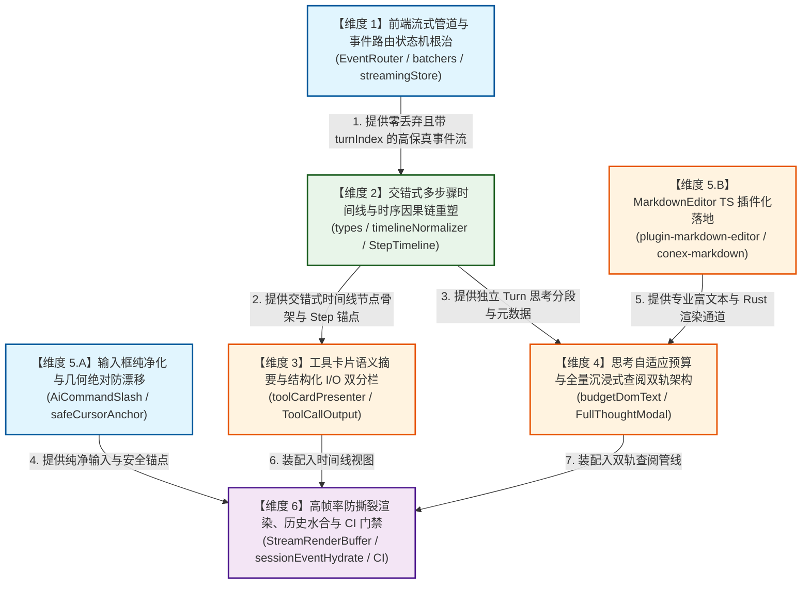

# 02-流式管道与交互体验视角维度划分建议（权威建议书）

> **【报告标识】**：`docs/system-audit-and-redesign/dimension-proposals/02-流式管道与交互体验视角维度划分建议.md`
> **【分析师角色】**：【子Agent B: 流式管道与交互体验视角维度划分分析师】
> **【前置权威遵循】**：
>
> - `docs/system-audit-and-redesign/00-战役通则与协同执行规范.md`（纯逻辑反退避、问题同权、pwsh7、UTF-8 无 BOM、只读代码写文档、主控独占 Git 提交权）
> - `ANTI_OVERENGINEERING_GUARDRAILS.md`（反过度设计硬性红线）
> - `AGENTS.md` & `LOGIC_PLAN_NO_RETREAT.md`（效果锁、禁止退避裁判、测试资产保护）
> - `docs/system-audit-and-redesign/analysis/` 15 份专题分析报告（重点聚焦 02、03、06、08、09、10，并融合 01、07、11、12、13、14、15 架构全景）

---

## 目录（Table of Contents）

1. [执行摘要与视角定位（Executive Summary & Perspective Declaration）](#一执行摘要与视角定位)
2. [维度划分总览清单（Dimension Proposal Summary Matrix）](#二维度划分总览清单)
3. [维度逐一详尽分解（Detailed Dimension Breakdown）](#三维度逐一详尽分解)
   - [维度 1：前端流式管道与事件路由状态机根治（Streaming Pipeline & EventRouter）](#31-维度-1前端流式管道与事件路由状态机根治)
   - [维度 2：交错式多步骤时间线与时序因果链重塑（Interleaved Step Timeline & CoT）](#32-维度-2交错式多步骤时间线与时序因果链重塑)
   - [维度 3：工具卡片语义化摘要与输入输出结构化分栏重构（Tool Presentation & Structured I/O）](#33-维度-3工具卡片语义化摘要与输入输出结构化分栏重构)
   - [维度 4：思考深度自适应预算与全量沉浸式查阅双轨架构（Adaptive Thinking Budget & Full Thought Inspector）](#34-维度-4思考深度自适应预算与全量沉浸式查阅双轨架构)
   - [维度 5：聊天提示框纯净化、几何绝对防漂移与 MarkdownEditor TS 插件化落地（Composer Purification & Editor Plugin）](#35-维度-5聊天提示框纯净化几何绝对防漂移与-markdowneditor-ts-插件化落地)
   - [维度 6：流式高帧率防撕裂渲染、性能门禁与高保真会话水合（High-FPS Anti-Tear Pipeline & Zero-Loss Hydration）](#36-维度-6流式高帧率防撕裂渲染性能门禁与高保真会话水合)
4. [纯逻辑依赖拓扑与推荐执行顺序（Pure Logical Dependency & Execution Topology）](#四纯逻辑依赖拓扑与推荐执行顺序)
5. [跨维度架构不变性与反过度设计自检（Architectural Invariants & Guardrails）](#五跨维度架构不变性与反过度设计自检)
6. [质量门禁、测试断言与真实 CDP 验收矩阵（Quality Gates & CDP Validation Matrix）](#六质量门禁测试断言与真实-cdp-验收矩阵)

---

## 一、执行摘要与视角定位

### 1.1 视角定位与核心宗旨

作为【流式管道与交互体验视角维度划分分析师】，本建议书从**前端流式事件接入、高频状态机投影、时序因果时间线建模、长程深度思考查阅、开发者级工具卡片呈现与极简纯净输入体验**的系统级链路出发，对全系统重构提出独立划分建议。

我们的核心目标是**终结黑盒体验与结构倒退**，将 Conex / Crish 桌面端打造为具有现代顶级 Agent（如 Claude Computer Use, Gemini 2.5 Pro, Cursor Composer, Windsurf Flow）般丝滑、透明、严谨且高保真的下一代智能协作工作台。

```
┌────────────────────────────────────────────────────────────────────────────────────────────────────────┐
│                              流式管道与交互体验全链路端到端全景图                                      │
│                                                                                                        │
│  [Rust 内核事件总线]                                                                                    │
│        │                                                                                               │
│        ▼ (Tauri IPC 实时轨 / 收口轨)                                                                   │
│  ┌──────────────────────────────────────────────────────────────────────────────────────────────────┐  │
│  │ 维度 1: 前端流式管道与事件路由状态机 (EventRouter, messageHandlers, triple batchers, streamingStore)│  │
│  └───────────────────────────────────┬──────────────────────────────────────────────────────────────┘  │
│                                      │ (高保真、零丢弃、带 turnIndex 的结构化事件流)                    │
│                                      ▼                                                                 │
│  ┌──────────────────────────────────────────────────────────────────────────────────────────────────┐  │
│  │ 维度 2: 交错式多步骤时间线核心引擎 (SessionMessage.blocks, timelineNormalizer, StepTimelineItem)  │  │
│  └───────────────────┬──────────────────────────────────────────────┬───────────────────────────────┘  │
│                      │                                              │                                  │
│                      ▼                                              ▼                                  │
│  ┌────────────────────────────────────────┐   ┌─────────────────────────────────────────────────────┐  │
│  │ 维度 3: 工具摘要与结构化 I/O 双分栏    │   │ 维度 4: 思考自适应预算与全量沉浸式查阅双轨架构       │  │
│  │ (toolCardPresenter, ToolCallOutput)    │   │ (budgetDomText, FadeOverlay, FullThoughtModal)      │  │
│  └───────────────────┬────────────────────┘   └─────────────────────┬───────────────────────────────┘  │
│                      │                                              │                                  │
│                      └──────────────────────┬───────────────────────┘                                  │
│                                             │ (装配至交互视口)                                         │
│                                             ▼                                                          │
│  ┌──────────────────────────────────────────────────────────────────────────────────────────────────┐  │
│  │ 维度 5: 聊天输入框纯净化、几何绝对锁定与 MarkdownEditor 插件化 (AiCommandSlash, safeCursorAnchor) │  │
│  └───────────────────────────────────┬──────────────────────────────────────────────────────────────┘  │
│                                      │ (端到端组装与渲染保护)                                          │
│                                      ▼                                                                 │
│  ┌──────────────────────────────────────────────────────────────────────────────────────────────────┐  │
│  │ 维度 6: 防撕裂流式渲染、虚拟滚动联动、无损历史水合与 CI/CD 门禁保障                              │  │
│  └──────────────────────────────────────────────────────────────────────────────────────────────────┘  │
└────────────────────────────────────────────────────────────────────────────────────────────────────────┘
```

### 1.2 用户核心痛点回顾与系统性根除承诺

1. **思考首字碎片化（"TheTheThe..."）** ➔ 根除 `EventRouter.ts` 无 `sequence` 去重键冲突，彻底放行实时增量；
2. **多轮思考与工具中途完全不可见** ➔ 根治 Rust 双轨滞留与前端 `isThinkingMsg` 突变折叠断崖，建立交错多步骤实时推进机制；
3. **首个正文 Token 到达时思考被误杀清空** ➔ 根除 `streamExecutionHelper.ts` 盲目 drop 思考批缓冲与抹平 `sessionStore`；
4. **思考 4000 字一刀切硬截断与死胡同** ➔ 建立行内自适应弹性视口 + 全量 Markdown 富文本沉浸式查阅器双轨架构；
5. **工具卡片标题简陋粗暴且 JSON 逃逸（`浏览 {}`, `处理 .`, `运行命令`, `处理 {"action":"status"}`）** ➔ 构建四道安全防线的语义化提取引擎；
6. **工具卡片展开后输入输出混杂一团** ➔ 重构为【输入参数 CLI / Key-Value 表格】与【输出结果 Stderr / Stdout 分栏】结构化容器；
7. **输入框混入博客排版命令且斜杠弹窗飞到屏幕左上角 `(0, 0)`** ➔ 拔除 H1/H2/H3 命令，重塑 AI 元指令，采用四级几何防护网绝对锁定光标正上方 8px；
8. **专业富文本编辑器深埋孤立目录** ➔ 将 `reference/markdown-editor` 插件化封装为标准 `@crish/plugin-markdown-editor` 并对接 Rust `conex-markdown`。

---

## 二、维度划分总览清单

遵循“高内聚、低耦合、单向数据流、可独立编译验证”的软件工程架构法则，本建议书将全系统涉及流式管道与交互体验的修复工作**划分为 6 个正交维度**。所有问题一律同权，无业务轻重之分：

| 维度编号   | 维度名称 (Dimension Name)                                        | 核心定位与职责边界                                                                                                                              | 核心涉及文件域 (Key File Domains)                                                                                                                                                   |
| :--------- | :--------------------------------------------------------------- | :---------------------------------------------------------------------------------------------------------------------------------------------- | :---------------------------------------------------------------------------------------------------------------------------------------------------------------------------------- |
| **DIM-01** | **前端流式管道与事件路由状态机根治**                             | 彻底修复 IPC 事件去重、路由分发、三路批缓冲协同与流式 Store 响应机制，根除 Token 误杀与思考清空。                                               | `EventRouter.ts`, `streamExecutionHelper.ts`, `useStreamBatchers.ts`, `streamingStore.ts`, `messageHandlers.ts`, `toolHandlers.ts`                                                  |
| **DIM-02** | **交错式多步骤时间线与时序因果链重塑**                           | 扩展数据契约与时间线规范化器，支持 `thought` 一等公民块与按 `turnIndex` 交错分段，彻底根除“思考置顶、正文居中、工具垫底”的结构倒退。            | `store/types.ts`, `toolPresentationTypes.ts`, `timelineNormalizer.ts`, `sessionMessageActions.ts`, `ChatAssistantMessageRow.tsx`, `MessageContent.tsx`                              |
| **DIM-03** | **工具卡片语义化摘要与输入/输出结构化分栏重构**                  | 建立全领域工具精准中文语义标题提取引擎，彻底拦截 JSON 逃逸，构建输入（CLI/KV）与输出（Stdout/Stderr/Diff）清晰分区的两段式卡片。                | `toolCardPresenter.ts`, `ToolCallOutput.tsx`, `CompactToolRow.tsx`, `ToolCallHeader.tsx`, `ChatToolCallBlock.tsx`, `ChatToolCallBlock.module.css`                                   |
| **DIM-04** | **思考深度自适应预算与全量沉浸式查阅双轨架构**                   | 突破 4000 字符死胡同，实现行内弹性视口与平滑追尾滚动，开发全量 Markdown 沉浸式大屏查阅模态窗与工作区检查器（带 TOC 与全文检索）。               | `messageWindowDomBudget.ts`, `MessageThinkingSection.tsx`, `FullThoughtModal.tsx`, `ThoughtOutline.tsx`, `ThoughtSearchBar.tsx`, `thoughtInspectorStore.ts`, `AppGlobalDialogs.tsx` |
| **DIM-05** | **聊天提示框纯净化、几何绝对防漂移与 MarkdownEditor 插件化落地** | 彻底剥离 ChatComposer 博客排版命令并重塑 AI 指令，根除 `(0, 0)` 坐标塌陷；将专业编辑器封装为 `@crish/plugin-markdown-editor` 并对接 Rust 后端。 | `SlashExtension.ts`, `AiCommandSlashExtension.ts`, `safeCursorAnchor.ts`, `TiptapSlashMenu.tsx`, `reference/markdown-editor/`, `crates/conex-markdown/`                             |
| **DIM-06** | **流式高帧率防撕裂渲染、性能门禁与高保真会话水合**               | 建立单帧 6ms/8192 字符 rAF 帧预算控制、Unicode Grapheme 截断、Timeline 签名缓存、历史事件水合与 CI 分级行数自动化门禁。                         | `StreamRenderBuffer.ts`, `sessionEventHydrate.ts`, `streamMessageViewModel.ts`, `VirtualScrollManager.ts`, `scripts/check-line-counts.mjs`, `EventRouter.test.ts`                   |

---

## 三、维度逐一详尽分解

### 3.1 维度 1：前端流式管道与事件路由状态机根治

#### 3.1.1 解决的具体缺陷

1. **实时轨事件去重键计算冲突（"TheTheThe..." 根因）**：修复 `EventRouter.ts` 在 `raw.sequence` 为空时将 `message-delta` 降级为 `${type}:${messageId}` 导致的后续 Token 全部静默丢弃问题；
2. **多轮工具事件误杀**：修复 `tool-start` / `tool-end` 未按 `toolId` 去重导致第 2..19 个工具事件全部被 DROP 的致命缺陷；
3. **多轮轮次与收口事件误杀**：修复 `turn-start` / `turn-end` / `message-end` 缺失 `turnIndex` 导致的后续轮次收口失效；
4. **正文首帧到达时思考被盲目抹杀**：修复 `streamExecutionHelper.ts` 中 `handleThinkingResetOnChunk` 读取未同步的 `sessionStore` 误判初始占位符，进而执行 `thinkingBatcher.drop()` 并将思考置空的严重 bug；
5. **三重并发缓冲（Text / Thought / Tool）生命周期断层**：统一 `StreamRenderBuffer`（rAF 6ms）、`StreamTextBatcher`（48ms leading-edge）与 `StreamValueBatcher`（48ms/0ms immediate），确保在会话切换与窗口卸载时 100% 内存安全与数据落盘。

#### 3.1.2 核心涉及文件域

- `apps/crish-desktop/src/api/chat-bridge/EventRouter.ts`
- `apps/crish-desktop/src/api/chat-bridge/EventRouter.test.ts`
- `apps/crish-desktop/src/api/chat-bridge/handlers/eventParser.ts`
- `apps/crish-desktop/src/api/chat-bridge/handlers/messageHandlers.ts`
- `apps/crish-desktop/src/api/chat-bridge/handlers/toolHandlers.ts`
- `apps/crish-desktop/src/hooks/chat-stream/streamExecutionHelper.ts`
- `apps/crish-desktop/src/hooks/chat-stream/streamCallbacksInternals.ts`
- `apps/crish-desktop/src/hooks/chat-stream/useStreamBatchers.ts`
- `apps/crish-desktop/src/store/streamingStore.ts`

#### 3.1.3 核心重构设计蓝图

```typescript
// EventRouter.ts: 建立防御性 Dedupe Key 决策引擎
export function buildEventDedupeKey(
  envelope: BridgeEventEnvelope
): string | null {
  const { type, raw } = envelope;
  const seq = raw.sequence;
  const msgId = raw.messageId;

  // 1. 实时流式增量：无 sequence 时必须返回 null，绝对放行所有 chunk
  if (type === 'message-delta') {
    return seq != null ? `message-delta:${msgId}:${seq}` : null;
  }
  // 2. 工具域事件：必须绑定 toolId，严禁仅按 msgId 去重
  if (type === 'tool-start' || type === 'tool-end' || type === 'tool-update') {
    const toolId = raw.call?.id || raw.toolCallId || raw.id;
    if (!toolId) return null;
    return seq != null ? `${type}:${toolId}:${seq}` : `${type}:${toolId}`;
  }
  // 3. 轮次与收口事件：必须绑定 turnIndex
  if (type === 'turn-start' || type === 'turn-end' || type === 'message-end') {
    const turnIdx = raw.turnIndex ?? raw.turn_index ?? 0;
    return seq != null
      ? `${type}:${msgId}:${turnIdx}:${seq}`
      : `${type}:${msgId}:${turnIdx}`;
  }
  // 4. 终态事件与审批流
  if (type === 'run-terminal')
    return seq != null ? `run-terminal:${seq}` : 'run-terminal';
  if (type === 'approval-requested' || type === 'approval-resolved') {
    const callId = raw.toolCallId || raw.id;
    return seq != null ? `${type}:${callId}:${seq}` : `${type}:${callId}`;
  }
  return null;
}
```

```typescript
// streamExecutionHelper.ts: 安全的思考重置检查（结合 streamingStore 与真实字数）
export function handleThinkingResetOnChunk(
  sid: string,
  assistantMsgId: string,
  thinkingBatcher: StreamTextBatcher | null | undefined
): void {
  const storeKey = streamBatchKey(sid, assistantMsgId);
  const liveThinking = useStreamingStore.getState().byKey[storeKey]?.thinking;

  // 仅当 streamingStore 与 sessionStore 均无实质思考内容（字数 <= 0 或为纯占位符）时，才允许清除
  const hasRealThinking =
    liveThinking &&
    liveThinking.trim().length > 0 &&
    liveThinking !== '正在处理…' &&
    liveThinking !== '正在思考中...';
  if (hasRealThinking) {
    // 保护真实思考流，严禁 drop 批合并器！
    return;
  }

  const cur = getSessionById(sid)?.messages?.find(
    (m) => m.id === assistantMsgId
  );
  if (cur?.thinking === '正在处理…' || cur?.thinking === '正在思考中...') {
    thinkingBatcher?.drop(storeKey);
    getCompositionRoot()
      .layout.getState()
      .updateMessageThinking(sid, assistantMsgId, '');
  }
}
```

---

### 3.2 维度 2：交错式多步骤时间线与时序因果链重塑

#### 3.2.1 解决的具体缺陷

1. **数据契约层剥夺 `thought` 资格**：扩展 `MessageTimelineBlockType` 与 `AssistantTimelineItem`，将 `thought` 列为一等公民；
2. **多轮思考被换行符暴力拼接**：重构 `messageHandlers.ts`，不再将多轮思考塞入单一顶层字符串，而是按 `turnIndex` 独立记录思考分段（`thinkingTurns` 与 `blocks` 中的独立 `thought` 节点）；
3. **`timelineNormalizer.ts` 主动丢弃 `thought` 块**：重构 `buildAssistantTimeline` 算法，在遍历 `blocks` 时精确识别并保留 `thought`、`text`、`tool_call` 的时序交错拓扑；
4. **`ChatAssistantMessageRow.tsx` 顶层物理置顶割裂**：彻底拆除 Row 组件最顶部的硬编码 `<MessageThinkingBlock>`，将其下沉至 `MessageContent.tsx` 的交错时间线流中渲染；
5. **运行中步骤与历史步骤的状态机自适应**：实现当前活跃步骤（Active Turn）默认自动展开打字机视口与计时器，历史步骤（Historic Turns）在完成后优雅自动收起为紧凑胶囊条（带耗时与字数徽标）。

#### 3.2.2 核心涉及文件域

- `apps/crish-desktop/src/store/types.ts`
- `apps/crish-desktop/src/api/tool-presentation/toolPresentationTypes.ts`
- `apps/crish-desktop/src/api/tool-presentation/timelineNormalizer.ts`
- `apps/crish-desktop/src/api/tool-presentation/timelineNormalizer.test.ts`
- `apps/crish-desktop/src/store/sessionMessageActions.ts`
- `apps/crish-desktop/src/components/chat-message-row/ChatAssistantMessageRow.tsx`
- `apps/crish-desktop/src/components/chat-message/MessageContent.tsx`
- `apps/crish-desktop/src/components/chat-message/StepTimelineSection.tsx`（新增）

#### 3.2.3 核心重构设计蓝图

```
【交错多步骤时间线模型（Interleaved CoT Timeline Model）】

 [Turn 0: 探索阶段]
  ├── 💭 StepThinkingBlock (turnIndex=0, duration=1.4s, chars=350) ──► 自动折叠胶囊
  ├── 💬 Pre-Tool Text (可选解释文本)
  └── 🔧 ToolRenderItem (list_dir ➔ 成功)

 [Turn 1: 分析与诊断]
  ├── 💭 StepThinkingBlock (turnIndex=1, duration=2.1s, chars=520) ──► 自动折叠胶囊
  └── 🔧 ToolRenderItem (grep_search ➔ 命中 3 处)

 [Turn 2: 实施与修改]
  ├── 💭 StepThinkingBlock (turnIndex=2, duration=0.8s, chars=180) ──► 自动折叠胶囊
  └── 🔧 ToolRenderItem (replace_file_content ➔ 成功)

 [Turn 3: 最终收尾 (Active / Final)]
  ├── 💭 StepThinkingBlock (turnIndex=3, isLive=true) ───────────────► 活跃展开打字
  └── 💬 Final Answer Text (最终交付的完整 Markdown 内容) ──────────► 永久完整展开
```

```typescript
// store/types.ts: 全新增强数据契约
export type MessageTimelineBlockType =
  'thought' | 'text' | 'tool_call' | 'image' | 'step_start' | 'step_end';

export interface MessageTimelineBlock {
  type: MessageTimelineBlockType;
  id?: string;
  content?: string;
  turnIndex?: number;
  thoughtMeta?: {
    turnIndex?: number;
    durationMs?: number;
    isLive?: boolean;
    redacted?: boolean;
  };
  images?: MessageImageRef[];
}
```

```typescript
// timelineNormalizer.ts: 支持 thought 的高保真交错算法
export function buildAssistantTimeline(
  msg: SessionMessage
): AssistantTimelineItem[] {
  const tools = msg.toolCalls || [];
  const toolsById = new Map(tools.map((t) => [t.id, t]));
  const blocks = msg.blocks || [];
  const items: AssistantTimelineItem[] = [];
  let toolBuf: MessageToolCall[] = [];
  let ti = 0,
    xi = 0,
    thi = 0;

  const flushTools = () => {
    if (!toolBuf.length) return;
    const rendered = buildToolRenderItems(toolBuf);
    if (rendered.length) {
      items.push({ kind: 'tools', items: rendered, key: `tools-${ti++}` });
    }
    toolBuf = [];
  };

  for (const b of blocks) {
    if (b.type === 'thought') {
      flushTools();
      if ((b.content || '').trim()) {
        items.push({
          kind: 'thought',
          content: b.content || '',
          id: b.id,
          turnIndex: b.thoughtMeta?.turnIndex ?? b.turnIndex,
          durationMs: b.thoughtMeta?.durationMs,
          isLive: b.thoughtMeta?.isLive,
          key: `thought-${b.id || thi++}`,
        });
      }
    } else if (b.type === 'text') {
      flushTools();
      if ((b.content || '').trim()) {
        items.push({
          kind: 'text',
          content: b.content || '',
          key: `text-${xi++}`,
        });
      }
    } else if (b.type === 'tool_call' && b.id) {
      const tc = toolsById.get(b.id);
      if (tc) toolBuf.push(tc);
    }
  }
  flushTools();
  return items;
}
```

---

### 3.3 维度 3：工具卡片语义化摘要与输入/输出结构化分栏重构

#### 3.3.1 解决的具体缺陷

1. **JSON 参数逃逸与糟糕标题彻底根除**：
   - 彻底修复 `extractToolCommand` 仅识别 13 个键的缺陷，支持 PascalCase（`CommandLine`、`AbsolutePath`、`TargetFile`、`SearchPath`、`Action`、`TaskId`）与 snake_case 全量键集；
   - 消除 `浏览 {}`、`处理 .`、`运行命令`、`处理 {"action":"status"}` 等拙劣标题，建立四道安全防线与 `sanitizeHumanLabel` 清洗锁；
2. **展开内容输入输出混杂**：
   - 彻底废除仅针对 Shell 渲染一行代码、非 Shell 工具完全不显示入参的落后实现；
   - 构建清晰的【输入区（Input Section）】与【输出区（Output Section）】结构化分栏；
3. **运行期工具卡片黑盒（`isToolRowDefaultOpen` 恒为 false）**：
   - 引入运行期实时透视模式（Live Inspector），运行中长耗时命令（如编译测试、文件遍历）默认展开输入命令并实时输出 stdout 流；
4. **开发者交互能力补齐**：
   - 输入区提供一键复制命令/参数、工作目录展示；
   - 输出区提供状态徽标（Exit 0 / Error）、耗时、行数、一键复制完整输出、超长折叠与 Diff 代码差异视图。

#### 3.3.2 核心涉及文件域

- `apps/crish-desktop/src/api/tool-presentation/toolCardPresenter.ts`
- `apps/crish-desktop/src/api/tool-presentation/toolCardPresenter.test.ts`
- `apps/crish-desktop/src/components/chat-tool-call/CompactToolRow.tsx`
- `apps/crish-desktop/src/components/chat-tool-call/ToolCallOutput.tsx`
- `apps/crish-desktop/src/components/chat-tool-call/ToolCallHeader.tsx`
- `apps/crish-desktop/src/components/chat-tool-call/ChatToolCallBlock.tsx`
- `apps/crish-desktop/src/components/chat-tool-call/ChatToolCallBlock.module.css`
- `apps/crish-desktop/src/components/chat-tool-call/chatToolCallUtils.ts`

#### 3.3.3 核心重构设计蓝图

```
┌────────────────────────────────────────────────────────────────────────────────────────┐
│ 🟢 下一代两段式结构化工具卡片展开容器 (Structured Dual-Section ToolCard)               │
├────────────────────────────────────────────────────────────────────────────────────────┤
│                                                                                        │
│  ┌─ 【输入分区】Section: Input / Parameters ─────────────────────────────────────────┐  │
│  │ ┌──────────────────────────────────────────────────────────────────────────────┐ │  │
│  │ │ 📥 输入 (Input) · 运行命令                       [📋 复制命令] [⚙️ 原始参数]   │ │  │
│  │ └──────────────────────────────────────────────────────────────────────────────┘ │  │
│  │  ┌────────────────────────────────────────────────────────────────────────────┐  │ │
│  │  │ $ npm run test:coverage -- --project=unit                                  │  │ │
│  │  │ CWD: c:/Software/conex                                                     │  │ │
│  │  └────────────────────────────────────────────────────────────────────────────┘  │ │
│  └───────────────────────────────────────────────────────────────────────────────────┘  │
│                                                                                        │
│  ┌─ 【输出分区】Section: Output / Results ────────────────────────────────────────────┐  │
│  │ ┌──────────────────────────────────────────────────────────────────────────────┐ │  │
│  │ │ 📤 输出 (Output) · 成功 (Exit 0) · 1.4s · 32 行          [📋 复制结果]        │ │  │
│  │ └──────────────────────────────────────────────────────────────────────────────┘ │  │
│  │  ┌────────────────────────────────────────────────────────────────────────────┐  │ │
│  │  │ ✓ tests/unit/timelineNormalizer.test.ts (6 tests) 12ms                     │  │ │
│  │  │ ✓ tests/unit/toolCardPresenter.test.ts (24 tests) 45ms                     │  │ │
│  │  │ Test Files  2 passed (2)                                                   │  │ │
│  │  │ Tests       30 passed (30)                                                 │  │ │
│  │  └────────────────────────────────────────────────────────────────────────────┘  │ │
│  └───────────────────────────────────────────────────────────────────────────────────┘  │
│                                                                                        │
└────────────────────────────────────────────────────────────────────────────────────────┘
```

```typescript
// toolCardPresenter.ts: 全工具类别精准语义映射核心逻辑
export function generateToolHumanSummary(tc: MessageToolCall): string {
  const norm = normalizeToolArguments(tc.arguments);
  const name = (tc.name || '').toLowerCase();

  // 1. Shell 终端执行
  if (isShellToolName(name)) {
    const cmd =
      norm.CommandLine || norm.command || norm.cmd || norm.script || '';
    return humanizeShellAction(cmd);
  }
  // 2. 文件读取与查看
  if (name === 'read_file' || name === 'view_file') {
    const file = getFilename(
      norm.AbsolutePath || norm.path || norm.target_file || ''
    );
    const range = norm.StartLine
      ? ` (L${norm.StartLine}-${norm.EndLine || '末尾'})`
      : '';
    return `查看 ${file}${range}`;
  }
  // 3. 文件写入与修改
  if (name === 'write_file' || name === 'write_to_file') {
    return `创建/写入 ${getFilename(norm.TargetFile || norm.path || '')}`;
  }
  if (name === 'replace_file_content' || name === 'edit_file') {
    return `修改 ${getFilename(norm.TargetFile || norm.path || '')}`;
  }
  // 4. 目录检索
  if (name === 'list_dir' || name === 'list_directory') {
    const p = norm.DirectoryPath || norm.path || '';
    return !p || p === '.' || p === './'
      ? '列出当前目录'
      : `列出目录 ${basename(p)}`;
  }
  // 5. 任务管理
  if (name === 'manage_task' || name === 'background_task') {
    const actionMap: Record<string, string> = {
      status: '查询状态',
      list: '查询任务列表',
      kill: '终止任务',
      send_input: '发送输入',
    };
    const act = actionMap[norm.Action || norm.action || 'status'] || '管理任务';
    const tid = norm.TaskId || norm.taskId || '';
    return tid ? `${act} (${tid})` : act;
  }
  // 6. 安全清洗锁兜底
  return sanitizeHumanLabel(fallbackTitle(tc), tc.name);
}
```

---

### 3.4 维度 4：思考深度自适应预算与全量沉浸式查阅双轨架构

#### 3.4.1 解决的具体缺陷

1. **4000 字符硬切断与 `... (已截断)` 死胡同**：
   - 彻底废除 `THINKING_DOM_CHAR_CAP = 4000` 的一刀切策略；
   - 建立双轨解耦架构（Dual-Track Architecture）：**轨道 A（行内弹性视口）** 与 **轨道 B（全量沉浸式查阅器）**；
2. **流式超长思考中途假死**：
   - 优化 `useLayoutEffect` 追尾滚动，在流式期间支持全量平滑追尾，不因字符超标而卡滞在第 4000 字处；
3. **行内阅读体验提升**：
   - 行内视口设为自适应高度（`max-height: 280px ~ 420px`），尾部配备优雅的「渐变遮罩（Fade Overlay）+ 行内操作条（Action Strip）」，清晰呈现字数统计并提供「查看完整思考链」按钮；
4. **全量沉浸式查阅器（Full Thought Modal & Inspector）**：
   - 支持居中大屏模态弹窗与右侧工作区检查器双形态；
   - 接入 Rust `markdownRenderAsync` 异步排版管道，提供全量 Markdown 富文本解析、代码块语法高亮；
   - 配备**自动提取的思考大纲目录（TOC Navigator）**、**全文关键词检索与高亮（In-Thought Search）**、**元信息看板**与**一键无损复制/导出**。

#### 3.4.2 核心涉及文件域

- `apps/crish-desktop/src/api/messageWindowDomBudget.ts`
- `apps/crish-desktop/src/components/chat-message-row/MessageThinkingSection.tsx`
- `apps/crish-desktop/src/components/chat-message-row/ChatMessageRow.module.css`
- `apps/crish-desktop/src/components/chat-message/MessageThinkingBlock.tsx`
- `apps/crish-desktop/src/components/chat-message/FullThoughtModal.tsx`（新增）
- `apps/crish-desktop/src/components/chat-message/FullThoughtModal.module.css`（新增）
- `apps/crish-desktop/src/components/chat-message/ThoughtOutline.tsx`（新增）
- `apps/crish-desktop/src/components/chat-message/ThoughtSearchBar.tsx`（新增）
- `apps/crish-desktop/src/store/thoughtInspectorStore.ts`（新增）
- `apps/crish-desktop/src/app/AppGlobalDialogs.tsx`

#### 3.4.3 核心重构设计蓝图

````
┌────────────────────────────────────────────────────────────────────────────────────────┐
│ 🟢 双轨架构一：行内弹性视口与悬浮操作条 (Inline Adaptive Viewport)                    │
├────────────────────────────────────────────────────────────────────────────────────────┤
│ 💭 思考过程 (3.2s)                                                                     │
│ ┌────────────────────────────────────────────────────────────────────────────────────┐ │
│ │ 1. 深度分析系统架构依赖，定位到 EventRouter.ts 与 timelineNormalizer.ts...          │ │
│ │ 2. 检查数据契约中的 MessageTimelineBlock，发现缺少 thought 类型定义...              │ │
│ │ 3. 开始构建双轨思考查阅模型，将行内预算与弹窗查阅彻底解耦...                        │ │
│ │ ░░░░░░░░░░░░░░░░░░░░░░░░░░░░░░░░░░░░░░░░░░░░░░░░░░░░░░░░░░░░░░░░░░░░░░ (渐变遮罩) │ │
│ └────────────────────────────────────────────────────────────────────────────────────┘ │
│   [ 🔍 查看完整思考链 (共 18,420 字 · 含 12 个标题大纲) ]    [ 📋 复制全部思考 ]        │
└────────────────────────────────────────────────────────────────────────────────────────┘

                                           │ 点击触发
                                           ▼
┌────────────────────────────────────────────────────────────────────────────────────────┐
│ 🟢 双轨架构二：全量沉浸式查阅器 (Full Thought Modal / Side Inspector)                  │
├────────────────────────────────────────────────────────────────────────────────────────┤
│ 🧠 深度推理思维链 · 全量检查器                   [🔍 搜索] [📋 复制] [📥 导出] [✖ 关闭]│
├─────────────────────────┬──────────────────────────────────────────────────────────────┤
│ 📑 大纲目录 (TOC)       │ 📝 思考全文 (Rust 异步渲染 Markdown 富文本 + 语法高亮)       │
│                         │                                                              │
│ ▾ 1. 架构问题识别       │ # 1. 架构问题识别                                            │
│   • 1.1 根因拓扑分析    │ 经过逐行追踪，我们发现前端去重键在实时轨无 sequence 时...     │
│   • 1.2 思考误清根因    │                                                              │
│ ▾ 2. 修复方案推导       │ ```typescript                                                │
│   • 2.1 数据契约扩展    │ export interface MessageTimelineBlock {                      │
│   • 2.2 双轨管道建立    │   type: 'thought' | 'text' | 'tool_call';                    │
│ ▾ 3. 验收与断言矩阵     │ }                                                            │
│                         │ ```                                                          │
└─────────────────────────┴──────────────────────────────────────────────────────────────┘
````

---

### 3.5 维度 5：聊天提示框纯净化、几何绝对防漂移与 MarkdownEditor TS 插件化落地

#### 3.5.1 解决的具体缺陷

1. **聊天提示词输入框（ChatComposer）与文档排版职能混淆**：
   - 彻底从 `SlashExtension.ts` 中拔除 `Heading 1/2/3`, `Bullet List`, `Task List`, `Blockquote` 等 Notion 类文章排版命令；
   - 聊天框键入 `/` 仅触发 AI 系统元指令（`/goal`, `/clear`, `/compact`, `/schedule`, `/learn`, `/grill-me`, `/teamwork`, `/browser`, `/settings`, `/help`）以及动态 `/skill:*`；
2. **斜杠菜单弹出坐标 `(0, 0)` 屏幕左上角塌陷漂移**：
   - 根除 `measureCursorLineBox` 异常返回 `DOMRect(0,0,0,0)` 被误判为合法坐标的数学漏洞；
   - 构建四级几何防线探测器（`SafeAnchorGeometryEngine`），确保弹层绝对锁定在输入框光标正上方 `8px`，全零坐标下严禁挂载 Portal；
3. **专业富文本 Markdown 编辑器单体孤岛化**：
   - 将 `reference/markdown-editor/` 与 `note-paper` 规范封装为官方标准 TypeScript 插件 `@crish/plugin-markdown-editor`；
   - 遵循 `packages/plugin-sdk/` 契约，支持在右坞（RightToolDock）与标签页（UnitSessionTabStrip）中按需挂载；
   - 深度集成 Rust `crates/conex-markdown`，实现单条/批量渲染、代码高亮与 HTML 净化的后端服务化支持。

#### 3.5.2 核心涉及文件域

- `apps/crish-desktop/src/components/chat-composer/SlashExtension.ts`
- `apps/crish-desktop/src/components/chat-composer/AiCommandSlashExtension.ts`（新增）
- `apps/crish-desktop/src/components/chat-composer/safeCursorAnchor.ts`（新增）
- `apps/crish-desktop/src/components/chat-composer/TiptapSlashMenu.tsx`
- `apps/crish-desktop/src/components/chat-composer/ChatComposer.tsx`
- `packages/plugin-sdk/src/` & `reference/markdown-editor/`
- `packages/plugin-markdown-editor/`（新增插件包）
- `apps/crish-desktop/src/components/note-paper/`
- `crates/conex-markdown/`
- `apps/agent-workbench/src-tauri/src/markdown_commands.rs`

#### 3.5.3 核心重构设计蓝图

```typescript
// safeCursorAnchor.ts: 四级几何降级绝对锁定引擎
export function calculateSafeCursorAnchor(editor: Editor): AnchorRect {
  // 防线 1: ProseMirror 真实光标 LineBox
  const cursorCoords = editor.view.coordsAtPos(editor.state.selection.from);
  if (isNonZeroVisibleRect(cursorCoords)) {
    return {
      top: cursorCoords.top - 8,
      left: cursorCoords.left,
      width: 2,
      height: cursorCoords.bottom - cursorCoords.top,
    };
  }
  // 防线 2: 编辑器视口活跃 DOM 节点
  const activeDom = editor.view.domAtPos(editor.state.selection.from)
    .node as HTMLElement;
  const activeRect = activeDom?.getBoundingClientRect?.();
  if (isNonZeroVisibleRect(activeRect)) {
    return {
      top: activeRect.top - 8,
      left: activeRect.left,
      width: 2,
      height: 20,
    };
  }
  // 防线 3: 编辑器容器自身 Safe Padding Box
  const editorRect = editor.view.dom.getBoundingClientRect();
  if (isNonZeroVisibleRect(editorRect)) {
    return {
      top: editorRect.top - 8,
      left: editorRect.left + 16,
      width: 2,
      height: 20,
    };
  }
  // 防线 4: 兜底拒挂（返回 null，Portal 拒绝挂载，绝对不传递 0,0）
  return null;
}
```

---

### 3.6 维度 6：流式高帧率防撕裂渲染、性能门禁与高保真会话水合

#### 3.6.1 解决的具体缺陷

1. **高频打字流式帧率抖动与防撕裂**：
   - 完善 `StreamRenderBuffer` 单帧 6ms / 8192 字符预算控制与 Unicode Grapheme 截断，杜绝 Emoji 或汉字双字节乱码；
   - 优化 `buildAssistantTimelineCached` 签名算法，纯文本流式帧仅局部更新末尾 `StreamingTextBlock`，前方历史节点 100% `React.memo` 阻断；
2. **长程会话重放与水合结构倒退**：
   - 彻底修复 `sessionEventHydrate.ts` 在加载历史会话时将多轮交错事件暴力压缩为“所有工具排前、所有正文排后”的降级 bug，使刷新/重载后的历史会话也能完美还原交错步骤；
3. **虚拟滚动列表（VirtualScrollManager）联动**：
   - 在多步骤交错展开/折叠、思考块弹窗展开时，正确通知虚拟列表进行高度重测，彻底根除消息列表跳动与闪烁；
4. **CI 分级行数与质量门禁护航**：
   - 执行分级行数门禁（UI 500 行、业务 400 行、类型 800 行），阻断上帝组件与循环依赖。

#### 3.6.2 核心涉及文件域

- `apps/crish-desktop/src/api/StreamRenderBuffer.ts`
- `apps/crish-desktop/src/api/sessionEventHydrate.ts`
- `apps/crish-desktop/src/hooks/chat-stream/streamMessageViewModel.ts`
- `apps/crish-desktop/src/components/chat-message-list/VirtualScrollManager.ts`
- `scripts/check-line-counts.mjs`
- `apps/crish-desktop/src/api/chat-bridge/EventRouter.test.ts`
- `apps/crish-desktop/src/api/sessionEventHydrate.test.ts`

---

## 四、纯逻辑依赖拓扑与推荐执行顺序

本章节严格基于**数据流单向依赖、自底向上装配、接口先行、无损演进**的纯逻辑原理推导执行拓扑。**不涉及任何工期、人天或业务优先级**。

### 4.1 纯逻辑依赖拓扑图（Mermaid DAG）



### 4.2 逻辑推进阶段与严格推导理由

#### 阶段一：底层流式事件通道与输入框几何锚点固化（基座建设）

- **推进对象**：`DIM-01`（前端流式管道） + `DIM-05.A`（输入框纯净化与几何锁定）
- **逻辑推导理由**：
  1. `DIM-01` 是整个系统交互的“水龙头”。若 `EventRouter` 依然在误杀 Token（"TheTheThe..."）或丢弃工具事件，上层任何时间线与卡片重构都无法接收到真实数据，无法进行有效的端到端验证；
  2. `DIM-05.A` 属于独立的输入交互入口（Input Surface），不依赖消息渲染管线，率先将其净化并锁定坐标，可确保测试过程中的输入操作零干扰。

#### 阶段二：数据契约扩展与交错多步骤时间线引擎（核心骨架）

- **推进对象**：`DIM-02`（交错时间线重构）
- **逻辑推导理由**：
  1. `DIM-02` 依赖 `DIM-01` 提供的完整事件流；
  2. `DIM-02` 扩展了 `MessageTimelineBlock` 与 `timelineNormalizer.ts`，为整个消息流建立了 `thought` ➔ `tools` ➔ `text` 的交错骨架；
  3. 后续的工具卡片分栏（DIM-03）与思考深度查阅（DIM-04）均作为该时间线上的子节点组件挂载。骨架不立，子节点无处安放。

#### 阶段三：工具结构化展示、思考双轨查阅与编辑器插件落地（展示与体验跃迁）

- **推进对象**：`DIM-03`（工具卡片分栏） + `DIM-04`（思考深度查阅） + `DIM-05.B`（MarkdownEditor 插件）
- **逻辑推导理由**：
  1. `DIM-03` 与 `DIM-04` 分别消费 `DIM-02` 时间线中的 `kind: 'tools'` 与 `kind: 'thought'` 节点，可完全并行开发与独立测试；
  2. `DIM-05.B` 将 `reference/markdown-editor` 封装为标准插件，其底层的 `conex-markdown` 异步渲染能力可直接为 `DIM-04` 的全量沉浸式查阅器提供富文本支持。

#### 阶段四：防撕裂渲染收口、历史水合修复与全量门禁封板（系统级闭环）

- **推进对象**：`DIM-06`（防撕裂渲染与历史水合）
- **逻辑推导理由**：
  1. 当所有流式事件、交错节点、工具卡片与思考弹窗全部就位后，必须统一验证高频打字时的 rAF 帧率、内存回收与防撕裂平滑降级；
  2. 验证 `sessionEventHydrate`，确保历史会话与持久化存储能够 100% 高保真还原所有新特性；
  3. 运行全量行数门禁、Vitest 单元测试与 CDP 真实浏览器验收。

---

## 五、跨维度架构不变性与反过度设计自检

全维度必须严格恪守仓库既定架构红线与设计系统规范，严禁任何形式的违规与倒退：

```
┌────────────────────────────────────────────────────────────────────────────────────────────────────────┐
│                              跨维度六大架构不变性守卫 (Architectural Guardrails)                       │
├────────────────────────────────┬───────────────────────────────────────────────────────────────────────┤
│ 1. 反过度设计红线 (Anti-Over)  │ 坚决不引入黑盒沙箱、不引入复杂工具中间件流水线、不引入动态模型路由器。 │
│ 2. 单向数据流 (Single Flux)    │ 流式期间仅更新轻量 plain zustand (streamingStore)，终态一次性写入持久化│
│ 3. O(1) DOM 更新与防重排       │ 历史步骤与卡片 100% React.memo 阻断，流式打字仅局部重绘末尾 TextBlock  │
│ 4. 视觉曲率分级阶梯规范        │ 药丸/徽标: var(--radius-full); 按钮: var(--radius-xl); 容器: 2xl/lg   │
│ 5. 焦点与输入框克制态          │ 激活态禁止深黑边框，文本混入上限 <= 10% (推荐 3%~6%)，Tooltip 统一封装 │
│ 6. 严禁 Git 回撤与作弊         │ 主控独占提交，禁止 reset/rebase，禁止 --no-verify，门禁报错正面根治    │
└────────────────────────────────┴───────────────────────────────────────────────────────────────────────┘
```

---

## 六、质量门禁、测试断言与真实 CDP 验收矩阵

每个维度完成后必须通过相应的单元测试、集成测试与 CDP 机器真值检验，杜绝任何假阴性：

| 维度编号   | 关键自动化测试用例集 (Test Suites)                                                                         | 真实 CDP WebView2 验收断言 (Port 9222)                                                                                    | 验收绿灯标准                                                              |
| :--------- | :--------------------------------------------------------------------------------------------------------- | :------------------------------------------------------------------------------------------------------------------------ | :------------------------------------------------------------------------ |
| **DIM-01** | `EventRouter.test.ts`<br>`useStreamBatchers.test.ts`<br>`streamExecutionHelper.test.ts`                    | 触发 19 轮工具长任务，监视 `window.__CRISH_STREAM_STORE__`，断言无任何 Token 丢弃，思考流持续累加。                       | 所有流式 Token 100% 实时呈现，无 "TheTheThe..."，正文到达时思考不被清空。 |
| **DIM-02** | `timelineNormalizer.test.ts`<br>`StepTimeline.test.tsx`<br>`sessionMessageActions.test.ts`                 | 检查 DOM 树结构：断言助手气泡内存在交错排布的 `[data-block-type="thought"]` 与 `[data-block-type="tool_call"]` 节点。     | 彻底杜绝顶部大单块，展现清晰的因果交错推进节奏。                          |
| **DIM-03** | `toolCardPresenter.test.ts`<br>`ToolCallOutput.test.tsx`<br>`CompactToolRow.test.tsx`                      | 检查工具卡片标题，断言无 `{}`、`[]` 或 `{"action"` 字符；展开卡片，断言存在 `.toolSectionInput` 与 `.toolSectionOutput`。 | 100% 优雅中文标题，输入输出清晰分栏，支持一键复制。                       |
| **DIM-04** | `messageWindowDomBudget.test.ts`<br>`FullThoughtModal.test.tsx`<br>`ThoughtOutline.test.ts`                | 注入 30,000 字符长思考，行内视口平滑追尾；点击「查看完整思考链」，断言大屏模态弹窗挂载且大纲目录可点击跳转。              | 行内弹性不假死，全量查阅器排版精美、搜索大纲毫秒级响应。                  |
| **DIM-05** | `AiCommandSlashExtension.test.ts`<br>`safeCursorAnchor.test.ts`<br>`packages/plugin-markdown-editor/tests` | 在输入框内键入 `/`，CDP 捕获弹出菜单坐标 `top/left > 0` 且绝对位于光标上方 8px；打开 Markdown Tab，验证独立编辑器挂载。   | 彻底拔除 H1/H2/H3，零 (0,0) 漂移，专业编辑器独立可用。                    |
| **DIM-06** | `sessionEventHydrate.test.ts`<br>`scripts/check-line-counts.mjs`<br>`vitest run --coverage`                | 刷新已完成多轮长任务的页面，断言历史交错结构 100% 还原；全量运行 `npm run check:line-counts`。                            | 历史水合无损，行数门禁全绿，测试覆盖率达标。                              |

---

> **【分析师结论】**：
> 本建议书严格遵循纯逻辑规划与反退避铁律，将全系统修复解耦为 **6 大正交维度**。通过清晰的单向数据流与严格的依赖拓扑推进，系统将彻底根除过往的流式黑盒与结构倒退缺陷，构建出极致专业、透明、丝滑的下一代桌面交互体验。
