# 权限沙箱与插件体系视角维度划分建议报告

> **文档定位**：Conex / Crish 全系统综合重构战役维度划分建议案（序号：03）
> **责任分析师**：【子Agent C: 权限沙箱与插件体系视角维度划分分析师】
> **审查与依据资产**：
>
> - `docs/system-audit-and-redesign/00-战役通则与协同执行规范.md`（战役最高执行纪律）
> - `docs/system-audit-and-redesign/analysis/` 全部 15 份专题深度分析报告（特别重点结合 04、07、10、12、15 号专题）
> - 仓库核心代码域：`crates/agent-tools/`、`crates/conex-fs/`、`crates/session-loop/`、`crates/conex-markdown/`、`crates/conex-browser/`、`crates/conex-computer/`、`apps/agent-workbench/`、`apps/crish-desktop/`、`packages/plugin-sdk/`、`reference/markdown-editor/`
>   **核心使命**：从【权限体系极简集中化、工作区沙箱与 Windows 路径规范化、官方 TS 插件解耦体系（MarkdownEditor / Browser / ComputerUse / FollowUp）】的宏观与微观治理视角，独立输出一份严密、正交、纯逻辑演进的全系统综合重构维度划分建议。

---

## 目录（Table of Contents）

1. [执行摘要与顶层架构治理宣言](#一执行摘要与顶层架构治理宣言)
   - 1.1 现状核心病灶总揽：硬沙箱错位、私法设卡、插件内嵌倒置与交互污染
   - 1.2 重构治理的三大铁律支柱
2. [建议拆分的全系统重构维度清单全景](#二建议拆分的全系统重构维度清单全景)
   - 2.1 维度划分拓扑总览表
   - 2.2 维度正交性与内聚性论证
3. [各维度详细实施方案与治理清单（Defects, Purging & Modules）](#三各维度详细实施方案与治理清单)
   - 3.1 维度一：工作区沙箱规范化与 Windows 路径归一底座（Workspace Sandbox & Path Normalizer）
   - 3.2 维度二：统一三档权限引擎与工具输入输出分区分割（Unified Permission Engine & Tool I/O Partitioning）
   - 3.3 维度三：输入框富文本解耦与 MarkdownEditor TS 插件化（ChatComposer Decoupling & MarkdownEditor TS Plugin）
   - 3.4 维度四：Follow-up 行动建议 TS 插件架构与子 Agent 物理隔离（FollowUp TS Plugin & Subagent Isolation）
   - 3.5 维度五：自动化插件化解耦与设置中心数据回归（Browser & Computer-Use TS Plugins & Settings Migration）
   - 3.6 维度六：原生双轨终端与会话自愈状态机（Native ConPTY Dual-Track & Fault-Tolerant ReAct Loop）
   - 3.7 维度七：全系统视觉契约对齐与测试资产质量门禁闭环（Design System Alignment & Quality Gates）
4. [全系统维度纯逻辑依赖顺序与演进因果推导（Logical Dependency Sequencing）](#四全系统维度纯逻辑依赖顺序与演进因果推导)
   - 4.1 纯逻辑演进时序拓扑图
   - 4.2 为什么必须“先沙箱与权限底座，后工具与交互面”？
   - 4.3 为什么 TS 插件体系必须分层渐进接入？
   - 4.4 为什么视觉曲率与门禁验证是最终收敛面？
5. [反过度设计硬性红线与架构纯洁性自检表](#五反过度设计硬性红线与架构纯洁性自检表)
6. [总结与主控调度建议](#六总结与主控调度建议)

---

## 一、执行摘要与顶层架构治理宣言

### 1.1 现状核心病灶总揽

经过对 `docs/system-audit-and-redesign/analysis/` 下全部 15 份专题分析报告的系统级审视，尤其深入研读 04、07、10、12、15 号报告所揭示的底层代码断层，我们发现当前系统的架构失序主要集中在**权限沙箱错位**与**插件内嵌倒置**两大根源性矛盾上：

```
┌────────────────────────────────────────────────────────────────────────────────────────────────────────┐
│                               当前全系统核心架构断层全景拓扑图                                         │
└────────────────────────────────────────────────────────────────────────────────────────────────────────┘

  【断层 1：工作区沙箱错位与 AI 脚本越狱】
  [纯对话无 CWD] ──► 悄悄绑定宿主进程目录 (src-tauri) ──► 文件工具报 tool.path_escape
                          │
                          └─► AI 被迫利用 PowerShell 内联脚本绕过沙箱落盘 ──► 破坏可审计性

  【断层 2：权限体系九龙治水与私法设卡】
  [用户选择完全访问] ──► 顶层放行 ──► 底层 shell.rs / redirect_or_intercept_delete 私设卡点
                                        │
                                        ├─► 复合删除链 (&& rm) 整链拦截
                                        ├─► 间接执行 (pwsh -c) 无差别阻断
                                        └─► 临时文件 (%TEMP%) 跨目录误杀

  【断层 3：输入框与专业排版引擎职责倒置】
  [聊天输入框 ChatComposer] ◄── 侵入 H1/H2/H3/List/Quote 博客排版 ──► 触发 (0,0) 坐标漂移
  [自研高性能 MarkdownEditor] ◄── 沉睡在 reference/ 目录与孤立测试中 ──► 无法在工作区发挥价值

  【断层 4：重型自动化能力内嵌形成丑陋脚手架】
  [开发者 Web 预览 PreviewCard] ◄── 强塞 BrowserPanel + 500行数据导入 + ComputerPanel
                                        │
                                        └─► 抽屉垃圾桶效应，挤压预览视口，界面难看且死锁互斥

  【断层 5：建议生成死板且子 Agent 隔离脆弱】
  [Follow-up 机制] ◄── 纯静态 Mock 启发式 + 8 层 Props 瀑布透传 ──► 子 Agent 卡片缺乏硬隔离
```

### 1.2 重构治理的三大铁律支柱

为了彻底根治上述病灶，本建议案确立三大治理支柱：

1. **底座单一真相源（Single Source of Truth for Security & Workspace）**：
   - 彻底拔除一切隐式 CWD 假定，将工作区显式建模为三态枚举；
   - 统一建立 Windows 路径归一化底座（`ConexPathNormalizer`），彻底根治盘符大小写、`\\?\` UNC 前缀与 NTFS Junction 误杀；
   - 废除工具层内部的私自设卡，确立统一的极简三档权限引擎（`ReadOnly` / `Standard` / `FullAccess`），赋予“完全访问”真正的完全信任执行权。
2. **官方 TypeScript 插件体系解耦（Micro-kernel TS Plugin Architecture）**：
   - 严格遵循 `packages/plugin-sdk/` 契约，将 **MarkdownEditor**、**Browser 自动化**、**Computer Use 电脑操作**、**Follow-up 行动建议** 4 大能力全部解耦为独立的 `@crish/plugin-*` TS 插件；
   - 彻底清除主界面工作区（`PreviewCard` / `ChatComposer`）中生硬内嵌的脚手架代码；数据迁移、凭证导入、环境配置 100% 回归「系统设置中心（Settings Center）」。
3. **视觉契约与交互纯净化（Design System Contracts & Purified Surfaces）**：
   - 聊天输入框回归纯粹的自然语言与 AI 系统元指令（`/goal`, `/clear`, `/compact`, `/schedule` 等），通过几何安全引擎根除 `(0, 0)` 坐标漂移；
   - 工具展开面板实现 **📥 输入区（Input）** 与 **📤 输出区（Output）** 优雅结构化分栏；
   - 自动化操作采用现代轻量悬浮 HUD / 画中画（PiP）与 800ms 平滑人工接管；全系统严格对齐曲率分级规范（9999px / 10px / 12px / 6px），严禁 8px 直角硬边与深黑边框。

---

## 二、建议拆分的全系统重构维度清单全景

基于纯逻辑正交性、模块内聚性与依赖先后次序，建议将后续全系统修复与重构划分为 **7 个高度内聚、正交解耦的专项维度**：

### 2.1 维度划分拓扑总览表

| 维度编号   | 维度名称（中英文）                                                                                        | 核心治理范围与使命                                                                                                                                              | 主要涉及模块（Rust / TS）                                                                                                                                                                                               | 对应解决的审计分析报告                                                                                                                     |
| :--------- | :-------------------------------------------------------------------------------------------------------- | :-------------------------------------------------------------------------------------------------------------------------------------------------------------- | :---------------------------------------------------------------------------------------------------------------------------------------------------------------------------------------------------------------------- | :----------------------------------------------------------------------------------------------------------------------------------------- |
| **维度一** | **工作区沙箱规范化与 Windows 路径归一底座**<br>_(Workspace Sandbox & Path Normalizer)_                    | 显式三态工作区建模、AI 动态提议与授权切换链路、统一 Windows 盘符与 UNC 规范化底座、解禁合法 NTFS Junction                                                       | `crates/conex-fs/`<br>`crates/agent-tools/`<br>`crates/session-loop/`<br>`apps/crish-desktop/src/api/`                                                                                                                  | **04 号报告**（路径越界与盘符规范化）                                                                                                      |
| **维度二** | **统一三档权限引擎与工具输入输出分区分割**<br>_(Unified Permission Engine & Tool I/O Partitioning)_       | 拔除工具私法设卡、赋予完全访问真实权限、收敛极端物理红线、工具调用展开面板 📥 输入区 与 📤 输出区 结构化分栏                                                    | `crates/agent-tools/src/permission.rs`<br>`crates/agent-tools/src/tools/shell.rs`<br>`apps/crish-desktop/src/components/chat-tool-call/`                                                                                | **12 号报告**（权限重构与工具分栏）<br>**06 号报告**（工具摘要与分栏）                                                                     |
| **维度三** | **输入框富文本解耦与 MarkdownEditor TS 插件化**<br>_(ChatComposer Decoupling & MarkdownEditor TS Plugin)_ | 输入框拔除博客排版、重塑 AI 系统元指令、四级降级几何引擎根除 (0,0) 漂移、`@crish/plugin-markdown-editor` 独立封装与多文档 Store 隔离、对接 `conex-markdown`     | `apps/crish-desktop/src/components/chat-composer/`<br>`packages/plugin-sdk/`<br>`reference/markdown-editor/`<br>`crates/conex-markdown/`                                                                                | **10 号报告**（输入框解耦与编辑器插件）<br>**09 号报告**（思考全量查阅）                                                                   |
| **维度四** | **Follow-up 行动建议 TS 插件架构与子 Agent 物理隔离**<br>_(FollowUp TS Plugin & Subagent Isolation)_      | AI 原生建议 `<crish_followup>` 零泄漏提取、`@crish/plugin-follow-up` 插件架构、子 Agent 四重立体防御隔离网、解耦 `<FollowUpSlot>` 组件                          | `packages/shared-types/`<br>`apps/crish-desktop/src/api/plugins/followUp/`<br>`apps/crish-desktop/src/components/chat-message/`<br>`apps/crish-desktop/src/components/agent-card/`                                      | **07 号报告**（FollowUp 插件与子 Agent 隔离）                                                                                              |
| **维度五** | **自动化插件化解耦与设置中心数据回归**<br>_(Browser & Computer-Use TS Plugins & Settings Migration)_      | 剥离 `PreviewCard` 丑陋 `aiStack`、构建 `@crish/plugin-browser` 与 `@crish/plugin-computer-use`、书签历史 Cookie 回归设置中心、气泡安全卡片与协作队列、悬浮 HUD | `packages/plugin-browser/`<br>`packages/plugin-computer-use/`<br>`apps/crish-desktop/src/components/workspace/`<br>`apps/crish-desktop/src/components/settings/`<br>`crates/conex-browser/`<br>`crates/conex-computer/` | **15 号报告**（浏览器与电脑操作插件化）                                                                                                    |
| **维度六** | **原生双轨终端与会话自愈状态机**<br>_(Native ConPTY Dual-Track & Fault-Tolerant ReAct Loop)_              | 纯 ConPTY 交互终端 + AI 只读命令监视器双轨架构、长程 ReAct 自愈状态机、流式事件管道与中断恢复、思考强度档位与 PromptCache 命中优化                              | `crates/conex-terminal/`<br>`crates/session-loop/`<br>`apps/crish-desktop/src/components/terminal/`<br>`apps/crish-desktop/src/components/chat-message-list/`                                                           | **11 号报告**（ConPTY 与命令监视器双轨）<br>**13 号报告**（中断与自愈状态机）<br>**01/02/03/05/08/14 号报告**（会话循环/事件/时间线/档位） |
| **维度七** | **全系统视觉契约对齐与测试资产质量门禁闭环**<br>_(Design System Alignment & Quality Gates)_               | 全系统曲率分级落地（9999px / 10px / 12px / 6px）、Tooltip 胶囊规范、输入框克制焦点态、CDP 9222 真机验收、测试资产 100% 保护与 CI 门禁                           | 全系统 CSS Token / Modules<br>`tests/e2e/`<br>`reference/markdown-editor/tests/`<br>`scripts/check-line-counts.mjs`                                                                                                     | **战役通则规范**<br>**全系统视觉规范**<br>**测试资产保护铁律**                                                                             |

---

### 2.2 维度正交性与内聚性论证

上述 7 个维度的划分严格遵循**高内聚、低耦合、职责单一、单向依赖**的架构设计原则：

1. **底座与上层解耦**：维度一（路径沙箱）与维度二（权限引擎）作为纯 Rust/TS 底座，不依赖任何具体 UI 视图；
2. **插件体系彼此正交**：维度三（Markdown）、维度四（FollowUp）、维度五（Browser/ComputerUse）各自对应独立的业务能力包，彼此之间没有任何逆向引入或共享全局脏状态，完全通过 `@crish/plugin-sdk` 标准总线交互；
3. **运行机制与视图解耦**：维度六（双轨终端与会话循环状态机）专注于长程任务推进的鲁棒性与字节流管道；
4. **横切关注点统一收敛**：维度七（视觉契约与门禁闭环）作为全系统的最终质量守护者，不侵入具体业务逻辑。

---

## 三、各维度详细实施方案与治理清单

### 3.1 维度一：工作区沙箱规范化与 Windows 路径归一底座（Workspace Sandbox & Path Normalizer）

#### 3.1.1 核心使命与要解决的缺陷

- **根除隐式 CWD 偷换漏洞**：彻底废除前端无项目时后端将 `ToolContext.workspace_root` 悄悄绑定到 `src-tauri` 目录的致命回退（04 号报告 §3.2），建立显式三态枚举 `WorkspaceScope`；
- **根治 AI PowerShell“越狱偷渡”乱象**：建立结构化的 `WorkspaceSwitchRequired` 挂起与动态授权切换协议，用户一键批准后在会话上下文动态挂载新工作区；
- **根除 Windows 路径三大硬伤**：
  1. 剥离 Windows `std::fs::canonicalize` 引入的 `\\?\` 及 `\\?\UNC\` 前缀；
  2. 修复 `strip_prefix` 因盘符大小写不一致（`c:` vs `C:`）导致的字节级比对崩溃；
  3. 解除 `has_symlink_below_root` 对合法 NTFS Directory Junction（`mklink /J`，如 `node_modules/.pnpm/`）的一刀切误杀。

#### 3.1.2 拔除的过度设计

- 拔除脱离实际的跨平台符号链接过度防御；
- 拔除工具层散落的脆弱字符串 `starts_with` 比较与硬编码绝对路径校验。

#### 3.1.3 涉及代码模块与文件清单

- **Rust 引擎层**：
  - `crates/conex-fs/src/path_normalizer.rs`（【新增】`ConexPathNormalizer` 路径归一化器）
  - `crates/conex-fs/src/lib.rs`（完善 `safe_canonicalize`，剥离 `\\?\` 前缀）
  - `crates/agent-tools/src/tools/mod.rs`（改造 `resolve_workspace_path`、`display_path_native` 与 `has_symlink_below_root`）
  - `crates/conex-types/src/workspace.rs`（【新增】`WorkspaceScope` 三态枚举：`Unbound`, `Project(PathBuf)`, `SessionDynamic(PathBuf)`）
  - `crates/session-loop/src/loop/loop_runner.rs`（移除 `std::env::current_dir()` 隐式回退）
  - `crates/session-loop/src/exec_single.rs`（支持 `WorkspaceSwitchRequired` 审批事件）
  - `apps/agent-workbench/src-tauri/src/run/run_launch.rs`（治理 `resolve_escape_watch_root`）
- **TS 前端层**：
  - `apps/crish-desktop/src/api/projectStore.ts`（显式建模无工作区状态）
  - `apps/crish-desktop/src/api/chat-bridge/ConnectionLifecycle.ts`（明确传递 `workspaceScope`）
  - `apps/crish-desktop/src/components/chat-message-row/`（【新增】工作区动态绑定审批卡片组件）

---

### 3.2 维度二：统一三档权限引擎与工具输入输出分区分割（Unified Permission Engine & Tool I/O Partitioning）

#### 3.2.1 核心使命与要解决的缺陷

- **确立单一权限真相源**：将碎片化分散在 `CommandGatekeeper`、AST 分析、`redirect_or_intercept_delete`、`RevertPolicy` 中的私设卡点彻底收拢至内核 `PermissionEngine`（12 号报告 §3.1）；
- **赋予“完全访问模式”真正权限**：
  - 在 `FullAccess` 模式下，**彻底放行**日常开发中的复合删除命令（如 `cargo test && rm temp.log`）；
  - **彻底放行**间接执行（`pwsh -c "Remove-Item ..."`、`bash -c "rm ..."`）；
  - **彻底放行**系统临时目录（`%TEMP%`）及跨工作区临时文件的读写与清理；
  - **彻底放行**进程内复合 `cd dir && command` 脚本；
  - **解除** `RevertPolicy` 在完全访问下的强制拦截弹窗；
- **收敛极端物理红线**：仅保留格式化全盘（`format C:`）、写裸扇区（`dd if=... of=/dev/sda`）、物理关机（`Stop-Computer`）等确定性毁灭操作作为不可越过的硬红线；
- **重构工具展开面板结构化呈现**：彻底解决 06/12 号报告中指出的“工具输入参数丢失、命令与输出混杂、错误无高亮”问题，实现 **📥 输入区 (Input)** 与 **📤 输出区 (Output)** 双栏优雅分划。

#### 3.2.2 拔除的过度设计

- 彻底拔除 `shell_redirect.rs` 中的 `has_non_delete_segment` 复合命令整链拦截过度设计；
- 彻底拔除 `has_indirect_delete` 间接包裹拦截过度设计；
- 彻底废除各工具内部自行充当法官的私法拦截逻辑。

#### 3.2.3 涉及代码模块与文件清单

- **Rust 引擎层**：
  - `crates/agent-tools/src/permission.rs`（【重构】统一 `UnifiedPermissionMode` 与 `evaluate_tool_permission`）
  - `crates/agent-tools/src/tools/shell.rs`（彻底接入统一权限判定，移除私设拦截）
  - `crates/agent-tools/src/tools/shell_redirect.rs`（废除 `has_non_delete_segment` 报错，仅在标准模式下接管纯删除）
  - `crates/agent-tools/src/tools/git/revert.rs`（在 `FullAccess` 下豁免强制二次审批）
- **TS 前端层**：
  - `apps/crish-desktop/src/components/chat-tool-call/ToolCallInputPane.tsx`（【新增】结构化输入参数表格与 Shell CWD 展示组件）
  - `apps/crish-desktop/src/components/chat-tool-call/ToolCallOutputPane.tsx`（【新增】标准输出、错误诊断横幅、耗时与 Diff 独立面板）
  - `apps/crish-desktop/src/components/chat-tool-call/ToolCallOutput.tsx`（【重构】双分区组合容器）
  - `apps/crish-desktop/src/components/chat-tool-call/ChatToolCallBlock.module.css`（【重构】高颜值现代分栏样式）

---

### 3.3 维度三：输入框富文本解耦与 MarkdownEditor TS 插件化（ChatComposer Decoupling & MarkdownEditor TS Plugin）

#### 3.3.1 核心使命与要解决的缺陷

- **聊天输入框（Prompt Surface）彻底纯净化**：
  - 彻底拔除 `SlashExtension.ts` 中硬编码的 `Heading 1/2/3`, `Bullet List`, `Task List`, `Blockquote` 等博客文章排版命令（10 号报告 §2.1）；
  - 重塑 `/` 正交语义，仅保留 AI 系统元指令（`/goal`, `/clear`, `/compact`, `/schedule`, `/learn`, `/grill-me`, `/teamwork`, `/browser`, `/settings`, `/help`）与动态注册的 Skill 技能；
  - 禁用 Tiptap StarterKit 中的 Heading 节点扩展，防止输入框高度突变与 Markdown 序列化污染；
- **几何推导与四级降级引擎根除 (0, 0) 坐标漂移**：
  - 解决 `measureCursorLineBox` 异常返回 `(0,0,0,0)` 与 `isValidClientRect` 判定真值反噬的数学漏洞（10 号报告 §3.1）；
  - 构建 `safeCursorAnchor.ts` 四级降级几何引擎（光标精准 LineBox -> 活动行视口居中 -> 输入框外壳内边距安全区 -> 视口底栏居中兜底），确保弹层恒定锁定在光标正上方 8px；
- **官方 `@crish/plugin-markdown-editor` TS 插件封装与多文档 Store 隔离**：
  - 将 `reference/markdown-editor/` 高性能行级虚拟化、C3 直刷流式更新、双段内存存储（`mainLines` + `streamTailLines`）、DecorationSet 装饰管线完整封装为标准 TS 插件；
  - 改造 `EditorStore` 为实例工厂模式 `createEditorStore(docId)`，实现多 Tab / 多分栏文档状态完全隔离（10 号报告 §4.3）；
  - 按需挂载至右坞（RightToolDock）与多标签页（UnitSessionTabStrip），对接 Rust `crates/conex-markdown` 渲染、Syntect 语法着色与 Ammonia 净化后端服务。

#### 3.3.2 拔除的过度设计

- 拔除在轻量聊天输入框内强塞重型富文本排版节点的错误架构；
- 拔除孤立的第三方浮层测量库依赖，复用 Radix UI Floating Popper 结合原生几何纯函数。

#### 3.3.3 涉及代码模块与文件清单

- **TS 前端层**：
  - `apps/crish-desktop/src/components/chat-composer/AiCommandSlashExtension.ts`（【新增】纯净版 AI 系统命令扩展）
  - `apps/crish-desktop/src/components/chat-composer/safeCursorAnchor.ts`（【新增】绝对安全锚点几何计算引擎）
  - `apps/crish-desktop/src/components/chat-composer/TiptapSlashMenu.tsx`（接入物理可见性守卫）
  - `apps/crish-desktop/src/components/chat-composer/TiptapEditorField.tsx`（移除 StarterKit 排版节点）
  - `apps/crish-desktop/src/plugins/markdown-editor/`（【新增】`@crish/plugin-markdown-editor` 插件实现）
  - `apps/crish-desktop/src/plugins/markdown-editor/MarkdownEditorCard.tsx`（【新增】工作区右坞挂载面板）
  - `apps/crish-desktop/src/components/card-panel/CardPanelLayout.tsx`（集成文档编辑器面板）
  - `apps/crish-desktop/src/store/workspace-shell/openTool.ts`（注册文档工具别名与打开协议）
- **Rust 引擎层**：
  - `crates/conex-markdown/`（高性能 Markdown / HTML 净化与高亮服务化）
  - `apps/agent-workbench/src-tauri/src/markdown_commands.rs`（IPC 通信命令通道）

---

### 3.4 维度四：Follow-up 行动建议 TS 插件架构与子 Agent 物理隔离（FollowUp TS Plugin & Subagent Isolation）

#### 3.4.1 核心使命与要解决的缺陷

- **真实 AI 驱动与 `<crish_followup>` 零泄漏提取管道**：
  - 彻底拔除基于死板静态特征匹配的 Mock 规则（07 号报告 §2.1）；
  - 建立 AI 原生建议协议：支持模型在回复末尾输出 `<crish_followup>` 结构化 JSON 块以及 Wire 协议信封；
  - 实现纯函数 `extractAndSanitizeFollowUp`，在流式传输与 Markdown 渲染中实现零标签泄漏正文清洗；
  - 解决纯文本回复无建议的系统缺陷；
- **`@crish/plugin-follow-up` 标准 TS 插件体系构建**：
  - 建立双段式扁平插件注册表 `FollowUpPluginRegistry`（07 号报告 §4.3）；
  - 装配内置三标准插件：`AiExtractFollowUpPlugin`（优先级 100，最高优）、`SmartContextHeuristicPlugin`（优先级 50，智能降级兜底）、`GitWorkflowFollowUpPlugin`（优先级 30，工作流扩展）；
- **子 Agent（Subagent）四重立体防御隔离网**：
  - 严格贯彻 `AGENTS.md` REQ-D08 铁律，构建四重物理隔离门禁（Context 标尺 `isSubagent`、Registry 调度短路、`<FollowUpSlot>` 视图秒返 null、Store 隔离），严禁子 Agent 卡片误弹交互建议；
- **UI 瘦身与解耦**：
  - 彻底拔除 8 层 Props 瀑布透传反模式，消除 `ChatAssistantMessageRow` 中 4 个专有 key 对 Memo 比较器的性能破坏；
  - 封装独立的 `<FollowUpSlot>` 组件，严格遵循无硬黑边与 10% 柔和焦点态规范。

#### 3.4.2 拔除的过度设计

- 拔除 6 段式或复杂洋葱中间件，采用极简的 `Provider + Transformer` 两段式插件架构；
- 拔除跨 8 层组件层层透传的僵化 Props 链路。

#### 3.4.3 涉及代码模块与文件清单

- **TS 类型与插件包**：
  - `packages/shared-types/src/followUpPlugin.ts`（【新增】`FollowUpPlugin`、`FollowUpContext` 权威契约）
  - `apps/crish-desktop/src/api/plugins/followUp/FollowUpRegistry.ts`（【新增】插件注册表与生命周期调度器）
  - `apps/crish-desktop/src/api/plugins/followUp/builtinPlugins.ts`（【新增】内置 3 大标准插件实现）
  - `apps/crish-desktop/src/api/plugins/followUp/textSanitizer.ts`（【新增】零泄漏正文净化与提取纯函数）
- **TS 视图层**：
  - `apps/crish-desktop/src/components/chat-message/FollowUpSlot.tsx`（【新增】独立 Follow-up 插槽渲染组件）
  - `apps/crish-desktop/src/components/chat-message-row/MessageActionsBar.tsx`（移除 `FollowUpSuggestionsSection`）
  - `apps/crish-desktop/src/components/chat-message-row/ChatAssistantMessageRow.tsx`（Props 瘦身与 Memo 字段清理）
  - `apps/crish-desktop/src/components/agent-card/AgentMessageRow.tsx`（显式注入 `isSubagent={true}` 实施硬隔离）
  - `apps/crish-desktop/src/components/chat-message-list/useChatMessageState.ts`（精简状态转发逻辑）

---

### 3.5 维度五：自动化插件化解耦与设置中心数据回归（Browser & Computer-Use TS Plugins & Settings Migration）

#### 3.5.1 核心使命与要解决的缺陷

- **工作区彻底移除生硬脚手架代码**：
  - 彻底删除 `PreviewCard.tsx` 内粗暴拼贴的 `aiStack`（`BrowserPanel` + `ComputerPanel`），让开发者 Web 预览回归 100% 专属于用户本地 Web App 调试（15 号报告 §2.1/3.4）；
  - 废除 507 行的 `BrowserImportSection.tsx` 与残破的电脑操作占位骨架；
- **官方 TS 插件独立化封装**：
  - 构建 `@crish/plugin-browser` 独立插件包（声明 `browser_navigate`, `browser_click`, `browser_type_text`, `browser_take_screenshot` 等标准工具）；
  - 构建 `@crish/plugin-computer-use` 独立插件包（声明 `computer_mouse_click`, `computer_type_text`, `computer_press_key`, `computer_take_screenshot` 等 OS 级特权工具）；
- **低频配置与数据迁移彻底回归「系统设置中心」**：
  - 在 `Settings -> 扩展 (Plugins)` 中提供精美的卡片化管理面；
  - 将 Chrome 书签同步、历史记录导入、Playwright Storage State / Cookies 登录态管理彻底迁移至设置中心（15 号报告 §4.2）；
- **极简顺畅权限与协作队列**：
  - 彻底废除全屏阻断式 Modal 弹窗（`ConfirmDialog`）与死板的 `tool.session.exclusive` 互斥报错；
  - 引入聊天流内嵌交互式授权卡片（`InlineSafetyCard`）；
  - 在 Rust 后端 `ActivationGate` 建立协作优先级队列，浏览器与电脑操作之间实现 50ms 自动让渡与状态恢复；
- **现代极简高颜值悬浮 HUD / 画中画（PiP）**：
  - 打造轻量毛玻璃悬浮 HUD（`FloatingAutomationHUD`），支持发光虚拟光标轨迹、点击波纹与按键提示；
  - 实现零打扰平滑人工接管（鼠标点击画面即刻 0 延迟暂停 AI，800ms 平滑让渡）。

#### 3.5.2 拔除的过度设计

- 拔除在主工作区强塞 500 行数据导入表单与原始调试画面的混乱布局；
- 拔除阻断用户心流的多层嵌套模态对话框与生硬报错。

#### 3.5.3 涉及代码模块与文件清单

- **独立 TS 插件包**：
  - `packages/plugin-browser/`（【新增】独立浏览器自动化扩展插件）
  - `packages/plugin-computer-use/`（【新增】独立电脑操作扩展插件）
- **TS 前端宿主层**：
  - `apps/crish-desktop/src/components/workspace/PreviewCard.tsx`（纯净化改造，移除 `aiStack`）
  - `apps/crish-desktop/src/components/settings/extensions/BrowserSettingsSection.tsx`（【新增】设置中心浏览器配置卡片）
  - `apps/crish-desktop/src/components/settings/extensions/ComputerUseSettingsSection.tsx`（【新增】设置中心电脑操作配置卡片）
  - `apps/crish-desktop/src/components/automation-hud/`（【新增】现代化悬浮 HUD / PiP 画中画管理器）
  - `apps/crish-desktop/src/components/chat-message-row/InlineSafetyCard.tsx`（【新增】内联权限授权卡片）
- **Rust 引擎层**：
  - `crates/conex-browser/`（Chromium CDP 进程与帧流传输服务化）
  - `crates/conex-computer/`（Windows UIA / Enigo 输入注入与急停服务化）
  - `apps/agent-workbench/src-tauri/src/`（插件 IPC 路由与协作优先级队列装配）

---

### 3.6 维度六：原生双轨终端与会话自愈状态机（Native ConPTY Dual-Track & Fault-Tolerant ReAct Loop）

#### 3.6.1 核心使命与要解决的缺陷

- **原生双轨终端体系彻底正交化**（11 号报告）：
  - **轨道一：原生系统纯终端（Native ConPTY Terminal）**：基于 `portable-pty` 直连 Windows 原生 ConPTY（`pwsh.exe`/`cmd.exe`）+ `@xterm/xterm`，双向字节流直通，支持键盘交互、ANSI 颜色与 Vim，零业务逻辑侵入；
  - **轨道二：AI 命令输出只读面板（Command Output Inspector）**：无头运行 AI 脚本，全要素展示 stdout/stderr 实时日志流、退出码与耗时；
- **长程多轮思考与自愈状态机（ReAct Fault-Tolerant Loop）**（01/02/08/13/14 号报告）：
  - 彻底解决流式中间事件（`thought_delta`, `tool_call_update`）在高速传输下的前端丢失与死锁中断；
  - 建立 ReAct 状态机步进预算与停滞自愈机制，防止由于单次工具返回非致命错误导致的 AI 静默罢工；
  - 落地思考强度档位调节（Low/Medium/High/Extreme）与系统 Prompt / Tools 静态顺序锁死（确保 PromptCache 命中率最大化）。

#### 3.6.2 拔除的过度设计

- 拔除将 AI 日志流与人类交互终端生硬揉在一体的“伪终端”混乱设计；
- 拔除过度复杂的网络解析器与动态模型重选中间件。

#### 3.6.3 涉及代码模块与文件清单

- `crates/conex-terminal/`（Windows ConPTY / PTY 进程封装与双向通道）
- `crates/session-loop/src/loop/state_machine.rs`（ReAct 容错自愈状态机）
- `crates/session-loop/src/loop/event_emitter.rs`（中间事件高频无损发射）
- `apps/crish-desktop/src/components/terminal/NativeConPtyTerminal.tsx`（纯系统终端视图）
- `apps/crish-desktop/src/components/terminal/CommandOutputInspector.tsx`（AI 日志监视器）
- `apps/crish-desktop/src/api/chat-bridge/EventRouter.ts`（流式状态批量 RAF 投影）

---

### 3.7 维度七：全系统视觉契约对齐与测试资产质量门禁闭环（Design System Alignment & Quality Gates）

#### 3.7.1 核心使命与要解决的缺陷

- **全系统视觉曲率阶梯规范化落地**（战役通则规范 §5.2）：
  - 严格落实四级曲率：
    1. 胶囊/药丸触发器（Pills）：`var(--radius-full)` (9999px)，杜绝 8px 直立硬边；
    2. 独立功能按钮（Buttons）：`var(--radius-xl)` (10px)，取代 6px 直角硬边；
    3. 卡片与浮层容器（Containers）：`var(--radius-2xl)` (12px) / `var(--radius-lg)` (8px)；
    4. 菜单与列表项（Items）：`var(--radius-md)` (6px) 满足同心圆角；
- **交互与色彩细节严格达标**：
  - 统一使用自定义 `<Tooltip>` 组件，严禁散落原生 HTML `title`；
  - 输入框与按钮激活态边框禁止深黑实线，灰色混入文本色严格控制在 **3%~10%** 之间；
  - 全量采用 HSL / HSLA 斜杠透明度现代 CSS 语法；
- **质量门禁与测试资产绝对保护**：
  - **100% 保护测试资产**：严守 `reference/markdown-editor/` 全部源码与单元测试、`tests/e2e/` 下 5 个 markdown-editor 专项 spec，严禁任何误删；
  - **真实 CDP 9222 验收**：所有 UI 验收与截图直接针对 Tauri WebView2 `http://127.0.0.1:9222`，严禁在独立浏览器或 Mock 数据上冒充验收；
  - **全量门禁跑通**：`cargo test --workspace`、`npm run typecheck`、`npm run check:line-counts`。

#### 3.7.2 涉及代码模块与文件清单

- `apps/crish-desktop/src/index.css`（全局 Design Tokens 梳理）
- `apps/crish-desktop/src/components/ui/`（基础组件库曲率与 Tooltip 对齐）
- `tests/e2e/` & `reference/markdown-editor/tests/`（全量测试保护与验证）
- `scripts/check-line-counts.mjs`（代码行数分级门禁验证）

---

## 四、全系统维度纯逻辑依赖顺序与演进因果推导

在工程实施与演进规划中，必须遵循严格的**纯逻辑依赖顺序（Logical Dependency Order）**。严禁脱离底层依赖先做上层 UI，也严禁在沙箱边界未确立前装配重型自动化。

### 4.1 纯逻辑演进时序拓扑图

```mermaid
flowchart TD
    D1["【维度一】工作区沙箱规范化与 Windows 路径归一底座<br/>(Workspace Sandbox & Path Normalizer)"]
    D2["【维度二】统一三档权限引擎与工具输入输出分区分割<br/>(Unified Permission Engine & Tool I/O Partitioning)"]
    D3["【维度三】输入框富文本解耦与 MarkdownEditor TS 插件化<br/>(ChatComposer Decoupling & MarkdownEditor TS Plugin)"]
    D4["【维度四】Follow-up 行动建议 TS 插件架构与子 Agent 隔离<br/>(FollowUp TS Plugin & Subagent Isolation)"]
    D5["【维度五】自动化插件化解耦与设置中心数据回归<br/>(Browser & Computer-Use TS Plugins & Settings Migration)"]
    D6["【维度六】原生双轨终端与会话自愈状态机<br/>(Native ConPTY Dual-Track & Fault-Tolerant ReAct Loop)"]
    D7["【维度七】全系统视觉契约对齐与测试资产质量门禁闭环<br/>(Design System Alignment & Quality Gates)"]

    D1 -->|"奠定确定性路径与沙箱基准"| D2
    D1 -->|"提供安全的路径解析底座"| D3
    D2 -->|"提供集中权限判定总线"| D5
    D2 -->|"提供结构化工具执行结果"| D4
    D3 -->|"提供纯净 Prompt Surface 与富文本插件"| D6
    D4 -->|"提供收口建议管线与子 Agent 防护"| D6
    D5 -->|"解耦宿主并接入协作优先级队列"| D6
    D6 -->|"长程任务稳定与双轨终端就绪"| D7

    style D1 fill:#1e293b,stroke:#38bdf8,stroke-width:2px;
    style D2 fill:#1e293b,stroke:#818cf8,stroke-width:2px;
    style D3 fill:#1e293b,stroke:#34d399,stroke-width:2px;
    style D4 fill:#1e293b,stroke:#fbbf24,stroke-width:2px;
    style D5 fill:#1e293b,stroke:#f87171,stroke-width:2px;
    style D6 fill:#1e293b,stroke:#a78bfa,stroke-width:2px;
    style D7 fill:#0f172a,stroke:#e2e8f0,stroke-width:3px;
```



---

### 4.2 为什么必须“先沙箱与权限底座，后工具与交互面”？

#### 逻辑推导：

1. **工作区沙箱（维度一）是所有文件工具与进程运行的前提**：
   如果 `WorkspaceScope` 仍存在将纯对话错误回退至 `src-tauri` 的 Bug，或者 Windows 盘符大小写比对依然失败，那么后续任何文件读写工具、Markdown 文档保存、甚至 Shell 测试脚本都会立即触发 `tool.path_escape`，迫使系统再次退化到 AI 脚本绕过的错误路径。因此，**维度一必须作为最底层的第 1 块基石**。
2. **统一权限引擎（维度二）是工具执行的仲裁网关**：
   如果权限判定依然碎片化地散落在 `shell.rs`、`revert.rs` 等私设卡点中，完全访问模式依然名不副实，那么上层的自动化插件（Browser/ComputerUse）和高级脚本在执行时将处处被无理拦截。只有在确立了 `ReadOnly` / `Standard` / `FullAccess` 的统一权限裁决总线后，工具执行才能拥有确定性的行为预期。

---

### 4.3 为什么 TS 插件体系必须分层渐进接入？

#### 逻辑推导：

1. **输入框纯净化与 Markdown 插件（维度三）解决最高频人机输入冲突**：
   输入框是用户每一次交互的起点。拔除博客排版命令并修复 `(0, 0)` 坐标漂移，能够瞬间恢复提示词输入流的纯粹感；同时将 `reference/markdown-editor/` 封装为独立插件，为工作区提供了独立的文档知识工作台。
2. **Follow-up 建议插件（维度四）依赖工具执行结果，并为子 Agent 提供安全边界**：
   Follow-up 插件的输入依赖维度二产生的结构化工具执行状态（`toolCalls`、`diffs`），其四重隔离网为后续多 Agent 协同作战提供了不可逾越的安全红线。
3. **自动化能力（维度五）依赖插件 SDK 与权限网关**：
   AI 浏览器与电脑操作是高特权、高复杂度的外部能力。它们必须在 `packages/plugin-sdk/` 契约建立完毕、设置中心扩展面板就绪、且底层权限网关（内联安全卡片与协作队列）打通后，才能平稳接入，彻底避免此前内嵌在 `PreviewCard` 中的丑陋堆叠。

---

### 4.4 为什么视觉曲率与门禁验证是最终收敛面？

#### 逻辑推导：

- 维度六（原生双轨终端与会话自愈状态机）将所有的工具执行流、流式事件、交互终端与容错循环统一收拢，保证了长程多轮思考任务的端到端稳健运行；
- **维度七（视觉契约与质量门禁闭环）作为最终收敛面**，对全系统各模块产出的 UI 界面进行统一曲率审查（9999px / 10px / 12px / 6px）、Tooltip 审查与焦点态审查，并在真实的 CDP 9222 端口与全量自动化测试套件下完成最终的验收闭环。

---

## 五、反过度设计硬性红线与架构纯洁性自检表

所有维度的设计严格遵守仓库根目录 `ANTI_OVERENGINEERING_GUARDRAILS.md` 与 `00-战役通则与协同执行规范.md`，逐项断言如下：

| 审计条目                         | 红线约束规范                                         | 本方案架构遵从断言                                                                    |
| :------------------------------- | :--------------------------------------------------- | :------------------------------------------------------------------------------------ |
| **1. 禁内核级黑盒沙箱**          | 禁止自研 macOS Seatbelt / Linux Seccomp / 驱动级沙箱 | ✅ 严格基于标准文件系统包含性校验与 OS 原生权限模型                                   |
| **2. 禁多层中间件流水线**        | 严禁引入 6 段式拦截器链或复杂洋葱模型                | ✅ 权限引擎与插件调度均采用扁平的 `Match -> Evaluate/Provide -> Transform` 极简两段式 |
| **3. 禁伪内存环形缓冲**          | 严禁滥用 `SharedArrayBuffer` / `sab_ring_buffer`     | ✅ 前端事件采用原生 RAF 批量合并，数据流采用纯 TS 数组与不可变数据模型                |
| **4. 禁脱离上下文私设卡点**      | 严禁在底层工具内硬编码复合删除拦截与间接执行阻断     | ✅ 权限裁决完全由统一 `PermissionEngine` 依据三档模式处理，完全访问模式 100% 信任放行 |
| **5. 禁全局状态交叉污染**        | 严禁不同文档或插件共享全局单例 Store                 | ✅ `EditorStore` 采用 `createEditorStore(docId)` 实例隔离池，随 Tab 销毁自动释放      |
| **6. 禁生硬内嵌脚手架**          | 严禁在工作区预览面板中堆叠 500 行数据导入表单        | ✅ 彻底解耦为独立插件，数据迁移与环境配置 100% 回归设置中心                           |
| **7. 禁 8px 直角硬边与深黑焦点** | 控件必须符合曲率分级，焦点对比度上限约 10%           | ✅ 药丸 9999px、按钮 10px、容器 12px/8px；焦点态保持 3%~6% 浅灰温润混入               |
| **8. 保护测试资产**              | 严禁删除 `reference/markdown-editor/` 等目录测试     | ✅ 100% 保护既有测试用例，全量门禁驱动验证                                            |

---

## 六、总结与主控调度建议

本报告从【权限体系极简集中化、工作区沙箱与 Windows 路径规范化、官方 TS 插件解耦体系】的系统治理视角出发，将全系统重构细分为 **7 大正交且逻辑严密的专项维度**：

1. **维度一**：工作区沙箱规范化与 Windows 路径归一底座（最底层沙箱与 OS 适配基石）；
2. **维度二**：统一三档权限引擎与工具输入输出分区分割（权限真相源与工具呈现）；
3. **维度三**：输入框富文本解耦与 MarkdownEditor TS 插件化（Prompt 与知识工坊解耦）；
4. **维度四**：Follow-up 行动建议 TS 插件架构与子 Agent 物理隔离（AI 建议与子 Agent 安全）；
5. **维度五**：自动化插件化解耦与设置中心数据回归（Browser / Computer-Use 插件与悬浮 HUD）；
6. **维度六**：原生双轨终端与会话自愈状态机（ConPTY 纯终端与长程稳健推进）；
7. **维度七**：全系统视觉契约对齐与测试资产质量门禁闭环（设计系统与全量质量门禁）。

各维度之间依赖清晰、边界分明、无循环依赖、无工期预设。建议主控调度者以此 7 维划分作为后续编制独立方案（Independent Plans）、组织交叉评审（Plan Reviews）及多轮并行执行的基准蓝图！
