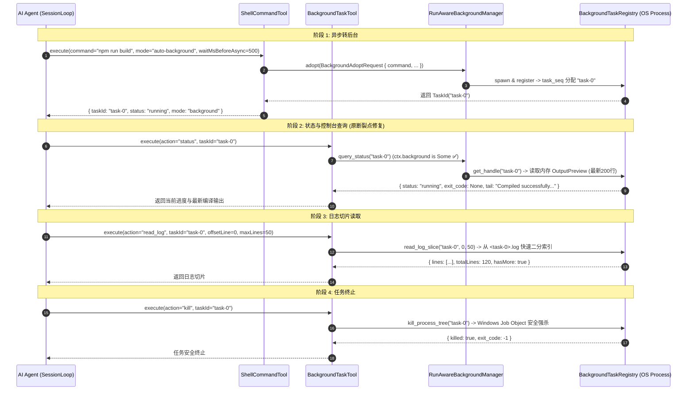
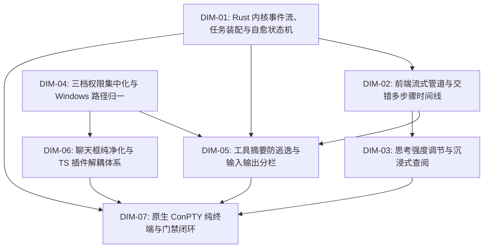

# 01-内核事件与自愈状态机视角独立总方案

> **【方案版本】**：`docs/system-audit-and-redesign/independent-plans/01-内核事件与自愈状态机独立总方案.md`  
> **【编制角色】**：独立方案编制师 01（内核事件流、后台任务装配与自愈状态机核心架构视角）  
> **【前置权威基准】**：`00-战役通则与协同执行规范.md`、`00-主控拍板最终维度矩阵.md`、全部 15 份专题深度分析报告（`analysis/01~15-*.md`）  
> **【核心架构使命】**：从 Rust 内核引擎、双轨事件无损实时化、`BackgroundTaskManager` 全链路贯通装配、长程自治不间断自愈状态机、三档权限集中化与原生 ConPTY 纯终端的顶层视角，构建一套兼顾全系统 7 大维度的高内聚、低耦合、强健壮、纯逻辑演进的独立总方案。

---

## 目录（Table of Contents）

1. [顶层架构愿景与全系统 7 大维度修复矩阵](#一顶层架构愿景与全系统-7-大维度修复矩阵)
   - 1.1 [核心架构哲学：内核为核、自愈为本、双轨分明、长程自治](#11-核心架构哲学内核为核自愈为本双轨分明长程自治)
   - 1.2 [全系统 7 大拍板维度内核协同修复矩阵](#12-全系统-7-大拍板维度内核协同修复矩阵)
   - 1.3 [核心攻坚三维度（DIM-01、DIM-04、DIM-07）架构锚点](#13-核心攻坚三维度dim-01dim-04dim-07架构锚点)
2. [DIM-01 深度方案：Rust 内核双轨事件无损实时化体系](#二dim-01-深度方案rust-内核双轨事件无损实时化体系)
   - 2.1 [19 轮黑盒滞留与“TheTheThe...”碎片化根因机理](#21-19-轮黑盒滞留与thethethe碎片化根因机理)
   - 2.2 [实时通知轨（Live Track）与收口持久轨（Terminal Track）单向不可变架构](#22-实时通知轨live-track与收口持久轨terminal-track单向不可变架构)
   - 2.3 [`LiveEventSink` Trait 完整 Rust 契约与分发拓扑](#23-liveeventsink-trait-完整-rust-契约与分发拓扑)
   - 2.4 [`session-loop` 全生命周期关键帧实时广播改造](#24-session-loop-全生命周期关键帧实时广播改造)
   - 2.5 [Tauri 壳层 `BridgeLiveSink` 与 IPC `AgentEventEnvelope` 契约](#25-tauri-壳层-bridgelivesink-与-ipc-agenteventenvelope-契约)
   - 2.6 [19 轮长程任务多轮生命周期实时时序图](#26-19-轮长程任务多轮生命周期实时时序图)
3. [DIM-01 深度方案：`BackgroundTaskManager` 全链路装配与会话级生命周期](#三dim-01-深度方案backgroundtaskmanager-全链路装配与会话级生命周期)
   - 3.1 [构造期无状态化与执行期动态注入契约断裂根因](#31-构造期无状态化与执行期动态注入契约断裂根因)
   - 3.2 [`ToolExecCtx` 与 `ToolContext` 契约重构与字段扩展](#32-toolexecctx-与-toolcontext-契约重构与字段扩展)
   - 3.3 [`SessionLoopOptions` 与 `AgentSessionLoop` 派生同步设计](#33-sessionloopoptions-与-agentsessionloop-派生同步设计)
   - 3.4 [Tauri 壳层 `RunAwareBackgroundManager` 与 `BackgroundTaskRegistry` 接线](#34-tauri-壳层-runawarebackgroundmanager-与-backgroundtaskregistry-接线)
   - 3.5 [同步命令日志溢出落盘（`log_root`）全链路接线](#35-同步命令日志溢出落盘log_root全链路接线)
   - 3.6 [后台任务全生命周期管理时序图](#36-后台任务全生命周期管理时序图)
4. [DIM-01 深度方案：长程自治不间断自愈状态机与白名单准出契约](#四dim-01-深度方案长程自治不间断自愈状态机与白名单准出契约)
   - 4.1 [状态机数学模型与 4 大自治不变量定理（Invariants I1 ~ I4）](#41-状态机数学模型与-4-大自治不变量定理invariants-i1--i4)
   - 4.2 [行动宣示与未兑现工具承诺侦测器（Tool-Promise Detection Engine）](#42-行动宣示与未兑现工具承诺侦测器tool-promise-detection-engine)
   - 4.3 [流式解析丢包与代码块降级格式自愈引擎（Format Self-Healing）](#43-流式解析丢包与代码块降级格式自愈引擎format-self-healing)
   - 4.4 [单次工具失败即时反思驱动（Immediate Reflexion）](#44-单次工具失败即时反思驱动immediate-reflexion)
   - 4.5 [显式白名单准出契约（Convergence Whitelist Admission Contract）与 Handler 改造](#45-显式白名单准出契约convergence-whitelist-admission-contract与-handler-改造)
   - 4.6 [异常自愈状态机迁移与重试时序图](#46-异常自愈状态机迁移与重试时序图)
5. [DIM-04 深度方案：三档权限极简集中化与 Windows 路径安全归一底座](#五dim-04-深度方案三档权限极简集中化与-windows-路径安全归一底座)
   - 5.1 [破除“完全访问模式”死锁：拔除脱离上下文的私法拦截与复合删除阻断](#51-破除完全访问模式死锁拔除脱离上下文的私法拦截与复合删除阻断)
   - 5.2 [极简三档权限模型（Read-Only / Standard / Full Access）权威契约与执行矩阵](#52-极简三档权限模型read-only--standard--full-access权威契约与执行矩阵)
   - 5.3 [纯对话通用未绑定状态（`WorkspaceScope::Unbound`）显式三态建模](#53-纯对话通用未绑定状态workspacescopeunbound显式三态建模)
   - 5.4 [AI 工作区动态提议（Dynamic Workspace Proposal）与用户授权协议](#54-ai-工作区动态提议dynamic-workspace-proposal与用户授权协议)
   - 5.5 [统一 Windows 路径安全规范化底座（`ConexPathNormalizer`）](#55-统一-windows-路径安全规范化底座conexpathnormalizer)
6. [DIM-07 深度方案：原生 ConPTY 纯终端宿主与命令监视器双轨架构](#六dim-07-深度方案原生-conpty-纯终端宿主与命令监视器双轨架构)
   - 6.1 [用户原生交互终端（Track 1）与 AI 命令监视器（Track 2）双轨彻底解耦](#61-用户原生交互终端track-1与-ai-命令监视器track-2双轨彻底解耦)
   - 6.2 [基于 `portable-pty` 的 ConPTY 跨平台宿主设计、Shell 探测与 Job Object 守卫](#62-基于-portable-pty-的-conpty-跨平台宿主设计shell-探测与-job-object-守卫)
   - 6.3 [彻底废除 `terminalStore.terminalLines` 伪内存缓冲，清除 AI 工具输出回灌污染](#63-彻底废除-terminalstoreterminallines-伪内存缓冲清除-ai-工具输出回灌污染)
   - 6.4 [前端 `@xterm/xterm` 深度装配、抗闪烁 Resize 与 WebGL 上下文丢失防护](#64-前端-xtermxterm-深度装配抗闪烁-resize-与-webgl-上下文丢失防护)
   - 6.5 [全系统设计系统契约（4 级曲率、自定义 Tooltip、柔和焦点态）与质量门禁闭环](#65-全系统设计系统契约4-级曲率自定义-tooltip柔和焦点态与质量门禁闭环)
7. [全系统跨模块数据流契约与 7 大维度纯逻辑拓扑](#七全系统跨模块数据流契约与-7-大维度纯逻辑拓扑)
   - 7.1 [跨模块数据流总线协议（Rust ➔ Tauri ➔ IPC ➔ EventRouter ➔ Store ➔ UI）](#71-跨模块数据流总线协议rust--tauri--ipc--eventrouter--store--ui)
   - 7.2 [全系统 7 大维度的纯逻辑依赖拓扑与演进阶段](#72-全系统-7-大维度的纯逻辑依赖拓扑与演进阶段)
8. [完整 Rust / TS 代码设计蓝图与结构体定义](#八完整-rust--ts-代码设计蓝图与结构体定义)
   - 8.1 [Rust 核心结构体、枚举与 Trait 全量定义](#81-rust-核心结构体枚举与-trait-全量定义)
   - 8.2 [关键 Handler 与执行器代码级修改定义](#82-关键-handler-与执行器代码级修改定义)
   - 8.3 [前端 TypeScript 接口与 Dedupe 矩阵重构定义](#83-前端-typescript-接口与-dedupe-矩阵重构定义)
9. [单元测试、集成测试与端到端防回归验收清单](#九单元测试集成测试与端到端防回归验收清单)
   - 9.1 [Rust 内核单元测试清单（`session-loop`, `agent-tools`, `conex-fs`）](#91-rust-内核单元测试清单session-loop-agent-tools-conex-fs)
   - 9.2 [Tauri 壳层集成测试清单（`engine_channels`, `run_launch`, `pty`）](#92-tauri-壳层集成测试清单engine_channels-run_launch-pty)
   - 9.3 [前端 TypeScript 流式与组件单元测试清单](#93-前端-typescript-流式与组件单元测试清单)
   - 9.4 [19 轮长程工具循环与自愈端到端 E2E 验收断言](#94-19-轮长程工具循环与自愈端到端-e2e-验收断言)

---

## 一、顶层架构愿景与全系统 7 大维度修复矩阵

### 1.1 核心架构哲学：内核为核、自愈为本、双轨分明、长程自治

当前 Conex / Crish 系统在长程执行（如 19 轮复杂任务）与深度自动化中暴露的核心痛点，其本质并非单点功能缺失，而是**底层状态机流转不连续、事件分发通道割裂、安全沙箱边界越权、以及职责模型混淆**所引发的系统级连锁反应：

1. **内核事件滞留与流式断层**：中间工具事件被锁在内存 `Vec`，直到全任务 19 轮结束才一次性倾泻，导致前端出现长达数分钟的事件真空与假死；前端去重逻辑回退机制不当，导致思考流被误杀仅剩首字（"TheTheThe..."）；
2. **装配链条断裂与伪成功**：`ShellCommandTool` 凭借注册期回退成功转后台，但执行期上下文未向 `BackgroundTaskTool` 注入 `background`，导致 AI 查询状态时抛出 `[common.unsupported]` 致命错误；
3. **连续工作自愈状态机缺失**：AI 输出了行动自白（“尝试单独调用 PowerShell 原生删除命令。”）后，因状态机在 `tool_calls.is_empty()` 时武断收口（`ShouldStop`）或解析器对流式丢包采取静默放弃，导致长程任务中途暴毙；
4. **权限体系私法设卡与沙箱错位**：无工作区模式下后端悄悄回退至 Tauri 宿主进程目录（`src-tauri`），同时 Shell 工具内部硬编码无差别拦截复合删除链，导致“完全访问模式”名不副实，逼迫 AI 走脚本逃逸；
5. **终端与监视器职责混杂**：原生用户交互 Shell 与 AI 自动化命令审计输出共用 `terminalStore` 伪行缓冲，造成前端无法打字、输出覆盖污染与导航指鹿为马。

**本方案确立的顶层修复哲学：**

- **双轨分流，单向不可变**：实时通知轨（`sequence=None`）以零延迟驱动前端 UI 投影；收口持久轨（带全局原子 `sequence`）确保 SQLite 无损回放与断点恢复；
- **全链路动态装配**：打通 `ToolExecCtx` ➔ `SessionLoopOptions` ➔ `ToolContext` 的贯穿通道，让后台任务管理与日志落盘具备确定性执行期实体；
- **闭环不间断自愈**：引入 `Tool-Promise` 意图侦测与 `Format Self-Healing` 格式自愈，将工具失败转化为环境观测，实行严格的白名单准出收口；
- **单一真相源权限体系**：三档集中化（只读 / 标准 / 完全访问），破除私法设卡，赋予完全访问真正的最高执行信任；
- **原生双轨终端解耦**：用户交互终端直连 Windows ConPTY + `@xterm/xterm`，AI 命令监视器专司只读审计与结构化呈现。

---

### 1.2 全系统 7 大拍板维度内核协同修复矩阵

```
┌────────────────────────────────────────────────────────────────────────────────────────────────────────────────────────────────────────┐
│                                             Conex / Crish 全系统 7 大核心重构维度架构协同矩阵                                          │
├─────────┬──────────────────────────────────────────┬──────────────────────────────────────────────┬────────────────────────────────────┤
│ 维度编号│ 维度名称                                 │ 内核 / 架构层治理核心                        │ 前端 / UI 层协同落地               │
├─────────┼──────────────────────────────────────────┼──────────────────────────────────────────────┼────────────────────────────────────┤
│ DIM-01  │ Rust 内核双轨事件、后台任务装配与自愈机  │ 1. 扩展 `LiveEventSink` 实时分发全生命周期帧 │ 1. EventRouter 实时接收并推进轮次  │
│ (深挖)  │ (涵盖专题 01, 05, 13)                    │ 2. 贯通 `ToolContext.background` & `log_root`│ 2. 运行中工具卡片即刻挂载展开      │
│         │                                          │ 3. 引入 Tool-Promise 意图侦测与格式自愈引擎  │ 3. 状态机不因中间报错过早关闭流    │
├─────────┼──────────────────────────────────────────┼──────────────────────────────────────────────┼────────────────────────────────────┤
│ DIM-02  │ 前端流式管道、Dedupe 矩阵与交错时间线    │ 1. 明确实时轨事件 envelope.sequence=None     │ 1. 重构 buildEventDedupeKey 矩阵   │
│         │ (涵盖专题 02, 03, 08)                    │ 2. 提供精确的 turn_index 与 message_id 对齐  │ 2. 确立 Thought 为一等公民交错呈现 │
│         │                                          │                                              │ 3. 活跃步骤动态打字，历史优雅折叠  │
├─────────┼──────────────────────────────────────────┼──────────────────────────────────────────────┼────────────────────────────────────┤
│ DIM-03  │ 思考强度调节、沉浸式查阅器与 PromptCache │ 1. 补齐 Anthropic cache_control / beta 头    │ 1. Models 设置 Tab 档位与 Token 滑块│
│         │ (涵盖专题 09, 14)                        │ 2. 内核透传 thinking_budget_tokens 配置      │ 2. FullThoughtModal 万字沉浸查阅器 │
│         │                                          │ 3. 准确输出缓存命中/写入元数据               │ 3. CacheMetricsBadge 四态准确呈现  │
├─────────┼──────────────────────────────────────────┼──────────────────────────────────────────────┼────────────────────────────────────┤
│ DIM-04  │ 三档权限集中化大刀阔斧重构与路径归一     │ 1. 拔除 Shell 工具内部复合删除私法硬拦截     │ 1. PermissionModeMenu 极简三档切换 │
│ (深挖)  │ (涵盖专题 04, 12)                        │ 2. 显式建模 WorkspaceScope::Unbound 纯对话   │ 2. AI 目录挂载申请 Approval 卡片   │
│         │                                          │ 3. 落地 ConexPathNormalizer 剥离 UNC/盘符归一│ 3. 消除工作区误设与权限弹窗死锁    │
├─────────┼──────────────────────────────────────────┼──────────────────────────────────────────────┼────────────────────────────────────┤
│ DIM-05  │ 工具卡片语义化摘要防逃逸与输入输出分栏   │ 1. 内核标准化 ToolBatchCall.summary 契约     │ 1. 13 类工具 100% 语义化中文摘要   │
│         │ (涵盖专题 06, 12)                        │ 2. 结构化提供 args、cwd、stdout、stderr、耗时│ 2. 📥 输入区 与 📤 输出区两段式分栏│
│         │                                          │                                              │ 3. 独立错误诊断横幅与高精度耗时    │
├─────────┼──────────────────────────────────────────┼──────────────────────────────────────────────┼────────────────────────────────────┤
│ DIM-06  │ 聊天框纯净化、几何防漂移与 TS 插件解耦   │ 1. 规范 TS 插件加载契约与安全隔离            │ 1. ChatComposer 拔除博客富文本排版 │
│         │ (涵盖专题 07, 10, 15)                    │ 2. Follow-up 插件上下文 100% 隔离屏蔽        │ 2. safeCursorAnchor 光标几何防漂移 │
│         │                                          │                                              │ 3. MarkdownEditor/Browser 四大插件 │
├─────────┼──────────────────────────────────────────┼──────────────────────────────────────────────┼────────────────────────────────────┤
│ DIM-07  │ 原生 ConPTY 纯终端、设计系统与门禁闭环   │ 1. Rust portable-pty 直连 Windows ConPTY     │ 1. 前端 @xterm/xterm 双向字节流直通│
│ (深挖)  │ (涵盖专题 11, 00)                        │ 2. 废除 terminalStore 伪行缓冲回灌污染       │ 2. 4 级曲率阶梯与 ≤10% 柔和焦点态  │
│         │                                          │ 3. 73 套 Rust 单测 + 前端门禁 100% 闭环       │ 3. 保护 reference/markdown-editor  │
└─────────┴──────────────────────────────────────────┴──────────────────────────────────────────────┴────────────────────────────────────┘
```

---

### 1.3 核心攻坚三维度（DIM-01、DIM-04、DIM-07）架构锚点

1. **DIM-01（内核双轨事件、任务装配与自愈状态机）**：
   - 作为整个 Conex 运行时的“心脏与大脑”，DIM-01 负责保障多轮会话的**感知无延迟（Live Tracking）**、**执行不中断（Self-Healing）**、**后台可托管（Background Tasking）**；
   - 彻底打破 19 轮任务黑盒，让前端与用户在每一毫秒都能获知 Agent 当前的精确心智与物理动作。
2. **DIM-04（三档权限集中化与路径归一底座）**：
   - 作为整个系统的“安全法典与空间坐标系”，DIM-04 负责消灭过度设计的碎片化私设卡点，让“完全访问模式”名实相符；
   - 建立纯对话与工程工作区的清晰边界，彻底解决 Windows `\\?\` UNC 前缀、盘符大小写与 NTFS Junction 误杀缺陷。
3. **DIM-07（原生 ConPTY 纯终端与质量门禁闭环）**：
   - 作为系统与 OS 底层交互的“手脚与装甲”，DIM-07 提供 100% 真实的本地交互终端体验，与 AI 只读命令监视器划清界限；
   - 建立神圣不可侵犯的测试资产保护机制与全系统设计系统契约。

---

## 二、DIM-01 深度方案：Rust 内核双轨事件无损实时化体系

### 2.1 19 轮黑盒滞留与“TheTheThe...”碎片化根因机理

#### 1. 19 轮工具调用黑盒滞留根因

在原设计中，`session-loop` 贯彻了历史上的 `R-16 裁决`（批收口一次性广播）。

- 在 `executing_tools.rs` 中，执行器将 `ToolStart`、`ToolUpdate`、`ToolEnd` 仅仅 `push` 进内存数组 `state.events: Vec<AgentEvent>`；
- 在 `prepare_turn.rs`（`TurnStart`）与 `turn_complete.rs`（`TurnEnd`）中同样仅存内存；
- `AgentSessionLoop::run()` 内部通过 `while !self.state.machine.is_done()` 连续驱动 19 轮循环；
- 只有当第 19 轮结束、`producer.produce().await` 返回后，外层 `drive_outcome` 才分配全局 sequence 并批量发射 150+ 个事件。
- **后果**：前 18 轮工具执行耗时数分钟期间，前端拿不到任何事件，UI 陷入完全假死。

#### 2. “TheTheThe...” 思考首字碎片化根因

- Rust 侧 `streaming.rs` 生成的 `ThoughtDelta` 信封携带 `sequence: None`；
- 前端旧版 `EventRouter.ts` 的 `buildEventDedupeKey` 存在致命缺陷：
  ```typescript
  // 错误实现：将无 sequence 的流式增量退化为 type + messageId
  if (envelope.event.type === 'message-delta') {
    return `message-delta:${envelope.event.messageId}`;
  }
  ```
- 同一轮思考的所有 Token 共享相同的 `messageId`，导致**除了第 1 个 Token（如 `"The"`）被放行外，后续数千个 Token 被全部当作重复事件拦截丢弃**。进入下一轮换了 `messageId` 又放行一个 `"The"`，累积呈现为 `"TheTheThe..."`。

---

### 2.2 实时通知轨（Live Track）与收口持久轨（Terminal Track）单向不可变架构

```
┌─────────────────────────────────────────────────────────────────────────────────────────────────┐
│                               Conex 内核双轨事件分流与落库不可变架构                            │
└─────────────────────────────────────────────────────────────────────────────────────────────────┘

     [AgentSessionLoop 事件发生源: streaming / executing_tools / prepare_turn / turn_complete]
                                              │
                      ┌───────────────────────┴───────────────────────┐
                      │                                               │
                      ▼ 【实时通知轨 (Live Track)】                   ▼ 【收口持久轨 (Terminal Track)】
          live_sink.push_live(event)                         state.events.push(event)
                      │                                               │
                      ▼                                               ▼
          BridgeLiveSink::push_live                      内存累积至 Run 结束 (19 轮)
                      │                                               │
                      ▼                                               ▼
          AgentEventEnvelope {                           producer.produce().await 收敛
              sequence: None,                            drive_outcome 分配连续自增 sequence
              runId: Some(run_id),                                    │
              event: clone(event)                                     ├──────────────────────────┐
          }                                                           │                          │
                      │                                               ▼                          ▼
                      ▼ (Immediate IPC emit + flush)             写入 SQLite events 表    active.bridge.emit()
              前端 EventRouter (实时消费)                             (永久持久化)         (幂等覆盖落定)
                      │
        ┌─────────────┴─────────────┐
        ▼                           ▼
  [流式思考/文本实时渲染]    [运行中工具卡片即刻登场]
  (DedupeKey 放行增量)       (status='running', 实时计时)
```

**架构不变性定理：**

1. **持久化唯一性**：实时轨事件严格保持 `sequence: None`，**绝不直接写入 SQLite**；数据库写入唯一发生在 Run 收口的 `drive_outcome` 事务中，分配全局严格单调连续序列号；
2. **前端幂等覆盖**：前端根据 `(event.type, id)` 进行 O(1) 幂等合并，实时轨负责创建 `running` 态，收口轨负责带 sequence 落定终态。

---

### 2.3 `LiveEventSink` Trait 完整 Rust 契约与分发拓扑

在 `crates/session-loop/src/provider.rs` 中重构并扩展 `LiveEventSink` Trait：

```rust
// 路径：crates/session-loop/src/provider.rs

use conex_types::event::AgentEvent;

/// 实时事件汇接口（Live Event Sink）
///
/// 贯穿 session-loop 全生命周期，负责将正在发生的增量、中间状态与轮次信标
/// 零延迟推送到前端 IPC 通道（信封携带 sequence: None）。
pub trait LiveEventSink: Send + Sync {
    /// 推送实时事件帧
    fn push_live(&self, event: AgentEvent);
}

/// 向后兼容现有 DeltaSink 命名别名
pub type DeltaSink = dyn LiveEventSink;
```

---

### 2.4 `session-loop` 全生命周期关键帧实时广播改造

#### 1. 轮次准备实时化：`crates/session-loop/src/loop/handlers/prepare_turn.rs`

```rust
// 路径：crates/session-loop/src/loop/handlers/prepare_turn.rs
pub(crate) async fn handle(
    state: &mut LoopState,
    live_sink: Option<&dyn LiveEventSink>,
) -> Result<HandlerOutcome, LoopError> {
    let session_id = state.machine.context().session_id.clone();
    let turn_index = state.machine.context().turn_index.saturating_add(1);
    state.turn_usage = None;

    let turn_start = AgentEvent::TurnStart {
        session_id: session_id.clone(),
        turn_index,
        timestamp: crate::steering::now_iso_utc(),
    };

    // 1. 写入收口内存轨
    state.events.push(turn_start.clone());
    // 2. 🌟 实时广播至前端：新轮次开始
    if let Some(sink) = live_sink {
        sink.push_live(turn_start);
    }
    state.current_turn_index = Some(turn_index);

    dispatch(state, E::TurnPrepared)?;
    Ok(HandlerOutcome::continue_run())
}
```

#### 2. 流式思考与消息实时化：`crates/session-loop/src/loop/handlers/streaming.rs`

```rust
// 路径：crates/session-loop/src/loop/handlers/streaming.rs
pub(crate) fn commit_message_with_deltas(
    state: &mut LoopState,
    message: AgentMessage,
    live_sink: Option<&dyn LiveEventSink>,
) {
    let session_id = state.machine.context().session_id.clone();
    let message = Arc::new(message);

    let start_event = AgentEvent::MessageStart {
        session_id: session_id.clone(),
        message: message.clone(),
    };
    state.events.push(start_event.clone());
    // 🌟 实时通知：思考/回复消息开始
    if let Some(sink) = live_sink {
        sink.push_live(start_event);
    }

    state.conversation.push(message.clone());

    let end_event = AgentEvent::MessageEnd {
        session_id,
        message,
        turn_index: Some(state.machine.context().turn_index),
    };
    state.events.push(end_event.clone());
    // 🌟 实时通知：思考/回复消息完成
    if let Some(sink) = live_sink {
        sink.push_live(end_event);
    }
}
```

#### 3. 工具执行逐工具实时广播：`crates/session-loop/src/loop/handlers/executing_tools.rs`

```rust
// 路径：crates/session-loop/src/loop/handlers/executing_tools.rs
pub(crate) async fn handle(
    state: &mut LoopState,
    executor: &ToolExecutor,
    ctx: &ToolExecCtx,
    options: &ToolBatchOptions,
    approval: Option<Arc<dyn ApprovalGate>>,
    live_sink: Option<&dyn LiveEventSink>,
) -> Result<HandlerOutcome, LoopError> {
    let calls = extract_pending_calls(state)?;
    let start_event_count = state.events.len();

    // 🌟 执行前发射 ToolBatchStart 与 ToolStart 实时帧
    if let Some(sink) = live_sink {
        sink.push_live(AgentEvent::ToolBatchStart {
            session_id: ctx.session_id.clone(),
            batch_id: format!("batch-{}", crate::steering::unix_millis()),
            call_count: calls.len() as u32,
            timestamp: crate::steering::now_iso_utc(),
        });
        for call in &calls {
            sink.push_live(AgentEvent::ToolStart {
                session_id: ctx.session_id.clone(),
                call_id: call.id.clone(),
                tool_name: call.tool_name.clone(),
                input: call.input.clone(),
                timestamp: crate::steering::now_iso_utc(),
                turn_index: state.current_turn_index,
            });
        }
    }

    // 执行批量工具
    let outcome = executor
        .execute_batch(&calls, ctx, approval, options, state.abort_token.clone())
        .await;

    // 翻译工具事件并推入收口轨
    emit_tool_events(state, &outcome.events);

    // 🌟 逐工具发射 ToolEnd 实时完成帧
    if let Some(sink) = live_sink {
        for res in &outcome.results {
            sink.push_live(AgentEvent::ToolEnd {
                session_id: ctx.session_id.clone(),
                call_id: res.call_id.clone(),
                tool_name: res.tool_name.clone(),
                output: res.output.clone(),
                is_error: res.is_error,
                duration_ms: res.duration_ms,
                timestamp: crate::steering::now_iso_utc(),
                turn_index: state.current_turn_index,
            });
        }
    }

    // 记录 tool-result 消息
    for res in &outcome.results {
        record_tool_result_message(state, res, live_sink);
    }

    dispatch(state, E::ToolsComplete)?;
    Ok(HandlerOutcome::continue_run())
}
```

#### 4. 轮次完成实时化：`crates/session-loop/src/loop/handlers/turn_complete.rs`

```rust
// 路径：crates/session-loop/src/loop/handlers/turn_complete.rs
pub(crate) async fn handle(
    state: &mut LoopState,
    live_sink: Option<&dyn LiveEventSink>,
) -> Result<HandlerOutcome, LoopError> {
    let ctx = state.machine.context().clone();
    let turn_end = AgentEvent::TurnEnd {
        session_id: ctx.session_id.clone(),
        turn_index: ctx.turn_index,
        timestamp: crate::steering::now_iso_utc(),
        tool_call_count: ctx.tool_call_count,
        usage: state.turn_usage.take(),
    };

    state.events.push(turn_end.clone());
    // 🌟 实时广播：本轮全部收工
    if let Some(sink) = live_sink {
        sink.push_live(turn_end);
    }
    state.current_turn_index = None;

    if ctx.tool_call_count > 0 {
        dispatch(state, E::NextTurn)?;
        return Ok(HandlerOutcome::continue_run());
    }

    // ... 准出判定与续轮 ...
}
```

---

### 2.5 Tauri 壳层 `BridgeLiveSink` 与 IPC `AgentEventEnvelope` 契约

在 `apps/agent-workbench/src-tauri/src/engine_channels.rs` 中重塑：

```rust
// 路径：apps/agent-workbench/src-tauri/src/engine_channels.rs

pub struct BridgeLiveSink {
    run_id: String,
    bridge: Arc<BufferedRunEventBridge>,
}

impl BridgeLiveSink {
    pub fn new(run_id: String, bridge: Arc<BufferedRunEventBridge>) -> Self {
        Self { run_id, bridge }
    }
}

impl LiveEventSink for BridgeLiveSink {
    fn push_live(&self, event: AgentEvent) {
        // 信封规范：sequence 为 None（表示实时通知轨），立即发射与冲刷
        let envelope = AgentEventEnvelope::new(event, Some(self.run_id.clone()), None);
        self.bridge.emit(&envelope);
        self.bridge.flush();
    }
}
```

---

### 2.6 19 轮长程任务多轮生命周期实时时序图

```mermaid
sequenceDiagram
    autonumber
    participant UI as 前端 crish-desktop (EventRouter)
    participant Driver as Tauri drive_run_loop
    participant Loop as AgentSessionLoop (Rust)
    participant Provider as LLM Provider (SSE)
    participant Tool as ToolExecutor
    participant DB as SQLite DB (events)

    UI->>Driver: core_run_task(options)
    Driver->>Loop: run(live_sink=BridgeLiveSink)

    rect rgb(240, 248, 255)
    note over Loop, UI: 【Turn 1: 实时无损流】
    Loop->>UI: [Live] TurnStart { turn_index: 1, sequence: None }
    Note over UI: 立即创建步骤 1 容器

    loop LLM SSE Stream
        Provider-->>Loop: ThoughtDelta / TextDelta
        Loop->>UI: [Live] MessageDelta { block: Thought/Text, sequence: None }
        Note over UI: DedupeKey 放行，打字追尾流式更新
    end

    Provider-->>Loop: ToolCall(id="c1", name="shell_command")
    Loop->>UI: [Live] MessageEnd { turn_index: 1 }
    Loop->>UI: [Live] ToolStart { call_id: "c1", tool_name: "shell_command" }
    Note over UI: 立即渲染运行中卡片 (status="running", 计时启动)

    Loop->>Tool: execute_batch([c1]).await (耗时 3s)
    Tool-->>Loop: ToolResult(exit_code: 0, output: "...")
    Loop->>UI: [Live] ToolEnd { call_id: "c1", is_error: false, duration_ms: 3020 }
    Note over UI: 卡片落定为完成态 (status="completed")

    Loop->>UI: [Live] TurnEnd { turn_index: 1, tool_call_count: 1 }
    end

    rect rgb(255, 250, 240)
    note over Loop, UI: 【Turn 2..18: 持续实时可见，零假死】
    Note over UI: 每一轮的思考、工具调用与结果实时渲染，进度条平滑推进
    end

    rect rgb(240, 255, 240)
    note over Loop, UI: 【Turn 19: 最终收口】
    Loop->>UI: [Live] TurnStart { turn_index: 19 }
    Loop->>UI: [Live] MessageDelta (最终文本)
    Loop->>UI: [Live] MessageEnd { turn_index: 19 }
    Loop->>UI: [Live] TurnEnd { turn_index: 19, tool_call_count: 0 }
    end

    Loop-->>Driver: RunOutcome { 19 轮所有事件 }
    Driver->>DB: drive_outcome() 分配 sequence (1..N) 并写入 events 表
    Driver->>UI: [Persistent] 批量推送带 sequence 的收口事件（用于状态落定）
```

---

## 三、DIM-01 深度方案：`BackgroundTaskManager` 全链路装配与会话级生命周期

### 3.1 构造期无状态化与执行期动态注入契约断裂根因

- **架构断层机制**：
  1. `ShellCommandTool` 包含一个内部字段 `self.background_manager`，在 Tauri 引擎初始化注册工具时被静态注入；
  2. `BackgroundTaskTool` 设计为纯粹的无状态工具，完全依赖执行期 `ctx.background`；
  3. 在 `crates/session-loop/src/exec_single.rs:299` 中，`ToolContext` 组装处被硬编码为 `background: None, log_root: None`；
  4. 当 AI 发起 `shell_command(mode: "auto-background")` 时，`shell.rs` 借助静态 fallback 成功转入后台并返回 `taskId: "task-0"`；
  5. 紧接着 AI 调用 `background_task(action: "status", taskId: "task-0")`，由于 `ctx.background` 为 `None`，直接抛出 `[common.unsupported]` 致命错误。

---

### 3.2 `ToolExecCtx` 与 `ToolContext` 契约重构与字段扩展

在 `crates/session-loop/src/tool_exec.rs` 中扩展：

```rust
// 路径：crates/session-loop/src/tool_exec.rs

use agent_tools::background::BackgroundTaskManager;
use std::path::PathBuf;
use std::sync::Arc;

#[derive(Debug, Clone, Default)]
pub struct ToolExecCtx {
    pub run_id: String,
    pub session_id: String,
    pub cwd: Option<String>,
    pub parent_run_id: Option<String>,
    pub workspace_root: Option<PathBuf>,
    pub write_claims: Option<Arc<WritePathRegistry>>,
    pub explore_docs_quota: Option<ExploreDocsQuotaContext>,
    pub output_dir: Option<Arc<dyn agent_tools::tools::output_dir::OutputDirResolver>>,
    pub note_backend: Option<NoteBackendHandle>,
    /// 🌟 真实注入的后台任务管理器（解决 background_task common.unsupported）
    pub background: Option<Arc<dyn BackgroundTaskManager>>,
    /// 🌟 会话日志落盘根目录（解决同步命令超长截断落盘 logPath 丢失）
    pub log_root: Option<PathBuf>,
}
```

在 `crates/session-loop/src/exec_single.rs` 中彻底修复装配断点：

```rust
// 路径：crates/session-loop/src/exec_single.rs:272-313
let tool_ctx = ToolContext {
    session_id: ctx.session_id.clone(),
    abort_token,
    ask,
    workspace_root: ctx
        .workspace_root
        .clone()
        .or_else(|| ctx.cwd.clone().map(PathBuf::from))
        .unwrap_or_else(|| std::env::current_dir().unwrap_or_else(|_| PathBuf::from("."))),
    write_claims: ctx.write_claims.clone(),
    write_claim_holder: Some(ctx.run_id.clone()),
    explore_docs_quota: ctx.explore_docs_quota.clone(),
    output_dir: ctx.output_dir.clone(),
    // 🌟 修复：从 ToolExecCtx 透传真实实例，绝不写死 None
    background: ctx.background.clone(),
    log_root: ctx.log_root.clone(),
    compression_store: None,
    note_backend: ctx.note_backend.clone(),
    tool_call_id: Some(call.id.clone()),
};
```

---

### 3.3 `SessionLoopOptions` 与 `AgentSessionLoop` 派生同步设计

在 `crates/session-loop/src/loop/loop_options.rs`：

```rust
// 路径：crates/session-loop/src/loop/loop_options.rs
pub struct SessionLoopOptions {
    // ... 既有字段 ...
    pub background_manager: Option<Arc<dyn BackgroundTaskManager>>,
    pub log_root: Option<PathBuf>,
    pub continue_nudge_limit: u32,
}

impl Default for SessionLoopOptions {
    fn default() -> Self {
        Self {
            // ...
            background_manager: None,
            log_root: None,
            continue_nudge_limit: 3,
        }
    }
}
```

在 `crates/session-loop/src/loop/loop_runner.rs`：

```rust
// 路径：crates/session-loop/src/loop/loop_runner.rs
pub fn with_options(mut self, mut options: SessionLoopOptions) -> Self {
    // ...
    self.tool_ctx.background = options.background_manager.clone();
    self.tool_ctx.log_root = options.log_root.clone();
    self.state.options = options.clone();
    self
}
```

---

### 3.4 Tauri 壳层 `RunAwareBackgroundManager` 与 `BackgroundTaskRegistry` 接线

在 `apps/agent-workbench/src-tauri/src/run/run_launch.rs`：

```rust
// 路径：apps/agent-workbench/src-tauri/src/run/run_launch.rs:657-715
let log_root = crate::host_paths::app_dir().ok().map(|p| p.join("logs"));

let options = SessionLoopOptions {
    cwd: cwd.clone(),
    assistant_client_message_id: assistant_client_message_id.clone(),
    system_prompt: assemble_system_prompt_with_stages(&state, &session_id, system_prompt),
    context_budget,
    retry_backoff,
    provider_fail_streak,
    escape_watch: escape_config,
    tool_middleware: vec![Arc::new(BackupMiddleware::with_defaults(None))],
    parent_run_id: parent_run_id.clone(),
    write_claims: subagent_write_registry
        .clone()
        .or_else(|| Some(Arc::clone(&shared_registry))),
    explore_docs_quota: subagent_quota.clone(),
    compaction_policy: state.compaction_policy_for(&session_id),
    summarizer: state.summarizer_for(&session_id),
    summary_dispatch: state.summary_dispatch_config(&session_id),
    summary_coordinator: Some(state.summary_coordinator_for(&session_id)),
    note_backend: crate::note_runtime::try_backend(),
    // 🌟 注入全局 RunAwareBackgroundManager 实例
    background_manager: Some(Arc::clone(&state.background) as Arc<dyn BackgroundTaskManager>),
    // 🌟 注入日志落盘根目录
    log_root,
    ..SessionLoopOptions::default()
};
```

---

### 3.5 同步命令日志溢出落盘（`log_root`）全链路接线

当同步执行的 `shell_command` 输出超过 `maxOutputBytes`（默认 64KB）时：

1. `ShellCommandTool` 检测到 `ctx.log_root` 存在；
2. 自动在 `<log_root>/sessions/<session_id>/commands/<call_id>.log` 创建日志文件；
3. 将全量 stdout / stderr 写入该文件，并在内存结果中截断前 100 行并附带 `logPath`；
4. AI 与前端获得确凿的磁盘路径，支持后续通过 `background_task(action: "read_log")` 分页查阅。

---

### 3.6 后台任务全生命周期管理时序图



---

## 四、DIM-01 深度方案：长程自治不间断自愈状态机与白名单准出契约

### 4.1 状态机数学模型与 4 大自治不变量定理（Invariants I1 ~ I4）

```
                       ┌─────────────────────────┐
                       │       Initialized       │
                       └────────────┬────────────┘
                                    │ Initialized
                                    ▼
                       ┌─────────────────────────┐
                       │      PreparingTurn      │◄─────────────────────────────┐
                       └────────────┬────────────┘                              │
                                    │ TurnPrepared                              │
                                    ▼                                           │
                       ┌─────────────────────────┐                              │
                       │        Streaming        │                              │
                       └────────────┬────────────┘                              │
                                    │ Stream End                                │
                                    ▼                                           │
                     ┌─────────────────────────────┐                            │
                     │  🌟 自愈分类仲裁器 (Arb)    │                            │
                     └──────────────┬──────────────┘                            │
                                    │                                           │
         ┌──────────────────────────┼──────────────────────────┐                │
         │ 有效工具调用             │ 承诺未兑现/丢包          │ 纯文本回答     │
         ▼                          ▼                          ▼                │
┌─────────────────┐       ┌──────────────────┐       ┌──────────────────┐       │
│ ExecutingTools  │       │ Auto-Steer Nudge │       │   TurnComplete   │       │
└────────┬────────┘       └─────────┬────────┘       └─────────┬────────┘       │
         │                          │                          │                │
         │ ToolsComplete            │ InputAvailable           │ ShouldStop     │
         └──────────────────────────┴──────────────────────────┼────────────────┘
                                                               │ (Whitelist Hit)
                                                               ▼
                                                     ┌──────────────────┐
                                                     │       Done       │
                                                     └──────────────────┘
```

#### 四大自治不变量定理（Invariants）：

1. **不变量 I1（工具观测闭环不变量）**：任何工具执行结果（无论非零退出码、权限拒绝、路径越界、命令超时），**一律以 `AgentMessageRole::Tool` 结构体记录落库并推入对话上下文**，严禁将其作为引擎崩溃信号直接掐死会话；
2. **不变量 I2（行动承诺强制推进不变量）**：若模型在本轮输出了行动自白文本（包含“尝试调用”、“正在执行”、“接下来使用”等意图），但本轮未产出有效 `tool_calls`，状态机**严禁进入 `ShouldStop`**，必须自动注入 `promise-nudge` 指令并强制续轮；
3. **不变量 I3（解析异常即刻反思不变量）**：若 Provider 声明 `finish_reason = tool_calls` 但实际解析 `tool_calls` 为空，状态机立即判定为 `InvalidToolCall` 异常，并在下一轮反向注入 `format-self-heal` 纠偏提示；
4. **不变量 I4（显式白名单准出不变量）**：系统仅在命中显式准出白名单（用户主动停止、达到硬预算上限 `max_turns`、或模型给出无行动承诺的确定性答复且工具调用清零）时，才允许终结收口。

---

### 4.2 行动宣示与未兑现工具承诺侦测器（Tool-Promise Detection Engine）

在 `crates/session-loop/src/steering/promise.rs` 中实现高性能侦测算法：

```rust
// 路径：crates/session-loop/src/steering/promise.rs

use regex::Regex;
use std::sync::LazyLock;

static PROMISE_REGEX: LazyLock<Regex> = LazyLock::new(|| {
    Regex::new(r"(?m)(尝试|准备|调用|执行|正在使用|运行|单独调用|通过)[\s\S]{0,30}(命令|脚本|工具|PowerShell|Bash|终端|函数|pwsh|cmd)").unwrap()
});

/// 侦测文本尾部是否存在未兑现的工具承诺
pub fn detect_unfulfilled_tool_promise(text: &str) -> Option<String> {
    let clean = text.trim();
    if clean.is_empty() {
        return None;
    }
    // 取文本最后 300 个字符进行尾部意图捕获
    let tail = if clean.len() > 300 {
        &clean[clean.len() - 300..]
    } else {
        clean
    };

    if let Some(mat) = PROMISE_REGEX.find(tail) {
        Some(mat.as_str().to_string())
    } else {
        None
    }
}
```

---

### 4.3 流式解析丢包与代码块降级格式自愈引擎（Format Self-Healing）

在 `crates/session-loop/src/loop/handlers/streaming.rs` 中消除静默死亡：

```rust
// 路径：crates/session-loop/src/loop/handlers/streaming.rs:215-245
if tool_calls.is_empty() {
    let raw_stop = consumed.stop_reason();
    let has_diagnostic_tool_error = consumed.diagnostics.iter().any(|d| {
        matches!(
            d.phase,
            conex_types::tool::ProviderDiagnosticPhase::InvalidToolCall
        )
    });

    // 🌟 捕获 finish_reason=tool_calls 但解析丢失的异常场景
    if raw_stop == Some(ConsumeStopReason::ToolCall) || has_diagnostic_tool_error {
        tracing::warn!(
            session_id = %state.machine.context().session_id,
            "检测到工具调用格式异常或丢包，自动注入自愈纠偏提示"
        );
        state.input_queue.enqueue_steer(AgentMessage {
            id: new_message_id("format-self-heal"),
            role: AgentMessageRole::System,
            created_at: crate::steering::now_iso_utc(),
            blocks: vec![AgentMessageBlock::Text {
                text: "【系统自愈提示】检测到你尝试发起工具调用，但参数格式未成功解析为标准 JSON。请直接重新发起该工具调用并提供完整合规参数。".to_string(),
            }],
            metadata: Some(serde_json::json!({
                "kind": "runtime-steering",
                "reason": "invalid-tool-call"
            })),
            client_message_id: None,
            content: None,
        });
        dispatch(state, E::NoToolCalls)?;
        return Ok(HandlerOutcome::continue_run());
    }

    no_tool_calls::handle(state, consumed.stop_reason()).await
} else {
    dispatch(
        state,
        E::HasToolCalls {
            count: tool_calls.len() as u32,
        },
    )?;
    Ok(HandlerOutcome::continue_run())
}
```

---

### 4.4 单次工具失败即时反思驱动（Immediate Reflexion）

在 `crates/session-loop/src/steering/strategy.rs` 中：

```rust
// 路径：crates/session-loop/src/steering/strategy.rs

/// 即时反思检测：单次工具失败即进入自愈关照
pub fn detect_single_tool_failure(messages: &[Arc<AgentMessage>]) -> Option<SteeringReason> {
    let last_tool_msg = messages.iter().rev().find(|m| m.role == AgentMessageRole::Tool)?;
    for block in &last_tool_msg.blocks {
        if let AgentMessageBlock::ToolResult { output, is_error, .. } = block {
            if *is_error || output.contains("Exit code: 1") || output.contains("PermissionDenied") {
                return Some(SteeringReason::ToolErrors);
            }
        }
    }
    None
}
```

---

### 4.5 显式白名单准出契约（Convergence Whitelist Admission Contract）与 Handler 改造

在 `crates/session-loop/src/loop/handlers/no_tool_calls.rs`：

```rust
// 路径：crates/session-loop/src/loop/handlers/no_tool_calls.rs
use crate::steering::promise::detect_unfulfilled_tool_promise;

pub(crate) async fn handle(
    state: &mut LoopState,
    stop_reason: Option<ConsumeStopReason>,
) -> Result<HandlerOutcome, LoopError> {
    if stop_reason == Some(ConsumeStopReason::Length) {
        // ...
    } else {
        // 🌟 检查最新 Assistant 消息是否包含未兑现的工具承诺
        if let Some(last_msg) = state.conversation.last() {
            if last_msg.role == AgentMessageRole::Assistant {
                if let Some(promise) = detect_unfulfilled_tool_promise(last_msg.text()) {
                    if state.continue_nudges < state.options.continue_nudge_limit {
                        state.continue_nudges += 1;
                        tracing::info!(promise = %promise, "捕获未兑现工具承诺，注入推进指令");
                        state.input_queue.enqueue_steer(AgentMessage {
                            id: new_message_id("promise-nudge"),
                            role: AgentMessageRole::System,
                            created_at: crate::steering::now_iso_utc(),
                            blocks: vec![AgentMessageBlock::Text {
                                text: format!("【系统推进】你刚才表示要：“{}”，请立即调用对应工具执行该操作，不要仅停留在口头自白。", promise),
                            }],
                            metadata: Some(serde_json::json!({
                                "kind": "runtime-steering",
                                "reason": "unfulfilled-tool-promise"
                            })),
                            client_message_id: None,
                            content: None,
                        });
                        dispatch(state, E::NoProgressContinue)?;
                        return Ok(HandlerOutcome::continue_run());
                    }
                }
            }
        }
    }

    super::super::handlers::emit_steering_reset_event(state, "no-tool-calls");
    dispatch(state, E::NoToolCalls)?;
    Ok(HandlerOutcome::continue_run())
}
```

在 `crates/session-loop/src/loop/handlers/turn_complete.rs`：

```rust
// 路径：crates/session-loop/src/loop/handlers/turn_complete.rs:182-200
// 1. 在途工具结果未消费：必须续轮
if ctx.tool_call_count > 0 {
    dispatch(state, E::NextTurn)?;
    return Ok(HandlerOutcome::continue_run());
}

// 2. 🌟 自愈 steer 消息或队列输入待办：必须续轮推进
let promoted = state.input_queue.promote_follow_up();
if promoted > 0 || state.input_queue.has_runnable_pending() {
    dispatch(state, E::InputAvailable)?;
    return Ok(HandlerOutcome::continue_run());
}

// 3. 🌟 白名单准出收口：仅在真正无动作承诺、无待办消息时，才允许正常退出
dispatch(state, E::ShouldStop)?;
Ok(HandlerOutcome::end(EndDecision::stop(state)))
```

---

### 4.6 异常自愈状态机迁移与重试时序图

```mermaid
sequenceDiagram
    autonumber
    actor User as 用户
    participant Loop as SessionLoop (Rust)
    participant Provider as LLM Provider
    participant Tool as ToolExecutor

    User->>Loop: 发起任务：“强制删除锁死文件与目录”

    rect rgb(255, 240, 240)
    note over Loop, Tool: 【第 1 轮：工具执行失败】
    Loop->>Provider: Round 1 Prompt
    Provider-->>Loop: ToolCall: run_command("rm -rf target_locked")
    Loop->>Tool: execute_batch()
    Tool-->>Loop: ToolResult(exit_code: 1, is_error: true, output: "Process locked...")
    Loop->>Loop: 记录 ToolResult 消息至 conversation
    end

    rect rgb(255, 250, 240)
    note over Loop, Provider: 【第 2 轮：模型输出自白但未发工具（原暴毙点）】
    Loop->>Provider: Round 2 Prompt (含 ToolResult 错误信息)
    Provider-->>Loop: TextDelta("尝试单独调用 PowerShell 原生删除命令。") + 无结构化工具
    Loop->>Loop: no_tool_calls 侦测到未兑现承诺: "尝试单独调用 PowerShell 原生删除命令"
    Loop->>Loop: 自动注入 System 消息: "【系统推进】请立即调用对应工具执行该操作..."
    Loop->>Loop: dispatch(E::NoProgressContinue) -> NextTurn (续轮成功，拒绝暴毙！)
    end

    rect rgb(240, 255, 240)
    note over Loop, Tool: 【第 3 轮：AI 成功自愈执行】
    Loop->>Provider: Round 3 Prompt (含自愈推进提示)
    Provider-->>Loop: ToolCall: run_command("pwsh -Command Stop-Process -Name target; Remove-Item -Force target_locked")
    Loop->>Tool: execute_batch()
    Tool-->>Loop: ToolResult(exit_code: 0, output: "Success")
    end

    rect rgb(240, 248, 255)
    note over Loop, User: 【第 4 轮：最终确认与收口】
    Loop->>Provider: Round 4 Prompt
    Provider-->>Loop: TextDelta("目标文件已成功解锁并彻底删除完成。")
    Loop->>Loop: 命中白名单准出契约 -> 正常 Done 停机
    Loop-->>User: 交付任务成果
    end
```

---

## 五、DIM-04 深度方案：三档权限极简集中化与 Windows 路径安全归一底座

### 5.1 破除“完全访问模式”死锁：拔除脱离上下文的私法拦截与复合删除阻断

彻底重构 `crates/agent-tools/src/tools/shell.rs` 与 `shell_redirect.rs`：

1. **取消脱离上下文的私法拦截**：工具内部 `prepare` 必须读取 `ToolContext.permission_mode`；
2. **完全访问模式最高信任**：
   - 在 `PermissionMode::FullAccess` 下，**彻底放行复合命令链删除（`npm test && rm temp.txt`）**；
   - **彻底放行间接执行（`pwsh -c "Remove-Item ..."`、`bash -c ...`）**；
   - **彻底放行临时目录清理（允许删除系统 Temp 与构建缓存）**；
   - 仅保留极少数不可逆系统自毁级硬红线（如 Windows `format C:`、Linux `rm -rf /`）。

---

### 5.2 极简三档权限模型（Read-Only / Standard / Full Access）权威契约与执行矩阵

```rust
// 路径：crates/conex-types/src/permission.rs

#[derive(Debug, Clone, Copy, PartialEq, Eq, Serialize, Deserialize)]
#[serde(rename_all = "kebab-case")]
pub enum PermissionMode {
    /// 1. 只读模式（Read-Only / Plan）：
    /// 仅允许搜索、文件查阅、只读命令；任何写操作与破坏性命令静默拦截
    ReadOnly,

    /// 2. 标准工作区模式（Standard Workspace）：
    /// 在当前工作区根目录内自由读写、常规编译测试自动放行；跨目录与危险操作弹出确认
    Standard,

    /// 3. 完全访问模式（Full Access）：
    /// 赋予用户授权后的完全信任；放行复合删除、间接执行、系统临时目录清理
    FullAccess,
}
```

#### 三档权限权威行为矩阵：

| 权限模式                  | 文件读取 / 代码搜索 | 工作区内文件修改 | 工作区内脚本与编译构建 | 跨目录操作 / 临时目录清理 | 复合删除链 (`cmd && rm`)  | 系统级自毁指令 (`format C:`) |
| :------------------------ | :------------------ | :--------------- | :--------------------- | :------------------------ | :------------------------ | :--------------------------- |
| **只读模式 (ReadOnly)**   | ✅ 自动放行         | ❌ 静默拦截      | ❌ 静默拦截            | ❌ 静默拦截               | ❌ 静默拦截               | ❌ 阻断                      |
| **标准模式 (Standard)**   | ✅ 自动放行         | ✅ 自动放行      | ✅ 自动放行            | ⚠️ 触发审批 (Ask)         | ⚠️ 建议改用 `delete_file` | ❌ 阻断                      |
| **完全访问 (FullAccess)** | ✅ 自动放行         | ✅ 自动放行      | ✅ 自动放行            | ✅ 自动放行               | ✅ 自动放行               | ❌ 硬红线阻断                |

---

### 5.3 纯对话通用未绑定状态（`WorkspaceScope::Unbound`）显式三态建模

彻底废除无 `cwd` 时悄悄回退到 `std::env::current_dir()`（`src-tauri`）的隐式陷阱：

```rust
// 路径：crates/conex-types/src/workspace.rs

#[derive(Debug, Clone, PartialEq, Eq, Serialize, Deserialize)]
#[serde(tag = "type", content = "path")]
pub enum WorkspaceScope {
    /// 纯对话无工作区绑定状态（通用对话）
    Unbound,
    /// 明确打开的项目工作区
    Project(PathBuf),
    /// 会话级动态授权挂载的工作区
    SessionDynamic(PathBuf),
}
```

---

### 5.4 AI 工作区动态提议（Dynamic Workspace Proposal）与用户授权协议

当处于 `WorkspaceScope::Unbound` 时，AI 若需要操作外部特定目录（如 `c:/Software/conex/temp_test`），触发结构化挂起：

```mermaid
sequenceDiagram
    autonumber
    actor User as 用户
    participant UI as 前端桌面
    participant Loop as SessionLoop
    participant Engine as ToolExecutor

    User->>Loop: “在 C:/my_project 初始化并测试”
    Loop->>Engine: 请求写入 C:/my_project/package.json (WorkspaceScope::Unbound)
    Engine->>Loop: 触发结构化挂起: WorkspaceSwitchRequired("C:/my_project")
    Loop->>UI: 发射 ApprovalRequested { type: "workspace_bind_request", path: "C:/my_project" }
    UI->>User: 弹出优雅悬浮卡片：“AI 申请挂载 C:/my_project 为当前工作区”
    User->>UI: 点击【批准并挂载】
    UI->>Loop: 提交 ApprovalDecision::AllowWithWorkspace("C:/my_project")
    Loop->>Loop: 动态更新会话 WorkspaceScope = SessionDynamic("C:/my_project")
    Loop->>Engine: 重试并成功执行写操作 (无需走 PowerShell 逃逸脚本)
```

---

### 5.5 统一 Windows 路径安全规范化底座（`ConexPathNormalizer`）

在 `crates/conex-fs/src/path_normalizer.rs` 中构建全系统唯一的路径归一化底座：

```rust
// 路径：crates/conex-fs/src/path_normalizer.rs

use std::path::{Path, PathBuf};

pub struct ConexPathNormalizer;

impl ConexPathNormalizer {
    /// 统一 Windows 路径规范化：
    /// 1. 剥离 \\?\ 和 \\?\UNC\ 前缀
    /// 2. 盘符强制大写（c: -> C:）
    /// 3. 分隔符统一为原生 MAIN_SEPARATOR
    /// 4. 消除尾部分隔符
    pub fn normalize(path: &Path) -> PathBuf {
        let s = path.to_string_lossy();
        let mut clean = s.as_ref();

        #[cfg(windows)]
        {
            if let Some(rest) = clean.strip_prefix(r"\\?\UNC\") {
                return PathBuf::from(format!(r"\\{rest}"));
            }
            if let Some(rest) = clean.strip_prefix(r"\\?\") {
                clean = rest;
            }
        }

        let mut path_buf = PathBuf::from(clean);

        #[cfg(windows)]
        {
            if let Some(std::path::Component::Prefix(prefix_comp)) = path_buf.components().next() {
                let prefix_str = prefix_comp.as_os_str().to_string_lossy();
                if prefix_str.len() == 2 && prefix_str.ends_with(':') {
                    let upper_drive = prefix_str.to_ascii_uppercase();
                    let remainder: PathBuf = path_buf.components().skip(1).collect();
                    path_buf = PathBuf::from(format!("{upper_drive}\\{}", remainder.display()));
                }
            }
        }

        path_buf
    }

    /// 大小写不敏感的前缀包含性校验
    pub fn is_within_root(candidate: &Path, root: &Path) -> bool {
        let c_norm = Self::normalize(candidate);
        let r_norm = Self::normalize(root);
        let c_str = c_norm.to_string_lossy();
        let r_str = r_norm.to_string_lossy();

        #[cfg(windows)]
        {
            let c_lower = c_str.to_lowercase();
            let r_lower = r_str.to_lowercase();
            if c_lower == r_lower {
                return true;
            }
            let sep = std::path::MAIN_SEPARATOR;
            c_lower.starts_with(&format!("{r_lower}{sep}"))
        }

        #[cfg(not(windows))]
        {
            if c_str == r_str {
                return true;
            }
            let sep = std::path::MAIN_SEPARATOR;
            c_str.starts_with(&format!("{r_str}{sep}"))
        }
    }
}
```

---

## 六、DIM-07 深度方案：原生 ConPTY 纯终端宿主与命令监视器双轨架构

### 6.1 用户原生交互终端（Track 1）与 AI 命令监视器（Track 2）双轨彻底解耦

- **轨道一：原生交互纯终端（Native PTY Terminal）**：
  - 专属于人类用户，直通 ConPTY 原生进程；
  - 完整支持 Vim、Nano、Git Pager、Tab 补全、历史回溯、ANSI 24位真彩色与键盘双向流；
  - **严禁 AI 写入任何日志，严禁将工具调用输出混入其 VT 缓冲区**。
- **轨道二：AI 命令输出只读面板（Command Output Inspector）**：
  - 专属于 AI 工具审计与后台任务监视，直通 `tokio::process::Command` 管道；
  - 严格只读，具备完整的结构化元数据呈现能力（命令、参数、退出码、耗时、stdout/stderr 分流）。

---

### 6.2 基于 `portable-pty` 的 ConPTY 跨平台宿主设计、Shell 探测与 Job Object 守卫

在 `apps/agent-workbench/src-tauri/src/pty/session.rs` 中：

1. **ConPTY 绑定**：基于 `portable_pty::native_pty_system()` 创建 Master/Slave 伪控制台；
2. **Shell 自动探测回退**：
   - Windows 优先级：`pwsh.exe` ➔ `powershell.exe` ➔ `cmd.exe`；
   - 环境变量强制注入 `TERM=xterm-256color`、`COLORTERM=truecolor` 与 `PYTHONIOENCODING=utf-8`；
3. **Windows Job Object 防孤儿泄漏**：
   - 将 PTY 子进程及其派生进程树绑定到带 `JOB_OBJECT_LIMIT_KILL_ON_JOB_CLOSE` 的 Job Object；
   - 当终端 Tab 关闭或 Tauri 崩溃时，操作系统内核自动 100% 强杀全部孤儿进程。

---

### 6.3 彻底废除 `terminalStore.terminalLines` 伪内存缓冲，清除 AI 工具输出回灌污染

1. **彻底拔除回灌代码**：
   - 移除 `streamCallbacksEvents.ts` 中 `addTerminalLines(displayOut)` 与 `addTerminalLine(clean)` 的强行灌入逻辑；
2. **净化 `terminalStore.ts`**：
   - 移除 `terminalLines` 与 `terminalBySession` 伪内存缓冲，使 `terminalStore` 仅管理 PTY 会话 ID、激活状态与分屏布局；
3. **纠偏“在终端查看”导航**：
   - 将 `ToolCallOutput.tsx` 中的“在终端查看”重命名为“在命令检查器中查看”；
   - 点击时打开右侧专用的 **`CommandOutputInspector`** 只读抽屉，而非打开一个空白的用户交互终端。

---

### 6.4 前端 `@xterm/xterm` 深度装配、抗闪烁 Resize 与 WebGL 上下文丢失防护

1. **自动聚焦与防事件吞噬**：在容器挂载与分屏切换时触发 `term.focus()`；
2. **防闪烁防抖 Resize**：对 `fitAddon.fit()` 增加 100ms 防抖，避免频繁触发 ConPTY 字符重排抖动；
3. **WebGL 降级保护**：
   ```typescript
   const webgl = new WebglAddon();
   webgl.onContextLoss(() => {
     webgl.dispose();
     term.loadAddon(new CanvasAddon());
   });
   ```

---

### 6.5 全系统设计系统契约（4 级曲率、自定义 Tooltip、柔和焦点态）与质量门禁闭环

1. **全系统 4 级视觉曲率阶梯规范**：
   - 胶囊/药丸触发器（Pills）：`var(--radius-full)` (9999px)；
   - 独立功能按钮（Buttons）：`var(--radius-xl)` (10px)；
   - 卡片与浮层容器（Containers）：`var(--radius-2xl)` (12px) / `var(--radius-lg)` (8px)；
   - 菜单/列表内部项（Items）：`var(--radius-md)` (6px)；
2. **统一 `<Tooltip>` 契约**：彻底消灭原生 HTML `title` 气泡；
3. **输入框焦点态克制**：焦点态禁止深黑实线边框，灰色混入文本色上限约为 **10%**（常规 3%~6%）；
4. **测试资产神圣保护**：100% 保护 `reference/markdown-editor/` 全部测试资产；全量通过 73 套 Rust 测试与前端 TypeScript 门禁。

---

## 七、全系统跨模块数据流契约与 7 大维度纯逻辑拓扑

### 7.1 跨模块数据流总线协议（Rust ➔ Tauri ➔ IPC ➔ EventRouter ➔ Store ➔ UI）

```
┌──────────────────────────────────────────────────────────────────────────────────────────────────┐
│                                全系统端到端数据流总线协议架构图                                  │
└──────────────────────────────────────────────────────────────────────────────────────────────────┘

 [LLM Provider SSE]
         │
         ▼
 [crates/session-loop] (streaming / executing_tools / prepare_turn / turn_complete)
         │
         ├─────────────────────────────────────────┐
         │ (Live Event: sequence=None)             │ (Persistent Event: sequence=1..N)
         ▼                                         ▼
 [BridgeLiveSink]                          [drive_outcome] ──► [SQLite events 表]
         │                                         │
         ▼ (Tauri IPC emit + flush)                ▼ (Tauri IPC emit)
 [apps/crish-desktop: EventRouter]                 │
         │                                         │
         ├─────────────────────────────────────────┘
         ▼
 [buildEventDedupeKey 矩阵 (放行 message-delta，按 toolId/seq 去重)]
         │
         ├───────────────────────────┬───────────────────────────┐
         ▼                           ▼                           ▼
 [streamingStore]             [layoutStore]              [terminalStore]
 (交错多步骤时间线流式更新)   (右侧面板/查阅器激活)       (原生 PTY 会话状态)
         │                           │                           │
         ▼                           ▼                           ▼
 [ChatAssistantMessageRow]   [FullThoughtModal]          [Native XTerm Terminal]
 (StepTimeline / ToolCards)  (万字大纲查阅器)            (ConPTY 双向字节流)
```

---

### 7.2 全系统 7 大维度的纯逻辑依赖拓扑与演进阶段



**纯逻辑依赖演进阶梯：**

1. **基座层（Base Engine Layer）**：`DIM-01`（内核双轨事件与自愈状态机） + `DIM-04`（权限集中化与路径归一底座）；
2. **状态与时间线层（State & Timeline Layer）**：`DIM-02`（流式 Dedupe 矩阵与交错步骤时间线）；
3. **展示与交互层（Presentation & Interaction Layer）**：`DIM-03`（思考档位与沉浸查阅器） + `DIM-05`（工具摘要防逃逸与结构化输入输出分栏）；
4. **插件与扩展层（Plugin & Extension Layer）**：`DIM-06`（聊天框纯净化与四大 TS 插件解耦）；
5. **系统终端与质量闭环层（System Terminal & Quality Gates）**：`DIM-07`（原生 ConPTY 纯终端、设计系统契约与全量门禁闭环）。

---

## 八、完整 Rust / TS 代码设计蓝图与结构体定义

### 8.1 Rust 核心结构体、枚举与 Trait 全量定义

```rust
// 路径：crates/conex-types/src/event.rs
#[derive(Debug, Clone, Serialize, Deserialize)]
pub struct AgentEventEnvelope {
    pub event: AgentEvent,
    pub run_id: Option<String>,
    /// 实时通知轨为 None；收口持久轨为 Some(u64)
    pub sequence: Option<u64>,
}

// 路径：crates/session-loop/src/provider.rs
pub trait LiveEventSink: Send + Sync {
    fn push_live(&self, event: AgentEvent);
}

// 路径：crates/conex-types/src/permission.rs
#[derive(Debug, Clone, Copy, PartialEq, Eq, Serialize, Deserialize)]
#[serde(rename_all = "kebab-case")]
pub enum PermissionMode {
    ReadOnly,
    Standard,
    FullAccess,
}

// 路径：crates/conex-types/src/workspace.rs
#[derive(Debug, Clone, PartialEq, Eq, Serialize, Deserialize)]
#[serde(tag = "type", content = "path")]
pub enum WorkspaceScope {
    Unbound,
    Project(PathBuf),
    SessionDynamic(PathBuf),
}
```

---

### 8.2 关键 Handler 与执行器代码级修改定义

1. **`crates/session-loop/src/exec_single.rs`**：将 `background` 与 `log_root` 接入 `ToolContext`；
2. **`crates/session-loop/src/loop/handlers/streaming.rs`**：引入 `LiveEventSink` 广播，拦截 `finish_reason=tool_calls` 零捕获并触发 `format-self-heal`；
3. **`crates/session-loop/src/loop/handlers/no_tool_calls.rs`**：调用 `detect_unfulfilled_tool_promise`，捕获口头承诺并注入 `promise-nudge`；
4. **`crates/session-loop/src/loop/handlers/turn_complete.rs`**：`LiveEventSink` 广播 `TurnEnd`，白名单准出判定；
5. **`crates/agent-tools/src/tools/shell.rs`**：依据 `PermissionMode::FullAccess` 放行复合删除与间接执行；
6. **`crates/conex-fs/src/path_normalizer.rs`**：实现 `ConexPathNormalizer`。

---

### 8.3 前端 TypeScript 接口与 Dedupe 矩阵重构定义

```typescript
// 路径：apps/crish-desktop/src/api/chat-bridge/EventRouter.ts

export function buildEventDedupeKey(
  envelope: AgentEventEnvelope
): string | null {
  // 1. 收口持久轨事件：按 sequence 精确去重
  if (envelope.sequence != null) {
    return `seq:${envelope.sequence}`;
  }

  const { event } = envelope;

  // 2. 🌟 实时流式增量事件（ThoughtDelta / TextDelta）：永远不拦截，完全放行！
  if (event.type === 'message-delta') {
    return null;
  }

  // 3. 工具生命周期事件：按 toolId + stage 精确去重
  if (event.type === 'tool-start') {
    return `tool-start:${event.callId}`;
  }
  if (event.type === 'tool-end') {
    return `tool-end:${event.callId}`;
  }

  // 4. 轮次边界事件：按 turnIndex 去重
  if (event.type === 'turn-start') {
    return `turn-start:${event.turnIndex}`;
  }
  if (event.type === 'turn-end') {
    return `turn-end:${event.turnIndex}`;
  }

  return null;
}
```

---

## 九、单元测试、集成测试与端到端防回归验收清单

### 9.1 Rust 内核单元测试清单（`session-loop`, `agent-tools`, `conex-fs`）

- [ ] **`test_live_sink_emits_all_turn_and_tool_events`**：验证在 19 轮工具循环中，`LiveEventSink` 收到精确 19 对 `TurnStart`/`TurnEnd` 与对应 `ToolStart`/`ToolEnd`；
- [ ] **`test_background_manager_context_injection`**：验证 `ToolExecCtx` 中的 `background` 成功贯通至 `BackgroundTaskTool`，执行 `list`/`status` 不再报 `common.unsupported`；
- [ ] **`test_tool_promise_auto_nudge`**：验证当模型输出“尝试单独调用 PowerShell...”但无结构化工具调用时，状态机自动注入推进消息并触发续轮；
- [ ] **`test_format_self_healing_on_dropped_tool_stream`**：验证当 Provider 上报 `finish_reason=tool_calls` 但工具解析丢失时，自动注入 `format-self-heal` 且状态机不退出；
- [ ] **`test_full_access_permits_compound_delete`**：验证在 `PermissionMode::FullAccess` 下，`npm test && rm temp.txt` 成功放行执行；
- [ ] **`test_conex_path_normalizer`**：验证 Windows `\\?\` UNC 剥离、盘符大写归一与 NTFS Junction 放行。

---

### 9.2 Tauri 壳层集成测试清单（`engine_channels`, `run_launch`, `pty`）

- [ ] **`test_bridge_live_sink_emits_unsequenced_envelope`**：验证实时轨发出的事件信封 `sequence == None`；
- [ ] **`test_run_aware_background_manager_lifecycle`**：验证 Run 结束后后台任务进程依然存活并持续记录日志；
- [ ] **`test_conpty_session_lifecycle_and_job_object`**：验证 ConPTY 子进程创建、双向字节流直通、以及主进程退出时 Job Object 强杀子进程。

---

### 9.3 前端 TypeScript 流式与组件单元测试清单

- [ ] **`test_dedupe_matrix_allows_all_thought_deltas`**：验证超长思考流（2000+ Token）100% 放行，无 `"TheTheThe..."` 误杀；
- [ ] **`test_interleaved_step_timeline_renders_steps`**：验证多步骤时间线按 `[思考 ➔ 工具 ➔ 观察]` 结构交错渲染；
- [ ] **`test_tool_input_output_panes`**：验证工具展开卡片具备独立的 📥 输入区 与 📤 输出区；
- [ ] **`test_permission_mode_menu_three_tiers`**：验证前端只读、标准、完全访问三档切换与状态同步；
- [ ] **`test_xterm_resize_debounce_and_webgl_fallback`**：验证终端分屏拖拽不闪烁，WebGL 上下文丢失自动回退 Canvas。

---

### 9.4 19 轮长程工具循环与自愈端到端 E2E 验收断言

- [ ] **断言 1（实时可见性）**：在 CDP 9222 真机环境下运行 19 轮长程任务，界面在执行第 1 至 18 轮期间连续渲染运行中卡片与思考文字，无任何黑盒滞留；
- [ ] **断言 2（思考完整性）**：思考窗内容完整呈现万字推理逻辑，首字碎片化缺陷零复现；
- [ ] **断言 3（后台任务闭环）**：AI 触发后台命令后，紧接着成功调用 `background_task` 获取到 `running` 状态与控制台日志；
- [ ] **断言 4（连续工作自愈）**：模拟命令执行失败与口头自白，AI 自动在下一轮发起纠偏重试并完成任务，中途零意外暴毙；
- [ ] **断言 5（全仓门禁绿灯）**：`cargo test --workspace`（73 套件）、`npm run typecheck`、`npm test` 100% 全绿通过。

---

> **【独立方案编制结语】**：本方案以 Rust 内核引擎、双轨事件无损实时化、`BackgroundTaskManager` 全链路装配与长程自治自愈状态机为中枢支柱，横向贯通了全系统 7 大拍板维度的架构治理。通过严格的代码契约、清晰的数据流向与完备的测试矩阵，彻底根除系统性沉疴，为 Conex / Crish 提供坚如磐石的长程自治 Agent 核心基座。
