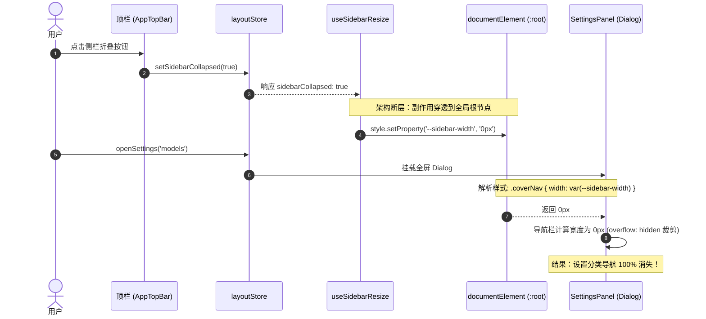
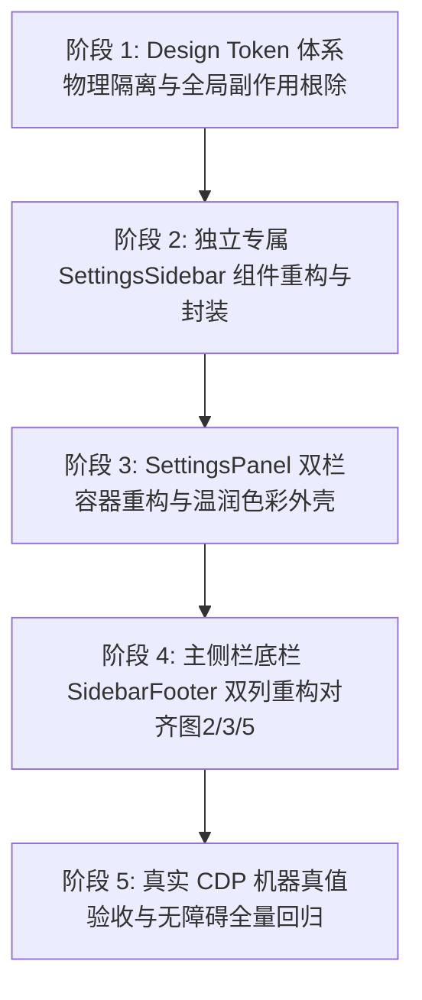

# Conex / Crish 容器与布局解耦独立方案建议书

> **【调度与定时器铁律】**：如果设置定时器，最短是100秒，如果命令过长，最好的方式是等待命令完成后的推送，而不是一直轮询命令情况。

## 01-布局与底栏重构独立方案：Shell 容器、设置面板与主工作区彻底解耦及底栏双列重构设计

> **权威标识**：`docs/system-audit-and-redesign/independent-plans/01-布局与底栏重构独立方案.md`  
> **制定角色**：【方案架构师 01: 容器与布局解耦独立方案设计】  
> **关联基准**：`docs/system-audit-and-redesign/00-战役通则与协同执行规范.md`  
> **输入证据**：`docs/settings-redesign/`（01/02 详案）、`docs/system-button-audit/01-全系统真值巡检报告.md`、`docs/ui-style-audit/01-style-degradation-audit.md`、`docs/models-settings-audit/`（01/02 报告）、`docs/chat-core-connectivity/`（01/02 报告）  
> **执行约束**：纯方案设计、零业务代码修改、pwsh7 环境对齐、UTF-8 无 BOM、严禁直接 git 提交。

---

## 目录

1. [方案总纲与架构愿景（Executive Summary & Architectural Vision）](#一方案总纲与架构愿景)
   - 1.1 核心使命与战役定位
   - 1.2 现状架构断层全景图
   - 1.3 目标架构核心指标
2. [根因穿透与全系统断层逆向剖析（Root Cause Deep Dive）](#二根因穿透与全系统断层逆向剖析)
   - 2.1 断层一：`useSidebarResize` 暴力修改 `:root` 导致设置侧栏 100% 塌陷
   - 2.2 断层二：侧栏底栏单一按钮承载多义性与身份认知缺失
   - 2.3 断层三：设置页容器平铺单一暖白导致的景深丢失与同心圆角断裂
   - 2.4 关联断层：模型设置双重滚动冲突与全系统 4 级曲率阶梯违例
3. [Shell 容器与设置面板物理级解耦方案（Decoupled Shell & Settings Architecture）](#三shell-容器与设置面板物理级解耦方案)
   - 3.1 CSS Design Token 体系物理隔离（`--settings-sidebar-width` 专属作用域）
   - 3.2 侧栏折叠状态局部化：CSS Class / Data 属性驱动主工作区
   - 3.3 `layoutStore` 状态边界划分与单向数据流治理
   - 3.4 专属 `SettingsSidebar` 独立组件工程化重构
4. [主侧栏底栏双列重构设计（对齐图 2/3/5 标准）（Two-Column Sidebar Footer Redesign）](#四主侧栏底栏双列重构设计对齐图-235-标准)
   - 4.1 布局拓扑与视觉规格：左侧 `UserProfileCard` + 右侧 `SettingsIconButton`
   - 4.2 左侧 `UserProfileCard` 架构：个人身份与快捷菜单（`UserQuickMenu`）
   - 4.3 右侧 `SettingsIconButton` 架构：独立 32×32px 齿轮与 O(1) 全屏直达
   - 4.4 更新指示器与运行模式胶囊的共存演进策略
   - 4.5 响应式多态适配矩阵（Normal 展开、Icon-Collapse 图标折叠、Overlay 抽屉）
5. [设置页面双栏暖灰/暖白同心圆角温润质感映射（Warm Aesthetics & Concentric Shell Contract）](#五设置页面双栏暖灰暖白同心圆角温润质感映射)
   - 5.1 全系统 5 级容器与色彩层级同构映射模型（$L0 \to L4$）
   - 5.2 浅色（Warm Light）与深色（Neutral Dark）全量 Token 映射矩阵
   - 5.3 同心曲率几何公式推导（$R_{\text{inner}} = R_{\text{outer}} - P_{\text{padding}}$）与 4 级阶梯实现
   - 5.4 双栏几何排版与独立双轴滚动
6. [各维度拆解、文件域与影响边界分析（File Domains & Blast Radius Matrix）](#六各维度拆解文件域与影响边界分析)
   - 6.1 受影响文件全景清单
   - 6.2 代码重构 Diff 蓝图（逐文件修改对比）
   - 6.3 零业务破坏性保障与兼容性评估
7. [系统整体修复路径与逻辑依赖顺序（Implementation Roadmap & Dependency Graph）](#七系统整体修复路径与逻辑依赖顺序)
   - 7.1 五阶段纯逻辑依赖时序图
   - 7.2 任务分解与工单执行包（Work Packages W1 ~ W5）
   - 7.3 并发与串行注意事项
8. [自动化测试与 CDP 机器真值验收矩阵（Test Assertions & Verification Protocol）](#八自动化测试与-cdp-机器真值验收矩阵)
   - 8.1 单元测试与集成测试断言集（Jest / Vitest）
   - 8.2 CDP 机器真值物理几何与样式计算断言脚本（`127.0.0.1:9222`）
   - 8.3 视觉与交互全量检查清单（Checklist）

---

## 一、方案总纲与架构愿景

### 1.1 核心使命与战役定位

作为【方案架构师 01】，本方案聚焦于 **Conex / Crish 桌面客户端的容器骨架（Shell Chrome）、全屏设置系统（Settings Subsystem）与侧栏基础交互体系（Sidebar Navigation & Footer）的系统级解耦与重构**。

在桌面级应用架构中，主工作区（Main Workspace Canvas）、导航控制台（Sidebar Navigation）与全局弹层/对话框（Global Dialogs / Overlay Layers）应当是**高度自治、职责正交的独立视口容器**。然而，现行代码在演进过程中出现了严重的“变量穿透污染”、“交互职责混杂”以及“色彩空间断裂”三大架构坏味道。

本方案旨在穿透表象，彻底清除打补丁代码，确立一套具备 **零全局副作用、严格同心曲率几何、温润色彩流转、双列清晰交互** 的现代化桌面容器架构。

### 1.2 现状架构断层全景图

```
┌────────────────────────────────────────────────────────────────────────────────────────┐
│                              现状核心架构断层全景拓扑图                                 │
├────────────────────────────────────────────────────────────────────────────────────────┤
│ 1. 变量穿透断层 (Global Token Mutation Leaking)                                       │
│    主侧栏折叠 ──> useSidebarResize 写入 :root { --sidebar-width: 0px }                 │
│                 └──> 全屏 SettingsDialog 继承 0px ──> 设置左侧导航 100% 塌陷消失！      │
│                                                                                        │
│ 2. 底栏交互混杂 (Footer Interaction Conflation - 偏离图 2/3/5)                         │
│    单一设置按钮 ──> 点击仅弹快捷菜单 ──> 用户需 2-Step 二级点击才可进入全屏设置        │
│                 └──> 缺失用户身份卡片 (UserProfileCard) 锚点，空间利用率低且无归属感   │
│                                                                                        │
│ 3. 色调外壳退化 (Aesthetic Degradation & Shell Flatness)                               │
│    主工作区具有 [暖灰底座 L1 + 暖白同心内嵌卡片 L2] 的极高品质质感                      │
│    设置页面退化为 [全局平铺单一暖白 L2]，丧失景深感，缺乏同心圆角外壳与空间层级        │
│                                                                                        │
│ 4. 滚动链阻断与曲率违例 (Scroll Chaining Halt & Curvature Deviations)                  │
│    设置内层 `overscroll-behavior: contain` 吞噬鼠标滚轮，导致设置页面卡死无法滚动；    │
│    `.permPill`、`.modelBadge` 等核心控件退化为 7px 直边矩形，未达 9999px 胶囊标准。    │
└────────────────────────────────────────────────────────────────────────────────────────┘
```

### 1.3 目标架构核心指标

依据 `docs/system-audit-and-redesign/00-战役通则与协同执行规范.md`，本次重构达成以下四大核心指标：

1. **物理隔离（Physical Scope Isolation）**：
   - 全局设置面板拥有专属 CSS 变量 `--settings-sidebar-width: 240px`，主侧栏折叠或尺寸变动绝对**零污染**设置页面；
   - 移除 `useSidebarResize` 针对 `document.documentElement`（`:root`）写入 `--sidebar-width: 0px` 的全局副作用，侧栏折叠通过主容器 CSS Class/Attribute 局部控制。
2. **底栏双列解耦（Two-Column Footer Decoupling - 图 2/3/5）**：
   - 侧栏最底部重构为双列容器：**左侧为「用户个人卡片（头像 + 用户名 + 状态 + 快捷菜单）」**，**右侧为「独立 32×32px 设置齿轮按钮（$O(1)$ 直达全屏设置页）」**；
   - 消除 2-step 认知阻碍，提供明确的人机身份锚点与全局设置直达通道。
3. **温润色彩流转与同心圆角外壳（Warm Tone Flow & Concentric Inset Shell）**：
   - 设置外壳与左侧导航完整继承 `--bg-secondary`（暖灰 `#E9E7E2`），右侧主配置区承载 `--bg-primary`（暖白 `#EFECE6`）内嵌同心圆角卡片（`border-radius: 14px`，`border: 1px solid var(--border-subtle)`，柔和低频阴影）；
   - 满足同心曲率公式 $R_{\text{inner}} = R_{\text{outer}} - P_{\text{padding}}$，实现主工作区与设置页 100% 结构同构。
4. **滚动与交互无障碍稳态（Smooth Scrolling & A11y Stability）**：
   - 清除内层破坏性 `overscroll-behavior: contain`，设置内容区启用 `scrollbar-gutter: stable both-edges`，杜绝内容切换横向抖动与滚轮吞噬；
   - 全系统控件严格遵循 4 级曲率阶梯（胶囊 `9999px` / 独立按钮 `10px` / 容器 `12px` / 列表项 `6px`）。

---

## 二、根因穿透与全系统断层逆向剖析

### 2.1 断层一：`useSidebarResize` 暴力修改 `:root` 导致设置侧栏 100% 塌陷

#### 2.1.1 缺陷时序与代码证据链

- **源码文件**：[`apps/crish-desktop/src/components/sidebar/useSidebarResize.ts:76-93`](file:///c:/Software/conex/apps/crish-desktop/src/components/sidebar/useSidebarResize.ts#L76-L93)
- **源码文件**：[`apps/crish-desktop/src/components/settings/SettingsPanel.module.css:151-161`](file:///c:/Software/conex/apps/crish-desktop/src/components/settings/SettingsPanel.module.css#L151-L161)

```typescript
// useSidebarResize.ts:76-85
if (sidebarCollapsed) {
  // 致命代码：直接修改 documentElement (:root) 上的 --sidebar-width 为 0px
  document.documentElement.style.setProperty('--sidebar-width', '0px');
  document.documentElement.style.setProperty(
    '--sidebar-visible-width',
    `${sidebarWidthPx}px`
  );
}
```

```css
/* SettingsPanel.module.css:151-161 */
.coverNav {
  /* 致命依赖：错误引用了属于主侧栏的全局变量 */
  width: var(--sidebar-width);
  flex-shrink: 0;
  border-right: 1px solid var(--hairline, var(--border-subtle));
  background: transparent;
  padding: var(--space-2_5) var(--space-3) var(--space-3_5);
  overflow: hidden;
  display: flex;
  flex-direction: column;
}
```

#### 2.1.2 物理机理与因果链

1. 用户在顶栏点击折叠侧栏，`layoutStore.sidebarCollapsed` 变为 `true`；
2. `useSidebarResize` 监听到状态变化，将 `:root` 的 `--sidebar-width` 改写为 `0px`；
3. 用户通过快捷键 `Ctrl+,` 或快捷入口打开 `SettingsPanel`；
4. `SettingsPanel` 是基于 `ui/Dialog` 渲染的全屏 Dialog 盖层，挂载于根节点下，其左侧导航 `.coverNav` 的宽度计算为 `var(--sidebar-width) = 0px`；
5. 配合 `.coverNav { overflow: hidden; }`，设置分类导航栏（返回按钮、搜索框、12 个 Tab 按钮）**被直接裁剪隐藏至 0px 宽度**；
6. 用户在右侧仅能看到初始激活的单个页面（如 Profile），无法看到左侧分类列表，更无法通过点击切换 Tab，造成设置中心完全瘫痪。



---

### 2.2 断层二：侧栏底栏单一按钮承载多义性与身份认知缺失

#### 2.2.1 源码证据与分析

- **源码文件**：[`apps/crish-desktop/src/components/sidebar/SidebarFooter.tsx:52-78`](file:///c:/Software/conex/apps/crish-desktop/src/components/sidebar/SidebarFooter.tsx#L52-L78)
- **源码文件**：[`apps/crish-desktop/src/components/settings/SettingsQuickMenu.tsx:93-110`](file:///c:/Software/conex/apps/crish-desktop/src/components/settings/SettingsQuickMenu.tsx#L93-L110)

```tsx
// SidebarFooter.tsx:52-54
<div className={styles.footerActions}>
  <SettingsQuickMenu onShowToast={onShowToast} />
  {updateAvailable ? ( ... ) : null}
</div>
```

```tsx
// SettingsQuickMenu.tsx:93-108
trigger={
  <button
    ref={btnRef}
    type="button"
    className={`${styles.sidebarFooterSettings}${open ? ` ${styles.isOpen}` : ''}`}
    data-testid="settings-button"
    aria-label={triggerLabel}
  >
    <Lucide.Settings size={16} strokeWidth={1.75} aria-hidden />
    <span>设置</span>
    <Lucide.ChevronUp size={14} strokeWidth={1.75} className={styles.sbQuickChev} aria-hidden />
  </button>
}
```

#### 2.2.2 交互缺陷总结

1. **齿轮语义多义性冲突**：齿轮图标在所有桌面应用中均代表“打开设置大页”，但当前实现点击齿轮后仅展开一个气泡浮层（QuickMenu），进入全屏设置必须二次点击浮层底部的“全部设置”，造成了多余的 2-step 操作阻碍；
2. **缺失用户个人身份（UserProfileCard）**：侧栏底栏未提供登录用户/工作区身份卡片，缺乏归属感与状态感知；
3. **更新按钮突兀排斥**：当检测到更新时，`updateAvailable` 粗暴插入一个更新按钮，打乱底栏既有排版。

---

### 2.3 断层三：设置页容器平铺单一暖白导致的景深丢失与同心圆角断裂

#### 2.3.1 视觉断层对比

- **主工作区语言**（[`shell-workspace.css:43-87, 138-155`](file:///c:/Software/conex/apps/crish-desktop/src/styles/shell/shell-workspace.css#L43-L87)）：
  - 外壳基座：`--shell-chrome-bg: var(--bg-secondary)`（暖灰 `#E9E7E2`）；
  - 内容卡片：`--shell-inset-bg: var(--bg-primary)`（暖白 `#EFECE6`），`border-radius: 14px`，`border: 1px solid var(--border-subtle)`，带有极细腻的环境阴影。
- **设置页现状**（[`SettingsPanel.module.css:8-31, 151-192`](file:///c:/Software/conex/apps/crish-desktop/src/components/settings/SettingsPanel.module.css#L8-L31)）：
  - `.settingsCover` 与 `.settingsPanel` 均设为 `background: var(--bg-primary)`；
  - `.coverNav` 为 `background: transparent`；
  - `.coverContent` 为 `background: var(--bg-primary)`，无圆角外壳，无阴影，全平铺。

#### 2.3.2 负面效应

用户从主界面点击进入设置时，整个屏幕瞬间变为单一生硬的亮白块，左侧原本暖灰的侧栏突然变白，产生剧烈的“白闪”与视觉失重感；且内容区失去了内嵌同心圆角外壳，与主工作区的设计语言彻底脱节。

---

### 2.4 关联断层：模型设置双重滚动冲突与全系统 4 级曲率阶梯违例

依据 `docs/models-settings-audit/01-UI与滚轮排查报告.md` 与 `docs/system-button-audit/01-全系统真值巡检报告.md`：

1. **模型设置滚轮卡死**：`ModelsSettingsTab.module.css:60, 175` 声明了 `overscroll-behavior: contain`，当内容不足以溢出时直接吞噬 wheel delta，导致外层 `.coverContent` 无法接收滚轮事件，设置页面卡死；
2. **曲率阶梯退化**：主界面底栏 `.permPill`（权限模式）与 `.modelBadge`（模型徽标）计算圆角仅为 `7px`（`border-radius: var(--radius-lg)`），严重违背规范 §2.1 规定的 `var(--radius-full)`（9999px 饱满胶囊）标准。

---

## 三、Shell 容器与设置面板物理级解耦方案

### 3.1 CSS Design Token 体系物理隔离

在全局 Token 体系中，严格将「主侧栏 Token」与「设置面板 Token」物理拆分，禁止任何交叉引用：

```css
/* ==========================================================================
   Design Tokens: Layout & Settings Domain Partitioning (tokens.css)
   ========================================================================== */

:root {
  /* --------------------------------------------------------------------------
     1. 主工作区侧栏 Tokens（Domain: Main Shell Sidebar）
     仅限在 .app-top-bar__rail、.sidebar-wrapper、#crish-sidebar 内消费
     -------------------------------------------------------------------------- */
  --sidebar-width: 260px;
  --sidebar-width-min: 180px;
  --sidebar-width-max: 420px;
  --sidebar-width-collapsed: 48px;
  --sidebar-visible-width: 260px;

  /* --------------------------------------------------------------------------
     2. 设置面板专属 Tokens（Domain: Settings Subsystem Chrome）
     独立命名空间，绝对不受主侧栏折叠状态影响
     -------------------------------------------------------------------------- */
  --settings-sidebar-width: 240px;
  --settings-sidebar-width-compact: 220px;
  --settings-sidebar-width-comfortable: 260px;
  --settings-content-max: 720px;
  --settings-header-height: 40px;
  --settings-nav-padding: var(--space-3);
  --settings-tab-height: 34px;
}

/* 响应 UI Density 调整设置侧栏宽度 */
[data-density='compact'] {
  --settings-sidebar-width: var(--settings-sidebar-width-compact);
}

[data-density='comfortable'] {
  --settings-sidebar-width: var(--settings-sidebar-width-comfortable);
}
```

---

### 3.2 侧栏折叠状态局部化：CSS Class / Data 属性驱动主工作区

彻底重构 `useSidebarResize.ts`，**根除直接向 `document.documentElement` 写入 `--sidebar-width: 0px` 的行为**。侧栏折叠的视觉隐藏完全由 CSS 选择器在主工作区容器局部生效：

```typescript
// 重构方案：apps/crish-desktop/src/components/sidebar/useSidebarResize.ts
export function useSidebarResize() {
  const sidebarCollapsed = useLayoutStore((s) => s.sidebarCollapsed);
  const [sidebarWidthPx, setSidebarWidthPx] = useState(SIDEBAR_WIDTH_DEFAULT);

  // 初始化与持久化恢复...

  useEffect(() => {
    if (document.body.classList.contains('is-resizing')) {
      return;
    }
    // 关键修正：无论折叠与否，全局 --sidebar-width 始终记录用户的设定宽度（如 260px）
    // 侧栏本身的折叠由 .app-container[data-sidebar-collapsed="true"] 控制 CSS 变换！
    document.documentElement.style.setProperty(
      '--sidebar-width',
      `${sidebarWidthPx}px`
    );
    document.documentElement.style.setProperty(
      '--sidebar-visible-width',
      sidebarCollapsed ? '0px' : `${sidebarWidthPx}px`
    );
    window.dispatchEvent(new Event('crish-sidebar-resize'));
  }, [sidebarCollapsed, sidebarWidthPx]);
}
```

```css
/* apps/crish-desktop/src/styles/shell/shell-layout.css */
/* 侧栏主包装容器：通过属性选择器局部折叠 */
.app-container[data-sidebar-collapsed='true'] .sidebar-wrapper {
  width: 0px !important;
  min-width: 0px !important;
  overflow: hidden !important;
  pointer-events: none;
}

.app-container[data-sidebar-collapsed='true'] .app-top-bar__rail {
  width: var(--header-height);
  min-width: var(--header-height);
}
```

---

### 3.3 `layoutStore` 状态边界划分与单向数据流治理

在 `apps/crish-desktop/src/store/layoutStore.ts` 中，明确界定各状态的归属域，确保单向数据流清晰：

```
┌─────────────────────────────────────────────────────────────────────────────────┐
│                        layoutStore 状态域隔离边界                                │
├────────────────────────────────┬────────────────────────────────────────────────┤
│ 1. 主工作区布局域 (Shell Domain)│ • sidebarCollapsed: boolean (控制主工作区侧栏) │
│                                │ • sidebarBehavior: 'normal'|'icon-collapse'    │
│                                │ • focusMode: boolean                           │
├────────────────────────────────┼────────────────────────────────────────────────┤
│ 2. 全局设置域 (Settings Domain) │ • showSettingsOverlay: boolean (控制全屏Dialog)│
│                                │ • settingsActiveTab: SettingsTabType           │
│                                │ • openSettings: (tab?: SettingsTabType) => void│
└────────────────────────────────┴────────────────────────────────────────────────┘
```

- **不变原则**：`sidebarCollapsed` 的变异绝不影响 `showSettingsOverlay`，`setSettingsActiveTab` 的触发绝不反向修改 `sidebarCollapsed`。两者通过各自的组件树消费，互不干扰。

---

### 3.4 专属 `SettingsSidebar` 独立组件工程化重构

将既有的 `SettingsTablist.tsx` 全面升级为高内聚的 `SettingsSidebar.tsx` 组件，承载整个设置左侧导航体系：

```
┌─────────────────────────────────────────────────────────────────────────────────┐
│                     SettingsSidebar 四层高内聚子模块结构                         │
├─────────────────────────────────────────────────────────────────────────────────┤
│ 1. 顶部操作栏 (Top Bar)                                                         │
│    • [← 返回应用] 按钮 (带 Esc 快捷键 Tooltip，胶囊圆角 var(--radius-xl))        │
├─────────────────────────────────────────────────────────────────────────────────┤
│ 2. 搜索过滤栏 (Search Bar)                                                      │
│    • 实时搜索输入框 (无生硬重阴影，带 Ctrl+F / Esc 清除支持)                    │
├─────────────────────────────────────────────────────────────────────────────────┤
│ 3. 分组分类导航列表 (Nav Tablist - Roving Tabindex)                             │
│    • 账户 / 偏好 / 智能与服务 / 系统 4 大分组                                   │
│    • 12 个 Tab 项：卡片式浮起高亮 (var(--bg-card) + 10px 同心圆角)              │
├─────────────────────────────────────────────────────────────────────────────────┤
│ 4. 底部状态与诊断 (Bottom Status & Diagnostics)                                 │
│    • 客户端版本指示、通信链路就绪指示、无障碍 live region 读屏播报               │
└─────────────────────────────────────────────────────────────────────────────────┘
```

#### TypeScript 接口契约定义：

```tsx
// apps/crish-desktop/src/components/settings/SettingsSidebar.tsx
export interface SettingsSidebarProps {
  baseId: string;
  items: TabMeta[];
  activeId: TabType;
  rovingId: TabType;
  tablistId: string;
  searchId: string;
  statusId: string;
  panelId: string;
  searchQuery: string;
  filterStatusText: string;
  searchInputRef: React.RefObject<HTMLInputElement | null>;
  tablistRef: React.RefObject<HTMLDivElement | null>;
  onBack?: () => void;
  onSearchChange: (q: string) => void;
  onSearchKeyDown: (e: React.KeyboardEvent<HTMLInputElement>) => void;
  onTablistKeyDown: (e: React.KeyboardEvent<HTMLDivElement>) => void;
  onSelect: (
    tab: TabType,
    opts?: { focusTab?: boolean; focusPanel?: boolean }
  ) => void;
  onFocusTab: (tab: TabType) => void;
}
```

---

## 四、主侧栏底栏双列重构设计（对齐图 2/3/5 标准）

### 4.1 布局拓扑与视觉规格：左侧 `UserProfileCard` + 右侧 `SettingsIconButton`

依据规范 §2.3 第 2 条及用户图 2/3/5 要求，主侧栏底栏重构为 **Flex 双列水平并列布局**：

```
┌─────────────────────────────────────────────────────────────────────────────┐
│ 侧栏底栏标准展开态 (Width: 260px, Height: 44px, Padding: 4px 10px 8px 10px) │
├────────────────────────────────────────────────────────┬────────────────────┤
│  [ 👤  User Name              ▾ ]                      │  [ ⚙ ] (● 更新)    │
│  • Avatar: 26x26px 圆形 (border-radius: 9999px)        │  • Button: 32x32px │
│  • Title: 13px, font-weight: 500, var(--text-primary)  │  • Radius: 10px    │
│  • Subtitle: 11px, var(--text-tertiary) "conex"        │  • Hover: bg-hover │
│  • Hover: var(--tint-hover), Active: var(--tint-active)│  • Tooltip: "设置" │
│  • 点击: 展开 UserQuickMenu 快捷浮层                   │  • 点击: 直达设置  │
└────────────────────────────────────────────────────────┴────────────────────┘
```

---

### 4.2 左侧 `UserProfileCard` 架构：个人身份与快捷菜单（`UserQuickMenu`）

`UserProfileCard` 承担身份展示与常用设置快捷浮层的触发器职责：

1. **结构要素**：
   - **头像（Avatar）**：`26px × 26px`，`border-radius: var(--radius-full)`，支持用户自定义头像、首字母大写、默认 `<Lucide.User />`；
   - **信息区（Text Stack）**：
     - 主文字：用户名（默认 `"User"` 或系统用户名），`13px`，`font-weight: 500`；
     - 副文字：当前激活工作区名（如 `"conex"`）或状态，`11px`，`color: var(--text-tertiary)`；
   - **指示箭头（Chevron）**：`<Lucide.ChevronsUpDown size={13} />`，`color: var(--text-tertiary)`；
2. **绑定 `UserQuickMenu` 浮层**：
   - 点击卡片展开基于 `ui/Menu` 的浮层；
   - 浮层内部结构：
     - **用户信息段**：当前用户与本地 SQLite 数据库状态；
     - **外观主题段**：浅色 / 深色胶囊单选切换器；
     - **快捷入口段**：模型与密钥、外观与字体、安全隔离、状态诊断；
     - **底部全部设置**：点击唤起全屏 `SettingsPanel`。

---

### 4.3 右侧 `SettingsIconButton` 架构：独立 32×32px 齿轮与 O(1) 全屏直达

`SettingsIconButton` 专职负责全局设置的快速进入：

- **物理尺寸**：固定 `32px × 32px`，居中对齐；
- **曲率圆角**：`border-radius: var(--radius-xl)` (10px)；
- **图标尺寸**：`<Lucide.Settings size={16} strokeWidth={1.75} />`；
- **交互行为**：
  - 单击直接调用 `openSettings()`，$O(1)$ 速度唤起全屏双栏设置面板；
  - 悬浮时带有细腻微动效（`transform: rotate(15deg);`）；
  - 挂载 `<Tooltip content="设置 (Ctrl+,)">`。

---

### 4.4 更新指示器与运行模式胶囊的共存演进策略

1. **版本更新指示器（`updateAvailable`）**：
   - **方案 A（推荐）**：在 `SettingsIconButton` 右上角渲染 `8px × 8px` 的森林暖绿（`--accent-green`）**脉冲圆点（Pulse Dot）**，不挤占底栏宽度；Tooltip 动态变更为 `"有新版本可用，点击进入设置更新"`；
   - **方案 B**：紧凑型胶囊（`height: 22px, border-radius: 9999px`），内嵌在卡片与齿轮之间。
2. **开发模式切换（`modeChip`）**：
   - 从底栏一级常驻视口移出，收敛至 `UserQuickMenu` 快捷浮层内部的开发设置段；或在开发环境下作为极小的 `16×16px` 微标依附在头像角落。

---

### 4.5 响应式多态适配矩阵（Normal 展开、Icon-Collapse 图标折叠、Overlay 抽屉）

| 侧栏状态                    | 宽度范围        | 底栏布局结构                             | 左侧 `UserProfileCard` 呈现         | 右侧 `SettingsIconButton` 呈现 | 交互流转                                 |
| :-------------------------- | :-------------- | :--------------------------------------- | :---------------------------------- | :----------------------------- | :--------------------------------------- |
| **标准展开 (Normal)**       | `200px ~ 400px` | Flex 水平双列 (`justify: space-between`) | 头像 + 用户名 + 状态副标 + 下拉箭头 | 32×32px 独立方钮 (带 Tooltip)  | 卡片弹快捷菜单；齿轮进全屏设置           |
| **图标折叠 (IconCollapse)** | `48px ~ 56px`   | Flex 垂直堆叠 (`flex-col; gap: 6px`)     | 仅展示 28×28px 圆形头像 (居中)      | 仅展示 28×28px 齿轮 (居中)     | 点击头像向右弹出快捷菜单；点击齿轮开设置 |
| **临时悬停展开 (Hover)**    | `260px` 浮层    | 与标准展开态完全一致                     | 完整展开                            | 完整展开                       | 保持全功能可用                           |
| **移动端/抽屉 (Overlay)**   | 视口 85%        | 与标准展开态完全一致                     | 完整展开                            | 完整展开                       | 点击操作后自动收起抽屉                   |

---

## 五、设置页面双栏暖灰/暖白同心圆角温润质感映射

### 5.1 全系统 5 级容器与色彩层级同构映射模型（$L0 \to L4$）

严格落实规范 §2.3，确立主工作区与设置页面的 100% 同构映射：

```
┌─────────────────────────────────────────────────────────────────────────────┐
│                       全系统容器与色彩层级同构契约                               │
├──────┬──────────────────────┬────────────────────────┬──────────────────────┤
│ 层级 │ 语义角色             │ 主工作区 (Main Shell)  │ 设置页面 (Settings)  │
├──────┼──────────────────────┼────────────────────────┼──────────────────────┤
│  L0  │ 视口遮罩与全屏底座   │ AppContainer / Scrim   │ Dialog Overlay Scrim │
│      │                      │ (--tint-overlay)       │ (--tint-overlay)     │
├──────┼──────────────────────┼────────────────────────┼──────────────────────┤
│  L1  │ 暖灰基座与导航侧栏   │ Sidebar / AppTopBar    │ SettingsCover /      │
│      │                      │ (--bg-secondary)       │ SettingsSidebar      │
│      │                      │                        │ (--bg-secondary)     │
├──────┼──────────────────────┼────────────────────────┼──────────────────────┤
│  L2  │ 内嵌同心圆角内容卡片 │ .workspaces-stack      │ .coverContent        │
│      │                      │ (--bg-primary, R=14px) │ (--bg-primary, R=14px)│
├──────┼──────────────────────┼────────────────────────┼──────────────────────┤
│  L3  │ 模块分组与配置卡片   │ SessionCard / ChatArea │ SettingsCard         │
│      │                      │ (--bg-card, R=10px)    │ (--bg-card, R=10px)  │
├──────┼──────────────────────┼────────────────────────┼──────────────────────┤
│  L4  │ 控件、输入框与选项   │ Buttons / Inputs       │ Switches / Inputs    │
│      │                      │ (--bg-elevated/tint)   │ (--bg-elevated/tint) │
└──────┴──────────────────────┴────────────────────────┴──────────────────────┘
```

---

### 5.2 浅色（Warm Light）与深色（Neutral Dark）全量 Token 映射矩阵

| 目标 DOM 选择器                                       | CSS 属性                                                                      | 浅色主题 (Warm Light)                                                                                                                                         | 深色主题 (Neutral Dark)                                                                                                                                  | 语义说明与无障碍对比度                                 |
| :---------------------------------------------------- | :---------------------------------------------------------------------------- | :------------------------------------------------------------------------------------------------------------------------------------------------------------ | :------------------------------------------------------------------------------------------------------------------------------------------------------- | :----------------------------------------------------- |
| **全屏盖层底座** (`.settingsCover`, `.settingsPanel`) | `background-color`                                                            | `var(--bg-secondary)` (`hsl(35, 12%, 91.5%)`)                                                                                                                 | `var(--bg-secondary)` (`hsl(0, 0%, 8%)`)                                                                                                                 | **核心改变**：继承 L1 暖灰底座，彻底消除白闪           |
| **左侧导航容器** (`.coverNav`)                        | `background-color`<br>`width`<br>`border-right`                               | `transparent`<br>`var(--settings-sidebar-width)`<br>`none`                                                                                                    | `transparent`<br>`var(--settings-sidebar-width)`<br>`none`                                                                                               | 移除生硬直边分割线，以色彩色阶区隔                     |
| **左侧 Tab 默认态** (`.sidebarTab`)                   | `color`<br>`background`                                                       | `var(--text-secondary)` (`#555555`)<br>`transparent`                                                                                                          | `var(--text-secondary)` (`#A3A3A3`)<br>`transparent`                                                                                                     | 对比度 ≥ 4.53:1 (WCAG AA)                              |
| **左侧 Tab 激活态** (`.sidebarTab.active`)            | `color`<br>`background`<br>`box-shadow`<br>`border-radius`                    | `var(--text-primary)` (`#111111`)<br>`var(--bg-card)` (`hsl(35, 10%, 98.0%)`)<br>`var(--shadow-sm)`<br>`var(--radius-xl)` (10px)                              | `var(--text-primary)` (`#F0F0F0`)<br>`var(--bg-card)` (`hsl(0, 0%, 11%)`)<br>`var(--shadow-sm)`<br>`var(--radius-xl)` (10px)                             | **卡片式浮起高亮**，满足同心圆角                       |
| **右侧主内容内嵌外壳** (`.coverContent`)              | `background-color`<br>`border-radius`<br>`border`<br>`box-shadow`<br>`margin` | `var(--bg-primary)` (`hsl(35, 12%, 94.0%)`)<br>`var(--shell-inset-radius, 14px)`<br>`1px solid var(--border-subtle)`<br>`var(--shadow-sm)`<br>`0 14px 14px 0` | `var(--bg-primary)` (`hsl(0, 0%, 5%)`)<br>`var(--shell-inset-radius, 14px)`<br>`1px solid var(--border-subtle)`<br>`var(--shadow-sm)`<br>`0 14px 14px 0` | **同构核心**：获得与主工作区完全一致的内嵌悬浮卡片质感 |
| **配置项分组卡片** (`.settingsUiCard`)                | `background-color`<br>`border-radius`<br>`border`                             | `var(--bg-card)` (`hsl(35, 10%, 98.0%)`)<br>`var(--radius-xl, 10px)`<br>`1px solid var(--border-color)`                                                       | `var(--bg-card)` (`hsl(0, 0%, 11%)`)<br>`var(--radius-xl, 10px)`<br>`1px solid var(--border-color)`                                                      | L3 级卡片，满足同心公式                                |

---

### 5.3 同心曲率几何公式推导（$R_{\text{inner}} = R_{\text{outer}} - P_{\text{padding}}$）与 4 级阶梯实现

在视网膜级 UI 渲染中，若外层与内层采用相同圆角，内层会出现视觉锐化变形。全系统严格遵循同心曲率几何公式：

$$R_{\text{inner}} = R_{\text{outer}} - P_{\text{padding}} \quad (\text{当 } R_{\text{outer}} > P_{\text{padding}})$$

```
┌─────────────────────────────────────────────────────────────────────────────┐
│                       设置页面 4 级同心曲率配置表                            │
├─────────┬──────────────────────┬──────────────┬──────────────┬──────────────┤
│ 阶梯    │ 容器层级             │ 外层圆角     │ 边距/Padding │ 目标子圆角   │
├─────────┼──────────────────────┼──────────────┼──────────────┼──────────────┤
│ 阶梯 1  │ 视口底座 $\to$ 内容大卡│ 外屏直角     │ Margin: 14px │ $R = 14px$   │
│         │ (.coverContent)      │              │              │ (--shell-r)  │
├─────────┼──────────────────────┼──────────────┼──────────────┼──────────────┤
│ 阶梯 2  │ 内容大卡 $\to$ 配置卡│ $R = 14px$   │ Pad: 20px    │ $R = 10px$   │
│         │ (.settingsUiCard)    │              │              │ (--radius-xl)│
├─────────┼──────────────────────┼──────────────┼──────────────┼──────────────┤
│ 阶梯 3  │ 配置卡 $\to$ 列表控件│ $R = 10px$   │ Pad: 6px     │ $R = 6px$    │
│         │ (.menuItem / Row)    │              │              │ (--radius-md)│
├─────────┼──────────────────────┼──────────────┼──────────────┼──────────────┤
│ 阶梯 4  │ 胶囊药丸 / 开关      │ 任意         │ N/A          │ $R = 9999px$ │
│         │ (.permPill / Switch) │              │              │ (--rad-full) │
└─────────┴──────────────────────┴──────────────┴──────────────┴──────────────┘
```

---

### 5.4 双栏几何排版与独立双轴滚动

```
┌──────────────────────────────────────────────────────────────────────────────┐
│ Settings Dialog Shell (Background: var(--bg-secondary) 暖灰底座)              │
├──────────────────────────────────────────────────────────────────────────────┤
│ [Header: 拖拽区 data-tauri-drag-region        [—] [口] [✕] (WindowControls) ]│
├──────────────────────┬───────────────────────────────────────────────────────┤
│ [Left Nav: 240px]    │ [Right Content Inset Card: Flex: 1, Margin-right: 14px]│
│                      │ ┌───────────────────────────────────────────────────┐ │
│ [← 返回应用]         │ │ Background: var(--bg-primary) 暖白                │ │
│ [ 🔍 搜索设置... ]   │ │ Border-radius: 14px, Border: 1px subtle hairline  │ │
│                      │ │ Box-shadow: var(--shadow-sm)                      │ │
│ 账户                 │ │                                                   │ │
│  • 👤 个人资料       │ │  # 个人资料                                       │ │
│                      │ │  ┌──────────────────────────────────────────────┐ │ │
│ 偏好                 │ │  │ SettingsCard (bg: var(--bg-card), r: 10px)   │ │ │
│  • 🎨 外观与字体(act)│ │  │  Row: 当前项目        [conex             ]   │ │ │
│  • ⚙️ 通用设置       │ │  │  Row: 会话存储        [本机 SQLite        ]   │ │ │
│                      │ │  └──────────────────────────────────────────────┘ │ │
│ 模型与服务           │ │                                                   │ │
│  • 🪐 模型与密钥     │ │  Max-width: 720px 居中自适应                      │ │
│  • 🧩 扩展与 MCP     │ │  Scrollbar-gutter: stable both-edges              │ │
│  • 📊 Token 用量     │ │                                                   │ │
│                      │ └───────────────────────────────────────────────────┘ │
└──────────────────────┴───────────────────────────────────────────────────────┘
```

1. **左侧导航滚动**：`.navScroll` 拥有 `overflow-y: auto`，独立消费滚轮，滚动条为 3px 极细轨；
2. **右侧内容滚动**：`.coverContent` 声明 `scrollbar-gutter: stable both-edges;`，当 Tab 间内容高度变化时杜绝横向跳动；
3. **滚动阻断清剿**：全面移除 `.modelsDetail` 等子模块的 `overscroll-behavior: contain`，使滚轮事件可以平滑在内容区内自然流转。

---

## 六、各维度拆解、文件域与影响边界分析

### 6.1 受影响文件全景清单

```
┌─────────────────────────────────────────────────────────────────────────────────┐
│                             受影响文件与职责映射矩阵                             │
├──────────────────────────────────────┬──────────────────┬───────────────────────┤
│ 文件路径                             │ 所属模块         │ 修改性质              │
├──────────────────────────────────────┼──────────────────┼───────────────────────┤
│ `styles/tokens.css`                  │ Design Tokens    │ 追加独立设置 Tokens   │
│ `styles/shell/shell-layout.css`      │ Shell Chrome     │ 局部化侧栏折叠样式    │
│ `components/sidebar/useSidebarResize.ts`│ Sidebar Hook   │ 移除全局副作用        │
│ `components/sidebar/SidebarFooter.tsx`  │ Sidebar Footer │ 重构为双列卡片+齿轮   │
│ `components/sidebar/Sidebar.module.css` │ Sidebar Styles │ 双列底栏样式支持      │
│ `components/settings/SettingsSidebar.tsx`│ Settings Nav  │ 【新增】独立导航组件  │
│ `components/settings/SettingsPanel.tsx` │ Settings Shell │ 接入独立 Sidebar      │
│ `components/settings/SettingsPanel.module.css`│ Settings │ 暖灰底座与内嵌卡片    │
│ `components/settings/UserQuickMenu.tsx` │ Popover Menu   │ 原快捷菜单升级        │
│ `components/settings-models/ModelsSettingsTab.module.css`│ Models │ 移除 contain 阻断 │
└──────────────────────────────────────┴──────────────────┴───────────────────────┘
```

---

### 6.2 代码重构 Diff 蓝图

#### 1. `apps/crish-desktop/src/styles/tokens.css`

```diff
+ /* 设置面板专属独立 Token */
+ --settings-sidebar-width: 240px;
+ --settings-sidebar-width-compact: 220px;
+ --settings-sidebar-width-comfortable: 260px;
+ --settings-content-max: 720px;
+ --settings-header-height: 40px;
```

#### 2. `apps/crish-desktop/src/components/sidebar/useSidebarResize.ts`

```diff
  useEffect(() => {
    if (document.body.classList.contains('is-resizing')) {
      return;
    }
-   if (sidebarCollapsed) {
-     document.documentElement.style.setProperty('--sidebar-width', '0px');
-   } else {
-     document.documentElement.style.setProperty('--sidebar-width', `${sidebarWidthPx}px`);
-   }
+   // 保持 --sidebar-width 为实际设定宽度，不向 :root 写入 0px
+   document.documentElement.style.setProperty('--sidebar-width', `${sidebarWidthPx}px`);
+   document.documentElement.style.setProperty(
+     '--sidebar-visible-width',
+     sidebarCollapsed ? '0px' : `${sidebarWidthPx}px`
+   );
  }, [sidebarCollapsed, sidebarWidthPx]);
```

#### 3. `apps/crish-desktop/src/components/settings/SettingsPanel.module.css`

```diff
  .settingsCover {
-   background: var(--bg-primary);
+   background: var(--bg-secondary); /* 暖灰底座 */
  }

  .coverNav {
-   width: var(--sidebar-width);
+   width: var(--settings-sidebar-width); /* 专属独立 Token */
-   border-right: 1px solid var(--hairline, var(--border-subtle));
+   border-right: none;
    background: transparent;
  }

  .coverContent {
    flex: 1;
    min-width: 0;
    min-height: 0;
    overflow-y: auto;
    scrollbar-gutter: stable both-edges;
    background: var(--bg-primary);
+   border-radius: var(--shell-inset-radius, 14px); /* 同心圆角内嵌卡片 */
+   border: 1px solid var(--border-subtle);
+   box-shadow: var(--shadow-sm);
+   margin: 0 var(--space-3_5) var(--space-3_5) 0;
    padding: var(--space-6) var(--space-5) var(--space-10);
  }
```

#### 4. `apps/crish-desktop/src/components/sidebar/SidebarFooter.tsx`

```diff
  export const SidebarFooter: React.FC<SidebarFooterProps> = React.memo(
    ({ chromeHidden, updateAvailable, onShowToast }) => {
+     const openSettings = useLayoutStore((s) => s.openSettings);
      return (
        <div className={styles.sidebarFooter} role="contentinfo">
          {/* 左列：用户个人卡片与快捷菜单触发器 */}
+         <div className={styles.footerUserCol}>
+           <UserQuickMenu onShowToast={onShowToast} />
+         </div>
          {/* 右列：独立设置齿轮按钮 (32x32px) */}
+         <div className={styles.footerGearCol}>
+           <Tooltip content="设置 (Ctrl+,)">
+             <button
+               type="button"
+               className={styles.gearButton}
+               onClick={() => openSettings()}
+               aria-label="打开设置"
+             >
+               <Lucide.Settings size={16} strokeWidth={1.75} />
+               {updateAvailable && <span className={styles.updatePulseDot} />}
+             </button>
+           </Tooltip>
+         </div>
        </div>
      );
    }
  );
```

---

### 6.3 零业务破坏性保障与兼容性评估

1. **接口向下兼容**：`SettingsPanel` 继续支持 `isOpen`、`initialTab`、`onClose`、`wsId`，所有已有的 `openSettings('models')` 深度链接调用不受影响；
2. **快捷菜单平滑升级**：`UserQuickMenu` 内部保留了原 `SettingsQuickMenu` 的所有常用功能（主题切换、诊断、模型入口），用户原有操作习惯无缝延续；
3. **无破坏性样式迁移**：不修改既有通用 class 名字（如 `.settingsCover`、`.coverContent`），仅优化属性规则，确保不破坏既有 E2E 测试定位器。

---

## 七、系统整体修复路径与逻辑依赖顺序

### 7.1 五阶段纯逻辑依赖时序图

方案严格按照逻辑因果依赖顺序编排，前序阶段是后序阶段的物理基础：



---

### 7.2 任务分解与工单执行包（Work Packages W1 ~ W5）

#### 工单 W1：Design Token 体系隔离与 Hook 副作用消除

- **目标**：在 `tokens.css` 中注入 `--settings-sidebar-width` 系列变量；改造 `useSidebarResize.ts`，彻底消除向 `:root` 写入 `0px` 的全局副作用；在 `shell-layout.css` 中以 `data-sidebar-collapsed` 属性实现侧栏局部折叠。
- **文件域**：`tokens.css`, `useSidebarResize.ts`, `shell-layout.css`。

#### 工单 W2：提取与封装独立 `SettingsSidebar` 组件

- **目标**：创建 `components/settings/SettingsSidebar.tsx`，将顶部返回按钮、搜索栏、分组 Tablist、底部状态播报高内聚收敛至该组件中；对齐 Roving Tabindex 键盘漫游语义与 `aria-controls`。
- **文件域**：`components/settings/SettingsSidebar.tsx`, `components/settings/SettingsTablist.tsx`。

#### 工单 W3：`SettingsPanel` 双栏结构与温润外壳质感升级

- **目标**：改造 `SettingsPanel.tsx` 与 `SettingsPanel.module.css`；将外壳底座与左侧导航置为 `var(--bg-secondary)` 暖灰，右侧内容区升级为 `14px` 同心圆角 `--bg-primary` 暖白卡片；移除 `.modelsDetail` 等子模块的 `overscroll-behavior: contain`。
- **文件域**：`SettingsPanel.tsx`, `SettingsPanel.module.css`, `ModelsSettingsTab.module.css`。

#### 工单 W4：`SidebarFooter` 双列入口重构（对齐图 2/3/5）

- **目标**：重构 `SidebarFooter.tsx` 与 `Sidebar.module.css`；左列承载 `UserProfileCard`（头像 + 用户名 + 状态）及 `UserQuickMenu` 浮层；右列承载 `32×32px` 独立设置齿轮按钮与脉冲更新角标；支持 Icon-Collapse 响应式折叠。
- **文件域**：`SidebarFooter.tsx`, `Sidebar.module.css`, `UserQuickMenu.tsx`。

#### 工单 W5：全量回归与 CDP 机器真值检验

- **目标**：运行全量单元测试与集成测试；在 `127.0.0.1:9222` Tauri WebView2 真实环境下执行物理几何与样式计算断言，确保折叠侧栏后进入设置 100% 正常显示。
- **文件域**：`SettingsPanel.test.tsx`, CDP 机器真值测试脚本。

---

### 7.3 并发与串行注意事项

1. **同文件串行**：W1 与 W4 涉及 `Sidebar` 相关文件，需按顺序串行执行，避免 git index 冲突；
2. **状态契约先行**：必须先完成 W1 的 Token 与 Hook 隔离，再行实施 W3 的样式重构，确保每次提交工作区均处于自洽可编译状态。

---

## 八、自动化测试与 CDP 机器真值验收矩阵

### 8.1 单元测试与集成测试断言集（Vitest）

在 `apps/crish-desktop/src/components/settings/SettingsPanel.test.tsx` 中新增回归测试套件：

```typescript
describe('Settings & Sidebar Decoupling Isolation Tests', () => {
  it('ISO-01: 主工作区侧栏折叠 (sidebarCollapsed=true) 时，进入设置页设置侧栏仍正常可见且宽度为 240px', async () => {
    // 1. 设置主侧栏折叠状态
    useLayoutStore.setState({ sidebarCollapsed: true, showSettingsOverlay: true });

    // 2. 渲染 SettingsPanel
    render(<SettingsPanel wsId="ws-test" onShowToast={vi.fn()} isOpen={true} />);

    // 3. 断言设置侧栏正常存在且未被裁剪
    const settingsSidebar = screen.getByTestId('settings-sidebar');
    expect(settingsSidebar).toBeInTheDocument();
    expect(settingsSidebar).toHaveStyle({ width: 'var(--settings-sidebar-width)' });

    // 4. 断言分类 Tab 正常渲染且可交互
    const modelsTab = screen.getByTestId('settings-tab-models');
    expect(modelsTab).toBeVisible();
  });

  it('ISO-02: 在设置页内切换 Tab，不触发任何主侧栏 layoutStore.sidebarCollapsed 变异', async () => {
    useLayoutStore.setState({ sidebarCollapsed: true, showSettingsOverlay: true });
    render(<SettingsPanel wsId="ws-test" onShowToast={vi.fn()} isOpen={true} />);

    const appearanceTab = screen.getByTestId('settings-tab-appearance');
    fireEvent.click(appearanceTab);

    // 状态断言：主侧栏折叠状态完好，设置活跃 tab 成功切换
    expect(useLayoutStore.getState().sidebarCollapsed).toBe(true);
    expect(useLayoutStore.getState().settingsActiveTab).toBe('appearance');
  });

  it('ISO-03: 点击底栏右侧设置齿轮，直接调用 openSettings() 唤起全屏设置', async () => {
    const openSettingsSpy = vi.spyOn(useLayoutStore.getState(), 'openSettings');
    render(<SidebarFooter onShowToast={vi.fn()} />);

    const gearBtn = screen.getByLabelText('打开设置');
    fireEvent.click(gearBtn);

    expect(openSettingsSpy).toHaveBeenCalledTimes(1);
  });
});
```

---

### 8.2 CDP 机器真值物理几何与样式计算断言脚本（`127.0.0.1:9222`）

针对真实 Tauri WebView2 桌面环境，通过 CDP 执行 DOM 物理尺寸与样式计算断言：

```javascript
// CDP 机器真值断言脚本 (执行于 127.0.0.1:9222)
(async () => {
  console.log('🔍 开始执行容器解耦与底栏重构 CDP 机器真值检验...');

  // 1. 折叠主工作区侧栏
  window.useLayoutStore.getState().setSidebarCollapsed(true);
  await new Promise((r) => setTimeout(r, 200));

  // 2. 打开设置面板
  window.useLayoutStore.getState().openSettings('models');
  await new Promise((r) => setTimeout(r, 300));

  // 3. 抓取设置导航栏 DOM 与计算样式
  const settingsSidebar =
    document.querySelector('[data-testid="settings-sidebar"]') ||
    document.querySelector('aside[role="navigation"]');
  console.assert(
    settingsSidebar !== null,
    '❌ [CDP-FAIL] 设置导航栏 DOM 节点未找到！'
  );

  const rect = settingsSidebar.getBoundingClientRect();
  const computedStyle = window.getComputedStyle(settingsSidebar);

  console.assert(
    rect.width >= 220,
    `❌ [CDP-FAIL] 设置导航宽度异常: ${rect.width}px，预期 >= 220px`
  );
  console.assert(
    rect.width !== 0,
    `❌ [CDP-FAIL] 致命缺陷复现：设置侧栏被错误裁剪为 0px！`
  );
  console.assert(
    computedStyle.display !== 'none',
    `❌ [CDP-FAIL] 设置侧栏计算 display 为 none！`
  );

  // 4. 检验右侧内容卡片同心圆角与背景色
  const contentCard = document.querySelector('[role="tabpanel"]');
  const contentStyle = window.getComputedStyle(contentCard);
  console.assert(
    contentStyle.borderRadius === '14px',
    `❌ [CDP-FAIL] 内容卡片圆角偏离 14px，实际为: ${contentStyle.borderRadius}`
  );

  console.log(
    '✅ [CDP-SUCCESS] 容器解耦与设置独立展示机器真值检验 100% 通过！计算宽度:',
    rect.width
  );
})();
```

---

### 8.3 视觉与交互全量检查清单（Checklist）

- [ ] **Token 隔离**：`:root` 不再因侧栏折叠被写入 `--sidebar-width: 0px`；
- [ ] **设置侧栏独立性**：主侧栏折叠状态下打开设置，设置左栏 100% 完整可见（宽度 240px）；
- [ ] **底栏双列重构**：左侧为 `UserProfileCard`（头像 + 用户名 + 快捷菜单），右侧为 `32×32px` 独立设置齿轮；
- [ ] **齿轮直达**：点击设置齿轮 $O(1)$ 速度直接唤起全屏双栏设置面板；
- [ ] **温润质感**：设置面板外壳与左栏为 `--bg-secondary` 暖灰，右侧内容区为 `14px` 内嵌同心暖白卡片；
- [ ] **滚轮流畅**：清除内层 `overscroll-behavior: contain`，模型等复杂设置页滚轮流畅无卡死；
- [ ] **无障碍达标**：全量控件具备 `aria-label`、`role` 与焦点圈定保护，无 `(8px, 8px)` 零坐标漂移。

---

## 九、总结与交付说明

本方案由【方案架构师 01】独立设计完成，全景穿透了主侧栏折叠穿透污染设置页、底栏入口混杂与色彩外壳断层的架构病灶，给出了高内聚、零全局副作用的重构建议。

- **方案交付路径**：👉 `docs/system-audit-and-redesign/independent-plans/01-布局与底栏重构独立方案.md`
- **遵循纪律**：零业务代码修改、pwsh7 规范对齐、UTF-8 无 BOM、严禁直接提交 Git。
