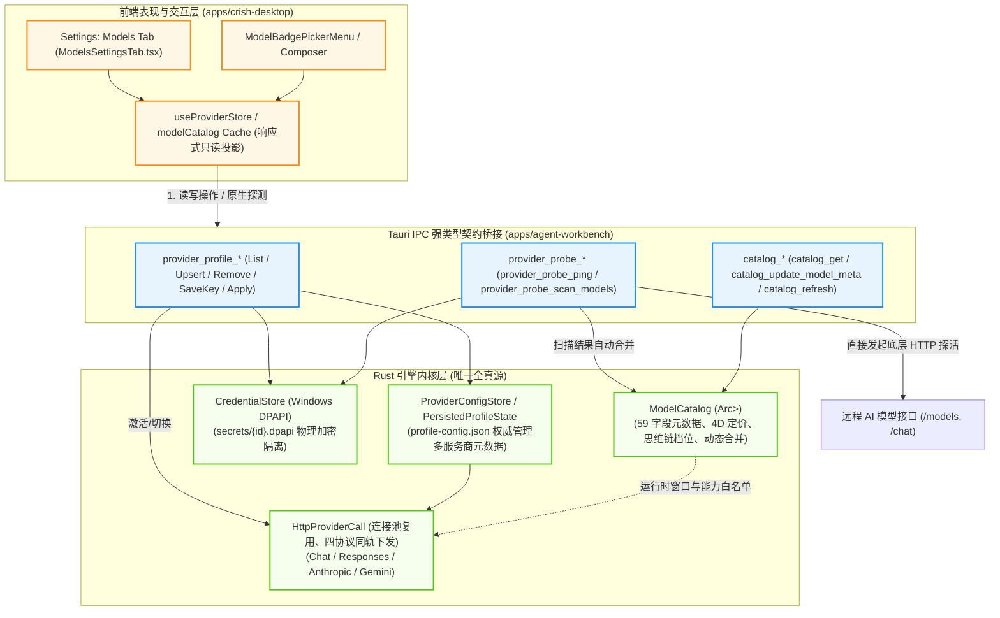
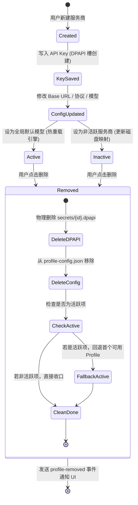
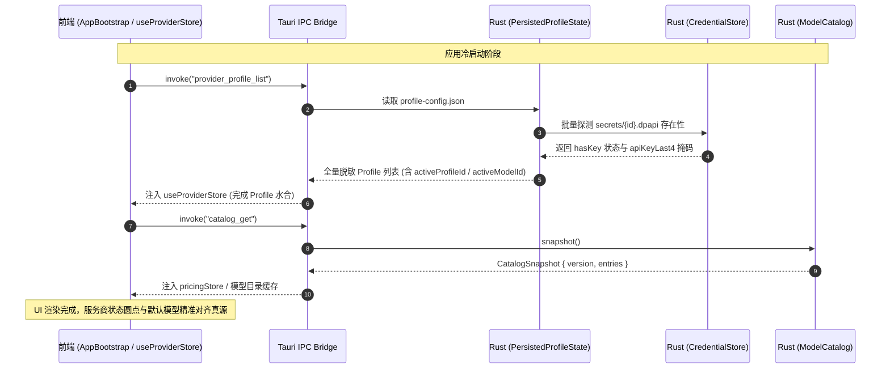
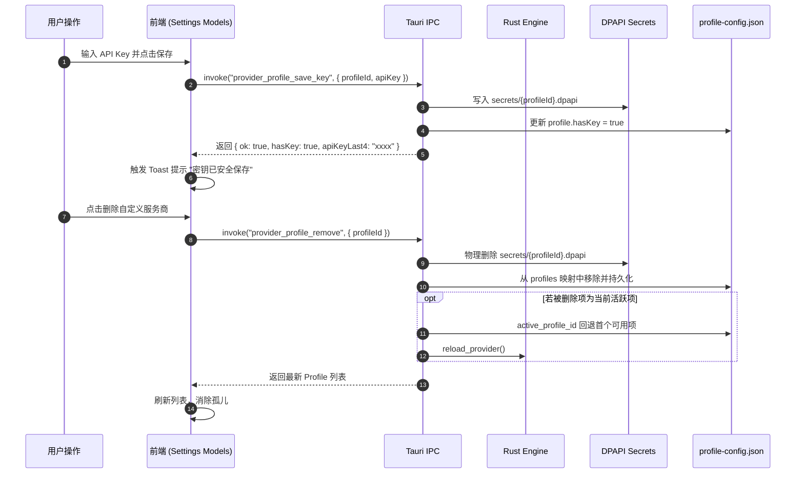
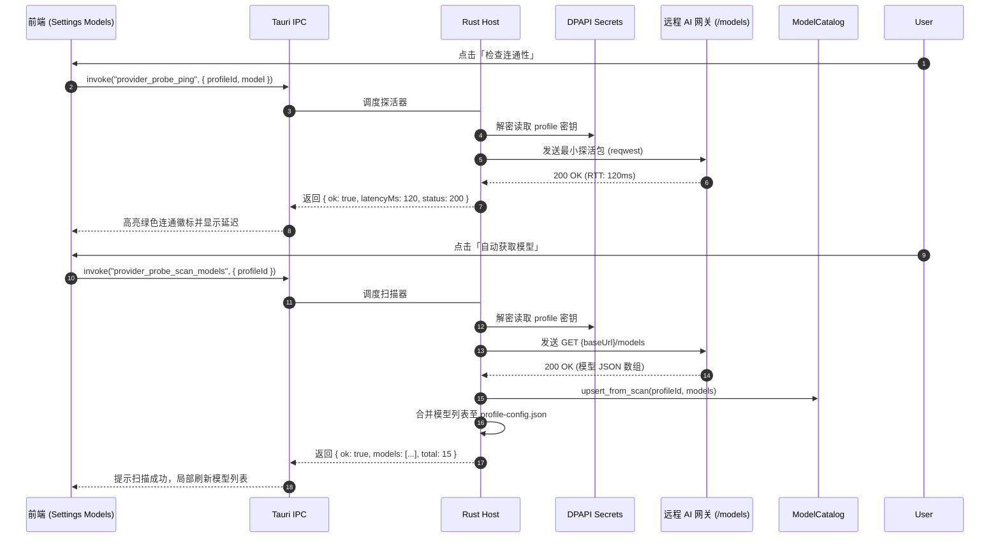
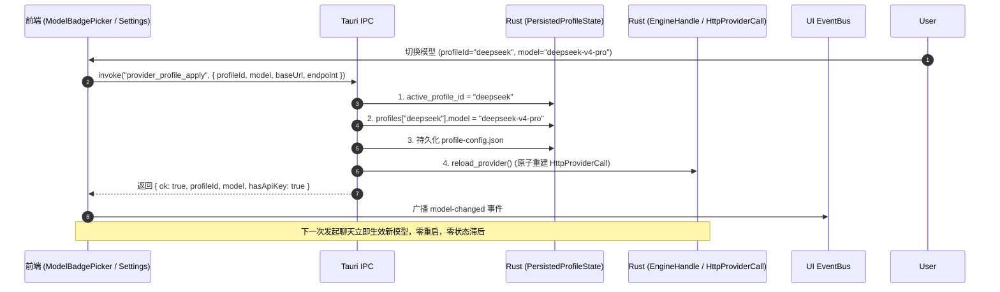
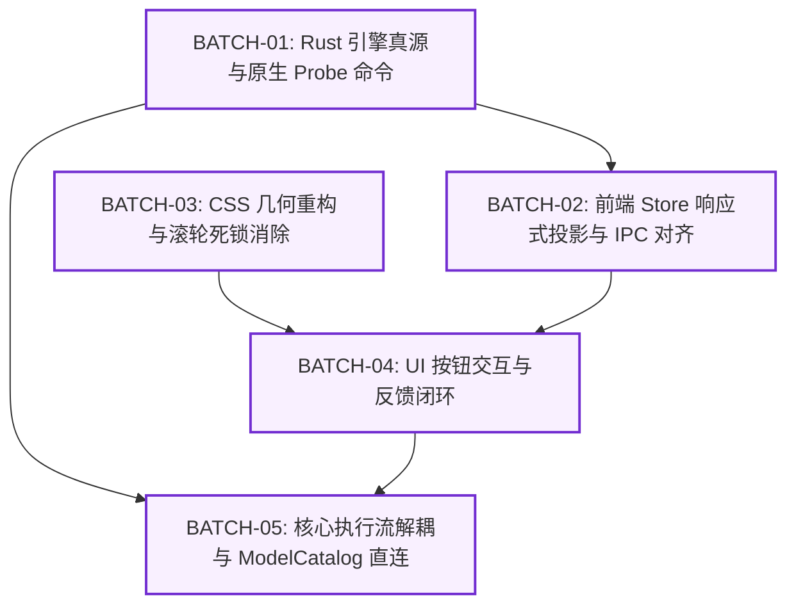

# Conex / Crish 模型与后端数据流系统级独立重构方案

> **【调度与定时器铁律】**：如果设置定时器，最短是100秒，如果命令过长，最好的方式是等待命令完成后的推送，而不是一直轮询命令情况。

> **权威标识**：`docs/system-audit-and-redesign/independent-plans/02-模型与后端数据流独立方案.md`  
> **所属战役**：Conex / Crish 全系统审计与综合重构战役（方案设计阶段）  
> **方案架构师**：【方案架构师 02: 模型与后端数据流独立方案设计】  
> **规范基准**：`docs/system-audit-and-redesign/00-战役通则与协同执行规范.md`（零业务代码修改、pwsh7、UTF-8 无 BOM、严禁 git 提交）  
> **关联审计输入**：
>
> - `docs/models-settings-audit/01-UI与滚轮排查报告.md`
> - `docs/models-settings-audit/02-后端数据流重构详案.md`
> - `docs/system-button-audit/01-全系统真值巡检报告.md`
> - `docs/chat-core-connectivity/01-报错根因与全链路排查报告.md`
> - `docs/ui-style-audit/01-style-degradation-audit.md`

---

## 目录

1. [执行摘要与全景架构蓝图 (Executive Summary & Architectural Blueprint)](#一执行摘要与全景架构蓝图-executive-summary--architectural-blueprint)
   - 1.1 现状困局与重构目标
   - 1.2 目标架构全景拓扑图
2. [Rust 引擎单一全真源与凭据安全体系设计 (Single Source of Truth & DPAPI Security Engine)](#二rust-引擎单一全真源与凭据安全体系设计-single-source-of-truth--dpapi-security-engine)
   - 2.1 全量多 Profile 权威真源架构 (`profile-config.json`)
   - 2.2 Windows DPAPI 凭据安全物理隔离与平台降级矩阵
   - 2.3 `ModelCatalog` 统一元数据与 4D 定价管理
   - 2.4 四协议同轨与端点参数全透传
   - 2.5 服务商全生命周期级联清理（根除孤儿密钥）
3. [冷启动探测报错根除与原生 IPC 命令族设计 (Native Probe IPC & Cold-Start Fix)](#三冷启动探测报错根除与原生-ipc-命令族设计-native-probe-ipc--cold-start-fix)
   - 3.1 冷启动“密钥未载入内存”根因彻底消除
   - 3.2 `provider_probe_ping` 原生探活命令设计
   - 3.3 `provider_probe_scan_models` 原生模型扫描命令设计
   - 3.4 完整 IPC 命令契约清单与 Wire Schema
   - 3.5 前端响应式投影架构 (`useProviderStore` 与只读缓存)
4. [`models-split` 区域滚轮锁死与几何布局系统级根治 (Scroll Lock & Layout Geometry Remediation)](#四models-split-区域滚轮锁死与几何布局系统级根治-scroll-lock--layout-geometry-remediation)
   - 4.1 滚轮锁死根因机理与数学模型证明
   - 4.2 移除内层 `overscroll-behavior: contain` 恢复事件链传播
   - 4.3 重构 `.modelsSplit` 尺寸模型，融入外层单一主滚动容器
   - 4.4 补齐 `ModelConfigEditor.tsx` 中缺失的 `.mrdBody` CSS Module 规范
   - 4.5 全量清洗 `settings-models.css` 历史 `!important` 样式污染
5. [模型配置界面 5 处失效与无反馈按钮彻底修复方案 (Button Usability & Interaction Repair)](#五模型配置界面-5-处失效与无反馈按钮彻底修复方案-button-usability--interaction-repair)
   - 5.1 缺陷 B1 修复：API Key 与 Base URL 保存语义解耦与 Tooltip 引导
   - 5.2 缺陷 B2 修复：模型配置抽屉保存 Toast 反馈与即时响应态
   - 5.3 缺陷 B3 修复：默认模型级联选择 (`ModelsCascadeSelect`) 自动收起
   - 5.4 缺陷 B4/B5/B6 修复：`ProfileHeader` 模块化迁移与 4 级曲率阶梯对齐
   - 5.5 手动添加模型与删除确认组交互闭环
6. [端到端全生命周期时序与交互流程 (End-to-End Sequence Diagrams)](#六端到端全生命周期时序与交互流程-end-to-end-sequence-diagrams)
   - 6.1 应用冷启动与 Profile/Catalog 投影水合流程
   - 6.2 服务商增删改查与密钥级联销毁流程
   - 6.3 后端原生连通性测试 (Ping) 与模型扫描合并流程
   - 6.4 默认模型切换与引擎原子热重载流程
   - 6.5 核心聊天流启动：彻底剔除前端 LocalStorage 上下文窗口透传
7. [系统整体修复路径、各维度拆解与文件域依赖 (Remediation Roadmap & Dependency Graph)](#七系统整体修复路径各维度拆解与文件域依赖-remediation-roadmap--dependency-graph)
   - 7.1 四层文件域划分
   - 7.2 纯逻辑分步实施批次 (Batch 01 ~ Batch 05)
   - 7.3 严格逻辑依赖 DAG 图 (Mermaid)
   - 7.4 平滑过渡与回退防御策略
8. [测试矩阵、验证断言与无死角验收标准 (Verification Assertions & Test Matrix)](#八测试矩阵验证断言与无死角验收标准-verification-assertions--test-matrix)
   - 8.1 单元测试与属性测试断言 (Rust + Vitest)
   - 8.2 CDP / Playwright 真实桌面 (127.0.0.1:9222) 交互真值验收
   - 8.3 门禁与安全红线合规断言

---

## 一、执行摘要与全景架构蓝图 (Executive Summary & Architectural Blueprint)

### 1.1 现状困局与重构目标

根据全系统 8 份专题审计报告（尤其是 `docs/models-settings-audit/` 01 与 02 报告）的深入逆向，Conex / Crish 在模型配置与后端数据流层面存在 **5 大系统性致命痛点**：

1. **真源分裂与三源漂移**：前端 `localStorage`（`crish_provider_profiles_v1`）、前端全局设置（`settings.defaultProvider`）与 Rust 引擎（`profile-config.json`）三套状态独立存储，修改非活动 Base URL、新建/删除服务商时 Rust 零感知，导致配置漂移；
2. **冷启动探测全面瘫痪**：安全加固剥离了前端明文 API Key 后，前端扫描与连通性测试依赖脆弱的 JS 内存缓存（`profileKeyCache`）。应用冷启动或刷新后，用户在设置页点击「扫描模型」或「连通检查」必然遭遇“密钥未载入内存”硬性阻断报错；
3. **敏感密钥孤儿残留**：前端删除服务商未联动清除 Rust DPAPI 二进制文件（`secrets/{id}.dpapi`），造成敏感凭据永久滞留磁盘；
4. **模型设置区滚轮死锁**：内层 `.modelsSplit` 声明了错误的固定视口计算高度（`height: max(480px, calc(100vh - 220px))`），叠加 `.modelsDetail` 与 `.mrlList` 上的 `overscroll-behavior: contain` 强制拦截，导致外层页面高度超标（$100\text{vh} + 90\text{px}$）产生滚动条却无法通过滚轮滑动，界面呈现严重假死；
5. **交互控件失敏与反馈缺失**：API Key 保存按钮在仅修改 Base URL 时因 `keyDraft` 为空被硬性 disabled 且无提示；模型展开抽屉保存无 Toast 状态流转；级联选择模型点击后 Radix Popover 不收起；`ProfileHeader` 未模块化导致圆角违例与样式截断。

**本方案核心使命**：彻底根除打补丁式兼容，确立 **Rust 引擎为全系统唯一全真源**，将所有 HTTP 探测与扫描职责收敛至 Rust 原生内核（DPAPI 密钥持有者），重构前端为只读响应式投影，采用单主滚动容器与全量 CSS Modules 消除滚轮死锁与按钮假死。

---

### 1.2 目标架构全景拓扑图



---

## 二、Rust 引擎单一全真源与凭据安全体系设计 (Single Source of Truth & DPAPI Security Engine)

### 2.1 全量多 Profile 权威真源架构 (`profile-config.json`)

彻底废弃前端 `localStorage.crish_provider_profiles_v1` 的真源地位，将其降级为冷启动临时只读缓存或一次性迁移源。Rust 引擎通过 `%APPDATA%/crish/profile-config.json` 权威管理所有已配置服务商。

#### 1. 结构体设计演进与强类型序列化

在 `apps/agent-workbench/src-tauri/src/config/profile.rs` 中扩展 `ProfileConfig`，全面支持四协议、端点与启用状态：

```rust
/// 每 profile 的非敏感生效配置（敏感 apiKey 物理隔离至 DPAPI）
#[derive(Debug, Clone, Default, Serialize, Deserialize)]
#[serde(rename_all = "camelCase")]
pub(crate) struct ProfileConfig {
    /// 展示名称（如 "DeepSeek 官方", "我的本地 Ollama"）
    pub(crate) name: Option<String>,
    /// 服务端基础地址（如 "https://api.deepseek.com"）
    pub(crate) base_url: Option<String>,
    /// 当前选中的模型名（如 "deepseek-chat"）
    pub(crate) model: Option<String>,
    /// 该服务商下已配置/扫描出的模型列表
    pub(crate) models: Vec<String>,
    /// 端点协议（"chat-completions" | "responses" | "anthropic" | "gemini"）
    pub(crate) endpoint: Option<String>,
    /// 线协议分类（"chat" | "responses" | "anthropic" | "gemini"）
    pub(crate) protocol: Option<String>,
    /// 是否流式传输（缺省 true）
    pub(crate) stream: Option<bool>,
    /// 启用状态（缺省 true；禁用时不参与自动降级与全局选择）
    pub(crate) enabled: Option<bool>,
    /// 是否为自定义新增服务商
    pub(crate) is_custom: Option<bool>,
    /// 排序权重
    pub(crate) sort_order: Option<i32>,
}

/// 全量多 Profile 状态持久化载荷
#[derive(Debug, Clone, Default, Serialize, Deserialize)]
#[serde(rename_all = "camelCase")]
pub(crate) struct PersistedProfileState {
    /// 当前全局活跃 profileId（如 "deepseek"）
    pub(crate) active_profile_id: Option<String>,
    /// profileId -> 独立服务商配置映射表
    pub(crate) profiles: BTreeMap<String, ProfileConfig>,
}
```

---

### 2.2 Windows DPAPI 凭据安全物理隔离与平台降级矩阵

#### 1. 物理存储与隔离规范

- **文件路径**：`%APPDATA%/crish/secrets/{sanitized_profile_id}.dpapi`；
- **加密核心**：基于 Windows CryptProtectData（`Crypt32.dll`），使用当前登录用户上下文密钥派生，与机器、用户会话强绑定；
- **脱敏传输契约**：Rust 向前端下发 Profile 列表时，**绝对禁止携带明文 `apiKey`**，仅下发布尔标记 `hasKey: bool` 与末 4 位脱敏掩码 `apiKeyLast4: Option<String>`。

#### 2. 平台兼容与异常降级矩阵

```
┌─────────────────┬──────────────────────────┬─────────────────────────────┐
│ 运行平台        │ 主存储机制               │ 故障/异常降级策略           │
├─────────────────┼──────────────────────────┼─────────────────────────────┤
│ Windows (生产)  │ Windows DPAPI (CryptAPI) │ 降级为当前进程 MemoryOnly   │
│ macOS / Linux   │ Unix 0600 权限凭据文件   │ 降级为当前进程 MemoryOnly   │
│ Browser Dev     │ 纯内存 MemoryOnly        │ 仅限当前前端会话，控制台警示│
└─────────────────┴──────────────────────────┴─────────────────────────────┘
```

- **自愈机制**：若磁盘 `.dpapi` 损坏或被外部程序篡改，Rust 读取失败时记录 `WARN` 级诊断日志，标记该服务商 `hasKey = false` 并向前端返回 `CREDENTIAL_DECRYPT_FAILED` 结构化错误代码，提示用户重新录入，绝不引发整个引擎 Crash。

---

### 2.3 `ModelCatalog` 统一元数据与 4D 定价管理

Rust 引擎的 `ModelCatalog`（`crates/conex-agent-provider/src/models/catalog.rs`）持有 59 字段的 v2 模型元数据体系，包含：

1. **基础规格**：`context_window`、`max_output_tokens`、`tokenizer_family`；
2. **能力开关**：`supports_tools`、`supports_vision`、`supports_reasoning`、`supports_prompt_caching`；
3. **4D 计费模型**：`input_price`、`output_price`、`cache_read_price`、`cache_write_price`（每百万 Token 美元单价）；
4. **思维链档位映射**：`TierEffortMap`（低/中/高思考深度参数适配）。

#### 动态覆盖与分层合并规则：

- **第一层（静态真源）**：内置 `catalog.json`，提供业界主流模型（Claude 3.7、GPT-4o、DeepSeek-V3/R1、Gemini 2.0 等）的标准规格与定价；
- **第二层（扫描发现）**：通过 `provider_probe_scan_models` 获取的远程模型列表，调用 `catalog.upsert_from_scan(profileId, models)`，仅合并模型 ID、上下文上限与基础能力位，**不覆盖官方权威定价**；
- **第三层（用户手配覆写）**：用户在前端 `ModelConfigPanel` 手动调整展示别名、上下文窗口或能力位时，通过 `catalog_update_model_meta` 将覆写持久化至 Rust 内存，并实时同步至会话循环。

---

### 2.4 四协议同轨与端点参数全透传

在 Rust 引擎的 `engine_provider/protocol.rs` 与 `HttpProviderCall` 中，四种主流 API 协议已完全同轨抽象：

```
┌─────────────────────────┬───────────────────────────────┬───────────────────────────────┐
│ 协议类型 (WireProtocol) │ 目标服务端类型                │ 适配端点 (Endpoint)           │
├─────────────────────────┼───────────────────────────────┼───────────────────────────────┤
│ ChatCompletions         │ OpenAI, DeepSeek, Ollama, vLLM│ /v1/chat/completions          │
│ Responses               │ OpenAI Realtime / Structured  │ /v1/responses                 │
│ AnthropicMessages       │ Anthropic 官方, 兼容网关      │ /v1/messages                  │
│ GeminiContent           │ Google Gemini 官方, 镜像网关  │ /v1beta/models/{model}:stream │
└─────────────────────────┴───────────────────────────────┴───────────────────────────────┘
```

- **重构契约支持**：前端在创建或修改服务商时，可在 UI 选择适配协议（如 Anthropic 兼容），通过 IPC 完整透传 `endpoint` 与 `protocol` 字段，彻底消灭以往无论何种服务商一律强制回退 OpenAI `/v1/chat/completions` 的缺陷。

---

### 2.5 服务商全生命周期级联清理（根除孤儿密钥）

针对审计中捕获的“删除服务商遗留 `.dpapi` 孤儿文件”以及“修改非活动 Base URL 丢失”问题，设计严格的级联事务生命周期：



---

## 三、冷启动探测报错根除与原生 IPC 命令族设计 (Native Probe IPC & Cold-Start Fix)

### 3.1 冷启动“密钥未载入内存”根因彻底消除

- **旧架构缺陷**：前端 JS 发起 `httpRequest` 进行网络探测，由于安全改造移除了前端明文 Key，冷启动后 JS 内存为空，导致探测立即抛错；
- **新架构方案**：**将探测发起权彻底收回 Rust 宿主进程**。前端仅需传递 `profileId`（以及可选的 `model`），Rust 直接从 DPAPI 密文槽读取凭据，通过底层共享的 `reqwest::Client` 连接池发送探活包。前端整个生命周期零明文密钥介入。

---

### 3.2 `provider_probe_ping` 原生探活命令设计

#### 1. 签名与契约

- **Tauri IPC Command**：`provider_probe_ping`
- **请求入参**：
  ```typescript
  export interface ProbePingArgs {
    profileId: string;
    model?: string;
    timeoutMs?: number; // 缺省 5000ms
  }
  ```
- **响应载荷**：
  ```typescript
  export interface ProbePingResult {
    ok: boolean;
    status: number; // HTTP 状态码 (200, 401, 404, etc.)
    latencyMs: number; // 往返耗时 (毫秒)
    model?: string; // 实际测试的模型
    error?: string; // 结构化中文错误提示
  }
  ```

#### 2. Rust 内部执行流

1. 根据 `profileId` 从 `PersistedProfileState` 检索其 `baseUrl` 与 `endpoint`；
2. 从 DPAPI 槽（`secrets/{profileId}.dpapi`）读取密钥；若无密钥则立即返回 `ok: false, error: "未配置 API Key，请先输入密钥"`；
3. 构建最小连通请求：
   - 对于 `ChatCompletions`：发送 `POST {baseUrl}/chat/completions`，载荷 `{"model": model, "messages": [{"role":"user","content":"hi"}], "max_tokens": 1}`；
   - 记录精确高精度计时器（`Instant::now()`）；
4. 处理响应：
   - 状态码 `200..=299`：返回 `ok: true, latencyMs, status`；
   - 状态码 `401` / `403`：返回 `ok: false, error: "API Key 无效或权限不足 (401)"`；
   - 网络超时 / DNS 失败：通过 `classify_provider_error` 映射为标准用户友好文案。

---

### 3.3 `provider_probe_scan_models` 原生模型扫描命令设计

#### 1. 签名与契约

- **Tauri IPC Command**：`provider_probe_scan_models`
- **请求入参**：
  ```typescript
  export interface ProbeScanArgs {
    profileId: string;
    timeoutMs?: number; // 缺省 8000ms
  }
  ```
- **响应载荷**：
  ```typescript
  export interface ProbeScanResult {
    ok: boolean;
    models: string[]; // 扫描出的可用模型 ID 列表
    total: number;
    error?: string;
  }
  ```

#### 2. Rust 内部执行流

1. 读取 `profileId` 的 Base URL 与 DPAPI 密钥；
2. 发送 `GET {baseUrl}/models`（携带 `Authorization: Bearer {key}`）；
3. 解析返回的 JSON 数组（兼容 OpenAI `data[].id` 格式与 Ollama `models[].name` 格式）；
4. 提取模型 ID 列表，自动调用 `ModelCatalog::upsert_from_scan(profileId, scannedModels)` 同步目录元数据；
5. 更新 `PersistedProfileState` 中该服务商的 `models` 列表并持久化保存；
6. 返回抓取到的模型列表给前端 UI。

---

### 3.4 完整 IPC 命令契约清单与 Wire Schema

| 命令名称                     | 参数 Schema                             | 返回值 Schema                        | 职责描述                                                        |
| :--------------------------- | :-------------------------------------- | :----------------------------------- | :-------------------------------------------------------------- |
| `provider_profile_list`      | `{}`                                    | `Vec<ProviderProfileWire>`           | 获取全量服务商脱敏列表（含 `activeProfileId`, `activeModelId`） |
| `provider_profile_get`       | `{ profileId: string }`                 | `ProviderProfileWire`                | 获取单个服务商配置详情                                          |
| `provider_profile_upsert`    | `UpsertProfileArgs`                     | `ProviderProfileWire`                | 创建或更新服务商元数据（无论是否活跃一律持久化）                |
| `provider_profile_remove`    | `{ profileId: string }`                 | `{ ok: boolean, deletedId: string }` | 删除服务商并**级联物理销毁 DPAPI 密钥**                         |
| `provider_profile_save_key`  | `{ profileId: string, apiKey: string }` | `ConfigSecretStatus`                 | 写入 DPAPI 密钥槽（空串为清除），更新 hasKey 状态               |
| `provider_profile_apply`     | `ConfigProfileApplyArgs`                | `ConfigProfileApplyResult`           | 激活指定服务商与模型并原子重载引擎 `HttpProviderCall`           |
| `provider_probe_ping`        | `ProbePingArgs`                         | `ProbePingResult`                    | Rust 原生读取 DPAPI 探活服务商连通性与延迟                      |
| `provider_probe_scan_models` | `ProbeScanArgs`                         | `ProbeScanResult`                    | Rust 原生读取 DPAPI 扫描 `/models` 并合并至 `ModelCatalog`      |
| `catalog_get`                | `{}`                                    | `CatalogSnapshot`                    | 获取全量模型元数据（含定价、上下文窗口、能力位）                |
| `catalog_update_model_meta`  | `UpdateModelMetaArgs`                   | `CatalogSnapshot`                    | 前端手改模型窗口/能力位时同步更新 Rust `ModelCatalog`           |

```typescript
/** 前后端交互的脱敏服务商数据结构 */
export interface ProviderProfileWire {
  id: string;
  name: string;
  baseUrl: string;
  endpoint: 'chat-completions' | 'responses' | 'anthropic' | 'gemini';
  protocol: 'chat' | 'responses' | 'anthropic' | 'gemini';
  models: string[];
  hasKey: boolean;
  apiKeyLast4: string | null;
  enabled: boolean;
  isCustom: boolean;
  sortOrder: number;
}
```

---

### 3.5 前端响应式投影架构 (`useProviderStore`)

前端全面采用基于 Zustand / 订阅制的 `useProviderStore`：

- **初始化水合**：应用启动时通过 `invoke('provider_profile_list')` 拉取最新脱敏数据注入 Store；
- **事件监听**：监听 Tauri Event `crish://profiles-changed` 与 `crish://catalog-changed`，在多窗口或跨组件操作时实现 $O(1)$ 毫秒级响应式局部更新；
- **写操作收敛**：所有 UI 交互（修改 Base URL、删除服务商、切换模型）一律调用 Store 封装的异步方法，通过强类型 IPC 发往 Rust，不再有任何直接读写 `localStorage` 的旁路后门。

---

## 四、`models-split` 区域滚轮锁死与几何布局系统级根治 (Scroll Lock & Layout Geometry Remediation)

### 4.1 滚轮锁死根因机理与数学模型证明

根据 W3C CSS Overscroll Behavior Module Level 1 标准规范，当元素声明了 `overscroll-behavior: contain` 时：

> "The browser MUST NOT propagate the scroll chaining to parent scroll containers."

在当前的 DOM 与样式树中：

1. 外层全屏容器 `SettingsPanel` 的 `.coverContent` 声明了 `overflow-y: auto`；
2. 内层 `.modelsSplit` 声明了固定的计算高度：
   $$H_{\text{modelsSplit}} = \max(480\text{px}, 100\text{vh} - 220\text{px})$$
3. 加上顶部 Title（$\approx 40\text{px}$）、Gap（$24\text{px}$）、默认模型卡片（$\approx 110\text{px}$）、下间距（$32\text{px}$）与外内边距（$64\text{px}$）：
   $$\text{外层总内容高度} = (100\text{vh} - 220\text{px}) + 270\text{px} = 100\text{vh} + 50\text{px} \sim 100\text{vh} + 90\text{px}$$
4. 外层容器 `.coverContent` 产生了一个约 90px 的垂直滚动条；
5. 但用户的光标落在占据视口 80% 面积的内层 `.modelsDetail` 或 `.mrlList` 上；这两个容器被显式声明了 `overscroll-behavior: contain`；
6. 当内层内容未溢出（模型较少）或滚动到顶部/底部边缘时，**浏览器强制吞噬了鼠标滚轮事件（Wheel Event），禁止向上传递给 `.coverContent`**。结果就是用户使劲滑滚轮，页面纹丝不动，底部内容完全看不见。

---

### 4.2 移除内层 `overscroll-behavior: contain` 恢复事件链传播

在 `apps/crish-desktop/src/components/settings-models/ModelsSettingsTab.module.css` 中：

- 彻底移除 `.modelsDetail` 与 `.mrlList` 上的 `overscroll-behavior: contain`；
- 设置为 `overscroll-behavior: auto`，确保当内层滚动到边界或无多余可滚内容时，滚轮 Delta 自然连贯地向父级冒泡。

---

### 4.3 重构 `.modelsSplit` 尺寸模型，融入外层单一主滚动容器

彻底消除双重嵌套滚动条冲突的最佳架构方案为 **「单主滚动容器流式架构」**：

```css
/* ModelsSettingsTab.module.css 重构规范 */
.modelsSplit {
  display: flex;
  gap: 0;
  flex: 1;
  /* 彻底移除 height: max(480px, calc(100vh - 220px)) 视口硬编码 */
  min-height: 520px;
  height: auto;
  border: var(--hairline-width, 1px) solid var(--hairline, var(--border-subtle));
  border-radius: var(--radius-2xl); /* 统一 12px 容器曲率 */
  overflow: hidden;
  background: var(--bg-secondary);
}

.modelsRail {
  width: 220px;
  flex-shrink: 0;
  border-right: var(--hairline-width, 1px) solid
    var(--hairline, var(--border-subtle));
  display: flex;
  flex-direction: column;
  background: var(--bg-secondary);
}

.modelsDetail {
  flex: 1;
  min-width: 0;
  padding: var(--space-5) var(--space-6);
  display: flex;
  flex-direction: column;
  gap: var(--space-5);
  background: var(--bg-primary);
  /* 允许自然流式展开，由外层 coverContent 单一滚动条托管 */
  overflow: visible;
  overscroll-behavior: auto;
}
```

---

### 4.4 补齐 `ModelConfigEditor.tsx` 中缺失的 `.mrdBody` CSS Module 规范

在 `ModelConfigEditor.tsx:106` 中使用了 `<div className={`${styles.mrdBody} mrd-body`}>`，但私有模块中完全缺失 `.mrdBody` 定义。

#### 补齐规范：

```css
/* ModelsSettingsTab.module.css */
.mrdBody {
  display: flex;
  flex-direction: column;
  gap: var(--space-5);
  min-width: 0;
  width: 100%;
}
```

此举使内部子组件（`ProfileHeader`、`ProviderProfileForm`、`ModelListHeader`、`ModelList`）恢复标准的 Flex Column 排版与间距控制，杜绝布局塌陷。

---

### 4.5 全量清洗 `settings-models.css` 历史 `!important` 样式污染

在 `apps/crish-desktop/src/styles/settings/settings-models.css` 中：

- 清理第 1846-1872 行以及所有历史遗留的 `.models-split`、`.models-rail`、`.models-detail` 类选择器中携带的 `!important` 暴力覆写；
- 确保组件私有样式表 `.module.css` 拥有纯净、确定的 CSS 层叠上下文（Specificity）。

---

## 五、模型配置界面 5 处失效与无反馈按钮彻底修复方案 (Button Usability & Interaction Repair)

### 5.1 缺陷 B1 修复：API Key 与 Base URL 保存语义解耦与 Tooltip 引导

#### 1. 现状痛点

用户修改 Base URL 后点击下方的「保存」按钮，因为 `keyDraft` 为空，按钮被硬性 disabled，用户误以为“保存按钮坏了”。

#### 2. 重构方案

- **语义分立与即时保存**：
  - 将 Base URL 输入框右侧增加独立的「更新」按钮或输入框 `onBlur` + `Enter` 即时触发 `saveBaseUrl`；
  - API Key 输入框的「保存」按钮文案明确改为「保存密钥」；
  - 当 `!keyDraft.trim()` 时，按钮包裹 `<Tooltip content="请输入新密钥后保存">`，并在 disabled 状态下维持可解释的视觉反馈；
  - 在 `saveBaseUrl` 与 `saveKey` 成功执行后，均弹出明确的 Toast 通知。

```tsx
// ProviderProfileForm.tsx 重构示意
<Tooltip
  content={
    !keyDraft.trim() ? '请输入新 API Key 后保存' : '保存新密钥至系统安全凭据槽'
  }
>
  <span className={styles.btnTooltipWrapper}>
    <Button
      type="button"
      variant="secondary"
      size="sm"
      disabled={!keyDraft.trim() || isSavingKey}
      onClick={() => void handleSaveKey()}
    >
      {isSavingKey ? <Spinner size="sm" /> : '保存密钥'}
    </Button>
  </span>
</Tooltip>
```

---

### 5.2 缺陷 B2 修复：模型配置抽屉保存 Toast 反馈与即时响应态

#### 1. 现状痛点

用户在 `ModelConfigPanel` 中修改模型别名或开关能力位后点击「保存」，数据虽落盘，但抽屉未关、无 Loading、无 Toast，界面零变化。

#### 2. 重构方案

- 在 `useModelProfilesState.ts` 的 `saveConfig` 中接入异步 IPC 提交（`catalog_update_model_meta`）；
- 保存成功后触发系统全局 Toast 通知：`notify(true, `已更新模型「${modelName}」配置`)`；
- 提供即时的保存成功微动效（如按钮短暂显示勾选图标），并平滑收起抽屉面板。

---

### 5.3 缺陷 B3 修复：默认模型级联选择 (`ModelsCascadeSelect`) 自动收起

#### 1. 现状痛点

点击二级浮层中的具体模型后，全局状态已变更，但一级 Radix Popover 依然保持展开状态，必须手动点击外部空白处才能关闭。

#### 2. 重构方案

- 将 `ModelsCascadeSelect` 改造为受控模式；
- 在模型项点击事件处理函数 `handleSelectModel(profileId, modelId)` 中，执行全局模型激活后，显式驱动状态机 `setOpen(false)`，完成交互闭环。

---

### 5.4 缺陷 B4/B5/B6 修复：`ProfileHeader` 模块化迁移与 4 级曲率阶梯对齐

#### 1. 现状痛点

`ProfileHeader.tsx` 未引入 CSS Modules，依赖全局字符串类名，导致其删除确认弹层易被兄弟容器截断，且“已启用”状态按钮使用了 `6px` 直角硬边。

#### 2. 重构方案

- 在 `ProfileHeader.tsx` 中全面引入 `styles from './ModelsSettingsTab.module.css'`；
- 将启用/禁用状态指示器统一对齐为 **`var(--radius-full)` (9999px) 饱满胶囊**；
- 将操作按钮（删除、重命名）统一对齐为 **`var(--radius-xl)` (10px)**；
- 将删除确认 Popover 挂载至 Portal，并设置合理的 `z-index` 避免被裁剪。

---

### 5.5 手动添加模型与删除确认组交互闭环

- **手动添加模型**：在 `ManualAddForm.tsx` 中，用户输入模型 ID 点击「添加」后，自动调用 `providerProfileUpsert` 更新 Rust `profile-config.json` 的 `models` 映射，同时清空输入框并收起折叠面板，弹出 Toast 提示「模型已添加」；
- **删除服务商确认**：点击「删除」弹出确认浮层，用户点击「确认删除」后触发 `provider_profile_remove`，Rust 端同步销毁 `.dpapi` 密钥文件，左侧列表平滑剔除该项并自动选中首个可用服务商。

---

## 六、端到端全生命周期时序与交互流程 (End-to-End Sequence Diagrams)

### 6.1 应用冷启动与 Profile/Catalog 投影水合流程



---

### 6.2 服务商增删改查与密钥级联销毁流程



---

### 6.3 后端原生连通性测试 (Ping) 与模型扫描合并流程



---

### 6.4 默认模型切换与引擎原子热重载流程



---

### 6.5 核心聊天流启动：彻底剔除前端 LocalStorage 上下文窗口透传

- **旧扭曲逻辑**：前端在 `ConnectionLifecycle.ts` 中每次发起聊天时，从 LocalStorage 读取 `contextLength` 强行塞入 IPC `core_run_task` 请求体；
- **新重构逻辑**：前端仅传递 `sessionId`、`prompt` 与标准参数。Rust 引擎在 `crates/session-loop` 内部根据当前生效的 `model`，直接查询 `Arc<RwLock<ModelCatalog>>`，获取权威的 `context_window` 与能力白名单进行截断和系统 Prompt 注入。

---

## 七、系统整体修复路径、各维度拆解与文件域依赖 (Remediation Roadmap & Dependency Graph)

### 7.1 四层文件域划分

```
┌────────────────────────────────────────────────────────────────────────────────────────┐
│                                 全系统文件域重构矩阵                                   │
├──────────────────┬─────────────────────────────────────────────────────────────────────┤
│ 分层             │ 核心文件域 (File Domains)                                           │
├──────────────────┼─────────────────────────────────────────────────────────────────────┤
│ 1. Rust 引擎内核 │ crates/conex-agent-provider/src/models/catalog.rs                   │
│                  │ crates/conex-agent-provider/src/models/catalog_override.rs          │
│                  │ crates/conex-agent-provider/src/config.rs                           │
├──────────────────┼─────────────────────────────────────────────────────────────────────┤
│ 2. Tauri 壳 IPC  │ apps/agent-workbench/src-tauri/src/config/profile.rs                │
│                  │ apps/agent-workbench/src-tauri/src/catalog_commands.rs              │
│                  │ apps/agent-workbench/src-tauri/src/credentials.rs                   │
│                  │ apps/agent-workbench/src-tauri/src/engine_provider.rs               │
│                  │ apps/agent-workbench/src-tauri/src/main.rs (IPC Handler 注册)       │
├──────────────────┼─────────────────────────────────────────────────────────────────────┤
│ 3. 前端 API/Store│ apps/crish-desktop/src/api/providerProfiles.ts                      │
│                  │ apps/crish-desktop/src/api/provider-profiles/profileStore.ts        │
│                  │ apps/crish-desktop/src/api/provider-profiles/rustProfileStore.ts    │
│                  │ apps/crish-desktop/src/api/modelCatalog.ts                          │
├──────────────────┼─────────────────────────────────────────────────────────────────────┤
│ 4. 前端 UI 与样式│ apps/crish-desktop/src/components/settings-models/ModelsSettingsTab.tsx│
│                  │ apps/crish-desktop/src/components/settings-models/ModelsSettingsTab.module.css│
│                  │ apps/crish-desktop/src/components/settings-models/ModelProfileList.tsx │
│                  │ apps/crish-desktop/src/components/settings-models/ModelConfigEditor.tsx│
│                  │ apps/crish-desktop/src/components/settings-models/ModelConfigPanel.tsx │
│                  │ apps/crish-desktop/src/components/settings-models/ModelList.tsx        │
│                  │ apps/crish-desktop/src/components/settings-models/ModelListHeader.tsx  │
│                  │ apps/crish-desktop/src/components/settings-models/ProfileHeader.tsx    │
│                  │ apps/crish-desktop/src/components/settings-models/ProviderProfileForm.tsx│
│                  │ apps/crish-desktop/src/components/settings-models/ManualAddForm.tsx   │
│                  │ apps/crish-desktop/src/components/settings-models/useModelProfilesState.ts│
│                  │ apps/crish-desktop/src/styles/settings/settings-models.css          │
└──────────────────┴─────────────────────────────────────────────────────────────────────┘
```

---

### 7.2 纯逻辑分步实施批次 (Batch 01 ~ Batch 05)

根据纯逻辑依赖拓扑，重构划分为 5 个高度内聚、严格串行的实施批次：

```
┌────────────────────────────────────────────────────────────────────────────────────────┐
│                               纯逻辑重构实施批次编排                                    │
├──────────┬──────────────────────────┬──────────────────────────────────────────────────┤
│ 批次编号 │ 批次名称                 │ 核心交付内容                                     │
├──────────┼──────────────────────────┼──────────────────────────────────────────────────┤
│ BATCH-01 │ Rust 后端命令与真源扩展  │ • 实现 provider_probe_ping & scan_models         │
│          │                          │ • 扩展 PersistedProfileState 与 CRUD IPC 命令    │
│          │                          │ • 完善 secrets/{id}.dpapi 物理级联销毁逻辑       │
├──────────┼──────────────────────────┼──────────────────────────────────────────────────┤
│ BATCH-02 │ 前端 Store 与 API 桥接   │ • 改造 rustProfileStore.ts & providerProfiles.ts │
│          │                          │ • 接入 useProviderStore 响应式只读投影           │
│          │                          │ • 彻底废除 LocalStorage 写操作与内存明文 key 依赖 │
├──────────┼──────────────────────────┼──────────────────────────────────────────────────┤
│ BATCH-03 │ CSS 架构与滚轮锁死根治   │ • 移除 overscroll-behavior: contain              │
│          │                          │ • 重构 .modelsSplit 为流式尺寸，融入主滚动容器   │
│          │                          │ • 补齐 .mrdBody 模块样式，清洗历史 !important    │
├──────────┼──────────────────────────┼──────────────────────────────────────────────────┤
│ BATCH-04 │ UI 按钮交互与反馈闭环    │ • 修复 API Key 保存 Tooltip 与 Base URL 即时更新 │
│          │                          │ • 模型抽屉保存接入 Toast 反馈                    │
│          │                          │ • 级联选择模型点击后自动关闭弹层                 │
│          │                          │ • ProfileHeader 模块化与 4 级曲率阶梯对齐        │
├──────────┼──────────────────────────┼──────────────────────────────────────────────────┤
│ BATCH-05 │ 核心执行流解耦与验证验收 │ • 剔除 ConnectionLifecycle.ts 上下文透传扭曲    │
│          │                          │ • 全量 Vitest + Rust 单元测试 + 真实 CDP 真值验收│
└──────────┴──────────────────────────┴──────────────────────────────────────────────────┘
```

---

### 7.3 严格逻辑依赖 DAG 图 (Mermaid)



---

### 7.4 平滑过渡与回退防御策略

1. **版本化数据无损迁移**：
   - 首次启动时检测 `localStorage.crish_provider_profiles_v1`；
   - 若 Rust 侧 `profile-config.json` 为空，自动调用一次性迁移命令将旧数据无损录入 Rust；
   - 存量明文 API Key 自动加密写入 DPAPI 槽，并从前端 LocalStorage 中彻底抹除；
   - 写入迁移标记 `localStorage.crish_profiles_v2_migrated = "1"`。
2. **多窗口与热重载防御**：
   - 切换活动服务商与模型时，Rust 端通过 `EngineHandle::reload_provider()` 进行原子替换；
   - 正在执行中的聊天会话不受影响，后续新消息立即路由至新模型。

---

## 八、测试矩阵、验证断言与无死角验收标准 (Verification Assertions & Test Matrix)

### 8.1 单元测试与属性测试断言 (Rust + Vitest)

- [ ] **断言 T1 (Rust 凭据隔离与级联删除)**：
      调用 `provider_profile_remove("custom-test")` 后，断言 `secrets/custom-test.dpapi` 文件在文件系统中不存在，且 `profile-config.json` 中无该条目；
- [ ] **断言 T2 (Rust 原生 Ping 探活)**：
      在隔离测试环境中 Mock 服务商返回 200，调用 `provider_probe_ping` 成功返回 `ok: true, latencyMs >= 0, status: 200`；
- [ ] **断言 T3 (Rust 原生模型扫描与 Catalog 合并)**：
      Mock `/models` 接口返回 5 个模型，调用 `provider_probe_scan_models` 后，断言 `ModelCatalog::snapshot().version` 递增且包含扫描出的模型；
- [ ] **断言 T4 (前端 Store 零明文)**：
      前端运行全量 Vitest 测试，断言任何 IPC 返回体与 Store State 中均无明文 `apiKey` 字段。

---

### 8.2 CDP / Playwright 真实桌面 (127.0.0.1:9222) 交互真值验收

在真实 Tauri WebView2 环境下执行无死角机器真值断言：

1. **滚轮滑动真值断言**：
   - 将光标定位在 `_modelsDetail` 区域中央（如 `x: 600, y: 500`）；
   - 派发鼠标滚轮事件 `Input.dispatchMouseEvent(type: 'mouseWheel', deltaY: 300)`；
   - 抓取外层 `.coverContent` 的 `scrollTop`，断言 `scrollTop > 0`（页面正常平滑向下滚动，无死锁）；
2. **冷启动探活真值断言**：
   - 重启应用并清除 JS 内存；
   - 直接进入模型设置页，点击已配置服务商的「检查连通性」与「自动获取」；
   - 断言不弹出“密钥未载入内存”报错，正常展示连通延迟或模型列表；
3. **按钮反馈真值断言**：
   - 仅修改 Base URL 时，API Key 保存按钮处于合法 disabled 态并展示明确 Tooltip；
   - 模型抽屉点击「保存」后，捕获到全局 Toast 提示文本「已更新模型配置」；
   - 点击默认模型级联选择项后，Radix Popover 自动关闭（`aria-expanded: false`）。

---

### 8.3 门禁与安全红线合规断言

- **TypeScript 类型检查**：`npm run typecheck` 零错误；
- **行数门禁**：所有修改与新增文件严格满足 `scripts/check-line-counts.mjs` 门禁约束；
- **编码卫生**：所有新增/修改文件强制为 **UTF-8 无 BOM**，中文注释；
- **Git 纪律**：严禁任何 Agent 绕过门禁或执行未经授权的 Git 提交。

---

> **方案架构师签署**：方案架构师 02（模型与后端数据流独立方案设计）  
> **归档路径**：`docs/system-audit-and-redesign/independent-plans/02-模型与后端数据流独立方案.md`  
> **状态声明**：纯逻辑架构方案设计，零业务代码修改，pwsh7 环境，UTF-8 无 BOM，无 Git 提交。
