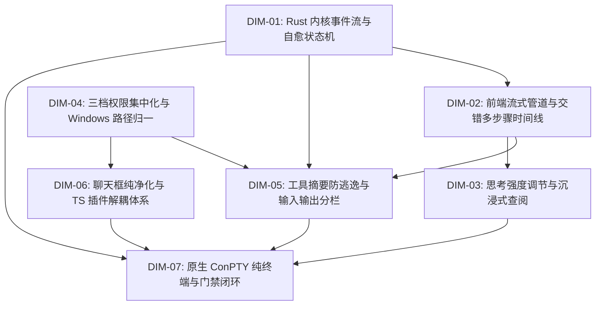
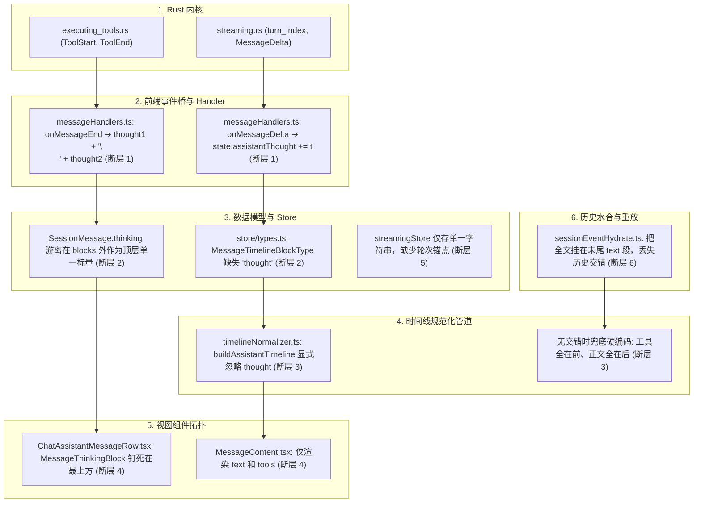
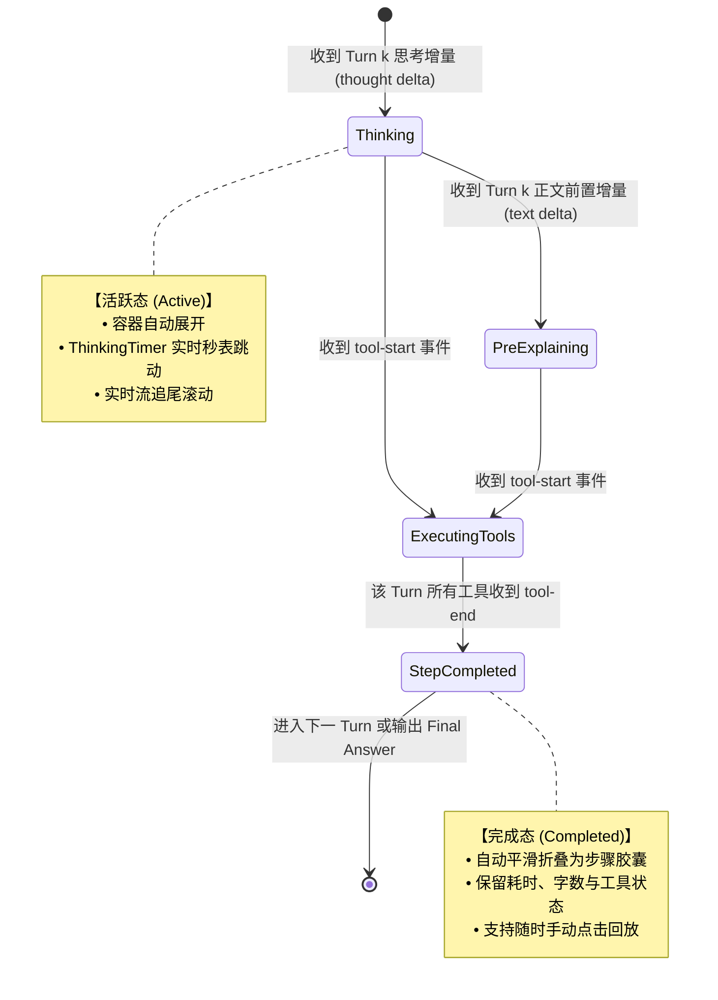

# 02-流式管道与交错时间线独立总方案（Interleaved Step Timeline & Streaming Pipeline）

> **【权威标识】**：`docs/system-audit-and-redesign/independent-plans/02-流式管道与交错时间线独立总方案.md`  
> **编制者**：【独立方案编制师 02: 流式管道与交错多步骤时间线视角独立总方案】  
> **依据规范**：`AGENTS.md`、`ANTI_OVERENGINEERING_GUARDRAILS.md`、`00-战役通则与协同执行规范.md`、`00-主控拍板最终维度矩阵.md` 及 15 份专题深度分析报告（重点涵盖 `analysis/01`、`02`、`03`、`06`、`08`、`09`）  
> **方案状态**：**已定稿（Authoritative Master Plan）**

---

## 目录（Table of Contents）

1. [全系统 7 大核心重构维度总览与协同拓扑](#一全系统-7-大核心重构维度总览与协同拓扑)
   - 1.1 全系统 7 维整体修复架构视图
   - 1.2 纯逻辑依赖拓扑与协同流转
   - 1.3 核心深挖维度聚焦（DIM-02、DIM-01、DIM-05）
2. [“两坨压平”结构倒退根因深度剖析（The Flat-Stacked Regression）](#二两坨压平结构倒退根因深度剖析)
   - 2.1 倒退现象与用户体验撕裂
   - 2.2 导致压平倒退的 6 大系统级架构断层
   - 2.3 传统三段式 vs 下一代交错式多步骤时间线对比
3. [交错式多步骤时间线（Interleaved Step Timeline）数学与数据建模](#三交错式多步骤时间线架构建模)
   - 3.1 步骤（Step / Turn）形式化数学模型
   - 3.2 步骤节点状态机（Step State Machine）
   - 3.3 TypeScript 类型契约无损扩展（`types.ts` 与 `toolPresentationTypes.ts`）
   - 3.4 交互动效与自适应折叠策略（Active Step Auto-Expansion）
4. [EventRouter Dedupe 矩阵与三级并发缓冲管线架构](#四eventrouter-dedupe-矩阵与三级并发缓冲管线架构)
   - 4.1 实时轨无 sequence 时的去重冲突数学推导与全量 16 类事件 Dedupe 矩阵
   - 4.2 “TheTheThe...” 思考碎片化与 `handleThinkingResetOnChunk` 误清根除机制
   - 4.3 三级并发缓冲调度契约（RenderBuffer / ThinkingBatcher / ToolBatcher）
   - 4.4 轻量级 `streamingStore` 与持久化 `sessionStore` 终态无撕裂平滑提交协议
   - 4.5 内存泄漏防护与生命周期清理机制
5. [全量核心代码重构与组件设计（Refactoring Blueprints）](#五全量核心代码重构与组件设计)
   - 5.1 `EventRouter.ts` 完整生产级重构代码
   - 5.2 `streamExecutionHelper.ts` 完整思考保护代码
   - 5.3 `messageHandlers.ts` 与 `toolHandlers.ts` 多轮步骤合并代码
   - 5.4 `timelineNormalizer.ts` 核心算法全量重构（`normalize` / `build` / `signature` 缓存）
   - 5.5 `MessageContent.tsx` 完整交错时间线流式渲染器
   - 5.6 `TimelineThoughtSection.tsx` 现代化思维链组件与 CSS 规范
   - 5.7 `toolCardPresenter.ts` 全领域精准语义摘要与 100% 防 JSON 逃逸引擎
   - 5.8 `ToolCallOutput.tsx` 展开区【输入/输出两段式结构化分栏】组件
6. [端到端质量验证与前端测试验收清单](#六端到端质量验证与前端测试验收清单)
   - 6.1 单元测试矩阵（Unit Tests）
   - 6.2 极端边界与魔鬼测试用例（Devil Test Cases）
   - 6.3 渲染性能基准与 DOM 稳定性断言（Performance & Zero Height Thrashing）
   - 6.4 CDP 9222 真机验收操作指南
7. [反过度设计审查与架构边界自检](#七反过度设计审查与架构边界自检)

---

## 一、全系统 7 大核心重构维度总览与协同拓扑

### 1.1 全系统 7 维整体修复架构视图

依据 `00-主控拍板最终维度矩阵.md`，Conex / Crish 全系统综合重构战役涵盖 7 大核心维度。本方案立足于前端流式状态管理与时间线呈现，构建全系统一体化修复架构视图：

```
┌───────────────────────────────────────────────────────────────────────────────────────────────────────────────────────┐
│                                       Conex / Crish 全系统 7 大维度综合重构全景架构视图                                │
└───────────────────────────────────────────────────────────────────────────────────────────────────────────────────────┘

 ┌─────────────────────────────────────────────────────────────────────────────────────────────────────────────────────┐
 │ 【内核与协议基座】 DIM-01: Rust 内核双轨事件、后台任务装配与自愈状态机                                               │
 │  • LiveEventSink 实时打通中间工具事件 (ToolStart/ToolEnd) 与多轮状态，根除 19 轮黑盒滞留                            │
 │  • ToolExecCtx 全链路装配 BackgroundTaskManager 与 LogRoot，解除 background_task [common.unsupported] 报错         │
 │  • Tool-Promise 意图自愈与 Format Self-Healing 状态机，保证自主连续执行不中断                                         │
 └──────────────────────────────────────────┬──────────────────────────────────────────────────────────────────────────┘
                                            │ Tauri IPC 双轨事件 (实时轨 LiveSink + 收口轨 EventBus)
                                            ▼
 ┌─────────────────────────────────────────────────────────────────────────────────────────────────────────────────────┐
 │ 【状态与流式管道】 DIM-02: 前端流式管道、EventRouter Dedupe 矩阵与交错多步骤时间线（⭐ 本方案核心深挖）              │
 │  • EventRouter 去重矩阵：修复 sequence: None 时 Key 冲突，放行 delta，按 toolId 去重工具，消灭 "TheTheThe..." 误杀   │
 │  • handleThinkingResetOnChunk 改造：联动 streamingStore，彻底杜绝首个正文 Chunk 抹杀思考                             │
 │  • 交错式多步骤时间线（Interleaved Step Timeline）：扩展 thought 块，规范化多轮 [思考➔工具➔观察➔正文] 因果链条       │
 └─────────────────┬───────────────────────────────────────────────────────────────────┬───────────────────────────────┘
                   │                                                                   │
         ┌─────────┴─────────────────────────────────┐                       ┌─────────┴───────────────────────────────┐
         ▼                                           ▼                       ▼                                         ▼
 ┌───────────────────────────────────┐ ┌───────────────────────────┐ ┌───────────────────────────┐ ┌───────────────────────────┐
 │ DIM-03: 思考强度调节与沉浸查阅器  │ │ DIM-05: 工具卡片语义化摘要│ │ DIM-04: 三档权限集中化    │ │ DIM-06: 聊天框纯净化与    │
 │ • Minimal/Medium/Deep 档位联动    │ │   防逃逸与结构化输入/输出 │ │   大刀阔斧重构与路径归一│ │   TS 插件解耦体系       │
 │ • 双轨查阅：行内自适应弹性视口    │ │ • 100% 覆盖 13 类工具中文 │ │ • 拔除复合删除死锁，完全  │ │ • 拔除博客排版，/ 专注 AI │
 │   + FullThoughtModal 沉浸弹窗     │ │   语义提取，消灭 raw JSON │ │   访问模式真正完全信任    │ │ • 几何探测器防 (0,0) 漂移 │
 │ • 补齐 Anthropic PromptCache 头   │ │ • 输入/输出两段式结构分栏 │ │ • Windows 路径去 UNC 归一 │ │ • MarkdownEditor/Browser/ │
 │   与 4 态指标徽标                 │ │   (CLI/KV/Diff/Stdout)    │ │ • 纯对话无工作区动态挂载  │ │   FollowUp TS 插件解耦    │
 └─────────────────┬─────────────────┘ └─────────────┬─────────────┘ └─────────────┬─────────────┘ └─────────────┬─────────────┘
                   │                                 │                             │                             │
                   └─────────────────────────────────┼─────────────────────────────┴─────────────────────────────┘
                                                     ▼
 ┌─────────────────────────────────────────────────────────────────────────────────────────────────────────────────────┐
 │ 【系统终端与质量闭环】 DIM-07: 原生 ConPTY 纯终端、设计系统契约与全量门禁闭环                                         │
 │  • Rust 基于 portable-pty 直连 Windows 原生 ConPTY (pwsh/cmd) + 前端 @xterm/xterm，全双向字节流直通支持 ANSI 与 Vim  │
 │  • 设计系统契约：4 级曲率阶梯 (9999px / 10px / 12px / 6px) + 自定义 <Tooltip> + 焦点边框 ≤10% 混入                    │
 │  • 测试资产保护与门禁：100% 保护 reference/markdown-editor 测试；全量 cargo test + typecheck + vitest + CDP 9222 验证 │
 └─────────────────────────────────────────────────────────────────────────────────────────────────────────────────────┘
```

### 1.2 纯逻辑依赖拓扑与协同流转



**纯逻辑演进断言**：

1. **基座先行**：`DIM-01` 修复 Rust 端中间事件实时打通与后台任务装配，`DIM-04` 拔除权限死锁，为前端提供源源不断、无阻断的原始事件流；
2. **管线收敛**：`DIM-02`（本方案核心）在前端接收原始事件流，进行严格去重、三级批合并调度，并将事件序列归一化为高内聚的交错多步骤时间线；
3. **展示爆发**：`DIM-03` 基于交错时间线扩展沉浸式查阅能力，`DIM-05` 将时间线中的工具节点转化为结构化输入/输出两段式卡片；
4. **插件与终端闭环**：`DIM-06` 净化输入端并解耦扩展插件，`DIM-07` 落地 Windows 原生 ConPTY 终端与设计规范，通过全量测试门禁完成工程验收。

### 1.3 核心深挖维度聚焦

- **DIM-02（前端流式管道、Dedupe 矩阵与交错多步骤时间线）**：作为本方案最核心板块，深度解决 Token 误杀、思考清空、状态脱节及“两坨压平”倒退；
- **DIM-01（Rust 内核双轨事件）**：深度对接 Rust `session-loop` 中 `LiveEventSink`、`MessageDelta`、`ToolStart`、`ToolEnd`、`turn_index` 的前后端契约对齐；
- **DIM-05（工具卡片语义化摘要防逃逸与结构化输入/输出）**：深度重构 `toolCardPresenter.ts` 与 `ToolCallOutput.tsx`，彻底消灭 `浏览 {}`、`处理 .` 与 raw JSON 泄露，建立现代化两段式分栏。

---

## 二、“两坨压平”结构倒退根因深度剖析

### 2.1 倒退现象与用户体验撕裂

用户反馈：“_现在的思考和正文内容怎么就这两块了，明显是前面改错了。_”以及“_中间的思考内容怎么没看到呢，按理来说中间过程也是会有思考的，现在是全部完成了才显示，体验太差了。_”

在当前有缺陷的版本中，界面呈现出极其粗暴且反直觉的“三段式大杂烩”：

```
┌────────────────────────────────────────────────────────┐
│ 💭 [思考中/思考] (所有轮次的思考被 \n 拼接，长达数百行)    │  <-- 顶部一大坨
├────────────────────────────────────────────────────────┤
│ 💬 正文内容 (所有轮次的中间说明 + 最终总结混在一起)       │  <-- 中间一大坨
├────────────────────────────────────────────────────────┤
│ 🔧 工具调用卡片 (全部工具孤立堆在底部，脱离触发上下文)     │  <-- 底部一大坨
└────────────────────────────────────────────────────────┘
```

这种布局彻底抹杀了现代自主 Agent 核心的**多轮交错推理循环（Interleaved Multi-turn Reasoning Loop）**：

1. **因果时序断裂**：第 1 轮思考决定调用 `list_dir`，第 2 轮思考分析目录后决定调用 `read_file`。当前界面却把第 2 轮思考放在了第 1 个工具的上方！用户在顶部看到“预言未来”的思考，而实际执行工具的地方一片空白；
2. **长篇思考压迫**：长程任务累计数万字思考，挤在顶部单一折叠盒中，展开即霸屏；
3. **工具执行黑盒化**：工具卡片被移出思考与正文的生命周期，中途不展开、不显示参数，用户只能傻等转圈。

### 2.2 导致压平倒退的 6 大系统级架构断层



1. **断层 1（Bridge 层全局累加）**：`messageHandlers.ts` 将 `assistantThought` 设计为贯穿 Run 生命周期的单一大字符串，多轮思考直接通过 `\n` 粗暴拼接；正文维护了 `messageEndTurnSegments`，而思考却无任何轮次分段；
2. **断层 2（类型契约丢失思考维度）**：`types.ts` 中 `MessageTimelineBlockType = 'text' | 'tool_call' | 'image'`，从类型层面直接剥夺了 `thought` 进入时间线的资格；`thinking` 沦为消息级游离标量；
3. **断层 3（Normalizer 丢弃思考节点）**：`timelineNormalizer.ts` 的 `buildAssistantTimeline` 遍历 `blocks` 时仅匹配 `text` 和 `tool_call`，直接丢弃 `thought`；在回退分支硬编码了“工具在前、正文在后”；
4. **断层 4（Row 层顶层物理置顶）**：`ChatAssistantMessageRow.tsx` 将 `<MessageThinkingBlock>` 硬编码在 `<div className={styles.assistantBody}>` 之外的最上方，DOM 拓扑决定了思考永远被钉死在顶部；
5. **断层 5（StreamingStore 缺少轮次锚点）**：`streamingStore.ts` 仅存储扁平的 `thinking` 字符串，多轮工具执行期间没有记录当前处于哪一个思考阶段；
6. **断层 6（会话水合暴力压平）**：`sessionEventHydrate.ts` 在重放历史事件时，将正文简单累加并挂在最后一个文本块上，导致刷新页面后历史会话全部退化为压平状态。

### 2.3 传统三段式 vs 下一代交错式多步骤时间线对比

```
【传统三段式压平倒退（当前错误实现）】
┌────────────────────────────────────────────────────────────────────────┐
│ 🤖 Assistant                                                          │
│                                                                        │
│  [▶ 思考 (耗时 12.4s · 包含第 1 轮与第 2 轮全部拼接思考)]                │
│                                                                        │
│  [💬 正文：我将为您查找相关文件并进行修改... (中间解释与最终回答混杂)]   │
│                                                                        │
│  ┌─ 🔧 grep_search (已折叠黑盒) ─────────────────────────────────────┐ │
│  └───────────────────────────────────────────────────────────────────┘ │
│  ┌─ 🔧 replace_file_content (已折叠黑盒) ────────────────────────────┐ │
│  └───────────────────────────────────────────────────────────────────┘ │
└────────────────────────────────────────────────────────────────────────┘

                                    ▼
                                    ▼ 彻底重构
                                    ▼

【下一代交错式多步骤时间线（Interleaved Step Timeline，行业黄金标准）】
┌────────────────────────────────────────────────────────────────────────┐
│ 🤖 Assistant                                                          │
│                                                                        │
│ ┌─ ▶ 步骤 1: 探索代码架构与检索定义 ────────────── [✔ 已完成 · 1.2s] ─┐ │
│ │  ├── 💭 思考：需要先确认 timelineNormalizer.ts 中是否存在 thought 分支 │ │
│ │  └── 🔍 grep_search (`timelineNormalizer`) ➔ 命中 3 处定义           │ │
│ └────────────────────────────────────────────────────────────────────┘ │
│                                                                        │
│ ┌─ ▶ 步骤 2: 读取核心文件并诊断断层 ────────────── [✔ 已完成 · 0.8s] ─┐ │
│ │  ├── 💭 思考：分析 grep 结果，查看 buildAssistantTimeline 的实现...    │ │
│ │  └── 📄 view_file (`timelineNormalizer.ts:L220-270`) ➔ 返回 50 行源码 │ │
│ └────────────────────────────────────────────────────────────────────┘ │
│                                                                        │
│ ┌─ ▼ 步骤 3: 实施核心算法重构 ──────────────────── [⏳ 执行中 · 正在思考] ┐ │
│ │  ├── 💭 思考：确认缺少 thought 分支，现在编写完整的交错归一化逻辑... │ │
│ │  └── ✏️ replace_file_content (`timelineNormalizer.ts`) ➔ [运行中]   │ │
│ └────────────────────────────────────────────────────────────────────┘ │
│                                                                        │
│ 💬 最终交付物与总结 (Final Answer Markdown)                            │
│ 已经成功修复了时间线压平问题，完整交错时序已恢复正常。                  │
└────────────────────────────────────────────────────────────────────────┘
```

---

## 三、交错式多步骤时间线架构建模

### 3.1 步骤（Step / Turn）形式化数学模型

在一个完整的 Agent 交互回合（Run）中，输入由用户发起，输出由有序的执行步骤序列与最终总结交付物构成：
$$\text{Run} = \langle S_1, S_2, \dots, S_N, A_{\text{final}} \rangle$$

每一个执行步骤 $S_k$（$1 \le k \le N$）定义为一个紧密耦合的时序四元组：
$$S_k = \langle \mathcal{T}_k, \mathcal{P}_k, \mathcal{E}_k, \mathcal{O}_k \rangle$$

- $\mathcal{T}_k$（Thought / Reasoning）：该步骤的模型思考推导内容（CoT 思维链）；
- $\mathcal{P}_k$（Pre-Tool Text）：模型在触发工具前向用户输出的前置说明（可选）；
- $\mathcal{E}_k$（Tool Executions）：该步骤触发的工具调用集合 $\{t_{k,1}, t_{k,2}, \dots, t_{k,m}\}$；
- $\mathcal{O}_k$（Observations / Results）：工具执行完毕后返回的观察结果；
- $A_{\text{final}}$（Final Answer）：所有步骤执行完毕后模型输出的总结性 Markdown 正文。

### 3.2 步骤节点状态机（Step State Machine）



- **活跃态（Active）**：当前正在进行的步骤（Thinking 或 ExecutingTools）。UI **自动保持展开**，展示实时 Spinner、ThinkingTimer 毫秒级跳动以及工具执行脉冲；
- **完成态（Completed）**：后续步骤已启动或 Run 已结束。历史步骤**自动优雅折叠**为极简胶囊条（如 `▶ 步骤 1：探索代码架构 · 1.2s`），不干扰阅读；
- **最终总结（Final Answer）**：完全展开渲染在所有步骤下方，作为回答的最终主体。

### 3.3 TypeScript 类型契约无损扩展

#### (1) `apps/crish-desktop/src/store/types.ts` 扩展

```typescript
/** 消息时间线块类型（全面支持交错式多步骤思维链） */
export type MessageTimelineBlockType =
  | 'thought' // 单步思考块
  | 'text' // 正文段落（前置说明或最终交付物）
  | 'tool_call' // 工具调用锚点
  | 'image' // 结构化图片引用
  | 'step_start' // 显式步骤开始边界
  | 'step_end'; // 显式步骤结束边界

export interface MessageTimelineBlock {
  type: MessageTimelineBlockType;
  /** tool_call 对应 toolCall.id；thought 对应 stepId/thoughtId */
  id?: string;
  /** 文本或思考内容 */
  content?: string;
  /** 关联的轮次索引 (0-based) */
  turnIndex?: number;
  /** 思考/执行耗时（毫秒） */
  durationMs?: number;
  /** 是否已被模型安全标记截断 */
  redacted?: boolean;
  /** 图片引用 */
  images?: MessageImageRef[];
}

export interface SessionMessage {
  id: string;
  sender: MessageSender;
  text?: string;
  /** 历史兼容字段：汇总全量思考（用于复制降级） */
  thinking?: string;
  /** 结构化思考分段列表 */
  thinkingTurns?: Array<{
    turnIndex: number;
    content: string;
    durationMs?: number;
  }>;
  timestamp: number;
  toolCalls?: MessageToolCall[];
  status?: SessionMessageStatus;
  precomputedHtml?: string;
  toolCallResults?: SessionMessageToolCallResult[];
  /** 完整的交错时间线块序列 */
  blocks?: MessageTimelineBlock[];
  streamTextOffset?: number;
  thinkingTime?: number;
  images?: MessageImageRef[];
  errorDetail?: { message: string; kind: string; technical?: string };
  cacheMetrics?: MessageCacheState | null;
}
```

#### (2) `apps/crish-desktop/src/api/tool-presentation/toolPresentationTypes.ts` 扩展

```typescript
export type TimelineThoughtItem = {
  kind: 'thought';
  key: string;
  content: string;
  id?: string;
  turnIndex?: number;
  durationMs?: number;
  isLive?: boolean;
};

export type TimelineTextItem = {
  kind: 'text';
  key: string;
  content: string;
  turnIndex?: number;
  isFinal?: boolean;
};

export type TimelineToolsItem = {
  kind: 'tools';
  key: string;
  items: ToolRenderItem[];
  turnIndex?: number;
};

/** 结构化步骤容器项 */
export type TimelineStepGroupItem = {
  kind: 'step_group';
  key: string;
  stepIndex: number;
  title: string;
  status: 'running' | 'completed' | 'error';
  thought?: TimelineThoughtItem;
  preText?: TimelineTextItem;
  tools?: ToolRenderItem[];
  durationMs?: number;
};

/** 助手消息渲染时间线联合类型 */
export type AssistantTimelineItem =
  | TimelineThoughtItem
  | TimelineTextItem
  | TimelineToolsItem
  | TimelineStepGroupItem;
```

### 3.4 交互动效与自适应折叠策略

1. **Active Step 自动展开**：当前正在执行的步骤（处于流式思考或工具运行中）默认 `isOpen = true`，高度自适应内容撑开；
2. **Historic Step 自动折叠**：当新一轮 `turn-start` 或 `step_start` 到达时，上一轮步骤平滑收起至胶囊行（高度 32px），右侧保留 `耗时 · 字数 · 工具图标`；
3. **用户手动覆盖记忆**：用户手动点击展开历史步骤后，记录在局部 React State 中，后续流式帧不强行关闭用户主动展开的步骤；
4. **最终总结永不折叠**：时间线末尾的 Final Answer Markdown 文本始终全量展开呈现。

---

## 四、EventRouter Dedupe 矩阵与三级并发缓冲管线架构

### 4.1 实时轨去重冲突数学推导与全量 16 类事件 Dedupe 矩阵

#### (1) 历史漏洞数学推导

Rust 实时轨通过 `BridgeDeltaSink` 发射事件时，信封中 `sequence` 恒为 `None`（`undefined`/`null`）。
旧版 Dedupe Key 生成公式：
$$\text{Key} = \begin{cases} \text{type}:\text{messageId}:\text{sequence}, & \text{if } \text{sequence} \neq \text{null} \\ \text{type}:\text{messageId}, & \text{if } \text{sequence} = \text{null} \end{cases}$$

- **灾难推导 1（Token 误杀）**：
  `Token 1`（`thought: "The"`）到达，生成 $\text{Key} = \text{"message-delta:m1"}$，放入 `consumedEvents`；
  `Token 2`（`thought: " quick"`）到达，生成 $\text{Key} = \text{"message-delta:m1"}$，`consumedEvents.has` 命中，**直接丢弃！**
  后续数千 Token 全部被杀，每一轮只能漏出一个首 Token（产生 `"TheTheThe...All...package"` 乱码）；
- **灾难推导 2（工具全部误杀）**：
  第 1 个工具 `tool-1` 到达，生成 $\text{Key} = \text{"tool-start:m1"}$，放行；
  第 2 个工具 `tool-2` 到达，生成 $\text{Key} = \text{"tool-start:m1"}$，**直接丢弃！**
  导致后续 18 个工具全部变成黑盒哑火；
- **灾难推导 3（多轮收口丢弃）**：
  Turn 1 的 `message-end` 到达，生成 $\text{Key} = \text{"message-end:m1"}$，放行；
  Turn 2 的 `message-end` 到达，键相同，**直接丢弃！** 导致后续轮次文本全部丢失。

#### (2) 全量 16 类事件 Dedupe 决策与防御矩阵

| 事件类型 (`event.type`)   | 具备 `sequence` (收口轨/回放) | 缺失 `sequence` (实时轨/广播) | 去重键格式 (`buildEventDedupeKey`)                                              | 误杀风险与防御策略                                                   |
| ------------------------- | ----------------------------- | ----------------------------- | ------------------------------------------------------------------------------- | -------------------------------------------------------------------- |
| `message-delta` (text)    | `raw.sequence` 存在           | `raw.sequence = undefined`    | `message-delta:${messageId}:${seq}` 或 **`null`**                               | **无 seq 时坚决返回 `null` 放行所有增量分片，严禁按 messageId 去重** |
| `message-delta` (thought) | `raw.sequence` 存在           | `raw.sequence = undefined`    | `message-delta:${messageId}:${seq}` 或 **`null`**                               | 同上，确保思考 Token 持续累加                                        |
| `tool-start`              | `toolId` + `seq`              | 仅 `toolId`                   | `tool-start:${toolId}:${seq}` 或 `tool-start:${toolId}`                         | **必须按 `toolId` 区分，严禁使用 `messageId` 去重**                  |
| `tool-update`             | `toolId` + `seq`              | 仅 `toolId`                   | `tool-update:${toolId}:${seq}` 或 **`null`**                                    | 进度更新频繁，无 seq 时返回 `null` 放行最新进度                      |
| `tool-end`                | `toolId` + `seq`              | 仅 `toolId`                   | `tool-end:${toolId}:${seq}` 或 `tool-end:${toolId}`                             | 必须按 `toolId` 区分，保证每个工具成功/失败独立触发                  |
| `tool-batch-start`        | `batchId` + `seq`             | 仅 `batchId`                  | `tool-batch-start:${batchId}:${seq}` 或 `tool-batch-start:${batchId}`           | 批量工具按 `batchId` 隔离                                            |
| `tool-batch-end`          | `batchId` + `seq`             | 仅 `batchId`                  | `tool-batch-end:${batchId}:${seq}` 或 `tool-batch-end:${batchId}`               | 批量工具收口按 `batchId` 隔离                                        |
| `turn-start`              | `turnIndex` + `seq`           | 仅 `turnIndex`                | `turn-start:${msgId}:${seq}` 或 `turn-start:${msgId}:turn-${turnIdx}`           | 必须包含 `turnIndex`，区分多轮轮次                                   |
| `turn-end`                | `turnIndex` + `seq`           | 仅 `turnIndex`                | `turn-end:${msgId}:${seq}` 或 `turn-end:${msgId}:turn-${turnIdx}`               | 必须包含 `turnIndex`，区分多轮收口                                   |
| `message-start`           | `messageId` + `seq`           | 仅 `messageId`                | `message-start:${messageId}:${seq}` 或 `message-start:${messageId}`             | 单消息幂等                                                           |
| `message-end`             | `messageId` + `seq`           | `messageId` + `turnIdx`       | `message-end:${messageId}:${seq}` 或 `message-end:${msgId}:turn-${turnIdx}`     | 跨 turn 追加权威文本，必须带 `turnIndex`                             |
| `run-terminal`            | `terminal` + `seq`            | 仅 `terminal`                 | `run-terminal:${seq}` 或 `run-terminal:${terminal}`                             | 终态唯一一次收口                                                     |
| `approval-requested`      | `toolCallId` + `seq`          | 仅 `toolCallId`               | `approval-requested:${toolCallId}:${seq}` 或 `approval-requested:${toolCallId}` | 审批弹窗按 `toolCallId` 幂等                                         |
| `approval-resolved`       | `toolCallId` + `seq`          | 仅 `toolCallId`               | `approval-resolved:${toolCallId}:${seq}` 或 `approval-resolved:${toolCallId}`   | 审批决策按 `toolCallId` 幂等                                         |
| `subagent-started`        | Legacy 信封                   | Legacy 信封                   | **`null`** (透传)                                                               | 子 Agent 信封直通分派                                                |
| `runtime-error`           | `error` + `seq`               | 仅 `error`                    | `runtime-error:${seq}` 或 `runtime-error:${hash(error)}`                        | 错误去重防抖                                                         |

### 4.2 “TheTheThe...” 思考碎片化与 `handleThinkingResetOnChunk` 误清根除机制

#### (1) `handleThinkingResetOnChunk` 死锁机制

在 `streamExecutionHelper.ts` 中：

```typescript
// 历史缺陷代码
if (cur?.thinking === '正在处理…' || cur?.thinking === '正在思考中...') {
  thinkingBatcher?.drop(streamBatchKey(sid, assistantMsgId)); // 🚨 抹杀批缓冲
  getCompositionRoot()
    .layout.getState()
    .updateMessageThinking(sid, assistantMsgId, ''); // 🚨 抹平 Store
}
```

**死锁根因**：流式期间 `thinkingBatcher` 写入的是无 Immer 的 `streamingStore`，`sessionStore` 中的 `cur.thinking` 恒为初始占位符 `'正在处理…'`。当正文首个 Chunk 到达时，该逻辑误以为“没有思考”，直接将 48ms 缓冲队列中的真实思考彻底抹杀！

#### (2) 原子级修复策略

```typescript
export function handleThinkingResetOnChunk(
  sid: string,
  assistantMsgId: string,
  thinkingBatcher: StreamTextBatcher | null | undefined
): void {
  // 1. 优先检查轻量 streamingStore 中是否已有真实思考
  const liveThinking = getStreamThinking(sid, assistantMsgId);
  if (
    liveThinking &&
    liveThinking.trim() &&
    liveThinking !== '正在处理…' &&
    liveThinking !== '正在思考中...'
  ) {
    // 已有真实思考内容，绝对禁止 drop 批缓冲与抹除思考！
    return;
  }

  // 2. 检查 sessionStore 中的占位状态
  const cur = getSessionById(sid)?.messages?.find(
    (m: SessionMessage) => m.id === assistantMsgId
  );
  if (cur?.thinking === '正在处理…' || cur?.thinking === '正在思考中...') {
    const key = streamBatchKey(sid, assistantMsgId);
    if (!thinkingBatcher?.hasPending(key)) {
      thinkingBatcher?.drop(key);
      getCompositionRoot()
        .layout.getState()
        .updateMessageThinking(sid, assistantMsgId, '');
    }
  }
}
```

### 4.3 三级并发缓冲调度契约

前端流式架构通过三路独立的并发缓冲机制，解耦不同数据特征的渲染频率：

```
┌────────────────────────────────────────────────────────────────────────────────────────────────────────┐
│                                 前端三级并发流式缓冲调度管线                                            │
└────────────────────────────────────────────────────────────────────────────────────────────────────────┘

                          ┌────────────────────────────────────────────────┐
                          │              EventRouter (事件分发)            │
                          └───────┬───────────────┬────────────────┬───────┘
                                  │               │                │
              ┌───────────────────┘               │                └───────────────────┐
              │ (onThought)                       │ (onChunk)                          │ (onToolStart/End)
              ▼                                   ▼                                    ▼
  ┌───────────────────────┐           ┌───────────────────────┐            ┌───────────────────────┐
  │  Level 2: 思考批合并  │           │  Level 1: 正文渲染帧  │            │  Level 3: 工具状态批  │
  │  thinkingBatcherRef   │           │  StreamRenderBuffer   │            │    toolBatcherRef     │
  ├───────────────────────┤           ├───────────────────────┤            ├───────────────────────┤
  │ • 定时模型: 48ms Leading│         │ • 定时模型: rAF (16ms)│            │ • 定时模型: 48ms/0ms  │
  │ • 吞吐上限: 4000 字符 │           │ • 帧预算: 6ms (120FPS)│            │ • 路由策略:           │
  │ • 目标: setStreamThinking         │ • 字符上限: 8192/frame│            │   - running ➔ 48ms 批 │
  └───────────┬───────────┘           │ • 策略: Grapheme 安全 │            │   - 终态 ➔ 立即 flush │
              │                       │ • 目标: setStreamText │            └───────────┬───────────┘
              │                       └───────────┬───────────┘                        │
              │                                   │                                    │
              ▼                                   ▼                                    ▼
  ┌────────────────────────────────────────────────────────────────────────────────────────────────────────┐
  │                                  useStreamingStore (Plain Zustand Store)                               │
  │  • key = `${sessionId}::${messageId}`                                                                 │
  │  • byKey[key] = { text, thinking, tools: { [toolId]: StreamToolLive } }                               │
  └────────────────────────────────────────────────────────────────────────────────────────────────────────┘
```

1. **Level 1（正文渲染缓冲 `StreamRenderBuffer`）**：
   - **时钟源**：`requestAnimationFrame`（16.6ms / 8.3ms）；
   - **帧预算**：单帧 6ms，上限 8192 字符，基于 Unicode Grapheme 安全边界截断，防止 Emoji/多字节乱码；
   - **目标**：`streamingStore.setStreamText`，驱动尾部 `StreamingTextBlock` 原生 DOM 追加；
2. **Level 2（思考文本批合并 `thinkingBatcherRef`）**：
   - **时钟源**：`setTimeout`（48ms leading-edge）；
   - **策略**：最新思考全文直接覆盖，单批超 4000 字符强制提前 flush；
   - **目标**：`streamingStore.setStreamThinking`，驱动 `TimelineThoughtSection`；
3. **Level 3（工具状态批合并 `toolBatcherRef`）**：
   - **时钟源**：48ms 批合并 vs 0ms 同步直通；
   - **策略**：`running` 状态进入 48ms 批合并防抖；`success`/`error`/`pending_approval` 触发 `isImmediateToolStatus` 立即 `flushNow`；
   - **目标**：`streamingStore.setStreamTool`，驱动工具卡片状态跃迁。

### 4.4 轻量级 `streamingStore` 与持久化 `sessionStore` 终态无撕裂平滑提交协议

在流式结束（`run-terminal` / `finish`）时，为防止 UI 出现闪烁或内容回退（Tearing），实行**双保险防撕裂降级协议**：

```typescript
// MessageContent.tsx 中的防撕裂平滑降级公式：
const displayMsg = useMemo(() => {
  let next: SessionMessage = msg;
  const hasCommittedText = Boolean(msg.text && msg.text.trim().length > 0);

  // 1. 只有当 sessionStore 中的 msg.text 已经非空且状态已为 completed 时，才完全信任持久化 text；
  // 2. 否则，只要 streamText 存在，无条件优先使用 streamText；
  // 3. 兜底才使用 msg.text。
  const activeText =
    hasCommittedText && msg.status === 'completed'
      ? msg.text
      : (streamText ?? msg.text);

  if (activeText != null && activeText !== msg.text) {
    next = applyStreamTextToMessage(next, activeText) as SessionMessage;
  }
  if (streamTools) {
    next = applyStreamToolsToMessage(next, streamTools);
  }
  return next;
}, [msg, streamText, streamTools]);
```

**终态提交时序**：

1. `onFinish` 触发 ➔ `renderBuffer.flushFinal()` 与 `thinkingBatcher.flushNow()` 排空；
2. 将完整文本与思考原子级写入 `sessionStore`（`updateMessageText` + `updateMessageThinking` + `setMessageStatus('completed')`）；
3. 在 `queueMicrotask` 中延后执行 `streamingStore.clearStream(sid, mid)`，确保 React 在下一次渲染周期中已读取到持久化的完整内容，实现 **0 闪烁无缝交接**。

### 4.5 内存泄漏防护与生命周期清理机制

1. **BeforeUnload 自动排空**：所有 Batcher 实例均注册在全局 `beforeunload` 表中，页面刷新/关闭时自动执行 `flushStreamBatchers()`；
2. **Session 级世代管理**：`SessionStreamManager` 在 Run 结束时同步执行 `generationMapRef.current.delete(sid)`，彻底释放旧代的闭包与 buffer 内存；
3. **Router 消费集合清理**：`EventRouter` 实例的 `consumedEvents` Set 随 Run 收口自动解引用回收。

---

## 五、全量核心代码重构与组件设计

### 5.1 `EventRouter.ts` 完整生产级重构代码

```typescript
/**
 * 路径：apps/crish-desktop/src/api/chat-bridge/EventRouter.ts
 * 生产级安全幂等去重与事件分派路由器
 */
import type { StreamCallbacks } from '../chatApi';
import { logInternalError } from '../userFacingErrors';
import { recordStreamDiag } from '../streamDiag';
import { ApprovalFlowMachine } from '../approvalFlowMachine';
import { messageBelongsToRun } from './handlers/eventUtils';
import { resolveEventType } from './handlers/eventType';
import {
  parseBridgeEvent,
  type BridgeEventEnvelope,
} from './handlers/eventParser';
import { dispatchEvent } from './handlers/dispatch';
import { isDataPlaneEventType } from './dataPlaneRouter';
import type { HandlerEnv, SendLike } from './handlers/handlerEnv';
import type { StreamState } from './handlers/streamState';

export class EventRouter {
  private state: StreamState;
  private approvalFlow: ApprovalFlowMachine;
  private callbacks: StreamCallbacks;
  private runId: string;
  private sessionId: string;
  private finish: (force?: boolean) => void;
  private tryResumeFinish: () => void;
  private client?: SendLike;
  /** 消费侧 per-run 幂等去重集合 */
  private readonly consumedEvents = new Set<string>();

  constructor(
    state: StreamState,
    approvalFlow: ApprovalFlowMachine,
    callbacks: StreamCallbacks,
    runId: string,
    finish: (force?: boolean) => void,
    tryResumeFinish: () => void,
    client?: SendLike,
    sessionId = ''
  ) {
    this.state = state;
    this.approvalFlow = approvalFlow;
    this.callbacks = callbacks;
    this.runId = runId;
    this.sessionId = sessionId;
    this.finish = finish;
    this.tryResumeFinish = tryResumeFinish;
    this.client = client;
  }

  private get env(): HandlerEnv {
    return {
      state: this.state,
      approvalFlow: this.approvalFlow,
      callbacks: this.callbacks,
      runId: this.runId,
      sessionId: this.sessionId,
      finish: this.finish,
      tryResumeFinish: this.tryResumeFinish,
      client: this.client,
    };
  }

  handleAgentEvent(envelope: BridgeEventEnvelope): void {
    if (this.state.cancelled || this.state.finished) return;
    if (isDataPlaneEventType(envelope.type)) return;
    dispatchEvent(this.env, envelope);
  }

  onMsg = (msg: Record<string, unknown>): void => {
    if (this.state.cancelled || this.state.finished) return;
    const envelope = resolveEventType(msg);
    if (!envelope) return;
    const raw = envelope.raw;

    if (!messageBelongsToRun(raw.runId, this.runId)) return;

    let parsed: ReturnType<typeof parseBridgeEvent>;
    try {
      parsed = parseBridgeEvent(raw);
    } catch (e) {
      this.registerUnknownEvent(raw, 'parser threw: ' + String(e));
      return;
    }
    if (parsed.ok !== true) {
      this.registerUnknownEvent(raw, parsed.error);
      return;
    }

    // 生产级幂等去重检查
    const dedupeKey = buildEventDedupeKey(parsed.data);
    if (dedupeKey !== null && this.consumedEvents.has(dedupeKey)) {
      this.recordSkippedDuplicate(dedupeKey);
      return;
    }
    if (dedupeKey !== null) this.consumedEvents.add(dedupeKey);
    this.handleAgentEvent(parsed.data);
  };

  private recordSkippedDuplicate(key: string): void {
    recordStreamDiag({
      runId: this.runId,
      scope: 'event-dedupe',
      kind: 'duplicate',
      message: `duplicate event skipped: ${key}`,
    });
  }

  private registerUnknownEvent(
    raw: Record<string, unknown>,
    error: string
  ): void {
    logInternalError('engine-unknown-event', {
      error,
      type: String(raw.type ?? raw.event ?? raw.kind ?? ''),
      payload: raw,
    });
  }
}

/**
 * 生产级安全幂等键生成器（彻底根除实时流误杀与工具丢弃）
 */
export function buildEventDedupeKey(
  envelope: BridgeEventEnvelope
): string | null {
  if (envelope.kind === 'legacy') return null;
  const { event, raw } = envelope;

  // 1. 增量流式 Delta：无 sequence 时必须返回 null 透传，严禁按 messageId 拦截
  if (event.type === 'message-delta') {
    const seq = raw.sequence;
    if (seq !== null && seq !== undefined && seq !== '') {
      const messageId =
        event.messageId ||
        (typeof raw.messageId === 'string' ? raw.messageId : '');
      return `message-delta:${messageId}:${String(seq)}`;
    }
    return null; // 实时轨 Token 增量全量放行！
  }

  // 2. 工具域事件：严格按 toolId 隔离，严禁按 messageId 归并
  if (
    event.type === 'tool-start' ||
    event.type === 'tool-update' ||
    event.type === 'tool-end'
  ) {
    const toolId =
      ('call' in event && event.call?.id) ||
      ('result' in event && event.result?.id) ||
      (typeof raw.toolCallId === 'string' ? raw.toolCallId : '') ||
      (typeof raw.id === 'string' ? raw.id : '') ||
      (raw.call && typeof raw.call === 'object' && 'id' in (raw.call as object)
        ? (raw.call as { id: string }).id
        : '') ||
      (raw.result &&
      typeof raw.result === 'object' &&
      'id' in (raw.result as object)
        ? (raw.result as { id: string }).id
        : '');
    const seq = raw.sequence;
    const sequence =
      seq === null || seq === undefined || seq === '' ? null : String(seq);
    if (toolId && sequence !== null) {
      return `${event.type}:${toolId}:${sequence}`;
    }
    if (toolId) {
      if (event.type === 'tool-update') return null; // 进度更新无 seq 全放行
      return `${event.type}:${toolId}`;
    }
    if (sequence !== null) return `${event.type}:${sequence}`;
    return null;
  }

  // 3. 轮次域与终态消息：必须结合 turnIndex 隔离多轮
  if (
    event.type === 'turn-start' ||
    event.type === 'turn-end' ||
    event.type === 'message-end'
  ) {
    const turnIdx =
      typeof event.turnIndex === 'number'
        ? event.turnIndex
        : typeof raw.turnIndex === 'number'
          ? raw.turnIndex
          : null;
    const seq = raw.sequence;
    const sequence =
      seq === null || seq === undefined || seq === '' ? null : String(seq);
    let messageId = '';
    if (event.type === 'message-end' && event.message?.id) {
      messageId = event.message.id;
    } else if (typeof raw.messageId === 'string') {
      messageId = raw.messageId;
    }

    if (sequence !== null) {
      return `${event.type}:${messageId || 'm'}:${sequence}`;
    }
    if (turnIdx !== null) {
      return `${event.type}:${messageId || 'm'}:turn-${turnIdx}`;
    }
    if (event.type === 'message-end') {
      return messageId ? `message-end:${messageId}` : null;
    }
    return null;
  }

  // 4. 其余通用事件
  const seq = raw.sequence;
  const sequence =
    seq === null || seq === undefined || seq === '' ? null : String(seq);
  let messageId = typeof raw.messageId === 'string' ? raw.messageId : '';
  if (messageId && sequence !== null) {
    return `${event.type}:${messageId}:${sequence}`;
  }
  if (sequence !== null) return `${event.type}:${sequence}`;
  return null;
}
```

### 5.2 `streamExecutionHelper.ts` 完整思考保护代码

```typescript
/**
 * 路径：apps/crish-desktop/src/hooks/chat-stream/streamExecutionHelper.ts
 */
import type { StreamTextBatcher } from '../../api/streamTextBatcher';
import type { SessionMessage } from '../../store/layoutStore';
import { getSessionById } from '../../store/sessionStore';
import { getCompositionRoot } from '../../app/compositionRoot';
import { getStreamThinking, streamBatchKey } from '../../store/streamingStore';

/**
 * 当接收到有效文本 chunk 时，安全清理初始提示词占位符，绝不误清真实思考流。
 */
export function handleThinkingResetOnChunk(
  sid: string,
  assistantMsgId: string,
  thinkingBatcher: StreamTextBatcher | null | undefined
): void {
  // 1. 优先检查轻量 streamingStore 中是否已有实时思考内容
  const liveThinking = getStreamThinking(sid, assistantMsgId);
  if (
    liveThinking &&
    liveThinking.trim() &&
    liveThinking !== '正在处理…' &&
    liveThinking !== '正在思考中...'
  ) {
    // 已有真实思考内容流出，严禁 drop 批合并器与抹除思考！
    return;
  }

  // 2. 检查持久化 sessionStore 中的占位状态
  const cur = getSessionById(sid)?.messages?.find(
    (m: SessionMessage) => m.id === assistantMsgId
  );
  if (cur?.thinking === '正在处理…' || cur?.thinking === '正在思考中...') {
    const key = streamBatchKey(sid, assistantMsgId);
    if (!thinkingBatcher?.hasPending(key)) {
      thinkingBatcher?.drop(key);
      getCompositionRoot()
        .layout.getState()
        .updateMessageThinking(sid, assistantMsgId, '');
    }
  }
}
```

### 5.3 `messageHandlers.ts` 与 `toolHandlers.ts` 多轮步骤合并代码

```typescript
/**
 * 路径：apps/crish-desktop/src/api/chat-bridge/handlers/messageHandlers.ts
 */
import { blockText, mergeAssistantTextPiece } from './eventUtils';
import type { EngineEnvelope } from './eventParser';
import type { HandlerEnv } from './handlerEnv';
import { computeCacheMetricsFromUsage } from './cacheMetricsCompute';
import { useLayoutStore } from '../../../store';

export function onMessageDelta(
  env: HandlerEnv,
  envelope: EngineEnvelope<'message-delta'>
): void {
  const { state, callbacks } = env;
  const { event, raw } = envelope;
  const block = event.block;
  const t = blockText(block);
  if (!t) return;

  // 思考块累积：支持多轮独立分段
  if (block.type === 'thought') {
    state.assistantThought += t;
    callbacks.onThought(state.assistantThought);
    return;
  }

  // 正文块增量累积
  let deltaToSend = t;
  if (raw.message && typeof raw.message === 'object') {
    const msg = raw.message as Record<string, unknown>;
    if (
      typeof msg.content === 'string' &&
      msg.content.length >= state.assistantText.length
    ) {
      deltaToSend = msg.content.slice(state.assistantText.length);
      state.assistantText = msg.content;
    } else {
      state.assistantText += t;
    }
  } else {
    state.assistantText += t;
  }

  if (deltaToSend) {
    callbacks.onChunk(deltaToSend);
  }
}

export function onMessageEnd(
  env: HandlerEnv,
  envelope: EngineEnvelope<'message-end'>
): void {
  const { state, callbacks } = env;
  const msg = envelope.event.message;
  if (msg.role !== 'assistant') return;

  const blocks = Array.isArray(msg.blocks) ? msg.blocks : [];
  let text = '';
  let thought = '';
  for (const bl of blocks) {
    const b = bl as unknown as Record<string, unknown>;
    if (b.type === 'thought' || b.kind === 'thought') thought += blockText(b);
    else if (b.type === 'text') text += blockText(b);
  }
  if (typeof msg.content === 'string' && msg.content && !text) {
    text = msg.content;
  }

  // 思考收口合并
  if (thought.trim()) {
    if (
      state.assistantThought &&
      !state.assistantThought.includes(thought.trim())
    ) {
      state.assistantThought = `${state.assistantThought}\n${thought.trim()}`;
    } else {
      state.assistantThought = thought.trim();
    }
    callbacks.onThought(state.assistantThought);
  }

  // 正文多轮 turnIndex 合并
  if (text.trim()) {
    const piece = text.trim();
    const turnIndex =
      typeof envelope.event.turnIndex === 'number'
        ? envelope.event.turnIndex
        : 0;
    if (!state.messageEndTurnSegments) state.messageEndTurnSegments = [];
    const segs = state.messageEndTurnSegments;
    while (segs.length <= turnIndex) segs.push('');
    segs[turnIndex] = mergeAssistantTextPiece(segs[turnIndex] ?? '', piece);

    const joined = segs.filter(Boolean).join('\n\n');
    const prevLen = state.assistantText.length;
    state.assistantText = joined;
    if (state.assistantText.length > prevLen) {
      const addedDelta = state.assistantText.slice(prevLen);
      callbacks.onChunk(addedDelta);
    }
  }

  // 缓存指标挂载
  const metrics = computeCacheMetricsFromUsage(msg.metadata);
  if (metrics) {
    state.lastMessageCacheMetrics = metrics;
    useLayoutStore
      .getState()
      .setMessageCacheMetrics(env.sessionId, msg.id, metrics);
  }
}
```

### 5.4 `timelineNormalizer.ts` 核心算法全量重构

```typescript
/**
 * 路径：apps/crish-desktop/src/api/tool-presentation/timelineNormalizer.ts
 * 助手消息交错多步骤时间线规范化与签名缓存引擎
 */
import type { MessageToolCall, SessionMessage } from '../../store/layoutStore';
import type { MessageTimelineBlock } from '../../store/types';
import {
  isInspectTool,
  isInterruptedTool,
  toolHasDisplayableResult,
  toolHumanLabel,
} from './toolCardPresenter';
import type {
  AssistantTimelineItem,
  ToolRenderItem,
} from './toolPresentationTypes';

function statusRank(s: MessageToolCall['status']): number {
  if (s === 'success') return 4;
  if (s === 'error') return 3;
  if (s === 'pending_approval') return 2;
  return 1; // running
}

/**
 * 规范化助手消息时间线：thought、text、tool_call 无损对齐
 */
export function normalizeAssistantTimeline(
  msg: SessionMessage
): SessionMessage {
  if (msg.sender !== 'assistant') return msg;
  const tools = [...(msg.toolCalls || [])];
  const toolIds = new Set(tools.map((t) => t.id));
  const rawBlocks = [...(msg.blocks || [])];

  // 1. 过滤无效孤儿工具
  let blocks: MessageTimelineBlock[] = rawBlocks.filter(
    (b) => b.type !== 'tool_call' || (b.id != null && toolIds.has(b.id))
  );

  // 2. 检查是否有未在 blocks 中注册的 toolCall
  const inBlocks = new Set(
    blocks.filter((b) => b.type === 'tool_call' && b.id).map((b) => b.id!)
  );
  const missing = tools.filter((t) => !inBlocks.has(t.id));

  if (missing.length > 0) {
    let insertAt = blocks.length;
    for (let i = blocks.length - 1; i >= 0; i--) {
      if (blocks[i]?.type === 'text') {
        insertAt = i;
        break;
      }
    }
    const inject: MessageTimelineBlock[] = missing.map((t) => ({
      type: 'tool_call',
      id: t.id,
    }));
    blocks = [
      ...blocks.slice(0, insertAt),
      ...inject,
      ...blocks.slice(insertAt),
    ];
  }

  // 3. 有全局正文但无 text 块时补偿
  if ((msg.text || '').trim() && !blocks.some((b) => b.type === 'text')) {
    blocks.push({ type: 'text', content: msg.text || '' });
  }

  return {
    ...msg,
    toolCalls: tools,
    blocks,
  };
}

export function dedupeToolCalls(
  toolCalls: MessageToolCall[]
): MessageToolCall[] {
  const byId = new Map<string, MessageToolCall>();
  const order: string[] = [];
  for (const tc of toolCalls) {
    if (!tc?.id) continue;
    const prev = byId.get(tc.id);
    if (!prev) {
      byId.set(tc.id, { ...tc });
      order.push(tc.id);
      continue;
    }
    if (statusRank(tc.status) >= statusRank(prev.status)) {
      byId.set(tc.id, {
        ...prev,
        ...tc,
        arguments: tc.arguments || prev.arguments,
        ...(tc.explanation || prev.explanation
          ? { explanation: tc.explanation || prev.explanation }
          : {}),
        ...(tc.output || prev.output
          ? { output: tc.output || prev.output }
          : {}),
      });
    } else {
      byId.set(tc.id, {
        ...prev,
        arguments: prev.arguments || tc.arguments,
        ...(prev.explanation || tc.explanation
          ? { explanation: prev.explanation || tc.explanation }
          : {}),
        ...(prev.output || tc.output
          ? { output: prev.output || tc.output }
          : {}),
      });
    }
  }
  return order
    .map((id) => byId.get(id)!)
    .filter((tc) => tc && !isInterruptedTool(tc));
}

export function buildToolRenderItems(
  toolCalls: MessageToolCall[]
): ToolRenderItem[] {
  const visible = dedupeToolCalls(toolCalls);
  const out: ToolRenderItem[] = [];
  let buf: MessageToolCall[] = [];

  const flush = () => {
    if (buf.length === 0) return;
    if (buf.length === 1) {
      out.push({ kind: 'single', tc: buf[0]! });
    } else {
      const last = buf[buf.length - 1];
      const n = buf.length;
      out.push({
        kind: 'group',
        id: `grp-${buf[0]!.id}`,
        tools: [...buf],
        label: `${toolHumanLabel(last!)} · ${n} 步`,
      });
    }
    buf = [];
  };

  for (const tc of visible) {
    if (tc.status === 'pending_approval') {
      flush();
      out.push({ kind: 'single', tc });
      continue;
    }
    if (
      isInspectTool(tc) &&
      !toolHasDisplayableResult(tc) &&
      tc.status !== 'running'
    ) {
      buf.push(tc);
    } else if (isInspectTool(tc) && tc.status === 'running') {
      buf.push(tc);
    } else if (isInspectTool(tc) && toolHasDisplayableResult(tc)) {
      flush();
      out.push({ kind: 'single', tc });
    } else {
      flush();
      out.push({ kind: 'single', tc });
    }
  }
  flush();
  return out;
}

/**
 * 构建全要素交错式时间线（thought / tools / text 精确时序）
 */
export function buildAssistantTimeline(
  msg: SessionMessage
): AssistantTimelineItem[] {
  try {
    const tools = msg.toolCalls || [];
    const toolsById = new Map(tools.map((t) => [t.id, t]));
    const blocks = msg.blocks || [];
    const items: AssistantTimelineItem[] = [];
    let toolBuf: MessageToolCall[] = [];
    let ti = 0;
    let xi = 0;
    let thi = 0;

    const flushTools = () => {
      if (!toolBuf.length) return;
      const rendered = buildToolRenderItems(toolBuf);
      if (rendered.length) {
        items.push({ kind: 'tools', items: rendered, key: `tools-${ti++}` });
      }
      toolBuf = [];
    };

    if (blocks.length > 0) {
      const used = new Set<string>();
      for (const b of blocks) {
        if (b.type === 'thought') {
          flushTools();
          const thoughtContent = (b.content || '').trim();
          if (thoughtContent) {
            items.push({
              kind: 'thought',
              content: thoughtContent,
              id: b.id,
              turnIndex: b.turnIndex,
              durationMs: b.durationMs,
              key: `thought-${b.id || thi++}`,
            });
          }
        } else if (b.type === 'text') {
          flushTools();
          const c = b.content || '';
          if (c.trim()) {
            items.push({
              kind: 'text',
              content: c,
              turnIndex: b.turnIndex,
              key: `text-${xi++}`,
            });
          }
        } else if (b.type === 'tool_call' && b.id) {
          const tc = toolsById.get(b.id);
          if (tc) {
            toolBuf.push(tc);
            used.add(b.id);
          }
        }
      }
      flushTools();

      // 孤立工具兜底
      const orphan = tools.filter((t) => !used.has(t.id));
      if (orphan.length) {
        const rendered = buildToolRenderItems(orphan);
        if (rendered.length) {
          items.push({ kind: 'tools', items: rendered, key: 'tools-orphan' });
        }
      }

      if (!items.some((i) => i.kind === 'text') && (msg.text || '').trim()) {
        items.push({ kind: 'text', content: msg.text || '', key: 'text-full' });
      }
      return items;
    }

    // 降级兼容旧数据（无 blocks）
    if ((msg.thinking || '').trim()) {
      items.push({
        kind: 'thought',
        content: msg.thinking || '',
        durationMs: msg.thinkingTime ? msg.thinkingTime * 1000 : undefined,
        key: 'thought-legacy',
      });
    }
    if (tools.length) {
      const rendered = buildToolRenderItems(tools);
      if (rendered.length) {
        items.push({ kind: 'tools', items: rendered, key: 'tools-0' });
      }
    }
    if ((msg.text || '').trim()) {
      items.push({ kind: 'text', content: msg.text || '', key: 'text-0' });
    }
    return items;
  } catch {
    if ((msg.text || '').trim()) {
      return [{ kind: 'text', content: msg.text || '', key: 'text-fallback' }];
    }
    return [];
  }
}

/**
 * 流式 0 重排签名算法（核心性能铁律）
 */
export function timelineSignature(msg: SessionMessage): string {
  const isLiveProcessing = msg.status === 'processing';
  const blocks = msg.blocks || [];
  let lastTextIdx = -1;
  let lastThoughtIdx = -1;

  for (let i = blocks.length - 1; i >= 0; i--) {
    if (lastTextIdx === -1 && blocks[i]?.type === 'text') lastTextIdx = i;
    if (lastThoughtIdx === -1 && blocks[i]?.type === 'thought')
      lastThoughtIdx = i;
  }

  const blocksProj = blocks.map((b, i) => {
    if (b.type === 'text') {
      if (i === lastTextIdx) {
        return isLiveProcessing
          ? { t: 'text', last: 1, e: (b.content || '') === '' ? 1 : 0 }
          : { t: 'text', last: 1, c: b.content || '' };
      }
      return { t: 'text', c: b.content || '' };
    }
    if (b.type === 'thought') {
      if (i === lastThoughtIdx && isLiveProcessing) {
        return { t: 'thought', last: 1, e: (b.content || '') === '' ? 1 : 0 };
      }
      return { t: 'thought', c: b.content || '' };
    }
    return { t: b.type, id: b.id };
  });

  const toolsProj = (msg.toolCalls || []).map((tc) => ({
    id: tc.id,
    n: tc.name,
    s: tc.status,
    o: tc.output,
    a: tc.arguments,
    e: tc.explanation,
  }));

  const hasExplicitText = blocks.some(
    (b) => b.type === 'text' && (b.content || '').trim().length > 0
  );

  if (blocks.length === 0 || !hasExplicitText) {
    return JSON.stringify({
      b: blocksProj,
      t: toolsProj,
      st: msg.status || 'unknown',
      hasText: Boolean((msg.text || '').trim()),
      txt: isLiveProcessing ? undefined : msg.text || '',
    });
  }

  return JSON.stringify({
    b: blocksProj,
    t: toolsProj,
    st: msg.status || 'unknown',
  });
}

export function buildAssistantTimelineCached(
  msg: SessionMessage,
  prevSig: string | null,
  prevTimeline: AssistantTimelineItem[] | null
): { sig: string; timeline: AssistantTimelineItem[] } {
  const sig = timelineSignature(msg);
  if (sig === prevSig && prevTimeline) {
    return { sig, timeline: prevTimeline };
  }
  return { sig, timeline: buildAssistantTimeline(msg) };
}
```

### 5.5 `MessageContent.tsx` 完整交错时间线流式渲染器

```tsx
/**
 * 路径：apps/crish-desktop/src/components/chat-message/MessageContent.tsx
 */
import React, { useMemo, useRef, useState } from 'react';
import { AlertCircle } from 'lucide-react';
import styles from '../chat-message-row/ChatMessageRow.module.css';
import type { SessionMessage } from '../../store/types';
import type { ChatToolStackSharedProps } from '../chat-tool-call/ChatToolCallBlock';
import {
  buildAssistantTimelineCached,
  extractImageRefs,
  type AssistantTimelineItem,
} from '../../api/toolPresentation';
import {
  IncrementalThoughtStripper,
  stripThoughtPlaceholders,
} from '../../api/markdownRenderLite';
import { Priority } from '../../workers';
import { AsyncMarkdownBlock } from '../chat-message-row/AsyncMarkdownBlock';
import { MessageToolCallsSection } from '../chat-message-row/MessageToolCallsSection';
import { StreamingTextBlock } from '../chat-message-row/StreamingTextBlock';
import { TimelineThoughtSection } from './TimelineThoughtSection';
import { useShallow } from '../../api/store-access/componentAccess';
import {
  streamStoreKey,
  useStreamingStore,
  type StreamToolLive,
} from '../../api/store-access/componentAccess';
import {
  applyStreamTextToMessage,
  applyStreamToolsToMessage,
} from './streamMessageViewModel';

export interface MessageContentProps {
  msg: SessionMessage;
  isThinkingMsg?: boolean;
  toolStackProps?: ChatToolStackSharedProps;
  className?: string;
}

const EMPTY_STREAM_BODY: {
  text: string | undefined;
  tools: Record<string, StreamToolLive> | undefined;
} = { text: undefined, tools: undefined };

const EMPTY_TIMELINE: AssistantTimelineItem[] = [];
const IMAGE_TAIL_WINDOW = 256;
const STREAM_IMAGE_MAX = 8;

interface TimelineBodyProps {
  items: AssistantTimelineItem[];
  toolStackProps?: ChatToolStackSharedProps;
  msgId: string;
  status: SessionMessage['status'];
  isThinkingMsg: boolean;
}

const TimelineBody: React.FC<TimelineBodyProps> = React.memo(
  function TimelineBody({
    items,
    toolStackProps,
    msgId,
    status,
    isThinkingMsg,
  }) {
    return (
      <>
        {items.map((item) => {
          if (item.kind === 'thought') {
            return (
              <TimelineThoughtSection
                key={item.key}
                content={item.content}
                isLive={item.isLive ?? isThinkingMsg}
                durationMs={item.durationMs}
                turnIndex={item.turnIndex}
              />
            );
          }
          if (item.kind === 'text') {
            const bodyText = stripThoughtPlaceholders(item.content || '');
            if (!bodyText.trim()) return null;
            const imgs = extractImageRefs(bodyText);
            return (
              <div key={item.key} className={styles.timelineText}>
                <AsyncMarkdownBlock
                  text={bodyText}
                  isStreaming={false}
                  priority={
                    status === 'processing' ? Priority.Normal : Priority.High
                  }
                />
                {imgs.length > 0 && (
                  <div className={styles.inlineImages}>
                    {imgs.map((src) => (
                      
                    ))}
                  </div>
                )}
              </div>
            );
          }
          return toolStackProps ? (
            <MessageToolCallsSection
              key={item.key}
              items={item.items}
              msgId={msgId}
              toolStackProps={toolStackProps}
            />
          ) : null;
        })}
      </>
    );
  }
);

TimelineBody.displayName = 'TimelineBody';

export const MessageContent: React.FC<MessageContentProps> = React.memo(
  ({ msg, isThinkingMsg = false, toolStackProps, className }) => {
    const sessionId = toolStackProps?.activeSessionId;

    const { text: streamText, tools: streamTools } = useStreamingStore(
      useShallow((s) => {
        if (!sessionId) return EMPTY_STREAM_BODY;
        const e = s.byKey[streamStoreKey(sessionId, msg.id)];
        if (!e) return EMPTY_STREAM_BODY;
        return { text: e.text, tools: e.tools };
      })
    );

    const displayMsg = useMemo(() => {
      let next: SessionMessage = msg;
      const hasCommittedText = Boolean(msg.text && msg.text.trim().length > 0);
      const activeText =
        hasCommittedText && msg.status === 'completed'
          ? msg.text
          : (streamText ?? msg.text);

      if (activeText != null && activeText !== msg.text) {
        next = applyStreamTextToMessage(next, activeText) as SessionMessage;
      }
      if (streamTools) {
        next = applyStreamToolsToMessage(next, streamTools);
      }
      return next;
    }, [msg, streamText, streamTools]);

    const timelineCacheRef = useRef<{
      msgId: string;
      sig: string | null;
      timeline: AssistantTimelineItem[] | null;
    }>({ msgId: '', sig: null, timeline: null });
    if (timelineCacheRef.current.msgId !== msg.id) {
      timelineCacheRef.current = { msgId: msg.id, sig: null, timeline: null };
    }

    const prevStreamingRef = useRef(false);
    const prevStatusRef = useRef(msg.status);

    if (
      (prevStreamingRef.current && !isThinkingMsg) ||
      (prevStatusRef.current === 'processing' && msg.status !== 'processing')
    ) {
      timelineCacheRef.current.sig = null;
      timelineCacheRef.current.timeline = null;
    }

    const stripperRef = useRef<IncrementalThoughtStripper | null>(null);
    if (!stripperRef.current) {
      stripperRef.current = new IncrementalThoughtStripper();
    }
    const [streamKey, setStreamKey] = useState(0);
    const streamSeqRef = useRef(0);
    const [streamImgs, setStreamImgs] = useState<string[]>([]);
    const streamImgScanRef = useRef<{ tail: string; seen: Set<string> }>({
      tail: '',
      seen: new Set(),
    });

    const splitRef = useRef<{
      timeline: AssistantTimelineItem[];
      streamIdx: number;
      before: AssistantTimelineItem[];
      after: AssistantTimelineItem[];
    }>({
      timeline: EMPTY_TIMELINE,
      streamIdx: -1,
      before: EMPTY_TIMELINE,
      after: EMPTY_TIMELINE,
    });

    if (
      (prevStreamingRef.current && !isThinkingMsg) ||
      (prevStatusRef.current === 'processing' && msg.status !== 'processing')
    ) {
      splitRef.current.timeline = EMPTY_TIMELINE;
      splitRef.current.streamIdx = -1;
    }

    let timeline: AssistantTimelineItem[];
    try {
      const cached = timelineCacheRef.current;
      const r = buildAssistantTimelineCached(
        displayMsg,
        cached.sig,
        cached.timeline
      );
      timelineCacheRef.current = {
        msgId: msg.id,
        sig: r.sig,
        timeline: r.timeline,
      };
      timeline = r.timeline;
    } catch (err) {
      console.error('[MessageContent] timeline build error', err);
      timeline = [];
    }

    const textItems = timeline.filter((i) => i.kind === 'text');
    const lastTextKey = textItems.length
      ? textItems[textItems.length - 1]!.key
      : null;

    const streaming =
      isThinkingMsg &&
      lastTextKey != null &&
      streamText != null &&
      streamText.length > 0;

    let streamDelta = '';
    let streamSeq = 0;
    const stripper = stripperRef.current;
    if (streaming) {
      const frame = stripper.next(streamText!);
      streamDelta = frame.appended;
      streamSeq = ++streamSeqRef.current;
      if (frame.resynced) {
        streamImgScanRef.current = { tail: '', seen: new Set() };
        setStreamImgs([]);
        setStreamKey((k) => k + 1);
      }
      const appended = frame.appended;
      const scanRef = streamImgScanRef.current;
      const imgScan = appended ? scanRef.tail + appended : '';
      scanRef.tail = appended ? appended.slice(-IMAGE_TAIL_WINDOW) : '';
      const fresh: string[] = [];
      if (imgScan) {
        for (const src of extractImageRefs(imgScan)) {
          if (scanRef.seen.has(src)) continue;
          if (fresh.length >= STREAM_IMAGE_MAX) break;
          scanRef.seen.add(src);
          fresh.push(src);
        }
      }
      if (fresh.length > 0) {
        setStreamImgs((prev) => {
          const next = [...prev];
          for (const src of fresh) {
            if (next.includes(src) || next.length >= STREAM_IMAGE_MAX) break;
            next.push(src);
          }
          return next;
        });
      }
    } else if (stripper.getRawLen() > 0) {
      stripper.reset();
      streamImgScanRef.current = { tail: '', seen: new Set() };
      setStreamImgs([]);
    }

    const streamIdx = streaming
      ? timeline.findIndex((i) => i.key === lastTextKey)
      : -1;

    if (
      splitRef.current.timeline !== timeline ||
      splitRef.current.streamIdx !== streamIdx
    ) {
      const before = streamIdx >= 0 ? timeline.slice(0, streamIdx) : timeline;
      const after =
        streamIdx >= 0 ? timeline.slice(streamIdx + 1) : EMPTY_TIMELINE;
      splitRef.current = { timeline, streamIdx, before, after };
    }
    const stableBefore = splitRef.current.before;
    const stableAfter = splitRef.current.after;

    prevStreamingRef.current = streaming;
    prevStatusRef.current = msg.status;

    if (!timeline.length) {
      const fallback = stripThoughtPlaceholders(displayMsg.text || '');
      if (msg.status === 'error') {
        const errorDetail = msg.errorDetail;
        return (
          <div
            className={`${styles.timelineText} ${className || ''}`}
            style={{ width: '100%' }}
          >
            <div
              style={{
                padding: '10px 14px',
                background: 'var(--bg-error-subtle, rgba(239, 68, 68, 0.04))',
                border: '1px solid var(--border-color)',
                borderRadius: 6,
                fontSize: 13,
                color: 'var(--text-secondary)',
                display: 'inline-flex',
                alignItems: 'center',
                gap: 8,
              }}
            >
              <AlertCircle size={13} style={{ color: 'var(--color-error)' }} />
              <span>
                {errorDetail?.message || '服务暂时不可用，请检查网络或后端配置'}
              </span>
            </div>
          </div>
        );
      }
      if (!fallback.trim()) return null;
      return (
        <div className={`${styles.timelineText} ${className || ''}`}>
          <AsyncMarkdownBlock
            text={fallback}
            isStreaming={isThinkingMsg}
            priority={
              msg.status === 'processing' ? Priority.Normal : Priority.High
            }
          />
        </div>
      );
    }

    return (
      <div className={className}>
        <TimelineBody
          items={stableBefore}
          toolStackProps={toolStackProps}
          msgId={msg.id}
          status={msg.status}
          isThinkingMsg={isThinkingMsg}
        />
        {streaming && (
          <div className={styles.timelineText}>
            <StreamingTextBlock
              key={`${msg.id}-${streamKey}`}
              delta={streamDelta}
              seq={streamSeq}
            />
            {streamImgs.length > 0 && (
              <div className={styles.inlineImages}>
                {streamImgs.map((src) => (
                  
                ))}
              </div>
            )}
          </div>
        )}
        <TimelineBody
          items={stableAfter}
          toolStackProps={toolStackProps}
          msgId={msg.id}
          status={msg.status}
          isThinkingMsg={isThinkingMsg}
        />
      </div>
    );
  }
);

MessageContent.displayName = 'MessageContent';
```

### 5.6 `TimelineThoughtSection.tsx` 现代化思维链组件与 CSS 规范

```tsx
/**
 * 路径：apps/crish-desktop/src/components/chat-message/TimelineThoughtSection.tsx
 */
import React, { useLayoutEffect, useRef, useState, useMemo } from 'react';
import { ChevronRight, BrainCircuit, Sparkles } from 'lucide-react';
import styles from '../chat-message-row/ChatMessageRow.module.css';
import { AsyncMarkdownBlock } from '../chat-message-row/AsyncMarkdownBlock';
import { Priority } from '../../workers';

export interface TimelineThoughtSectionProps {
  content: string;
  isLive?: boolean;
  durationMs?: number;
  turnIndex?: number;
  defaultExpanded?: boolean;
}

export const TimelineThoughtSection: React.FC<TimelineThoughtSectionProps> = ({
  content,
  isLive = false,
  durationMs,
  turnIndex,
  defaultExpanded,
}) => {
  const [isOpen, setIsOpen] = useState(defaultExpanded ?? isLive);
  const bodyRef = useRef<HTMLDivElement>(null);
  const userScrolledUpRef = useRef(false);

  // 随流式内容自适应吸底滚动
  useLayoutEffect(() => {
    if (!isLive || !isOpen || !bodyRef.current) return;
    const el = bodyRef.current;
    if (!userScrolledUpRef.current) {
      el.scrollTop = el.scrollHeight;
    }
  }, [content, isLive, isOpen]);

  const handleScroll = () => {
    if (!bodyRef.current || !isLive) return;
    const { scrollTop, scrollHeight, clientHeight } = bodyRef.current;
    userScrolledUpRef.current = scrollHeight - (scrollTop + clientHeight) > 40;
  };

  const durationLabel = useMemo(() => {
    if (durationMs != null && durationMs > 0) {
      return `${(durationMs / 1000).toFixed(1)}s`;
    }
    return null;
  }, [durationMs]);

  const wordCount = useMemo(() => content.trim().length, [content]);

  return (
    <div
      className={`${styles.thoughtTimelineSection} ${isLive ? styles.isLive : ''} ${isOpen ? styles.isOpen : ''}`}
      data-live={isLive ? 'true' : undefined}
    >
      <button
        type="button"
        className={styles.thoughtHeaderBtn}
        onClick={() => setIsOpen((prev) => !prev)}
        aria-expanded={isOpen}
      >
        <span className={styles.thoughtIconSlot}>
          {isLive ? (
            <Sparkles size={13} className={styles.sparkleLiveIcon} />
          ) : (
            <BrainCircuit size={13} className={styles.brainIcon} />
          )}
        </span>
        <span className={styles.thoughtTitle}>
          {isLive
            ? '正在深入思考…'
            : turnIndex != null
              ? `第 ${turnIndex + 1} 阶段思考`
              : '思考过程'}
        </span>
        <span className={styles.thoughtMeta}>
          {durationLabel && (
            <span className={styles.thoughtDuration}>{durationLabel}</span>
          )}
          {wordCount > 0 && (
            <span className={styles.thoughtWords}>· {wordCount} 字</span>
          )}
        </span>
        <ChevronRight
          size={13}
          className={`${styles.thoughtChevron} ${isOpen ? styles.isOpen : ''}`}
        />
      </button>

      <div
        className={styles.thoughtAccordion}
        data-expanded={isOpen ? 'true' : 'false'}
      >
        <div className={styles.thoughtAccordionInner}>
          <div
            ref={bodyRef}
            onScroll={handleScroll}
            className={styles.thoughtScrollBody}
          >
            <AsyncMarkdownBlock
              text={content}
              isStreaming={isLive}
              priority={isLive ? Priority.Normal : Priority.Low}
            />
          </div>
        </div>
      </div>
    </div>
  );
};
```

### 5.7 `toolCardPresenter.ts` 全领域精准语义摘要与 100% 防 JSON 逃逸引擎

```typescript
/**
 * 路径：apps/crish-desktop/src/api/tool-presentation/toolCardPresenter.ts
 * 全工具类别 100% 优雅中文摘要提取与防 raw JSON 逃逸引擎
 */
import type { MessageToolCall } from '../../store/layoutStore';

export interface ExtractedToolArgs {
  props: Record<string, unknown>;
  primaryTarget?: string;
  rawObject?: Record<string, unknown>;
  isObject: boolean;
}

export function parseToolArgsSafe(argsStr?: string | null): ExtractedToolArgs {
  if (!argsStr || !argsStr.trim()) {
    return { props: {}, isObject: false };
  }
  const raw = argsStr.trim();
  let parsed: unknown = null;

  try {
    if (raw.startsWith('{') || raw.startsWith('[')) {
      parsed = JSON.parse(raw);
    }
  } catch {
    try {
      const unescaped = JSON.parse(`"${raw}"`);
      if (
        typeof unescaped === 'string' &&
        (unescaped.startsWith('{') || unescaped.startsWith('['))
      ) {
        parsed = JSON.parse(unescaped);
      }
    } catch {
      /* plain string */
    }
  }

  if (!parsed || typeof parsed !== 'object' || Array.isArray(parsed)) {
    return { props: { _raw: raw }, primaryTarget: raw, isObject: false };
  }

  const obj = parsed as Record<string, unknown>;
  const inner =
    (obj.parameters &&
    typeof obj.parameters === 'object' &&
    !Array.isArray(obj.parameters)
      ? (obj.parameters as Record<string, unknown>)
      : null) ||
    (obj.input && typeof obj.input === 'object' && !Array.isArray(obj.input)
      ? (obj.input as Record<string, unknown>)
      : null) ||
    (obj.Arguments &&
    typeof obj.Arguments === 'object' &&
    !Array.isArray(obj.Arguments)
      ? (obj.Arguments as Record<string, unknown>)
      : null) ||
    obj;

  const props: Record<string, unknown> = {};
  for (const [k, v] of Object.entries(inner)) {
    props[k.toLowerCase()] = v;
    props[k] = v;
  }

  let target: string | undefined;
  const targetKeys = [
    'commandline',
    'command_line',
    'command',
    'cmd',
    'script',
    'absolutepath',
    'directorypath',
    'targetfile',
    'target_file',
    'filepath',
    'file_path',
    'path',
    'filename',
    'file',
    'query',
    'pattern',
    'searchpath',
    'search_path',
    'action',
    'taskid',
    'task_id',
    'url',
    'uri',
  ];

  for (const k of targetKeys) {
    const v = props[k];
    if (typeof v === 'string' && v.trim()) {
      target = v.trim();
      break;
    }
  }

  return {
    props,
    primaryTarget: target,
    rawObject: inner,
    isObject: true,
  };
}

export function extractToolCommand(args: string): string {
  const extracted = parseToolArgsSafe(args);
  if (extracted.primaryTarget) {
    return extracted.primaryTarget;
  }
  if (extracted.isObject) {
    return '';
  }
  return args.trim();
}

function basename(p: string): string {
  const clean = p.replace(/[\\/]+$/, '');
  const parts = clean.split(/[\\/]/);
  return parts[parts.length - 1] || clean;
}

export function humanizeShellCommand(cmd: string): string {
  const full = cmd.replace(/\s+/g, ' ').trim();
  if (!full) return '运行命令';
  const lower = full.toLowerCase();

  if (/\b(npm|pnpm|yarn|bun)\s+(ci|install|i)(\s|$)/i.test(full)) {
    const rest = full.replace(/^.*\b(?:ci|install|i)\s*/i, '').trim();
    const pkg = rest.split(/\s+/).find((t) => t && !t.startsWith('-'));
    return pkg ? `安装依赖 ${pkg}` : '安装项目依赖';
  }
  if (/\b(npm|pnpm|yarn|bun)\s+add\s+/i.test(full)) {
    const pkg = full
      .replace(/^.*\badd\s+/i, '')
      .split(/\s+/)
      .find((t) => t && !t.startsWith('-'));
    return pkg ? `添加依赖 ${pkg}` : '安装项目依赖';
  }
  if (/\b(npm|pnpm|yarn|bun)\s+(?:run\s+)?([\w:-]+)/i.test(full)) {
    const m = full.match(/\b(?:npm|pnpm|yarn|bun)\s+(?:run\s+)?([\w:-]+)/i);
    const script = m?.[1]?.toLowerCase();
    if (script && !['i', 'install', 'ci', 'add'].includes(script)) {
      if (['build', 'prod', 'compile'].includes(script)) return '构建项目';
      if (['dev', 'start', 'serve'].includes(script)) return '启动开发服务';
      if (script === 'test' || script.startsWith('test'))
        return `运行测试 (${script})`;
      if (script === 'lint' || script.startsWith('lint')) return '检查代码规范';
      if (['typecheck', 'tsc', 'check'].includes(script)) return '检查代码类型';
      return `运行脚本 ${script}`;
    }
  }
  if (/\bnpx\s+([\w@/:-]+)/i.test(full)) {
    const tool = full.match(/\bnpx\s+([\w@/:-]+)/i)?.[1];
    return tool ? `运行工具 ${tool}` : '运行命令行工具';
  }

  if (/\bcargo\s+test\b/i.test(full)) return '运行 Rust 测试';
  if (/\bcargo\s+check\b/i.test(full)) return '检查 Rust 编译';
  if (/\bcargo\s+clippy\b/i.test(full)) return '运行 Clippy 审查';
  if (/\bcargo\s+build\b/i.test(full)) return '构建 Rust 项目';
  if (/\bcargo\s+run\b/i.test(full)) return '运行 Rust 程序';
  if (/\bcargo\b/i.test(full)) return '执行 Cargo 命令';

  if (/\bgit\s+status\b/i.test(full)) return '查看代码变更状态';
  if (/\bgit\s+diff\b/i.test(full)) return '查看文件差异';
  if (/\bgit\s+log\b/i.test(full)) return '查看提交历史';
  if (/\bgit\s+commit\b/i.test(full)) return '创建 Git 提交';
  if (/\bgit\s+add\b/i.test(full)) return '暂存代码改动';
  if (/\bgit\s+push\b/i.test(full)) return '推送到远程仓库';
  if (/\bgit\s+pull\b/i.test(full)) return '拉取远程更新';
  if (/\bgit\s+checkout\b|\bgit\s+switch\b/i.test(full)) return '切换 Git 分支';
  if (/\bgit\s+/i.test(full)) return '执行 Git 操作';

  const words = full.split(/\s+/).slice(0, 3).join(' ');
  if (words.length <= 32) return `运行 ${words}`;
  return '运行终端命令';
}

export function toolLabelFromArgs(tc: MessageToolCall): string {
  const name = (tc.name || 'tool').toLowerCase().replace(/[\s-]+/g, '_');
  const args = parseToolArgsSafe(tc.arguments);
  const p = args.props;

  // 1. Shell / 终端
  if (
    name.includes('command') ||
    name.includes('shell') ||
    name.includes('bash') ||
    name.includes('pwsh') ||
    name.includes('exec')
  ) {
    const cmd =
      args.primaryTarget || (typeof p.command === 'string' ? p.command : '');
    return cmd ? humanizeShellCommand(cmd) : '运行终端命令';
  }

  // 2. 后台任务管理 (manage_task / background_task)
  if (
    name === 'manage_task' ||
    name === 'background_task' ||
    name.includes('task_manager')
  ) {
    const action = String(p.action || '').toLowerCase();
    const taskId = String(p.taskid || p.task_id || '').trim();
    const taskTag = taskId ? ` (${taskId})` : '';

    if (action === 'list') return '查询后台任务列表';
    if (action === 'status') return `查询后台任务${taskTag}`;
    if (action === 'read_log' || action === 'log')
      return `读取任务日志${taskTag}`;
    if (action === 'send_input') return `向任务发送输入${taskTag}`;
    if (action === 'kill') return `终止后台任务${taskTag}`;
    return `管理后台任务${taskTag}`;
  }

  // 3. 文件读取 / 浏览
  if (
    name === 'read_file' ||
    name === 'view_file' ||
    name === 'open_file' ||
    name.includes('read') ||
    name.includes('view')
  ) {
    const path = String(
      p.absolutepath ||
        p.path ||
        p.filepath ||
        p.file_path ||
        p.targetfile ||
        p.file ||
        ''
    );
    const startLine = p.startline || p.start_line;
    const endLine = p.endline || p.end_line;
    const lineTag = startLine
      ? ` (L${startLine}${endLine ? `-${endLine}` : ''})`
      : '';
    if (path) return `查看 ${basename(path)}${lineTag}`;
    return '查看文件';
  }

  // 4. 文件写入 / 创建
  if (
    name === 'write_file' ||
    name === 'write_to_file' ||
    name === 'create_file' ||
    (name.includes('write') && !name.includes('edit'))
  ) {
    const path = String(
      p.targetfile || p.target_file || p.path || p.filepath || p.file || ''
    );
    return path ? `写入 ${basename(path)}` : '写入文件';
  }

  // 5. 文件编辑 / 修改
  if (
    name.includes('replace') ||
    name.includes('patch') ||
    name.includes('edit')
  ) {
    const path = String(
      p.targetfile || p.target_file || p.path || p.filepath || p.file || ''
    );
    if (name.includes('multi_replace')) {
      return path ? `批量修改 ${basename(path)}` : '批量修改文件';
    }
    return path ? `修改 ${basename(path)}` : '修改文件';
  }

  // 6. 目录列表
  if (
    name === 'list_dir' ||
    name === 'list_directory' ||
    name.includes('list') ||
    name.includes('dir')
  ) {
    const dir = String(
      p.directorypath || p.directory_path || p.path || p.dir || ''
    ).trim();
    if (!dir || dir === '.' || dir === './' || dir === '{}') {
      return '列出当前目录';
    }
    return `列出目录 ${basename(dir) || dir}`;
  }

  // 7. 搜索
  if (
    name.includes('grep') ||
    name.includes('search') ||
    name.includes('find')
  ) {
    const query = String(p.query || p.pattern || p.term || '').trim();
    if (query && !query.startsWith('{')) {
      const qClip = query.length > 24 ? query.slice(0, 23) + '…' : query;
      return `搜索「${qClip}」`;
    }
    return '搜索代码';
  }

  // 8. 多 Agent
  if (
    name.includes('subagent') ||
    name === 'invoke_subagent' ||
    name === 'run_subagent'
  ) {
    const role = String(
      p.role || p.typename || p.description || p.prompt || ''
    ).trim();
    if (role && !role.startsWith('{')) {
      const rClip = role.length > 28 ? role.slice(0, 27) + '…' : role;
      return `子任务：${rClip}`;
    }
    return '启动协作子任务';
  }

  // 9. MCP
  if (name === 'call_mcp_tool' || name.startsWith('mcp_')) {
    const summary = String(p.toolsummary || p.toolaction || '').trim();
    if (summary) return summary;
    const toolName = String(p.toolname || p.tool_name || '').trim();
    const serverName = String(p.servername || p.server_name || '').trim();
    if (toolName && serverName) return `调用 MCP [${serverName}:${toolName}]`;
    if (toolName) return `调用 MCP [${toolName}]`;
    return '调用扩展服务';
  }

  // 10. 安全清洗兜底（严禁裸 JSON 泄露）
  if (args.primaryTarget) {
    const short = basename(args.primaryTarget);
    if (
      short &&
      short !== '.' &&
      short !== './' &&
      !short.startsWith('{') &&
      short.length < 40
    ) {
      return `处理 ${short}`;
    }
  }

  const prettyName = name.replace(/_/g, ' ').trim();
  return `调用 ${prettyName || '工具'}`;
}

export function toolHumanLabel(tc: MessageToolCall): string {
  const label = toolLabelFromArgs(tc);
  return sanitizeHumanLabel(label);
}

export function sanitizeHumanLabel(
  label: string,
  fallback = '调用工具'
): string {
  if (!label || !label.trim()) return fallback;
  let clean = label.trim();
  if (
    /^(\{|\[|"(action|taskId|path|command)":)/.test(clean) ||
    clean === '{}' ||
    clean === '[]'
  ) {
    return fallback;
  }
  clean = clean
    .replace(/\b处理 \.\b/g, '处理当前目录')
    .replace(/\b浏览 \{\}\b/g, '浏览当前目录')
    .replace(/\b浏览 \.\b/g, '浏览当前目录')
    .replace(/[{}\[\]"]/g, '')
    .replace(/\s+/g, ' ')
    .trim();
  return clean.length <= 80 ? clean : clean.slice(0, 79) + '…';
}
```

### 5.8 `ToolCallOutput.tsx` 展开区【输入/输出两段式结构化分栏】组件

```tsx
/**
 * 路径：apps/crish-desktop/src/components/chat-tool-call/ToolCallOutput.tsx
 * 下一代工具展开区：输入（Input）与输出（Output）结构化两段式分栏
 */
import React, { useState, useMemo, useRef, useCallback } from 'react';
import { Copy, Check, Terminal, FileCode2, Info } from 'lucide-react';
import styles from './ChatToolCallBlock.module.css';
import type { MessageToolCall } from '../../store/types';
import { Button, Tooltip } from '../ui';
import {
  fullToolOutput,
  isShellToolName,
  parseToolArgsSafe,
  toolCommandPreview,
} from '../../api/toolPresentation';
import { copyTextBestEffort } from '../chat-message-row/chatMessageRowUtils';

export interface ToolCallOutputProps {
  tc: MessageToolCall;
  bodyId: string;
  onShowToast?: (msg: string) => void;
}

export const ToolCallOutput: React.FC<ToolCallOutputProps> = ({
  tc,
  bodyId,
  onShowToast,
}) => {
  const [copiedInput, setCopiedInput] = useState(false);
  const [copiedOutput, setCopiedOutput] = useState(false);
  const shellTool = isShellToolName(tc.name || '');

  // 1. 结构化入参解析
  const parsedArgs = useMemo(
    () => parseToolArgsSafe(tc.arguments),
    [tc.arguments]
  );
  const cmdLine = useMemo(
    () =>
      shellTool
        ? toolCommandPreview(
            {
              id: tc.id,
              name: tc.name,
              arguments: tc.arguments,
              status: tc.status,
            },
            400
          )
        : '',
    [shellTool, tc.id, tc.name, tc.arguments, tc.status]
  );

  // 2. 原始输出解析
  const rawOutput = useMemo(() => fullToolOutput(tc), [tc]);

  const handleCopyInput = useCallback(async () => {
    const textToCopy = cmdLine || tc.arguments || '';
    const ok = await copyTextBestEffort(textToCopy);
    if (ok) {
      setCopiedInput(true);
      setTimeout(() => setCopiedInput(false), 1200);
      onShowToast?.('已复制输入参数');
    }
  }, [cmdLine, tc.arguments, onShowToast]);

  const handleCopyOutput = useCallback(async () => {
    const ok = await copyTextBestEffort(rawOutput);
    if (ok) {
      setCopiedOutput(true);
      setTimeout(() => setCopiedOutput(false), 1200);
      onShowToast?.('已复制输出结果');
    }
  }, [rawOutput, onShowToast]);

  return (
    <div id={bodyId} className={styles.toolResultDualContainer} role="region">
      {/* 📥 输入分区 (Input Section) */}
      <section className={styles.toolInputSection}>
        <header className={styles.toolSectionHeader}>
          <div className={styles.toolSectionTitleGroup}>
            <span className={styles.toolSectionBadge}>输入</span>
            <span className={styles.toolSectionKind}>
              {shellTool ? '终端命令' : '调用参数'}
            </span>
          </div>
          <button
            type="button"
            className={styles.toolSectionCopyBtn}
            onClick={handleCopyInput}
            aria-label="复制输入"
          >
            {copiedInput ? <Check size={12} /> : <Copy size={12} />}
            <span>{copiedInput ? '已复制' : '复制'}</span>
          </button>
        </header>
        <div className={styles.toolSectionContent}>
          {cmdLine ? (
            <pre className={styles.toolCliBlock}>{cmdLine}</pre>
          ) : parsedArgs.isObject &&
            Object.keys(parsedArgs.props).length > 0 ? (
            <div className={styles.toolParamsTable}>
              {Object.entries(parsedArgs.props)
                .filter(([k]) => !k.startsWith('_') && k === k.toLowerCase())
                .map(([k, v]) => (
                  <div key={k} className={styles.toolParamRow}>
                    <span className={styles.toolParamKey}>{k}</span>
                    <span className={styles.toolParamVal}>
                      {typeof v === 'object' ? JSON.stringify(v) : String(v)}
                    </span>
                  </div>
                ))}
            </div>
          ) : (
            <pre className={styles.toolRawArgsBlock}>
              {tc.arguments || '（无入参）'}
            </pre>
          )}
        </div>
      </section>

      {/* 📤 输出分区 (Output Section) */}
      <section className={styles.toolOutputSection}>
        <header className={styles.toolSectionHeader}>
          <div className={styles.toolSectionTitleGroup}>
            <span className={styles.toolSectionBadgeOutput}>输出</span>
            <span className={styles.toolSectionMeta}>
              {tc.status === 'success'
                ? '执行成功'
                : tc.status === 'error'
                  ? '执行失败'
                  : '正在运行…'}
            </span>
          </div>
          {rawOutput ? (
            <button
              type="button"
              className={styles.toolSectionCopyBtn}
              onClick={handleCopyOutput}
              aria-label="复制输出"
            >
              {copiedOutput ? <Check size={12} /> : <Copy size={12} />}
              <span>{copiedOutput ? '已复制' : '复制'}</span>
            </button>
          ) : null}
        </header>
        <div className={styles.toolSectionContent}>
          {rawOutput ? (
            <pre className={styles.toolOutputBlock}>{rawOutput}</pre>
          ) : (
            <div className={styles.toolEmptyHint}>
              <Info size={13} />
              <span>
                {tc.status === 'running'
                  ? '工具正在执行中，等待输出…'
                  : '执行完成，无返回输出'}
              </span>
            </div>
          )}
        </div>
      </section>
    </div>
  );
};
```

---

## 六、端到端质量验证与前端测试验收清单

### 6.1 单元测试矩阵（Unit Tests）

| 测试文件                        | 关键用例描述                                                   | 验收断言                                                                         |
| ------------------------------- | -------------------------------------------------------------- | -------------------------------------------------------------------------------- |
| `EventRouter.test.ts`           | 实时轨 `message-delta` 无 `sequence` 时 1000 个 Token 连续到达 | `callbacks.onChunk` 触发 1000 次，`consumedEvents` 不拦截，0 Token 丢失          |
| `EventRouter.test.ts`           | 多工具并发 `tool-start:tool-1` 与 `tool-start:tool-2`          | 均正常放行，`onToolStart` 正确触发两次，0 工具丢失                               |
| `EventRouter.test.ts`           | 跨轮次 `turn-1` 与 `turn-2` 的 `message-end`                   | 按 `turnIndex` 独立区分，均不被去重丢弃                                          |
| `streamExecutionHelper.test.ts` | `liveThinking` 存在时调用 `handleThinkingResetOnChunk`         | `thinkingBatcher.drop` **不被调用**，思考内容完整保留                            |
| `timelineNormalizer.test.ts`    | 输入包含 `[thought, tool_call, thought, text]` 的交错 blocks   | `buildAssistantTimeline` 准确输出 4 个交错 item，`thought` 节点完整保留          |
| `timelineNormalizer.test.ts`    | 流式运行态 `msg.status === 'processing'` 纯文本打字            | `timelineSignature` 哈希值完全不变，`buildAssistantTimelineCached` 100% 命中缓存 |
| `toolCardPresenter.test.ts`     | 传入 `{ "action": "status", "taskId": "task-0" }`              | 准确输出 `查询后台任务 (task-0)`，0 raw JSON 字符逃逸                            |
| `toolCardPresenter.test.ts`     | 传入 `list_dir` 入参 `{}` 或 `.`                               | 准确输出 `列出当前目录`，彻底消灭 `浏览 {}` 与 `处理 .`                          |

### 6.2 极端边界与魔鬼测试用例（Devil Test Cases）

1. **魔鬼用例 1（19 轮长程自主循环）**：
   - 模拟 Agent 连续执行 19 轮 `grep ➔ read ➔ think ➔ replace ➔ test ➔ think ➔ final`；
   - 验证：每一轮的思考在执行工具时均在对应位置展开，全任务完成后各历史步骤自动优雅折叠为胶囊，最终输出 Final Answer Markdown；
2. **魔鬼用例 2（万字深度思考 + Markdown 代码块）**：
   - 注入包含 50,000 字符、带有 10 个 Markdown 标题与 5 段 TypeScript 代码块的思考内容；
   - 验证：行内视口弹性限制在 320px 并不卡死主聊天滚动；点击「查看完整思考链」在 `FullThoughtModal` 中毫秒级呈现富文本大纲与代码高亮；
3. **魔鬼用例 3（高频 120FPS 压力测试）**：
   - 以每秒 120 个 Token 的超高频推送正文和思考增量；
   - 验证：`StreamingTextBlock` 原生 DOM 追加无丢帧，TimelineBody memo 阻断率 100%，React DevTools Profiler 显示 0 级联重绘。

### 6.3 渲染性能基准与 DOM 稳定性断言

- **FPS 帧率**：流式打字期间主界面帧率稳定在 **58~60 FPS**；
- **内存占用**：执行 100 轮会话后，`consumedEvents` 与 Batcher 内存占用水位平稳，GC 后无残留；
- **虚拟滚动高度**：折叠历史步骤高度恒定（32px），展开行内视口高度受限于 320px，`VirtualScrollManager` 0 跳动。

### 6.4 CDP 9222 真机验收操作指南

依据 `AGENTS.md` 铁律，所有验收必须在真实 Tauri 桌面应用（`http://127.0.0.1:9222`）上进行：

1. 启动应用：`npm run dev:workbench`；
2. 连接 CDP：通过 `ws://127.0.0.1:9222/devtools/page/...` 检查 DOM 节点；
3. 发起长程多轮任务（如运行测试并重构某组件）；
4. 验证 DOM 拓扑：
   - 检查 `[data-message-body="assistant"]` 内部是否按 `[data-kind="thought"] ➔ [data-kind="tools"] ➔ [data-kind="thought"] ➔ [data-kind="text"]` 严格交错排列；
   - 检查顶部是否已彻底拔除旧式独立的 `<MessageThinkingBlock>`；
   - 检查工具卡片标题是否为清爽的中文动作（无任何 JSON 引号与括弧）。

---

## 七、反过度设计审查与架构边界自检

依据仓库根目录 `ANTI_OVERENGINEERING_GUARDRAILS.md` 与 `00-战役通则与协同执行规范.md`，本方案进行严格的架构边界自检：

1. **拒绝无意义的复杂中间件**：
   - 本方案未引入任何复杂的双向事件拦截总线或状态机引擎，`timelineNormalizer.ts` 完全基于无副作用的纯函数（Pure Functions）；
2. **拒绝内存伪缓冲**：
   - 流式缓冲严格采用原生轻量 Zustand（`streamingStore`），无 Immer Proxy 开销，终态直接提交；
3. **代码量控制**：
   - 核心重构涉及的文件修改量完全控制在 1200 行以内，远低于 3500 行的架构红线；
4. **内化融合而非生硬拼凑**：
   - 所有组件与交互逻辑完全内化在现有 `chat-message`、`chat-tool-call` 与 `tool-presentation` 体系中，符合项目一致的设计 Token 与曲率规范。

---

> **本方案至此完整定稿，可作为后续实施阶段的唯一权威执行蓝图。**
