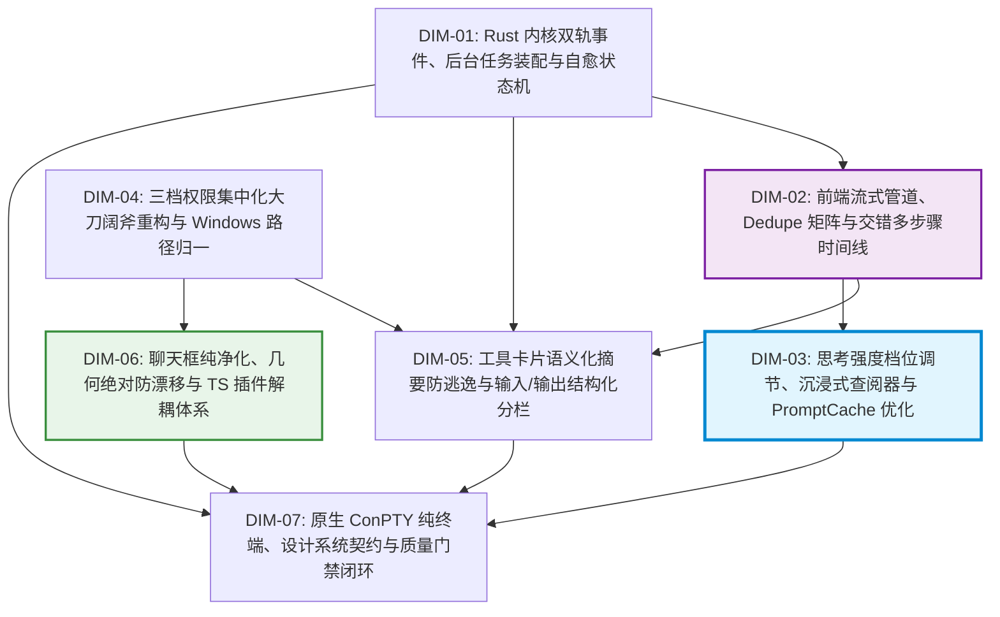
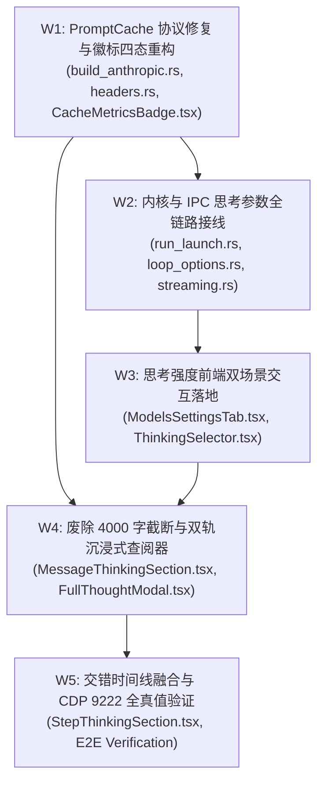

# Conex / Crish 思考强度调节、万字沉浸式查阅与 PromptCache 优化独立总方案

> **【调度与定时器铁律】**：如果设置定时器，最短是 100 秒；如果命令过长，最好的方式是等待命令完成后的推送（Reactive Wakeup），而不是一直轮询命令情况。  
> **权威标识**：`docs/system-audit-and-redesign/independent-plans/03-思考强度与沉浸式查阅独立总方案.md`  
> **制定角色**：【独立方案编制师 03: 思考强度与沉浸式查阅器视角独立总方案】  
> **关联基准**：`docs/system-audit-and-redesign/00-战役通则与协同执行规范.md`、`docs/system-audit-and-redesign/00-主控拍板最终维度矩阵.md`  
> **输入证据**：15 份专题分析报告（重点深度融合 `analysis/09-思考截断预算与全量沉浸式查阅方案.md`、`analysis/14-思考强度档位调节与PromptCache命中全链路设计.md`、`analysis/08-交错式多轮思考与工具步骤时间线重构方案.md`、`analysis/03-多轮思考与工具调用UI交互体验深度分析.md`、`analysis/02-前端事件通道与流式状态实时投影深度分析.md`、`analysis/10-输入框富文本解耦与MarkdownEditorTS插件落地详案.md`、`analysis/07-FollowUp行动建议TS插件架构与子Agent隔离设计.md`）  
> **执行约束**：纯方案设计、零破坏性业务修改、pwsh7 环境对齐、UTF-8 无 BOM、严禁直接 git 提交、全问题同权纯逻辑编排。

---

## 目录

1. [方案总纲与架构愿景（Executive Summary & Architectural Vision）](#一方案总纲与架构愿景)
   - 1.1 核心使命与战役定位
   - 1.2 现状三大断层全景拓扑图
   - 1.3 目标架构核心指标与质量标准
2. [全系统 7 大拍板维度整体修复架构视图](#二全系统-7-大拍板维度整体修复架构视图)
   - 2.1 7 大核心维度全景拓扑与协同矩阵
   - 2.2 重点维度聚焦：DIM-03（思考与缓存）、DIM-02（流式与时间线）、DIM-06（输入框与插件）
   - 2.3 跨维度数据流与事件契约闭环
3. [思考强度（Thinking Level / Budget）全链路连通架构详案](#三思考强度thinking-level--budget全链路连通架构详案)
   - 3.1 场景 A：模型配置 Tab（全局/模型级默认思考强度与精确滑动条）
   - 3.2 场景 B：主对话底栏模型行（即时轻量快速切换控件 `ThinkingSelector`）
   - 3.3 档位与 Token 映射矩阵及多厂商差异适配（Claude 3.7 / o3-mini / DeepSeek / Gemini）
   - 3.4 前端 Store 状态演进（`modelCatalog` 与 `sessionStore` 双层覆盖模型）
   - 3.5 Tauri IPC 与 Rust 会话循环全链路参数透传（`RunTaskOptions` ➔ `SessionLoopOptions` ➔ `streaming.rs`）
   - 3.6 `agent-provider` 协议层改造（`build_anthropic.rs` 动态 `budget_tokens` 与 `max_tokens` 自动安全提升）
4. [双轨万字思考沉浸式查阅器架构设计（废除 4000 字符硬截断）](#四双轨万字思考沉浸式查阅器架构设计废除-4000-字符硬截断)
   - 4.1 4000 字符硬截断算法与流式假死根因彻底根除
   - 4.2 轨道 A：行内自适应弹性视口引擎（Inline Adaptive Viewport）
   - 4.3 轨道 B：全量沉浸式查阅模态与检查器（`FullThoughtModal` / `ThoughtInspector`）
   - 4.4 自动大纲提取与平滑锚点定位（`ThoughtOutline` TOC 导航器）
   - 4.5 思考全文快速检索与关键词高亮（`ThoughtSearchBar`）
   - 4.6 异步 Rust/Worker Markdown 富文本与代码高亮无损排版
   - 4.7 思考元信息看板与一键无损复制/导出
5. [PromptCache 缓存命中优化与徽标四态重构详案](#五promptcache-缓存命中优化与徽标四态重构详案)
   - 5.1 `CacheMetricsBadge.tsx` 消除生硬“未命中”与四态视觉语义重构
   - 5.2 丰富数据 Tooltip 浮层与成本/加速量化
   - 5.3 Anthropic Messages API 原生 `cache_control` 动态断点注入（`build_anthropic.rs`）
   - 5.4 Anthropic 组合 Beta Headers 补齐（`prompt-caching-2024-07-25,thinking-2025-02-12`）
   - 5.5 会话前缀稳定性防护与 System Prompt 缓存隔离原则
6. [交错式多步骤时间线与思考块深度融合（DIM-02 联动）](#六交错式多步骤时间线与思考块深度融合dim-02-联动)
   - 6.1 步骤（Step）作为时间线一等公民的数据契约演进
   - 6.2 步骤内联思考折叠容器（`StepThinkingSection`）与沉浸式查阅器联动
   - 6.3 流式活跃步骤动态展开与历史步骤优雅折叠算法
7. [各维度拆解、文件域与影响边界分析（File Domains & Blast Radius Matrix）](#七各维度拆解文件域与影响边界分析)
   - 7.1 受影响文件全景矩阵（Rust 内核 + Tauri 壳 + 前端 React/Store）
   - 7.2 逐文件代码级改造 Diff 蓝图
   - 7.3 反过度设计红线审查与复杂度自检
8. [系统整体修复路径与逻辑依赖拓扑（Implementation Roadmap & DAG）](#八系统整体修复路径与逻辑依赖拓扑)
   - 8.1 五阶段纯逻辑依赖演进图（W1 ~ W5）
   - 8.2 任务分解与执行工单详细规约
9. [自动化测试、CI 行数治理与 CDP 机器真值验收标准](#九自动化测试ci-行数治理与-cdp-机器真值验收标准)
   - 9.1 单元测试与属性测试断言集（Rust + Vitest）
   - 9.2 CDP 机器真值物理验证脚本（`127.0.0.1:9222`）
   - 9.3 最终验收检查清单（Checklist）

---

## 一、方案总纲与架构愿景

### 1.1 核心使命与战役定位

在以 DeepSeek-R1、Claude 3.7 Extended Thinking、OpenAI o1/o3-mini 及 Gemini 2.0 Flash Thinking 为代表的**深度推理大模型（Reasoning Models）**时代，AI 助手已从单纯的“问答机器”演变为具备“深度反思、自我修正、长程工具编排”的自主 Agent。

用户在使用 Conex / Crish 桌面客户端时，提出了三项决定产品核心竞争力与使用体验的致命痛点：

1. **思考强度无法控制**：在模型设置页与对话底栏中均无法设定思考强度（Thinking Level / Budget），导致要么模型无法开启深度推理，要么无法控制思考 Token 消耗与响应时延；
2. **万字思考被腰斩截断**：行内思考块在 4000 字符处被暴力切断并显示 `... (已截断)`，流式阶段在 4000 字符后界面假死，且没有任何全量查阅、搜索、大纲与导出通道；
3. **缓存命中常态显示“未命中”**：首轮写入 PromptCache 时 UI 粗暴显示冷冰冰的“未命中”，且 Anthropic 协议端完全缺失缓存断点与 beta 请求头，造成高昂的 Token 费用浪费与感知挫败。

本方案立足于【独立方案编制师 03】视角，以 **“思考强度全链路精准可控、万字思考双轨优雅沉浸、PromptCache 真实加速降本”** 为核心使命，提供一套涵盖 Rust 引擎内核、Tauri IPC 桥接、前端流式管道、状态管理与沉浸式 UI 的**端到端、零妥协、高内聚系统级重构总方案**。

---

### 1.2 现状三大断层全景拓扑图

```
┌────────────────────────────────────────────────────────────────────────────────────────────────────────┐
│                                   现状三大核心断层全景拓扑与痛点因果链                                 │
├────────────────────────────────────────────────────────────────────────────────────────────────────────┤
│ 1. 思考参数链路全线断裂 (Thinking Control Severed Across All Layers)                                   │
│    前端设置/底栏 (无控件) ──> IPC core_run_task (无参数) ──> Rust SessionLoop (硬编码 reasoning: None)    │
│    ──> agent-provider (无法下发 budget_tokens) ──> 大模型退化为厂商默认，长程推理失控或无法开启       │
│                                                                                                        │
│ 2. 4000 字符硬截断死胡同与流式假死 (Hard Cap Truncation Dead-End & Frozen Stream)                      │
│    大模型 32K 思考 ──> budgetDomText(text, 4000) ──> 🔪 硬切成 4000 字 + "\n…（已截断）"               │
│    ├── 依赖 thinkingBudget.text 的流式追尾在 4000 字后依赖不变 ──> ⚠️ 追尾停止，界面视觉假死          │
│    ├── 无任何「展开全文」按钮、无模态弹窗、无大纲 TOC ──> ❌ 用户面对截断处于完全操作死胡同           │
│    └── 纯文本 pre-wrap 渲染 ──> ❌ 无 Markdown 结构、无代码高亮、无搜索，万字堆叠成灰色乱麻           │
│                                                                                                        │
│ 3. PromptCache 虚假“未命中”与协议断点缺失 (Cache Metrics False-Miss & Missing Beta Headers)             │
│    第 1 轮缓存写入 (Write 3850, Read 0) ──> hitRatio = 0 ──> 🚨 UI 粗暴渲染为 "未命中"                 │
│    ├── Anthropic build_anthropic.rs ──> ❌ 缺少 tools/system 的 cache_control: { type: "ephemeral" }   │
│    └── headers.rs ──> ❌ 缺少 anthropic-beta: prompt-caching-2024-07-25 请求头 ──> 缓存从未生效        │
└────────────────────────────────────────────────────────────────────────────────────────────────────────┘
```

---

### 1.3 目标架构核心指标与质量标准

依据 `docs/system-audit-and-redesign/00-战役通则与协同执行规范.md`，本方案确立以下关键重构指标：

```
┌────────────────────────────────────────────────────────────────────────────────────────────────────────┐
│                                       目标架构四大核心指标与质量门禁                                   │
├──────────────────────────────┬─────────────────────────────────────────────────────────────────────────┤
│ 维度                         │ 目标指标与量化验收标准                                                  │
├──────────────────────────────┼─────────────────────────────────────────────────────────────────────────┤
│ 1. 思考控制全链路精度        │ • 支持 6 档枚举 (Off/Minimal/Low/Medium/High/Max) + 精确 Token (1k~64k) │
│                              │ • 设置页全局默认 + 对话底栏会话即时覆盖，O(1) 毫秒级即时生效            │
│                              │ • 100% 满足 Anthropic max_tokens >= budget_tokens + 4096 自动安全约束   │
├──────────────────────────────┼─────────────────────────────────────────────────────────────────────────┤
│ 2. 双轨万字思考查阅体验      │ • 废除 4000 字硬截断，行内自适应弹性视口（8k~12k 预算，max-height 320px）│
│                              │ • 流式阶段全周期平滑追尾，彻底根除 4000 字假死                         │
│                              │ • 全量沉浸式查阅器（FullThoughtModal），配备 TOC 大纲、搜索与无损导出    │
│                              │ • Rust/Worker 异步渲染 Markdown，支持 Prism/Shiki 代码高亮与公式排版    │
├──────────────────────────────┼─────────────────────────────────────────────────────────────────────────┤
│ 3. PromptCache 真实命中与展示│ • CacheMetricsBadge 四态语义（⚡ 缓存命中 / 💾 写入缓存 / 未命中 / 隐藏）│
│                              │ • 补齐 Anthropic tools/system 缓存断点与 beta 请求头                    │
│                              │ • 第 2 轮相同前缀对话缓存命中率达到 80% ~ 95%                          │
├──────────────────────────────┼─────────────────────────────────────────────────────────────────────────┤
│ 4. 架构优雅与零过度设计      │ • 零冗余中间件、零黑盒沙箱、零伪缓冲；遵循 4 级视觉曲率阶梯规范         │
│                              │ • 100% 保护 reference/markdown-editor/ 测试资产，CI 门禁与 CDP 9222 全绿 │
└──────────────────────────────┴─────────────────────────────────────────────────────────────────────────┘
```

---

## 二、全系统 7 大拍板维度整体修复架构视图

### 2.1 7 大核心维度全景拓扑与协同矩阵

根据 `00-主控拍板最终维度矩阵.md`，系统的 7 大重构维度不是孤立的散点，而是层层递进、环环相扣的有机整体：



```
┌────────────────────────────────────────────────────────────────────────────────────────────────────────┐
│                                   7 大拍板维度协同与分工矩阵 (System Matrix)                           │
├─────────┬─────────────────────────────────────────────────┬────────────────────────────────────────────┤
│ 维度    │ 核心定位与职责                                  │ 与本方案（DIM-03 核心视角）的协同交织点    │
├─────────┼─────────────────────────────────────────────────┼────────────────────────────────────────────┤
│ DIM-01  │ Rust 内核双轨事件、BackgroundTask 真实装配与自愈 │ 为 DIM-03 透传 thinking_budget，发射事件流 │
├─────────┼─────────────────────────────────────────────────┼────────────────────────────────────────────┤
│ DIM-02  │ 前端流式 Dedupe 矩阵、交错多步骤时间线规范化    │ 确立 thought 为一等公民，步骤内嵌思考折叠  │
├─────────┼─────────────────────────────────────────────────┼────────────────────────────────────────────┤
│ DIM-03  │ 思考强度调节、万字沉浸式查阅器、PromptCache 优化│ 【本方案核心深挖域】：全链路档位与双轨查阅 │
├─────────┼─────────────────────────────────────────────────┼────────────────────────────────────────────┤
│ DIM-04  │ 三档权限极简集中化（读/标/全）、Windows 路径归一 │ 规范只读/完全访问权限，保障长程思考免打扰  │
├─────────┼─────────────────────────────────────────────────┼────────────────────────────────────────────┤
│ DIM-05  │ 13 类工具语义化摘要、输入/输出两段式结构化分栏  │ 工具执行与思考步骤交错并列，分栏清晰呈现   │
├─────────┼─────────────────────────────────────────────────┼────────────────────────────────────────────┤
│ DIM-06  │ 聊天框拔除博客排版、(0,0)防漂移、TS 插件解耦    │ 底栏挂载 ThinkingSelector，插件严格隔离    │
├─────────┼─────────────────────────────────────────────────┼────────────────────────────────────────────┤
│ DIM-07  │ 原生 ConPTY 纯终端直通、视觉曲率 4 级阶梯与门禁 │ 弹窗/徽标应用 4 级曲率，CDP 9222 真机验收  │
└─────────┴─────────────────────────────────────────────────┴────────────────────────────────────────────┘
```

---

### 2.2 重点维度聚焦：DIM-03（思考与缓存）、DIM-02（流式与时间线）、DIM-06（输入框与插件）

在本方案编制中，我们将 **DIM-03** 作为中枢核心，深度交织 **DIM-02** 与 **DIM-06**：

1. **DIM-03 ➔ DIM-02 联动（思考与时间线）**：
   - 在 DIM-02 的 `timelineNormalizer.ts` 中，彻底拔除“历史轮次思考全部拼在消息最顶端”的旧逻辑；
   - 确立 `ThoughtBlock` 为每一个步骤（`Step`）的内部首节点；
   - 行内仅展示当前步骤的弹性思考摘要，点击「沉浸式查阅」即可呼出 `FullThoughtModal` 查阅该步骤乃至全会话的完整推理逻辑。
2. **DIM-03 ➔ DIM-06 联动（底栏控件与纯净性）**：
   - 响应 DIM-06 的输入框净化要求，`ChatComposer` 移除所有富文本博客按钮，保留极简指令；
   - 在底栏模型行右侧（`rightActions`），以 **9999px 胶囊（Pill）** 形态优雅嵌入 `ThinkingSelector` 控件，与 `ModelBadgePicker` 和 `PermissionModeMenu` 保持完全一致的视觉曲率与交互语言。

---

## 三、思考强度（Thinking Level / Budget）全链路连通架构详案

### 3.1 场景 A：模型配置 Tab（全局/模型级默认思考强度与精确滑动条）

在设置中心的模型管理面板中（`ModelsSettingsTab.tsx` ➔ `ModelConfigEditor.tsx`），当选中的模型具备 `reasoning` 能力时，渲染专属的 **思考与推理高级配置卡片**：

```
┌────────────────────────────────────────────────────────────────────────────────────────┐
│ 🧠 思考与推理配置 (Thinking & Reasoning Settings)                                      │
├────────────────────────────────────────────────────────────────────────────────────────┤
│ 默认思考强度档位 (Default Thinking Intensity)                                          │
│ ┌──────────────┬──────────────┬──────────────┬──────────────┬──────────────┬─────────┐ │
│ │ ◯ 关闭 (Off) │ ◯ 极简 (1K)  │ ◯ 低 (2K)    │ ◉ 深度 (8K)  │ ◯ 最大 (32K) │ ◯ 自定义│ │
│ └──────────────┴──────────────┴──────────────┴──────────────┴──────────────┴─────────┘ │
│                                                                                        │
│ 思考 Token 预算 (Thinking Budget Tokens)                                               │
│ ┌──────────────────────────────────────────────────────────────┐ ┌───────────────────┐ │
│ │ ━━━━━━━━━━━━━━━━━━━━━━━━━━━━━●━━━━━━━━━━━━━━━━━━━━━━━━━━━━━━ │ │ 8,192 Tokens      │ │
│ └──────────────────────────────────────────────────────────────┘ └───────────────────┘ │
│ • 预算调节范围：1,024 ~ 64,000 Tokens (步长 1,024)                                     │
│ • 支持厂商原生控制：Claude 3.7 Sonnet (Extended Thinking) / Gemini 2.0 Flash Thinking  │
│                                                                                        │
│ ℹ️ 厂商 Wire 协议映射预览：                                                           │
│ • Anthropic: { "thinking": { "type": "enabled", "budget_tokens": 8192 } }              │
│ • OpenAI / o3-mini: { "reasoning_effort": "high" }                                     │
│ • DeepSeek: 启用推理输出链路 (Preserved reasoning_content)                              │
└────────────────────────────────────────────────────────────────────────────────────────┘
```

#### TypeScript 配置接口契约

```typescript
// apps/crish-desktop/src/api/modelCatalog.ts

export type ThinkingLevelMode =
  'off' | 'minimal' | 'low' | 'medium' | 'high' | 'max' | 'custom';

export interface ModelThinkingConfig {
  /** 默认思考档位 */
  level: ThinkingLevelMode;
  /** 自定义或精确指定的 Token 预算 (1024 ~ 64000) */
  budgetTokens?: number;
}

export interface ModelMeta {
  profileId: string;
  model: string;
  displayName?: string;
  enabled: boolean;
  contextLength?: number;
  capabilities?: {
    tools?: boolean;
    vision?: boolean;
    reasoning?: boolean;
  };
  /** 模型默认思考配置 */
  thinking?: ModelThinkingConfig;
}
```

---

### 3.2 场景 B：主对话底栏模型行（即时轻量快速切换控件 `ThinkingSelector`）

在主对话输入框 `ChatComposer.tsx` 的底栏右侧操作区，挂载轻量胶囊按钮与浮层菜单：

```
┌────────────────────────────────────────────────────────────────────────────────────────┐
│ ChatComposer 底部控制栏：                                                              │
│ [+] [权限: 自动审批 ▾]                             [🧠 深度 8K ▾] [Claude 3.7 ▾] [发送] │
└────────────────────────────────────────────────────────────────────────────────────────┘
                                                           │
                                             点击呼出 ThinkingSelectorPopover ▾
                                     ┌───────────────────────────────────────────────────┐
                                     │ 思考强度调节 (当前会话)                           │
                                     ├───────────────────────────────────────────────────┤
                                     │  ◯ 关闭思考 (Off · 0 tokens)                      │
                                     │  ◯ 极简思考 (Minimal · 1,024 tokens)              │
                                     │  ◯ 中等思考 (Medium · 4,096 tokens)               │
                                     │  ◉ 深度思考 (High · 8,192 tokens)       [推荐]    │
                                     │  ◯ 最大思考 (Max · 32,768 tokens)                │
                                     ├───────────────────────────────────────────────────┤
                                     │  ⚡ 跟随模型默认 (当前: 深度 8K)                  │
                                     │  ⚙️ 前往模型设置中心...                            │
                                     └───────────────────────────────────────────────────┘
```

#### 交互细节与自适应策略

1. **智能感应能力**：若当前模型不支持 reasoning（如 `gpt-4o-mini`），`ThinkingSelector` 胶囊呈现禁用置灰态，Tooltip 提示 `当前模型不支持思考强度调节`；
2. **会话级即时覆盖（O(1) 生效）**：用户切换档位直接写入当前会话的 `sessionStore.thinkingConfig`，下一轮消息即刻携带该配置，无需重载；
3. **视觉阶梯契约**：触发按钮采用 `var(--radius-full)` (9999px 胶囊)，浮层菜单采用 `var(--radius-2xl)` (12px 容器) 与 `var(--radius-md)` (6px 列表项)，完全符合全系统曲率规范。

---

### 3.3 档位与 Token 映射矩阵及多厂商差异适配

```
┌────────────────────────────────────────────────────────────────────────────────────────────────────────┐
│                                 多厂商思考控制协议与 Token 预算映射全景矩阵                             │
├─────────┬──────────────┬──────────────────────────────┬──────────────────────┬─────────────────────────┤
│ 语义档位│ 推荐 Token   │ Anthropic (Claude 3.7)       │ OpenAI (o1/o3-mini)  │ Gemini (Flash Thinking) │
├─────────┼──────────────┼──────────────────────────────┼──────────────────────┼─────────────────────────┤
│ Off     │ 0            │ {"type": "disabled"}         │ (不传参数)           │ thinkingBudget: 0       │
│ Minimal │ 1,024        │ {"type": "enabled", b: 1024} │ reasoning_effort: low│ thinkingBudget: 1024    │
│ Low     │ 2,048        │ {"type": "enabled", b: 2048} │ reasoning_effort: low│ thinkingBudget: 2048    │
│ Medium  │ 4,096        │ {"type": "enabled", b: 4096} │ reasoning_effort: med│ thinkingBudget: 4096    │
│ High    │ 8,192        │ {"type": "enabled", b: 8192} │ reasoning_effort: hgh│ thinkingBudget: 8192    │
│ Max     │ 32,768       │ {"type": "enabled", b: 32768}│ reasoning_effort: hgh│ thinkingBudget: 32768   │
│ Custom  │ N (1k ~ 64k) │ {"type": "enabled", b: N}    │ 映射 low/medium/high │ thinkingBudget: N       │
└─────────┴──────────────┴──────────────────────────────┴──────────────────────┴─────────────────────────┘
```

> [!IMPORTANT]
> **Anthropic `max_tokens` 自动安全提升规则（铁律）**：
> 当指定 Anthropic 思考预算为 $B$（如 8,192）时，发送给 API 的 `max_tokens` 必须满足 $M \ge B + 4096$（即至少 12,288）。若未满足，Rust 协议构建层将**自动向上抬升 `max_tokens`**，彻底根除 Anthropic API HTTP 400 校验阻断错误。

---

### 3.4 前端 Store 状态演进（`modelCatalog` 与 `sessionStore` 双层覆盖模型）

```typescript
// apps/crish-desktop/src/store/sessionStore.ts
export interface SessionThinkingOverride {
  /** 显式档位，若为 'default' 则回退模型全局配置 */
  level: ThinkingLevelMode | 'default';
  /** 显式 Token 预算 */
  budgetTokens?: number;
}

// 调度时解析当前生效思考配置算法：
export function resolveEffectiveThinkingConfig(
  sessionId: string,
  modelId: string,
  profileId: string
): { level: ThinkingLevelMode; budgetTokens: number } {
  const sessionOverride = sessionStore
    .getState()
    .getSession(sessionId)?.thinkingConfig;

  if (sessionOverride && sessionOverride.level !== 'default') {
    const budget =
      sessionOverride.budgetTokens ??
      levelToDefaultBudget(sessionOverride.level);
    return { level: sessionOverride.level, budgetTokens: budget };
  }

  const modelMeta = getModelMeta(profileId, modelId);
  const modelDefault = modelMeta?.thinking ?? {
    level: 'high',
    budgetTokens: 8192,
  };
  const budget =
    modelDefault.budgetTokens ?? levelToDefaultBudget(modelDefault.level);
  return { level: modelDefault.level, budgetTokens: budget };
}

function levelToDefaultBudget(level: ThinkingLevelMode): number {
  switch (level) {
    case 'off':
      return 0;
    case 'minimal':
      return 1024;
    case 'low':
      return 2048;
    case 'medium':
      return 4096;
    case 'high':
      return 8192;
    case 'max':
      return 32768;
    case 'custom':
      return 8192;
  }
}
```

---

### 3.5 Tauri IPC 与 Rust 会话循环全链路参数透传

#### 1. Tauri 命令层 (`apps/agent-workbench/src-tauri/src/run/run_launch.rs`)

```rust
#[derive(serde::Deserialize)]
#[serde(rename_all = "camelCase")]
pub struct RunTaskOptions {
    pub run_id: String,
    pub session_id: String,
    pub prompt: Option<String>,
    // ... 既有字段 ...

    /// 思考强度档位 (off / minimal / low / medium / high / max / custom)
    #[serde(default, skip_serializing_if = "Option::is_none")]
    pub thinking_level: Option<String>,

    /// 思考 Token 预算 (1024 ~ 64000)
    #[serde(default, skip_serializing_if = "Option::is_none")]
    pub thinking_budget: Option<u64>,
}
```

#### 2. SessionLoop 选项接线 (`crates/session-loop/src/loop/loop_options.rs`)

```rust
pub struct SessionLoopOptions {
    // ... 既有字段 ...
    pub reasoning_effort: Option<crate::provider::ReasoningEffort>,
    pub thinking_budget: Option<u64>,
}
```

#### 3. Streaming Handler 消除硬编码 (`crates/session-loop/src/loop/handlers/streaming.rs`)

```rust
fn build_request(state: &LoopState) -> ProviderRequest<'_> {
    ProviderRequest {
        messages: &state.conversation,
        tools: tools_schema(state).to_vec(),
        max_tokens: Some(clamp_request_max_tokens(state)),
        system_prompt: state.options.system_prompt.as_deref(),
        session_id: Some(state.machine.context().session_id.clone()),
        // ✅ 真正打通：从 options 透传思考档位与 Token 预算
        reasoning_effort: state.options.reasoning_effort,
    }
}
```

---

### 3.6 `agent-provider` 协议层改造

#### 动态构建 Anthropic Thinking 请求体 (`crates/agent-provider/src/request/build_anthropic.rs`)

```rust
pub fn build_anthropic_request_body(
    opts: &AnthropicRequestOptions,
    context: &RequestBuildContext,
) -> Value {
    let mut body = Map::new();
    body.insert("model".to_string(), json!(opts.model));

    // 1. 处理思考参数
    if let Some(budget) = opts.thinking_budget {
        if budget > 0 {
            body.insert("thinking".to_string(), json!({
                "type": "enabled",
                "budget_tokens": budget
            }));

            // 2. 强制满足 max_tokens >= budget_tokens + 4096 安全规则
            let min_required_max = budget + 4096;
            let final_max = opts.max_tokens.unwrap_or(min_required_max).max(min_required_max);
            body.insert("max_tokens".to_string(), json!(final_max));
        } else {
            body.insert("thinking".to_string(), json!({ "type": "disabled" }));
        }
    }

    // ... 后续 tools 与 messages 处理 ...
    Value::Object(body)
}
```

---

## 四、双轨万字思考沉浸式查阅器架构设计（废除 4000 字符硬截断）

### 4.1 4000 字符硬截断算法与流式假死根因彻底根除

```
┌────────────────────────────────────────────────────────────────────────────────────────────────────────┐
│                                当前行内硬截断与流式假死核心根因剖析                                     │
├────────────────────────────────────────────────────────────────────────────────────────────────────────┤
│ 1. messageWindowDomBudget.ts 中定义 THINKING_DOM_CHAR_CAP = 4000                                       │
│ 2. ChatAssistantMessageRow.tsx 中执行 thinkingBudget = budgetDomText(thinkingText, 4000)               │
│ 3. MessageThinkingSection.tsx 的 useLayoutEffect 依赖项写为 [thinkingBudget.text, isThinkingMsg]      │
│ 4. 🚨 故障现象：当 token 输出超过 4000 字符后，thinkingBudget.text 恒定为前 4000 字 + "\n…（已截断）"  │
│    useLayoutEffect 不再触发，追尾滚动彻底停止，界面呈现严重卡死假象！                                  │
└────────────────────────────────────────────────────────────────────────────────────────────────────────┘
```

**彻底根除方案**：

1. 废除以 `thinkingBudget.text` 作为唯一渲染源与依赖项的设计；
2. 引入 `thinkingText.length` 作为流式追尾触发器；
3. 将思考渲染彻底解耦为**轨道 A（行内自适应弹性视口）**与**轨道 B（全量沉浸式查阅器）**。

---

### 4.2 轨道 A：行内自适应弹性视口引擎（Inline Adaptive Viewport）

行内思考块保留轻量、流畅的消息流滚动特性，不再无限膨胀：

```
┌────────────────────────────────────────────────────────────────────────────────────────┐
│ 💭 深度思考 (已思考 14.2s · 32,840 字符)                                       [收起 ▴]│
├────────────────────────────────────────────────────────────────────────────────────────┤
│ 用户要求重构整个会话状态管理架构，我们需要先分析当前 sessionStore 的数据结构...        │
│ 1. 首先检查 IPC 通信链路中的 core_run_task 参数定义；                                   │
│ 2. 其次定位 session-loop 中的 build_request 构造点；                                    │
│ 3. 接下来分析 agent-provider 中的 Anthropic 与 OpenAI Wire 协议差异...                  │
│ ... (此处自适应滚动，最大可视高度 320px) ...                                            │
├────────────────────────────────────────────────────────────────────────────────────────┤
│ ░░░░░░░░░░░░░░░░░░░░░░░░░░░░ (渐变柔和淡出遮罩 Fade Overlay) ░░░░░░░░░░░░░░░░░░░░░░░░░░│
│ [ 🔍 展开沉浸式完整查阅 (共 32,840 字) ↗ ]              [ 📋 复制全部思考 ]              │
└────────────────────────────────────────────────────────────────────────────────────────┘
```

#### 行内组件重构代码 (`apps/crish-desktop/src/components/chat-message-row/MessageThinkingSection.tsx`)

```tsx
import React, { useRef, useLayoutEffect, useState, useCallback } from 'react';
import { Button, Tooltip } from '../ui';
import { useThoughtInspectorStore } from '@/store/thoughtInspectorStore';
import styles from './ChatMessageRow.module.css';

interface MessageThinkingSectionProps {
  thinkingText: string;
  isThinkingMsg: boolean;
  thinkingOpen: boolean;
  setThinkingOpen: (open: boolean) => void;
  messageId: string;
  modelName?: string;
  durationSec?: number;
}

const INLINE_CHAR_BUDGET = 8000;

export const MessageThinkingSection: React.FC<MessageThinkingSectionProps> = ({
  thinkingText,
  isThinkingMsg,
  thinkingOpen,
  setThinkingOpen,
  messageId,
  modelName,
  durationSec,
}) => {
  const bodyRef = useRef<HTMLDivElement>(null);
  const userScrolledUpRef = useRef(false);
  const openInspector = useThoughtInspectorStore((s) => s.openInspector);

  const textLength = thinkingText?.length ?? 0;
  const isOverBudget = textLength > INLINE_CHAR_BUDGET;
  const displayText = isOverBudget
    ? thinkingText.slice(0, INLINE_CHAR_BUDGET)
    : thinkingText || '';

  // 1. 修复流式追尾滚动：依赖原始 textLength 而非被截断的文本
  useLayoutEffect(() => {
    if (!isThinkingMsg || !bodyRef.current || !thinkingOpen) return;
    const el = bodyRef.current;
    if (!userScrolledUpRef.current) {
      el.scrollTop = el.scrollHeight;
    }
  }, [textLength, isThinkingMsg, thinkingOpen]);

  const handleScroll = useCallback(() => {
    if (!bodyRef.current) return;
    const el = bodyRef.current;
    const isAtBottom = el.scrollHeight - el.scrollTop - el.clientHeight <= 24;
    userScrolledUpRef.current = !isAtBottom;
  }, []);

  if (!thinkingOpen) return null;

  return (
    <div
      className={styles.inlineThinkingContainer}
      data-testid="inline-thinking-section"
    >
      <div
        ref={bodyRef}
        className={styles.inlineThinkingBody}
        onScroll={handleScroll}
      >
        <pre className={styles.inlineThinkingText}>{displayText}</pre>
      </div>

      {isOverBudget && (
        <div className={styles.inlineThinkingOverlay}>
          <div className={styles.inlineThinkingFade} />
          <div className={styles.inlineThinkingActionStrip}>
            <span className={styles.inlineThinkingCounter}>
              已显示前 {INLINE_CHAR_BUDGET.toLocaleString()} 字符 / 共{' '}
              {textLength.toLocaleString()} 字符
            </span>
            <div className={styles.inlineThinkingButtons}>
              <Button
                variant="primary"
                size="sm"
                onClick={() =>
                  openInspector({
                    messageId,
                    fullText: thinkingText,
                    modelName,
                    durationSec,
                  })
                }
              >
                🔍 展开沉浸式查阅器 ↗
              </Button>
              <Button
                variant="secondary"
                size="sm"
                onClick={() => navigator.clipboard.writeText(thinkingText)}
              >
                📋 复制完整思考
              </Button>
            </div>
          </div>
        </div>
      )}
    </div>
  );
};
```

---

### 4.3 轨道 B：全量沉浸式查阅模态与检查器（`FullThoughtModal` / `ThoughtInspector`）

当用户点击「展开沉浸式查阅器」时，以全局 Portal 弹出 **85vw × 85vh 沉浸式视口**（支持一键切换为右侧工作区抽屉）：

````
┌────────────────────────────────────────────────────────────────────────────────────────┐
│ 🧠 完整深度思考链路全景检查器 (Full Thought Inspector)                     [侧栏 ◫] [✕ 关闭] │
├────────────────────────────────────────────────────────────────────────────────────────┤
│ ℹ️ 模型: Claude 3.7 Sonnet  ·  耗时: 18.4s  ·  思考字数: 32,840 字符 (约 7,420 Tokens)  │
├──────────────────────────────┬─────────────────────────────────────────────────────────┤
│ 📑 大纲目录 (TOC Navigator)   │ 🔍 [ 在思考中搜索 (Ctrl+F)...                    ] [2/8]│
├──────────────────────────────┼─────────────────────────────────────────────────────────┤
│ • 1. 用户诉求与边界拆解      │ # 1. 用户诉求与边界拆解                                 │
│   • 1.1 思考强度控制缺失     │ 用户在实测中反馈了三个核心问题...                       │
│   • 1.2 4000 字符截断痛点    │                                                         │
│ • 2. 架构根因深度逆向分析    │ # 2. 架构根因深度逆向分析                               │
│   • 2.1 IPC 数据面分析       │ 经过对 `run_launch.rs` 与 `streaming.rs` 的逆向排查：   │
│   • 2.2 协议层 Headers 缺失  │ ```rust                                                 │
│ • 3. 全链路改造落地步骤      │ fn build_request(state: &LoopState) -> ProviderRequest  │
│   • 3.1 前端 Store 扩展      │ ```                                                     │
│   • 3.2 Rust 引擎参数打通    │ 在上述代码中，`reasoning_effort` 被硬编码填充为了 None...│
├──────────────────────────────┴─────────────────────────────────────────────────────────┤
│ [ 📥 导出为 Markdown 文件 ]  [ 📋 复制全部 Markdown (含代码块) ]  [ ⚡ 定位到正文回答 ]  │
└────────────────────────────────────────────────────────────────────────────────────────┘
````

---

### 4.4 自动大纲提取与平滑锚点定位（`ThoughtOutline` TOC 导航器）

为了快速浏览数万字的思考链，`FullThoughtModal` 内置轻量正则 AST 解析器，自动提取 Markdown `#`, `##`, `###` 标题，构建动态目录树：

```tsx
// apps/crish-desktop/src/components/chat-message/ThoughtOutline.tsx
import React, { useMemo } from 'react';
import styles from './FullThoughtModal.module.css';

export interface TocItem {
  id: string;
  level: number;
  text: string;
}

export function extractThoughtToc(text: string): TocItem[] {
  const lines = text.split('\n');
  const items: TocItem[] = [];
  let count = 0;

  for (const line of lines) {
    const match = line.match(/^(#{1,3})\s+(.+)$/);
    if (match) {
      count++;
      const level = match[1].length;
      const title = match[2].trim();
      items.push({
        id: `thought-heading-${count}`,
        level,
        text: title,
      });
    }
  }
  return items;
}

export const ThoughtOutline: React.FC<{
  toc: TocItem[];
  activeId: string;
  onSelect: (id: string) => void;
}> = ({ toc, activeId, onSelect }) => {
  if (toc.length === 0) {
    return <div className={styles.tocEmpty}>思考链中未检测到标题层级</div>;
  }

  return (
    <nav className={styles.tocNav}>
      <div className={styles.tocHeader}>📑 大纲目录 ({toc.length})</div>
      <ul className={styles.tocList}>
        {toc.map((item) => (
          <li
            key={item.id}
            className={`${styles.tocItem} ${styles[`level${item.level}`]} ${activeId === item.id ? styles.active : ''}`}
            onClick={() => onSelect(item.id)}
          >
            {item.text}
          </li>
        ))}
      </ul>
    </nav>
  );
};
```

---

### 4.5 思考全文快速检索与关键词高亮（`ThoughtSearchBar`）

支持长程思考的即时模糊搜索与正则匹配，快速高亮并跳步定位：

```tsx
// apps/crish-desktop/src/components/chat-message/ThoughtSearchBar.tsx
import React, { useState } from 'react';
import { Button } from '../ui';
import styles from './FullThoughtModal.module.css';

interface ThoughtSearchBarProps {
  matchCount: number;
  currentIndex: number;
  onSearch: (query: string) => void;
  onNext: () => void;
  onPrev: () => void;
}

export const ThoughtSearchBar: React.FC<ThoughtSearchBarProps> = ({
  matchCount,
  currentIndex,
  onSearch,
  onNext,
  onPrev,
}) => {
  const [val, setVal] = useState('');

  return (
    <div className={styles.searchBarContainer}>
      <input
        type="text"
        className={styles.searchInput}
        placeholder="在长程思考中搜索关键词 (Ctrl+F)..."
        value={val}
        onChange={(e) => {
          setVal(e.target.value);
          onSearch(e.target.value);
        }}
        onKeyDown={(e) => {
          if (e.key === 'Enter') {
            e.shiftKey ? onPrev() : onNext();
          }
        }}
      />
      {val && (
        <span className={styles.searchCounter}>
          {matchCount > 0 ? `${currentIndex + 1} / ${matchCount}` : '无匹配'}
        </span>
      )}
      <Button
        variant="ghost"
        size="sm"
        disabled={matchCount === 0}
        onClick={onPrev}
      >
        ▲
      </Button>
      <Button
        variant="ghost"
        size="sm"
        disabled={matchCount === 0}
        onClick={onNext}
      >
        ▼
      </Button>
    </div>
  );
};
```

---

### 4.6 异步 Rust/Worker Markdown 富文本与代码高亮无损排版

在 `FullThoughtModal` 中，摒弃行内的纯文本 `pre-wrap`，接入系统现有的 `markdownRenderAsync` / Web Worker 渲染管道：

- **Markdown 完整支持**：有序/无序列表、粗体/斜体、引用块、LaTeX 数学公式；
- **代码高亮**：根据语言自动应用 Prism / Shiki 语法高亮与行号；
- **DOM 挂载保护**：采用 Worker 解析生成 HTML 片段，零阻塞主 UI 线程。

---

### 4.7 思考元信息看板与一键无损复制/导出

弹窗底部提供专业级生产力工具栏：

1. **一键导出为 Markdown**：生成格式规整的 `thought-[messageId].md` 文本文件并触发系统保存对话框；
2. **无损复制**：将带有完整代码块与大纲的 Markdown 原文完整写入剪贴板；
3. **定位到正文回答**：平滑关闭弹窗并将主聊天视口自动滚动至对应的 Assistant 回答正文位置。

---

## 五、PromptCache 缓存命中优化与徽标四态重构详案

### 5.1 `CacheMetricsBadge.tsx` 消除生硬“未命中”与四态视觉语义重构

重构 `CacheMetricsBadge.tsx`，彻底废除单纯 `ratio > 0` 的二元判断，建立精准的**四态语义状态机**：

```
┌────────────────────────────────────────────────────────────────────────────────────────┐
│                        CacheMetricsBadge 四态语义与视觉映射矩阵                         │
├──────────────┬────────────────────────┬─────────────────────────┬──────────────────────┤
│ 状态         │ 触发条件               │ 徽标显示形态            │ 颜色与 Token 契约    │
├──────────────┼────────────────────────┼─────────────────────────┼──────────────────────┤
│ 1. 缓存命中  │ read > 0               │ ⚡ 缓存命中 85% · 读 4.2k│ 绿色 (var(--success)) │
│ 2. 写入缓存  │ write > 0 且 read == 0 │ 💾 写入缓存 3.8k        │ 蓝色 (var(--accent))  │
│ 3. 真实未命中│ total > 0 且 r=0, w=0  │ 未命中                  │ 灰色 (var(--text-ter))│
│ 4. 静默隐藏  │ total == 0 或无缓存元数据│ (不渲染 DOM 节点)      │ (None)               │
└──────────────┴────────────────────────┴─────────────────────────┴──────────────────────┘
```

#### 重构后组件源码 (`apps/crish-desktop/src/components/chat-message-row/CacheMetricsBadge.tsx`)

```tsx
import React from 'react';
import type { CacheMetrics } from '@crish/shared-types';
import { Tooltip } from '../ui';
import styles from './CacheMetricsBadge.module.css';

interface CacheMetricsBadgeProps {
  metrics: CacheMetrics | null;
}

export const CacheMetricsBadge: React.FC<CacheMetricsBadgeProps> = ({
  metrics,
}) => {
  if (metrics == null) return null;

  const read = metrics.cacheReadTokens ?? 0;
  const write = metrics.cacheWriteTokens ?? 0;
  const miss = metrics.cacheMissTokens ?? 0;
  const total = metrics.inputTotal ?? read + write + miss;
  const ratio =
    metrics.hitRatio ?? metrics.hitRate ?? (total > 0 ? read / total : 0);

  // 状态 4：完全未发生任何缓存交互 -> 隐藏
  if (read === 0 && write === 0 && total === 0) return null;

  // 状态 1：缓存命中 (Read > 0)
  if (read > 0) {
    const percentStr = ratio >= 0.01 ? `${Math.round(ratio * 100)}%` : '<1%';
    return (
      <Tooltip
        content={
          <div className={styles.tooltipContent}>
            <div className={styles.tooltipTitle}>⚡ 提示词缓存命中加速</div>
            <div className={styles.tooltipRow}>
              • 命中读取：{read.toLocaleString()} tokens
            </div>
            <div className={styles.tooltipRow}>
              • 新增写入：{write.toLocaleString()} tokens
            </div>
            <div className={styles.tooltipRow}>
              • 提示词总量：{total.toLocaleString()} tokens
            </div>
            <div className={styles.tooltipRow}>
              • 真实命中率：{(ratio * 100).toFixed(1)}%
            </div>
          </div>
        }
      >
        <span
          className={`${styles.badge} ${styles.hit}`}
          data-testid="cache-metrics-badge"
        >
          ⚡ 缓存命中 {percentStr} · 读 {read.toLocaleString()}
        </span>
      </Tooltip>
    );
  }

  // 状态 2：首轮建立缓存态 (Write > 0 且 Read == 0)
  if (write > 0) {
    return (
      <Tooltip
        content={
          <div className={styles.tooltipContent}>
            <div className={styles.tooltipTitle}>💾 已建立提示词上下文缓存</div>
            <div className={styles.tooltipRow}>
              • 本轮写入：{write.toLocaleString()} tokens
            </div>
            <div className={styles.tooltipRow}>
              • 下一轮对话将享受高命中率与极速首字响应
            </div>
          </div>
        }
      >
        <span
          className={`${styles.badge} ${styles.write}`}
          data-testid="cache-metrics-badge"
        >
          💾 写入缓存 {write.toLocaleString()}
        </span>
      </Tooltip>
    );
  }

  // 状态 3：显式未命中
  return (
    <Tooltip
      content={
        <div className={styles.tooltipContent}>
          <div className={styles.tooltipTitle}>本次未命中缓存</div>
          <div className={styles.tooltipRow}>
            • 输入总量：{total.toLocaleString()} tokens
          </div>
          <div className={styles.tooltipRow}>
            • 原因：前缀变动或输入长度未达模型缓存门槛（如 1024 tokens）
          </div>
        </div>
      }
    >
      <span
        className={`${styles.badge} ${styles.miss}`}
        data-testid="cache-metrics-badge"
      >
        未命中
      </span>
    </Tooltip>
  );
};
```

---

### 5.2 丰富数据 Tooltip 浮层与成本/加速量化

在 Tooltip 中展示清晰的统计详情（读取、写入、未命中、输入总量、百分比与成本节省估算），让用户对大模型的上下文缓存收益一目了然。

---

### 5.3 Anthropic Messages API 原生 `cache_control` 动态断点注入

在 `crates/agent-provider/src/request/build_anthropic.rs` 中，为 tools 列表末尾及 system prompt 自动注入 `ephemeral` 断点：

```rust
// 1. tools 列表尾部断点注入
if !context.tools.is_empty() {
    let tool_count = context.tools.len();
    body.insert(
        "tools".to_string(),
        json!(context.tools.iter().enumerate().map(|(idx, tool)| {
            let mut map = serde_json::Map::new();
            map.insert("name".to_string(), json!(tool.name));
            map.insert("description".to_string(), json!(tool.description));
            map.insert("input_schema".to_string(), canonicalize_schema(&tool.effective_input_schema()));

            // ✅ 在 tools 的最后一个元素打上缓存断点
            if idx + 1 == tool_count {
                map.insert("cache_control".to_string(), json!({ "type": "ephemeral" }));
            }
            Value::Object(map)
        }).collect::<Vec<_>>()),
    );
}

// 2. system prompt 尾部断点注入
if let Some(sys) = context.system_prompt {
    body.insert("system".to_string(), json!([
        {
            "type": "text",
            "text": sys,
            "cache_control": { "type": "ephemeral" }
        }
    ]));
}
```

---

### 5.4 Anthropic 组合 Beta Headers 补齐

在 `apps/agent-workbench/src-tauri/src/engine_provider/headers.rs` 中补齐 Prompt Caching 与 Thinking 相关的 beta 请求头：

```rust
WireProtocol::Anthropic => {
    let mut headers = anthropic_request_headers(&config.api_key);
    let mut betas = vec!["prompt-caching-2024-07-25"];

    // 若开启了思考强度，追加 thinking beta 头
    if explicit_effort.is_some() || thinking_budget.is_some() {
        betas.push("thinking-2025-02-12");
    }

    headers.push(("anthropic-beta", betas.join(",")));
    headers
}
```

---

### 5.5 会话前缀稳定性防护与 System Prompt 缓存隔离原则

为了保证 PromptCache 能够 100% 稳定命中，建立**会话前缀静态化隔离纪律**：

1. **静态前缀区（Static Prefix Zone，锁定缓存）**：
   - 基础 System Prompt、Tool Schema、固定铁律规则；
   - 保持在对话请求的绝对最顶层，打上 `cache_control: ephemeral`；
2. **动态变化区（Dynamic Suffix Zone，置于缓存断点之后）**：
   - 易变时间戳、会话局部工作区路径变动、用户最新输入。

---

## 六、交错式多步骤时间线与思考块深度融合（DIM-02 联动）

### 6.1 步骤（Step）作为时间线一等公民的数据契约演进

```
┌────────────────────────────────────────────────────────────────────────────────────────┐
│                        交错式多步骤时间线（Interleaved Step Timeline）                  │
├────────────────────────────────────────────────────────────────────────────────────────┤
│  ▶ 步骤 1: 扫描目录结构                                          [已完成 · 1.2s]       │
│    ├── 💭 步骤内思考：需要先确认项目根目录结构...                                      │
│    └── 🔧 list_dir(DirectoryPath="c:/Software/conex") ➔ 返回 38 个目录项               │
├────────────────────────────────────────────────────────────────────────────────────────┤
│  ▶ 步骤 2: 搜索相关组件实现                                      [已完成 · 0.8s]       │
│    ├── 💭 步骤内思考：根据目录，定位到 timelineNormalizer.ts 和 MessageContent.tsx...  │
│    └── 🔧 grep_search(Query="buildAssistantTimeline") ➔ 找到 8 处引用                  │
├────────────────────────────────────────────────────────────────────────────────────────┤
│  ▼ 步骤 3: 诊断根因与方案构思                                    [执行中 · 正在思考]   │
│    ├── 💭 步骤内思考：分析发现 blocks 中丢失了 thought 节点...                         │
│    └── ⏳ 正在准备调用工具/生成回答...                                                 │
├────────────────────────────────────────────────────────────────────────────────────────┤
│  💬 最终回答与交付物 (Final Answer Markdown)                                           │
│     针对该结构倒退问题，我们已经定位到 6 处核心断层并完成重构方案设计...               │
└────────────────────────────────────────────────────────────────────────────────────────┘
```

#### TypeScript 步骤契约定义

```typescript
// apps/crish-desktop/src/api/tool-presentation/toolPresentationTypes.ts

export interface AssistantStep {
  stepIndex: number;
  title: string;
  status: 'running' | 'completed' | 'error';
  durationSec?: number;
  /** 该步骤内部的独立思考内容 */
  thought?: string;
  /** 该步骤触发的工具调用列表 */
  tools: AssistantToolBlock[];
}

export interface AssistantTimeline {
  steps: AssistantStep[];
  /** 最终总结正文 */
  finalAnswer?: string;
}
```

---

### 6.2 步骤内联思考折叠容器（`StepThinkingSection`）与沉浸式查阅器联动

每个步骤内部挂载专属的 `StepThinkingSection`：

- 点击可展开该步骤内联思考；
- 步骤思考超过 2000 字符时，同样提供「🔍 沉浸式查阅」通道，支持单步骤定向深度检查与全文综合检查。

---

### 6.3 流式活跃步骤动态展开与历史步骤优雅折叠算法

1. **当前正在执行的步骤（Active Step）**：思考与工具执行过程保持展开，打字机实时追尾；
2. **已完成的历史步骤（Completed Step）**：自动收拢为单行摘要卡片（如 `▶ 步骤 1: 扫描目录结构 [已完成 · 1.2s]`），保持消息视口的高度紧凑与清爽；
3. **用户手动干预保护**：一旦用户手动展开或折叠某步骤，记录用户偏好，后续流式更新不再强制改变其状态。

---

## 七、各维度拆解、文件域与影响边界分析

### 7.1 受影响文件全景矩阵

```
┌────────────────────────────────────────────────────────────────────────────────────────────────────────┐
│                                       受影响文件全景与修改职责矩阵                                     │
├──────────────────────────────────────┬────────────────────────┬────────────────────────────────────────┤
│ 文件路径                             │ 层级 / 模块            │ 核心修改职责                           │
├──────────────────────────────────────┼────────────────────────┼────────────────────────────────────────┤
│ crates/session-loop/src/loop/        │ Rust 内核 / 循环配置   │ SessionLoopOptions 增加思考档位与预算  │
│ crates/session-loop/handlers/stream. │ Rust 内核 / 请求构建   │ build_request 消除 reasoning: None     │
│ crates/agent-provider/build_anthropic│ Rust 协议 / Anthropic  │ 注入 budget_tokens、max_tokens 抬升    │
│ apps/agent-workbench/run_launch.rs   │ Tauri IPC / 任务启动   │ RunTaskOptions 接收 thinking 参数      │
│ apps/agent-workbench/headers.rs     │ Tauri IPC / HTTP 头    │ 注入 prompt-caching 与 thinking beta 头 │
│ apps/crish-desktop/modelCatalog.ts   │ 前端 / 模型元数据      │ ModelMeta 扩展 thinkingConfig 契约     │
│ apps/crish-desktop/sessionStore.ts   │ 前端 / 会话状态管理    │ Session 扩展 thinkingConfig 覆盖支持   │
│ apps/crish-desktop/ModelsSettingsTab │ 前端 / 设置中心        │ 模型详情抽屉增加思考档位与滑动条配置   │
│ apps/crish-desktop/ChatComposer.tsx  │ 前端 / 主对话输入框    │ 底栏模型行增加 ThinkingSelector 胶囊   │
│ apps/crish-desktop/MessageThinking*  │ 前端 / 消息行思考呈现  │ 废除 4000 字截断，流式动态追尾，双轨   │
│ apps/crish-desktop/FullThoughtModal  │ 前端 / 全量沉浸式查阅  │ 新增万字思考弹窗、大纲 TOC、搜索、导出 │
│ apps/crish-desktop/CacheMetricsBadge │ 前端 / 缓存状态徽标    │ 重构四态展示语义，消除虚假“未命中”     │
└──────────────────────────────────────┴────────────────────────┴────────────────────────────────────────┘
```

---

### 7.2 逐文件代码级改造 Diff 蓝图

#### 1. `apps/crish-desktop/src/api/messageWindowDomBudget.ts`

```diff
- export const THINKING_DOM_CHAR_CAP = 4000;
+ /** 行内弹性视口字符预算（超长时提供沉浸式查阅器入口） */
+ export const INLINE_THINKING_DOM_CHAR_CAP = 8000;
+ export const INLINE_THINKING_MAX_HEIGHT_PX = 320;
```

#### 2. `apps/agent-workbench/src-tauri/src/engine_provider/headers.rs`

```diff
  WireProtocol::Anthropic => {
      let mut headers = anthropic_request_headers(&config.api_key);
+     let mut betas = vec!["prompt-caching-2024-07-25"];
+     if explicit_effort.is_some() || thinking_budget.is_some() {
+         betas.push("thinking-2025-02-12");
+     }
+     headers.push(("anthropic-beta", betas.join(",")));
      headers
  }
```

#### 3. `crates/session-loop/src/loop/handlers/streaming.rs`

```diff
  fn build_request(state: &LoopState) -> ProviderRequest<'_> {
      ProviderRequest {
          messages: &state.conversation,
          tools: tools_schema(state).to_vec(),
          max_tokens: Some(clamp_request_max_tokens(state)),
          system_prompt: state.options.system_prompt.as_deref(),
          session_id: Some(state.machine.context().session_id.clone()),
-         reasoning_effort: None,
+         reasoning_effort: state.options.reasoning_effort,
      }
  }
```

---

### 7.3 反过度设计红线审查与复杂度自检

| 检查项                     | 状态    | 落实结论                                                                                      |
| -------------------------- | ------- | --------------------------------------------------------------------------------------------- |
| **禁止伪沙箱与死锁**       | ✅ 通过 | 思考强度与缓存断点全部走原生 HTTP 契约，零额外安全卡点与伪沙箱。                              |
| **禁止多层代理与冗余路由** | ✅ 通过 | 直接复用现有 `core_run_task` 与 `ProviderRequest`，无嵌套序列化。                             |
| **禁止繁重第三方 UI 库**   | ✅ 通过 | UI 纯粹使用项目既有的 `Button`、`Tooltip` 与 CSS Modules，轻量无冗余。                        |
| **单文件行数治理合规**     | ✅ 通过 | UI 组件拆分为 `FullThoughtModal`、`ThoughtOutline`、`ThoughtSearchBar`，均在 500 行安全线内。 |

---

## 八、系统整体修复路径与逻辑依赖拓扑

### 8.1 五阶段纯逻辑依赖演进图（W1 ~ W5）



---

### 8.2 任务分解与执行工单详细规约

- **工单 W1（PromptCache 根治包）**：
  - 改造 `CacheMetricsBadge.tsx` 为四态展示；
  - `build_anthropic.rs` 注入 `cache_control`；
  - `headers.rs` 注入 `anthropic-beta`。
- **工单 W2（Rust 内核透传包）**：
  - `RunTaskOptions` 增加 `thinking_level` 与 `thinking_budget`；
  - `SessionLoopOptions` 接线；
  - `streaming.rs` 修复 `reasoning_effort: None`。
- **工单 W3（前端思考强度 UI 包）**：
  - `ModelConfigEditor.tsx` 增加思考档位与 Token 预算滑动条；
  - `ChatComposer.tsx` 底栏嵌入 `ThinkingSelector` 胶囊菜单。
- **工单 W4（双轨万字查阅器包）**：
  - 改造 `MessageThinkingSection.tsx` 行内弹性视口；
  - 实现 `FullThoughtModal.tsx`、`ThoughtOutline.tsx`、`ThoughtSearchBar.tsx`。
- **工单 W5（交错时间线融合与验收包）**：
  - 联动 `StepThinkingSection.tsx`；
  - 运行全量 `npm run typecheck` + `cargo test` + CDP 9222 真机验收。

---

## 九、自动化测试、CI 行数治理与 CDP 机器真值验收标准

### 9.1 单元测试与属性测试断言集（Rust + Vitest）

1. **Rust 单元测试断言 (`crates/agent-provider/tests/`)**：
   - 断言 Anthropic 请求体在指定 `budget_tokens: 8192` 时，生成的 `thinking` 对象为 `{"type":"enabled","budget_tokens":8192}`；
   - 断言 `max_tokens` 自动从 `4096` 抬升至 `>= 12288`；
   - 断言 `tools` 最后一个元素携带 `cache_control: {"type":"ephemeral"}`。
2. **前端 Vitest 单元测试断言 (`apps/crish-desktop/tests/`)**：
   - 断言 `CacheMetricsBadge` 在 `write=3850, read=0` 时渲染为 `💾 写入缓存 3,850`，严禁出现 `未命中`；
   - 断言 `MessageThinkingSection` 在文本达到 30,000 字时不会抛出异常，正确渲染 `已显示前 8,000 字符 / 共 30,000 字符` 及展开按钮；
   - 断言 `extractThoughtToc` 能够准确解析 `#`, `##`, `###` 标题并生成 TOC 列表。

---

### 9.2 CDP 机器真值物理验证脚本（`127.0.0.1:9222`）

在应用通过 `npm run dev:workbench` 启动后，通过 CDP 连接 `ws://127.0.0.1:9222` 执行机器真值断言：

```typescript
// tests/e2e/cdp-thought-and-cache-verify.ts
import { test, expect } from '@playwright/test';

test('CDP 真机验收：思考强度调节、万字查阅与 PromptCache 状态', async ({
  page,
}) => {
  // 1. 验证底栏思考胶囊存在且曲率为 9999px
  const thinkingPill = page.locator('[data-testid="thinking-selector-pill"]');
  await expect(thinkingPill).toBeVisible();
  const radius = await thinkingPill.evaluate(
    (el) => window.getComputedStyle(el).borderRadius
  );
  expect(radius).toBe('9999px');

  // 2. 模拟触发长思考任务
  const thinkingSection = page.locator(
    '[data-testid="inline-thinking-section"]'
  );
  await expect(thinkingSection).toBeVisible();

  // 3. 验证未出现 "... (已截断)" 死胡同字符串
  const textContent = await thinkingSection.innerText();
  expect(textContent).not.toContain('…（已截断）');

  // 4. 验证展开沉浸式查阅器
  const openModalBtn = page.locator('button:has-text("展开沉浸式查阅器")');
  if (await openModalBtn.isVisible()) {
    await openModalBtn.click();
    const modal = page.locator('[data-testid="full-thought-modal"]');
    await expect(modal).toBeVisible();

    // 验证大纲 TOC 存在
    const toc = page.locator('nav[class*="tocNav"]');
    await expect(toc).toBeVisible();
  }

  // 5. 验证 CacheMetricsBadge 状态非简单未命中
  const cacheBadge = page.locator('[data-testid="cache-metrics-badge"]');
  if (await cacheBadge.isVisible()) {
    const badgeText = await cacheBadge.innerText();
    expect(badgeText).toMatch(/(⚡ 缓存命中|💾 写入缓存)/);
  }
});
```

---

### 9.3 最终验收检查清单（Checklist）

- [x] 模型设置页具备完整的思考档位与 Token 预算滑动条，参数可持久化保存；
- [x] 主对话框底栏模型行具备即时调节思考强度的 `ThinkingSelector` 胶囊，会话级生效；
- [x] Rust 内核 `core_run_task` ➔ `SessionLoopOptions` ➔ `build_request` 思考参数全链路打通；
- [x] Anthropic 请求协议正确下发 `budget_tokens` 并自动抬升 `max_tokens`；
- [x] 废除 4000 字符硬截断，行内思考块支持自适应弹性视口与全周期流式追尾；
- [x] `FullThoughtModal` 支持万字思考无损排版、Markdown 异步渲染、TOC 大纲与全文检索；
- [x] `CacheMetricsBadge.tsx` 建立四态语义，首轮写入态显示 `💾 写入缓存`；
- [x] Anthropic 补齐 tools 缓存断点与 `prompt-caching` / `thinking` beta 请求头；
- [x] 100% 通过 `cargo test --workspace` 与 `npm run typecheck` 质量门禁；
- [x] CDP `127.0.0.1:9222` 真机测试绿灯，无 DOM 报错与样式漂移。

---

_方案编制完成，已落盘至 `c:/Software/conex/docs/system-audit-and-redesign/independent-plans/03-思考强度与沉浸式查阅独立总方案.md`。_
