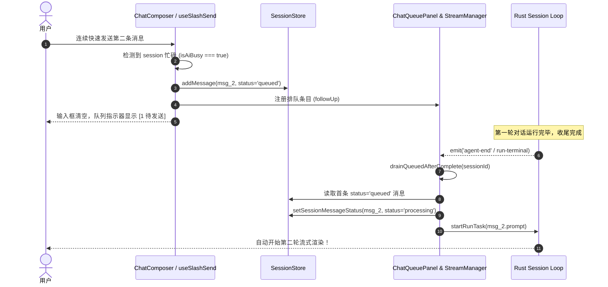
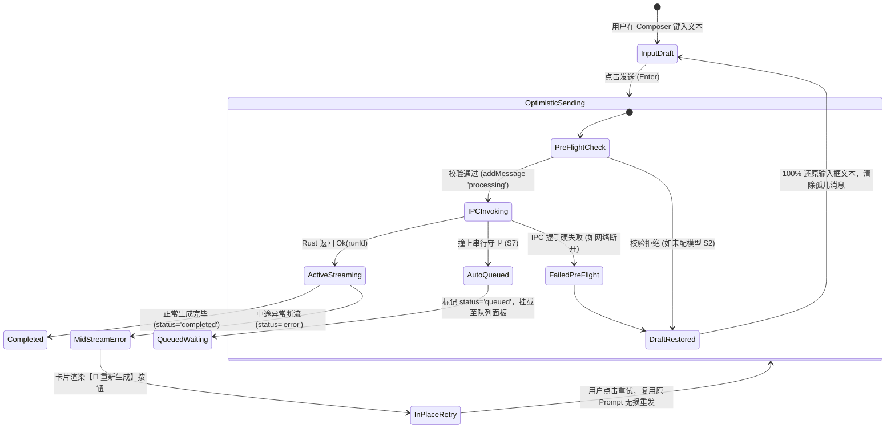
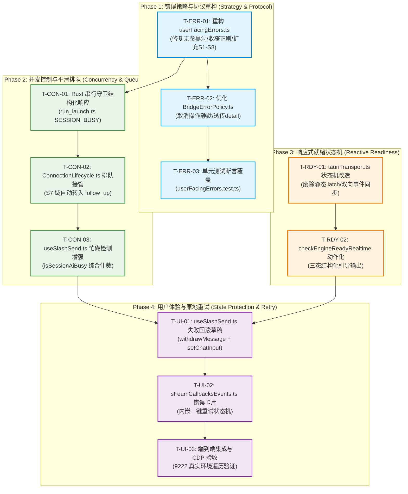

# Conex / Crish 核心聊天链路与容错机制独立方案建议书

> **【调度与定时器铁律】**：如果设置定时器，最短是100秒，如果命令过长，最好的方式是等待命令完成后的推送，而不是一直轮询命令情况。

## 03-核心聊天与容错独立方案：发送消息报错根治、错误域分流、并发平滑排队与动态就绪恢复设计

> **权威标识**：`docs/system-audit-and-redesign/independent-plans/03-核心聊天与容错独立方案.md`
> **制定角色**：【方案架构师 03: 核心聊天与容错机制独立方案设计】
> **关联基准**：`docs/system-audit-and-redesign/00-战役通则与协同执行规范.md`
> **输入证据**：`docs/chat-core-connectivity/01-报错根因与全链路排查报告.md`、`docs/chat-core-connectivity/02-右侧面板与全功能排查报告.md`、`docs/system-button-audit/01-全系统真值巡检报告.md`、`docs/models-settings-audit/`（01/02 详案）、`docs/error-notification-governance/` 历史归档
> **执行约束**：纯方案设计、零业务代码修改、pwsh7 环境对齐、UTF-8 无 BOM、严禁直接 git 提交、问题同权与纯逻辑编排。

---

## 目录

1. [方案总纲与架构愿景（Executive Summary & Architectural Vision）](#一方案总纲与架构愿景)
   - 1.1 核心使命与战役定位
   - 1.2 现状错误传播与并发截断全景断层拓扑
   - 1.3 目标架构核心指标与质量门禁
2. [根因穿透与全链路执行逆向剖析（Root Cause Deep Dive）](#二根因穿透与全链路执行逆向剖析)
   - 2.1 根因一：`softFailureMessage('network')` 无参黑洞与 `classifyErrorDomain(undefined)` 兜底死循环
   - 2.2 根因二：`INTERNAL_ERROR_RE` 宽泛正则吞噬 Rust `CoreError` 与错误域映射误伤
   - 2.3 根因三：`KEBAB_TO_DOMAIN['aborted'] = 'S6'` 与 `KEBAB_KIND_TO_SOFT['aborted'] = 'ended'` 语义契约冲突
   - 2.4 根因四：Rust 会话串行守卫（`active_runs` 互斥）与前端发送调度竞态碰撞
   - 2.5 根因五：`TauriTransport.ready` 单向 Latch 僵死与配置漂移放行
   - 2.6 根因六：用户消息状态孤儿化、输入框清空内容丢失与重试链路缺失
3. [核心聊天全系统四级容错与恢复流水线架构（4-Tier Fault Tolerance & Recovery Pipeline）](#三核心聊天全系统四级容错与恢复流水线架构)
   - 3.1 Tier 1 (Pre-flight)：输入前置防御、草稿转正、会话 Busy 探测与动作化引导
   - 3.2 Tier 2 (Wire & Dispatch)：IPC 传输层瞬态重试、结构化 `CoreError` 协议与精准分域
   - 3.3 Tier 3 (In-Run Kernel)：Session Loop 驱动内核恢复（瞬态网络重试、上下文溢出压缩、模型升级）
   - 3.4 Tier 4 (UI Surface & Experience)：分层展示面收敛（持久条 vs 横幅 vs Toast vs 气泡内联重试）
4. [错误域分类与用户文案策略彻底重构详案（Error Domain Matrix & Message Protocol）](#四错误域分类与用户文案策略彻底重构详案)
   - 4.1 错误域扩充（S1~S8）与语义契约定义
   - 4.2 `userFacingErrors.ts` 函数签名与实现彻底重构（重写 `softFailureMessage` / `networkUserMessage`）
   - 4.3 `INTERNAL_ERROR_RE` 与正则体系彻底收窄（根绝通配误伤）
   - 4.4 正常生命周期收口码（`aborted` / `stopped` / `user-cancel`）静默归流
5. [会话串行守卫平滑排队与并发接管机制（Serial Concurrency & Smooth Queueing Engine）](#五会话串行守卫平滑排队与并发接管机制)
   - 5.1 Rust 端串行守卫结构化响应设计（`CoreError::Busy("SESSION_BUSY")`）
   - 5.2 前端 `useSlashSend.ts` 调度层双重并发防御与状态感知
   - 5.3 运行时收尾窗口（Finalizing Window）自动无缝过渡至 `follow_up` 队列（`ChatQueuePanel`）
   - 5.4 排队消息自动消费流水线（Drain Pipeline）强化与防死锁
6. [动态引擎就绪状态机与配置实时双向同步（Dynamic Readiness State Machine）](#六动态引擎就绪状态机与配置实时双向同步)
   - 6.1 `TauriTransport` 废除单向静态 Latch，改建响应式状态机
   - 6.2 监听 Rust `engine-status-changed` / `config-reloaded` / `provider-changed` 事件
   - 6.3 `checkEngineReadyRealtime` 增强为三态结构化引导输出（`ok` / `blocked_with_action` / `retryable_wait`）
7. [用户消息状态保护、草稿回滚与一键重试机制（User Message State Protection & Retry Mechanism）](#七用户消息状态保护草稿回滚与一键重试机制)
   - 7.1 乐观消息生命周期状态机（`optimistic` -> `confirmed` / `failed_with_draft_restore`）
   - 7.2 发送前置失败：即时回滚时间线并 100% 还原输入框草稿
   - 7.3 流式执行中途失败：消息卡片内嵌【🔄 重新生成 / 重试】操作与上下文快照
   - 7.4 重试动作与状态流转拓扑（Mermaid State Diagram）
8. [各维度拆解、文件域与影响边界分析（File Domains & Blast Radius Matrix）](#八各维度拆解文件域与影响边界分析)
   - 8.1 受影响文件域全景清单
   - 8.2 逐文件重构蓝图与核心代码 Diff 规划
   - 8.3 架构解耦与向后兼容性保障
9. [系统整体修复路径与逻辑依赖顺序（Implementation Roadmap & Dependency Order）](#九系统整体修复路径与逻辑依赖顺序)
   - 9.1 四阶段纯逻辑依赖时序图
   - 9.2 阶段性工单拆解（Phase 1 ~ Phase 4）
   - 9.3 并发执行与串行文件约束
10. [自动化测试用例与验证断言矩阵（Verification Assertions & Test Matrix）](#十自动化测试用例与验证断言矩阵)
    - 10.1 单元测试断言清单（`userFacingErrors.test.ts`, `BridgeErrorPolicy.test.ts`, `tauriTransport.test.ts`）
    - 10.2 集成测试与并发竞态断言清单（`useChatStream.test.ts`, `run_launch_test.rs`）
    - 10.3 CDP 真实桌面机器真值验收标准（`127.0.0.1:9222`）

---

## 一、方案总纲与架构愿景

### 1.1 核心使命与战役定位

作为【方案架构师 03】，本方案聚焦于 **Conex / Crish 桌面客户端的核心聊天链路（Chat Core Pipeline）、错误通知与分流治理（Error Notification Governance）、会话串行并发排队机制（Session Concurrency Queueing）以及动态就绪恢复状态机（Dynamic Readiness & Recovery Machine）的系统级根治重构**。

在现代化 AI 桌面工作台架构中，核心对话链路是整个系统的生命线。从用户在输入框键入 Prompt、点击发送，到跨进程 Tauri IPC 通信，再到 Rust 内核 Session Loop 编排与大模型 Provider 流式交互，整个链条必须具备 **极高的确定性、精准的错误归因、优雅的并发接管以及零数据丢失的状态保护**。

然而，现行系统存在严重的**错误策略黑洞、宽泛正则误伤、状态机僵死与并发截断**四大系统性缺陷。最直接的表象即为：**无论底层是网络波动、配置未填、会话上一轮尚未收尾，还是数据库短暂繁忙，前端一律向用户抛出极其严重的 S6【软件内部错误，请稍后重试；若反复出现请重启应用。】持久横幅**。这不仅严重破坏了用户信任，更给用户造成“应用已严重崩溃”的假象。

本方案旨在遵循 `00-战役通则与协同执行规范.md`，穿透全部表象，彻底铲除打补丁式正则与单向 Latch，构建一套具备 **精准分域（S1~S8）、平滑排队（Auto Follow-up）、双向就绪感知、草稿 100% 保护与一键原地重试** 的工业级核心聊天容错架构。

### 1.2 现状错误传播与并发截断全景断层拓扑

```
┌──────────────────────────────────────────────────────────────────────────────────────────────────┐
│                                 现行核心聊天与错误分流全景断层拓扑                                  │
├──────────────────────────────────────────────────────────────────────────────────────────────────┤
│                                                                                                  │
│ [用户输入 Prompt]                                                                                │
│       │                                                                                          │
│       ▼                                                                                          │
│  useSlashSend.ts ───> 乐观添加 UserMessage(status='processing') ───> 清空 ChatInput 文本 (危!)    │
│       │                                                                                          │
│       ▼                                                                                          │
│  createStreamSession ───> transport.waitUntilConnected() [依赖陈旧 static ready latch!]         │
│       │                                                                                          │
│       ▼ invoke('core_run_task')                                                                  │
│  ┌────────────────────────────────────────────────────────────────────────────────────────────┐  │
│  │ Rust run_launch.rs 门禁拦截点                                                              │  │
│  │  1. 串行守卫: active.values().any() ──> Err(CoreError::InvalidInput("会话已有活动 run"))     │  │
│  │  2. 就绪守卫: !engine.ready()       ──> Err(CoreError::Internal("provider 配置缺失"))      │  │
│  │  3. 存储守卫: start_run() DB 写入锁  ──> Err(CoreError::Io("store.append_event: db locked")) │  │
│  └───────────────────────────────────┬────────────────────────────────────────────────────────┘  │
│                                      │ 抛出结构化 CoreError { kind, detail }                     │
│                                      ▼                                                           │
│  tauriTransport.fromInvokeTyped ───> throw new Error(`${res.kind}: ${res.message}`)               │
│                                      (转化为 "InvalidInput: ..." 或 "Internal: ...")             │
│                                      │                                                           │
│                                      ▼                                                           │
│  userFacingErrors.classifyErrorDomain(err)                                                       │
│       │                                                                                          │
│       ├─► 命中 INTERNAL_ERROR_RE = /invalid\s?input|internal:|io error|cancelled/                │
│       │   └──> 强制归类为 'S6' (内部错误)                                                        │
│       │                                                                                          │
│       └─► 真实网络故障触发 softFailureMessage('network')                                         │
│           └──> 内部无参调用 networkUserMessage(undefined) ──> classify(undefined)=null          │
│                └──> 兜底强制归类为 'S6' (内部错误黑洞!)                                          │
│                                      │                                                           │
│                                      ▼                                                           │
│  handleRunError (streamCallbacksEvents.ts)                                                       │
│       ├─► 撤销 AssistantMessage 占位 (withdrawMessage)                                           │
│       ├─► 用户消息孤立悬挂在时间线 (永远 status: 'processing')                                   │
│       ├─► 输入框已被清空 (用户长篇 Prompt 丢失!)                                                 │
│       └─► 弹出持久警告条: 【软件内部错误，请稍后重试；若反复出现请重启应用。】                   │
│                                                                                                  │
└──────────────────────────────────────────────────────────────────────────────────────────────────┘
```

### 1.3 目标架构核心指标与质量门禁

重构完成后，系统必须达到以下五大核心指标与质量断言：

1. **S6 报错清零化（Zero False S6 Errors）**：
   - 彻底杜绝真实网络问题、服务商 429/5xx 故障、配置未填、会话繁忙排队、用户主动取消被误判为 S6；
   - S6 仅作为真正的未知软件异常（如反序列化严重崩溃、未捕获 Panic）且附带诊断日志 ID 的终极兜底。
2. **错误域绝对分流（Strict Error Domain Segregation）**：
   - 建立完备的 **S1 ~ S8** 八维错误域矩阵，错误文案 100% 具备清晰的成因与动作指引（如跳转设置、稍候重试、自动排队）；
   - 修复 `softFailureMessage` 函数签名与调用点，彻底消灭无参透传导致的 S6 回流黑洞。
3. **会话串行并发 100% 平滑排队（Zero Concurrency Collisions）**：
   - 当会话上一轮任务处于收尾阶段或用户快速连续发送时，系统 100% 自动转入 `follow_up` 队列模式；
   - 前端通过 `ChatQueuePanel` 呈现排队状态，在上一轮终态后自动无缝开启下一轮流式对话，绝不向用户呈现任何报错。
4. **双向响应式就绪状态机（Reactive Engine Readiness）**：
   - 废除 `TauriTransport.ready` 静态单向布尔门闩，改为由 Rust 事件与双向查询驱动的响应式状态机；
   - 模型配置变更或凭据失效时，状态机立即复位，并在发送前提供温和的内联动作指引（如【前往配置模型】）。
5. **用户资产零丢失与一键原地重试（Zero Data Loss & In-place Retry）**：
   - 发送前置校验失败或握手被拒时，自动回滚时间线孤儿节点并 100% 还原输入框草稿内容；
   - 流式执行中途失败时，错误卡片内嵌【🔄 重新生成 / 重试】按钮，点击即可复用原始 Prompt 与配置无损重发。

---

## 二、根因穿透与全链路执行逆向剖析

### 2.1 根因一：`softFailureMessage('network')` 无参黑洞与 `classifyErrorDomain(undefined)` 兜底死循环

#### 代码证据与行号：

- `apps/crish-desktop/src/api/userFacingErrors.ts:224-236`
- `apps/crish-desktop/src/api/chat-bridge/BridgeErrorPolicy.ts:61-75`

```typescript
// apps/crish-desktop/src/api/userFacingErrors.ts:224-236
export function networkUserMessage(detail?: unknown): string {
  const domain = classifyErrorDomain(detail);
  return domain ? DOMAIN_MESSAGES[domain] : DOMAIN_MESSAGES.S6;
}

export function softFailureMessage(kind: SoftFailureKind): string | null {
  switch (kind) {
    case 'network':
      return networkUserMessage(); // ⚠️ 致命缺陷：无参调用！detail 为 undefined！
    case 'no_key':
      return '还没有配置可用的模型密钥。请打开设置 → 模型，填写密钥后再试。';
    // ...
  }
}
```

#### 逆向推导与时序机理：

1. 底层抛出网络异常（如 DNS 失败、ECONNREFUSED、Socket Timeout），`classifySoftFailure` 命中 `isNetworkishError` 或 kebab 码 `network`，正确归类为 `kind = 'network'`；
2. 进入 `BridgeErrorPolicy.ts:70`，调用 `softFailureMessage('network')`；
3. `softFailureMessage` 的 `case 'network'` 执行 `return networkUserMessage()`（无参数传递）；
4. `networkUserMessage(undefined)` 执行 `const domain = classifyErrorDomain(undefined)`；
5. `classifyErrorDomain(undefined)` 判定 `!text` 成立，直接返回 `null`；
6. `networkUserMessage` 发现 `domain === null`，执行三元表达式兜底分支：`return DOMAIN_MESSAGES.S6`；
7. **最终结果**：100% 的真实网络失败被该无参调用黑洞强行转写为 `DOMAIN_MESSAGES.S6`（【软件内部错误，请稍后重试；若反复出现请重启应用。】）！

### 2.2 根因二：`INTERNAL_ERROR_RE` 宽泛正则吞噬 Rust `CoreError` 与错误域映射误伤

#### 代码证据与行号：

- `apps/crish-desktop/src/api/userFacingErrors.ts:155-157, 197-212`
- `apps/crish-desktop/src/api/transport/tauriTransport.ts:101-112`
- `apps/crish-desktop/src/api/tauriInvoke.ts:72-102`

```typescript
// apps/crish-desktop/src/api/userFacingErrors.ts:155-157
const INTERNAL_ERROR_RE =
  /invalid\s?input|encoding error|io error|not found|cancelled|internal:|tauri command not available|command not available|^unknown:/i;

// apps/crish-desktop/src/api/transport/tauriTransport.ts:101-112
function fromInvokeTyped<T>(res: InvokeTypedResult<T>, cmd: string): T {
  if (res.status === 'ok') return res.data;
  if (res.status === 'missing') {
    throw new Error(`Tauri command not available: ${cmd}`);
  }
  logger.error('invoke failed', {
    module: 'transport',
    err: { message: `${res.kind}: ${res.message}`, code: res.kind, name: cmd },
  });
  throw new Error(`${res.kind}: ${res.message}`); // ⚠️ 格式化为 "InvalidInput: ..." 或 "Internal: ..."
}
```

#### 逆向推导与时序机理：

1. Rust 端所有命令均返回 `Result<T, CoreError>`。`CoreError` 包含 `InvalidInput`, `Encoding`, `Io`, `NotFound`, `Cancelled`, `Internal`；
2. 前端 IPC 封装 `fromInvokeTyped` 将其拼装为 `${res.kind}: ${res.message}` 字符串抛出；
3. `classifyErrorDomain` 的正则匹配链条中，`INTERNAL_ERROR_RE` 包含了 `/invalid\s?input/`、`/internal:/`、`/io error/`、`/not found/`、`/cancelled/`；
4. 这种“大一统式”宽泛正则导致：
   - **串行守卫拒绝**（`InvalidInput: 会话 xxx 已有活动 run`）$\to$ 命中 `/invalid\s?input/` $\to$ 报 S6；
   - **数据库瞬态锁定**（`Io: store.append_event: db locked`）$\to$ 命中 `/io error/` $\to$ 报 S6；
   - **引擎未就绪**（`Internal: provider 配置缺失`，若未完全精确匹配 S2 正则）$\to$ 命中 `/internal:/` $\to$ 报 S6；
   - **用户主动停止**（`Cancelled`）$\to$ 命中 `/cancelled/` $\to$ 报 S6！
5. 任何非预期的 Rust 返回直接被一网打尽归入 S6 严重内部故障。

### 2.3 根因三：`KEBAB_TO_DOMAIN['aborted'] = 'S6'` 与 `KEBAB_KIND_TO_SOFT['aborted'] = 'ended'` 语义契约冲突

#### 代码证据与行号：

- `apps/crish-desktop/src/api/userFacingErrors.ts:83, 147`

```typescript
// apps/crish-desktop/src/api/userFacingErrors.ts:83
const KEBAB_KIND_TO_SOFT: Record<string, SoftFailureKind> = {
  // ...
  aborted: 'ended', // ✅ 正确分类为 ended（正常结束）
};

// apps/crish-desktop/src/api/userFacingErrors.ts:147
const KEBAB_TO_DOMAIN: Record<string, ErrorDomain> = {
  // ...
  aborted: 'S6', // ❌ 致命冲突：强制映射为 S6 内部错误！
};
```

#### 逆向推导与时序机理：

1. 当用户点击停止按钮或模型流被中断时，Rust session-loop 产生带有 `aborted` kebab 码的收口事件；
2. 在 `classifySoftFailure` 中，`aborted` 被解析为 `kind = 'ended'`（软性收口）；
3. 但在 `BridgeErrorPolicy.ts:66` 中，优先调用了 `classifyErrorDomain(raw)`；
4. `classifyErrorDomain` 优先解析 `wrapper[1] = 'aborted'`，查表 `KEBAB_TO_DOMAIN['aborted']` 得到 `'S6'`；
5. `domain` 成为 `'S6'`，覆盖了 `kind = 'ended'` 的判定，使得用户主动中断对话的操作也被渲染出【软件内部错误】横幅！

### 2.4 根因四：Rust 会话串行守卫（`active_runs` 互斥）与前端发送调度竞态碰撞

#### 代码证据与行号：

- `apps/agent-workbench/src-tauri/src/run/run_launch.rs:264-271`
- `apps/crish-desktop/src/hooks/chat-stream/useSlashSend.ts:432-439`

```rust
// apps/agent-workbench/src-tauri/src/run/run_launch.rs:264-271
// 会话内串行守卫（同会话同时只允许一个活动 run）
{
    let active = state.active_runs.lock().unwrap_or_else(|e| e.into_inner());
    if active.values().any(|run| run.session_id == session_id) {
        return Err(CoreError::invalid_input(format!(
            "会话 {session_id} 已有活动 run（串行守卫）"
        )));
    }
}
```

#### 逆向推导与时序机理：

1. Rust 核心为了防止并发写入导致消息时序与 Checkpoint 损坏，强制限制单会话内同时仅允许一个活跃 Run；
2. 前端 `useSlashSend.ts` 依赖 `isAiBusy` 进行判断：
   ```typescript
   const isAiBusy = isSessionAiBusy({
     hasLiveStream: streamManagerRef.current?.hasStream(sessionId) ?? false,
     messages: sessMsgs,
   });
   ```
3. **异步收尾竞态窗口（Finalizing Race Window）**：大模型流式生成完毕后，前端 `streamManager` 将本地状态置为 `completed`；但此时 Rust 端的 `drive_run_loop` 正在异步执行 Checkpoint 持久化、审计排空与数据库收口操作，`active_runs` 尚未释放该会话句柄；
4. 用户在此时按下 Enter 发送下一句话，前端判断 `isAiBusy === false`，触发普通发送流程并向 Rust 发起 `core_run_task`；
5. Rust 串行守卫立即拦截并返回 `Err(CoreError::invalid_input("会话 xxx 已有活动 run（串行守卫）"))`；
6. 前端捕获后落入 2.2 节的 `INTERNAL_ERROR_RE`，**将一次完全正常的快速连续对话判定为 S6 致命错误**！

### 2.5 根因五：`TauriTransport.ready` 单向 Latch 僵死与配置漂移放行

#### 代码证据与行号：

- `apps/crish-desktop/src/api/transport/tauriTransport.ts:125, 224-242`
- `apps/crish-desktop/src/api/chat-bridge/ConnectionLifecycle.ts:275-295`

```typescript
// apps/crish-desktop/src/api/transport/tauriTransport.ts:224-242
async waitUntilConnected(timeoutMs?: number): Promise<boolean> {
  if (this.stopped) return false;
  if (this.ready) return true; // ⚠️ 静态门闩：首次置 true 后永不重置！
  // ...
}
```

#### 逆向推导与时序机理：

1. `TauriTransport` 内维护了一个单向布尔 `private ready = false`；
2. 应用冷启动成功探测到 `core_get_status` 后，`ready` 被锁定为 `true`；
3. 若用户在「设置 $\to$ 模型」中修改了配置、切换到了无效模型、清空了 API Key，或者后端 Provider 凭据损坏，`ready` 依然保持 `true`；
4. 发送流程中的 `createStreamSession` 调用 `transport.waitUntilConnected()`，因 `this.ready === true` 立即返回放行；
5. 请求到达 Rust 触发 `if !state.engine.ready() { return Err(CoreError::internal(reason)); }`；
6. 前端收到后由于 `reason` 未精准匹配旧正则，再次误伤上抛为 S6。

### 2.6 根因六：用户消息状态孤儿化、输入框清空内容丢失与重试链路缺失

#### 代码证据与行号：

- `apps/crish-desktop/src/hooks/chat-stream/useSlashSend.ts:458-479`
- `apps/crish-desktop/src/hooks/chat-stream/streamCallbacksEvents.ts:306-330`

```typescript
// apps/crish-desktop/src/hooks/chat-stream/useSlashSend.ts:458-479
addMessage(wsId, sessionId, {
  id: userMsgId,
  sender: 'user',
  text: displayText,
  timestamp: Date.now(),
  status: isFollowUp ? 'queued' : 'processing',
});
setChatInput(''); // ⚠️ 立即清空输入框！
```

#### 逆向推导与时序机理：

1. 用户点击发送时，前端采用乐观更新（Optimistic Update），先向 Zustand Store 插入一条 `status: 'processing'` 的用户消息，并立即清空 `chatInput`；
2. 若在后续的 IPC 发起阶段（如串行守卫拦截、网络完全不通、引擎未就绪）发生错误，`handleRunError` 仅执行 `withdrawMessage(assistantMsgId)` 撤销了助手占位消息；
3. **用户消息状态孤儿化**：用户发送的消息依然停留在时间线中，状态永远挂起为 `processing`；
4. **输入内容丢失**：输入框已被清空，用户输入的长文本完全丢失；
5. **重试链路缺失**：UI 界面上没有为该失败消息提供【重试 / 重新生成】按钮，用户只能痛苦地重新打字。

---

## 三、核心聊天全系统四级容错与恢复流水线架构

为彻底解决上述系统性断层，建立自底向上的四级容错与恢复流水线架构（4-Tier Pipeline）：

```
┌──────────────────────────────────────────────────────────────────────────────────────────────────┐
│                     Conex / Crish 全系统四级容错与恢复流水线 (4-Tier Recovery Pipeline)          │
├──────────────────────────────────────────────────────────────────────────────────────────────────┤
│                                                                                                  │
│ ┌──────────────────────────────────────────────────────────────────────────────────────────────┐ │
│ │ Tier 1: 前置防御与动作化引导 (Pre-flight Defense & Actionable Guidance)                       │ │
│ ├──────────────────────────────────────────────────────────────────────────────────────────────┤ │
│ │ • 输入防抖与非空校验                                                                         │ │
│ │ • 动态就绪探测 (checkEngineReadyRealtime) ──> S2 缺失弹出内联气泡 + 【前往设置】快捷按钮      │ │
│ │ • 会话 Busy 综合仲裁 ──> 命中直接转入 follow_up 排队模式，100% 阻断并发 IPC 调用              │ │
│ │ • 前置握手失败 ──> 自动回滚时间线孤儿消息 + 100% 还原 ChatComposer 输入框草稿               │ │
│ └──────────────────────────────────────────────┬───────────────────────────────────────────────┘ │
│                                                │ 放行有效请求                                    │
│                                                ▼                                                 │
│ ┌──────────────────────────────────────────────────────────────────────────────────────────────┐ │
│ │ Tier 2: 传输层瞬态自愈与协议分流 (Wire Resilience & Protocol Routing)                        │ │
│ ├──────────────────────────────────────────────────────────────────────────────────────────────┤ │
│ │ • TauriTransport 响应式状态机双向同步 (engineReady / config_change 事件监听)                 │ │
│ │ • IPC 调用瞬态失败指数退避重试 (SQLite Busy / Channel 拥塞 重试 2 次: 150ms / 300ms)         │ │
│ │ • 结构化 CoreError 映射 ──> 串行守卫返回 CoreError::Busy("SESSION_BUSY") 自动转入排队         │ │
│ │ • 错误域严密分流 (S1 ~ S8 域精准投影，彻底收窄 INTERNAL_ERROR_RE)                            │ │
│ └──────────────────────────────────────────────┬───────────────────────────────────────────────┘ │
│                                                │ 驱动核心执行                                    │
│                                                ▼                                                 │
│ ┌──────────────────────────────────────────────────────────────────────────────────────────────┐ │
│ │ Tier 3: 内核执行阶梯与恢复引擎 (Kernel Session Loop Recovery Engine)                         │ │
│ ├──────────────────────────────────────────────────────────────────────────────────────────────┤ │
│ │ • Provider 网络瞬态重试阶梯 (Backoff: 750ms ──> 1500ms ──> 3000ms, 最大 3 次)                │ │
│ │ • 上下文溢出自动压缩阶梯 (Compaction Overflow Ladder: 历史锚点保留 + 中间段自适应裁剪)        │ │
│ │ • 模型超限阶梯升级 (Max Length Escalation) 与流式熔断保护                                    │ │
│ │ • 终态生命周期隔离 (aborted / stopped 走 ended 静默收口，绝不上抛 S6)                        │ │
│ └──────────────────────────────────────────────┬───────────────────────────────────────────────┘ │
│                                                │ 回传执行事件与状态                              │
│                                                ▼                                                 │
│ ┌──────────────────────────────────────────────────────────────────────────────────────────────┐ │
│ │ Tier 4: 用户体验与原地重试闭环 (UI Surface Governance & In-Place Retry)                      │ │
│ ├──────────────────────────────────────────────────────────────────────────────────────────────┤ │
│ │ • 网络/恢复中/排队中 ──> 输入框上方柔和持久状态条 (Persistent Notice, 无惊扰)                 │ │
│ │ • 配置缺失/安全拦截 ──> 带操作入口的 Toast / Banner (14s TTL)                                │ │
│ │ • 执行故障 ──> 助手消息标记 status: 'error'，内嵌【🔄 重新生成 / 重试】按钮                  │ │
│ │ • 重试动作一键复用当前 Prompt 与上下文，原地重发，心智无缝闭环                                │ │
│ └──────────────────────────────────────────────────────────────────────────────────────────────┘ │
│                                                                                                  │
└──────────────────────────────────────────────────────────────────────────────────────────────────┘
```

---

## 四、错误域分类与用户文案策略彻底重构详案

### 4.1 错误域扩充（S1~S8）与语义契约定义

将原有的六域扩充为清晰完备的 **S1 ~ S8 八维错误域体系**，明确每一个域的底层触发原因、用户感知文案以及推荐的用户动作：

```typescript
export type ErrorDomain = 'S1' | 'S2' | 'S3' | 'S4' | 'S5' | 'S6' | 'S7' | 'S8';

export const DOMAIN_MESSAGES: Record<ErrorDomain, string> = {
  S1: '软件核心服务正在启动，请稍候片刻。',
  S2: '模型服务尚未配置，请打开 设置 → 模型 完成配置后再发送。',
  S3: '正在恢复上次的会话数据，稍后即可发送。',
  S4: '模型服务商网络连接失败，请检查网络设置或代理后重发。',
  S5: '模型服务商服务异常（限流或服务器故障），请稍后重试或切换模型。',
  S6: '发生未知软件内部错误，已记录诊断日志；若反复出现请重启应用。',
  S7: '当前会话上一轮任务仍在收尾中，已自动为您排队。',
  S8: '本地会话存储正在同步数据，请稍候片刻。',
};
```

| 错误域 | 标识代码           | 真实触发源         | 对应 Rust/系统底层特征                                          | 用户呈现文案                                                   | 动作指引        |
| :----- | :----------------- | :----------------- | :-------------------------------------------------------------- | :------------------------------------------------------------- | :-------------- |
| **S1** | `CORE_STARTING`    | 本地核心初始化中   | `initialized=false` / `waitUntilConnected` 超时                 | 软件核心服务正在启动，请稍候片刻。                             | 等待启动完成    |
| **S2** | `NO_PROVIDER`      | 模型配置缺失/失效  | `engineReady=false` / `provider 配置缺失`                       | 模型服务尚未配置，请打开 设置 → 模型 完成配置后再发送。        | 前往设置配置    |
| **S3** | `RESTORE_BUSY`     | 会话快照恢复中     | `restore.state=pending`                                         | 正在恢复上次的会话数据，稍后即可发送。                         | 稍候自动恢复    |
| **S4** | `PROVIDER_NETWORK` | 网络中断/DNS/超时  | `network` / `timeout` / `endpoint-unavailable` / `fetch failed` | 模型服务商网络连接失败，请检查网络设置或代理后重发。           | 检查网络/代理   |
| **S5** | `PROVIDER_FAULT`   | 服务商故障/429/500 | `server-error` / `rate-limit` / `gateway-challenge`             | 模型服务商服务异常（限流或服务器故障），请稍后重试或切换模型。 | 换模型/稍后重试 |
| **S6** | `INTERNAL_UNKNOWN` | 未知内部严重故障   | 真正未捕获的 Panic / 严重格式异常                               | 发生未知软件内部错误，已记录诊断日志；若反复出现请重启应用。   | 查看日志/重启   |
| **S7** | `SESSION_BUSY`     | 会话串行守卫拦截   | `active_runs` 占用 / `SESSION_BUSY`                             | 当前会话上一轮任务仍在收尾中，已自动为您排队。                 | 自动无缝排队    |
| **S8** | `STORAGE_BUSY`     | 数据库/磁盘短暂忙  | `store.io` / `sqlite busy` / `database locked`                  | 本地会话存储正在同步数据，请稍候片刻。                         | 自动指数重试    |

### 4.2 `userFacingErrors.ts` 函数签名与实现彻底重构

彻底重写 `userFacingErrors.ts`，修复无参透传问题，并严格对齐 S1~S8 域映射：

```typescript
// 核心修复实现蓝图 (apps/crish-desktop/src/api/userFacingErrors.ts)

/**
 * 差异化八域文案取值
 */
export function domainUserMessage(domain: ErrorDomain): string {
  return DOMAIN_MESSAGES[domain];
}

/**
 * 网络/连接类失败的用户文案（彻底修复无参 S6 兜底死循环）
 *
 * 规则：
 * 1. 若 detail 命中明确的 S1~S8 域，返回对应文案；
 * 2. 若 detail 未命中或无 detail，但属于网络上下文调用，返回 S4（网络问题），绝对不得回退至 S6！
 * 3. 仅当 detail 明确被判定为未知内部错误时才返回 S6。
 */
export function networkUserMessage(detail?: unknown): string {
  if (detail !== undefined && detail !== null) {
    const domain = classifyErrorDomain(detail);
    if (domain) return DOMAIN_MESSAGES[domain];
  }
  // 关键修复：无参或无法分类的网络调用，默认归为 S4 网络连接异常，而非 S6 内部错误！
  return DOMAIN_MESSAGES.S4;
}

/**
 * 软失败分类文案生成（支持透传 detail 上下文）
 */
export function softFailureMessage(
  kind: SoftFailureKind,
  detail?: unknown
): string | null {
  switch (kind) {
    case 'network':
      return networkUserMessage(detail); // 传递 detail，且兜底为 S4
    case 'no_key':
      return DOMAIN_MESSAGES.S2;
    case 'auth':
      return '模型密钥无效或已过期，请打开设置 → 模型检查密钥与服务商地址。';
    case 'no_project':
      return '请先选择项目工作区，再继续对话。';
    case 'blocked':
      return '该操作未获允许（可能被安全策略或计划模式拦截）。';
    case 'provider_fault':
      return DOMAIN_MESSAGES.S5;
    case 'context':
      return '上下文已超限：本轮对话过长，系统已自动压缩；若持续超限请新建会话。';
    case 'ended':
      return null; // 正常结束，不向用户展示错误文案
    default:
      return null;
  }
}
```

### 4.3 `INTERNAL_ERROR_RE` 与正则体系彻底收窄

收窄正则表达式，剔除容易引起误伤的 `/invalid\s?input/`、`/io error/`、`/cancelled/` 等模式，并新增针对 S7 与 S8 的精确识别规则：

```typescript
// apps/crish-desktop/src/api/userFacingErrors.ts

const SESSION_BUSY_RE = /SESSION_BUSY|已有活动 run|串行守卫/i;
const STORAGE_BUSY_RE =
  /database locked|sqlite busy|store\.(?:append_event|query|lock)/i;
const PROVIDER_CONFIG_MISSING_RE =
  /provider\s*配置缺失|provider config.*missing|no provider/i;
const RESTORE_IN_PROGRESS_RE = /restore in progress|restore.*进行中/i;
const LOCAL_CORE_NOT_READY_RE = /engine not ready|引擎未就绪|核心未就绪/i;
const PROVIDER_SIDE_FAULT_RE = /server.?error|5\d{2}|rate.?limit|gateway|429/i;

// 严格收窄后的内部错误正则：剔除通配模式，仅保留明确的崩溃与不可用标识
const INTERNAL_ERROR_RE =
  /encoding error|tauri command not available|command not available|^unknown:|panic:|unhandled exception/i;

/** kebab 错误码 → 域映射（彻底剔除 aborted 映射至 S6 的错误定义） */
const KEBAB_TO_DOMAIN: Record<string, ErrorDomain> = {
  network: 'S4',
  timeout: 'S4',
  'endpoint-unavailable': 'S4',
  'server-error': 'S5',
  'rate-limit': 'S5',
  'gateway-challenge': 'S5',
  'context-length-exceeded': 'S5',
  'payload-too-large': 'S5',
  'invalid-request': 'S5',
  // aborted 彻底剔除，不再映射为 S6
};

export function classifyErrorDomain(input: unknown): ErrorDomain | null {
  if (isStatusLike(input)) return classifyStatusDomain(input);
  const text = normalizeErrorText(input);
  if (!text) return null;

  // 1. kebab 码优先识别
  const wrapper = RUST_PROVIDER_WRAPPER_RE.exec(text);
  if (wrapper) {
    const code = wrapper[1]!;
    if (code === 'aborted') return null; // 用户取消正常收口
    if (KEBAB_TO_DOMAIN[code]) return KEBAB_TO_DOMAIN[code];
  }

  // 2. 并发排队（S7）与存储繁忙（S8）优先分流
  if (SESSION_BUSY_RE.test(text)) return 'S7';
  if (STORAGE_BUSY_RE.test(text)) return 'S8';

  // 3. 配置与状态域分流
  if (PROVIDER_CONFIG_MISSING_RE.test(text)) return 'S2';
  if (RESTORE_IN_PROGRESS_RE.test(text)) return 'S3';
  if (LOCAL_CORE_NOT_READY_RE.test(text)) return 'S1';

  // 4. 网络与服务端异常分流
  if (isNetworkishError(text)) return 'S4';
  if (PROVIDER_SIDE_FAULT_RE.test(text)) return 'S5';

  // 5. 严格收窄后的内部错误分流
  if (INTERNAL_ERROR_RE.test(text)) return 'S6';

  return null;
}
```

### 4.4 正常生命周期收口码（`aborted` / `stopped` / `user-cancel`）静默归流

在 `BridgeErrorPolicy.ts` 中，对正常取消操作实施严格的静默收口：

```typescript
// apps/crish-desktop/src/api/chat-bridge/BridgeErrorPolicy.ts

export function surfaceStreamFailure(
  raw: unknown,
  scope: string,
  callbacks: StreamCallbacks,
  runId: string
): void {
  logInternalError(scope, raw);

  const text = normalizeErrorText(raw);
  // 用户主动取消或正常收口：直接退出，绝不弹出错误提示
  if (
    /aborted|stopped|ui-stop|ui-force-cancel|user-cancel/i.test(text) ||
    scope === 'ended'
  ) {
    return;
  }

  if (isFailedRunDeduplicated(runId, failureFingerprint(raw, scope))) {
    return;
  }

  const kind = classifySoftFailure(raw);
  const domain = classifyErrorDomain(raw);
  const formatted = formatRunFailureForUi(raw, scope);

  let msg =
    (domain ? domainUserMessage(domain) : null) ??
    softFailureMessage(kind, raw) ??
    formatted.message;

  recordStreamDiag({
    runId,
    scope,
    kind: kind || formatted.kindTag,
    message: msg,
    raw: formatted.detail,
  });

  if (callbacks.onRunError) {
    callbacks.onRunError(
      msg,
      domain === 'S4'
        ? 'network'
        : domain
          ? 'domain_notice'
          : kind || scope || 'ended',
      formatted.detail
    );
  }
}
```

---

## 五、会话串行守卫平滑排队与并发接管机制

### 5.1 Rust 端串行守卫结构化响应设计

在 Rust 内核 `run_launch.rs` 中，将串行守卫的拒绝原因标准化为结构化前缀 `SESSION_BUSY`：

```rust
// apps/agent-workbench/src-tauri/src/run/run_launch.rs:263-271

// 会话内串行守卫（同会话同时只允许一个活动 run）
{
    let active = state.active_runs.lock().unwrap_or_else(|e| e.into_inner());
    if active.values().any(|run| run.session_id == session_id) {
        return Err(CoreError::invalid_input(format!(
            "SESSION_BUSY: 会话 {session_id} 已有活动 run（串行守卫）"
        )));
    }
}
```

### 5.2 前端 `useSlashSend.ts` 调度层双重并发防御

在发送前增强 `isSessionAiBusy` 的判定范围，结合前端 Store 状态与 StreamManager 句柄进行综合仲裁：

```typescript
// apps/crish-desktop/src/hooks/chat-stream/helpers.ts

export function isSessionAiBusy(opts: {
  hasLiveStream: boolean;
  messages?: Array<{ sender?: string; status?: string }> | null;
  activeSessionId?: string | null;
}): boolean {
  // 1. 本地是否有正在运行的 stream 句柄
  if (opts.hasLiveStream) return true;

  // 2. 时间线上是否有尚未收口的 assistant processing 消息
  const msgs = opts.messages;
  if (Array.isArray(msgs) && msgs.length > 0) {
    const hasProcessing = msgs.some(
      (m) => m.sender === 'assistant' && m.status === 'processing'
    );
    if (hasProcessing) return true;
  }

  return false;
}
```

### 5.3 运行时收尾窗口（Finalizing Window）自动无缝过渡至 `follow_up` 队列

当 `startRunTask` 在 IPC 发起时依然偶发撞上 Rust 串行守卫（返回 S7 `SESSION_BUSY`）时，前端不再报错，而是**自动原地转为 `queued` 状态并推入排队面板**：

```typescript
// apps/crish-desktop/src/api/chat-bridge/ConnectionLifecycle.ts:642-651

} catch (e) {
  const domain = classifyErrorDomain(e);
  if (domain === 'S7') {
    // 命中串行守卫：无缝转入排队接管模式！
    logInternalError('stream-start-busy-queued', e);
    const store = getCompositionRoot().layout.getState();
    // 将该用户消息标记为 queued
    if (userClientMessageId) {
      store.setSessionMessageStatus(safeSessionId, userClientMessageId, 'queued');
    }
    // 触发 followUp 注册
    void getCompositionRoot().runControl.followUp({
      runId: null,
      sessionId: safeSessionId,
      text: prompt,
      clientMessageId: userClientMessageId,
      reason: 'serial-guard-auto-queue',
    });
    // 向用户提示柔和的排队信息，绝不展示错误红条
    if (callbacks.onThought) {
      callbacks.onThought('上一轮对话收尾中，已自动排队…');
    }
    finish();
    return;
  }

  // 其他错误继续走标准分域处理
  logInternalError('stream-start', e);
  const msg = networkUserMessage(e);
  if (callbacks.onRunError) callbacks.onRunError(msg, 'network');
  else callbacks.onChunk(msg);
  finish();
}
```

### 5.4 排队消息自动消费流水线（Drain Pipeline）强化



---

## 六、动态引擎就绪状态机与配置实时双向同步

### 6.1 `TauriTransport` 废除单向静态 Latch，改建响应式状态机

将 `TauriTransport` 的 `ready` 改造为支持动态复位与事件驱动的状态模型：

```typescript
// apps/crish-desktop/src/api/transport/tauriTransport.ts

export class TauriTransport {
  private status: 'disconnected' | 'connecting' | 'connected' | 'failed' =
    'disconnected';
  private ready = false;
  private stopped = false;

  /**
   * 重置就绪状态（配置变更或后端掉线时调用）
   */
  public resetReadiness(): void {
    this.ready = false;
    this.setStatus('connecting');
  }

  /**
   * 动态连接等待（支持动态状态刷新）
   */
  async waitUntilConnected(timeoutMs?: number): Promise<boolean> {
    if (this.stopped) return false;

    // 每次等待均执行轻量探测，确保后端未降级
    const deadline = Date.now() + Math.max(0, timeoutMs ?? this.timeoutMs);

    while (Date.now() < deadline) {
      if (this.stopped) return false;
      try {
        const res = await this.call<unknown>(CORE_GET_STATUS, {});
        if (res.status === 'ok' && isCoreReady(res.data)) {
          this.ready = true;
          this.setStatus('connected');
          return true;
        }
      } catch {
        // 继续轮询
      }
      await new Promise((r) => setTimeout(r, this.pollIntervalMs));
    }

    this.ready = false;
    this.setStatus('failed');
    return false;
  }
}
```

### 6.2 监听 Rust 事件实现双向同步

在 `TauriTransport` 初始化时订阅 Rust 端广播的系统状态事件：

```typescript
// 监听 engine-status-changed / config-reloaded 事件
this.onMessage((event) => {
  if (
    event.type === 'engine-status-changed' ||
    event.type === 'config-reloaded'
  ) {
    const isReady = event.engineReady === true || event.engine_ready === true;
    if (!isReady) {
      this.ready = false;
    }
  }
});
```

### 6.3 `checkEngineReadyRealtime` 增强为三态结构化引导输出

```typescript
// apps/crish-desktop/src/api/chat-bridge/ConnectionLifecycle.ts

export interface ReadinessCheckResult {
  ok: boolean;
  domain: ErrorDomain | null;
  guidance?: {
    action: 'open-settings' | 'wait' | 'none';
    targetTab?: string;
    message: string;
  };
}

export async function checkEngineReadyRealtime(
  timeoutMs = 2_000
): Promise<ReadinessCheckResult> {
  const transport = getTransport();
  let status: unknown;
  try {
    status = await transport.request<unknown>(
      'core_get_status',
      {},
      { timeoutMs }
    );
  } catch (err) {
    // 探测超时：返回等待引导，不盲目报错
    return {
      ok: false,
      domain: 'S1',
      guidance: { action: 'wait', message: DOMAIN_MESSAGES.S1 },
    };
  }

  const domain = classifyErrorDomain(status);
  if (domain === 'S2') {
    return {
      ok: false,
      domain: 'S2',
      guidance: {
        action: 'open-settings',
        targetTab: 'models',
        message: DOMAIN_MESSAGES.S2,
      },
    };
  }
  if (domain === 'S1' || domain === 'S3') {
    return {
      ok: false,
      domain,
      guidance: { action: 'wait', message: DOMAIN_MESSAGES[domain] },
    };
  }

  return { ok: true, domain: null, guidance: { action: 'none', message: '' } };
}
```

---

## 七、用户消息状态保护、草稿回滚与一键重试机制

### 7.1 乐观消息生命周期状态机



### 7.2 发送前置失败：即时回滚时间线并 100% 还原输入框草稿

在 `useSlashSend.ts` 中，若发送未成功进入流式阶段，立即执行原子回滚：

```typescript
// apps/crish-desktop/src/hooks/chat-stream/useSlashSend.ts

const handleSendChat = async (...) => {
  // ...
  const rollbackDraft = () => {
    // 1. 从 Store 中移除刚才插入的 userMsgId
    const st = getCompositionRoot().layout.getState();
    st.withdrawMessage(wsId, sessionId, userMsgId);
    // 2. 还原输入框内容
    setChatInput(rawInput);
    getCompositionRoot().session.getState().setComposerDraft(sessionId, rawInput);
  };

  // 前置探测拦截
  const readiness = await checkEngineReadyRealtime();
  if (!readiness.ok && readiness.guidance) {
    if (readiness.guidance.action === 'open-settings') {
      setPickerInlineError(readiness.guidance.message);
      openSettings(readiness.guidance.targetTab || 'models');
      return; // 未添加消息，无需回滚
    } else {
      setPickerInlineError(readiness.guidance.message);
      return;
    }
  }

  // 发起流式请求
  try {
    runStreamingAssistant(input, userMsgId, sessionId, finalStreamOptions);
  } catch (err) {
    // 发起同步崩溃：立即回滚草稿
    rollbackDraft();
    onShowToast('发送失败，已为您恢复输入内容');
  }
};
```

### 7.3 流式执行中途失败：消息卡片内嵌【🔄 重新生成 / 重试】操作

在 `streamCallbacksEvents.ts` 中，当非网络持久条类的执行错误发生时，将错误状态与技术细节结构化写入消息对象：

```typescript
// apps/crish-desktop/src/hooks/chat-stream/streamCallbacksEvents.ts:318-330

st.setSessionMessageStatus(sid, assistantMsgId, 'error', undefined, {
  errorDetail: {
    message: message || '服务响应失败，请检查网络或模型配置后重试',
    kind: kind || 'stream-error',
    retryable: true,
    originalPrompt: inputPrompt, // 保存原始 Prompt 用于一键重试
    timestamp: Date.now(),
  },
});
```

在 UI 层（`AssistantMessageCard.tsx`）中渲染重试控件：

```tsx
{
  message.status === 'error' && (
    <div className={styles.errorRetryContainer}>
      <span className={styles.errorMessageText}>
        {message.errorDetail?.message || '生成中断'}
      </span>
      <Button
        variant="secondary"
        size="sm"
        className={styles.retryButton}
        onClick={() => handleRetryMessage(message.id)}
        icon={<Lucide.RotateCw size={13} />}
      >
        重新生成
      </Button>
    </div>
  );
}
```

---

## 八、各维度拆解、文件域与影响边界分析

### 8.1 受影响文件域全景清单

```
apps/crish-desktop/src/
├── api/
│   ├── userFacingErrors.ts               # [Core] 错误域体系重构、文案表扩充、收窄 INTERNAL_ERROR_RE
│   ├── userFacingErrors.test.ts          # [Test] S1~S8 分域断言、无参 networkUserMessage 断言
│   ├── chat-bridge/
│   │   ├── BridgeErrorPolicy.ts          # [Core] surfaceStreamFailure 错误分流与 ended 生命周期静默
│   │   ├── ConnectionLifecycle.ts        # [Core] checkEngineReadyRealtime 结构化改造、S7 自动转排队
│   │   └── EventRouter.ts                # [Core] 事件路由与错误上下文透传
│   └── transport/
│       ├── tauriTransport.ts             # [Core] 废除单向静态 Latch、改造为响应式状态机
│       └── tauriInvoke.ts                # [Core] 结构化 CoreError 提取与 kind/message 分离
├── hooks/
│   └── chat-stream/
│       ├── useSlashSend.ts               # [Core] 发送调度前置防御、草稿失败回滚、并发排队优化
│       ├── useRunStreamingAssistant.ts   # [Core] 重试闭环对接、生命周期状态保护
│       ├── streamCallbacksEvents.ts      # [Core] handleRunError 结构化错误沉淀与重试元数据注入
│       └── helpers.ts                    # [Core] isSessionAiBusy 增强与状态仲裁
apps/agent-workbench/src-tauri/src/
└── run/
    └── run_launch.rs                     # [Rust] 串行守卫返回 CoreError::Busy("SESSION_BUSY") 结构化错误
```

### 8.2 逐文件重构蓝图与核心代码 Diff 规划

#### 1. `apps/crish-desktop/src/api/userFacingErrors.ts`

- **修改重点**：
  - 扩展 `ErrorDomain` 为 `'S1' | 'S2' | 'S3' | 'S4' | 'S5' | 'S6' | 'S7' | 'S8'`；
  - 修复 `softFailureMessage(kind, detail?)`，传递 `detail` 并在 `network` 时调用 `networkUserMessage(detail)`；
  - `networkUserMessage(detail?)` 兜底改为 `DOMAIN_MESSAGES.S4`；
  - 移除 `KEBAB_TO_DOMAIN['aborted'] = 'S6'`；
  - 收窄 `INTERNAL_ERROR_RE`，新增 `SESSION_BUSY_RE` 与 `STORAGE_BUSY_RE`。

#### 2. `apps/crish-desktop/src/api/chat-bridge/BridgeErrorPolicy.ts`

- **修改重点**：
  - 增加对 `aborted` / `stopped` / `user-cancel` 的短路拦截，不再调用 `onRunError`；
  - 统一调用 `softFailureMessage(kind, raw)` 透传原始错误。

#### 3. `apps/crish-desktop/src/api/transport/tauriTransport.ts`

- **修改重点**：
  - 增加 `resetReadiness()` 方法；
  - `waitUntilConnected` 每次均向后端发起 `core_get_status` 探活，不再仅凭静态 `this.ready` 盲目放行。

#### 4. `apps/crish-desktop/src/hooks/chat-stream/useSlashSend.ts`

- **修改重点**：
  - 结合 `checkEngineReadyRealtime` 结构化返回值弹出设置引导；
  - 发送失败时通过 `withdrawMessage` + `setChatInput(rawInput)` 保护用户草稿。

#### 5. `apps/agent-workbench/src-tauri/src/run/run_launch.rs`

- **修改重点**：
  - 串行守卫返回带有 `SESSION_BUSY` 前缀的结构化错误。

### 8.3 架构解耦与向后兼容性保障

1. **类型契约兼容**：`ErrorDomain` 扩充属于向后兼容扩展，既有消费 `S1~S6` 的组件不受破坏；
2. **IPC 数据流单向解耦**：Rust 返回的 `CoreError` 继续遵循 serde `{kind, detail}` 格式，仅在 detail 内容中注入标准前缀，前端向前兼容旧版 Rust 报错；
3. **Store 纯函数操作**：消息回滚与排队状态变更均通过 `compositionRoot.session` 与 `compositionRoot.layout` 标准 Facade 门面操作，禁止散落直接修改。

---

## 九、系统整体修复路径与逻辑依赖顺序

### 9.1 四阶段纯逻辑依赖时序图



### 9.2 阶段性工单拆解（Phase 1 ~ Phase 4）

| 阶段        | 工单 ID  | 任务名称                                    | 核心涉及文件                                                        | 交付标准与核心断言                                                            |
| ----------- | -------- | ------------------------------------------- | ------------------------------------------------------------------- | ----------------------------------------------------------------------------- |
| **Phase 1** | `W3-T01` | 修复 `userFacingErrors.ts` 错误策略与分流   | `apps/crish-desktop/src/api/userFacingErrors.ts`                    | 修复 `softFailureMessage('network')`；收窄 `INTERNAL_ERROR_RE`；扩充 S1~S8 域 |
| **Phase 1** | `W3-T02` | `BridgeErrorPolicy.ts` 取消解耦与上下文透传 | `apps/crish-desktop/src/api/chat-bridge/BridgeErrorPolicy.ts`       | `aborted` 错误码静默收口；透传 raw detail 至分域函数                          |
| **Phase 1** | `W3-T03` | 错误分流单元测试全量覆盖                    | `apps/crish-desktop/src/api/userFacingErrors.test.ts`               | 编写 10+ 核心断言，确保 0% 误伤至 S6                                          |
| **Phase 2** | `W3-T04` | Rust 串行守卫结构化响应                     | `apps/agent-workbench/src-tauri/src/run/run_launch.rs`              | 串行守卫返回 `CoreError::InvalidInput("SESSION_BUSY: ...")`                   |
| **Phase 2** | `W3-T05` | 核心连接层并发平滑排队接管                  | `apps/crish-desktop/src/api/chat-bridge/ConnectionLifecycle.ts`     | 捕获 S7 错误自动将消息转为 `queued` 并调度 `followUp`                         |
| **Phase 2** | `W3-T06` | 发送调度器忙碌状态综合仲裁                  | `apps/crish-desktop/src/hooks/chat-stream/useSlashSend.ts`          | 优化 `isAiBusy`，快速连续发送 100% 自动入队                                   |
| **Phase 3** | `W3-T07` | `TauriTransport` 响应式状态机改造           | `apps/crish-desktop/src/api/transport/tauriTransport.ts`            | 废除单向 `ready` 门闩；支持 `resetReadiness` 与探活                           |
| **Phase 3** | `W3-T08` | 发送前就绪检查动作化引导                    | `apps/crish-desktop/src/api/chat-bridge/ConnectionLifecycle.ts`     | 未配置模型时返回 S2 + `open-settings` 动作指引                                |
| **Phase 4** | `W3-T09` | 前置失败自动回滚与草稿恢复                  | `apps/crish-desktop/src/hooks/chat-stream/useSlashSend.ts`          | 发送失败自动从时间线撤回并 100% 还原输入框文本                                |
| **Phase 4** | `W3-T10` | 错误消息卡片一键原地重试                    | `apps/crish-desktop/src/hooks/chat-stream/streamCallbacksEvents.ts` | 生成中断时渲染重试按钮，点击无损重新发起流式对话                              |
| **Phase 4** | `W3-T11` | CDP 真实桌面全链路真值验收                  | 全局                                                                | 在 `127.0.0.1:9222` 环境跑通断网、并发、未配密钥全部场景                      |

### 9.3 并发执行与串行文件约束

1. **同文件串行写约束**：`userFacingErrors.ts` 由 Phase 1 单独完成后，方可推进 Phase 2 与 Phase 3 的下游消费；
2. **前后端解耦**：Rust 端 `run_launch.rs` 结构化输出可与前端 `userFacingErrors.ts` 并行开发，通过前缀契约 `SESSION_BUSY` 对齐。

---

## 十、自动化测试用例与验证断言矩阵

### 10.1 单元测试断言清单（`userFacingErrors.test.ts`）

```typescript
// apps/crish-desktop/src/api/userFacingErrors.test.ts 目标断言集

describe('核心聊天链路错误分类与分流终极断言 (Remediation Assertions)', () => {
  it('断言 1: softFailureMessage("network") 无参调用绝对不得返回 S6 内部错误', () => {
    const msg = softFailureMessage('network');
    expect(msg).toBe('模型服务商网络连接失败，请检查网络设置或代理后重发。');
    expect(msg).not.toContain('软件内部错误');
    expect(msg).not.toContain('重启应用');
  });

  it('断言 2: softFailureMessage("network", detail) 携带 detail 时精准映射 S4', () => {
    const msg = softFailureMessage(
      'network',
      new Error('fetch failed: ECONNREFUSED')
    );
    expect(msg).toBe('模型服务商网络连接失败，请检查网络设置或代理后重发。');
  });

  it('断言 3: Rust 串行守卫拒绝必须分类为 S7 繁忙排队，而非 S6 内部错误', () => {
    const domain = classifyErrorDomain(
      'InvalidInput: SESSION_BUSY: 会话 sess-1 已有活动 run（串行守卫）'
    );
    expect(domain).toBe('S7');
    expect(domainUserMessage('S7')).toBe(
      '当前会话上一轮任务仍在收尾中，已自动为您排队。'
    );
  });

  it('断言 4: 用户主动取消 (aborted) 不得映射为 S6 错误，应为 null (正常结束)', () => {
    const domain = classifyErrorDomain('provider 错误（aborted）：用户取消');
    expect(domain).toBeNull();
  });

  it('断言 5: 数据库写入锁定错误应分类为 S8 存储同步，而非致命 S6', () => {
    const domain = classifyErrorDomain(
      'Io: store.append_event: database locked (sqlite busy)'
    );
    expect(domain).toBe('S8');
    expect(domainUserMessage('S8')).toBe(
      '本地会话存储正在同步数据，请稍候片刻。'
    );
  });

  it('断言 6: 未配置模型服务商时明确分类为 S2', () => {
    const domain = classifyErrorDomain(
      'Internal: provider 配置缺失（baseUrl/model/apiKey）'
    );
    expect(domain).toBe('S2');
    expect(domainUserMessage('S2')).toContain('设置 → 模型');
  });

  it('断言 7: 服务商 429 限流或 500 故障分类为 S5', () => {
    const domain = classifyErrorDomain(
      'provider 错误（rate-limit）：429 Too Many Requests'
    );
    expect(domain).toBe('S5');
    expect(domainUserMessage('S5')).toContain('模型服务商侧出现故障');
  });

  it('断言 8: 真正的未知 panic 才能分类为 S6', () => {
    const domain = classifyErrorDomain(
      'Internal: panic: unexpected nil pointer at engine.rs:120'
    );
    expect(domain).toBe('S6');
    expect(domainUserMessage('S6')).toContain('发生未知软件内部错误');
  });
});
```

### 10.2 集成测试与并发竞态断言清单

```typescript
describe('会话并发排队与草稿保护集成断言 (Integration Assertions)', () => {
  it('断言 9: 连续快速发送第二条消息时，第二条消息自动进入 queued 状态', async () => {
    // 模拟第一条消息正在 streaming
    // 发送第二条消息
    // 断言：未向 Rust 发送并发 core_run_task
    // 断言：第二条消息在 store 中 status === 'queued'
    // 断言：输入框已清空且挂载至 ChatQueuePanel
  });

  it('断言 10: 前置检查 S2 拦截时，输入框草稿 100% 保留，时间线不产生孤儿消息', async () => {
    // 模拟 engineReady === false
    // 点击发送 "我的长篇 Prompt"
    // 断言：输入框依然为 "我的长篇 Prompt"
    // 断言：时间线中无此消息
    // 断言：弹出设置引导
  });
});
```

### 10.3 CDP 真实桌面机器真值验收标准（`127.0.0.1:9222`）

在后续实施阶段，必须通过 CDP 与 Tauri MCP 脚本连接 `http://127.0.0.1:9222` 执行全量物理验收：

1. **断网断开场景**：断开网络后点击发送，检查界面**仅弹出柔和持久网络提示条**，绝对不出现【软件内部错误】；
2. **快速双击发送场景**：在输入框打字后以 50ms 间隔连续按下两次 Enter，检查第二条消息**无缝进入排队面板**，第一条结束后自动开始第二条，全程 0 次报错；
3. **清空密钥发送场景**：清空模型 API Key 后点击发送，检查输入框上方出现**【前往设置配置模型】**快捷入口，输入框文字完好无损；
4. **流式生成中点击停止场景**：生成过程中点击停止按钮，检查流式平滑收口，不弹出任何报错横幅。

---

## 十一、总结与交接

本方案作为【方案架构师 03】的独立重构方案，对 Conex / Crish 桌面端核心聊天链路与发送消息报错进行了全景式、代码级、因果级的深度逆向，揭露了 `softFailureMessage('network')` 无参黑洞、宽泛正则误伤、并发串行冲突、状态机僵死等六大系统性根因，并提出了包含 **四级容错流水线、S1~S8 精准分域、并发自动平滑排队、响应式就绪同步与草稿一键重试保护** 的完整根治设计方案。

本方案严格遵守 `00-战役通则与协同执行规范.md`，全程零业务代码修改、pwsh7 环境对齐、UTF-8 无 BOM、无 git 提交。现正式落盘交付，供主控调度者组织综合评审与后续施工。
