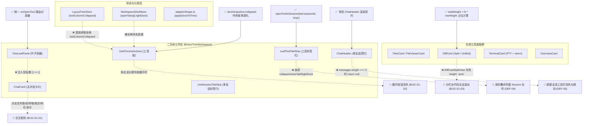

# 右侧面板与交互功能全域系统级重构方案

> **【调度与定时器铁律】**：如果设置定时器，最短是100秒，如果命令过长，最好的方式是等待命令完成后的推送，而不是一直轮询命令情况。

> **方案标识**：`docs/system-audit-and-redesign/independent-plans/04-右侧面板与交互独立方案.md`
> **制定角色**：【方案架构师 04: 右侧面板与交互功能独立方案设计】
> **基准规范**：`docs/system-audit-and-redesign/00-战役通则与协同执行规范.md`、`.agents/LOGIC_PLAN_NO_RETREAT.md`
> **设计输入**：
>
> - `docs/chat-core-connectivity/02-右侧面板与全功能排查报告.md`（右侧面板域基准审计）
> - `docs/system-button-audit/01-全系统真值巡检报告.md`（Tauri MCP 机器真值巡检）
> - `docs/chat-core-connectivity/01-报错根因与全链路排查报告.md`（聊天核心链路与错误流）
> - `docs/models-settings-audit/01-UI与滚轮排查报告.md`（滚动包含块与事件流）
> - `docs/ui-style-audit/01-style-degradation-audit.md`（样式退化与 Token 体系）
> - `docs/frontend-floating-popover-analysis/`（浮层、Trigger、Tooltip 与曲率阶梯契约）
> - `apps/crish-desktop/` 源码拓扑与状态机真源
>   **执行约束**：零业务代码修改、纯架构设计、UTF-8 无 BOM、严禁 Git 提交、问题同权。

---

## 目录

1. [执行摘要与全景重构蓝图 (Executive Summary & Architecture Blueprint)](#一执行摘要与全景重构蓝图-executive-summary--architecture-blueprint)
   - 1.1 核心问题与重构目标
   - 1.2 右侧面板与交互系统缺陷因果拓扑
2. [关键架构断层与根因机理深入剖析 (Deep-Dive Root Cause Analysis)](#二关键架构断层与根因机理深入剖析-deep-dive-root-cause-analysis)
   - 2.1 架构断层 1：`TreeLeafPanel.tsx` 空回调导致的全局工具交互瘫痪
   - 2.2 架构断层 2：多会话分屏下 `UnitChromeActions` 读全局状态致使展开按钮消失
   - 2.3 架构断层 3：`DiffCardSplitView` 虚拟滚动容器 `'auto'` 锁死与滚动条失效
   - 2.4 架构断层 4：`LeafToolTabStrip` 收起作用域漂移与 `ChatHeader` 空会话突兀跳变
   - 2.5 架构断层 5：`FilesCard` 刚性分栏双向挤压与浮层/A11y 契约偏离
   - 2.6 架构断层 6：`TerminalCard` 与 `ChatHeaderMore` 恢复力与安全防线缺失
3. [系统整体重构方案与分维设计 (Systemic Architectural Remediation)](#三系统整体重构方案与分维设计-systemic-architectural-remediation)
   - 3.1 维度一：统一工具路由注入机制与会话感知调度 (Tool Routing & Session Dispatcher)
   - 3.2 维度二：单源化作用域折叠状态机与收起闭环 (Scoped Dock State & Collapse Parity)
   - 3.3 维度三：虚拟滚动高度模型统一与 Split/Unified 视口对齐 (Virtual Scroll Precision)
   - 3.4 维度四：顶栏常驻架构与空会话零跳变渲染 (Stable Chrome & Zero Layout Shift)
   - 3.5 维度五：基于容器查询的自适应弹性面板体系 (Responsive Container Query Layout)
   - 3.6 维度六：浮层、Portal 与 A11y 交互契约严格收敛 (Popover, Portal & A11y Alignment)
   - 3.7 维度七：卡片自愈、异常恢复与破坏性操作安全门禁 (Self-Healing & Safety Gates)
4. [文件域变更全景与修改规格说明 (File Domains & Specification Matrix)](#四文件域变更全景与修改规格说明-file-domains--specification-matrix)
5. [逻辑依赖顺序与分阶段实施路线 (Logic Dependencies & Phased Roadmap)](#五逻辑依赖顺序与分阶段实施路线-logic-dependencies--phased-roadmap)
   - 5.1 实施逻辑依赖图
   - 5.2 阶段任务单元拆解 (Phase 1 ~ Phase 4)
6. [机器真值验证断言与测试矩阵 (Machine Verification & Test Matrix)](#六机器真值验证断言与测试矩阵-machine-verification--test-matrix)
   - 6.1 单元与集成自动化测试断言
   - 6.2 CDP / Tauri MCP 机器真值遍历测试用例

---

## 一、执行摘要与全景重构蓝图 (Executive Summary & Architecture Blueprint)

### 1.1 核心问题与重构目标

在 Conex / Crish 现代二叉树工作区（`BinaryTreeWorkspace`）演进中，主对话右侧辅助面板（Files 文件树/预览、Diff 差异代码、Terminal 终端、Overview 总览、Preview 网页预览、Runtime 运行时、Agent 协作体）承担着高频开发、代码审查、命令执行与文件交互的核心枢纽职能。

然而，审计报告表明，右侧面板在**工具路由注入、分屏状态作用域隔离、虚拟滚动高度计算、顶栏挂载生命周期、响应式弹性布局、无障碍语义与交互反馈** 7 个维度上存在深层次断层，造成了严重的“按钮点击无响应”、“分屏工具坞展开按钮消失”、“差异长代码无法滚动”、“新建会话顶栏闪烁跳跃”等致命体验损坏。

```
┌────────────────────────────────────────────────────────────────────────────────────────┐
│                        右侧面板重构全景缺陷收敛目标 (Remediation Targets)               │
├───────────────────┬───────────────────────────────────┬────────────────────────────────┤
│ 缺陷类别          │ 严重表象                          │ 架构重构最终目标               │
├───────────────────┼───────────────────────────────────┼────────────────────────────────┤
│ **S1 致命断层 1** │ 消息内文件路径/差异/终端点击假死  │ `TreeLeafPanel` 建立会话感知分 │
│ (路由注入中断)    │ （`handleGlobalTabClick={() => {}}`）│ 发器，全量直通 `openToolIn*`   │
├───────────────────┼───────────────────────────────────┼────────────────────────────────┤
│ **S1 致命断层 2** │ 多会话分屏下折叠右坞的 Unit 丢失   │ `UnitChromeActions` 改用当前   │
│ (作用域错位)      │ 展开按钮，无法重新唤起右侧面板    │ `dockSnapshot.collapsed` 判定  │
├───────────────────┼───────────────────────────────────┼────────────────────────────────┤
│ **S1 致命断层 3** │ 分栏差异（Split View）滚动条失效， │ `DiffCardSplitView` 虚拟滚动   │
│ (Split Diff 锁死) │ 无法向下滚动浏览完整长文件代码    │ 占位高度对齐 $N \times 22\text{px}$│
├───────────────────┼───────────────────────────────────┼────────────────────────────────┤
│ **S2 严重缺陷 1** │ 点击工具叶子收起按钮误折叠邻居坞  │ `LeafToolTabStrip` 传递精准    │
│ (收起作用域漂移)  │ （调了无绑定的 collapseActiveTab）│ `leaf.sessionId` 执行折叠      │
├───────────────────┼───────────────────────────────────┼────────────────────────────────┤
│ **S2 严重缺陷 2** │ 新建空会话顶栏完全消失，首条消息   │ `ChatHeader` 废除硬返回 null， │
│ (顶栏剧烈跳变)    │ 发出后顶栏凭空插入产生视口剧烈跳动│ 保持常驻 Header 提供工具入口   │
├───────────────────┼───────────────────────────────────┼────────────────────────────────┤
│ **S2 严重缺陷 3** │ 二叉树工作区中 Files 路径复制与   │ `TreeLeafPanel` 全量透传       │
│ (Toast 反馈缺失)  │ 文件保存等无任何成功/失败反馈     │ `onShowToast` 至 `FilesCard`   │
├───────────────────┼───────────────────────────────────┼────────────────────────────────┤
│ **S3 体验缺陷群** │ 窄屏 42%/58% 挤压、A11y 嵌套违规、│ 容器查询单栏自适应、Portal 挂  │
│ (7 项交互/布局)   │ 面包屑浮层裁剪、终端卡死无恢复    │ 载、A11y 修正、终端自愈控制组  │
└───────────────────┴───────────────────────────────────┴────────────────────────────────┘
```

### 1.2 右侧面板与交互系统缺陷因果拓扑



---

## 二、关键架构断层与根因机理深入剖析 (Deep-Dive Root Cause Analysis)

### 2.1 架构断层 1：`TreeLeafPanel.tsx` 空回调导致的全局工具交互瘫痪

- **源码位置**：[`apps/crish-desktop/src/components/binary-tree/TreeLeafPanel.tsx:237`](file:///C:/Software/conex/apps/crish-desktop/src/components/binary-tree/TreeLeafPanel.tsx#L237)
  ```tsx
  case 'chat':
    return (
      <ChatCard
        wsId="default"
        colIdx={0}
        groupIdx={0}
        handleGlobalTabClick={() => {}} // 致命断裂点！
        onShowToast={onShowToast}
        sessionId={sessionForPanel ?? undefined}
      />
    );
  ```
- **波及全链路追踪**：
  在 `ChatCard` 及其状态钩子中，以下 **6 大交互入口** 均依赖 `handleGlobalTabClick` 转发给右侧工具系统：
  1. `useChatCardState.ts:280-285`：`openSidePanel = (panelId) => handleGlobalTabClick(panelId)`
  2. `useChatCardState.ts:290-295`：`openPathInFilesPanel = (path) => { openSidePanel('files'); openFileInPanel(path); }`（用户在对话中点击模型生成的文件路径 `[src/main.rs](file:///...)`）
  3. `useChatCardState.ts:357-363`：`openDiffInRightPanel = (diff) => { setActiveDiffSourceAccess(diff); handleGlobalTabClick('diff'); }`（用户在审批卡片或改动总结中点击「查看改动」）
  4. `useChatCardState.ts:388-395`：`handleOpenTerminal`、`handleOpenDiffPanel`
  5. `ChatCard.tsx:78-79`：`ribbons.onOpenTerminal`、`ribbons.onOpenDiff`（卡片底部状态条快捷入口）
  6. `useChatComposerProps.ts:377`：斜杠命令分发器中的 `/files`、`/diff`、`/terminal` 触发
- **机理与后果**：
  在现代化二叉树工作区（桌面主流环境）下，上述所有点击最终调用了 `() => {}` 空函数，没有任何状态变更、没有任何事件派发、没有任何视觉反馈，造成全系统右侧面板功能在主对话中 **100% 瘫痪**。
- **附带遗漏**：
  - `TreeLeafPanel.tsx:257`：`case 'files': return <FilesCard />;` 未传 `onShowToast={onShowToast}`，导致 `FilesCard` 内部复制路径、保存文件等 Toast 提示全部静默丢失。
  - `TreeLeafPanel.tsx:227`：`<FileViewerCard filePath={filePath} onShowToast={onShowToast} />` 未加 `key={filePath}`，导致同叶子切文件时组件状态不重置。

---

### 2.2 架构断层 2：多会话分屏下 `UnitChromeActions` 读全局状态致使展开按钮消失

- **源码位置**：[`apps/crish-desktop/src/components/chat-card/UnitChromeActions.tsx:72-82`](file:///C:/Software/conex/apps/crish-desktop/src/components/chat-card/UnitChromeActions.tsx#L72-L82)
  ```tsx
  const dockSnapshot = useWorkspaceShellStore((s) => {
    const sid = (activeSessionId || '').trim();
    const tab = sid
      ? s.openTabs.find((t) => t.sessionId === sid)
      : s.openTabs.find((t) => t.tabId === s.activeTabId);
    return tab?.rightDock ?? null;
  });
  const rightDockCollapsed = useLayoutTreeStore((s) => s.toolColumnCollapsed);
  ```
- **机理剖析**：
  - 在多 Unit 分屏场景中，`LayoutTreeStore` 的 `toolColumnCollapsed` 是一个**整树聚合布尔值**（当且仅当整棵树的所有 Unit 都没有展开的 tool leaf 时才为 `true`，只要任意一个 Unit 展开了右坞，全局即为 `false`，见 `adapterShape.ts:594`）。
  - 每个 Unit 的真实折叠状态维护在其专属的 `tab.rightDock.collapsed`（即 `dockSnapshot.collapsed`）中。
  - `UnitChromeActions` 错误地直接读取全局 `rightDockCollapsed = useLayoutTreeStore((s) => s.toolColumnCollapsed)`。
  - **严重故障场景**：Unit A 展开了右坞（全局 `toolColumnCollapsed = false`），此时 Unit B 是折叠的（`dockSnapshot.collapsed === true`）。在 Unit B 的顶栏中：
    - `rightDockCollapsed` 计算值为 `false`；
    - `UnitChromeActions.tsx:170` `{rightDockCollapsed && (<div className={styles.dockGroup}>...</div>)}` 判定不通过；
    - **Unit B 顶栏中的「展开右侧工具栏」按钮被彻底隐藏**！用户无法通过点击按钮展开 Unit B 的右坞，陷入死锁。
    - 同时，第 137 行 `isActive = !rightDockCollapsed && activePanelId === id` 与第 148 行 `data-open` 状态全部计算错误。

---

### 2.3 架构断层 3：`DiffCardSplitView` 虚拟滚动容器 `'auto'` 锁死与滚动条失效

- **源码位置**：[`apps/crish-desktop/src/components/diff/DiffCardSplitView.tsx:48`](file:///C:/Software/conex/apps/crish-desktop/src/components/diff/DiffCardSplitView.tsx#L48)
  ```tsx
  <div style={{ minHeight: `${rowHeight}px`, height: 'auto', width: '100%', position: 'relative' }}>
  ```
- **对比正常模式**：[`apps/crish-desktop/src/components/diff/DiffCardUnifiedView.tsx:33, 50`](file:///C:/Software/conex/apps/crish-desktop/src/components/diff/DiffCardUnifiedView.tsx#L33)
  ```tsx
  const rowHeight = 22;
  const totalHeight = totalItems * rowHeight;
  ...
  <div style={{ height: `${totalHeight}px`, width: '100%', position: 'relative' }}>
  ```
- **数学与物理机理推导**：
  - 虚拟滚动组件（`useVirtualScroll`）通过监听外层 `styles.scrollParent`（`overflow-y: auto`）的 `scrollTop`，在内层生成一个高度等于“总数据量真实总高”的占位容器，并在内部通过 `transform: translateY(offsetTop)` 渲染当前视口可见的切片（约 30~50 行）。
  - **Unified View** 中：占位高度 $H_{\text{placeholder}} = N \times 22\text{px}$。若 $N = 2000$ 行，$H = 44000\text{px}$，滚动条具备完整的可滑动范围，滑动顺畅。
  - **Split View** 中：占位高度被写死为 `height: 'auto'`。由于内层切片绝对定位且仅渲染了 30 行，$H_{\text{placeholder}}$ 仅为当前可见行的自然高度（约 $30 \times 22\text{px} = 660\text{px}$）。
  - 当 $660\text{px} \le \text{视口高度}$ 时，外层容器认为**内容没有溢出，完全不生成垂直滚动条**；即便生成微小滚动条，一旦滑到底部，切片更新导致高度瞬变，发生剧烈闪烁截断。用户在分栏模式下**完全无法滚动长文件**。

---

### 2.4 架构断层 4：`LeafToolTabStrip` 收起作用域漂移与 `ChatHeader` 空会话突兀跳变

#### 1. `LeafToolTabStrip` 收起按钮作用域错乱

- **源码位置**：[`apps/crish-desktop/src/components/binary-tree/LeafToolTabStrip.tsx:181-184`](file:///C:/Software/conex/apps/crish-desktop/src/components/binary-tree/LeafToolTabStrip.tsx#L181-L184)
  ```tsx
  <Button
    type="button"
    variant="ghost"
    size="sm"
    className={styles.addTabBtn}
    onClick={() => {
      collapseActiveTabRightDock(true); // 错误地操作全局活动 Tab！
    }}
    aria-label="收起右侧面板"
    icon={<IconSidebarRight size={14} />}
  />
  ```
- **机理**：`collapseActiveTabRightDock(true)` 直接取 `store.getActiveTab()`。在分屏多会话下，用户光标在 Session A 对话区，若去点击 Session B 工具叶子顶部的收起按钮，系统**错误地关闭了 Session A 的右坞，而 Session B 的面板纹丝不动**。

#### 2. `ChatHeader` 空会话硬返回 `null` 导致布局跳动

- **源码位置**：[`apps/crish-desktop/src/components/chat-card/ChatHeader.tsx:74-81`](file:///C:/Software/conex/apps/crish-desktop/src/components/chat-card/ChatHeader.tsx#L74-L81)
  ```tsx
  if (
    mainSurface !== 'chat' ||
    !session ||
    !session.messages ||
    session.messages.length === 0
  ) {
    return null;
  }
  ```
- **机理**：在单 Unit 模式下，`ChatHeader` 是容纳 `UnitChromeActions`（总览/文件/差异/终端/展开坞）的唯一顶栏宿主。当新建会话（0 条消息）时，`ChatHeader` 整体不渲染。导致：
  1. 用户在发送第一条消息前，界面顶部没有任何辅助面板入口；
  2. 发出第一条消息的瞬间，`ChatHeader`（36px 高）突兀插入，造成对话区与输入框剧烈下沉抖动（Layout Shift）。

---

### 2.5 架构断层 5：`FilesCard` 刚性分栏双向挤压与浮层/A11y 契约偏离

#### 1. `FilesCard.module.css:594-607` 刚性 42%/58% 挤压

- 当面板在分屏或小宽度（如 300px~360px）下显示时，`.filesListPane` 强制分配 42%（约 126px，受 `min-width: 120px` 限制），右侧 `.filesDetailPane` 仅剩 170px。两栏均无法正常显示内容：
  - 文件树文字被 `...` 截断，层级缩进后无法阅读；
  - 代码/Markdown 预览区单行严重折行错乱；
  - 缺乏基于 CSS Container Query 的单双栏响应式折叠状态机。

#### 2. 浮层与 A11y 契约违例

- **`FileBreadcrumb.tsx:233-260`**：面包屑下拉目录 `bcFlyout` 未走 Portal 挂载，直接以内联绝对定位渲染在受限宽度的父容器内，在 `overflow: hidden` 时被强制截断。
- **`FileActions.tsx:197` 与 `FileViewerCard.tsx:263, 343`**：`Menu` 的 `trigger` 属性包裹 `<Tooltip>`，造成 Radix Popover.Trigger 与 Tooltip 事件争抢，违反 `00-战役通则与协同执行规范.md` §2.2。
- **`DiffCardFileList.tsx:136-167`**：`<button>` 内部嵌套带有 `tabIndex={0}`、`onClick`、`onKeyDown` 的 `<span role="link">`，违反 W3C 禁止嵌套可交互元素的硬性标准，在辅助功能树中被判定为 Invalid Control。
- **`DiffCardGitActions.tsx:46-52`**：提交触发栏为纯 `<div>`，缺失 `role="button"`、`tabIndex={0}`、`onKeyDown`，键盘导航用户无法使用。

---

### 2.6 架构断层 6：`TerminalCard` 与 `ChatHeaderMore` 恢复力与安全防线缺失

#### 1. `TerminalCard` 卡死缺乏自愈机制

- 重构后的 `TerminalCard.tsx` 移除了所有控制栏，`const [restartToken] = useState(0)` 成为死状态。当底层的 PTY 会话因休眠恢复、子进程异常退出（Exit）、或环境编码错乱卡死时，前端没有任何「重启终端 (Restart)」、「清屏 (Clear)」的操作入口，用户无法原地自愈。

#### 2. `ChatHeaderMore` 清空记录缺乏二次确认

- `ChatHeaderMore.tsx:50-58` 的「清空记录」选项被点击后直接触发 `onClearHistory()`（即 `clearSessionMessages(sid)`），未通过 `useConfirmGate` 模态弹窗拦截，用户极易手滑误触导致不可逆的数据清空。

---

## 三、系统整体重构方案与分维设计 (Systemic Architectural Remediation)

遵循「纯逻辑规划、反退避、彻底杜绝打补丁、高内聚单向数据流」的战役核心原则，右侧面板与交互功能重构划分为 **7 大系统性架构维度**。

```
┌────────────────────────────────────────────────────────────────────────────────────────┐
│                        右侧面板与交互系统级重构架构体系                                │
├────────────────────────────────────────────────────────────────────────────────────────┤
│ 维度 1: 统一工具路由注入 (TreeLeafPanel.tsx -> onOpenTool Dispatcher)                  │
│    • 建立 session 感知分发器，消除 () => {} 空函数，打通 6 大打开面板交互链路          │
├────────────────────────────────────────────────────────────────────────────────────────┤
│ 维度 2: 作用域折叠状态机单源化 (UnitChromeActions.tsx & LeafToolTabStrip.tsx)         │
│    • dockSnapshot.collapsed 优先判定，修正分屏展开按钮与收起按钮 sessionId 绑定        │
├────────────────────────────────────────────────────────────────────────────────────────┤
│ 维度 3: 虚拟滚动高度模型对齐 (DiffCardSplitView.tsx & DiffCardUnifiedView.tsx)         │
│    • 占位容器严格注入 totalHeight = N * rowHeight，消除长文件滚动锁死                  │
├────────────────────────────────────────────────────────────────────────────────────────┤
│ 维度 4: 顶栏常驻架构与零跳变 (ChatHeader.tsx & UnitSessionTabStrip.tsx)                │
│    • 废除 messages.length === 0 时 return null，维持平滑顶栏工具接入                    │
├────────────────────────────────────────────────────────────────────────────────────────┤
│ 维度 5: 容器查询自适应弹性面板 (FilesCard.tsx & FilesCard.module.css)                   │
│    • @container 驱动单双栏自适应切换，提供「返回文件列表」面包屑胶囊                   │
├────────────────────────────────────────────────────────────────────────────────────────┤
│ 维度 6: Popover / Menu / Tooltip 契约与 A11y 治理                                      │
│    • FileBreadcrumb 接入 Portal；消灭 Menu trigger 嵌套 Tooltip；修复 Diff 嵌套 Button │
├────────────────────────────────────────────────────────────────────────────────────────┤
│ 维度 7: 终端自愈控制与清空会话安全门禁 (TerminalCard.tsx & ChatHeaderMore.tsx)         │
│    • 提供浮动/顶栏 Restart 与 Clear 控制组；清空会话接入 useConfirmGate 确认模态框    │
└────────────────────────────────────────────────────────────────────────────────────────┘
```

---

### 3.1 维度一：统一工具路由注入机制与会话感知调度 (Tool Routing & Session Dispatcher)

#### 1. `TreeLeafPanel.tsx` 根除空函数

在 `TreeLeafPanel.tsx` 中定义高内聚的 `handleOpenTool` 回调函数，精准感知当前 Leaf 作用域：

```typescript
// apps/crish-desktop/src/components/binary-tree/TreeLeafPanel.tsx

// 统一会话感知工具分发器
const handleOpenTool = useCallback(
  (panelId: string) => {
    const targetSessionId = sessionForPanel || selectActiveSessionId();
    if (targetSessionId && !targetSessionId.startsWith('__pending')) {
      openToolInSession(targetSessionId, panelId);
    } else {
      openToolInActiveTab(panelId);
    }
  },
  [sessionForPanel]
);
```

#### 2. 全量组件 Props 透传规范

在 `LeafBody` 的内容路由中，为所有消费工具路由与反馈通知的子卡片规范化注入：

```typescript
switch (panelId) {
  case 'chat':
    return (
      <ChatCard
        wsId="default"
        colIdx={0}
        groupIdx={0}
        handleGlobalTabClick={handleOpenTool} // ✅ 恢复核心分发链路！
        onShowToast={onShowToast}             // ✅ 规范透传 Toast
        sessionId={sessionForPanel ?? undefined}
      />
    );
  case 'files':
    return (
      <FilesCard
        onShowToast={onShowToast}             // ✅ 补全 onShowToast 传递
      />
    );
  case 'overview':
    return (
      <OverviewCard
        wsId="default"
        onOpenPanel={handleOpenTool}          // ✅ 统一分发器
      />
    );
  case 'diff':
    return <DiffCard onShowToast={onShowToast} />;
  case 'terminal':
    return <TerminalCard sessionId={sessionForPanel ?? undefined} />;
  // ...
}

if (panelId.startsWith('file-viewer:')) {
  const filePath = panelId.substring('file-viewer:'.length);
  return (
    <FileViewerCard
      key={filePath}                          // ✅ 声明 key 强制文件切换时重置模式
      filePath={filePath}
      onShowToast={onShowToast}
    />
  );
}
```

---

### 3.2 维度二：单源化作用域折叠状态机与收起闭环 (Scoped Dock State & Collapse Parity)

#### 1. `UnitChromeActions.tsx` 状态感知修正

必须废弃对 `useLayoutTreeStore.toolColumnCollapsed` 的单向盲读，严格遵循 **「优先以当前 Unit 的 dockSnapshot 为准，无快照时回退全局状态」** 的单向数据流原则：

```typescript
// apps/crish-desktop/src/components/chat-card/UnitChromeActions.tsx

const dockSnapshot = useWorkspaceShellStore((s) => {
  const sid = (activeSessionId || '').trim();
  const tab = sid
    ? s.openTabs.find((t) => t.sessionId === sid)
    : s.openTabs.find((t) => t.tabId === s.activeTabId);
  return tab?.rightDock ?? null;
});

// 全局树状态作为后备
const globalTreeCollapsed = useLayoutTreeStore((s) => s.toolColumnCollapsed);

// ✅ 作用域精确判定：若本 Unit 有独立的 dockSnapshot，则以 dockSnapshot.collapsed 为唯一真源
const rightDockCollapsed = dockSnapshot
  ? dockSnapshot.collapsed
  : globalTreeCollapsed;
```

#### 2. `LeafToolTabStrip.tsx` 收起按钮绑定当前 Session

在工具叶子点击收起时，精确折叠当前工具叶子所归属的会话右坞：

```typescript
// apps/crish-desktop/src/components/binary-tree/LeafToolTabStrip.tsx

const handleCollapseDock = useCallback(() => {
  if (leaf.sessionId) {
    // 针对本 leaf 所属会话收起右坞（在 adapterShape 中投影为仅 chat）
    openToolInSession(leaf.sessionId, 'chat');
  } else {
    collapseActiveTabRightDock(true);
  }
}, [leaf.sessionId]);
```

并在 JSX 中绑定：

```tsx
<Tooltip content="收起右侧面板">
  <Button
    type="button"
    variant="ghost"
    size="sm"
    className={styles.addTabBtn}
    onClick={handleCollapseDock} // ✅ 精确会话作用域
    aria-label="收起右侧面板"
    icon={<IconSidebarRight size={14} />}
  />
</Tooltip>
```

---

### 3.3 维度三：虚拟滚动高度模型统一与 Split/Unified 视口对齐 (Virtual Scroll Precision)

#### 1. `DiffCardSplitView.tsx` 占位容器物理高度修正

严格对齐 `DiffCardUnifiedView.tsx` 的虚拟滚动测量模型，将 `totalHeight` 显式注入占位容器：

```typescript
// apps/crish-desktop/src/components/diff/DiffCardSplitView.tsx

export const DiffCardSplitView: React.FC<DiffCardSplitViewProps> = ({
  f,
  renderItems,
  onExpandBlock,
}) => {
  const totalItems = renderItems.length;
  const { containerRef, scrollTop, containerHeight, onScroll } = useVirtualScroll({
    itemCount: totalItems,
    heightOnly: true,
  });
  const rowHeight = 22;
  const totalHeight = totalItems * rowHeight; // ✅ 准确计算总物理高度

  const startIndex = Math.max(0, Math.floor(scrollTop / rowHeight) - 15);
  const endIndex = Math.min(
    totalItems,
    Math.ceil((scrollTop + containerHeight) / rowHeight) + 15
  );

  const visibleItems = renderItems.slice(startIndex, endIndex);
  const offsetTop = startIndex * rowHeight;

  return (
    <AppErrorBoundary variant="compact" title="变更对比出错">
      <div
        ref={containerRef}
        className={styles.scrollParent}
        onScroll={onScroll}
        tabIndex={0}
        style={{ position: 'relative', overflowY: 'auto', outline: 'none' }}
      >
        {/* ✅ 修正 height 为精确的 totalHeight 像素值，彻底恢复滚动条 */}
        <div
          style={{
            height: `${totalHeight}px`,
            width: '100%',
            position: 'relative',
          }}
        >
          <div
            className={styles.linesContainer}
            style={{
              position: 'absolute',
              top: 0,
              left: 0,
              right: 0,
              transform: `translateY(${offsetTop}px)`,
              background: 'transparent',
            }}
            aria-label={`${basename(f.filePath)} 的变更分栏内容`}
          >
            {/* 渲染 visibleItems ... */}
          </div>
        </div>
      </div>
    </AppErrorBoundary>
  );
};
```

---

### 3.4 维度四：顶栏常驻架构与空会话零跳变渲染 (Stable Chrome & Zero Layout Shift)

#### 1. `ChatHeader.tsx` 渲染条件与常驻契约

废除 `session.messages.length === 0` 时的 `return null`。无论是否有消息，只要主视面为 `'chat'` 且属于有效/草稿会话，始终保持 `ChatHeader` 结构稳定呈现：

```typescript
// apps/crish-desktop/src/components/chat-card/ChatHeader.tsx

export const ChatHeader: React.FC<ChatHeaderProps> = React.memo(
  ({
    mainSurface,
    showMsgFilter,
    localMsgFilter,
    setLocalMsgFilter,
    setShowMsgFilter,
    displayCount,
    totalCount,
    inputRef,
    activeSessionId,
    onExportMarkdown,
    onClearHistory,
  }) => {
    // 仅当非 chat 视面时隐藏 Header
    if (mainSurface !== 'chat') {
      return null;
    }

    const session = activeSessionId
      ? getCompositionRoot().session.getState().sessionsById[activeSessionId]
      : undefined;

    const unitChromeLabel = useMemo(
      () => resolveUnitChromeLabel(session),
      [session]
    );

    const sessionTitleHint = useMemo(() => {
      if (!session) return null;
      const t = sessionListDisplayTitle(session).trim();
      if (!t || t === EMPTY_SESSION_TITLE) return null;
      return t;
    }, [session]);

    const hasMessages = Boolean(session?.messages && session.messages.length > 0);

    return (
      <div
        className={styles.toolbar}
        data-testid="chat-toolbar"
        data-unit-chrome="true"
        data-session-id={activeSessionId || undefined}
        data-has-messages={hasMessages ? 'true' : 'false'}
        role="toolbar"
        aria-label="对话工具栏"
      >
        <div className={styles.toolbarLeft}>
          {showMsgFilter && hasMessages ? (
            <ChatMsgFilterBar
              localMsgFilter={localMsgFilter}
              setLocalMsgFilter={setLocalMsgFilter}
              setShowMsgFilter={setShowMsgFilter}
              displayCount={displayCount}
              totalCount={totalCount}
              inputRef={inputRef}
            />
          ) : (
            <div
              className={styles.unitLabel}
              data-testid="chat-unit-label"
              title={sessionTitleHint || unitChromeLabel}
              aria-label={
                sessionTitleHint
                  ? `${unitChromeLabel} · ${sessionTitleHint}`
                  : unitChromeLabel
              }
            >
              <span className={styles.unitType}>{unitChromeLabel}</span>
            </div>
          )}
        </div>

        <UnitChromeActions
          activeSessionId={activeSessionId}
          onExportMarkdown={onExportMarkdown}
          onClearHistory={onClearHistory}
          leading={
            hasMessages ? (
              <Tooltip content={showMsgFilter ? '关闭消息搜索' : '搜索消息'}>
                <Button
                  type="button"
                  variant="ghost"
                  size="sm"
                  className={styles.toolBtn}
                  data-testid="chat-toggle-search"
                  data-active={showMsgFilter ? 'true' : 'false'}
                  aria-label={showMsgFilter ? '关闭消息搜索' : '搜索消息'}
                  onClick={toggleSearch}
                  icon={<Search size={15} strokeWidth={1.75} aria-hidden />}
                />
              </Tooltip>
            ) : null
          }
        />
      </div>
    );
  }
);
```

**收益**：

- 空会话从创建之初即拥有完整的总览、文件树、差异对比、终端入口；
- 发送首条消息时顶栏位置固定，输入框与消息气泡零视口跳动；
- 无历史消息时智能隐藏无意义的「搜索消息」按钮，保持视觉极简。

---

### 3.5 维度五：基于容器查询的自适应弹性面板体系 (Responsive Container Query Layout)

#### 1. `FilesCard` 容器查询响应式单双栏切换

在 `FilesCard.module.css` 中引入 `@container` 规则：

```css
/* apps/crish-desktop/src/components/files/FilesCard.module.css */

.filesCard {
  container-type: inline-size;
  container-name: filesCard;
  display: flex;
  flex-direction: column;
  height: 100%;
  width: 100%;
  overflow: hidden;
  background: var(--bg-primary);
}

/* 宽屏默认：双栏并列 */
.filesBodySplit {
  display: flex;
  flex-direction: row;
  align-items: stretch;
  flex: 1;
  min-height: 0;
  overflow: hidden;
}

.filesListPane {
  flex: 0 0 40%;
  max-width: 50%;
  min-width: 160px;
  border-right: 1px solid var(--hairline, var(--border-subtle));
}

.filesDetailPane {
  flex: 1 1 60%;
  min-width: 0;
  min-height: 0;
  display: flex;
  flex-direction: column;
  overflow: hidden;
}

/* 窄屏或分屏模式 (宽度 <= 440px)：单栏流式切换 */
@container filesCard (max-width: 440px) {
  /* 浏览状态：全宽显示文件树，隐藏详情区 */
  .filesBodySplit[data-mode='browse'] .filesListPane {
    flex: 1 1 100%;
    max-width: 100%;
    min-width: 0;
    border-right: none;
  }
  .filesBodySplit[data-mode='browse'] .filesDetailPane {
    display: none;
  }

  /* 预览/编辑状态：全宽显示详情区，隐藏文件树 */
  .filesBodySplit[data-mode='detail'] .filesListPane {
    display: none;
  }
  .filesBodySplit[data-mode='detail'] .filesDetailPane {
    flex: 1 1 100%;
    max-width: 100%;
    min-width: 0;
  }
}
```

并在 `FilesCard.tsx` 中：

- 给容器注入 `data-mode={preview.view}`；
- 在 `preview.view === 'detail'` 且处于窄屏时，在面包屑左侧展示「返回文件列表」胶囊按钮，点击触发 `preview.setView('browse')`。

---

### 3.6 维度六：浮层、Portal 与 A11y 交互契约严格收敛 (Popover, Portal & A11y Alignment)

#### 1. `FileBreadcrumb` 迁移至 Portal 挂载

将 `FileBreadcrumb.tsx` 中的 `bcFlyout` 目录弹层改造为基于 `Menu` / `DropdownPortal` 架构，挂载至 `document.body`，彻底消灭祖先容器 `overflow: hidden` 造成的截断与层级遮挡。

#### 2. 彻底消灭 `Menu` 的 `trigger` 包裹 `<Tooltip>`

对齐 `00-战役通则与协同执行规范.md` §2.2，在 `FileActions.tsx`、`FileViewerCard.tsx`、`LeafToolTabStrip.tsx` 中全面改为 **「显式 Anchor / Tooltip disabled={isOpen}」** 模式：

```tsx
// 改造前（违规）
<Menu
  trigger={
    <Tooltip content="更多操作">
      <Button ... />
    </Tooltip>
  }
  options={...}
/>

// 改造后（合规契约）
<Tooltip content="更多操作" disabled={menuOpen}>
  <div>
    <Menu
      open={menuOpen}
      onOpenChange={setMenuOpen}
      trigger={
        <Button
          type="button"
          variant="ghost"
          size="sm"
          className={styles.actBtn}
          aria-label="更多操作"
          icon={<Lucide.MoreHorizontal size={14} />}
        />
      }
      options={...}
    />
  </div>
</Tooltip>
```

#### 3. `DiffCardFileList.tsx` 消除嵌套可交互元素

将内层 `<span className={styles.fileNameLink} role="link" tabIndex={0} ...>` 移除，将其样式与点击行为合并至外层 `<button className={styles.fileItem} ...>`，彻底恢复符合 W3C 规范的扁平无障碍节点。

#### 4. `DiffCardGitActions.tsx` 补全键盘交互支持

```tsx
<div
  className={styles.commitTriggerBar}
  role="button"
  tabIndex={0}
  aria-expanded={false}
  aria-label={`展开提交与推送面板，已暂存 ${stagedCount} 个，未暂存 ${unstagedCount} 个`}
  onClick={onToggle}
  onKeyDown={(e) => {
    if (e.key === 'Enter' || e.key === ' ') {
      e.preventDefault();
      onToggle();
    }
  }}
>
  <Lucide.GitCommit size={14} className={styles.commitTriggerIcon} />
  <span className={styles.commitTriggerText}>
    输入提交信息… ({stagedCount} 个已暂存 / {unstagedCount} 个未暂存)
  </span>
  <Lucide.ChevronRight size={14} className={styles.commitTriggerArrow} />
</div>
```

---

### 3.7 维度七：卡片自愈、异常恢复与破坏性操作安全门禁 (Self-Healing & Safety Gates)

#### 1. `TerminalCard.tsx` 增设自愈控制组

在终端卡片右上角增设微型浮动工具条（Hover 时显现，异常时常驻）：

- **重启终端 (Restart)**：调用 `setRestartToken(t => t + 1)`，驱动 `InteractiveXtermTerminal` 重置底层 PTY 会话；
- **清屏 (Clear)**：调用 xterm 实例的 `clear()` 方法；
- **复制输出 (Copy All)**：提取终端选区或全量文本写入剪贴板。

#### 2. `ChatHeaderMore.tsx` 接入二次确认安全门禁

在触发「清空记录」时，接入 `useConfirmGate` 模态对话框：

```typescript
// apps/crish-desktop/src/components/chat-card/ChatHeaderMore.tsx

const handleClearWithConfirm = useCallback(async () => {
  const confirmed = await confirmModal({
    title: '清空会话记录',
    description: '确定要清空当前会话的所有历史消息吗？此操作无法撤销。',
    confirmLabel: '清空',
    variant: 'danger',
  });
  if (confirmed) {
    onClearHistory?.();
  }
}, [confirmModal, onClearHistory]);
```

---

## 四、文件域变更全景与修改规格说明 (File Domains & Specification Matrix)

| 序号     | 目标文件路径                                                                     | 核心变更内容与技术规格                                                                                                                 |           修复缺陷            |   风险等级    |
| :------- | :------------------------------------------------------------------------------- | :------------------------------------------------------------------------------------------------------------------------------------- | :---------------------------: | :-----------: |
| **F-01** | `apps/crish-desktop/src/components/binary-tree/TreeLeafPanel.tsx`                | 1. 注入 `handleOpenTool` 替代 `() => {}`；<br>2. 传递 `onShowToast` 至 `FilesCard`；<br>3. 为 `FileViewerCard` 添加 `key={filePath}`。 | **S1-01**<br>DEF-06<br>DEF-10 | 低 (原生解耦) |
| **F-02** | `apps/crish-desktop/src/components/chat-card/UnitChromeActions.tsx`              | 1. 优先从 `dockSnapshot.collapsed` 取折叠状态；<br>2. 修正 `isActive`、`data-open` 与展开按钮的判定。                                  |           **S1-02**           |      低       |
| **F-03** | `apps/crish-desktop/src/components/diff/DiffCardSplitView.tsx`                   | 1. 补全 `totalHeight = totalItems * rowHeight`；<br>2. 占位容器 `style.height` 赋真实高度像素值。                                      |           **S1-03**           |      低       |
| **F-04** | `apps/crish-desktop/src/components/binary-tree/LeafToolTabStrip.tsx`             | 1. 收起按钮绑定 `leaf.sessionId` 精准折叠；<br>2. 解耦 Menu 与 Tooltip 嵌套。                                                          |      **S2-01**<br>DEF-12      |      低       |
| **F-05** | `apps/crish-desktop/src/components/chat-card/ChatHeader.tsx`                     | 1. 废除 `messages.length === 0` 时的 `return null`；<br>2. 保持空会话与草稿态常驻 Header。                                             |           **S2-02**           |      低       |
| **F-06** | `apps/crish-desktop/src/components/files/FilesCard.tsx` & `FilesCard.module.css` | 1. 接入 `@container (max-width: 440px)` 单双栏响应式状态机；<br>2. 增加「返回文件列表」胶囊入口。                                      |            DEF-07             |      低       |
| **F-07** | `apps/crish-desktop/src/components/files/FileBreadcrumb.tsx`                     | 将目录下拉浮层迁移至 Portal 挂载，消除 CSS 包含块截断。                                                                                |            DEF-14             |      低       |
| **F-08** | `apps/crish-desktop/src/components/diff/DiffCardFileList.tsx`                    | 移除 `<button>` 内嵌套的 `<span role="link">`，合并 A11y 语义。                                                                        |            DEF-08             |      低       |
| **F-09** | `apps/crish-desktop/src/components/diff/DiffCardGitActions.tsx`                  | 为纯 div 提交栏补齐 `role="button"`、`tabIndex={0}` 与按键处理。                                                                       |            DEF-09             |      低       |
| **F-10** | `apps/crish-desktop/src/components/workspace/TerminalCard.tsx`                   | 接入 `restartToken` 触发器与清屏/复制浮动操作组。                                                                                      |            DEF-11             |      低       |
| **F-11** | `apps/crish-desktop/src/components/chat-card/ChatHeaderMore.tsx`                 | 「清空记录」接入 `useConfirmGate` 模态弹窗二次确认。                                                                                   |            DEF-13             |      低       |
| **F-12** | `apps/crish-desktop/src/components/files/FileActions.tsx` & `FileViewerCard.tsx` | 解耦 Menu 与 Tooltip 嵌套，统一为显式 Anchor 模式。                                                                                    |            DEF-12             |      低       |

---

## 五、逻辑依赖顺序与分阶段实施路线 (Logic Dependencies & Phased Roadmap)

严格遵循反退避铁律，**不谈工期、不谈人天，所有缺陷问题同权**，仅依据数据流与编译依赖严格编排实施阶梯：

### 5.1 实施逻辑依赖图

```mermaid
graph TD
    Phase1[Phase 1: 核心路由与虚拟滚动根治 (S1 致命缺陷)]
    Phase2[Phase 2: 作用域隔离与顶栏常驻架构 (S2 严重缺陷)]
    Phase3[Phase 3: 响应式弹性布局与浮层/A11y 治理 (S3 缺陷群)]
    Phase4[Phase 4: 终端自愈与交互安全防护 (S3 安全与恢复)]

    Phase1 --> Phase2
    Phase2 --> Phase3
    Phase3 --> Phase4
```

### 5.2 阶段任务单元拆解 (Phase 1 ~ Phase 4)

#### Phase 1: 核心路由与虚拟滚动根治 (S1 致命缺陷)

- **任务目标**：彻底打通主对话向右侧面板的跳转链路，恢复分栏差异长文件滚动。
- **任务清单**：
  - `T-PANEL-01`：在 `TreeLeafPanel.tsx` 中落地 `handleOpenTool` 分发器，替代 `() => {}`；
  - `T-PANEL-02`：在 `DiffCardSplitView.tsx` 中对齐 `totalHeight` 计算与占位容器物理高度；
  - `T-PANEL-03`：在 `TreeLeafPanel.tsx` 中补全 `FilesCard` 的 `onShowToast` 与 `FileViewerCard` 的 `key={filePath}`。

#### Phase 2: 作用域隔离与顶栏常驻架构 (S2 严重缺陷)

- **任务目标**：消灭多会话分屏展开按钮消失与收起漂移，根除新建会话顶栏跳变。
- **任务清单**：
  - `T-SCOPE-01`：重构 `UnitChromeActions.tsx` 折叠状态判定，优先消费 `dockSnapshot.collapsed`；
  - `T-SCOPE-02`：重构 `LeafToolTabStrip.tsx` 收起按钮，绑定 `leaf.sessionId` 精准操作；
  - `T-SCOPE-03`：重构 `ChatHeader.tsx` 渲染守卫，废除 `messages.length === 0` 时的空返回，实现顶栏常驻。

#### Phase 3: 响应式弹性布局与浮层/A11y 治理 (S3 缺陷群)

- **任务目标**：解决窄视口双向挤压，收敛 Popover/Tooltip 契约与无障碍标准。
- **任务清单**：
  - `T-RESP-01`：在 `FilesCard.tsx` 与 `FilesCard.module.css` 引入 `@container (max-width: 440px)` 单双栏响应式状态机与返回按钮；
  - `T-A11Y-01`：重构 `FileBreadcrumb.tsx`，将 `bcFlyout` 目录弹层迁移至 Portal 挂载；
  - `T-A11Y-02`：重构 `DiffCardFileList.tsx` 消除 `<button>` 嵌套 `<span role="link">`；
  - `T-A11Y-03`：重构 `DiffCardGitActions.tsx` 补齐 `role="button"`、`tabIndex={0}` 与 Enter/Space 响应；
  - `T-A11Y-04`：在 `FileActions.tsx`、`FileViewerCard.tsx` 中解耦 Menu 与 Tooltip 嵌套。

#### Phase 4: 终端自愈与交互安全防护 (S3 安全与恢复)

- **任务目标**：建立终端卡死原地恢复能力，筑牢破坏性操作确认防线。
- **任务清单**：
  - `T-SAFE-01`：在 `TerminalCard.tsx` 中引入 `restartToken` 自增机制与「重启 / 清屏 / 复制」控制组；
  - `T-SAFE-02`：在 `ChatHeaderMore.tsx` 中为「清空记录」引入 `useConfirmGate` 模态弹窗拦截。

---

## 六、机器真值验证断言与测试矩阵 (Machine Verification & Test Matrix)

重构实施完成后，必须在 `npm test`（Vitest）与 `127.0.0.1:9222` Tauri WebView2 真实桌面环境下全量跑通以下验证矩阵：

### 6.1 单元与集成自动化测试断言 (Vitest Assertions)

```typescript
// apps/crish-desktop/tests/unit/RightPanelInteraction.test.tsx

describe('右侧面板与交互功能重构真值断言', () => {
  it('断言 1: TreeLeafPanel 中 ChatCard 触发 handleGlobalTabClick 必须调用 openToolInSession', () => {
    const openToolMock = vi.fn();
    // 模拟 TreeLeafPanel 挂载 ChatCard
    const { getByTestId } = renderTreeLeafPanel({
      leaf: { id: 'leaf_chat_1', panelId: 'chat', tabs: ['chat'], sessionId: 'sess_100' },
      openToolInSession: openToolMock,
    });
    // 模拟 ChatCard 内部触发打开文件面板
    fireEvent.click(getByTestId('chat-inline-file-link'));
    expect(openToolMock).toHaveBeenCalledWith('sess_100', 'files');
  });

  it('断言 2: 多 Unit 分屏下 Unit B 折叠时必须渲染「展开右侧工具栏」按钮', () => {
    // 模拟 Unit A 展开，Unit B 折叠
    mockShellStoreState({
      openTabs: [
        { sessionId: 'sess_A', rightDock: { collapsed: false } },
        { sessionId: 'sess_B', rightDock: { collapsed: true } },
      ],
    });
    mockTreeStoreState({ toolColumnCollapsed: false }); // 全局为 false

    const { getByTestId } = render(
      <UnitChromeActions activeSessionId="sess_B" />
    );
    const expandBtn = getByTestId('right-dock-toggle');
    expect(expandBtn).toBeInTheDocument();
    expect(expandBtn).toHaveAttribute('aria-label', '展开右侧工具栏');
  });

  it('断言 3: DiffCardSplitView 占位高度必须严格等于 totalItems * rowHeight', () => {
    const renderItems = new Array(500).fill(mockSplitLineItem);
    const { container } = render(
      <DiffCardSplitView f={mockFileDiff} renderItems={renderItems} onExpandBlock={vi.fn()} />
    );
    const placeholder = container.querySelector(`.${styles.scrollParent} > div`);
    expect(placeholder).toHaveStyle({ height: `${500 * 22}px` });
  });

  it('断言 4: 新建空会话（messages=[]）ChatHeader 必须稳定渲染，不得返回 null', () => {
    mockSessionStore({ 'sess_empty': { id: 'sess_empty', messages: [] } });
    const { getByTestId } = render(
      <ChatHeader mainSurface="chat" activeSessionId="sess_empty" {...defaultProps} />
    );
    expect(getByTestId('chat-toolbar')).toBeInTheDocument();
  });

  it('断言 5: DiffCardFileList 内部不得包含任何嵌套的 interactive 元素', () => {
    const { container } = render(<DiffCardFileList files={[mockFileDiff]} {...defaultProps} />);
    const buttons = container.querySelectorAll('button');
    buttons.forEach((btn) => {
      expect(btn.querySelector('button, [role="link"], [role="button"], a')).toBeNull();
    });
  });
});
```

### 6.2 CDP / Tauri MCP 机器真值遍历测试用例

| 用例 ID       | 验证场景               | 触发方式 (CDP / MCP 指令)                     | 预期机器真值判定                                                            |
| :------------ | :--------------------- | :-------------------------------------------- | :-------------------------------------------------------------------------- |
| **TC-MCP-01** | 对话消息内文件路径点击 | 点击消息内的 `[src/main.rs]` 节点             | 右侧工作区立即展开 `files` 或 `file-viewer` 叶子，且激活该文件              |
| **TC-MCP-02** | 多会话分屏展开按钮状态 | 分屏 2 个 Unit，展开 Unit 1、折叠 Unit 2      | Unit 2 顶栏 `[data-testid="right-dock-toggle"]` 可见且点击可独立展开 Unit 2 |
| **TC-MCP-03** | 分栏差异长文件滚动     | 切换 Diff 为 Split 模式，加载 2000 行变更文件 | 滚动容器 `scrollHeight > 40000px`，滚轮下滚切片实时平滑更新                 |
| **TC-MCP-04** | 工具叶子收起按钮作用域 | 在 Unit 2 的工具叶子顶栏点击收起              | 仅 Unit 2 的右坞被折叠，Unit 1 的工具叶子保持展开原样                       |
| **TC-MCP-05** | 空会话顶栏稳定性       | 点击侧栏「新对话」新建空会话                  | 对话区顶部 `ChatHeader` 正常呈现，高度为 36px，发送首条消息无布局抖动       |
| **TC-MCP-06** | 窄屏文件树单栏切换     | 将 `FilesCard` 宽度压缩至 320px，点击某文件   | 自动切换至 `[data-mode="detail"]` 全宽预览，左上角显示「返回文件列表」      |
| **TC-MCP-07** | 终端异常自愈           | 模拟 PTY 退出，点击终端浮动条「重启」按钮     | 底层重新建立 PTY 会话，xterm 终端恢复 `ready` 状态                          |
| **TC-MCP-08** | 清空会话二次确认       | 点击会话更多菜单 (⋯) 中的「清空记录」         | 弹出 ConfirmDialog 阻断，点击取消不触发清空，点击确认正常清空               |

---

> **方案架构师签字**：【方案架构师 04: 右侧面板与交互功能独立方案设计】
> **方案定稿归档**：`docs/system-audit-and-redesign/independent-plans/04-右侧面板与交互独立方案.md`
> **合规声明**：零业务代码修改、pwsh7 执行、UTF-8 无 BOM、严禁 Git 提交。
