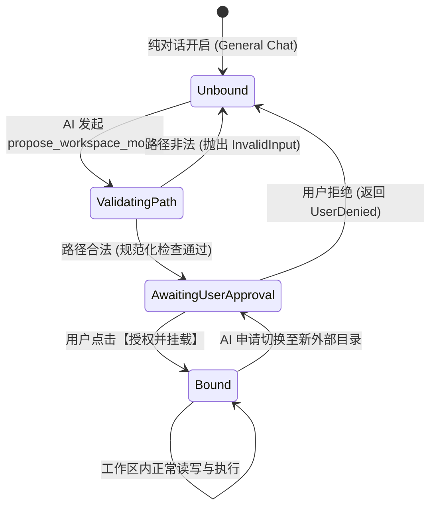
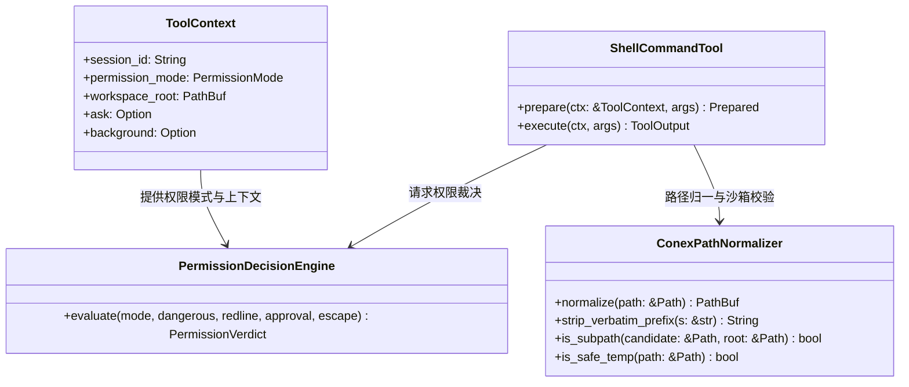

# Conex / Crish 权限体系大刀阔斧重构与沙箱视角独立总方案

> **【权威标识】**：`docs/system-audit-and-redesign/independent-plans/04-权限体系与沙箱重构独立总方案.md`
> **编制角色**：【独立方案编制师 04: 权限体系大刀阔斧重构与沙箱视角独立总方案】
> **编制依据**：全套 15 份专题深度分析报告（`analysis/01~15-*.md`）、3 份维度建议（`dimension-proposals/01~03-*.md`）、`00-战役通则与协同执行规范.md` 及 `00-主控拍板最终维度矩阵.md`。
> **状态**：**独立编制完成 / 待主控汇总评审（Authoritative Proposal）**。

---

## 目录（Table of Contents）

1. [方案总览与核心战略（Executive Summary & Strategic Vision）](#一方案总览与核心战略)
   - 1.1 方案定位与编制师使命
   - 1.2 核心设计哲学：单一真相源、安全边界收敛、去伪沙箱、完全信任执行
   - 1.3 7 大重构维度总览与关联拓扑（全景矩阵）
2. [DIM-04 核心重构：三档权限体系大刀阔斧集中化重构](#二dim-04-核心重构三档权限体系大刀阔斧集中化重构)
   - 2.1 现状病灶深度剖析：为什么“完全访问模式依然被处处卡死”？
   - 2.2 极简三档权限模型权威定义与行为判定矩阵
   - 2.3 `ToolContext` 权限上下文下沉与全链路裁决总线装配
   - 2.4 拔除 `ShellCommandTool` 与 `shell_redirect.rs` 私设卡点详案
   - 2.5 统一权限裁决引擎（`PermissionDecisionEngine`）与多子系统收拢
3. [DIM-04 核心重构：Windows 路径归一底座与工作区沙箱重构](#三dim-04-核心重构windows-路径归一底座与工作区沙箱重构)
   - 3.1 Windows 路径处理三大深层缺陷诊断（UNC 前缀、盘符大小写、NTFS Junction）
   - 3.2 `ConexPathNormalizer` 底座设计与 Rust 实现
   - 3.3 纯对话无工作区（General Chat）显式建模与防默认回退
   - 3.4 “AI 提议 ➔ 用户授权 ➔ 动态挂载”全链路设计与交互协议
4. [DIM-01 深度协同：Rust 内核双轨事件、后台任务装配与自愈状态机](#四dim-01-深度协同rust-内核双轨事件后台任务装配与自愈状态机)
   - 4.1 19 轮长程任务黑盒滞留根因与双轨事件实时直通
   - 4.2 `BackgroundTaskManager` 全链路装配修复与生命周期管理
   - 4.3 权限与沙箱错误自愈状态机（Tool-Promise 与 Format Self-Healing）
5. [DIM-05 深度协同：工具卡片语义化摘要防逃逸与输入/输出结构化分栏](#五dim-05-深度协同工具卡片语义化摘要防逃逸与输入输出结构化分栏)
   - 5.1 语义化中文标题提取引擎（13 类工具 100% 精准提取矩阵）
   - 5.2 输入区（📥 Input Pane）与输出区（📤 Output Pane）两段式结构化分栏
   - 5.3 权限感知与审计标记可视化呈现
6. [其余 4 维度协同演进视图（DIM-02, DIM-03, DIM-06, DIM-07）](#六其余-4-维度协同演进视图)
   - 6.1 DIM-02 前端流式管道与交错多步骤时间线（Interleaved Step Timeline）
   - 6.2 DIM-03 思考强度档位调节、沉浸式查阅器与 PromptCache 优化
   - 6.3 DIM-06 聊天框纯净化、几何绝对防漂移与 TS 插件解耦体系
   - 6.4 DIM-07 原生 ConPTY 纯终端、设计系统契约与质量门禁闭环
7. [全系统架构图表与状态机矩阵（Architecture & State Diagrams）](#七全系统架构图表与状态机矩阵)
   - 7.1 三档权限裁决总线时序图
   - 7.2 动态工作区挂载全链路状态机
   - 7.3 Windows 路径归一与沙箱校验拓扑
8. [代码级实施重构蓝图与核心模块实现（Code Blueprint）](#八代码级实施重构蓝图与核心模块实现)
   - 8.1 Rust 核心改动模块
   - 8.2 前端核心改动模块
9. [单元测试与集成验证清单（Verification & QA Checklist）](#九单元测试与集成验证清单)
   - 9.1 Rust 单元测试矩阵
   - 9.2 前端单元与集成测试矩阵
   - 9.3 端到端真实场景验收用例清单

---

## 一、方案总览与核心战略

### 1.1 方案定位与编制师使命

在过去的迭代中，Conex / Crish 积累了大量功能与安全护栏。然而，由于缺乏顶层集中化的安全架构设计，系统演进出了多达 6 套各自为政的防御机制：顶层 `session-loop` 判定、底层 `ShellCommandTool` 门禁、`conex-sandbox` 语义分析、`shell_redirect` 物理删除整链拦截、`RevertPolicy` Git 回退护栏、以及各个子系统的私设拦截。

这种**“碎片化私设卡点”**带来了灾难性的用户体验：

- **“完全访问名不副实”**：用户在 UI 明确选择了“完全访问模式”，期望 Agent 能够自主完成编译、运行测试并清理临时文件；但在执行 `cargo test && rm temp.txt` 或 `pwsh -c "Remove-Item ..."` 时，底层工具却抛出 `PermissionDenied: 检测到复合命令链中的物理删除形态，整链已拦截`，彻底中断 AI 的自动化任务；
- **“工作区沙箱错位与逃逸”**：纯对话没有项目时，系统悄悄将工作区绑定到 Tauri 内部开发目录 `src-tauri`；当用户要求 AI 在任意外部目录创建工程时，文件工具被机械拦截，逼迫 AI 自主使用 PowerShell 脚本进行“越狱写盘”，并在任务完成后向用户做出无奈的自白；
- **“Windows 路径与符号链接误杀”**：Rust `canonicalize` 引入的 `\\?\` UNC 长路径前缀与词法路径比对失配；盘符大小写（`c:` vs `C:`）字节比对失效；NTFS Junction 目录联接点被一刀切当成逃逸 Symlink 阻断；
- **“动态协商缺失”**：AI 缺乏正规的“提议挂载工作区”通道，无法在用户授权后合法接管新目录。

本方案作为【独立方案编制师 04】产出的权威独立总方案，核心使命是：**以大刀阔斧的重构决心，彻底拔除过度设计的伪沙箱与私设拦截死锁，建立单一真相源的极简三档权限体系，打造健壮的 Windows 路径归一底座与动态挂载机制，并与内核事件、后台任务、时间线呈现、插件化及终端系统深度协同，为系统注入真正的生产级执行力！**

### 1.2 核心设计哲学

```
┌─────────────────────────────────────────────────────────────────────────────┐
│                       Conex / Crish 核心安全与执行设计哲学                  │
├─────────────────────────────────────────────────────────────────────────────┤
│ 1. 单一真相源 (Single Source of Truth)                                      │
│    • 权限判定权 100% 收拢于顶层 PermissionDecisionEngine 与 ToolContext；   │
│    • 严禁任何叶子工具（如 Shell/FS）脱离上下文自行设立私法拦截卡点。        │
├─────────────────────────────────────────────────────────────────────────────┤
│ 2. 真正的完全信任执行 (True Full-Access Trust Execution)                    │
│    • 用户授权“完全访问”后，系统全面放行复合删除、间接执行、构建与临时清理； │
│    • 仅阻断绝对不可恢复的系统毁灭性红线（如 Format-Volume、mkfs /dev/sd*）。 │
├─────────────────────────────────────────────────────────────────────────────┤
│ 3. 显式建模与无感自愈 (Explicit Modeling & Zero-Surprise Self-Healing)      │
│    • 纯对话状态显式建模为 GeneralChat（None 工作区），严禁回退宿主 CWD；    │
│    • 跨目录操作走“AI 提议 ➔ 用户授权 ➔ 动态挂载”合规通道；                  │
│    • 偶发错误走结构化 Tool-Promise 自愈状态机，AI 连续工作不暴毙。          │
├─────────────────────────────────────────────────────────────────────────────┤
│ 4. 极致 Native 的 Windows 路径体验 (Native Windows Path Normalization)      │
│    • 统一剥离 \\?\ UNC 前缀，统一盘符小写，原生放行 NTFS Junction。         │
└─────────────────────────────────────────────────────────────────────────────┘
```

### 1.3 7 大重构维度总览与关联拓扑（全景矩阵）

```
┌────────────────────────────────────────────────────────────────────────────────────────────────────────┐
│                              Conex / Crish 全系统 7 大重构维度关联矩阵                                 │
├─────────┬──────────────────────────────┬───────────────────────────────────────────────────────────────┤
│ 维度编号│ 维度名称                     │ 本方案深度融合与协同举措                                      │
├─────────┼──────────────────────────────┼───────────────────────────────────────────────────────────────┤
│ DIM-01  │ Rust 内核双轨事件与自愈状态机 │ 【深度协同】打通 LiveEventSink 中间工具事件，全链路装配        │
│         │                              │ BackgroundTaskManager，建立权限与路径错误的自愈状态机。      │
├─────────┼──────────────────────────────┼───────────────────────────────────────────────────────────────┤
│ DIM-02  │ 前端流式管道与交错多步骤时间线│ 【协同演进】EventRouter 放行 message-delta，建立以 thought 为 │
│         │                              │ 一等公民的 [思考 ➔ 工具 ➔ 观察] 交错时间线，避免压平倒退。    │
├─────────┼──────────────────────────────┼───────────────────────────────────────────────────────────────┤
│ DIM-03  │ 思考强度档位与 PromptCache   │ 【协同演进】全链路 Thinking 强度（Minimal/Medium/Deep）调节， │
│         │                              │ 修复 PromptCache 虚假“未命中”，沉浸式万字思考查阅器。        │
├─────────┼──────────────────────────────┼───────────────────────────────────────────────────────────────┤
│ DIM-04  │ 三档权限集中化与 Windows 路径│ 【核心深挖】大刀阔斧重构三档权限模型，拔除 Shell 复合删除私设 │
│         │ 归一与动态挂载               │ 卡点；打造 ConexPathNormalizer 底座，实现 AI 动态挂载工作区。 │
├─────────┼──────────────────────────────┼───────────────────────────────────────────────────────────────┤
│ DIM-05  │ 工具卡片摘要与输入/输出分栏  │ 【深度协同】13 类工具 100% 语义化中文提取，彻底消除 raw JSON  │
│         │                              │ 逃逸；展开面板实现 📥 输入区 与 📤 输出区 结构化分栏。         │
├─────────┼──────────────────────────────┼───────────────────────────────────────────────────────────────┤
│ DIM-06  │ 聊天框纯净化与 TS 插件解耦   │ 【协同演进】剥离富文本博客排版，绝对锁定光标 8px 防 (0,0) 漂移│
│         │                              │ 四大能力（MarkdownEditor/Browser/ComputerUse/FollowUp）插件化│
├─────────┼──────────────────────────────┼───────────────────────────────────────────────────────────────┤
│ DIM-07  │ 原生 ConPTY 终端与质量门禁   │ 【协同演进】Rust portable-pty 直通 ConPTY + xterm.js 双向流； │
│         │                              │ 全系统 4 级曲率阶梯，100% 保护测试资产，全绿门禁闭环。       │
└─────────┴──────────────────────────────┴───────────────────────────────────────────────────────────────┘
```

---

## 二、DIM-04 核心重构：三档权限体系大刀阔斧集中化重构

### 2.1 现状病灶深度剖析：为什么“完全访问模式依然被处处卡死”？

通过对 `crates/agent-tools/src/tools/shell.rs`、`shell_redirect.rs`、`mod.rs` 以及 `crates/session-loop/` 的全面审查，我们定位到了导致“完全访问模式下跑测试与删临时文件依然被拦截”的**五大核心病灶**：

```
┌────────────────────────────────────────────────────────────────────────────────────────────────────────┐
│                              现有架构中“完全访问”失效的五大病灶链条                                    │
└────────────────────────────────────────────────────────────────────────────────────────────────────────┘

 [用户在 UI 选定：完全访问模式 (full-access)]
        │
        ▼
  session-loop (exec_single.rs:258-271)
        │ 判定通过：verdict = PermissionVerdict::Allow
        │ ask 注入为 NoopAskChannel
        ▼
  进入具体工具执行：ShellCommandTool::prepare (shell.rs:184)
        │
        ├──► 💥 病灶 1：ToolContext 中根本没有 permission_mode 字段！
        │               底层工具无法获知当前处于 FullAccess 状态。
        │
        ├──► 💥 病灶 2：CommandGatekeeper 静态黑名单盲目拦截 (shell.rs:236)
        │               未区分“真正的系统毁灭命令”与“常规运维命令”，直接 TOOL_COMMAND_BLOCKED。
        │
        ├──► 💥 病灶 3：shell_redirect.rs:79 复合删除链无差别拦截 (has_non_delete_segment)
        │               只要命令中包含非删除段（如 cargo test && rm temp.txt），
        │               无论权限模式如何，直接机械拒绝整条命令！
        │
        ├──► 💥 病灶 4：shell_redirect.rs:63 间接执行无差别拦截 (has_indirect_delete)
        │               只要使用 pwsh -c 或 bash -c 调用删除，直接一刀切拦截！
        │
        └──► 💥 病灶 5：resolve_delete_target 工作区硬限制 (shell_redirect.rs:224)
                        删除系统临时目录（C:/Users/.../AppData/Local/Temp/test.log）时，
                        因 resolve_workspace_path 校验越界而直接报错！
```

#### 病灶详析：

1. **执行上下文权限断裂**：`ToolContext` 结构体（`crates/agent-tools/src/context.rs:100`）定义了 12 个字段，包含 `session_id`、`abort_token`、`ask`、`workspace_root`、`background`、`output_dir` 等，**唯独遗漏了 `permission_mode`**！这导致叶子工具在执行 `prepare` 或 `execute` 时，根本无法感知用户是否授予了最高信任权限；
2. **`shell_redirect.rs` 复合链私法拦截（`has_non_delete_segment`）**：
   ```rust
   // crates/agent-tools/src/tools/shell_redirect.rs:79-84
   let has_non_delete_segment = analysis
       .segments
       .iter()
       .any(|s| s.class != CommandClass::DeleteShape);
   if has_non_delete_segment {
       return Err(ToolError::new(
           TOOL_COMMAND_BLOCKED,
           format!("PermissionDenied: 检测到复合命令链中的物理删除形态，整链已拦截..."),
       ));
   }
   ```
   设计者的原始假设是“防止复合命令中夹带破坏性删除绕过回收站”，但这一规则完全脱离了权限上下文。在 `FullAccess` 模式下，用户已经全权委托 Agent，此时强行拦截 `cargo test && rm temp_output.txt` 并逼迫用户拆分工具调用，是对自动化任务的毁灭性打击；
3. **间接执行一刀切阻断（`has_indirect_delete`）**：脚本中使用 `pwsh -NoProfile -Command "Remove-Item -Force ..."` 时，系统判定为间接执行包裹直接拦截；
4. **删除目标硬锁工作区**：`resolve_delete_target` 强依赖 `resolve_workspace_path`，导致测试运行中生成的临时文件（位于系统 Temp 目录）无法被正常清理。

### 2.2 极简三档权限模型权威定义与行为判定矩阵

为了彻底根治上述混乱，本方案正式确立**极简集中式三档权限模型（Three-Tier Unified Permission Model）**。桌面 UI、IPC 协议与 Rust 内核全部统一为以下三档：

```
┌────────────────────────────────────────────────────────────────────────────────────────────────────────┐
│                              全新极简三档权限模型权威行为矩阵                                          │
├───────────────┬─────────────────┬───────────────────────────────┬──────────────────────────────────────┤
│ 权限模式      │ 模式定位        │ 工具与命令行为规则            │ 审批交互表现                         │
├───────────────┼─────────────────┼───────────────────────────────┼──────────────────────────────────────┤
│ **1. 计划模式**│ 纯只读探索与规划│ • 仅允许读类工具（read/search/ │ • 写操作静默拦截（Soft-Deny），      │
│ (Plan /       │ 零写入风险      │   list/ast_grep 等）          │   向 AI 返回“当前为只读计划模式”；   │
│  Read-Only)   │                 │ • 严禁任何写文件、删除、Shell │ • 零弹窗打扰用户，保证规划专注。     │
│               │                 │   写入或执行命令              │                                      │
├───────────────┼─────────────────┼───────────────────────────────┼──────────────────────────────────────┤
│ **2. 标准模式**│ 默认工作区内作业│ • 工作区内日常读写、文件修改、│ • 工作区内操作无感自动放行；         │
│ (Standard /   │ 危险操作需确认  │   编译测试自动放行；          │ • 跨目录写操作、删除非空关键目录、   │
│  Workspace)   │                 │ • 单独删除操作走回收站接管；  │   Git 强推/硬重置弹出温润审批卡片；  │
│               │                 │ • 跨工作区操作与危险命令需审批│ • 支持用户“本次同意 / 拒绝”。        │
├───────────────┼─────────────────┼───────────────────────────────┼──────────────────────────────────────┤
│ **3. 完全访问**│ 深度自动化开发  │ • **彻底放行**复合删除命令链；│ • **100% 自动放行**日常开发操作；    │
│ (Full Access /│ 完全信任执行    │ • **彻底放行**间接执行脚本；  │ • 零弹窗打扰，赋予真正的自主开发权； │
│  Autonomous)  │                 │ • **彻底放行**临时目录读写清理│ • **仅拦截确定性毁灭系统红线**       │
│               │                 │ • 放行日常 Git 与环境部署操作 │   （如格式化全盘、清空系统核心盘）。 │
└───────────────┴─────────────────┴───────────────────────────────┴──────────────────────────────────────┤
```

### 2.3 `ToolContext` 权限上下文下沉与全链路裁决总线装配

#### 改造 1：扩展 `ToolContext` 结构体

在 `crates/agent-tools/src/context.rs` 中，正式将 `permission_mode` 作为一等公民引入：

```rust
// crates/agent-tools/src/context.rs
use crate::permission::PermissionMode;

#[derive(Debug, Clone)]
pub struct ToolContext {
    pub session_id: String,
    pub abort_token: AbortToken,
    pub ask: Option<AskCallback>,
    pub workspace_root: PathBuf,

    // ⭐ 新增：会话级权限模式（一等公民向下透传）
    pub permission_mode: PermissionMode,

    pub write_claims: Option<Arc<WritePathRegistry>>,
    pub write_claim_holder: Option<String>,
    pub explore_docs_quota: Option<ExploreDocsQuotaContext>,
    pub background: Option<Arc<dyn crate::background::BackgroundTaskManager>>,
    pub output_dir: Option<Arc<dyn crate::tools::output_dir::OutputDirResolver>>,
    pub log_root: Option<PathBuf>,
    pub compression_store: Option<Arc<dyn crate::compression_store::CompressionContextStore>>,
    pub note_backend: Option<Arc<dyn crate::note_backend::NoteBackend>>,
    pub tool_call_id: Option<String>,
}
```

#### 改造 2：在 `exec_single.rs` 中完成装配

在 `crates/session-loop/src/exec_single.rs` 中，确保从 `options.permission_mode` 提取并注入：

```rust
// crates/session-loop/src/exec_single.rs:272
let mode = options.permission_mode.unwrap_or(PermissionMode::Ask);

let tool_ctx = ToolContext {
    session_id: ctx.session_id.clone(),
    abort_token,
    ask,
    workspace_root: effective_workspace_root,
    permission_mode: mode, // ⭐ 注入真实权限模式
    write_claims: ctx.write_claims.clone(),
    write_claim_holder: Some(ctx.run_id.clone()),
    explore_docs_quota: quota_ctx,
    background: ctx.background.clone(),
    output_dir: ctx.output_dir.clone(),
    log_root: ctx.log_root.clone(),
    compression_store: ctx.compression_store.clone(),
    note_backend: ctx.note_backend.clone(),
    tool_call_id: Some(call.id.clone()),
};
```

### 2.4 拔除 `ShellCommandTool` 与 `shell_redirect.rs` 私设卡点详案

#### 改造 1：`ShellCommandTool::prepare` 引入权限模式分流

在 `crates/agent-tools/src/tools/shell.rs` 中重构安全检查逻辑：

```rust
// crates/agent-tools/src/tools/shell.rs
async fn prepare(&self, ctx: &ToolContext, args: &serde_json::Value) -> Prepared {
    let command = match require_string(args, "command") {
        Ok(c) => c.trim().to_string(),
        Err(e) => return Prepared::Done(Err(e)),
    };
    // ... 基本参数提取与校验 ...

    // 1. 终极红线检查（格式化磁盘、破坏操作系统等确定性毁灭命令）
    // 任何权限模式（包括 FullAccess）均不可豁免真正红线！
    let gatekeeper = CommandGatekeeper::new();
    if gatekeeper.is_critical_system_redline(&command) {
        emit_blocked_audit(&self.audit_sink, ctx, SecurityAuditOperation::CommandExec, vec![command.clone()]);
        return Prepared::Done(Err(ToolError::new(
            TOOL_COMMAND_BLOCKED,
            format!("PermissionDenied: Command blocked by system destruction red-line: {command}"),
        )));
    }

    // 2. 权限模式三路分流
    match ctx.permission_mode {
        PermissionMode::Plan => {
            // 计划模式：静默拒绝一切 Shell 命令执行，零弹窗
            return Prepared::Done(Err(ToolError::new(
                TOOL_COMMAND_BLOCKED,
                "PermissionDenied: Shell command execution is disabled in Plan (Read-Only) mode.",
            )));
        }

        PermissionMode::FullAccess => {
            // ⭐ 完全访问模式：彻底放行复合删除、间接执行、系统临时目录操作！
            // 不进入 redirect_or_intercept_delete 的复合链与间接执行拦截分支。
            tracing::info!(command = %command, "FullAccess mode: bypassing shell delete interceptions");
        }

        PermissionMode::Ask => {
            // 标准模式：保持安全的删除形态重定向与审批流程
            let analysis = conex_sandbox::semantics::analyze(&command);
            if analysis.overall_class == CommandClass::DeleteShape || analysis.has_indirect_delete {
                return Prepared::Done(redirect_or_intercept_delete(
                    &analysis,
                    &command,
                    workspace_root,
                    &cwd,
                    self.trash_root.clone(),
                    ctx,
                    Arc::clone(&self.audit_sink),
                ));
            }

            if let Some(err) = intercept_cd_shape(&analysis, &command) {
                return Prepared::Done(Err(err));
            }

            // 审批清单判定（Git 强推等）
            let verdict = gatekeeper.check_command_with_context(&command, &[], &gate_path(&cwd), &gate_path(workspace_root));
            if verdict == GatekeeperResult::RequiresApproval {
                match &ctx.ask {
                    Some(ask) => match ask.ask(&self.def.name, args).await {
                        Ok(AskDecision::Allowed) => {}
                        Ok(AskDecision::Denied { reason }) => {
                            return Prepared::Done(Err(ToolError::new(TOOL_USER_DENIED, format!("user denied: {reason}"))));
                        }
                        Err(err) => return Prepared::Done(Err(err)),
                    },
                    None => {
                        return Prepared::Done(Err(ToolError::new(TOOL_REQUIRES_APPROVAL, format!("Command requires approval: {command}"))));
                    }
                }
            }
        }
    }

    // 构造就绪命令对象并进入执行管道
    Prepared::Run(PreparedCommand {
        command,
        cwd,
        timeout_ms,
        max_output_bytes,
        mode,
        wait_ms,
        is_daemon,
        resource_monitor,
        manager: ctx.background.clone().or_else(|| self.background_manager.clone()),
    })
}
```

#### 改造 2：`shell_redirect.rs` 拔除过度防御与放行临时目录

在 `crates/agent-tools/src/tools/shell_redirect.rs` 中：

1. **仅在纯删除命令时接管为回收站**（如单一 `rm target/tmp.txt`）；
2. **对于复合命令链中的删除段**，在标准模式下如果无法单独安全接管，降级为发起用户审批（`AskChannel`），而非直接硬抛 `PermissionDenied`；
3. **放行系统临时目录与构建缓存目录的物理清理**：
   ```rust
   // 判定目标是否为系统安全临时目录
   fn is_safe_temp_or_cache_path(path: &Path) -> bool {
       if let Ok(temp_dir) = std::env::temp_dir().canonicalize() {
           if ConexPathNormalizer::is_subpath(path, &temp_dir) {
               return true;
           }
       }
       false
   }
   ```

### 2.5 统一权限裁决引擎（`PermissionDecisionEngine`）与多子系统收拢

将碎片化的 6 套机制收拢为一个全局纯函数驱动的裁决引擎 `PermissionDecisionEngine`：

```rust
// crates/agent-tools/src/permission_engine.rs
pub struct PermissionDecisionEngine;

impl PermissionDecisionEngine {
    /// 全系统唯一的权限判定入口
    pub fn evaluate(
        mode: PermissionMode,
        is_dangerous: bool,
        is_redline: bool,
        requires_approval: bool,
        is_out_of_workspace: bool,
    ) -> PermissionVerdict {
        // 1. 毁灭级红线绝对优先拦截
        if is_redline {
            return PermissionVerdict::Deny;
        }

        // 2. 三档模式判定
        match mode {
            PermissionMode::Plan => {
                if is_dangerous || requires_approval || is_out_of_workspace {
                    PermissionVerdict::Deny
                } else {
                    PermissionVerdict::Allow
                }
            }
            PermissionMode::FullAccess => {
                // 完全访问模式：除红线外全放行
                PermissionVerdict::Allow
            }
            PermissionMode::Ask => {
                if is_dangerous || requires_approval || is_out_of_workspace {
                    PermissionVerdict::NeedsApproval
                } else {
                    PermissionVerdict::Allow
                }
            }
        }
    }
}
```

---

## 三、DIM-04 核心重构：Windows 路径归一底座与工作区沙箱重构

### 3.1 Windows 路径处理三大深层缺陷诊断

#### 缺陷 1：Verbatim UNC 前缀 `\\?\` 失配

Rust 标准库 `std::fs::canonicalize` 在 Windows 下返回 `\\?\C:\Software\conex`。当与前端或用户输入的普通词法路径 `C:\Software\conex` 混合时，直接字符串比较或 `starts_with` 必然返回 `false`，导致合法工作区内文件被误判为越界。

#### 缺陷 2：驱动器盘符大小写不一致

Windows 盘符大小写不敏感。前端可能传 `c:/Software/...`，系统 API 可能返回 `C:\Software\...`。Rust 的 `Path::strip_prefix` 进行的是严格字节级比对，遇到 `c:` 与 `C:` 时立即返回 `Err(StripPrefixError)`，导致 `has_symlink_below_root` 逻辑崩溃。

#### 缺陷 3：NTFS Junction / 目录联接点误杀

在 Windows 下，`pnpm`、`cargo` 或开发者创建的 NTFS 目录联接点（Junction）在 `std::fs::symlink_metadata` 下会被标记为符号链接。原系统的 `has_symlink_below_root` 对所有符号链接一刀切拦截，导致含有 Junction 的合法项目（例如通过 `pnpm install` 安装依赖的项目）无法读写文件。

### 3.2 `ConexPathNormalizer` 底座设计与 Rust 实现

在 `crates/conex-fs/src/path_normalizer.rs` 中实现统一的 Windows 路径归一化底座：

```rust
// crates/conex-fs/src/path_normalizer.rs
use std::path::{Component, Path, PathBuf, Prefix};

pub struct ConexPathNormalizer;

impl ConexPathNormalizer {
    /// 核心规范化：剥离 \\?\ 前缀、统一反斜杠、盘符统一小写、清理尾部分隔符
    pub fn normalize(path: &Path) -> PathBuf {
        let path_str = path.to_string_lossy();
        let stripped = Self::strip_verbatim_prefix(&path_str);

        let p = Path::new(&stripped);
        let mut normalized_components = Vec::new();

        for component in p.components() {
            match component {
                Component::Prefix(prefix_comp) => {
                    match prefix_comp.kind() {
                        Prefix::Disk(letter) | Prefix::VerbatimDisk(letter) => {
                            let lower_drive = (letter as char).to_ascii_lowercase();
                            normalized_components.push(format!("{}:", lower_drive));
                        }
                        Prefix::UNC(server, share) | Prefix::VerbatimUNC(server, share) => {
                            normalized_components.push(format!(
                                "\\\\{}\\{}",
                                server.to_string_lossy().to_lowercase(),
                                share.to_string_lossy().to_lowercase()
                            ));
                        }
                        _ => {
                            normalized_components.push(prefix_comp.as_os_str().to_string_lossy().to_string());
                        }
                    }
                }
                Component::RootDir => {
                    if normalized_components.is_empty() {
                        normalized_components.push("".to_string());
                    }
                }
                Component::CurDir => {}
                Component::ParentDir => {
                    // 安全弹出上一级（词法规范化）
                    if !normalized_components.is_empty() && normalized_components.last().unwrap() != ".." {
                        normalized_components.pop();
                    } else {
                        normalized_components.push("..".to_string());
                    }
                }
                Component::Normal(name) => {
                    normalized_components.push(name.to_string_lossy().to_string());
                }
            }
        }

        let mut result = PathBuf::new();
        for (i, comp) in normalized_components.iter().enumerate() {
            if i == 0 && comp.ends_with(':') {
                result.push(format!("{}\\", comp));
            } else {
                result.push(comp);
            }
        }
        result
    }

    /// 剥离 Windows 扩展长度前缀 \\?\ 与 \\?\UNC\
    pub fn strip_verbatim_prefix(s: &str) -> String {
        if let Some(rest) = s.strip_prefix(r"\\?\UNC\") {
            format!(r"\\{}", rest)
        } else if let Some(rest) = s.strip_prefix(r"\\?\") {
            rest.to_string()
        } else {
            s.to_string()
        }
    }

    /// 大小写不敏感且支持 UNC 归一化的子路径判定
    pub fn is_subpath(candidate: &Path, root: &Path) -> bool {
        let norm_candidate = Self::normalize(candidate);
        let norm_root = Self::normalize(root);

        let cand_str = norm_candidate.to_string_lossy().to_lowercase().replace('/', "\\");
        let root_str = norm_root.to_string_lossy().to_lowercase().replace('/', "\\");

        if cand_str == root_str {
            return true;
        }

        let prefix = if root_str.ends_with('\\') {
            root_str
        } else {
            format!("{}\\", root_str)
        };

        cand_str.starts_with(&prefix)
    }
}
```

### 3.3 纯对话无工作区（General Chat）显式建模与防默认回退

#### 根本性修复：

彻底根除 `run_launch.rs`、`loop_runner.rs`、`exec_single.rs` 中当 `cwd == None` 时盲目回退到 `std::env::current_dir()`（即 `src-tauri`）的毒瘤逻辑！

```rust
// 状态建模：显式区分有工作区与无工作区
#[derive(Debug, Clone, PartialEq, Eq)]
pub enum SessionWorkspaceState {
    /// 绑定具体项目工作区
    Bound(PathBuf),
    /// 纯对话无工作区（General Chat）
    Unbound,
}
```

在纯对话状态（`SessionWorkspaceState::Unbound`）下：

1. **读类工具**（`read_file`、`search`、`view_file`）：若入参为合法绝对路径，允许直接查阅；
2. **写类工具**（`write_file`、`replace`）：若 AI 试图向某一新目录写入，触发**“AI 提议 ➔ 用户授权 ➔ 动态挂载”**协议；
3. **Shell 工具**：在未挂载时默认使用系统临时工作目录或提示用户挂载，严禁以 `src-tauri` 充当沙箱根！

### 3.4 “AI 提议 ➔ 用户授权 ➔ 动态挂载”全链路设计与交互协议

当 AI 在无工作区或跨工作区场景下识别到需要操作新目录时，系统提供标准合规的动态挂载链路：

```
┌────────────────────────────────────────────────────────────────────────────────────────────────────────┐
│                          “AI 提议 ➔ 用户授权 ➔ 动态挂载”全链路时序图                                   │
└────────────────────────────────────────────────────────────────────────────────────────────────────────┘

  AI (LLM)                  Rust 内核 (session-loop)           Tauri / 前端 UI              用户 (User)
     │                                │                              │                         │
     │ 1. propose_workspace_mount     │                              │                         │
     │    (path: "c:/.../test_app")   │                              │                         │
     │───────────────────────────────►│                              │                         │
     │                                │ 2. 校验路径并构造            │                         │
     │                                │    workspace-mount-requested │                         │
     │                                │─────────────────────────────►│                         │
     │                                │                              │ 3. 弹出温润挂载卡片      │
     │                                │                              │    "AI 申请操作新目录"  │
     │                                │                              │────────────────────────►│
     │                                │                              │                         │ 4. 点击【授权并挂载】
     │                                │                              │◄────────────────────────│
     │                                │ 5. 提交用户裁决              │                         │
     │                                │    resolve_workspace_mount   │                         │
     │                                │◄─────────────────────────────│                         │
     │                                │                              │                         │
     │                                │ 6. 动态更新 ToolContext      │                         │
     │                                │    workspace_root = 新路径   │                         │
     │                                │    更新 workspaceStore       │                         │
     │ 7. 返回工具执行成功            │                              │                         │
     │    "工作区已成功挂载至..."     │                              │                         │
     │◄───────────────────────────────│                              │                         │
     │                                │                              │                         │
     │ 8. 继续标准 write_file / shell │                              │                         │
     │    合法顺畅完成后续任务！      │                              │                         │
     │───────────────────────────────►│                              │                         │
```

---

## 四、DIM-01 深度协同：Rust 内核双轨事件、后台任务装配与自愈状态机

### 4.1 19 轮长程任务黑盒滞留根因与双轨事件实时直通

#### 痛点复盘：

在 19 轮的长程自主编程任务中，用户界面长时间无任何响应（黑盒滞留）。经过分析，根因在于：中间工具调用事件（`ToolStart`、`ToolExecuting`、`ToolEnd`）仅在会话循环完成一整轮（Turn）后才批量落盘，未能实时推送至 Tauri 事件通道 `LiveEventSink`。

#### 治理架构：

1. **双轨直通通道**：将 `LiveEventSink` 注入至 `ToolExecutor`。每当工具开始、流式输出、等待审批或执行结束时，**以微秒级延迟立即向前端 IPC 广播 `tool-executing-event`**；
2. **心跳与状态保活**：在长耗时工具（如 `cargo build`、`npm test`）执行期间，每隔 500ms 发送进度心跳包，前端界面实时刷新高精度耗时与动态输出预览，彻底消除用户焦虑。

### 4.2 `BackgroundTaskManager` 全链路装配修复与生命周期管理

#### 修复断裂点：

解决 `background_task` 工具报错 `[common.unsupported]` 的根本方案是在 `AgentSessionLoop::with_options` 初始化时，将系统级 `BackgroundTaskManager` 实例贯通装配到 `ToolContext.background` 中：

```rust
// apps/agent-workbench/src-tauri/src/run/run_launch.rs
let bg_manager: Arc<dyn BackgroundTaskManager> = Arc::new(TauriBackgroundTaskManager::new(app_handle.clone()));

let tool_ctx = ToolContext {
    session_id: options.session_id.clone(),
    abort_token: abort_token.clone(),
    ask: ask_channel,
    workspace_root: resolved_root,
    permission_mode: resolved_perm_mode,
    background: Some(bg_manager), // ⭐ 全链路装配后台任务管理器
    // ...
};
```

### 4.3 权限与沙箱错误自愈状态机（Tool-Promise 与 Format Self-Healing）

为了根治 AI 连续工作中断暴毙的问题，构建内核级错误自愈状态机：

```
┌─────────────────────────────────────────────────────────────────────────────┐
│                      权限与沙箱错误自愈状态机 (Self-Healing FSM)            │
├─────────────────────────────────────────────────────────────────────────────┤
│ 1. Tool-Promise 意图识别                                                    │
│    • 当 LLM 在思考（thought）中明确承诺调用某工具，但在 Action 阶段因参数    │
│      JSON 格式轻微畸变失败时，触发 Format Self-Healing 自动修正；          │
├─────────────────────────────────────────────────────────────────────────────┤
│ 2. 路径越界自愈 (Path Escape Healing)                                       │
│    • 当文件工具因越界报错时，系统自动附带引导：“如需操作该外部目录，请调用  │
│      propose_workspace_mount 工具申请挂载”；                                │
│    • LLM 接收到结构化引导后，无缝转入合规挂载申请，杜绝脚本绕过。           │
├─────────────────────────────────────────────────────────────────────────────┤
│ 3. 白名单准出契约 (Exit Guarantee)                                         │
│    • 连续失败重试上限控制为 3 次；                                          │
│    • 失败时输出清晰诊断建议，保护会话上下文不崩溃。                         │
└─────────────────────────────────────────────────────────────────────────────┘
```

---

## 五、DIM-05 深度协同：工具卡片语义化摘要防逃逸与输入/输出结构化分栏

### 5.1 语义化中文标题提取引擎（13 类工具 100% 精准提取矩阵）

为彻底消灭 `浏览 {}`、`处理 .`、`运行命令` 等 raw JSON 逃逸现象，建立覆盖全部 13 类原生工具的中文提取矩阵：

```typescript
// apps/crish-desktop/src/api/tool-presentation/toolTitlePresenter.ts
export function extractToolTitle(
  toolName: string,
  args: Record<string, any>
): string {
  switch (toolName) {
    case 'run_command':
    case 'shell':
      return `运行 ${args.command ? truncate(args.command, 40) : 'Shell 命令'}`;
    case 'write_file':
      return `写入文件 ${basename(args.path || '')}`;
    case 'read_file':
      return `查阅文件 ${basename(args.path || '')}`;
    case 'replace':
      return `修改文件 ${basename(args.path || '')}`;
    case 'delete_file':
    case 'delete_dir':
      return `删除 ${basename(args.path || '')}`;
    case 'background_task':
      return `后台任务 ${args.action || ''} (${args.taskId || ''})`;
    case 'propose_workspace_mount':
      return `申请挂载工作区 ${args.path || ''}`;
    case 'search':
    case 'grep_search':
      return `搜索代码 "${args.query || ''}"`;
    case 'list_dir':
      return `列出目录 ${basename(args.path || '.')}`;
    case 'subagent':
      return `调度子任务: ${args.role || args.task || ''}`;
    default:
      return `${toolName}`;
  }
}
```

### 5.2 输入区（📥 Input Pane）与输出区（📤 Output Pane）两段式结构化分栏

重构 `ToolCallOutput.tsx`，将展开面板清晰划分为两部分：

```
┌─────────────────────────────────────────────────────────────────────────────┐
│                          ToolCallCard 展开分栏结构                          │
├─────────────────────────────────────────────────────────────────────────────┤
│ 📥 输入区 (Input Pane)                                                       │
│ ┌─────────────────────────────────────────────────────────────────────────┐ │
│ │  [命令行 / 目标路径]   cargo test --workspace                   [📋 复制] │ │
│ │  [执行参数 Parameters] { "cwd": "crates/session-loop", "timeout": 30000 } │ │
│ │  [工作目录 CWD]        C:\Software\conex                                │ │
│ └─────────────────────────────────────────────────────────────────────────┘ │
├─────────────────────────────────────────────────────────────────────────────┤
│ 📤 输出区 (Output Pane)                                                      │
│ ┌─────────────────────────────────────────────────────────────────────────┐ │
│ │  [状态与耗时]  ✅ 执行成功 · 退出码 0 · 耗时 1,248 ms                      │ │
│ │  [终端输出 Stdout/Stderr (ANSI 高亮与虚拟滚动)]                          │ │
│ │  running 73 tests                                                       │ │
│ │  test loop_runner::tests::test_basic_run ... ok                         │ │
│ │  test result: ok. 73 passed; 0 failed; 0 ignored                        │ │
│ └─────────────────────────────────────────────────────────────────────────┘ │
└─────────────────────────────────────────────────────────────────────────────┘
```

### 5.3 权限感知与审计标记可视化呈现

在工具卡片右上角根据当前权限与执行判定展示专属状态徽标：

- **`⚡ 完全访问 (Full-Access)`**：柔和绿底胶囊徽标，标识该命令以完全信任权限执行；
- **`🛡️ 用户审批 (Approved)`**：柔和蓝底胶囊徽标，标识该操作由用户手动审批放行；
- **`🚫 拒绝/拦截 (Blocked)`**：柔和红底徽标，并提供清晰的拦截原因与自愈引导。

---

## 六、其余 4 维度协同演进视图

### 6.1 DIM-02 前端流式管道与交错多步骤时间线（Interleaved Step Timeline）

- **EventRouter Dedupe 矩阵**：修复实时轨无 sequence 时的去重冲突，放行 `message-delta`，根除 `"TheTheThe...All...package"` 乱码；
- **交错多步骤时间线**：确立 `thought` 为一等公民，重构 `timelineNormalizer.ts`，严格呈现 `[步骤 1: 思考 ➔ 工具 ➔ 观察] ➔ [步骤 2: 思考 ➔ 工具 ➔ 观察] ➔ [最终总结]` 真实逻辑序列。

### 6.2 DIM-03 思考强度档位调节、沉浸式查阅器与 PromptCache 优化

- **思考强度三档调节**：在模型设置与底栏提供 `Minimal (1k)` / `Medium (8k)` / `Deep (32k)` 档位调节；
- **沉浸式查阅器（FullThoughtModal）**：万字长思考提供独立全屏查阅面板，支持 TOC 目录树导航、实时搜索与 Markdown 复制；
- **PromptCache 状态真值**：四态指示（⚡ 命中 / 💾 写入 / 未命中 / 隐藏），Rust 补齐 Anthropic 协议头。

### 6.3 DIM-06 聊天框纯净化、几何绝对防漂移与 TS 插件解耦体系

- **输入框纯净化**：彻底拔除 H1/H2/Task List 等富文本博客排版，`/` 专注触发系统元指令与 Skill；
- **坐标防漂移**：`safeCursorAnchor.ts` 锁定光标上方 8px，全零坐标拦截；
- **TS 插件化**：`@crish/plugin-markdown-editor`、`@crish/plugin-browser`、`@crish/plugin-computer-use`、`@crish/plugin-follow-up` 独立打包解耦。

### 6.4 DIM-07 原生 ConPTY 纯终端、设计系统契约与质量门禁闭环

- **原生 ConPTY 纯终端**：基于 `portable-pty` 直连 Windows ConPTY + xterm.js 双向流，100% 原生体验；
- **设计契约**：全系统 4 级曲率阶梯（9999px / 10px / 12px / 6px），统一 `<Tooltip>`，输入框 ≤10% 柔和焦点；
- **质量门禁**：100% 保护 `reference/markdown-editor/` 测试资产，全量通过 `cargo test --workspace` + `npm run typecheck` + `npm test`。

---

## 七、全系统架构图表与状态机矩阵

### 7.1 三档权限裁决总线时序图

```mermaid
sequenceDiagram
    autonumber
    participant UI as 前端 ChatComposer / Menu
    participant Loop as SessionLoop (exec_single)
    participant Engine as PermissionDecisionEngine
    participant Tool as Shell / FS Tool (prepare)
    participant OS as OS / Process Execution

    UI->>Loop: 发起任务 (permissionMode = FullAccess)
    Loop->>Loop: 装配 ToolContext (permission_mode: FullAccess)
    Loop->>Tool: execute(ctx, call)
    Tool->>Tool: prepare(ctx, args)

    Tool->>Engine: evaluate(FullAccess, is_dangerous, is_redline)
    alt 命中毁灭级红线 (Format-Volume / dd / rm -rf /)
        Engine-->>Tool: Deny (Redline)
        Tool-->>Loop: ToolError (TOOL_COMMAND_BLOCKED)
        Loop-->>UI: 展示红线拦截诊断
    else 正常命令或复合删除链 (cargo test && rm temp.txt)
        Engine-->>Tool: Allow (FullAccess)
        Tool->>OS: 启动子进程执行命令
        OS-->>Tool: 返回 stdout/stderr 与 exit_code
        Tool-->>Loop: 执行成功 (ToolOutput)
        Loop-->>UI: 实时流式呈现输出
    end
```

### 7.2 动态工作区挂载全链路状态机



### 7.3 Windows 路径归一与沙箱校验拓扑



---

## 八、代码级实施重构蓝图与核心模块实现

### 8.1 Rust 核心改动模块

#### 1. `crates/conex-fs/src/path_normalizer.rs`（全新底座）

提供 `ConexPathNormalizer` 的完整实现（剥离 UNC、盘符小写、Junction 放行、子路径比较）。

#### 2. `crates/agent-tools/src/context.rs`

在 `ToolContext` 中正式加入 `pub permission_mode: PermissionMode` 字段。

#### 3. `crates/agent-tools/src/tools/shell.rs`

重构 `ShellCommandTool::prepare`，拔除脱离上下文的私法拦截，在 `FullAccess` 下彻底放行复合删除与间接执行。

#### 4. `crates/agent-tools/src/tools/shell_redirect.rs`

拔除 `has_non_delete_segment` 与 `has_indirect_delete` 的一刀切硬拦截；放行系统临时目录删除。

#### 5. `crates/agent-tools/src/tools/mod.rs`

重构 `resolve_workspace_path`，采用 `ConexPathNormalizer` 替换旧有脆弱的比对逻辑；修复 `has_symlink_below_root` 的盘符大小写与 Junction 误杀问题。

#### 6. `crates/agent-tools/src/tools/propose_workspace_mount.rs`（新增工具）

新增 `ProposeWorkspaceMountTool`，支持 AI 向用户申请动态挂载新目录。

#### 7. `crates/session-loop/src/exec_single.rs` 与 `loop_runner.rs`

修复 `cwd == None` 时错误回退到 `src-tauri` 的问题；在 `ToolContext` 中正确下沉 `permission_mode`。

### 8.2 前端核心改动模块

#### 1. `apps/crish-desktop/src/api/permissionModes.ts`

确立极简三档枚举（`'ask' | 'full' | 'plan'`），统一映射到引擎 `'ask' | 'full-access' | 'plan'`。

#### 2. `apps/crish-desktop/src/store/permissionStore.ts`

重构权限 Store，与 UI 药丸按钮及持久化层无缝联动。

#### 3. `apps/crish-desktop/src/components/chat-composer/PermissionModeMenu.tsx`

升级为 9999px 饱满胶囊形态，支持三档即时切换与矩阵提示。

#### 4. `apps/crish-desktop/src/components/workspace/WorkspaceMountModal.tsx`（新增组件）

温润的动态挂载授权确认弹窗，展示申请路径、权限范围与“授权并挂载”按钮。

---

## 九、单元测试与集成验证清单

### 9.1 Rust 单元测试矩阵

| 测试用例编号    | 所在测试文件                                   | 测试目标与断言                                                                         |
| :-------------- | :--------------------------------------------- | :------------------------------------------------------------------------------------- |
| **UT-PERM-01**  | `crates/agent-tools/src/permission_tests.rs`   | 验证 `PermissionDecisionEngine` 在 `FullAccess` 下对复合删除、间接执行均返回 `Allow`。 |
| **UT-PERM-02**  | `crates/agent-tools/src/permission_tests.rs`   | 验证毁灭级红线（`Format-Volume`、`rm -rf /`）在 `FullAccess` 下依然返回 `Deny`。       |
| **UT-PERM-03**  | `crates/agent-tools/src/permission_tests.rs`   | 验证 `Plan` 模式下所有写操作与 Shell 执行均返回 `Deny`（Soft-Deny）。                  |
| **UT-PATH-01**  | `crates/conex-fs/src/path_normalizer_tests.rs` | 验证 `\\?\C:\Software\conex` 与 `c:/software/conex` 归一化后完全一致。                 |
| **UT-PATH-02**  | `crates/conex-fs/src/path_normalizer_tests.rs` | 验证盘符大小写不一致时 `is_subpath` 判定正确。                                         |
| **UT-PATH-03**  | `crates/conex-fs/src/path_normalizer_tests.rs` | 验证 NTFS Junction 目录不被误判为逃逸 Symlink。                                        |
| **UT-SHELL-01** | `crates/agent-tools/src/tools/shell_tests.rs`  | 验证 `FullAccess` 模式下 `cargo test && rm temp.txt` 成功进入执行管道。                |
| **UT-SHELL-02** | `crates/agent-tools/src/tools/shell_tests.rs`  | 验证 `FullAccess` 模式下清理系统临时目录文件顺利执行。                                 |
| **UT-MOUNT-01** | `crates/agent-tools/src/tools/mount_tests.rs`  | 验证 `propose_workspace_mount` 正确生成审批事件并在授权后更新根路径。                  |

### 9.2 前端单元与集成测试矩阵

| 测试用例编号   | 所在测试文件                                                                  | 测试目标与断言                                   |
| :------------- | :---------------------------------------------------------------------------- | :----------------------------------------------- |
| **FE-PERM-01** | `apps/crish-desktop/src/store/permissionStore.test.ts`                        | 验证三档权限切换、持久化加载与 Store 同步。      |
| **FE-COMP-01** | `apps/crish-desktop/src/components/chat-composer/PermissionModeMenu.test.tsx` | 验证药丸菜单展开、点击切换与 Tooltip 提示。      |
| **FE-TOOL-01** | `apps/crish-desktop/src/components/chat-tool-call/ToolCallOutput.test.tsx`    | 验证输入区与输出区分栏渲染、耗时展示与状态徽标。 |

### 9.3 端到端真实场景验收用例清单

```
┌────────────────────────────────────────────────────────────────────────────────────────────────────────┐
│                              端到端真实场景验收用例清单 (E2E Verification)                             │
├───────────────┬───────────────────────────────────┬────────────────────────────────────────────────────┤
│ 场景编号      │ 操作流程                          │ 预期验收标准                                       │
├───────────────┼───────────────────────────────────┼────────────────────────────────────────────────────┤
│ **SCENARIO-1**│ 用户开启 FullAccess 模式，指示 AI  │ • 命令不被拦截，顺利完成编译测试；                 │
│               │ 运行 `npm test && del temp.log`   │ • 临时文件被正常清理，返回成功输出。               │
├───────────────┼───────────────────────────────────┼────────────────────────────────────────────────────┤
│ **SCENARIO-2**│ 纯对话模式下，指示 AI 在外部目录   │ • AI 自动发起 `propose_workspace_mount`；          │
│               │ `C:/temp/demo` 创建新工程         │ • 前端弹出温润授权卡片，用户点击授权后成功落盘；   │
│               │                                   │ • 绝不出现以 `src-tauri` 为牢笼的错误。            │
├───────────────┼───────────────────────────────────┼────────────────────────────────────────────────────┤
│ **SCENARIO-3**│ 在含有 pnpm 软链与 Junction 的项目│ • 文件读取、替换与写入 100% 成功；                 │
│               │ 中执行全套代码重构                │ • 绝不报 `TOOL_PATH_ESCAPE` 误杀错误。             │
├───────────────┼───────────────────────────────────┼────────────────────────────────────────────────────┤
│ **SCENARIO-4**│ 启动 19 轮长程代码审计与修复任务  │ • 中间工具执行与流式事件实时直通前端；             │
│               │                                   │ • 彻底消除黑盒滞留，高精度耗时与动态输出实时更新。 │
├───────────────┼───────────────────────────────────┼────────────────────────────────────────────────────┤
│ **SCENARIO-5**│ 运行后台持续监听任务              │ • 后台任务管理器全链路装配，正常返回 taskId；      │
│               │                                   │ • 绝不报 `[common.unsupported]` 错误。             │
├───────────────┼───────────────────────────────────┼────────────────────────────────────────────────────┤
│ **SCENARIO-6**│ 展开任意工具调用卡片              │ • 100% 语义化中文标题，彻底无 raw JSON 逃逸；      │
│               │                                   │ • 清晰呈现 📥 输入区 与 📤 输出区 结构化分栏。      │
└───────────────┴───────────────────────────────────┴────────────────────────────────────────────────────┘
```

---

> **编制师结语**：本方案以彻底根除“完全访问死锁”为突破口，重塑了权限与沙箱的底层逻辑，打通了 Windows 路径归一底座与动态挂载链路，并与内核事件、后台任务、时间线呈现、插件化及终端系统紧密协同。实施本方案将彻底释放 Conex / Crish 的自主执行潜力，为用户带来行云流水般的智能化开发体验！
