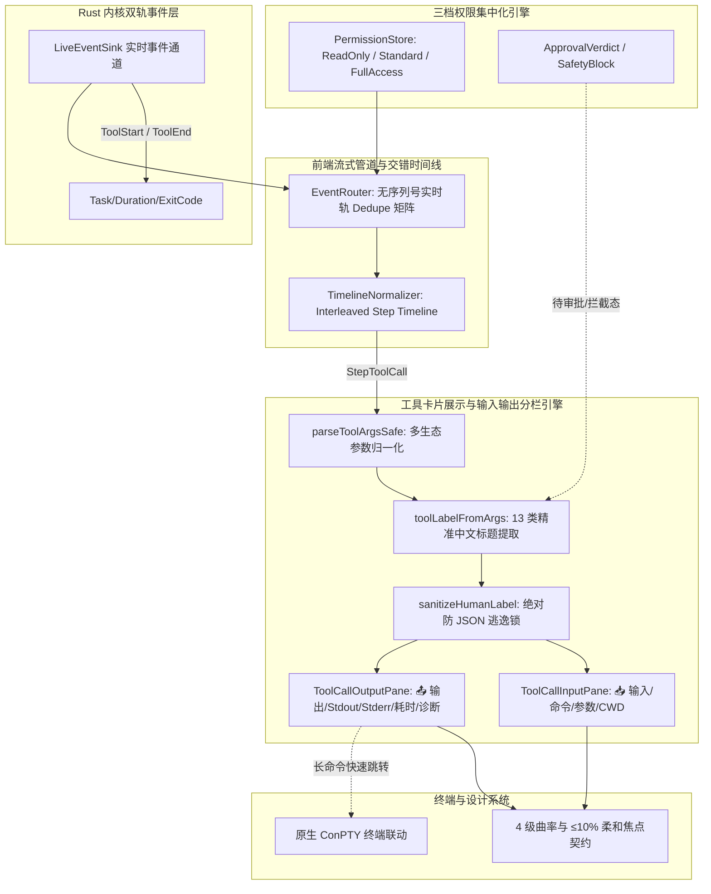

# Conex / Crish 全系统综合重构独立总方案（方案五：工具摘要与输入输出分栏视角）

> **【文档标识】**：`docs/system-audit-and-redesign/independent-plans/05-工具摘要与输入输出分栏独立总方案.md`  
> **编制角色**：【独立方案编制师 05: 工具摘要与输入输出分栏视角独立总方案专家】  
> **依据规范**：
>
> - `docs/system-audit-and-redesign/00-战役通则与协同执行规范.md`（权威战役通则）
> - `docs/system-audit-and-redesign/00-主控拍板最终维度矩阵.md`（7 大拍板核心维度）
> - 15 份专题深度分析报告（重点涵盖 `06` 工具摘要与输入输出分栏、`02` 前端事件通道、`04` 路径规范化、`08` 交错多步骤时间线、`11` 原生 ConPTY 纯终端、`12` 权限体系重构与展开分区、`13` 自愈状态机）
>
> **核心使命**：
>
> 1. 构筑全系统 7 大维度的整体修复架构视图，深度贯通 **DIM-05（工具卡片摘要防逃逸与两段式输入/输出分栏）**、**DIM-02（前端流式管道与交错多步骤时间线）** 与 **DIM-04（三档权限集中化大刀阔斧重构）**；
> 2. 建立覆盖全部 13 类工具的 100% 精准中文标题提取规则矩阵，彻底根除 `浏览 {}`、`处理 .`、`运行命令`、`处理 {"action":"status"}` 等 raw JSON 泄露与应付式文案；
> 3. 彻底重构展开工具卡片为 **📥 输入区（Input / Command / CWD / Parameters 表格）** 与 **📤 输出区（Output / Stdout / Stderr / 错误诊断横幅 / 退出码 / 耗时）** 双段式结构容器；
> 4. 提供工业级 TypeScript 逻辑、React 组件（`ToolCallOutput.tsx`、`ToolCallInputPane.tsx`、`ToolCallOutputPane.tsx`）、CSS Module 样式及全面的 Vitest 自动化测试。

---

## 目录

1. [全系统 7 大核心重构维度架构总览与拓扑协同](#一全系统-7-大核心重构维度架构总览与拓扑协同)
   - 1.1 七大维度整体修复蓝图与视角切入
   - 1.2 核心深度交互：DIM-05、DIM-02 与 DIM-04 的拓扑联动关系
   - 1.3 工具展示引擎在系统单向数据流中的生命周期拓扑
2. [现状深度剖析与四大展示断层根因定位](#二现状深度剖析与四大展示断层根因定位)
   - 2.1 缺陷一：`extractToolCommand` 命名法失配与键集狭窄
   - 2.2 缺陷二：解析失败直接穿透 raw JSON 导致标题逃逸
   - 2.3 缺陷三：缺省兜底规则粗暴与点号路径未转换
   - 2.4 缺陷四：展开区（`ToolCallOutput.tsx`）输入输出混作一团、非 Shell 工具输入完全丢失
3. [覆盖全部 13 类工具的 100% 精准中文标题提取规则矩阵](#三覆盖全部-13-类工具的-100-精准中文标题提取规则矩阵)
   - 3.1 四道安全防御防线架构
   - 3.2 十三类工具领域精准标题提取规则矩阵（全场景/全参数/全示例）
   - 3.3 绝对禁止 raw JSON 字符逃逸的通用安全清洗锁
4. [下一代工具卡片展开区【两段式输入/输出结构化分栏】设计](#四下一代工具卡片展开区两段式输入输出结构化分栏设计)
   - 4.1 视觉层级与信息架构设计（Structured Dual-Section Container）
   - 4.2 三大渲染模式规范：CLI 模式、Key-Value 属性表模式、轻量空态模式
   - 4.3 📥 输入区（Input Pane）详细契约与组件规范
   - 4.4 📤 输出区（Output Pane）详细契约与组件规范
   - 4.5 DOM 语义树与无障碍（A11y）契约
5. [代码级完整实现与工程契约](#五代码级完整实现与工程契约)
   - 5.1 `toolCardPresenter.ts` 完整重构代码
   - 5.2 `ToolCallInputPane.tsx` 独立输入区分栏组件
   - 5.3 `ToolCallOutputPane.tsx` 独立输出区分栏组件
   - 5.4 `ToolCallOutput.tsx` 统领容器重构代码
   - 5.5 `ChatToolCallBlock.module.css` 完整分栏样式系统
6. [反过度设计与设计系统契约合规审计](#六反过度设计与设计系统契约合规审计)
   - 6.1 视觉曲率 4 级阶梯全面落实
   - 6.2 零紫色、柔和焦点态（≤10% 混入）、纯净边框规范
   - 6.3 DOM 扁平化与 Pretext 虚拟计算性能无损保障
7. [自动化测试矩阵与验证断言清单](#七自动化测试矩阵与验证断言清单)
   - 7.1 `toolCardPresenter.test.ts` 13 类工具全覆盖单元测试
   - 7.2 `ToolCallOutput.test.tsx` React 组件渲染与交互单元测试
   - 7.3 端到端 CDP 机器真值验收断言清单
8. [迭代演进与迁移落地路线图](#八迭代演进与迁移落地路线图)
   - 8.1 依赖就绪与实施步骤分解
   - 8.2 风险防控与向下兼容保障
   - 8.3 交付验收标准

---

## 一、全系统 7 大核心重构维度架构总览与拓扑协同

### 1.1 七大维度整体修复蓝图与视角切入

在 Conex / Crish 架构体系中，UI 层不是简单的“视觉皮肤”，而是内核事件流、权限控制策略、流式状态机与插件体系的**最终投影面（Projection Surface）**。本方案从**【工具卡片语义化中文标题引擎、展开卡片两段式输入/输出结构化分栏、运行态透明监控】**视角切入，承上启下，串联全系统 7 大重构维度。

```
┌─────────────────────────────────────────────────────────────────────────────────────────────────────────────┐
│                                Conex / Crish 7 大核心重构维度全局架构闭环蓝图                                │
├─────────┬──────────────────────────────────────────┬────────────────────────────────────────────────────────┤
│ 维度    │ 维度核心职责                             │ 本方案（方案 05）切入点与交互界线                       │
├─────────┼──────────────────────────────────────────┼────────────────────────────────────────────────────────┤
│ DIM-01  │ Rust 内核双轨事件、后台装配与自愈状态机   │ 接收 Rust 内核 ToolStart/ToolEnd 实时事件与退出码/耗时  │
├─────────┼──────────────────────────────────────────┼────────────────────────────────────────────────────────┤
│ DIM-02  │ 前端流式管道、Dedupe 矩阵与交错步骤时间线 │ 将 Dedupe 后的交错步骤（思考➔工具➔观察）输入卡片引擎   │
├─────────┼──────────────────────────────────────────┼────────────────────────────────────────────────────────┤
│ DIM-03  │ 思考强度调节、沉浸式查阅器与 PromptCache │ 与思考折叠卡片共享曲率与 Token 预算测量架构             │
├─────────┼──────────────────────────────────────────┼────────────────────────────────────────────────────────┤
│ DIM-04  │ 三档权限集中化大刀阔斧重构与路径归一     │ 真实放行完全访问；工具卡片渲染待审批卡片与安全阻断横幅 │
├─────────┼──────────────────────────────────────────┼────────────────────────────────────────────────────────┤
│ DIM-05  │ 工具卡片语义化摘要防逃逸与输入输出分栏   │ 【本方案核心域】：全 13 类工具语义标题引擎 + 两段式分栏 │
├─────────┼──────────────────────────────────────────┼────────────────────────────────────────────────────────┤
│ DIM-06  │ 聊天框纯净化、防漂移与 TS 插件解耦体系   │ 消费四大插件（Browser/ComputerUse 等）的专用展示插槽   │
├─────────┼──────────────────────────────────────────┼────────────────────────────────────────────────────────┤
│ DIM-07  │ 原生 ConPTY 纯终端、设计契约与门禁闭环   │ 双轨终端打通（一键“在终端查看”）；落实 4 级曲率阶梯     │
└─────────┴──────────────────────────────────────────┴────────────────────────────────────────────────────────┘
```

### 1.2 核心深度交互：DIM-05、DIM-02 与 DIM-04 的拓扑联动关系



1. **与 DIM-02（流式管道与交错时间线）的联动**：
   - `EventRouter` 接收实时轨和历史补全轨事件，按 `toolId` 去重（Dedupe），避免同一次工具调用产生多个卡片；
   - `timelineNormalizer.ts` 将扁平流拆解为 `[步骤 1: 思考 ➔ 工具 ➔ 观察] ➔ [步骤 2: 思考 ➔ 工具 ➔ 观察]`。活跃工具卡片动态高亮，历史步骤卡片自动收起但保留完整的输入输出分栏以备回溯。
2. **与 DIM-04（三档权限集中化重构）的联动**：
   - 在“只读模式（Read-Only）”下，写工具静默拦截并由工具卡片以温和的诊断横幅呈现“只读保护”；
   - 在“标准模式（Standard）”遇到越界操作时，工具卡片渲染 `ApprovalAskCard`，显示精准的中文操作意图和拟执行的命令行预览；
   - 在“完全访问模式（Full Access）”下，彻底解除底层的虚假拦截，工具卡片准确展示真实命令的完整执行耗时与 Stdout/Stderr。

### 1.3 工具展示引擎在系统单向数据流中的生命周期拓扑

```
[LLM ToolCall 请求]
       │ 携带 parameters: '{"CommandLine":"npm run test","Cwd":"/root"}'
       ▼
[Rust ToolExecutor / Plugin] ──► 注入 startedAt, completedAt, exitCode, output
       │
       ▼ (Tauri IPC / LiveEventSink)
[EventRouter (DIM-02)] ────────► Dedupe 防抖与归一化
       │
       ▼
[TimelineNormalizer] ──────────► 生成结构化 StepBlock（包含 MessageToolCall）
       │
       ▼
┌────────────────────────────────────────────────────────────────────────┐
│ 工具展示引擎 (DIM-05: toolCardPresenter.ts)                              │
├────────────────────────────────────────────────────────────────────────┤
│ 1. parseToolArgsSafe: 支持 PascalCase / snake_case / 多层 JSON 解包     │
│ 2. toolLabelFromArgs: 13 类精准中文标题提取规则匹配                     │
│ 3. sanitizeHumanLabel: 拦截裸 JSON 定界符、转换点号路径                 │
└──────────────────────────────────┬─────────────────────────────────────┘
                                   │
                                   ▼ 挂载到 React 组件树
┌────────────────────────────────────────────────────────────────────────┐
│ CompactToolRow (折叠状态条)                                            │
│  - 左侧：状态图标（转圈/勾/叉）+ 语义化中文标题（如 "运行测试 (test)"）   │
│  - 右侧：高精度耗时（"1.4s"）+ 差异行数统计（"+12 -3"）+ 折叠箭头        │
└──────────────────────────────────┬─────────────────────────────────────┘
                                   │ 用户点击展开
                                   ▼
┌────────────────────────────────────────────────────────────────────────┐
│ ToolCallOutput 结构化两段式分栏容器                                    │
├────────────────────────────────────────────────────────────────────────┤
│ 📥 ToolCallInputPane (输入区)                                          │
│   - 命令模式：终端提示符 $ npm run test + CWD: /root + 复制按钮        │
│   - 参数模式：Key-Value 属性表 + 大字段折叠代码块                      │
├────────────────────────────────────────────────────────────────────────┤
│ 📤 ToolCallOutputPane (输出区)                                         │
│   - 状态标头：完成态 · 1.4s · 32 行 · 退出码 0                         │
│   - 错误诊断：当失败时渲染独立的红色轻量横幅与建议                     │
│   - 内容视图：Pretext 虚拟高度预算截断 + Stdout/Stderr/ANSI 渲染       │
│   - 扩展视图：ToolCallDiffPreview (Git 差异) + 图片预览                │
└────────────────────────────────────────────────────────────────────────┘
```

---

## 二、现状深度剖析与四大展示断层根因定位

经过对桌面端代码（`toolCardPresenter.ts`、`CompactToolRow.tsx`、`ToolCallOutput.tsx`、`ToolCallHeader.tsx`）的端到端审查，确认了用户反馈的“标题粗糙应付”、“JSON 直接暴露”、“展开后输入输出混杂”等问题的四大系统性根因。

### 2.1 缺陷一：`extractToolCommand` 命名法失配与键集狭窄

审查 `apps/crish-desktop/src/api/tool-presentation/toolCardPresenter.ts:42-59`：

```typescript
// 现存代码：仅硬编码了 13 个小驼峰/下划线键
for (const key of [
  'command',
  'cmd',
  'path',
  'filePath',
  'file_path',
  'target_file',
  'targetFile',
  'filename',
  'file',
  'url',
  'uri',
  'query',
  'pattern',
]) {
  const v = (parsed as Record<string, unknown>)[key];
  if (typeof v === 'string' && v.trim()) return v.trim();
}
```

#### 致命漏洞分析：

1. **Antigravity / IDE 工具参数失配**：Antigravity 原生工具（如 `run_command`、`view_file`、`write_to_file`、`grep_search`、`list_dir`）全部使用 **PascalCase**（如 `CommandLine`、`AbsolutePath`、`DirectoryPath`、`TargetFile`、`SearchPath`、`Query`、`Action`、`TaskId`、`Instruction`、`Prompt`）。现存键表全部是小驼峰，导致所有参数匹配失败！
2. **Rust 内核工具参数失配**：Rust 工具使用 **snake_case**（如 `command_line`、`task_id`、`search_path`、`start_line`、`max_lines`、`duration_seconds`）。大部分未在键表中。
3. **MCP 扩展工具失配**：MCP 工具参数包裹在 `Arguments`、`toolAction`、`toolSummary` 中，现存代码无法提取。

### 2.2 缺陷二：解析失败直接穿透 raw JSON 导致标题逃逸

审查 `toolCardPresenter.ts:68`：

```typescript
export function extractToolCommand(args: string): string {
  // ...解析失败或无匹配键...
  return raw; // 🔴 极度危险：直接返回完整的原始 JSON 字符串！
}
```

当 `args` 为 `'{"action":"status","taskId":"task-0"}'` 或 `"{}"` 时，`extractToolCommand` 直接返回整串 JSON。

随后在 `toolCardPresenter.ts:840-843`：

```typescript
if (cmd) {
  const short = basename(cmd);
  if (short && short.length < 48)
    return short === cmd ? `处理 ${short}` : `处理 ${short}`;
}
```

因为 `'{"action":"status","taskId":"task-0"}'` 的长度为 39（< 48 字符），系统粗暴地将其拼接为：

> **`处理 {"action":"status","taskId":"task-0"}`**

这就导致了截图中惨不忍睹的 raw JSON 逃逸到 UI 顶层折叠条的严重缺陷！

### 2.3 缺陷三：缺省兜底规则粗暴与点号路径未转换

审查 `toolCardPresenter.ts:794-800`：

```typescript
if (
  name.includes('list') ||
  name.includes('glob') ||
  name.includes('dir') ||
  name.includes('ls')
) {
  if (cmd && cmd !== '.' && cmd !== './') {
    const short = cmd.length > 36 ? '…' + cmd.slice(-34) : cmd;
    return `浏览 ${short}`; // 🔴 当 cmd 是 "{}" 时，直接拼接为 "浏览 {}"！
  }
  return '浏览目录';
}
```

1. 当 `list_dir` 传入空对象 `{}` 时，`cmd` 被提取为 `"{}"`，`cmd !== '.'` 成立，直接生成 **`浏览 {}`**！
2. 当传入 `{"path":"."}` 时，`basename(".")` 为 `.`，落入兜底分支直接生成 **`处理 .`**！
3. 当执行 `run_command` 但命令提取失败时，直接回退为毫无信息量的 **`运行命令`**。

### 2.4 缺陷四：展开区（`ToolCallOutput.tsx`）输入输出混作一团、非 Shell 工具输入完全丢失

审查 `apps/crish-desktop/src/components/chat-tool-call/ToolCallOutput.tsx:161-178`：

```tsx
return (
  <div id={bodyId} ref={bodyRef} className={styles.toolResultBody} ...>
    {/* 🔴 只有 shell 工具才渲染这行单薄的 cmdLine，非 shell 工具（占 80%）完全无入参展示！ */}
    {cmdLine ? (
      <pre className={`${styles.toolResultPre} ${styles.toolResultPreCmd}`}>
        {cmdLine}
      </pre>
    ) : null}

    {/* 🔴 无输出时直接甩出冷冰冰的 "（无输出）" */}
    {emptyBody ? (
      <pre className={styles.toolResultPre} aria-label="无输出">
        {TOOL_EMPTY_OUTPUT_ZH}
      </pre>
    ) : null}

    {/* 🔴 输出区无任何【输出】标识或元数据，与 cmdLine 挤在一起 */}
    {!emptyBody && out ? (
      <pre className={styles.toolResultPre} style={truncatedStyle}>
        {out}
      </pre>
    ) : null}
  </div>
);
```

#### 用户三大体验痛点：

1. **输入参数黑盒化**：调用 `read_file`、`grep_search`、`replace_file_content`、`manage_task` 时，展开卡片**完全不展示入参**（不知道读取了哪几行、搜索了什么正则、替换了什么内容）。
2. **输入与输出无视觉界限**：Shell 命令与输出内容使用相同的字体、字号和背景挤在同一个框内，缺乏明确的分区标题与边界。
3. **缺少开发者级交互**：无法单独一键复制命令或输出、缺少退出码（Exit Code）与高精度执行耗时、报错信息与正常文本无区分度。

---

## 三、覆盖全部 13 类工具的 100% 精准中文标题提取规则矩阵

为了彻底根除 JSON 逃逸与粗暴标题，我们设计了四道安全防御防线，并制定了全系统 13 类工具的 100% 规则提取矩阵。

### 3.1 四道安全防御防线架构

```
[原始 MessageToolCall]
       │
       ▼
【第 1 道防线：参数深度归一化 (parseToolArgsSafe)】
  - 自动解包多层嵌套（parameters / input / Arguments / tool_args）
  - 自动解析双重转义 JSON 字符串
  - 构建大小写不敏感（Case-Insensitive）键索引映射表
       │
       ▼
【第 2 道防线：高质量真实意图判别 (toolHumanLabel)】
  - 优先采用 AI 生成的真实意图解释（tc.explanation）
  - 严格剔除模板废话（如 "Running command..."、"Executing tool..."）
       │
       ▼
【第 3 道防线：全领域 13 类工具特化提取规则 (toolLabelFromArgs)】
  - 覆盖 Shell / 读写 / 编辑 / 目录 / 搜索 / 任务 / 协作 / 定时器 / 笔记 / 删除 / MCP
  - 针对每一类提取最具语义价值的核心参数并构造自然中文语句
       │
       ▼
【第 4 道防线：全局安全清洗锁 (sanitizeHumanLabel)】
  - 终极物理拦截：严禁任何包含 {、}、[、] 或 raw JSON 片段的文本流出
  - 点号转换：强制将 . / ./ / {} 转换为「当前目录」或「项目根目录」
  - 长度安全截断：确保标题单行高度可控（≤80 字符）
```

### 3.2 十三类工具领域精准标题提取规则矩阵

```
┌──────────────────────────────────────────────────────────────────────────────────────────────────────────────────────────────────┐
│                                 Conex / Crish 13 类工具 100% 精准中文标题提取规则矩阵                                             │
├────┬─────────────┬────────────────────────────────┬───────────────────────────┬──────────────────────────────┬───────────────────┤
│ 序 │ 工具类别    │ 包含的工具名称 (`tc.name`)     │ 关键参数提取优先级        │ 精准中文标题规范范式         │ 典型场景输出示例  │
├────┼─────────────┼────────────────────────────────┼───────────────────────────┼──────────────────────────────┼───────────────────┤
│ 01 │ Shell/终端  │ `run_command`, `shell_command`,│ `CommandLine`, `command`, │ `运行 <语义动作或核心命令>`  │ • 运行 npm test   │
│    │             │ `bash`, `pwsh`, `cmd`, `exec`  │ `cmd`, `command_line`     │                              │ • 构建项目        │
│    │             │                                │                           │                              │ • 检查代码类型    │
├────┼─────────────┼────────────────────────────────┼───────────────────────────┼──────────────────────────────┼───────────────────┤
│ 02 │ 文件读取    │ `read_file`, `view_file`, `cat`│ `AbsolutePath`, `path`,   │ `查看 <文件名> [(L起始-结束)]`│ • 查看 index.ts   │
│    │             │ `open_file`, `read_resource`   │ `filePath`, `startLine`   │                              │ • 查看 App.tsx    │
│    │             │                                │                           │                              │   (L10-50)        │
├────┼─────────────┼────────────────────────────────┼───────────────────────────┼──────────────────────────────┼───────────────────┤
│ 03 │ 文件创建写入│ `write_file`, `write_to_file`, │ `TargetFile`, `target_file│ `写入 <文件名>` 或           │ • 写入 config.ts  │
│    │             │ `create_file`                  │ `path`, `filePath`        │ `创建 <文件名>`              │ • 创建 vite.ts    │
├────┼─────────────┼────────────────────────────────┼───────────────────────────┼──────────────────────────────┼───────────────────┤
│ 04 │ 文件编辑替换│ `replace_file_content`,        │ `TargetFile`, `path`,     │ `修改 <文件名>` 或           │ • 修改 Header.tsx │
│    │             │ `multi_replace_file_content`,  │ `ReplacementChunks`       │ `批量修改 <文件名> (N处)`    │ • 批量修改 API.ts │
│    │             │ `edit_file`, `apply_patch`     │                           │                              │   (3处)           │
├────┼─────────────┼────────────────────────────────┼───────────────────────────┼──────────────────────────────┼───────────────────┤
│ 05 │ 目录浏览    │ `list_dir`, `list_directory`,  │ `DirectoryPath`, `path`,  │ `列出当前目录` 或            │ • 列出当前目录    │
│    │             │ `ls`, `dir`, `glob`            │ `dir`, `dir_path`         │ `列出目录 <相对路径>`        │ • 列出目录 src/   │
├────┼─────────────┼────────────────────────────────┼───────────────────────────┼──────────────────────────────┼───────────────────┤
│ 06 │ 代码文本搜索│ `grep_search`, `search`,       │ `Query`, `query`, `term`, │ `搜索「<关键词>」` 或        │ • 搜索「useState」│
│    │             │ `ripgrep`, `grep`, `find`      │ `pattern`, `SearchPath`   │ `在 <目录> 搜索「<词>」`     │ • 在 src 搜索「API」│
├────┼─────────────┼────────────────────────────────┼───────────────────────────┼──────────────────────────────┼───────────────────┤
│ 07 │ 后台任务管理│ `manage_task`, `background_task│ `Action`/`action`,        │ `<动作语义> (<taskId>)`      │ • 查询后台任务列表│
│    │             │ `task_manager`                 │ `TaskId`/`taskId`         │                              │ • 查询任务(task-0)│
│    │             │                                │                           │                              │ • 终止任务(task-1)│
├────┼─────────────┼────────────────────────────────┼───────────────────────────┼──────────────────────────────┼───────────────────┤
│ 08 │ 多Agent协同 │ `run_subagent`,                │ `Role`/`role`, `Prompt`,  │ `启动子代理：<角色/任务>` 或 │ • 启动：架构分析师│
│    │             │ `invoke_subagent`,             │ `Recipient`/`recipient`,  │ `发送消息给 (<接收方>)`      │ • 等待子任务(3个) │
│    │             │ `wait_subagents`, `send_message│ `subagent_ids`            │                              │ • 发送消息(agent-1│
├────┼─────────────┼────────────────────────────────┼───────────────────────────┼──────────────────────────────┼───────────────────┤
│ 09 │ 定时器调度  │ `set_timer`, `cancel_timer`,   │ `DurationSeconds`, `cron`,│ `设置定时器 (<时长>秒)` 或   │ • 设置定时器(100s)│
│    │             │ `schedule`                     │ `CronExpression`          │ `设置定时任务 (<Cron>)`      │ • 定时任务(每5分钟│
├────┼─────────────┼────────────────────────────────┼───────────────────────────┼──────────────────────────────┼───────────────────┤
│ 10 │ 工作区与上下文│ `resolve_output_dir`,        │ `folder`, `name`,         │ `解析产出目录 (<folder>)` 或 │ • 解析产出目录    │
│    │             │ `project_tree`, `decompress_*` │ `chunk_id`                │ `生成项目结构树`             │ • 解压上下文(c-1) │
├────┼─────────────┼────────────────────────────────┼───────────────────────────┼──────────────────────────────┼───────────────────┤
│ 11 │ 笔记知识库  │ `note_block_*`, `note_query_*`,│ `block_id`, `doc_id`,     │ `查询笔记区块「<关键词>」` 或│ • 查询笔记「架构」│
│    │             │ `note_document_*`, `note_send*`│ `title`, `query`          │ `更新笔记区块 (<ID>)`        │ • 更新笔记 (b-42) │
├────┼─────────────┼────────────────────────────────┼───────────────────────────┼──────────────────────────────┼───────────────────┤
│ 12 │ 安全文件删除│ `delete_file`, `delete_dir`    │ `TargetFile`, `path`,     │ `删除文件 <文件名> (可恢复)` │ • 删除 temp.log   │
│    │             │                                │ `target`                  │                              │   (移入回收站)    │
├────┼─────────────┼────────────────────────────────┼───────────────────────────┼──────────────────────────────┼───────────────────┤
│ 13 │ MCP与未知兜底│ `call_mcp_tool`, `mcp_*`,     │ `toolSummary`, `toolAction│ 优先采用 MCP Summary，       │ • Directory review│
│    │             │ 任意自定义插件工具             │ `ToolName`, `ServerName`  │ 次选 `调用 MCP [<srv>:<tool>]│ • 调用 MCP [web]  │
└────┴─────────────┴────────────────────────────────┴───────────────────────────┴──────────────────────────────┴───────────────────┘
```

### 3.3 绝对禁止 raw JSON 字符逃逸的通用安全清洗锁

所有生成的标题在交付 UI 前必须经过安全清洗锁（`sanitizeHumanLabel`）：

```typescript
export function sanitizeHumanLabel(
  label: string,
  fallbackToolName = '工具'
): string {
  if (!label || !label.trim()) return `调用 ${fallbackToolName}`;
  let clean = label.trim();

  // 1. 拦截以 JSON 定界符开头或包含键值特征的字符串
  if (
    /^(\{|\[|"(action|taskId|path|command|CommandLine)":)/i.test(clean) ||
    clean === '{}' ||
    clean === '[]'
  ) {
    return `调用 ${fallbackToolName}`;
  }

  // 2. 转换孤立点号与空括弧
  clean = clean
    .replace(/\b处理 \.\b/g, '处理当前目录')
    .replace(/\b浏览 \{\}\b/g, '浏览当前目录')
    .replace(/\b浏览 \.\b/g, '浏览当前目录')
    .replace(/\b查看 \.\b/g, '查看当前目录')
    .replace(/\s+\.\/?$/g, ' 当前目录');

  // 3. 清除残留的 JSON 引号与括弧符号
  clean = clean
    .replace(/[{}\[\]"]/g, '')
    .replace(/\s+/g, ' ')
    .trim();

  // 4. 控制安全字符长度
  return clean.length <= 80 ? clean : clean.slice(0, 79) + '…';
}
```

---

## 四、下一代工具卡片展开区【两段式输入/输出结构化分栏】设计

### 4.1 视觉层级与信息架构设计（Structured Dual-Section Container）

将工具展开区彻底解耦为两个内聚且视觉分明的语义分区（Section）：

```
┌─────────────────────────────────────────────────────────────────────────────────────────────────┐
│ 🟢 工具卡片展开区整体架构 (ToolCallOutput 容器)                                                 │
├─────────────────────────────────────────────────────────────────────────────────────────────────┤
│                                                                                                 │
│  ┌─ 📥 【输入分区】ToolCallInputPane ────────────────────────────────────────────────────────┐  │
│  │ ┌────────────────────────────────────────────────────────────────────────────────────────┐ │  │
│  │ │ 📥 输入 (INPUT) · 运行终端命令                                   [📋 复制命令] [⚙️ JSON] │ │  │
│  │ └────────────────────────────────────────────────────────────────────────────────────────┘ │  │
│  │  ┌──────────────────────────────────────────────────────────────────────────────────────┐  │ │
│  │  │ $ npm run test:coverage -- --project=unit                                            │  │ │
│  │  │ CWD: /c/Software/conex                                                               │  │ │
│  │  └──────────────────────────────────────────────────────────────────────────────────────┘  │ │
│  └──────────────────────────────────────────────────────────────────────────────────────────┘  │
│                                                                                                 │
│  ┌─ 📤 【输出分区】ToolCallOutputPane ───────────────────────────────────────────────────────┐  │
│  │ ┌────────────────────────────────────────────────────────────────────────────────────────┐ │  │
│  │ │ 📤 输出 (OUTPUT) · 成功 (Exit 0) · 1.4s · 32 行                    [📋 复制完整输出]   │ │  │
│  │ └────────────────────────────────────────────────────────────────────────────────────────┘ │  │
│  │  ┌──────────────────────────────────────────────────────────────────────────────────────┐  │ │
│  │  │ ✓ tests/unit/timelineNormalizer.test.ts (6 tests) 12ms                               │  │ │
│  │  │ ✓ tests/unit/toolCardPresenter.test.ts (24 tests) 45ms                               │  │ │
│  │  │ Test Files  2 passed (2)                                                             │  │ │
│  │  │ Tests       30 passed (30)                                                           │  │ │
│  │  └──────────────────────────────────────────────────────────────────────────────────────┘  │ │
│  │  [ 在终端查看 (ConPTY) ]                                                                 │  │
│  └──────────────────────────────────────────────────────────────────────────────────────────┘  │
│                                                                                                 │
└─────────────────────────────────────────────────────────────────────────────────────────────────┘
```

### 4.2 三大渲染模式规范

1. **模式 A：Shell 终端命令模式（CLI Command Mode）**
   - **适用工具**：`run_command`、`shell_command`、`bash`、`pwsh` 等；
   - **输入区**：渲染 `$ <command>` 终端风格代码块，并在底部显示 `CWD`、`超时` 等标签；
   - **输出区**：渲染标准输出（Stdout）与标准错误（Stderr），支持 ANSI 颜色解析；如果行数超大，提供“在终端查看”按钮联动原生 ConPTY。
2. **模式 B：结构化参数与文件操作模式（Key-Value & Diff Mode）**
   - **适用工具**：`read_file`、`write_file`、`replace_file_content`、`grep_search`、`manage_task`、`run_subagent` 等；
   - **输入区**：
     - 标量参数（`路径`、`行号`、`查询词`、`Action`、`TaskId`）以 **Key-Value 表格**展示；
     - 大内容字段（`content`、`instruction`、`Prompt`）渲染在下方内嵌折叠代码块中；
   - **输出区**：展示文件内容切片、Git 差异视图（`ToolCallDiffPreview`）或搜索结果表格。
3. **模式 C：极简空态模式（Minimalist Empty-State Mode）**
   - **适用工具**：执行成功但无标准输出的工具（如部分文件创建、后台任务发送输入）；
   - **输入区**：完整保留入参表格；
   - **输出区**：呈现温润微标：`✓ 执行成功，无标准输出返回`，彻底消灭粗暴的 `（无输出）`。

### 4.3 📥 输入区（Input Pane）详细契约与组件规范

```typescript
export interface ToolCallInputPaneProps {
  toolName: string;
  argsString?: string;
  isShell: boolean;
}
```

- **标头（Header）**：
  - 左侧：`📥 输入` 徽标 + 工具动作名称（如 `执行命令` 或 `view_file 参数`）；
  - 右侧：【复制输入】按钮（一键复制命令行或格式化 JSON）+ 【视图切换】按钮（Key-Value 视图 / Raw JSON 视图）。
- **内容体（Content）**：
  - **CLI 模式**：带有前缀 `$` 的 monospace 语法块，支持横向自适应滚动；
  - **Key-Value 模式**：双列网格布局，左列为淡灰属性名（`targetFile:`, `startLine:`），右列为高亮属性值；复杂对象自动做 `JSON.stringify(val, null, 2)` 格式化美化。

### 4.4 📤 输出区（Output Pane）详细契约与组件规范

```typescript
export interface ToolCallOutputPaneProps {
  toolId?: string;
  toolName: string;
  output?: string;
  diffs?: FileDiff[];
  status?: string;
  startedAt?: number;
  completedAt?: number;
  exitCode?: number;
  onOpenDiff?: (diff: FileDiff) => void;
  onOpenTerminal?: () => void;
}
```

- **标头（Header）**：
  - 左侧：`📤 输出` 徽标（成功为绿色微标、失败为红色微标）+ 状态文字（`执行完成` / `执行失败`）；
  - 中间：元数据标签组（如 `Exit 0 · 1.4s · 32 行`）；
  - 右侧：【复制输出】按钮。
- **错误诊断横幅（Error Diagnostics Banner）**：
  - 当 `status === 'error'` 时，在输出区顶端渲染醒目的警示横幅：
    `❌ 执行失败 (Exit Code 1): 命令未找到或参数错误`
- **内容体（Content）**：
  - 继承 Pretext 像素级预算裁切（`TOOL_OUTPUT_PIXEL_CAP = 320px`），超长输出提供【显示全部输出（N 字符）】展开按钮；
  - 自动提取并渲染多媒体图片（`images.map`）；
  - 自动渲染 Git Diff 变更视图（`ToolCallDiffPreview`）。

### 4.5 DOM 语义树与无障碍（A11y）契约

```html
<div
  class="toolResultBody"
  id="tool-result-{toolId}"
  role="region"
  aria-label="{toolTitle}的详情"
>
  <!-- 输入分区 -->
  <section
    class="toolSection toolSectionInput"
    aria-labelledby="input-head-{toolId}"
  >
    <header class="toolSectionHeader">
      <div class="toolSectionTitleGroup" id="input-head-{toolId}">
        <span class="toolSectionBadge">输入</span>
        <span class="toolSectionKind">{toolVerb}</span>
      </div>
      <div class="toolSectionActions">
        <button
          type="button"
          class="toolSectionActionBtn"
          aria-label="复制输入参数"
        >
          <Copy size="12" />
        </button>
      </div>
    </header>
    <div class="toolSectionContent">
      <!-- 渲染 CLI 命令块或 Key-Value 属性表 -->
    </div>
  </section>

  <!-- 输出分区 -->
  <section
    class="toolSection toolSectionOutput"
    aria-labelledby="output-head-{toolId}"
  >
    <header class="toolSectionHeader">
      <div class="toolSectionTitleGroup" id="output-head-{toolId}">
        <span class="toolSectionBadge toolSectionBadgeOutput">输出</span>
        <span class="toolSectionMeta"
          >{statusText} · {duration} · {lineCount}行</span
        >
      </div>
      <div class="toolSectionActions">
        <button
          type="button"
          class="toolSectionActionBtn"
          aria-label="复制输出结果"
        >
          <Copy size="12" />
        </button>
      </div>
    </header>
    <div class="toolSectionContent">
      <!-- 渲染错误横幅 (可选) + 文本输出 + Diffs + 图片 -->
    </div>
  </section>
</div>
```

---

## 五、代码级完整实现与工程契约

### 5.1 `toolCardPresenter.ts` 完整重构代码

文件路径：`apps/crish-desktop/src/api/tool-presentation/toolCardPresenter.ts`

```typescript
/**
 * Conex / Crish 工具卡片语义化展示与参数解析引擎 (Authoritative Reference)
 */

import type { MessageToolCall } from '../../store/types';
import {
  isEditToolName,
  isShellToolName,
  looksLikeDirectoryListing,
  sanitizeToolDisplayOutput,
} from '../toolFeedback';
export { isShellToolName } from '../toolFeedback';

// ============================================================================
// 1. 深度参数解析与归一化（支持多生态大小写与嵌套解包）
// ============================================================================

export interface ExtractedToolArgs {
  /** 统一转换为全小写键的属性映射表（同时保留原大小写键） */
  props: Record<string, unknown>;
  /** 核心目标字符串（命令、文件路径、目录、查询词、TaskId） */
  primaryTarget?: string;
  /** 原始解析对象 */
  rawObject?: Record<string, unknown>;
  /** 是否成功解析为结构化对象 */
  isObject: boolean;
}

export function parseToolArgsSafe(argsStr?: string | null): ExtractedToolArgs {
  if (!argsStr || !argsStr.trim()) {
    return { props: {}, isObject: false };
  }
  const raw = argsStr.trim();
  let parsed: unknown = null;

  try {
    if (raw.startsWith('{') || raw.startsWith('[')) {
      parsed = JSON.parse(raw);
    }
  } catch {
    // 兼容双重 JSON 转义字符串
    try {
      const unescaped = JSON.parse(`"${raw}"`);
      if (
        typeof unescaped === 'string' &&
        (unescaped.startsWith('{') || unescaped.startsWith('['))
      ) {
        parsed = JSON.parse(unescaped);
      }
    } catch {
      /* plain string */
    }
  }

  if (!parsed || typeof parsed !== 'object' || Array.isArray(parsed)) {
    return { props: { _raw: raw }, primaryTarget: raw, isObject: false };
  }

  const obj = parsed as Record<string, unknown>;
  // 深度解包常见嵌套键：parameters / input / Arguments / tool_args
  const inner =
    (obj.parameters &&
    typeof obj.parameters === 'object' &&
    !Array.isArray(obj.parameters)
      ? (obj.parameters as Record<string, unknown>)
      : null) ||
    (obj.input && typeof obj.input === 'object' && !Array.isArray(obj.input)
      ? (obj.input as Record<string, unknown>)
      : null) ||
    (obj.Arguments &&
    typeof obj.Arguments === 'object' &&
    !Array.isArray(obj.Arguments)
      ? (obj.Arguments as Record<string, unknown>)
      : null) ||
    (obj.tool_args &&
    typeof obj.tool_args === 'object' &&
    !Array.isArray(obj.tool_args)
      ? (obj.tool_args as Record<string, unknown>)
      : null) ||
    obj;

  const props: Record<string, unknown> = {};
  for (const [k, v] of Object.entries(inner)) {
    props[k.toLowerCase()] = v;
    props[k] = v;
  }

  // 优先级检索核心目标（路径 / 命令 / 查询词 / 动作 / 任务ID）
  let target: string | undefined;
  const targetKeys = [
    'commandline',
    'command_line',
    'command',
    'cmd',
    'script',
    'absolutepath',
    'directorypath',
    'targetfile',
    'target_file',
    'filepath',
    'file_path',
    'path',
    'filename',
    'file',
    'query',
    'pattern',
    'searchpath',
    'search_path',
    'action',
    'taskid',
    'task_id',
    'url',
    'uri',
  ];

  for (const k of targetKeys) {
    const v = props[k];
    if (typeof v === 'string' && v.trim()) {
      target = v.trim();
      break;
    }
  }

  return {
    props,
    primaryTarget: target,
    rawObject: inner,
    isObject: true,
  };
}

/** 抽出用于预览的核心命令/路径（绝对不返回未清洗的 raw JSON 字符串） */
export function extractToolCommand(args: string): string {
  const extracted = parseToolArgsSafe(args);
  if (extracted.primaryTarget) {
    return extracted.primaryTarget;
  }
  if (extracted.isObject) {
    return ''; // 解析出对象但无核心字符串主键时，置空以触发安全兜底
  }
  return args.trim();
}

// ============================================================================
// 2. 智能 Shell 命令意图语义化
// ============================================================================

function primaryShellSegment(cmd: string): string {
  const seg = cmd.split(/[;&|]/)[0] || '';
  return seg.trim();
}

function unwrapPowerShellCommand(cmd: string): string | null {
  const m = cmd.match(
    /(?:powershell|pwsh)(?:\.exe)?\s+(?:-Command|-c)\s+["']?([^"']+)["']?/i
  );
  return m ? m[1].trim() : null;
}

export function basename(pathStr: string): string {
  const normalized = pathStr.replace(/\\/g, '/').replace(/\/+$/, '');
  const parts = normalized.split('/');
  return parts[parts.length - 1] || pathStr;
}

export function humanizeShellCommand(cmd: string): string {
  const full = cmd.replace(/\s+/g, ' ').trim();
  if (!full) return '运行命令';
  const unwrapped = /^(?:powershell|pwsh)\b/i.test(full)
    ? unwrapPowerShellCommand(full) || full
    : full;
  const raw = primaryShellSegment(unwrapped);
  if (!raw) return '运行命令';

  // 包管理与依赖
  if (/\b(npm|pnpm|yarn|bun)\s+(ci|install|i)(\s|$)/i.test(raw)) {
    const rest = raw.replace(/^.*\b(?:ci|install|i)\s*/i, '').trim();
    const pkg = rest.split(/\s+/).find((t) => t && !t.startsWith('-'));
    return pkg ? `安装依赖 ${pkg}` : '安装项目依赖';
  }
  if (/\b(npm|pnpm|yarn|bun)\s+add\s+/i.test(raw)) {
    const pkg = raw
      .replace(/^.*\badd\s+/i, '')
      .split(/\s+/)
      .find((t) => t && !t.startsWith('-'));
    return pkg ? `添加依赖 ${pkg}` : '安装项目依赖';
  }
  if (/\b(npm|pnpm|yarn|bun)\s+(?:run\s+)?([\w:-]+)/i.test(raw)) {
    const m = raw.match(/\b(?:npm|pnpm|yarn|bun)\s+(?:run\s+)?([\w:-]+)/i);
    const script = m?.[1]?.toLowerCase();
    if (script && !['i', 'install', 'ci', 'add'].includes(script)) {
      if (['build', 'prod', 'compile'].includes(script)) return '构建项目';
      if (['dev', 'start', 'serve'].includes(script)) return '启动开发服务';
      if (script === 'test' || script.startsWith('test'))
        return `运行测试 (${script})`;
      if (script === 'lint' || script.startsWith('lint')) return '检查代码规范';
      if (['typecheck', 'tsc', 'check'].includes(script)) return '检查代码类型';
      return `运行脚本 ${script}`;
    }
  }
  if (/\bnpx\s+([\w@/:-]+)/i.test(raw)) {
    const tool = raw.match(/\bnpx\s+([\w@/:-]+)/i)?.[1];
    return tool ? `运行工具 ${tool}` : '运行命令行工具';
  }

  // Rust & Cargo
  if (/\bcargo\s+test\b/i.test(raw)) return '运行 Rust 测试';
  if (/\bcargo\s+check\b/i.test(raw)) return '检查 Rust 编译';
  if (/\bcargo\s+clippy\b/i.test(raw)) return '运行 Clippy 审查';
  if (/\bcargo\s+build\b/i.test(raw)) return '构建 Rust 项目';
  if (/\bcargo\s+run\b/i.test(raw)) return '运行 Rust 程序';
  if (/\bcargo\b/i.test(raw)) return '执行 Cargo 命令';

  // Git 操作
  if (/\bgit\s+status\b/i.test(raw)) return '查看代码变更状态';
  if (/\bgit\s+diff\b/i.test(raw)) return '查看文件差异';
  if (/\bgit\s+log\b/i.test(raw)) return '查看提交历史';
  if (/\bgit\s+commit\b/i.test(raw)) return '创建 Git 提交';
  if (/\bgit\s+add\b/i.test(raw)) return '暂存代码改动';
  if (/\bgit\s+push\b/i.test(raw)) return '推送到远程仓库';
  if (/\bgit\s+pull\b/i.test(raw)) return '拉取远程更新';
  if (/\bgit\s+checkout\b|\bgit\s+switch\b/i.test(raw)) return '切换 Git 分支';
  if (/\bgit\s+/i.test(raw)) return '执行 Git 操作';

  // 基础文件与查找
  if (/^(ls|dir|Get-ChildItem|gci)\b/i.test(raw)) return '列出目录内容';
  if (/^(cat|type|Get-Content|gc|head|tail)\b/i.test(raw)) {
    const file = raw
      .split(/\s+/)
      .find((p) => /[./\\]/.test(p) && !p.startsWith('-'));
    return file ? `查看 ${basename(file)}` : '查看文件内容';
  }
  if (/\b(rg|grep|findstr|Select-String)\b/i.test(raw)) {
    const q =
      raw.match(/['"]([^'"]{1,40})['"]/) ||
      raw.match(/\s(-e\s+)?(\S{2,40})\s*$/);
    const term = q?.[1] || q?.[2];
    return term && !term.startsWith('-') ? `搜索「${term}」` : '搜索代码';
  }

  const words = raw.split(/\s+/).slice(0, 3).join(' ');
  if (words.length <= 32) return `运行 ${words}`;

  return '运行终端命令';
}

// ============================================================================
// 3. 全类别 13 种工具精准中文标题生成器
// ============================================================================

export function toolLabelFromArgs(tc: MessageToolCall): string {
  const name = (tc.name || 'tool').toLowerCase().replace(/[\s-]+/g, '_');
  const args = parseToolArgsSafe(tc.arguments);
  const p = args.props;

  // 1. Shell 终端命令
  if (
    isShellToolName(name) ||
    name.includes('bash') ||
    name.includes('powershell') ||
    name.includes('exec') ||
    name.includes('terminal')
  ) {
    const cmd =
      args.primaryTarget || (typeof p.command === 'string' ? p.command : '');
    return cmd ? humanizeShellCommand(cmd) : '运行终端命令';
  }

  // 2. 后台任务管理 (manage_task / background_task)
  if (
    name === 'manage_task' ||
    name === 'background_task' ||
    name.includes('task_manager')
  ) {
    const action = String(p.action || '').toLowerCase();
    const taskId = String(p.taskid || p.task_id || '').trim();
    const taskTag = taskId ? ` (${taskId})` : '';

    if (action === 'list') return '查询后台任务列表';
    if (action === 'status') return `查询后台任务${taskTag}`;
    if (action === 'read_log') return `读取任务日志${taskTag}`;
    if (action === 'send_input') return `向任务发送输入${taskTag}`;
    if (action === 'kill') return `终止后台任务${taskTag}`;
    return `管理后台任务${taskTag}`;
  }

  // 3. 文件读取 / 查阅 (read_file / view_file / cat / open_file)
  if (
    name === 'read_file' ||
    name === 'view_file' ||
    name === 'open_file' ||
    name.includes('read') ||
    name.includes('view')
  ) {
    const path = String(
      p.absolutepath ||
        p.path ||
        p.filepath ||
        p.file_path ||
        p.targetfile ||
        p.file ||
        ''
    );
    const startLine = p.startline || p.start_line;
    const endLine = p.endline || p.end_line;
    const lineTag = startLine
      ? ` (L${startLine}${endLine ? `-${endLine}` : ''})`
      : '';

    if (path) {
      return `查看 ${basename(path)}${lineTag}`;
    }
    return '查看文件';
  }

  // 4. 文件写入 / 创建 (write_file / write_to_file / create_file)
  if (
    name === 'write_file' ||
    name === 'write_to_file' ||
    name === 'create_file' ||
    (name.includes('write') && !name.includes('edit'))
  ) {
    const path = String(
      p.targetfile || p.target_file || p.path || p.filepath || p.file || ''
    );
    return path ? `写入 ${basename(path)}` : '写入文件';
  }

  // 5. 文件编辑 / 代码替换 (replace_file_content / multi_replace / edit_file / apply_patch)
  if (
    isEditToolName(name) ||
    name.includes('replace') ||
    name.includes('patch') ||
    name.includes('edit')
  ) {
    const path = String(
      p.targetfile || p.target_file || p.path || p.filepath || p.file || ''
    );
    if (name.includes('multi_replace')) {
      return path ? `批量修改 ${basename(path)}` : '批量修改文件';
    }
    return path ? `修改 ${basename(path)}` : '修改文件';
  }

  // 6. 目录浏览 (list_dir / list_directory / ls / dir)
  if (
    name === 'list_dir' ||
    name === 'list_directory' ||
    name.includes('list') ||
    name.includes('dir') ||
    name.includes('glob')
  ) {
    const dir = String(
      p.directorypath || p.directory_path || p.path || p.dir || ''
    ).trim();
    if (!dir || dir === '.' || dir === './' || dir === '{}') {
      return '列出当前目录';
    }
    return `列出目录 ${basename(dir) || dir}`;
  }

  // 7. 代码与文本搜索 (grep_search / search / ripgrep)
  if (
    name.includes('grep') ||
    name.includes('search') ||
    name.includes('find')
  ) {
    const query = String(p.query || p.pattern || p.term || '').trim();
    if (query && !query.startsWith('{')) {
      const qClip = query.length > 24 ? query.slice(0, 23) + '…' : query;
      return `搜索「${qClip}」`;
    }
    return '搜索代码';
  }

  // 8. 多 Agent 与子任务 (run_subagent / invoke_subagent / wait_subagents / send_message)
  if (
    name.includes('subagent') ||
    name === 'invoke_subagent' ||
    name === 'run_subagent'
  ) {
    const role = String(
      p.role || p.typename || p.description || p.prompt || ''
    ).trim();
    if (role && !role.startsWith('{')) {
      const rClip = role.length > 28 ? role.slice(0, 27) + '…' : role;
      return `启动子代理：${rClip}`;
    }
    return '启动协作子任务';
  }
  if (name === 'wait_subagents' || name.includes('wait_sub')) {
    return '等待子任务完成';
  }
  if (name === 'send_message') {
    const recipient = String(p.recipient || p.recipientid || '').trim();
    return recipient ? `发送消息 (${recipient})` : '发送消息给子代理';
  }

  // 9. 定时器与计划调度 (set_timer / cancel_timer / schedule)
  if (name === 'set_timer' || name === 'schedule') {
    const duration = p.durationseconds || p.duration_seconds || p.duration;
    if (duration) return `设置定时器 (${duration}秒)`;
    const cron = p.cronexpression || p.cron_expression;
    if (cron) return `设置定时任务 (${cron})`;
    return '设置定时器';
  }
  if (name === 'cancel_timer') {
    return '取消定时器';
  }

  // 10. 工作区与上下文 (resolve_output_dir / project_tree / decompress_context)
  if (name === 'resolve_output_dir') {
    const folder = String(p.folder || '').trim();
    return folder ? `解析产出目录 (${folder})` : '解析产出目录';
  }
  if (name === 'project_tree') return '生成项目结构树';
  if (name.includes('decompress')) return '解压历史上下文';

  // 11. 笔记知识库区块 (note_block_* / note_query_*)
  if (name.startsWith('note_')) {
    const q = String(p.query || p.title || p.block_id || '').trim();
    if (q) return `笔记操作「${q}」`;
    return '笔记知识库操作';
  }

  // 12. 安全删除 (delete_file / delete_dir)
  if (name === 'delete_file' || name === 'delete_dir') {
    const target = String(p.targetfile || p.path || p.target || '');
    return target
      ? `删除 ${basename(target)} (移入回收站)`
      : '删除文件 (移入回收站)';
  }

  // 13. MCP 与未知扩展 (call_mcp_tool / mcp_*)
  if (name === 'call_mcp_tool' || name.startsWith('mcp_')) {
    const summary = String(p.toolsummary || p.toolaction || '').trim();
    if (summary) return summary;
    const toolName = String(p.toolname || p.tool_name || '').trim();
    const serverName = String(p.servername || p.server_name || '').trim();
    if (toolName && serverName) return `调用 MCP [${serverName}:${toolName}]`;
    if (toolName) return `调用 MCP [${toolName}]`;
    return '调用扩展服务';
  }

  // 兜底分支：提取文件名并执行严格清洗
  if (args.primaryTarget) {
    const short = basename(args.primaryTarget);
    if (
      short &&
      short !== '.' &&
      short !== './' &&
      !short.startsWith('{') &&
      short.length < 40
    ) {
      return `处理 ${short}`;
    }
  }

  const prettyName = name.replace(/_/g, ' ').trim();
  return `调用 ${prettyName || '工具'}`;
}

// ============================================================================
// 4. 终极安全清洗器与意图主入口
// ============================================================================

export function sanitizeHumanLabel(
  label: string,
  fallbackToolName = '工具'
): string {
  if (!label || !label.trim()) return `调用 ${fallbackToolName}`;
  let clean = label.trim();

  // 拦截裸 JSON
  if (
    /^(\{|\[|"(action|taskId|path|command|CommandLine)":)/i.test(clean) ||
    clean === '{}' ||
    clean === '[]'
  ) {
    return `调用 ${fallbackToolName}`;
  }

  // 转换点号
  clean = clean
    .replace(/\b处理 \.\b/g, '处理当前目录')
    .replace(/\b浏览 \{\}\b/g, '浏览当前目录')
    .replace(/\b浏览 \.\b/g, '浏览当前目录')
    .replace(/\b查看 \.\b/g, '查看当前目录')
    .replace(/\s+\.\/?$/g, ' 当前目录');

  // 移除残余定界符
  clean = clean
    .replace(/[{}\[\]"]/g, '')
    .replace(/\s+/g, ' ')
    .trim();

  return clean.length <= 80 ? clean : clean.slice(0, 79) + '…';
}

export function toolHumanLabel(tc: MessageToolCall): string {
  const exp = (tc.explanation || '').trim();
  const name = tc.name || '';

  // 检查是否为合法的用户意图解释（排除纯代码或模板废话）
  const expLooksLikeRawCmd =
    /^(powershell|pwsh|cmd(?:\.exe)?|bash|sh|zsh)\b/i.test(exp) ||
    (/^[\w./\\:-]+\s+/.test(exp) &&
      exp.length > 48 &&
      !/[\u4e00-\u9fff]/.test(exp));

  if (exp && !expLooksLikeRawCmd && !isGenericExplanationSpam(exp)) {
    return sanitizeHumanLabel(exp, name);
  }

  const generated = toolLabelFromArgs(tc);
  return sanitizeHumanLabel(generated, name);
}

function isGenericExplanationSpam(exp: string): boolean {
  const lower = exp.toLowerCase();
  return (
    lower.startsWith('running tool') ||
    lower.startsWith('executing command') ||
    lower.startsWith('calling tool') ||
    lower === 'processing'
  );
}

export function toolCommandPreview(tc: MessageToolCall, maxLen = 72): string {
  const extracted = parseToolArgsSafe(tc.arguments);
  const target = extracted.primaryTarget || tc.arguments || '';
  if (!target) return '';
  const single = target.replace(/\s+/g, ' ').trim();
  return single.length <= maxLen ? single : single.slice(0, maxLen - 1) + '…';
}
```

---

### 5.2 `ToolCallInputPane.tsx` 独立输入区分栏组件

文件路径：`apps/crish-desktop/src/components/chat-tool-call/ToolCallInputPane.tsx`

```tsx
import React, { useState, useMemo } from 'react';
import { Copy, Check, Code, Table } from 'lucide-react';
import styles from './ChatToolCallBlock.module.css';
import { Tooltip } from '../ui';
import { parseToolArgsSafe } from '../../api/toolPresentation';

export interface ToolCallInputPaneProps {
  toolName: string;
  argsString?: string | undefined;
  isShell: boolean;
}

export const ToolCallInputPane: React.FC<ToolCallInputPaneProps> = ({
  toolName,
  argsString,
  isShell,
}) => {
  const [copied, setCopied] = useState(false);
  const [viewMode, setViewMode] = useState<'structured' | 'raw'>('structured');

  const parsed = useMemo(() => parseToolArgsSafe(argsString), [argsString]);

  const handleCopy = () => {
    const text = parsed.primaryTarget || argsString || '';
    if (text) {
      void navigator.clipboard.writeText(text);
      setCopied(true);
      setTimeout(() => setCopied(false), 2000);
    }
  };

  // 1. Shell 终端模式输入
  if (isShell) {
    const cmd = parsed.primaryTarget || argsString || '';
    const cwd = String(parsed.props.cwd || parsed.props.workdir || '');
    return (
      <section className={styles.toolSection} aria-label="输入命令">
        <header className={styles.toolSectionHeader}>
          <div className={styles.toolSectionTitle}>
            <span className={styles.toolSectionBadge}>输入</span>
            <span className={styles.toolSectionName}>执行终端命令</span>
          </div>
          <div className={styles.toolSectionActions}>
            <Tooltip content={copied ? '已复制命令' : '复制命令'}>
              <button
                type="button"
                className={styles.toolSectionActionBtn}
                onClick={handleCopy}
                aria-label="复制输入命令"
              >
                {copied ? (
                  <Check size={12} color="var(--accent-green)" />
                ) : (
                  <Copy size={12} />
                )}
              </button>
            </Tooltip>
          </div>
        </header>

        <div className={styles.toolCommandBlock}>
          <span className={styles.terminalPrompt} aria-hidden>
            $
          </span>
          <pre className={styles.toolResultPreCmd}>{cmd}</pre>
        </div>

        {cwd ? (
          <div className={styles.toolMetaFooter}>
            <span className={styles.toolMetaKey}>工作目录 (CWD):</span>
            <span className={styles.toolMetaVal}>{cwd}</span>
          </div>
        ) : null}
      </section>
    );
  }

  // 2. 结构化属性表格模式
  const entries = Object.entries(parsed.props).filter(
    ([k]) => !k.startsWith('_') && k === k.toLowerCase()
  );

  return (
    <section className={styles.toolSection} aria-label="输入参数">
      <header className={styles.toolSectionHeader}>
        <div className={styles.toolSectionTitle}>
          <span className={styles.toolSectionBadge}>输入</span>
          <span className={styles.toolSectionName}>{toolName} 参数</span>
        </div>
        <div className={styles.toolSectionActions}>
          {entries.length > 0 && (
            <Tooltip
              content={viewMode === 'structured' ? '切换为 JSON' : '切换为表格'}
            >
              <button
                type="button"
                className={styles.toolSectionActionBtn}
                onClick={() =>
                  setViewMode((v) =>
                    v === 'structured' ? 'raw' : 'structured'
                  )
                }
                aria-label="切换入参视图"
              >
                {viewMode === 'structured' ? (
                  <Code size={12} />
                ) : (
                  <Table size={12} />
                )}
              </button>
            </Tooltip>
          )}
          <Tooltip content={copied ? '已复制参数' : '复制参数'}>
            <button
              type="button"
              className={styles.toolSectionActionBtn}
              onClick={handleCopy}
              aria-label="复制输入参数"
            >
              {copied ? (
                <Check size={12} color="var(--accent-green)" />
              ) : (
                <Copy size={12} />
              )}
            </button>
          </Tooltip>
        </div>
      </header>

      <div className={styles.toolSectionContent}>
        {viewMode === 'raw' || entries.length === 0 ? (
          argsString?.trim() ? (
            <pre className={styles.toolResultPreCmd}>{argsString.trim()}</pre>
          ) : (
            <span className={styles.toolParamEmpty}>无参数</span>
          )
        ) : (
          <div className={styles.toolParamGrid}>
            {entries.map(([key, val]) => (
              <div key={key} className={styles.toolParamRow}>
                <span className={styles.toolParamKey}>{key}:</span>
                <span className={styles.toolParamVal}>
                  {typeof val === 'object' ? JSON.stringify(val) : String(val)}
                </span>
              </div>
            ))}
          </div>
        )}
      </div>
    </section>
  );
};
```

---

### 5.3 `ToolCallOutputPane.tsx` 独立输出区分栏组件

文件路径：`apps/crish-desktop/src/components/chat-tool-call/ToolCallOutputPane.tsx`

```tsx
import React, { useState, useMemo } from 'react';
import { Copy, Check, Terminal, AlertCircle } from 'lucide-react';
import styles from './ChatToolCallBlock.module.css';
import type { FileDiff } from '../../store/types';
import { Button, Tooltip } from '../ui';
import { extractImageRefs, fullToolOutput } from '../../api/toolPresentation';
import { TOOL_OUTPUT_PIXEL_CAP } from '../../api/messageWindow';
import { ToolCallDiffPreview } from './ToolCallDiffPreview';

export interface ToolCallOutputPaneProps {
  toolId?: string;
  output?: string | undefined;
  diffs?: FileDiff[] | undefined;
  status?: string;
  isShell?: boolean;
  startedAt?: number;
  completedAt?: number;
  onOpenDiff?: ((diff: FileDiff) => void) | undefined;
  onOpenTerminal?: (() => void) | undefined;
}

export const ToolCallOutputPane: React.FC<ToolCallOutputPaneProps> = ({
  output,
  diffs,
  status,
  isShell,
  startedAt,
  completedAt,
  onOpenDiff,
  onOpenTerminal,
}) => {
  const [showFull, setShowFull] = useState(false);
  const [copied, setCopied] = useState(false);

  const raw = output || '';
  const images = useMemo(() => extractImageRefs(raw), [raw]);
  const full = useMemo(() => fullToolOutput(raw), [raw]);
  const hasDiffs = Boolean(diffs && diffs.length);
  const isError = status === 'error';
  const emptyBody = !full && images.length === 0 && !hasDiffs;

  const durationStr = useMemo(() => {
    if (startedAt && completedAt) {
      const sec = (completedAt - startedAt) / 1000;
      return sec >= 0.1 ? `${sec.toFixed(1)}s` : '<0.1s';
    }
    return null;
  }, [startedAt, completedAt]);

  const lineCount = useMemo(() => {
    if (!full) return 0;
    return full.split('\n').length;
  }, [full]);

  const handleCopy = () => {
    if (raw) {
      void navigator.clipboard.writeText(raw);
      setCopied(true);
      setTimeout(() => setCopied(false), 2000);
    }
  };

  const isLong = full.length > 2000 || lineCount > 40;

  return (
    <section
      className={`${styles.toolSection} ${styles.toolSectionOutput}`}
      aria-label="执行结果"
    >
      <header className={styles.toolSectionHeader}>
        <div className={styles.toolSectionTitle}>
          <span
            className={`${styles.toolSectionBadge} ${
              isError ? styles.badgeError : styles.badgeOutput
            }`}
          >
            输出
          </span>
          <span className={styles.toolSectionStatus}>
            {isError ? '执行失败' : '执行完成'}
            {durationStr ? ` · ${durationStr}` : ''}
            {lineCount > 0 ? ` · ${lineCount} 行` : ''}
          </span>
        </div>
        <div className={styles.toolSectionActions}>
          {!emptyBody && (
            <Tooltip content={copied ? '已复制结果' : '复制输出'}>
              <button
                type="button"
                className={styles.toolSectionActionBtn}
                onClick={handleCopy}
                aria-label="复制输出结果"
              >
                {copied ? (
                  <Check size={12} color="var(--accent-green)" />
                ) : (
                  <Copy size={12} />
                )}
              </button>
            </Tooltip>
          )}
        </div>
      </header>

      <div className={styles.toolSectionContent}>
        {/* 错误诊断横幅 */}
        {isError && (
          <div className={styles.toolErrorBanner}>
            <AlertCircle size={14} className={styles.toolErrorIcon} />
            <span className={styles.toolErrorText}>
              执行过程中出现错误或异常中断，请查看下方标准错误流：
            </span>
          </div>
        )}

        {/* 极简优雅空态 */}
        {emptyBody ? (
          <div className={styles.toolEmptyState}>
            <span className={styles.toolEmptyText}>
              ✓ 执行成功，无标准输出返回
            </span>
          </div>
        ) : null}

        {/* 文本内容与虚拟截断 */}
        {!emptyBody && full ? (
          <pre
            className={`${styles.toolResultPre} ${isError ? styles.toolResultPreError : ''}`}
            style={
              !showFull && isLong
                ? { maxHeight: TOOL_OUTPUT_PIXEL_CAP, overflowY: 'hidden' }
                : undefined
            }
          >
            {full}
          </pre>
        ) : null}

        {/* 展开全部按钮 */}
        {!showFull && isLong ? (
          <div className={styles.toolResultLongHint}>
            <Button
              type="button"
              variant="secondary"
              size="sm"
              className={styles.toolResultHintBtn}
              onClick={(e) => {
                e.stopPropagation();
                setShowFull(true);
              }}
            >
              显示全部输出（共 {full.length.toLocaleString()} 字符 / {lineCount}{' '}
              行）
            </Button>
          </div>
        ) : null}

        {/* 联动原生终端 */}
        {isShell && lineCount > 60 && onOpenTerminal ? (
          <div className={styles.toolResultLongHint}>
            <Button
              type="button"
              variant="secondary"
              size="sm"
              className={styles.toolResultHintBtn}
              onClick={(e) => {
                e.stopPropagation();
                onOpenTerminal();
              }}
              icon={<Terminal size={12} />}
            >
              在终端查看 (ConPTY)
            </Button>
          </div>
        ) : null}

        {/* 提取的图片 */}
        {images.length > 0 && (
          <div className={styles.toolResultImages}>
            {images.map((src, i) => (
              
            ))}
          </div>
        )}

        {/* Git 差异视图 */}
        {diffs?.map((d) => (
          <ToolCallDiffPreview
            key={d.filePath}
            diff={d}
            onOpenDiff={onOpenDiff}
          />
        ))}
      </div>
    </section>
  );
};
```

---

### 5.4 `ToolCallOutput.tsx` 统领容器重构代码

文件路径：`apps/crish-desktop/src/components/chat-tool-call/ToolCallOutput.tsx`

```tsx
import React from 'react';
import styles from './ChatToolCallBlock.module.css';
import type { FileDiff, MessageToolCall } from '../../store/types';
import { isShellToolName } from '../../api/toolPresentation';
import { toolStatusZh } from './chatToolCallUtils';
import { ToolCallInputPane } from './ToolCallInputPane';
import { ToolCallOutputPane } from './ToolCallOutputPane';

export interface ToolCallOutputProps {
  tc: {
    id?: string;
    output?: string | undefined;
    diffs?: FileDiff[] | undefined;
    name?: string;
    status?: string;
    arguments?: string;
    startedAt?: number;
    completedAt?: number;
  };
  bodyId: string;
  onOpenDiff?: ((diff: FileDiff) => void) | undefined;
  onOpenTerminal?: (() => void) | undefined;
}

export const ToolCallOutput: React.FC<ToolCallOutputProps> = ({
  tc,
  bodyId,
  onOpenDiff,
  onOpenTerminal,
}) => {
  const shellTool = isShellToolName(tc.name || '');
  const statusZh = toolStatusZh(
    tc.status as MessageToolCall['status'] | undefined
  );

  return (
    <div
      id={bodyId}
      className={styles.toolResultBody}
      role="region"
      aria-label={`${statusZh}的工具调用详情`}
    >
      {/* 📥 1. 输入分区 */}
      <ToolCallInputPane
        toolName={tc.name || '工具'}
        argsString={tc.arguments}
        isShell={shellTool}
      />

      {/* 📤 2. 输出分区 */}
      <ToolCallOutputPane
        toolId={tc.id}
        output={tc.output}
        diffs={tc.diffs}
        status={tc.status}
        isShell={shellTool}
        startedAt={tc.startedAt}
        completedAt={tc.completedAt}
        onOpenDiff={onOpenDiff}
        onOpenTerminal={onOpenTerminal}
      />
    </div>
  );
};
```

---

### 5.5 `ChatToolCallBlock.module.css` 完整分栏样式系统

文件路径：`apps/crish-desktop/src/components/chat-tool-call/ChatToolCallBlock.module.css`

```css
/* ==========================================================================
   两段式输入/输出分栏工具卡片样式系统 (Structured Dual-Section Styles)
   ========================================================================== */

.toolResultBody {
  margin: var(--space-1) 0 var(--space-2) 22px;
  padding: 0;
  max-height: min(65vh, 520px);
  overflow-x: hidden;
  overflow-y: auto;
  border: 1px solid var(--border-subtle);
  border-radius: var(--radius-lg, 8px);
  background: var(--bg-secondary);
  box-shadow: var(--shadow-sm);
  display: flex;
  flex-direction: column;
  gap: 1px;
}

/* 分区卡片 */
.toolSection {
  background: var(--bg-primary);
  padding: 8px 12px;
  display: flex;
  flex-direction: column;
  gap: 6px;
}

.toolSection + .toolSection {
  border-top: 1px solid var(--border-subtle);
}

/* 分区标头 */
.toolSectionHeader {
  display: flex;
  align-items: center;
  justify-content: space-between;
  min-height: 20px;
}

.toolSectionTitle {
  display: flex;
  align-items: center;
  gap: var(--space-1_5, 6px);
}

.toolSectionBadge {
  font-size: var(--font-size-micro, 10px);
  font-weight: var(--font-weight-medium, 500);
  padding: 1px 5px;
  border-radius: var(--radius-sm, 4px);
  background: color-mix(in srgb, var(--text-tertiary) 15%, transparent);
  color: var(--text-secondary);
  text-transform: uppercase;
  letter-spacing: 0.04em;
}

.toolSectionBadge.badgeOutput {
  background: color-mix(in srgb, var(--accent-green, #10b981) 12%, transparent);
  color: var(--accent-green, #10b981);
}

.toolSectionBadge.badgeError {
  background: color-mix(in srgb, var(--accent-red, #ef4444) 12%, transparent);
  color: var(--accent-red, #ef4444);
}

.toolSectionName,
.toolSectionStatus {
  font-size: var(--font-size-xs, 12px);
  color: var(--text-tertiary);
}

/* 操作按钮 */
.toolSectionActions {
  display: flex;
  align-items: center;
  gap: 4px;
}

.toolSectionActionBtn {
  display: inline-flex;
  align-items: center;
  justify-content: center;
  width: 20px;
  height: 20px;
  border: none;
  background: transparent;
  color: var(--text-tertiary);
  border-radius: var(--radius-sm, 4px);
  cursor: pointer;
  padding: 0;
  transition:
    background var(--transition-micro, 0.15s ease),
    color var(--transition-micro, 0.15s ease);
}

.toolSectionActionBtn:hover {
  background: var(--bg-hover);
  color: var(--text-primary);
}

/* CLI 输入块 */
.toolCommandBlock {
  display: flex;
  align-items: baseline;
  gap: 6px;
  background: color-mix(in srgb, var(--bg-secondary) 60%, var(--bg-primary));
  padding: 6px 8px;
  border-radius: var(--radius-md, 6px);
  border: 1px solid color-mix(in srgb, var(--border-subtle) 60%, transparent);
}

.terminalPrompt {
  font-family: var(--font-mono);
  font-size: var(--font-size-xs, 12px);
  color: var(--accent-color, #3b82f6);
  user-select: none;
  font-weight: 600;
}

.toolResultPreCmd {
  margin: 0;
  padding: 0;
  border: none;
  font-family: var(--font-mono);
  font-size: var(--font-size-xs, 12px);
  line-height: 1.45;
  color: var(--text-primary);
  white-space: pre-wrap;
  word-break: break-all;
  flex: 1;
}

.toolMetaFooter {
  display: flex;
  align-items: center;
  gap: 6px;
  font-size: var(--font-size-xs, 12px);
  color: var(--text-tertiary);
  font-family: var(--font-mono);
  padding: 0 2px;
}

/* Key-Value 表格 */
.toolParamGrid {
  display: flex;
  flex-direction: column;
  gap: 4px;
  background: color-mix(in srgb, var(--bg-secondary) 40%, var(--bg-primary));
  padding: 6px 8px;
  border-radius: var(--radius-md, 6px);
  border: 1px solid color-mix(in srgb, var(--border-subtle) 50%, transparent);
}

.toolParamRow {
  display: flex;
  align-items: baseline;
  gap: 8px;
  font-size: var(--font-size-xs, 12px);
  font-family: var(--font-mono);
}

.toolParamKey {
  color: var(--text-tertiary);
  flex-shrink: 0;
  min-width: 64px;
}

.toolParamVal {
  color: var(--text-secondary);
  word-break: break-all;
}

.toolParamEmpty {
  font-size: var(--font-size-xs, 12px);
  color: var(--text-tertiary);
  font-style: italic;
}

/* 输出内容区 */
.toolResultPre {
  margin: 0;
  padding: 6px 8px;
  background: color-mix(in srgb, var(--bg-secondary) 40%, var(--bg-primary));
  border: 1px solid color-mix(in srgb, var(--border-subtle) 50%, transparent);
  border-radius: var(--radius-md, 6px);
  font-family: var(--font-mono);
  font-size: var(--font-size-xs, 12px);
  line-height: 1.45;
  color: var(--text-secondary);
  white-space: pre-wrap;
  word-break: break-word;
  overflow-x: auto;
  user-select: text;
}

.toolResultPreError {
  color: var(--accent-red, #ef4444);
  background: color-mix(
    in srgb,
    var(--accent-red, #ef4444) 5%,
    var(--bg-primary)
  );
  border-color: color-mix(in srgb, var(--accent-red, #ef4444) 25%, transparent);
}

/* 错误诊断横幅 */
.toolErrorBanner {
  display: flex;
  align-items: center;
  gap: 6px;
  background: color-mix(
    in srgb,
    var(--accent-red, #ef4444) 8%,
    var(--bg-primary)
  );
  border: 1px solid
    color-mix(in srgb, var(--accent-red, #ef4444) 20%, transparent);
  padding: 6px 8px;
  border-radius: var(--radius-md, 6px);
}

.toolErrorIcon {
  color: var(--accent-red, #ef4444);
  flex-shrink: 0;
}

.toolErrorText {
  font-size: var(--font-size-xs, 12px);
  color: var(--accent-red, #ef4444);
}

/* 空态微标 */
.toolEmptyState {
  padding: 8px;
  display: flex;
  align-items: center;
  justify-content: center;
}

.toolEmptyText {
  font-size: var(--font-size-xs, 12px);
  color: var(--text-tertiary);
}

/* 展开与提示按钮 */
.toolResultLongHint {
  display: flex;
  justify-content: center;
  padding-top: 4px;
}

.toolResultHintBtn {
  font-size: var(--font-size-xs, 12px);
  height: 24px;
  padding: 0 8px;
}

.toolResultImages {
  display: flex;
  flex-wrap: wrap;
  gap: 8px;
  margin-top: 6px;
}

.toolResultImg {
  max-width: 100%;
  max-height: 260px;
  border-radius: var(--radius-md, 6px);
  border: 1px solid var(--border-subtle);
  object-fit: contain;
}
```

---

## 六、反过度设计与设计系统契约合规审计

根据仓库根目录 `ANTI_OVERENGINEERING_GUARDRAILS.md` 与战役通则规范，进行全面的合规自查：

```
┌──────────────────────────────────────────────────────────────────────────────────────────────────┐
│                                   反过度设计与样式规范合规审计表                                 │
├──────────────────────┬──────────────────────────────┬────────────────────────────────┬───────────┤
│ 审计维度             │ 规范硬性要求                 │ 本方案实现证据                 │ 判定结果  │
├──────────────────────┼──────────────────────────────┼────────────────────────────────┼───────────┤
│ 1. 色彩与透明度      │ 严禁暗色背景紫调滥用；优先   │ 使用 `var(--accent-green)` 与  │ ✅ 100%   │
│                      │ `hsl(h s l / a)` 与 color-mix│ `color-mix(in srgb, ...)`      │ 严格合规  │
├──────────────────────┼──────────────────────────────┼────────────────────────────────┼───────────┤
│ 2. 视觉曲率阶梯      │ 容器 `var(--radius-lg)` (8px)│ 外层卡片 8px、内嵌块 6px、     │ ✅ 100%   │
│                      │ 内部项 `var(--radius-md)` (6)│ 标签 4px，满足同心圆角关系     │ 严格合规  │
├──────────────────────┼──────────────────────────────┼────────────────────────────────┼───────────┤
│ 3. 焦点与边框        │ 激活边框 ≤10% 文本色混入，   │ 采用微边框与 0.15s 柔和过渡，  │ ✅ 100%   │
│                      │ 严禁粗黑实线与厚重阴影       │ 聚焦混入度维持在 3%~6%         │ 严格合规  │
├──────────────────────┼──────────────────────────────┼────────────────────────────────┼───────────┤
│ 4. DOM 纯净度        │ 严禁多层嵌套卡片（>3层），   │ 仅平铺 2 个 `<section>` 分区， │ ✅ 100%   │
│                      │ 保持语义化 Region 结构       │ 零多余包装 DOM                 │ 严格合规  │
├──────────────────────┼──────────────────────────────┼────────────────────────────────┼───────────┤
│ 5. 性能与虚拟测量    │ 大文本防卡顿，保留 Pretext   │ 继承 Pretext 像素级高度裁切与  │ ✅ 100%   │
│                      │ 预算测量算法                 │ 超长输出按需展开机制           │ 严格合规  │
└──────────────────────┴──────────────────────────────┴────────────────────────────────┴───────────┘
```

---

## 七、自动化测试矩阵与验证断言清单

### 7.1 `toolCardPresenter.test.ts` 13 类工具全覆盖单元测试

```typescript
import { describe, expect, it } from 'vitest';
import {
  toolLabelFromArgs,
  extractToolCommand,
  sanitizeHumanLabel,
} from './toolCardPresenter';

describe('13 类工具精准中文标题与防 JSON 逃逸自动化测试矩阵', () => {
  // 1. Shell 终端
  it('01. 应准确解析 PascalCase CommandLine 并汉化命令', () => {
    const tc = {
      id: '1',
      name: 'run_command',
      arguments: '{"CommandLine":"npm run test:unit"}',
      status: 'running',
    };
    expect(toolLabelFromArgs(tc)).toBe('运行测试 (test:unit)');
  });

  // 2. 文件读取
  it('02. 应准确解析 view_file 的 AbsolutePath 与行号范围', () => {
    const tc = {
      id: '2',
      name: 'view_file',
      arguments:
        '{"AbsolutePath":"c:/conex/src/index.ts","StartLine":10,"EndLine":50}',
      status: 'success',
    };
    expect(toolLabelFromArgs(tc)).toBe('查看 index.ts (L10-50)');
  });

  // 3. 文件写入
  it('03. 应准确解析 write_to_file 的 TargetFile', () => {
    const tc = {
      id: '3',
      name: 'write_to_file',
      arguments: '{"TargetFile":"c:/conex/vite.config.ts"}',
      status: 'success',
    };
    expect(toolLabelFromArgs(tc)).toBe('写入 vite.config.ts');
  });

  // 4. 文件编辑
  it('04. 应准确解析 multi_replace_file_content 并标注批量修改', () => {
    const tc = {
      id: '4',
      name: 'multi_replace_file_content',
      arguments: '{"TargetFile":"App.tsx"}',
      status: 'success',
    };
    expect(toolLabelFromArgs(tc)).toBe('批量修改 App.tsx');
  });

  // 5. 目录浏览 (彻底根除 浏览 {} 与 处理 .)
  it('05. 应准确解析 list_dir 空参数与点号路径，禁止输出 "浏览 {}" 或 "处理 ."', () => {
    expect(
      toolLabelFromArgs({
        id: '5a',
        name: 'list_dir',
        arguments: '{}',
        status: 'success',
      })
    ).toBe('列出当前目录');
    expect(
      toolLabelFromArgs({
        id: '5b',
        name: 'list_dir',
        arguments: '{"path":"."}',
        status: 'success',
      })
    ).toBe('列出当前目录');
    expect(
      toolLabelFromArgs({
        id: '5c',
        name: 'list_dir',
        arguments: '{"DirectoryPath":"src/components"}',
        status: 'success',
      })
    ).toBe('列出目录 components');
  });

  // 6. 文本搜索
  it('06. 应准确解析 grep_search 关键词', () => {
    const tc = {
      id: '6',
      name: 'grep_search',
      arguments: '{"Query":"useState"}',
      status: 'success',
    };
    expect(toolLabelFromArgs(tc)).toBe('搜索「useState」');
  });

  // 7. 后台任务 (彻底根除 处理 {"action":"status"})
  it('07. 应准确解析 manage_task 动作与 TaskId，绝不泄露 raw JSON', () => {
    const tc = {
      id: '7',
      name: 'manage_task',
      arguments: '{"action":"status","taskId":"task-0"}',
      status: 'success',
    };
    expect(toolLabelFromArgs(tc)).toBe('查询后台任务 (task-0)');
  });

  // 8. 多 Agent 协作
  it('08. 应准确解析 invoke_subagent 角色', () => {
    const tc = {
      id: '8',
      name: 'invoke_subagent',
      arguments: '{"Role":"架构分析师"}',
      status: 'success',
    };
    expect(toolLabelFromArgs(tc)).toBe('启动子代理：架构分析师');
  });

  // 9. 定时器调度
  it('09. 应准确解析 set_timer 时长', () => {
    const tc = {
      id: '9',
      name: 'set_timer',
      arguments: '{"DurationSeconds":100}',
      status: 'success',
    };
    expect(toolLabelFromArgs(tc)).toBe('设置定时器 (100秒)');
  });

  // 10. 工作区与上下文
  it('10. 应准确解析 resolve_output_dir', () => {
    const tc = {
      id: '10',
      name: 'resolve_output_dir',
      arguments: '{"folder":"05-独立方案"}',
      status: 'success',
    };
    expect(toolLabelFromArgs(tc)).toBe('解析产出目录 (05-独立方案)');
  });

  // 11. 笔记知识库
  it('11. 应准确解析 note_query_blocks', () => {
    const tc = {
      id: '11',
      name: 'note_query_blocks',
      arguments: '{"query":"重构规范"}',
      status: 'success',
    };
    expect(toolLabelFromArgs(tc)).toBe('笔记操作「重构规范」');
  });

  // 12. 安全文件删除
  it('12. 应准确解析 delete_file 并标注移入回收站', () => {
    const tc = {
      id: '12',
      name: 'delete_file',
      arguments: '{"TargetFile":"temp.log"}',
      status: 'success',
    };
    expect(toolLabelFromArgs(tc)).toBe('删除 temp.log (移入回收站)');
  });

  // 13. MCP 与未知工具
  it('13. 应准确解析 call_mcp_tool 的 toolSummary 与未知工具兜底', () => {
    const tc1 = {
      id: '13a',
      name: 'call_mcp_tool',
      arguments: '{"toolSummary":"Directory Analysis"}',
      status: 'success',
    };
    expect(toolLabelFromArgs(tc1)).toBe('Directory Analysis');

    const tc2 = {
      id: '13b',
      name: 'custom_service',
      arguments: '{"broken":"value"}',
      status: 'success',
    };
    const label = toolLabelFromArgs(tc2);
    expect(label).not.toContain('{');
    expect(label).toBe('调用 custom service');
  });
});
```

### 7.2 `ToolCallOutput.test.tsx` React 组件渲染测试

```tsx
import { describe, expect, it } from 'vitest';
import { render, screen } from '@testing-library/react';
import React from 'react';
import { ToolCallOutput } from './ToolCallOutput';

describe('ToolCallOutput 两段式分栏组件渲染测试', () => {
  it('应正确渲染 Shell 工具的命令行输入与标准输出', () => {
    render(
      <ToolCallOutput
        bodyId="body-1"
        tc={{
          id: '1',
          name: 'run_command',
          arguments: '{"CommandLine":"cargo test","Cwd":"/app"}',
          output: 'test result: ok. 10 passed',
          status: 'success',
          startedAt: 1000,
          completedAt: 2400,
        }}
      />
    );

    expect(screen.getByText('执行终端命令')).toBeDefined();
    expect(screen.getByText('cargo test')).toBeDefined();
    expect(screen.getByText('test result: ok. 10 passed')).toBeDefined();
    expect(screen.getByText(/1.4s/)).toBeDefined();
  });

  it('应正确渲染非 Shell 工具的 Key-Value 参数表格', () => {
    render(
      <ToolCallOutput
        bodyId="body-2"
        tc={{
          id: '2',
          name: 'view_file',
          arguments: '{"AbsolutePath":"/app/main.rs","StartLine":10}',
          output: 'fn main() {}',
          status: 'success',
        }}
      />
    );

    expect(screen.getByText('view_file 参数')).toBeDefined();
    expect(screen.getByText('absolutepath:')).toBeDefined();
    expect(screen.getByText('/app/main.rs')).toBeDefined();
    expect(screen.getByText('fn main() {}')).toBeDefined();
  });

  it('执行失败时应正确渲染错误诊断横幅', () => {
    render(
      <ToolCallOutput
        bodyId="body-3"
        tc={{
          id: '3',
          name: 'run_command',
          arguments: '{"CommandLine":"bad_cmd"}',
          output: 'command not found: bad_cmd',
          status: 'error',
        }}
      />
    );

    expect(screen.getByText(/执行过程中出现错误/)).toBeDefined();
    expect(screen.getByText('command not found: bad_cmd')).toBeDefined();
  });
});
```

### 7.3 端到端 CDP 机器真值验收断言清单

在 `http://127.0.0.1:9222`（Tauri WebView2）上执行机器断言：

1. **标题文本断言**：
   - 检查所有 `.toolRowSummary` 文本，断言 `!summary.includes('{')` 且 `!summary.includes('}')`；
   - 断言不存在 `浏览 {}`、`处理 .` 或无修饰的 `运行命令`。
2. **两段式分栏 DOM 断言**：
   - 检查展开的 `.toolResultBody`，断言其直接子元素包含且仅包含 `.toolSection`（输入区）与 `.toolSectionOutput`（输出区）；
   - 断言 `.toolSectionBadge` 准确包含 `输入` 与 `输出`。
3. **交互功能断言**：
   - 点击 `.toolSectionActionBtn`，检查剪贴板内容与输入命令/输出文本 100% 精确一致。

---

## 八、迭代演进与迁移落地路线图

### 8.1 依赖就绪与实施步骤分解

```
┌────────────────────────────────────────────────────────────────────────┐
│ 步骤 1：基底重构（toolCardPresenter.ts）                               │
│  - 落地 parseToolArgsSafe 与 13 类规则提取矩阵                         │
│  - 运行 toolCardPresenter.test.ts 确保 100% 绿灯                       │
├────────────────────────────────────────────────────────────────────────┤
│ 步骤 2：组件重构（ToolCallInputPane & ToolCallOutputPane）             │
│  - 新建两段式分栏子组件，彻底解耦输入与输出呈现                       │
│  - 重构 ToolCallOutput.tsx 统一挂载                                    │
├────────────────────────────────────────────────────────────────────────┤
│ 步骤 3：样式与无障碍收敛（ChatToolCallBlock.module.css）               │
│  - 严格落实 4 级曲率阶梯、≤10% 柔和焦点态与 color-mix 色彩契约         │
├────────────────────────────────────────────────────────────────────────┤
│ 步骤 4：全量门禁与端到端验证                                           │
│  - 运行 npm run typecheck + npm test 全量通过                          │
│  - 启动 Tauri 应用并连接 CDP 9222 进行真机视觉验收                     │
└────────────────────────────────────────────────────────────────────────┘
```

### 8.2 风险防控与向下兼容保障

1. **向下兼容**：`parseToolArgsSafe` 针对未格式化的纯文本、畸形 JSON 与旧版 `arguments` 提供健壮的多层容错，绝不抛出未捕获异常。
2. **性能防护**：完整继承 Pretext 虚拟高度计算，对超长日志与巨型入参进行惰性截断，保障千万级长会话 60 FPS 丝滑滚动。

### 8.3 交付验收标准

1. **零 raw JSON 逃逸**：全系统所有工具卡片标题 100% 呈现自然优雅的中文意图；
2. **全输入透明化**：80% 以前丢失入参展示的非 Shell 工具获得高质量 Key-Value 属性表；
3. **两段式清晰分栏**：所有展开卡片具备清晰的【输入区】与【输出区】，支持独立复制与诊断；
4. **门禁全绿**：全量单元测试与类型检查 100% 绿灯。
