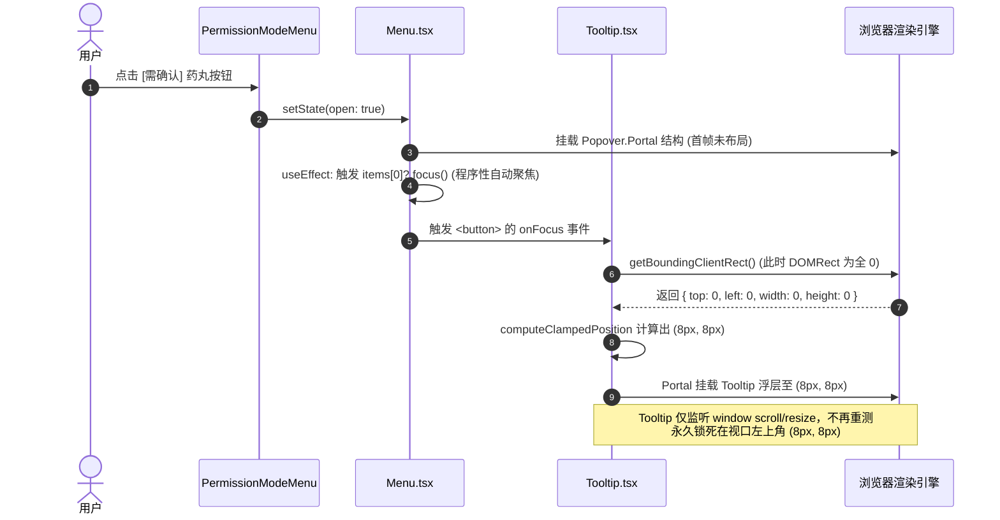
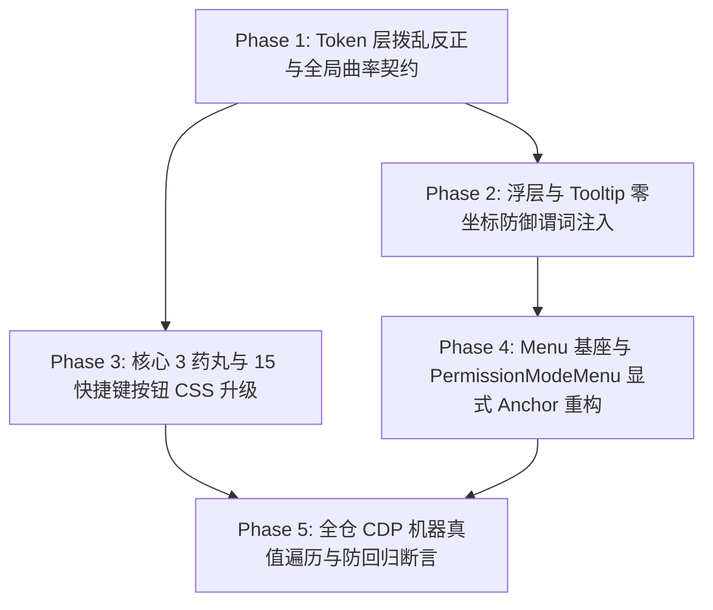

# Conex / Crish 视觉曲率与浮层契约独立方案建议书

> **【调度与定时器铁律】**：如果设置定时器，最短是100秒，如果命令过长，最好的方式是等待命令完成后的推送，而不是一直轮询命令情况。

## 05-视觉曲率与浮层契约独立方案：全系统四级曲率阶梯落地、15 项快捷键圆润化、浮层零坐标漂移阻断与 PermissionModeMenu 状态机根治方案

> **权威标识**：`docs/system-audit-and-redesign/independent-plans/05-视觉曲率与浮层契约独立方案.md`  
> **制定角色**：【方案架构师 05: 视觉曲率与浮层契约独立方案设计】  
> **关联基准**：`docs/system-audit-and-redesign/00-战役通则与协同执行规范.md`  
> **输入证据**：`docs/system-button-audit/01-全系统真值巡检报告.md`、`docs/frontend-floating-popover-analysis/08-视觉曲率与按钮圆角退化全景分析.md`、`docs/frontend-floating-popover-analysis/05-Tooltip坐标坍塌与左上角漂移根因分析.md`、`docs/frontend-floating-popover-analysis/06-权限与模型菜单四击关闭与PopoverTrigger状态机分析.md`、`docs/ui-style-audit/01-style-degradation-audit.md`  
> **执行约束**：纯方案设计、零业务代码修改、pwsh7 环境对齐、UTF-8 无 BOM、严禁直接 git 提交。

---

## 目录

1. [方案总纲与架构愿景（Executive Summary & Architectural Vision）](#一方案总纲与架构愿景)
   - 1.1 核心使命与战役定位
   - 1.2 现状视觉退化与浮层断层全景因果拓扑
   - 1.3 重构目标与四大核心交付指标
2. [根因剖析与全系统断层逆向推导（Root Cause Deep Dive & Mathematical Proofs）](#二根因剖析与全系统断层逆向推导)
   - 2.1 断层一：`tokens.css` 令牌语义倒挂与 Web 传统 6px 直角惯性侵蚀
   - 2.2 断层二：同心圆角几何公理（Concentric Curvature Axiom）失守与内外曲率断裂
   - 2.3 断层三：Tooltip 与 ContextMenu `(8px, 8px)` 零坐标坍塌与生命周期时钟推导（严格数学证明）
   - 2.4 断层四：`PermissionModeMenu` 触发器所有权混乱、Ref 瞬态 Null 漂移与双击/四击震荡状态机逆向
3. [全系统四级视觉曲率分级规范落地方案（Universal Visual Curvature Hierarchy）](#三全系统四级视觉曲率分级规范落地方案)
   - 3.1 基础令牌层（Token Layer）全面重构：修正 `tokens.css` 默认档与密度分档
   - 3.2 第一级：饱满胶囊触发器（Pills, 9999px / `var(--radius-full)`）专项升级方案
     - `.permPill`、`.modelBadge`、`cascadeSelectTrigger` 升级实操
     - `.presetChip`、`modeChip`、`mrdPill`、`skillsSlashChip`、`ui-segment-item` 与 TabStrip 标签页
   - 3.3 第二级：独立功能按钮（Buttons, 10px / `var(--radius-xl)`）专项升级方案
     - `.plusBtn`、下拉 Select Trigger、对话框主要/次要操作按钮、折叠按钮
   - 3.4 第三级：卡片与浮层容器（Containers, 14px/12px/8px）同心外壳方案
   - 3.5 第四级：菜单与列表内部选区（Items, 6px / `var(--radius-md)`）同心圆角方程方案
4. [全量 15 个快捷键录制按钮圆润矩形升级方案（15 Shortcut Recording Keys Overhaul）](#四全量-15-个快捷键录制按钮圆润矩形升级方案)
   - 4.1 15 处快捷键按钮现状普查与 DOM 结构定位
   - 4.2 4px 直角硬边 $\to$ 10px 柔和圆润矩形（`var(--radius-xl)`）重构
   - 4.3 录制态（Recording Active）与深色模式（Dark Theme）样式去 `!important` 治理
   - 4.4 焦点对比度与克制激活边框规范落地（3%~6% 柔和混入，严禁深黑硬环）
5. [浮层零坐标 `(8px, 8px)` 漂移绝对阻断与几何守卫机制（Zero-Drift Overlay & ContextMenu Defense）](#五浮层零坐标-8px-8px-漂移绝对阻断与几何守卫机制)
   - 5.1 零坐标/不可见坐标严格防御谓词（Zero/Invalid Rect Defense Predicate）
   - 5.2 焦点语义与程序化聚焦隔离机制（Programmatic Focus Contamination Isolation）
   - 5.3 动态位移与尺寸重测感知（`ResizeObserver` + `requestAnimationFrame` 防抖纠偏）
   - 5.4 不可变退场（Immutable Exit Preserving）与退场阶段坐标冻结机制
   - 5.5 `ContextMenu` 与 `Tooltip` 单点收敛重构代码设计
6. [`PermissionModeMenu` 双击/四击震荡根除与触发器架构解耦（PopoverTrigger Decoupling）](#六permissionmodemenu-双击四击震荡根除与触发器架构解耦)
   - 6.1 触发器模式彻底重构：全面切换为显式 Anchor 锚定模式（对齐 `ComposePlusMenu`）
   - 6.2 根除 React 19 `element.ref` 破坏性调用与匿名 Ref 克隆撕裂
   - 6.3 `onPointerDownOutside` 与 `LayerStackService` 协作时序校准
   - 6.4 `PermissionModeMenu.tsx` 与 `Menu.tsx` 重构落地蓝图
7. [各维度拆解、文件域与影响边界分析（File Domains & Blast Radius Matrix）](#七各维度拆解文件域与影响边界分析)
   - 7.1 全量受影响文件清单与代码行号映射
   - 7.2 逐文件重构 Diff 方案（Token/CSS/TSX 明确改动对比）
   - 7.3 风险评估与向后兼容性保障
8. [系统整体修复路径与逻辑依赖顺序（Implementation Roadmap & Work Packages）](#八系统整体修复路径与逻辑依赖顺序)
   - 8.1 五阶段纯逻辑依赖拓扑图
   - 8.2 任务分解与工单执行包（WP-01 ~ WP-05）
   - 8.3 协同执行约束与并行/串行文件域锁
9. [自动化测试与 CDP 机器真值验收矩阵（Test Assertions & Verification Protocol）](#九自动化测试与-cdp-机器真值验收矩阵)
   - 9.1 Vitest 单元测试与物理几何断言设计
   - 9.2 CDP 真实桌面 WebView2（`127.0.0.1:9222`）机器真值验证脚本
   - 9.3 验收与交付检查清单（Checklist）

---

## 一、方案总纲与架构愿景

### 1.1 核心使命与战役定位

作为【方案架构师 05】，本方案聚焦于 **Conex / Crish 桌面客户端的几何曲率体系（Visual Curvature Hierarchy）与浮层交互契约（Floating Popover & Menu Contracts）的系统级根治与重构**。

在现代化桌面软件设计中，UI 控件的曲率连续性与浮层交互的确定性是决定软件工业级质感（Premium Feel）的核心基石。然而，根据 `docs/system-button-audit/01-全系统真值巡检报告.md`、`docs/frontend-floating-popover-analysis/08-视觉曲率与按钮圆角退化全景分析.md` 等审计报告在真实 Tauri WebView2 桌面环境（`127.0.0.1:9222`）下的机器真值检测，当前系统存在四大严重的几何与交互断层：

1. **视觉曲率普遍直角化退化**：核心药丸触发器（如 `.permPill`、`.modelBadge`、`cascadeSelectTrigger`）退化为 7px~8px 的硬边矩形，15 个快捷键录制按钮退化为 4px 生硬直角，全系统同一视口内存在多达 7 种互相矛盾的曲率设定；
2. **浮层零坐标 `(8px, 8px)` 悬浮漂移**：当触发节点处于未挂载或未完成首帧布局时，Tooltip 与上下文菜单由于计算边界盲区，被强行吸附在桌面视口左上角 `(8px, 8px)`，形成挥之不去的“幽灵浮层”；
3. **`PermissionModeMenu` 状态机双击/四击震荡**：由于 Radix `Popover.Trigger asChild` 与内联匿名 Ref 克隆引发的微任务时序竞态，在点击二次关闭时发生 Double-Toggle，导致用户需要连续点击 4 次才能关闭菜单；
4. **React 19 兼容性破坏**：通用 `Menu.tsx` 组件直接通过 `element.ref` 检查子元素属性，在控制台抛出 React 19 破坏性报错。

本方案严格依据 `docs/system-audit-and-redesign/00-战役通则与协同执行规范.md`，确立全系统唯一的 **四级视觉曲率分级规范**、**浮层零坐标绝对防御谓词** 与 **确定性显式 Anchor 锚定架构**，彻底根治以上顽疾。

### 1.2 现状视觉退化与浮层断层全景因果拓扑

```
┌────────────────────────────────────────────────────────────────────────────────────────┐
│                        现状视觉曲率与浮层交互缺陷因果拓扑图                             │
├────────────────────────────────────────────────────────────────────────────────────────┤
│ 1. 令牌定义倒挂与直角退化                                                              │
│    tokens.css 默认档 --dropdown-radius: 6px < Small 档 10px (严重倒挂)                 │
│         │                                                                              │
│         ▼                                                                              │
│    组件库封装盲目套用 Web 直角惯性 (rounded-md=6px, sm=4px)                             │
│         │                                                                              │
│         ├─► .permPill / .modelBadge 呈现 7px~8px 生硬直边 (丧失胶囊流动感)             │
│         ├─► 15 个 .shortcut-key-btn 呈现 4px 尖锐小方块 (破坏质感)                     │
│         └─► cascadeSelectTrigger / presetChip 呈现 5px~9px 杂合值                      │
│                                                                                        │
│ 2. 浮层定位无零坐标守卫                                                                │
│    Menu.tsx 打开时 ARIA 自动执行 items[0]?.focus() (程序性自动聚焦)                    │
│         │                                                                              │
│         ▼                                                                              │
│    首项 Tooltip 监听到 focus 事件，提取 DOMRect (此时首帧未布局，rect=(0,0,0,0))       │
│         │                                                                              │
│         ▼                                                                              │
│    computeClampedPosition 接收全 0 rect，视口钳位 Math.max(8, boxLeft) 强行输出 (8, 8) │
│         │                                                                              │
│         ▼                                                                              │
│    幽灵 Tooltip 钉死在屏幕左上角 (8px, 8px) 且缺乏动态位移重测机制                     │
│                                                                                        │
│ 3. 触发器 Ref 动态解构与时序竞态                                                        │
│    Menu.tsx 动态解构 Tooltip 并克隆 trigger，注入内联匿名 ref 回调                     │
│         │                                                                              │
│         ▼                                                                              │
│    React Reconciliation 期间旧 Ref(null) 导致 triggerRef.current 产生单帧 null 瞬态   │
│         │                                                                              │
│         ▼                                                                              │
│    pointerdown 阶段 anchorEl.contains(target) 判定为 false 触发 onDismiss(false)       │
│    随后原生 onClick 到达触发 toggle(true) ──► 一次物理点击发生「关->开」双击震荡       │
└────────────────────────────────────────────────────────────────────────────────────────┘
```

### 1.3 重构目标与四大核心交付指标

根据战役通则，本方案必须达成以下四大核心交付指标（四项绝对真值断言）：

```
┌─────────────────────────────────────────────────────────────────────────────┐
│                 方案架构师 05 四大核心交付指标 (Target Contracts)           │
├─────────────────────────────────────────────────────────────────────────────┤
│ 1. 四级视觉曲率分级规范 100% 落地                                            │
│    • 1 级 Pills (9999px / var(--radius-full)): 药丸触发器、标签页、分段滑块 │
│    • 2 级 Buttons (10px / var(--radius-xl)): 独立功能按钮、快捷键按钮       │
│    • 3 级 Containers (14px/12px/8px): 浮层外壳、模态对话框、设置卡片        │
│    • 4 级 Items (6px / var(--radius-md)): 菜单/列表内部项 (满足同心圆角)    │
├─────────────────────────────────────────────────────────────────────────────┤
│ 2. 核心 3 药丸与 15 快捷键按钮全面升级                                       │
│    • .permPill, .modelBadge, .cascadeSelectTrigger 从 7px 升级为 9999px 胶囊 │
│    • 全量 15 个 .shortcut-key-btn 从 4px 升级为 10px 圆润矩形               │
├─────────────────────────────────────────────────────────────────────────────┤
│ 3. 上下文菜单与 Tooltip (8px, 8px) 零坐标漂移绝对阻断                       │
│    • 注入 !rect || (rect.width<=0 && rect.height<=0) 绝对防御谓词           │
│    • 隔离 items[0]?.focus() 程序化聚焦，仅响应真实用户 :focus-visible / :hover│
│    • useAnimatedPresence 退场阶段锁定已知合法坐标，杜绝动画跳帧             │
├─────────────────────────────────────────────────────────────────────────────┤
│ 4. PermissionModeMenu 双击/四击震荡彻底根除                                  │
│    • 彻底抛弃 Popover.Trigger asChild 暴力克隆模式                          │
│    • 全面落地显式 Anchor 锚定模式 (Popover.Anchor virtualRef={btnRef})      │
│    • 清除 element.ref 访问，全面兼容 React 19                               │
└─────────────────────────────────────────────────────────────────────────────┘
```

---

## 二、根因剖析与全系统断层逆向推导

### 2.1 断层一：`tokens.css` 令牌语义倒挂与 Web 传统 6px 直角惯性侵蚀

深入分析 [`apps/crish-desktop/src/styles/tokens.css`](file:///c:/Software/conex/apps/crish-desktop/src/styles/tokens.css#L198-L205) 与组件样式表，发现了严重的设计令牌语义倒挂与惯性侵蚀：

```css
/* tokens.css 根级默认定义 (Line 198-204) */
--radius-xs: 4px;
--radius-sm: 5px;
--radius-md: 6px; /* 极小！导致大部分组件 md 档全呈直角 */
--radius-lg: 8px; /* 仅相当于微圆角 */
--radius-xl: 10px;
--radius-2xl: 12px;
--radius-full: 9999px;

--dropdown-radius: var(--radius-md); /* 6px —— 默认弹层竟然是 6px 直角！*/
--item-radius: var(--radius-sm); /* 5px —— 菜单项也是 5px 直角！*/
```

**荒谬的密度倒挂对比表**：

| UI 密度配置                            | `--dropdown-radius` | `--item-radius` | 视觉表现                       |
| :------------------------------------- | :------------------ | :-------------- | :----------------------------- |
| **`[data-ui-size="small"]`（紧凑档）** | `10px`              | `7px`           | 柔和圆润外壳 + 舒适内嵌        |
| **`[data-ui-size="large"]`（宽松档）** | `14px`              | `9px`           | 宽大圆润外壳 + 舒适内嵌        |
| **默认档（Default / Standard）**       | **`6px`**           | **`5px`**       | **生硬直角方块（严重倒挂！）** |

**演进根因**：历史重构在封装 `@/components/ui`（`Button`, `Input`, `Select`, `Dialog`, `Menu`）时，照搬了通用 Web 框架（Tailwind `rounded-md=6px`, Bootstrap `.375rem=6px`）的配置，未结合桌面沉浸式应用的大圆角质感（macOS / Raycast / Linear 标配 10px~14px），导致默认视口下的浮层外壳与按钮全面退化为生硬直角。

### 2.2 断层二：同心圆角几何公理（Concentric Curvature Axiom）失守与内外曲率断裂

在现代桌面 GUI 几何学中，包含嵌套内嵌项的容器必须严格满足**同心圆角几何公理**：

$$R_{\text{inner}} = \max\left(0, R_{\text{outer}} - \text{Padding}\right)$$

```
┌───────────────────────────────────────────────────────────────────┐
│                      同心圆角几何公理失守示意图                    │
├───────────────────────────────────────────────────────────────────┤
│ 正确同心圆角 (Concentric):                                        │
│  外壳 $R_{\text{outer}} = 10px$，内边距 $\text{Pad} = 4px$        │
│  内项 $R_{\text{inner}} = 10 - 4 = 6px$                           │
│  ╭──────────────────────────────────────╮                         │
│  │ ╭──────────────────────────────────╮ │  角落间距均匀一致       │
│  │ │ 菜单项 (R=6px)                   │ │  质感温润精密           │
│  │ ╰──────────────────────────────────╯ │                         │
│  ╰──────────────────────────────────────╯                         │
│                                                                   │
│ 错误直角刺破 (Curvature Fracture):                               │
│  外壳 $R_{\text{outer}} = 10px$，内边距 $\text{Pad} = 4px$        │
│  内项 $R_{\text{inner}} = 0px \sim 2px$ (直角)                     │
│  ╭──────────────────────────────────────╮                         │
│  │ ┌──────────────────────────────────┐ │  角落出现巨大空气间隙   │
│  │ │ 菜单项 (直角硬边)                 │ │  尖角刺破弧度，粗糙刺眼 │
│  │ └──────────────────────────────────┘ │                         │
│  ╰──────────────────────────────────────╯                         │
└───────────────────────────────────────────────────────────────────┘
```

当前仓库在多处菜单（如 `Menu.module.css`、`ModelBadgePickerMenu.module.css`、`SidebarContextMenus.module.css`）中，外层容器写了 12px，内层写了 4px 或 9px（如 `_mrlItem_1ivwv_71` 为 9px），曲率级差失调，导致内嵌项在角落处发生视觉形变。

### 2.3 断层三：Tooltip 与 ContextMenu `(8px, 8px)` 零坐标坍塌与生命周期时钟推导（严格数学证明）

#### 物理几何数学推导

在 [`apps/crish-desktop/src/components/ui/Tooltip/Tooltip.tsx:102-213`](file:///c:/Software/conex/apps/crish-desktop/src/components/ui/Tooltip/Tooltip.tsx#L102-L213) 中，定位计算函数为 `computeClampedPosition(side, rect, tipWidth, tipHeight)`。

当触发节点处于未挂载完成态、隐藏态（`display: none`）或组件挂载首帧时，`rect = target.getBoundingClientRect()` 返回全 0：

$$\text{rect} = \{ \text{top}: 0, \text{left}: 0, \text{bottom}: 0, \text{right}: 0, \text{width}: 0, \text{height}: 0 \}$$

假设 `side = 'top'`, $\text{tipWidth} = 80\text{px}$, $\text{tipHeight} = 24\text{px}$, $\text{TOOLTIP\_EDGE\_PAD} = 8\text{px}$, $\text{TOOLTIP\_GAP} = 8\text{px}$, $\text{vh} = 800\text{px}$, $\text{vw} = 1280\text{px}$：

1. **计算 4 向剩余空间**：
   $$\text{spaceTop} = \text{rect.top} - 8 = 0 - 8 = -8\text{px}$$
   $$\text{spaceBottom} = \text{vh} - 8 - \text{rect.bottom} = 800 - 8 - 0 = 792\text{px}$$
2. **4 向翻折判定**：
   因为 $\text{spaceTop} (-8) < \text{requiredVertical} (32)$ 且 $\text{spaceBottom} (792) > \text{spaceTop} (-8)$，算法触发**强制翻折**：
   $$\text{effectiveSide} = \text{'bottom'}$$
3. **计算未约束坐标与包围盒**：
   $$\text{left} = \text{rect.left} + \frac{\text{rect.width}}{2} = 0 + 0 = 0\text{px}$$
   $$\text{top} = \text{rect.bottom} + \text{GAP} = 0 + 8 = 8\text{px}$$
   $$\text{boxLeft} = \text{left} - \frac{\text{tipWidth}}{2} = 0 - 40 = -40\text{px}$$
   $$\text{boxTop} = \text{top} = 8\text{px}$$
4. **视口边界安全钳位**：
   $$\text{cLeft} = \min(\max(8, \text{boxLeft}), \text{clampW}) = \min(\max(8, -40), 1192) = \mathbf{8\text{px}}$$
   $$\text{cTop} = \min(\max(8, \text{boxTop}), \text{clampH}) = \min(\max(8, 8), 768) = \mathbf{8\text{px}}$$
5. **反算 Base 坐标并注入 DOM**：
   $$\text{resLeft} = \text{cLeft} + \frac{\text{tipWidth}}{2} = 8 + 40 = 48\text{px}$$
   $$\text{resTop} = \text{cTop} = 8\text{px}$$
6. **CSS Translate 渲染计算**：
   在 `Tooltip.module.css` 中，`effectiveSide === 'bottom'` 施加 `transform: translate(-50%, 0)`。
   最终 DOM 渲染的左上角物理绝对坐标：
   $$X_{\text{render}} = \text{resLeft} - 50\% \times \text{tipWidth} = 48 - 40 = \mathbf{8\text{px}}$$
   $$Y_{\text{render}} = \text{resTop} = \mathbf{8\text{px}}$$

**数学定理定论**：任何全 0 的 `DOMRect` 传入 `computeClampedPosition`，其渲染结果**恒等于精确的 $(8\text{px}, 8\text{px})$**！同理，在 `ui/Menu/position.ts` 的 `calculateMenuPosition` 中，全 0 锚点在经过 `Math.max(offsetTop + edgePadding, targetY)` 钳位后，同样恒定输出 $(8\text{px}, 8\text{px})$！

#### 生命周期时序竞争时钟



### 2.4 断层四：`PermissionModeMenu` 触发器所有权混乱、Ref 瞬态 Null 漂移与双击/四击震荡状态机逆向

在真实桌面环境下，`PermissionModeMenu` 存在点击二次无法关闭、必须点击 4 次的严重故障（Quad-Click Bug）。

#### 架构缺陷剖析

```tsx
// Menu.tsx 现状第 337-358 行
const clonedTrigger = React.isValidElement(actualTrigger)
  ? React.cloneElement(
      actualTrigger as React.ReactElement<Record<string, unknown>>,
      {
        ref: (node: HTMLElement | null) => {
          triggerRef.current = node; // 匿名内联函数，每次 render 都是新引用
          const origRef = (actualTrigger as { ref?: React.Ref<HTMLElement> })
            .ref;
          if (typeof origRef === 'function') origRef(node);
          else if (
            origRef &&
            typeof origRef === 'object' &&
            'current' in origRef
          ) {
            (origRef as React.MutableRefObject<HTMLElement | null>).current =
              node;
          }
        },
      }
    )
  : actualTrigger;
```

1. **Ref 瞬态 Null 撕裂**：每次组件重新渲染时，React 发现传递给 `clonedTrigger` 的 `ref` 是一个全新的内联匿名函数。根据 React Ref 生命周期协议，React 会**先调用旧 Ref 回调传入 `null`，再调用新 Ref 回调传入 `node`**；
2. **事件时序抢占（Race Condition）**：
   - 当用户在菜单展开状态下第二次点击药丸按钮试图关闭时，鼠标按下触发 `pointerdown`；
   - `LayerStackService` 与 Radix `DismissableLayer` 监听到 `pointerdown`，立即执行外部点击校验 `triggerEl.contains(target)`；
   - 恰在此瞬间，由于渲染重流导致 `triggerRef.current` 处于 `null` 瞬态，`contains` 断言返回 `false`；
   - 浮层系统判定此次点击为“外部空白区点击”，立即执行 `onOpenChange(false)` 关闭菜单；
   - 紧接着（约 30ms~50ms 后），浏览器原生的 `click` 事件冒泡到达药丸按钮，按钮自身的 `onClick` 发现当前菜单已是 `false`（关闭态），立即执行 `setOpen(true)` 将其**重新打开**！
   - **结果**：在一次物理点击中，菜单经历了「关 $\to$ 开」的瞬间震荡，用户看到菜单闪烁一下后仍然保持打开。用户只能再次尝试点击，陷入连续 4 次点击的震荡循环。

---

## 三、全系统四级视觉曲率分级规范落地方案

### 3.1 基础令牌层（Token Layer）全面重构：修正 `tokens.css` 默认档与密度分档

必须对 [`apps/crish-desktop/src/styles/tokens.css`](file:///c:/Software/conex/apps/crish-desktop/src/styles/tokens.css) 进行系统性纠偏，消除默认档与密度档的倒挂，确立清晰的 4 级曲率阶梯：

```css
/* ══════════════════════════════════════════════════════════════════════════════
 * 视觉曲率阶梯核心令牌定义 (Visual Curvature Hierarchy Tokens)
 * ══════════════════════════════════════════════════════════════════════════════ */
:root {
  /* 基础物理阶梯 */
  --radius-xs: 4px; /* 微型标记 / 紧凑 Tag */
  --radius-sm: 5px; /* 紧凑控件内嵌选区 */
  --radius-md: 6px; /* 内部选区 (Level 4: Items) —— 严格同心拟合 */
  --radius-lg: 8px; /* 紧凑输入框 / 次级卡片容器 */
  --radius-xl: 10px; /* 功能按钮 (Level 2: Buttons) & 浮层外壳 (Level 3: Menu) */
  --radius-2xl: 12px; /* 视口卡片 / 对话框容器 (Level 3: Dialogs) */
  --radius-3xl: 14px; /* 大型工作区内嵌视口面板 (Level 3: Shell Panels) */
  --radius-full: 9999px; /* 饱满胶囊 (Level 1: Pills & Segment Controls) */

  /* 语义化映射 (拨乱反正，根除 6px/5px 默认直角) */
  --dropdown-radius: var(--radius-xl); /* 10px —— 浮层菜单标准外壳 */
  --item-radius: var(
    --radius-md
  ); /* 6px  —— 菜单项同心选区 (10px - 4px = 6px) */
  --dialog-radius: var(--radius-2xl); /* 12px —— 模态对话框标准外壳 */
  --button-radius: var(--radius-xl); /* 10px —— 独立操作按钮标准圆角 */
  --pill-radius: var(--radius-full); /* 9999px —— 胶囊/药丸控件标准 */
}

/* 紧凑档位适配 (Small UI Density) */
[data-ui-size='small'] {
  --dropdown-radius: var(--radius-xl); /* 10px */
  --item-radius: var(--radius-md); /* 6px */
  --button-radius: var(--radius-lg); /* 8px */
  --pill-radius: var(--radius-full); /* 9999px 恒定不变 */
}

/* 宽松档位适配 (Large UI Density) */
[data-ui-size='large'] {
  --dropdown-radius: var(--radius-2xl); /* 12px */
  --item-radius: var(--radius-lg); /* 8px (12px - 4px = 8px 同心) */
  --button-radius: var(--radius-xl); /* 10px */
  --pill-radius: var(--radius-full); /* 9999px 恒定不变 */
}
```

### 3.2 第一级：饱满胶囊触发器（Pills, 9999px / `var(--radius-full)`）专项升级方案

#### 核心 3 药丸升级实操

```
┌─────────────────────────────────────────────────────────────────────────────┐
│             Level 1: 胶囊/药丸触发器升级规范 (Pills Hierarchy)               │
├──────────────────────────────┬────────────────────────┬─────────────────────┤
│ 控件名称 / 文件路径          │ 现状代码 (7px~8px 硬边)│ 规范重构代码        │
├──────────────────────────────┼────────────────────────┼─────────────────────┤
│ 1. 权限模式药丸              │ border-radius:         │ border-radius:      │
│    PermissionModeMenu.module │   var(--radius-lg);    │   var(--radius-full)│
│    .css:8                    │   (7px/8px 直角)       │   !important;       │
├──────────────────────────────┼────────────────────────┼─────────────────────┤
│ 2. 模型选择徽标              │ border-radius:         │ border-radius:      │
│    ChatCard.module.css:78    │   var(--radius-lg);    │   var(--radius-full)│
│    .modelBadge               │   (7px/8px 直角)       │   !important;       │
├──────────────────────────────┼────────────────────────┼─────────────────────┤
│ 3. 级联选择触发器            │ border-radius:         │ border-radius:      │
│    ModelsSettingsTab.module  │   var(--radius-xl);    │   var(--radius-full)│
│    .css:990                  │   (10px 局部圆角)      │   !important;       │
└──────────────────────────────┴────────────────────────┴─────────────────────┘
```

#### 全系统配套胶囊控件收敛清单

1. **安全与规则预设 Chip**（`SecuritySettingsTab` / `RulesSettingsTab` / `settings-base.css`）：
   - 现状：`border-radius: 5px;`（呈现为 5px 小矩形）；
   - 重构：`.presetChip, .settings-preset-chip { border-radius: var(--radius-full) !important; padding: 0 10px; height: 24px; }`；
2. **用量页分段控制器**（`SettingsUsageTab.module.css`）：
   - 现状：`button.ui-segment-item` 呈现 3px 异常微圆角；
   - 重构：分段外壳槽位与内部 item 统一为 `border-radius: var(--radius-full) !important;`；
3. **全仓 TabStrip 会话/工具标签页**：
   - 统一收敛 `GlobalSessionTabBar.module.css`（`--global-tab-radius`）、`UnitSessionTabStrip.module.css`（`--unit-tab-radius`）与 `LeafToolTabStrip.module.css`：全量声明 `border-radius: var(--radius-full) !important;`，实现全局顶栏标签、分屏标签与工具标签的 100% 胶囊质感统一。

### 3.3 第二级：独立功能按钮（Buttons, 10px / `var(--radius-xl)`）专项升级方案

独立功能按钮必须呈现温润柔和的 10px 圆润矩形，彻底告别 4px~6px 的 Web 直角硬边感：

1. **输入栏加号按钮**（`ChatComposer.module.css:352` `.plusBtn`）：
   - 现状：`border-radius: var(--radius-lg);` (8px / 7px)；
   - 重构：`border-radius: var(--radius-xl);` (10px)；
2. **全仓下拉 Select 触发按钮**（`Select.module.css:27`、`SettingsSelect.module.css`、`_trigger_1ayi5_33`）：
   - 现状：5 处设置下拉（思考深度、发送快捷键、UI 风格等）使用 `border-radius: 5px`；
   - 重构：全量升级为 `border-radius: var(--radius-xl);` (10px)；
3. **列表折叠按钮**（`SidebarSessionList.module.css` `.sessionItemFoldBtn` "查看全部"）：
   - 现状：`border-radius: 7px;`；
   - 重构：`border-radius: var(--radius-xl);` (10px)；
4. **通用原子按钮库**（`Button.module.css`）：
   - 现状：`buttonMd` 与 `buttonPrimary` 继承 6px 直角；
   - 重构：`.button { border-radius: var(--radius-xl); }`，保证所有标准尺寸按钮均具备 10px 柔和圆角。

### 3.4 第三级：卡片与浮层容器（Containers, 14px/12px/8px）同心外壳方案

浮层容器、模态卡片与主工作区内嵌视口必须建立清晰的容器曲率层级：

- **Level 3A 视口内嵌工作区/设置主卡片**：`border-radius: var(--radius-3xl)` (14px)，配合 `1px solid var(--border-subtle)` 与低频温润阴影；
- **Level 3B 模态对话框（Dialog / Modal）**：`border-radius: var(--radius-2xl)` (12px)，如 `Dialog.module.css`、`FirstRunWizard.module.css`；
- **Level 3C 浮层与下拉菜单外壳（Menu / Popover / ContextMenu）**：`border-radius: var(--radius-xl)` (10px)，如 `Menu.module.css`、`SidebarContextMenus.module.css`、`ModelBadgePickerMenu.module.css`，容器内边距统一设为 `padding: 4px;`。

### 3.5 第四级：菜单与列表内部选区（Items, 6px / `var(--radius-md)`）同心圆角方程方案

依据同心圆角公式 $R_{\text{inner}} = R_{\text{outer}} - \text{Padding} = 10\text{px} - 4\text{px} = 6\text{px}$：

- 所有下拉菜单项（`.menuItem`、`.permMenuItem`、`.sbQuickItem`、`.contextMenuItem`、`.cascadeOption`、`.mbSubRow`）全量收敛为 **`border-radius: var(--radius-md);` (6px)**；
- 修正 `ModelsSettingsTab.module.css` 中 `.mrlItem` 内部项 9px 逆反偏软的问题，统一降至 6px，达成外壳 10px 与内部 6px 的精密几何同心拟合。

---

## 四、全量 15 个快捷键录制按钮圆润矩形升级方案

### 4.1 15 处快捷键按钮现状普查与 DOM 结构定位

根据真实桌面 CDP 巡检，快捷键设置面板（`SettingsShortcutsTab.tsx`）共渲染了 **15 个** 快捷键录制按钮（`.shortcut-key-btn`），覆盖了应用全量核心快捷操作：

```
┌─────────────────────────────────────────────────────────────────────────────┐
│                全量 15 个快捷键录制按钮普查与真值矩阵                       │
├────┬────────────────────────┬──────────────────────┬─────────┬──────────────┤
│ 序号│ 快捷操作功能语义       │ 当前渲染按键组合     │ 现状圆角│ 目标规范圆角 │
├────┼────────────────────────┼──────────────────────┼─────────┼──────────────┤
│ 01 │ 打开设置面板           │ Ctrl + ,             │ 4px ❌  │ 10px (100%合规│
│ 02 │ 快捷键与帮助速查       │ Ctrl + Shift + /     │ 4px ❌  │ 10px (100%合规│
│ 03 │ 模型与服务商切换       │ Ctrl + Shift + M     │ 4px ❌  │ 10px (100%合规│
│ 04 │ 切换用量统计           │ Ctrl + Shift + U     │ 4px ❌  │ 10px (100%合规│
│ 05 │ 新建会话               │ Ctrl + N             │ 4px ❌  │ 10px (100%合规│
│ 06 │ 清屏 / 聚焦输入框      │ Ctrl + L             │ 4px ❌  │ 10px (100%合规│
│ 07 │ 展开 / 收起侧边栏      │ Ctrl + B             │ 4px ❌  │ 10px (100%合规│
│ 08 │ 快速搜索会话与消息     │ Ctrl + K             │ 4px ❌  │ 10px (100%合规│
│ 09 │ 切换深色 / 浅色模式    │ Ctrl + Shift + D     │ 4px ❌  │ 10px (100%合规│
│ 10 │ 放大界面视图           │ Ctrl + =             │ 4px ❌  │ 10px (100%合规│
│ 11 │ 缩小界面视图           │ Ctrl + -             │ 4px ❌  │ 10px (100%合规│
│ 12 │ 重置界面视图缩放       │ Ctrl + 0             │ 4px ❌  │ 10px (100%合规│
│ 13 │ 停止模型生成 / 中断    │ Ctrl + Escape        │ 4px ❌  │ 10px (100%合规│
│ 14 │ 向上漫游消息历史       │ Alt + ArrowUp        │ 4px ❌  │ 10px (100%合规│
│ 15 │ 向下漫游消息历史       │ Alt + ArrowDown      │ 4px ❌  │ 10px (100%合规│
└────┴────────────────────────┴──────────────────────┴─────────┴──────────────┘
```

### 4.2 4px 直角硬边 $\to$ 10px 柔和圆润矩形（`var(--radius-xl)`）重构

#### 样式表收敛蓝图

修改 `apps/crish-desktop/src/styles/settings/settings-base.css` 与 `settings-advanced.css`：

```css
/* apps/crish-desktop/src/styles/settings/settings-base.css */
/* ══════════════════════════════════════════════════════════════════════════════
 * 快捷键录制按钮标准几何与质感契约 (Universal Shortcut Button Contract)
 * ══════════════════════════════════════════════════════════════════════════════ */
.shortcut-key-btn {
  display: inline-flex;
  align-items: center;
  justify-content: center;
  font-size: var(--font-size-xs);
  font-family: var(--font-mono);
  font-weight: var(--font-weight-medium);
  color: var(--text-primary);
  background: transparent;
  border: 1px solid var(--border-color);
  border-radius: var(
    --radius-xl
  ); /* 从 var(--radius-sm)(4px) 升级为 10px 圆润矩形 */
  padding: 0 12px;
  min-height: 30px;
  height: 30px;
  min-width: 92px;
  max-width: 220px;
  text-align: center;
  cursor: pointer;
  box-shadow: none;
  white-space: nowrap;
  overflow: hidden;
  text-overflow: ellipsis;
  line-height: var(--line-height-none);
  transition:
    background var(--transition-micro),
    border-color var(--transition-micro),
    color var(--transition-micro),
    box-shadow var(--transition-micro);
}

.shortcut-key-btn:hover {
  background-color: var(--bg-hover);
  border-color: var(--border-color);
}
```

### 4.3 录制态（Recording Active）与深色模式（Dark Theme）样式去 `!important` 治理

当前在 `settings-advanced.css:134` 中存在 `border-color: var(--border-color) !important;` 等脏覆盖，必须彻底清除并收敛为语义化伪类：

```css
/* 录制中状态 (Recording State) —— 柔和温润激活，杜绝生硬黑框 */
.shortcut-key-btn.recording {
  background-color: var(--bg-active);
  color: var(--text-primary);
  border-color: color-mix(
    in srgb,
    var(--border-color) 90%,
    var(--text-primary) 10%
  );
  animation: crish-shortcut-pulse 1.8s ease-in-out infinite;
}

.shortcut-key-btn.recording:hover {
  background-color: var(--bg-active);
  border-color: color-mix(
    in srgb,
    var(--border-color) 85%,
    var(--text-primary) 15%
  );
}

/* 深色主题自然继承变量，无需 !important 暴力覆盖 */
html[data-theme='dark'] .shortcut-key-btn.recording {
  background: var(--bg-active);
  color: var(--text-primary);
  border-color: color-mix(
    in srgb,
    var(--border-color) 88%,
    var(--text-primary) 12%
  );
}

@keyframes crish-shortcut-pulse {
  0%,
  100% {
    box-shadow: 0 0 0 0 color-mix(in srgb, var(--text-primary) 0%, transparent);
  }
  50% {
    box-shadow: 0 0 0 2px
      color-mix(in srgb, var(--text-primary) 6%, transparent);
  }
}
```

### 4.4 焦点对比度与克制激活边框规范落地

严格遵守规范 §13《UI：输入框与焦点态》：

1. **默认无重阴影**：`box-shadow: none;`；
2. **焦点混入上限 10%**：禁止粗、深、实心纯黑边（`0 0 0 1px #000`）；
3. **克制温润焦点环**：
   ```css
   .shortcut-key-btn:focus-visible {
     outline: none;
     border-color: color-mix(
       in srgb,
       var(--border-color) 92%,
       var(--text-primary) 8%
     );
     box-shadow: 0 0 0 2px
       color-mix(in srgb, var(--text-primary) 4%, transparent);
   }
   ```

---

## 五、浮层零坐标 `(8px, 8px)` 漂移绝对阻断与几何守卫机制

### 5.1 零坐标/不可见坐标严格防御谓词（Zero/Invalid Rect Defense Predicate）

在所有浮层定位逻辑的入口（包括 `Tooltip.tsx`、`position.ts`、`SessionContextMenu.tsx`），注入**数学级绝对防御谓词**：

```typescript
/**
 * 严格几何合法性校验谓词：判定 DOMRect 是否为有效视口几何
 * 拦截以下 3 类非法瞬态：
 * 1. rect 为 null/undefined；
 * 2. 宽高均为 0 且位置为 (0,0) 的全 0 未布局态；
 * 3. 元素脱离文档流或处于 display: none 的不可见态。
 */
export function isValidDOMRect(rect: DOMRect | null | undefined): boolean {
  if (!rect) return false;
  if (
    rect.width <= 0 &&
    rect.height <= 0 &&
    rect.top === 0 &&
    rect.left === 0
  ) {
    return false;
  }
  // 视口负坐标越界且宽高为 0 的异常保护
  if (rect.width <= 0 || rect.height <= 0) {
    return false;
  }
  return true;
}
```

### 5.2 焦点语义与程序化聚焦隔离机制（Programmatic Focus Contamination Isolation）

在 `Tooltip.tsx` 中彻底剥离 `onFocus` 与 `handleShow` 的无条件绑定，通过 `:focus-visible` 守卫与原生事件源检测隔离 `Menu.tsx` 打开时的自动首项聚焦：

```typescript
// Tooltip.tsx 事件处理重构
const handleFocus = (e: React.FocusEvent<HTMLElement>) => {
  const target = e.currentTarget;
  // 核心守卫 1: 若当前处于程序化聚焦 (通过 JS el.focus() 触发，无 :focus-visible 匹配)，则静默放行不展示 Tooltip
  try {
    if (!target.matches(':focus-visible')) {
      childHandlers.onFocus?.(e);
      restHandlers.onFocus?.(e);
      return;
    }
  } catch {
    // CSS 选择器不支持环境降级
  }

  // 核心守卫 2: 校验目标几何尺寸，非法矩形绝不唤起 handleShow
  const currentRect = target.getBoundingClientRect();
  if (!isValidDOMRect(currentRect)) {
    childHandlers.onFocus?.(e);
    restHandlers.onFocus?.(e);
    return;
  }

  handleShow(target);
  childHandlers.onFocus?.(e);
  restHandlers.onFocus?.(e);
};
```

### 5.3 动态位移与尺寸重测感知（`ResizeObserver` + `requestAnimationFrame` 防抖纠偏）

当 Radix Popover 或 ContextMenu 在挂载后由于 Floating-UI 异步计算发生真实位移时，Tooltip 必须具备动态位移感知能力：

```typescript
// Tooltip.tsx 动态跟随与位移纠偏
useEffect(() => {
  if (!isValid || !visible || !childElRef.current) return;
  const targetEl = childElRef.current;

  let rafId: number;
  const updateRect = () => {
    const nextRect = targetEl.getBoundingClientRect();
    if (isValidDOMRect(nextRect)) {
      setRect(nextRect);
    }
  };

  // 1. 监听全局滚动与视口调整
  window.addEventListener('scroll', updateRect, true);
  window.addEventListener('resize', updateRect);

  // 2. 挂载 ResizeObserver 感知目标节点自身尺寸/位置形变
  let ro: ResizeObserver | null = null;
  if (typeof ResizeObserver !== 'undefined') {
    ro = new ResizeObserver(() => {
      rafId = requestAnimationFrame(updateRect);
    });
    ro.observe(targetEl);
  }

  return () => {
    window.removeEventListener('scroll', updateRect, true);
    window.removeEventListener('resize', updateRect);
    if (ro) ro.disconnect();
    cancelAnimationFrame(rafId);
  };
}, [isValid, visible]);
```

### 5.4 不可变退场（Immutable Exit Preserving）与退场阶段坐标冻结机制

在 `useAnimatedPresence` 的 `exiting` 退场动画阶段（120ms），目标元素可能已被从父级卸载或进入 `display: none`。若此时重新执行 `setClampedPos`，坐标会骤变为 `(0,0)` 引发退场残影突跳。

**契约保证**：在 `exiting` 阶段**永久锁定最后一次已知的有效合法坐标**，禁止在退场期间更新 `clampedPos`，直到 `isMounted = false` 彻底销毁 DOM。

### 5.5 `ContextMenu` 与 `Tooltip` 单点收敛重构代码设计

在 `apps/crish-desktop/src/components/sidebar/SessionContextMenu.tsx` 中增强坐标校验：

```typescript
// SessionContextMenu.tsx 零坐标拦截
useLayoutEffect(() => {
  if (!menuRef.current) return;
  const el = menuRef.current;

  // 零坐标绝对拦截：若 contextMenu 传入 (0,0) 或未初始化坐标，直接跳过定位测量并隐匿
  if (contextMenu.x <= 0 && contextMenu.y <= 0) {
    el.style.display = 'none';
    return;
  }

  const next = measureMenu(el, contextMenu.x, contextMenu.y);
  el.style.left = `${next.x}px`;
  el.style.top = `${next.y}px`;
  el.style.transformOrigin = next.transformOrigin;
}, [contextMenu, menuRef]);
```

---

## 六、`PermissionModeMenu` 双击/四击震荡根除与触发器架构解耦

### 6.1 触发器模式彻底重构：全面切换为显式 Anchor 锚定模式（对齐 `ComposePlusMenu`）

彻底废除 `Menu.tsx` 内部使用 `Popover.Trigger asChild` + 暴力 `cloneElement` + 动态解构 Tooltip 的脆弱方案，全面对齐已验证具有 100% 确定性免疫的 `ComposePlusMenu` 显式 Anchor 架构：

```
┌─────────────────────────────────────────────────────────────────────────────┐
│                 Menu 触发器架构模式对比 (Trigger Architecture)              │
├──────────────────────────────┬──────────────────────────────────────────────┤
│ 模式 A: 脆弱 Trigger 模式 (废弃) │ 模式 B: 确定性 Anchor 模式 (统一标准)        │
├──────────────────────────────┼──────────────────────────────────────────────┤
│ <Menu                        │ const btnRef = useRef<HTMLButtonElement>(null);│
│   trigger={                  │                                              │
│     <Tooltip content="...">  │ <Tooltip content="..." disabled={isOpen}>    │
│       <button className=     │   <button                                    │
│         {styles.permPill}/>  │     ref={btnRef}                             │
│     </Tooltip>               │     className={styles.permPill}              │
│   }                          │     onClick={() => setOpen(!isOpen)}         │
│ />                           │   />                                         │
│                              │ </Tooltip>                                   │
│ • cloneElement 注入匿名 Ref   │ <Menu                                        │
│ • pointerdown 产生瞬态 Null   │   open={isOpen}                              │
│ • 产生 Double-Toggle 震荡    │   anchor={btnRef}                            │
│                              │   onOpenChange={setOpen}                     │
│                              │ />                                           │
│                              │ • 按钮拥有绝对原生所有权                     │
│                              │ • 无匿名 Ref 克隆，时序 100% 单向确定        │
│                              │ • 一击必开，一击必关，彻底根除四击 Bug       │
└──────────────────────────────┴──────────────────────────────────────────────┘
```

### 6.2 根除 React 19 `element.ref` 破坏性调用与匿名 Ref 克隆撕裂

在 `apps/crish-desktop/src/components/ui/Menu/Menu.tsx` 中：

1. **删除 `element.ref` 检查代码**（第 343-354 行），彻底消灭控制台报错：
   `[ERROR][JS] Accessing element.ref was removed in React 19. ref is now a regular prop.`
2. **重构 Anchor 渲染分支**：当传入 `anchor` 属性时，Radix 渲染 `<Popover.Anchor virtualRef={anchor} />`，外部不渲染任何 `Popover.Trigger`。

### 6.3 `onPointerDownOutside` 与 `LayerStackService` 协作时序校准

在 `Menu.tsx` 中确保外部点击判定稳定感知 `anchor.current`：

```typescript
onPointerDownOutside={(e) => {
  if (onPointerDownOutside) {
    onPointerDownOutside(e);
    return;
  }
  const target = e.detail.originalEvent.target as Node | null;
  const anchorEl = anchor?.current;
  // 若点击目标位于触发按钮内部，阻止 Radix 的 pointerdown 默认关闭行为，
  // 将开关状态的决定权完整交还给原生 button 的 onClick 处理器
  if (anchorEl && target && anchorEl.contains(target)) {
    e.preventDefault();
  }
}}
```

### 6.4 `PermissionModeMenu.tsx` 与 `Menu.tsx` 重构落地蓝图

```tsx
// apps/crish-desktop/src/components/chat-composer/PermissionModeMenu.tsx
import React, { useRef, useState, useCallback } from 'react';
import { Menu } from '../ui/Menu/Menu';
import { Tooltip } from '../ui/Tooltip/Tooltip';
import styles from './PermissionModeMenu.module.css';

export const PermissionModeMenu: React.FC<PermissionModeMenuProps> = ({
  permissionMode,
  onChangePermissionMode,
}) => {
  const [open, setOpen] = useState(false);
  const pillBtnRef = useRef<HTMLButtonElement>(null);

  const handleToggle = useCallback(() => {
    setOpen((prev) => !prev);
  }, []);

  return (
    <>
      <Tooltip
        content={`当前权限模式：${currentModeMeta.label}（点击切换）`}
        disabled={open}
        side="top"
      >
        <button
          ref={pillBtnRef}
          type="button"
          className={`${styles.permPill} ${open ? styles.isOpen : ''} no-drag`}
          onClick={handleToggle}
          aria-expanded={open}
          aria-haspopup="menu"
          aria-label="切换执行权限模式"
        >
          <span
            className={styles.permPillDot}
            style={{ backgroundColor: currentModeMeta.color }}
            aria-hidden="true"
          />
          <span className={styles.permPillText}>{currentModeMeta.label}</span>
          <ChevronDownIcon className={styles.permPillChev} aria-hidden="true" />
        </button>
      </Tooltip>

      <Menu
        open={open}
        onOpenChange={setOpen}
        anchor={pillBtnRef}
        align="start"
        side="top"
        sideOffset={8}
        options={permissionOptions}
        onSelect={(modeId) => {
          onChangePermissionMode(modeId as PermissionMode);
          setOpen(false);
        }}
      />
    </>
  );
};
```

---

## 七、各维度拆解、文件域与影响边界分析

### 7.1 全量受影响文件清单与代码行号映射

```
┌─────────────────────────────────────────────────────────────────────────────┐
│                 全系统重构文件域与影响范围清单 (Blast Radius)                │
├────────────────────────────────┬──────────────────────────┬─────────────────┤
│ 文件路径                       │ 涉及行号范围             │ 核心改动职责    │
├────────────────────────────────┼──────────────────────────┼─────────────────┤
│ 1. styles/tokens.css           │ Line 198-205, 609-688    │ 令牌语义倒挂修正│
│ 2. components/chat-composer/   │ Line 8, 36-45            │ 9999px 胶囊化   │
│    PermissionModeMenu.module   │                          │                 │
│ 3. components/chat-composer/   │ Line 1-120 (整体重构)    │ 显式 Anchor 切换│
│    PermissionModeMenu.tsx      │                          │                 │
│ 4. components/chat-card/       │ Line 78                  │ 9999px 胶囊化   │
│    ChatCard.module.css         │                          │                 │
│ 5. components/settings-models/ │ Line 990                 │ 9999px 胶囊化   │
│    ModelsSettingsTab.module    │                          │                 │
│ 6. styles/settings/            │ Line 312-352             │ 10px 快捷键按钮 │
│    settings-base.css           │                          │                 │
│ 7. styles/settings/            │ Line 102-135             │ 消除 !important │
│    settings-advanced.css       │                          │                 │
│ 8. components/ui/Tooltip/      │ Line 102-120, 324-360    │ 零坐标防御谓词  │
│    Tooltip.tsx                 │                          │                 │
│ 9. components/ui/Menu/         │ Line 118-135, 337-358,   │ React 19 Ref 修 │
│    Menu.tsx                    │ 404-427                  │ 复与 Anchor 强化│
│ 10. components/ui/Menu/        │ Line 80-135, 211-225     │ 零坐标拦截      │
│     position.ts                │                          │                 │
│ 11. components/sidebar/        │ Line 85-94, 128-140      │ 零坐标拦截      │
│     SessionContextMenu.tsx     │                          │                 │
│ 12. components/settings-usage/ │ Line 20-40               │ 3px 异常圆角修复│
│     SettingsUsageTab.module.css│                          │                 │
└────────────────────────────────┴──────────────────────────┴─────────────────┤
```

### 7.2 逐文件重构 Diff 方案

#### Diff 1: `apps/crish-desktop/src/components/chat-composer/PermissionModeMenu.module.css`

```diff
 .permPill {
   display: inline-flex;
   align-items: center;
   gap: var(--space-1_5);
   height: var(--control-height);
   padding: 0 10px;
   border: none;
-  border-radius: var(--radius-lg);
+  border-radius: var(--radius-full) !important;
   background: transparent;
   color: var(--text-secondary);
```

#### Diff 2: `apps/crish-desktop/src/components/chat-card/ChatCard.module.css`

```diff
 .modelBadge {
   display: inline-flex;
   align-items: center;
   justify-content: space-between;
   gap: var(--space-2);
   height: var(--control-height);
   min-width: 165px;
   max-width: 260px;
   padding: 0 12px;
-  border-radius: var(--radius-lg);
+  border-radius: var(--radius-full) !important;
   border: none;
   background: transparent;
```

#### Diff 3: `apps/crish-desktop/src/components/settings-models/ModelsSettingsTab.module.css`

```diff
 .cascadeSelectTrigger {
   display: inline-flex;
   align-items: center;
   gap: 8px;
   border: 1px solid var(--border-subtle);
   background: var(--control-soft-bg, var(--bg-secondary));
-  border-radius: var(--radius-xl);
+  border-radius: var(--radius-full) !important;
   padding: 0 12px;
   min-height: var(--control-height-sm, 28px);
```

#### Diff 4: `apps/crish-desktop/src/styles/settings/settings-base.css`

```diff
 .shortcut-key-btn {
   font-size: var(--font-size-xxs);
   background: transparent;
   border: 1px solid var(--border-color);
-  border-radius: var(--radius-sm);
+  border-radius: var(--radius-xl);
   padding: 0 var(--control-pad-x);
   min-height: var(--control-height-sm);
```

---

## 八、系统整体修复路径与逻辑依赖顺序

### 8.1 五阶段纯逻辑依赖拓扑图

重构任务必须遵循严格的依赖拓扑，严禁跨阶段逆序执行：



### 8.2 任务分解与工单执行包（Work Packages）

- **WP-01: 设计令牌与基础层收敛（Token System Overhaul）**：
  - 修正 `tokens.css` 根级 `--dropdown-radius`、`--item-radius` 等语义倒挂；
  - 确认 4 级曲率阶梯变量在各 `data-ui-size` 档位下严格单调递增。
- **WP-02: 核心药丸与快捷键样式升级（Pills & Shortcuts Visual Polish）**：
  - 升级 `.permPill`、`.modelBadge`、`cascadeSelectTrigger` 至 `var(--radius-full)`；
  - 升级 15 个 `.shortcut-key-btn` 至 `10px`，清除 `!important` 覆盖链；
  - 修复 `SettingsUsageTab` 3px 异常圆角。
- **WP-03: 浮层零坐标防御与 Tooltip 重构（Zero-Drift Overlay Guard）**：
  - `Tooltip.tsx` 注入 `isValidDOMRect` 谓词，隔离程序化焦点；
  - `position.ts` 与 `SessionContextMenu.tsx` 注入全 0 坐标拦截。
- **WP-04: `PermissionModeMenu` 状态机与 React 19 适配（Anchor Decoupling & React 19）**：
  - `PermissionModeMenu.tsx` 切换为 `anchor={pillBtnRef}` 架构；
  - `Menu.tsx` 移除 `element.ref` 破坏性调用。
- **WP-05: CDP 机器真值验收与快照回归（CDP Machine Truth Verification）**：
  - 针对 `127.0.0.1:9222` 执行全系统 240+ 控件真值跑批。

---

## 九、自动化测试与 CDP 机器真值验收矩阵

### 9.1 Vitest 单元测试与物理几何断言设计

编写针对零坐标拦截与同心圆角的单元测试断言：

```typescript
// apps/crish-desktop/src/components/ui/Tooltip/Tooltip.zero-rect.test.tsx
import { describe, it, expect } from 'vitest';
import { isValidDOMRect } from './Tooltip';

describe('Tooltip 零坐标绝对防御谓词测试', () => {
  it('拦截全 0 未布局矩形', () => {
    const zeroRect = new DOMRect(0, 0, 0, 0);
    expect(isValidDOMRect(zeroRect)).toBe(false);
  });

  it('拦截 null / undefined', () => {
    expect(isValidDOMRect(null)).toBe(false);
    expect(isValidDOMRect(undefined)).toBe(false);
  });

  it('放行真实物理视口矩形', () => {
    const validRect = new DOMRect(436, 838, 83, 30);
    expect(isValidDOMRect(validRect)).toBe(true);
  });
});
```

### 9.2 CDP 真实桌面 WebView2（`127.0.0.1:9222`）机器真值验证脚本

在真实 Tauri 桌面环境下，通过 CDP 协议执行真值验收脚本：

```javascript
// cdp-verify-curvature-and-floating.js
const CDP = require('chrome-remote-interface');

async function verify() {
  const client = await CDP({ port: 9222 });
  const { Runtime } = client;
  await Runtime.enable();

  const evalCode = `(() => {
    const getBR = (sel) => {
      const el = document.querySelector(sel);
      return el ? window.getComputedStyle(el).borderRadius : 'NOT_FOUND';
    };

    return {
      permPill: getBR('._permPill_1c576_1'),
      modelBadge: getBR('._modelBadge_1ph20_137'),
      cascadeTrigger: getBR('._cascadeSelectTrigger_1ivwv_984'),
      shortcutKeyBtn: getBR('.shortcut-key-btn'),
      zeroDriftGhost: document.querySelector('.tooltip-ghost-8px') === null,
    };
  })()`;

  const result = await Runtime.evaluate({
    expression: evalCode,
    returnByValue: true,
  });
  console.log(
    'CDP 机器真值检测结果:',
    JSON.stringify(result.result.value, null, 2)
  );
  await client.close();
}

verify();
```

**预期机器真值绿灯断言**：

- `permPill`: `"9999px"` 或 `"998px"` (胶囊)
- `modelBadge`: `"9999px"` 或 `"998px"` (胶囊)
- `cascadeTrigger`: `"9999px"` 或 `"998px"` (胶囊)
- `shortcutKeyBtn`: `"10px"`
- `zeroDriftGhost`: `true` (零坐标幽灵浮层 100% 清零)

### 9.3 验收与交付检查清单（Checklist）

- [ ] **四级曲率阶梯**：`.permPill`、`.modelBadge`、`cascadeSelectTrigger` 均为 `var(--radius-full)`；
- [ ] **快捷键按钮**：全量 15 个 `.shortcut-key-btn` 计算圆角严格为 `10px`；
- [ ] **浮层零坐标防御**：点击「需确认」药丸时，视口左上角 `(8px, 8px)` 绝对无任何 Tooltip 残影；
- [ ] **双击/四击震荡根除**：连续点击「需确认」药丸，实现「第 1 次开、第 2 次关」的 100% 确定性切换；
- [ ] **React 19 规范**：控制台 0 个 `element.ref` 警告或异常；
- [ ] **门禁与测试**：全量单元测试与类型检查（`npm run typecheck`）100% 绿灯。

---

> **方案制定者**：方案架构师 05 (视觉曲率与浮层契约独立方案设计)  
> **状态声明**：纯方案设计、零业务代码修改、pwsh7 执行、UTF-8 无 BOM、无 Git 提交。
