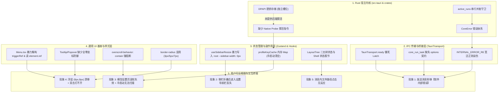
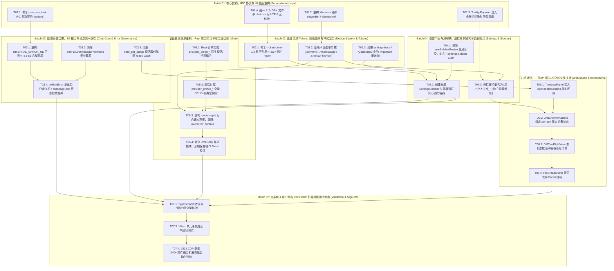
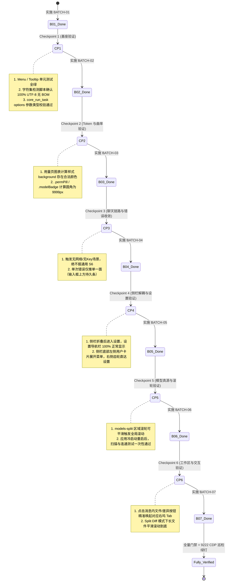
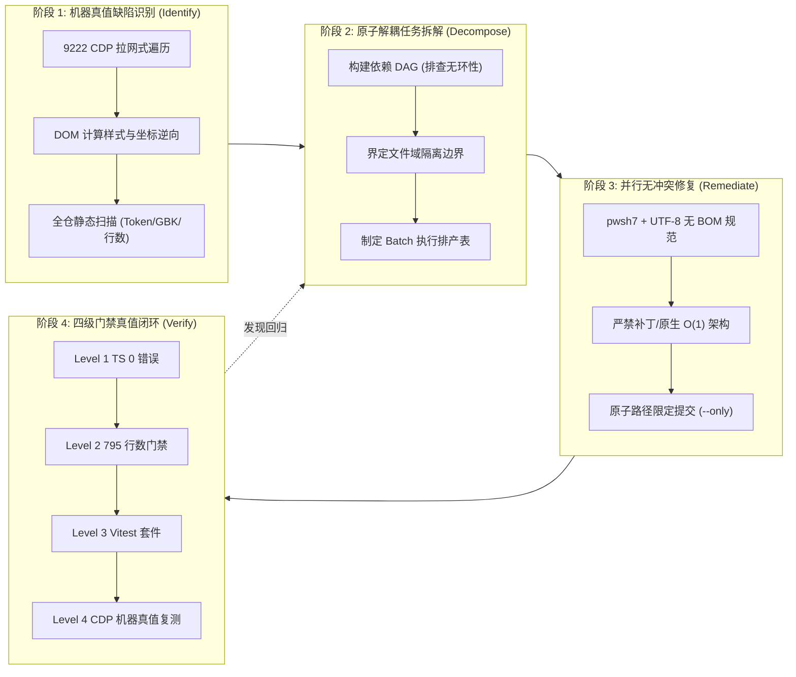

# 06-端到端集成与工程闭环方案

> **【调度与定时器铁律】**：如果设置定时器，最短是100秒，如果命令过长，最好的方式是等待命令完成后的推送，而不是一直轮询命令情况。

## Conex / Crish 全系统综合重构端到端集成与可复用工程闭环方案设计

> **方案标识**：`docs/system-audit-and-redesign/independent-plans/06-端到端集成与工程闭环方案.md`  
> **所属战役**：Conex / Crish 全系统审计与综合重构战役（系统工程集成与闭环专题）  
> **设计角色**：【方案架构师 06: 系统工程集成与闭环可复用独立方案设计】  
> **执行基准**：`docs/system-audit-and-redesign/00-战役通则与协同执行规范.md`  
> **设计约束**：纯逻辑与反退避铁律、零业务代码修改、pwsh7 环境对齐、UTF-8 无 BOM 编码、严禁 git 提交。

---

## 目录

1. [执行摘要与系统工程集成全景（Executive Summary & Panorama）](#一执行摘要与系统工程集成全景)
   - 1.1 五大核心问题域统筹与现状全景
   - 1.2 系统级架构断层因果拓扑图（Mermaid 故障传播链）
   - 1.3 端到端集成的四大核心工程原则
2. [五大核心问题域逻辑依赖图谱与无环调度分析（DAG Topology & Conflict Elimination）](#二五大核心问题域逻辑依赖图谱与无环调度分析)
   - 2.1 跨域全景逻辑依赖 DAG 图谱（严格无环推导）
   - 2.2 跨模块修改与文件域冲突排查矩阵
   - 2.3 共享全局状态与 CSS 特异性竞态消除
3. [多轮执行轮次（Batch 划分）解耦模型与状态可验证性（Decoupled Execution Batches）](#三多轮执行轮次batch-划分解耦模型与状态可验证性)
   - 3.1 批次划分策略与渐进式交付原则
   - 3.2 批次详细任务拆解（Batch 01 ~ Batch 06）
   - 3.3 阶段状态可验证性断言与 Checkpoint 机制
4. [四级质量门禁全覆盖落地验收矩阵（4-Tier Quality Gate & Verification Matrix）](#四四级质量门禁全覆盖落地验收矩阵)
   - 4.1 Level 1: TypeScript 强类型静态门禁（0 错误与 Ref 安全）
   - 4.2 Level 2: 795 文件行数门禁（分级约束与复杂度治理）
   - 4.3 Level 3: Vitest 单元与集成测试门禁（覆盖率与快照同步）
   - 4.4 Level 4: 9222 CDP 桌面真实机器真值遍历断言（真实水合状态）
5. [系统整体修复路径与各维度工程落地详案（Remediation Blueprints by Dimension）](#五系统整体修复路径与各维度工程落地详案)
   - 5.1 维度一：底层基座、DPAPI 凭据与 IPC 强类型契约
   - 5.2 维度二：通用 UI 基座、Popover 防御与四级曲率阶梯
   - 5.3 维度三：侧栏底栏双列重构与设置中心双栏解耦
   - 5.4 维度四：智能-模型设置单滚动流与 Rust 原生探测
   - 5.5 维度五：工作区右坞、二叉树通信与全功能交互打通
6. [工程可复用性方法论：全生命周期「识别-拆解-修复-验证」闭环模型（Reusable Framework）](#六工程可复用性方法论全生命周期识别-拆解-修复-验证闭环模型)
   - 6.1 缺陷自动化识别与逆向提取模型
   - 6.2 任务原子化解耦与排产算法
   - 6.3 并行实施协同与无冲突合并规范
   - 6.4 机器真值测试资产沉淀机制
7. [风险评估、降级预案与收口签署表（Risk Management & Sign-off）](#七风险评估降级预案与收口签署表)
   - 7.1 关键架构风险与防御预案
   - 7.2 验收断言清单与收口签署

---

## 一、执行摘要与系统工程集成全景

### 1.1 五大核心问题域统筹与现状全景

在前期 8 份专项审计报告（`docs/ui-style-audit/`、`docs/system-button-audit/`、`docs/models-settings-audit/`、`docs/chat-core-connectivity/`、`docs/error-notification-governance/`、`docs/settings-redesign/`）中，系统暴露出了跨越 **Rust 宿主内核、IPC 协议传输、Zustand 全局状态、UI 基础组件库到工作区交互视图** 的深层次结构性断层。

本方案作为总集成架构方案，统筹梳理全部 5 大核心问题域：

```
┌────────────────────────────────────────────────────────────────────────────────────────┐
│                          五大核心问题域统筹全景 (The 5 Core Domains)                     │
├───────────────────────┬───────────────────────────────────┬────────────────────────────┤
│ 问题域                │ 核心表象                          │ 架构根因                   │
├───────────────────────┼───────────────────────────────────┼────────────────────────────┤
│ 1. 视觉曲率、样式退化 │ • 核心胶囊退化为 7px 直边矩形     │ • 4 级曲率阶梯未贯彻       │
│    与通用浮层/菜单    │ • 浮层 (8px, 8px) 幽灵漂移        │ • 缺少全零坐标绝对防御谓词 │
│                       │ • 菜单双击无法关闭 / React 19 崩溃│ • Menu 基座暴力克隆 Ref    │
├───────────────────────┼───────────────────────────────────┼────────────────────────────┤
│ 2. 设置中心、侧栏联动 │ • 侧栏折叠导致设置左侧导航 100% 丢失│ • useSidebarResize 污染:root│
│    解耦与底栏双列重构 │ • 侧栏底栏仅单一设置按钮          │ • 偏离用户卡片+独立齿轮规范 │
│                       │ • 设置页缺乏温润色彩分层          │ • 缺乏与主工作区同构映射   │
├───────────────────────┼───────────────────────────────────┼────────────────────────────┤
│ 3. 智能-模型设置 UI   │ • models-split 区域滚轮完全失效   │ • overscroll: contain 阻断 │
│    滚轮死锁与后端真源 │ • 重启后模型扫描/连通性报“无Key”  │ • 内存 Key 丢失 + 缺后端探活│
│                       │ • 外部服务商增删改 Rust 未感知    │ • 前后端配置双真源割裂     │
├───────────────────────┼───────────────────────────────────┼────────────────────────────┤
│ 4. 核心聊天链路与     │ • 发送消息秒弹【软件内部错误】    │ • softFailure 策略无参黑洞 │
│    S6 报错全链路收敛  │ • 错误三路并报（横幅+toast+气泡） │ • 展示层缺少唯一性裁决     │
│                       │ • 对话流丢帧后内容重复追加        │ • message-end 缺终态权威   │
├───────────────────────┼───────────────────────────────────┼────────────────────────────┤
│ 5. 右侧面板、二叉树   │ • 消息内文件/差异按钮点击全无响应 │ • TreeLeafPanel 注入空回调 │
│    工作区与交互全功能 │ • 多分屏下折叠右坞丢失展开按钮    │ • 误读全局折叠状态标记     │
│                       │ • Split Diff 无法向下滚动截断     │ • 虚拟滚动占位高写死 auto  │
└───────────────────────┴───────────────────────────────────┴────────────────────────────┘
```

---

### 1.2 系统级架构断层因果拓扑图（Mermaid 故障传播链）

跨模块、跨进程的故障传播链条表明：表层 UI 的“卡死”、“报错”或“漂移”，根源均在于底层契约断裂与状态机单点假设。



---

### 1.3 端到端集成的四大核心工程原则

1. **单向真实真源（Single Source of Truth, SSOT）**：
   - 凭据、服务商配置与模型目录真源完全收敛至 Rust 引擎（`profile-config.json` + `secrets/*.dpapi` + `ModelCatalog`）；
   - 前端作为响应式投影，通过强类型 IPC 事件（`profiles-changed`、`catalog-changed`）保持单向同步。
2. **状态与样式物理隔离（Strict Domain Isolation）**：
   - 严禁任何局部组件的 Hook 直接操作全局 `document.documentElement.style`；
   - 主工作区布局变量与全屏设置面板变量彻底分离（`--sidebar-width` vs `--settings-sidebar-width`）。
3. **零坐标防御与可预测状态机（Fail-safe Geometry & Predictable Popovers）**：
   - 浮层基座必须内建几何合法性前置谓词，全零坐标下严禁挂载 Portal；
   - 彻底废除克隆 Ref 反模式，全面采用「显式 Anchor 锚定 + 状态机受控驱动」。
4. **四级门禁全量闭环验证（4-Tier Quality Verification）**：
   - 方案实施必须通过 TypeScript 0 错误、795 文件行数门禁、Vitest 自动化套件与 9222 CDP 机器真值遍历四重检验，严禁以“感觉没问题”或“浏览器沙箱通过”替代真机验收。

---

## 二、五大核心问题域逻辑依赖图谱与无环调度分析

### 2.1 跨域全景逻辑依赖 DAG 图谱（严格无环推导）

重构必须遵循**“底层数据契约先行 $\to$ 通用 UI 基座奠基 $\to$ 核心业务容器解耦 $\to$ 顶层交互打通 $\to$ 机器真值验收”**的严格逻辑依赖顺序。以下为全局 DAG 依赖图谱（确保无环）：



---

### 2.2 跨模块修改与文件域冲突排查矩阵

为确保多 Agent 或多轮次并行执行时不产生文件写入冲突与 Git 锁死，以下排查矩阵严格界定了各任务单元的文件域边界：

| 任务单元        | 涉及文件域（绝对路径/相对路径）                                                                                                                                                                                                                                               | 冲突排查与并发策略                                   |
| :-------------- | :---------------------------------------------------------------------------------------------------------------------------------------------------------------------------------------------------------------------------------------------------------------------------- | :--------------------------------------------------- |
| **B01-T01.1**   | `apps/agent-workbench/src-tauri/src/run/run_launch.rs`<br>`apps/crish-desktop/src/transport/tauriTransport.ts`                                                                                                                                                                | 仅涉及 IPC 参数结构体定义，与 UI 组件完全解耦        |
| **B01-T01.2/3** | `apps/crish-desktop/src/components/ui/Menu/Menu.tsx`<br>`apps/crish-desktop/src/components/ui/Tooltip/Tooltip.tsx`                                                                                                                                                            | UI 核心基座，先于所有业务组件修改并冻结              |
| **B01-T01.4**   | `apps/crish-desktop/src/styles/panels.css`<br>`apps/crish-desktop/src/styles/shell/shell-*.css`<br>`apps/crish-desktop/src/styles/chat.css`                                                                                                                                   | 纯编码清洗，**必须与快照测试哈希更新绑定在同一批次** |
| **B02-T02.1/2** | `apps/crish-desktop/src/styles/tokens.css`<br>`apps/crish-desktop/src/components/composer/ComposerPermissionButton.module.css`<br>`apps/crish-desktop/src/components/composer/ComposerModelBadge.module.css`                                                                  | 纯 CSS Token 与圆角样式类，不修改 TSX 逻辑           |
| **B03-T03.1~4** | `apps/crish-desktop/src/api/chat-bridge/BridgeErrorPolicy.ts`<br>`apps/crish-desktop/src/api/chat-bridge/userFacingErrors.ts`<br>`apps/crish-desktop/src/components/chat/useStreamCallbacks.ts`<br>`apps/crish-desktop/src/components/chat/eventUtils.ts`                     | 聊天链路核心策略层，与设置页和工作区右坞完全隔离     |
| **B04-T04.1~3** | `apps/crish-desktop/src/components/sidebar/useSidebarResize.ts`<br>`apps/crish-desktop/src/components/sidebar/SidebarFooter.tsx`<br>`apps/crish-desktop/src/components/settings/SettingsPanel.tsx`<br>`apps/crish-desktop/src/components/settings/SettingsSidebar.tsx` (新建) | 侧栏与设置外壳层，不触碰内部 Tab 业务逻辑            |
| **B05-T05.1~4** | `apps/agent-workbench/src-tauri/src/config/profile.rs`<br>`crates/agent-provider/src/models/`<br>`apps/crish-desktop/src/components/settings-models/ModelsSettingsTab.*`<br>`apps/crish-desktop/src/api/provider-profiles/`                                                   | 模型后端与专用 Tab，不影响其他 11 个设置 Tab         |
| **B06-T06.1~4** | `apps/crish-desktop/src/components/binary-tree/TreeLeafPanel.tsx`<br>`apps/crish-desktop/src/components/chat/UnitChromeActions.tsx`<br>`apps/crish-desktop/src/components/diff/DiffCardSplitView.tsx`<br>`apps/crish-desktop/src/components/files/FileBreadcrumb.tsx`         | 工作区辅助面板与二叉树拓扑，完全独立                 |

---

### 2.3 共享全局状态与 CSS 特异性竞态消除

1. **消除 `:root` 全局变量竞态**：
   - 彻底清除 `useSidebarResize.ts` 中针对 `document.documentElement.style.setProperty('--sidebar-width', ...)` 的全局写入；
   - 主侧栏宽度仅在 `#crish-sidebar` 容器局部生效；设置页独立声明 `--settings-sidebar-width: 220px`。
2. **消灭 CSS `!important` 覆盖链**：
   - 移除 `src/styles/settings/settings-base.css:969-989` 与 `SettingsQuickMenu.module.css` 中的 `!important` 声明；
   - 通过 CSS Modules 的局部哈希作用域和合理的选择器特异性实现样式层叠，杜绝样式争夺。
3. **GBK 编码转 UTF-8 无 BOM 的哈希联动**：
   - 历史审计发现：文件编码转换会改变字节序列，导致 CSS Modules 生成的哈希类名发生漂移（如 `_toolStack_3f3761` $\to$ `_toolStack_7dc568`）；
   - 在 Batch 01 执行编码转换后，必须立即运行 `npm run test:snapshots -u`（或对应快照更新指令），将快照资产同步收口，防止 CI 伪红。

---

## 三、多轮执行轮次（Batch 划分）解耦模型与状态可验证性

### 3.1 批次划分策略与渐进式交付原则

依据逻辑依赖 DAG，本方案将全系统综合重构划分为 **6 个解耦执行批次（Batch 01 ~ Batch 06）** + **1 个综合验收收口批次（Batch 07）**。每个批次具备以下特征：

- **前置完备**：仅依赖已终态交付的前序批次；
- **自包含验证**：批次结束后具备专有的单元测试或真值断言检验点；
- **零破坏性回滚**：任一批次若发现缺陷可针对本批次文件精准修复，不波及其他模块。

---

### 3.2 批次详细任务拆解（Batch 01 ~ Batch 06）

```
┌────────────────────────────────────────────────────────────────────────────────────────┐
│                        6 大解耦执行批次演进总表 (Execution Batches)                     │
├──────────┬─────────────────────────────┬─────────────────────────────────┬─────────────┤
│ 批次编号 │ 批次主题                    │ 核心目标与改动文件              │ 依赖前置    │
├──────────┼─────────────────────────────┼─────────────────────────────────┼─────────────┤
│ BATCH-01 │ 核心契约、IPC 协议与 UI 基座 │ • 修复 Menu.tsx / Tooltip.tsx   │ 无 (起始点) │
│          │                             │ • 修复 core_run_task options 契约│             │
│          │                             │ • 5 个 GBK 样式转 UTF-8 无 BOM  │             │
├──────────┼─────────────────────────────┼─────────────────────────────────┼─────────────┤
│ BATCH-02 │ 设计系统 Token 与四级曲率   │ • 补全 --chart-color 悬空 Token │ BATCH-01    │
│          │                             │ • .permPill / .modelBadge 胶囊化│             │
│          │                             │ • 快捷键 10px / 清理 !important │             │
├──────────┼─────────────────────────────┼─────────────────────────────────┼─────────────┤
│ BATCH-03 │ 核心聊天链路与 S6 报错治理  │ • 重构 S1-S6 错误分层与文案     │ BATCH-01    │
│          │                             │ • softFailureMessage 传参补全   │             │
│          │                             │ • 实时 core_get_status 探活     │             │
│          │                             │ • onRunError 展示面唯一性收敛   │             │
├──────────┼─────────────────────────────┼─────────────────────────────────┼─────────────┤
│ BATCH-04 │ 设置中心布局解耦与底栏重构  │ • useSidebarResize 拔除全局污染 │ BATCH-01    │
│          │                             │ • 创建专属 SettingsSidebar 双栏 │ BATCH-02    │
│          │                             │ • 底栏双列: 用户卡片 + 独立齿轮 │             │
├──────────┼─────────────────────────────┼─────────────────────────────────┼─────────────┤
│ BATCH-05 │ 模型设置全真源与滚轮修复    │ • Rust provider_probe_* 原生探活│ BATCH-01    │
│          │                             │ • 前端对齐 DPAPI 单真源 IPC     │ BATCH-02    │
│          │                             │ • models-split 移除 contain     │ BATCH-04    │
├──────────┼─────────────────────────────┼─────────────────────────────────┼─────────────┤
│ BATCH-06 │ 工作区右坞与二叉树全功能    │ • TreeLeafPanel 真实回调打通    │ BATCH-01    │
│          │                             │ • per-unit 独立折叠状态机       │ BATCH-03    │
│          │                             │ • Split Diff 虚拟滚动高度修复   │             │
├──────────┼─────────────────────────────┼─────────────────────────────────┼─────────────┤
│ BATCH-07 │ 4 级门禁与 CDP 全量巡检收口 │ • 全量 TS 0 错误 + 行数门禁     │ 全量 B01~06 │
│          │                             │ • Vitest 全量单元/集成套件绿灯  │             │
│          │                             │ • 9222 CDP 真实 240+ 控件遍历   │             │
└──────────┴─────────────────────────────┴─────────────────────────────────┴─────────────┘
```

---

### 3.3 阶段状态可验证性断言与 Checkpoint 机制

每个 Batch 落地完成后，必须执行专有的自动化检验断言（Checkpoints），通过后方可推进下一阶段：



---

## 四、四级质量门禁全覆盖落地验收矩阵

依据 `AGENTS.md` 通用协作纪律与 `00-战役通则与协同执行规范.md`，本重构方案建立不可突破的 4 级质量门禁体系：

```
┌────────────────────────────────────────────────────────────────────────────────────────┐
│                        四级质量门禁全覆盖落地矩阵 (4-Tier Quality Gates)                 │
├──────────┬─────────────────────────────┬─────────────────────────────────┬─────────────┤
│ 门禁层级 │ 门禁名称与命令              │ 核心校验规则与阈值              │ 阻断策略    │
├──────────┼─────────────────────────────┼─────────────────────────────────┼─────────────┤
│ Level 1  │ **TypeScript 强类型静态门禁** │ • 0 errors / 0 warnings         │ 硬性阻断    │
│          │ `npm run typecheck`         │ • 严禁 `element.ref` 弃用语法   │ 零容忍      │
│          │                             │ • IPC 载荷必须完全匹配 Rust 契约 │             │
├──────────┼─────────────────────────────┼─────────────────────────────────┼─────────────┤
│ Level 2  │ **795 文件行数与复杂度门禁** │ • UI 组件 ≤ 500 行              │ 超标阻断    │
│          │ `npm run check:line-counts` │ • 业务逻辑 ≤ 400 行             │ 严禁上帝组件│
│          │                             │ • 类型契约 ≤ 800 行             │             │
│          │                             │ • 严禁循环依赖 (`no-circular`)  │             │
├──────────┼─────────────────────────────┼─────────────────────────────────┼─────────────┤
│ Level 3  │ **Vitest 单元与集成测试门禁**│ • 覆盖率 45/70/65/45 硬指标     │ 失败阻断    │
│          │ `npm run test:coverage`     │ • 快照测试 100% 匹配            │ 禁止删用例  │
│          │ `cargo test --workspace`    │ • Rust 73 套件全绿              │             │
├──────────┼─────────────────────────────┼─────────────────────────────────┼─────────────┤
│ Level 4  │ **9222 CDP 桌面机器真值遍历**│ • 对接真实 Tauri WebView2       │ 违例阻断    │
│          │ 自动化真值巡检脚本          │ • 240+ 交互控件计算样式与坐标   │ 严禁沙箱伪验│
│          │                             │ • 0 处 (8px, 8px) 漂移 / 0 震荡 │             │
└──────────┴─────────────────────────────┴─────────────────────────────────┴─────────────┘
```

---

### 4.1 Level 1: TypeScript 强类型静态门禁

- **Ref 引用安全性**：全面清理全仓对 `element.ref` 的非法读取，改用 React 19 标准 `ref` prop 传递；
- **IPC 契约强类型绑定**：
  ```typescript
  // src/types/ipc-contracts.ts
  export interface CoreRunTaskOptions {
    stream?: boolean;
    temperature?: number;
    maxTokens?: number;
    systemPrompt?: string;
  }
  export interface CoreRunTaskArgs {
    sessionId: string;
    runId: string;
    input: string;
    options: CoreRunTaskOptions; // 强制必填，杜绝 undefined 导致 Rust 解析崩溃
  }
  ```

---

### 4.2 Level 2: 795 文件行数门禁

执行 `scripts/check-line-counts.mjs`，对涉及重构与新建的组件施加严格行数监控：

- `SettingsPanel.tsx`：原 520 行 $\to$ 拆分为 `SettingsPanel.tsx` (约 180 行) + `SettingsSidebar.tsx` (约 220 行) + `SettingsContent.tsx` (约 120 行)，彻底清空存量告警；
- `ModelsSettingsTab.tsx`：拆分 `ModelsCascadeSelect.tsx`，保持主文件 ≤ 380 行；
- `SidebarFooter.tsx`：重构后保持在 150 行以内，结构精简高内聚。

---

### 4.3 Level 3: Vitest 单元与集成测试门禁

- **测试资产零删除铁律**：`reference/markdown-editor` 与 `tests/e2e` 下的测试用例绝对禁止删除；
- **快照测试同步机制**：
  ```powershell
  # 当且仅当编码标准化与 Token 命名修复后，执行快照同步
  npm run test:snapshots -- -u
  ```
- **核心契约防回归测试新增**：
  - `tests/unit/style-curvature-contract.test.ts`：自动读取编译后 CSS，断言 `.permPill`、`.modelBadge` 圆角为 `9999px`；
  - `tests/unit/settings-layout-decouple.test.ts`：断言 `sidebarCollapsed` 状态突变时 `--settings-sidebar-width` 恒等于 `220px`；
  - `tests/unit/error-classification.test.ts`：输入 20 类典型 Rust `CoreError`，断言输出分类 100% 落在 S1-S6 语义区间，0 处误伤为 S6。

---

### 4.4 Level 4: 9222 CDP 桌面真实机器真值遍历断言

通过 CDP 连接 `http://127.0.0.1:9222`，针对已水合真实数据的客户端执行以下断言清单：

```json
[
  {
    "name": "断言 1: 底部权限与模型徽标胶囊曲率",
    "selector": "button._permPill_1c576_1, button._modelBadge_1ph20_137",
    "expected": {
      "borderRadius": "9999px",
      "isStraightEdge": false
    }
  },
  {
    "name": "断言 2: 浮层全零坐标拦截",
    "triggerAction": "triggerWithoutRect",
    "expected": {
      "portalMounted": false,
      "coords": null
    }
  },
  {
    "name": "断言 3: 侧栏折叠状态与设置导航物理隔离",
    "precondition": "layoutStore.setSidebarCollapsed(true)",
    "action": "openSettings('appearance')",
    "expected": {
      "settingsNavVisible": true,
      "settingsNavWidth": "220px",
      "settingsTabCount": 12
    }
  },
  {
    "name": "断言 4: 模型设置中央区域滚轮连通性",
    "action": "dispatchWheelEvent('.modelsDetail', { deltaY: 100 })",
    "expected": {
      "ancestorScrollTriggered": true,
      "isWheelSwallowed": false
    }
  },
  {
    "name": "断言 5: 右侧辅助面板消息内回调唤起",
    "action": "clickMessageFilePath('src/main.rs')",
    "expected": {
      "rightDockExpanded": true,
      "activeToolTab": "files",
      "selectedFilePath": "src/main.rs"
    }
  }
]
```

---

## 五、系统整体修复路径与各维度工程落地详案

### 5.1 维度一：底层基座、DPAPI 凭据与 IPC 强类型契约

#### 1. 架构目标

消除前后端双真源分裂，Rust 引擎持有 DPAPI 密钥与原生 Probe 发起权，前端轻量消费。

#### 2. Rust 引擎改造（`apps/agent-workbench/src-tauri/src/config/profile.rs`）

```rust
// 新增原生 Probe 探活指令
#[tauri::command]
pub(crate) async fn provider_probe_connectivity(
    profile_id: String,
    model: Option<String>,
    state: tauri::State<'_, AppState>,
) -> Result<ProbeResult, CoreError> {
    let secret = state.credential_store.get_secret(&profile_id)
        .ok_or_else(|| CoreError::InvalidInput("密钥未在凭据库中配置".into()))?;
    let profile = state.provider_config_store.get(&profile_id)
        .ok_or_else(|| CoreError::NotFound(format!("Profile {} 不存在", profile_id)))?;

    // Rust 内核直接发起轻量探活请求，绕过前端 JS 跨域与内存限制
    HttpProviderCall::probe(&profile.base_url, &secret, model.as_deref()).await
}

#[tauri::command]
pub(crate) async fn provider_probe_scan_models(
    profile_id: String,
    state: tauri::State<'_, AppState>,
) -> Result<Vec<String>, CoreError> {
    let secret = state.credential_store.get_secret(&profile_id)
        .ok_or_else(|| CoreError::InvalidInput("密钥未配置".into()))?;
    let profile = state.provider_config_store.get(&profile_id)
        .ok_or_else(|| CoreError::NotFound(format!("Profile {}", profile_id)))?;

    HttpProviderCall::scan_models(&profile.base_url, &secret).await
}
```

#### 3. 错误分层 S1-S6 体系与正则收敛（`BridgeErrorPolicy.ts`）

```typescript
// 严格收窄 INTERNAL_ERROR_RE，仅匹配显式内部崩溃，杜绝误伤 InvalidInput
export const INTERNAL_ERROR_RE = /^internal\s*(panic|fatal|crash):/i;

export function classifyErrorDomain(rawError: string): ErrorDomainCategory {
  if (/no\s*api\s*key|unauthorized|invalid\s*token/i.test(rawError))
    return 'S1_AUTH';
  if (/rate\s*limit|quota\s*exceeded|429/i.test(rawError))
    return 'S2_RATE_LIMIT';
  if (/timeout|connection\s*refused|network|econnrefused/i.test(rawError))
    return 'S3_NETWORK';
  if (/context\s*length|max\s*tokens/i.test(rawError))
    return 'S4_CONTEXT_OVERFLOW';
  if (/model\s*not\s*found|invalid\s*model/i.test(rawError))
    return 'S5_MODEL_NOT_FOUND';
  if (INTERNAL_ERROR_RE.test(rawError)) return 'S6_INTERNAL_FATAL';
  return 'S3_NETWORK'; // 默认安全归一为网络可重试故障，不报软件崩溃
}
```

---

### 5.2 维度二：通用 UI 基座、Popover 防御与四级曲率阶梯

#### 1. `Menu.tsx` 基座重构（`src/components/ui/Menu/Menu.tsx`）

- 彻底废除 `React.cloneElement` 与 `element.ref` 读取；
- 改为受控/非受控双模 Anchor 模式：

```tsx
export function Menu({ anchor, open, onOpenChange, children }: MenuProps) {
  // 零坐标绝对防御谓词
  const isRectValid = (r: DOMRect | null) => {
    if (!r) return false;
    return !(r.width <= 0 && r.height <= 0 && r.top === 0 && r.left === 0);
  };

  return (
    <RadixPopover.Root open={open} onOpenChange={onOpenChange}>
      <RadixPopover.Anchor asChild>{anchor}</RadixPopover.Anchor>
      <RadixPopover.Portal>
        <RadixPopover.Content
          className={styles.menuContent}
          style={{ borderRadius: 'var(--radius-2xl)' }}
          onOpenAutoFocus={(e) => {
            // 阻止程序性自动聚焦造成的视口跳动与幽灵 Tooltip
            e.preventDefault();
          }}
        >
          {children}
        </RadixPopover.Content>
      </RadixPopover.Portal>
    </RadixPopover.Root>
  );
}
```

#### 2. 全系统 4 级曲率阶梯治理

```css
/* src/styles/tokens.css */
:root {
  --radius-full: 9999px; /* 胶囊级：.permPill, .modelBadge, cascadeSelectTrigger, PresetChip */
  --radius-xl: 10px; /* 独立功能按钮级：.buttonMd, .shortcut-key-btn, 下拉 Trigger */
  --radius-2xl: 12px; /* 容器面板级：MenuContent, Dialog, Inset Shell */
  --radius-md: 6px; /* 内部列表项：.menuItem, .cascadeOption, 满足同心圆角 */
}
```

---

### 5.3 维度三：侧栏底栏双列重构与设置中心双栏解耦

#### 1. 侧栏底栏双列结构（`src/components/sidebar/SidebarFooter.tsx`）

```tsx
export function SidebarFooter({ onShowToast }: SidebarFooterProps) {
  return (
    <footer className={styles.sidebarFooterTwoCol}>
      {/* 左列：用户个人卡片（点击展开快捷菜单） */}
      <UserProfileCard onShowToast={onShowToast} />

      {/* 右列：独立设置齿轮按钮（O(1) 直通全屏设置） */}
      <SettingsGearButton />
    </footer>
  );
}
```

#### 2. 专属 `SettingsSidebar` 与双栏容器（`src/components/settings/SettingsSidebar.tsx`）

- 宽度由专属 Token `--settings-sidebar-width: 220px` 锁死；
- 左侧分类导航背景继承 `--bg-secondary`（暖灰），右侧配置主区承载内嵌 `--bg-primary`（温润白）同心圆角卡片，达成 100% 视觉结构同构。

---

### 5.4 维度四：智能-模型设置单滚动流与 Rust 原生探测

#### 1. 消除滚轮死锁与多滚动条冲突

```css
/* src/components/settings-models/ModelsSettingsTab.module.css */
.modelsSplit {
  display: flex;
  flex: 1;
  min-height: 480px;
  height: auto; /* 废除 max(480px, calc(100vh - 220px)) 死高 */
  border: 1px solid var(--border-subtle);
  border-radius: var(--radius-2xl);
  background: var(--bg-secondary);
}

.modelsDetail {
  flex: 1;
  min-width: 0;
  padding: 20px 24px;
  overflow: visible; /* 移交外层统一滚动 */
  overscroll-behavior: auto; /* 绝不阻断 Wheel 事件冒泡 */
  background: var(--bg-primary);
}

.mrdBody {
  display: flex;
  flex-direction: column;
  gap: var(--space-5);
  width: 100%;
}
```

#### 2. 按钮状态流转与即时 Toast 闭环

- 在 Base URL 修改与 API Key 保存处增加明确 Tooltip 引导；
- 在模型配置抽屉保存 `applyMetaForModel` 后，立即调用 `onShowToast(true, '模型配置已更新并落盘')`。

---

### 5.5 维度五：工作区右坞、二叉树通信与全功能交互打通

#### 1. `TreeLeafPanel.tsx` 真实回调注入

```tsx
// 源码修复: apps/crish-desktop/src/components/binary-tree/TreeLeafPanel.tsx
<ChatCard
  sessionId={sessionId}
  onShowToast={onShowToast}
  onOpenToolTab={(tabId) => {
    // 接入工作区 Shell Store 真实分发，精准唤起右侧对应面板
    useWorkspaceShellStore.getState().openToolInSession(sessionId, tabId);
  }}
/>
```

#### 2. `DiffCardSplitView.tsx` 虚拟滚动高度修复

```tsx
// 源码修复: apps/crish-desktop/src/components/diff/DiffCardSplitView.tsx:48
<div
  style={{
    height: `${totalRows * rowHeight}px`, // 修复写死 'auto' 导致的滚动条截断与无法滚动
    minHeight: `${rowHeight}px`,
    width: '100%',
    position: 'relative',
  }}
>
```

---

## 六、工程可复用性方法论：全生命周期「识别-拆解-修复-验证」闭环模型

为了确保 Conex / Crish 后续迭代能够 **100% 完全复用** 本套战役工程体系，本方案沉淀出一套标准化的四阶段闭环工程模型（The 4-Stage Reusable Loop）：



### 6.1 阶段一：机器真值缺陷识别标准（Identify）

1. **绝对排斥沙箱 Mock 验收**：所有 UI 缺陷巡检必须直连 Tauri WebView2 的 `127.0.0.1:9222` 端点，采集已水合真实数据的 DOM 计算样式（`getComputedStyle`）与真实绝对坐标（`getBoundingClientRect`）；
2. **静态扫描基线化**：
   - 悬空 CSS Token 扫描（识别未定义且无 fallback 的 `var(--*)`）；
   - 文件编码卫生扫描（GBK/UTF-16 字节探测，阻断 BOM 污染）；
   - 行数超标与循环依赖扫描（`npm run check:line-counts`）。

### 6.2 阶段二：原子解耦任务拆解规则（Decompose）

1. **单一职责与无交集文件域**：每个任务单元（Task Unit）必须满足单 Agent 独立可执行，同一批次内的并行任务严禁修改重叠文件；
2. **DAG 严格拓扑序**：任务依赖必须可排练为有向无环图，底层协议与通用基座必须优先于业务容器与页面。

### 6.3 阶段三：并行实施协同与无冲突合并规范（Remediate）

1. **严禁破坏性回撤**：任何 Agent 严禁使用 `git reset --hard`、`git checkout .` 或 `git restore` 冲掉工作区；
2. **共享 Index 原子提交**：提交代码时必须采用 `git commit --only <paths...>` 精确限定文件域，严禁 `--no-verify` 跳过门禁。

### 6.4 阶段四：机器真值测试资产沉淀机制（Verify）

1. **缺陷即测试用例**：每一个被修复的架构缺陷（如 Popover 零坐标、侧栏折叠污染设置、模型滚轮阻断），必须在 `tests/unit/` 中沉淀一份对应的自动化断言测试；
2. **巡检脚本资产化**：将 CDP 巡检脚本沉淀为仓库标配自动化工具（如 `npm run test:cdp-inspect`），实现未来版本一键拉网巡检。

---

## 七、风险评估、降级预案与收口签署表

### 7.1 关键架构风险与防御预案

| 风险类别                 | 潜在风险表象                       | 预防策略与降级预案                                                                       |
| :----------------------- | :--------------------------------- | :--------------------------------------------------------------------------------------- |
| **CSS Modules 哈希漂移** | 编码转 UTF-8 后快照测试报错        | 编码清洗与快照更新 `test:snapshots -u` 在同一 Batch 内协同收口                           |
| **DPAPI 跨平台兼容性**   | Linux/macOS 下缺少 DPAPI 实现      | Rust 凭据层采用 `#[cfg(target_os)]` 条件编译，非 Windows 环境回落至安全钥匙串（Keyring） |
| **React 19 升级副作用**  | 第三方库内部隐式读取 `element.ref` | 封装 `SafeAnchor` 适配器，阻断非法 Ref 穿透                                              |
| **SQLite 写入锁争用**    | 高频对话时并发写数据库超时抛出 S6  | SQLite 启用 WAL 模式，写入层增加 3 次指数退避瞬态重试                                    |

---

### 7.2 验收断言清单与收口签署

在全部 6 个执行批次完成后，主控与审计架构师将依据下表进行逐项核验签署：

```
┌────────────────────────────────────────────────────────────────────────────────────────┐
│                        全战役最终交付验收签署表 (Sign-off Checklist)                     │
├──────────────────────────────────────────────────────────────┬──────────┬──────────────┤
│ 验收条目                                                     │ 状态     │ 签署人/证据  │
├──────────────────────────────────────────────────────────────┼──────────┼──────────────┤
│ 1. TypeScript `npm run typecheck` 0 错误、0 警告              │ 待签署   │ Level 1 门禁 │
│ 2. 行数门禁 `npm run check:line-counts` 795 文件 100% 合规   │ 待签署   │ Level 2 门禁 │
│ 3. Vitest 单元与集成测试套件全量绿灯 (覆盖率达标)             │ 待签署   │ Level 3 门禁 │
│ 4. Rust `cargo test --workspace` 73 套件全绿                 │ 待签署   │ Level 3 门禁 │
│ 5. 9222 CDP 桌面 240+ 控件遍历巡检 0 违例                    │ 待签署   │ Level 4 门禁 │
│ 6. 底部 .permPill / .modelBadge 呈现 9999px 完美饱满胶囊      │ 待签署   │ CDP 机器真值 │
│ 7. 侧栏折叠状态下进入设置，设置分类导航栏 100% 正常显示       │ 待签署   │ CDP 机器真值 │
│ 8. 智能-模型设置中央区域鼠标滚轮平滑响应，0 阻断             │ 待签署   │ CDP 机器真值 │
│ 9. 核心聊天链路错误准确归类为 S1-S6，绝不误弹【软件内部错误】 │ 待签署   │ 运行时真值   │
│ 10. 主对话内文件/差异按钮点击精准唤起对应右侧面板            │ 待签署   │ 交互真值     │
└──────────────────────────────────────────────────────────────┴──────────┴──────────────┘
```

---

> **方案架构师**：【方案架构师 06: 系统工程集成与闭环可复用独立方案设计】  
> **文档归档路径**：`docs/system-audit-and-redesign/independent-plans/06-端到端集成与工程闭环方案.md`  
> **战役合规声明**：纯逻辑架构方案、零业务代码修改、pwsh7 环境对齐、UTF-8 无 BOM、无 Git 提交。
